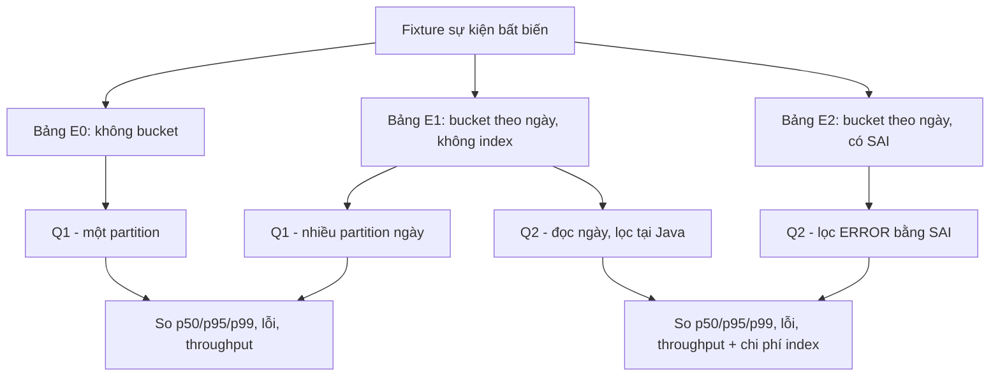

# Đo độ trễ trước/sau thay đổi schema, chỉ mục hoặc cách chia bucket

## 1. Bối cảnh và mục tiêu thực hành

Một hệ thống Java lưu sự kiện hoạt động trong **Apache Cassandra**. Mỗi sự kiện thuộc một tài khoản, có thời điểm phát sinh và loại sự kiện (`INFO`, `WARN`, `ERROR`). API cần đáp ứng hai câu hỏi:

- **Q1 — Timeline:** lấy tối đa 100 sự kiện mới nhất của một tài khoản trong khoảng thời gian cho trước, có thể trải qua nhiều ngày.
- **Q2 — Lỗi trong ngày:** lấy tối đa 50 sự kiện `ERROR` mới nhất của một tài khoản trong một ngày UTC.

Ban đầu bảng được phân vùng theo tài khoản, nên những tài khoản có nhiều sự kiện có thể tạo partition lớn. Nhóm phát triển đề xuất **chia partition theo ngày** và **tạo chỉ mục để lọc `event_type`**. Cả hai thay đổi đều có chi phí: thêm partition có thể khiến Q1 phải đọc nhiều lần, còn chỉ mục có thể tăng chi phí ghi và dung lượng lưu trữ. Ta cần số liệu để quyết định.

Bài này thuộc chương **Thực hành tổng hợp** của module `DATABASE_ENGINE_WIDE_COLUMN_CASSANDRA`: vận dụng mô hình wide-column, partition key, bảng theo truy vấn, consistency level, replication, compaction, repair, xử lý lỗi và Java Driver để **đo thay đổi một cách công bằng**.

Sau bài này, bạn có thể:

1. Xây dựng bộ dữ liệu tái lập và hai truy vấn nghiệp vụ tương đương trên các schema.
2. Thiết lập phép thử A/B cho partition không bucket, partition theo ngày và chỉ mục SAI.
3. Đo **p50/p95/p99**, throughput, lỗi, độ lớn partition, số trang đọc và chi phí ghi.
4. Tách tác động của schema/index khỏi tác động của cache, consistency level, compaction và tải đồng thời.
5. Đối chiếu **đúng dữ liệu trước khi so độ trễ**, phân tích kết quả và đưa ra quyết định có điều kiện.

> **Quy tắc:** Những số liệu trong bài dùng làm mục tiêu hoặc ví dụ minh họa, **không phải kết quả đã đo trên cluster thực**. Người học cần chạy thử trên môi trường được cấp quyền và điền bảng kết quả của chính mình.

## 2. Nền tảng: đo đúng thứ cần tối ưu

Trong Cassandra, **partition key** quyết định dữ liệu phân phối đến token range và replica nào; **clustering columns** quyết định thứ tự lưu các hàng trong cùng partition. Vì vậy, khi một account chứa hàng trăm nghìn event trong cùng partition, truy vấn theo thời gian có thể chịu ảnh hưởng từ kích thước partition, SSTable, tombstone và quá trình compaction. Chia theo ngày tạo nhiều partition nhỏ hơn nhưng làm tăng số partition phải truy vấn nếu người dùng xem nhiều ngày.

**Secondary index/Storage-Attached Index (SAI)** có thể trợ giúp lọc theo cột không nằm trong primary key ở những phiên bản Cassandra hỗ trợ; index không thay đổi partition key và không tự giải quyết một thiết kế truy vấn tệ. Index cũng phải được cập nhật khi dữ liệu ghi, xóa hoặc compaction diễn ra.

Độ trễ **một truy vấn CQL** và độ trễ **một yêu cầu nghiệp vụ** có thể khác nhau. Ví dụ Q1 trên bảng bucket có thể chạy 7 câu `SELECT`, gom kết quả, sắp xếp và chỉ sau đó trả 100 event. Vì vậy, phép đo chính phải bao gồm **tất cả thao tác Cassandra, truyền dữ liệu, decode và xử lý cần thiết để trả đúng kết quả Q1/Q2**.

| Chỉ số | Định nghĩa trong bài | Tại sao cần |
|---|---|---|
| `p50`, `p95`, `p99` (ms) | Phân vị thời gian của từng yêu cầu nghiệp vụ, đo bằng đồng hồ đơn điệu | Thấy trung vị và các yêu cầu chậm ở đuôi phân phối |
| Throughput (req/s) | Số yêu cầu **thành công** chia thời gian đo thực tế | Thấy hiệu năng khi có tải đồng thời |
| Error rate | Timeout, lỗi đọc, lỗi giải mã, kết quả không hợp lệ / tổng số yêu cầu | Phương án nhanh nhưng lỗi nhiều không đạt yêu cầu |
| Số hàng/trang đọc | Hàng chuyển qua driver, trang CQL được fetch cho mỗi yêu cầu | Lộ chi phí quét/lọc và lưu lượng mạng |
| CPU, I/O, heap/GC, độ trễ coordinator | Metrics cluster/driver trong cùng khoảng đo | Kiểm tra có dồn chi phí từ ứng dụng xuống Cassandra hay không |
| Partition size, SSTables/read, tombstones | Số liệu vận hành trên các bảng được thử | Giải thích nguyên nhân cải thiện hoặc suy giảm |
| Ghi p95/p99, kích thước index/disk | Đo riêng trên workload ghi tương đương | Chỉ mục và denormalization không miễn phí |

Phân vị p99 có nghĩa khoảng 99% mẫu có độ trễ **không lớn hơn** giá trị đó theo cách tính phân vị được chọn; không suy ra rằng mọi yêu cầu đều nhanh hơn p99. Ghi kèm số lượng mẫu, tỷ lệ lỗi và cách tính phân vị trong báo cáo.

## 3. Thiết kế thí nghiệm có kiểm soát



Chúng ta làm **hai phép so sánh riêng**, nhằm xác định đúng nguyên nhân:

| Thí nghiệm | Trước | Sau | Truy vấn logic giữ nguyên |
|---|---|---|---|
| **A — Chia bucket** | E0: `events_unbucketed` | E1: `events_day_plain` | Q1: top 100 event của account trong khoảng thời gian |
| **B — Thêm chỉ mục** | E1: `events_day_plain`, lọc `ERROR` ở Java | E2: `events_day_sai`, lọc `ERROR` bằng SAI | Q2: top 50 event ERROR của account trong cùng ngày |

Trong thí nghiệm B, dữ liệu ở E1 và E2 phải có **cùng số hàng và cùng nội dung**. Baseline E1 cố ý đọc cả partition của một ngày rồi lọc tại Java; đó là phương án đối chứng hợp lệ cho **cùng đáp án**, nhưng có thể tốn mạng và CPU. Không so Q2 có index với một câu lệnh `ALLOW FILTERING` tùy tiện rồi tuyên bố index thắng: truy vấn đối chứng cần được xác định rõ và kiểm tra tính tương đương.

### 3.1. Những biến cần cố định

- Giữ nguyên **phiên bản Cassandra, topology, số node, datacenter, RF, driver, heap, CPU/RAM, ổ đĩa, compaction strategy** và cấu hình request timeout trong từng cặp thí nghiệm.
- Sử dụng cùng tập bản ghi, phân phối account nóng/lạnh, khoảng thời gian truy vấn, thứ tự request (hoặc cùng random seed) và payload trả về.
- Chọn một consistency level giống nhau cho các truy vấn, chẳng hạn `LOCAL_QUORUM` nếu datacenter có RF = 3 và đủ replica khỏe. Không đổi sang `LOCAL_ONE` ở một bên rồi quy cải thiện độ trễ cho schema.
- Nạp dữ liệu hoàn tất trước khi đo; để index build/compaction nền ổn định. Nếu compaction vẫn chạy, ghi lại và chạy lại khi điều kiện ngang nhau.
- Không dùng Redis, cache JVM hay cache HTTP trong phép thử đọc Cassandra. **Page cache hệ điều hành, block/key cache và cache driver** có thể ảnh hưởng; báo cáo phép đo warm-cache và cold-ish cache riêng, không tuyên bố đã làm sạch mọi cache nếu chưa chứng minh.
- Chạy cùng mức concurrency và thời lượng, thử thêm vài mức tải (ví dụ 1, 8, 32 và 64 luồng) để tìm điểm bão hòa. Không so một phương án ở tải nhẹ với phương án kia ở tải cao.
- Khi một bảng được đo, không đồng thời chạy load generator đối với bảng đối chứng. Đổi thứ tự thử **A–B–A** hoặc **B–A–B** để nhận ra ảnh hưởng của thời gian và nhiệt hệ thống.

## 4. Chuẩn bị cluster và dữ liệu

Môi trường phù hợp: cluster Cassandra thử nghiệm **5.0 trở lên nếu muốn dùng SAI tích hợp**, Java 17+, Apache Cassandra Java Driver 4.x, `cqlsh`, `nodetool` và khả năng xem metrics. Có thể dùng một DC thử nghiệm với 3 replica. Ví dụ sau dùng DC tên `dc1`; thay đúng tên DC thực tế, không sao chép cấu hình này vào production chưa kiểm tra.

```sql
CREATE KEYSPACE IF NOT EXISTS latency_lab
WITH replication = {'class': 'NetworkTopologyStrategy', 'dc1': 3};

-- E0: toàn bộ event của account nằm trong một partition.
CREATE TABLE IF NOT EXISTS latency_lab.events_unbucketed (
    tenant_id   uuid,
    account_id  uuid,
    event_time  timestamp,
    event_id    bigint,
    event_type  text,
    payload     text,
    PRIMARY KEY ((tenant_id, account_id), event_time, event_id)
) WITH CLUSTERING ORDER BY (event_time DESC, event_id DESC);

-- E1: mỗi ngày UTC của mỗi account nằm trong một partition riêng.
CREATE TABLE IF NOT EXISTS latency_lab.events_day_plain (
    tenant_id   uuid,
    account_id  uuid,
    bucket_day  date,
    event_time  timestamp,
    event_id    bigint,
    event_type  text,
    payload     text,
    PRIMARY KEY ((tenant_id, account_id, bucket_day), event_time, event_id)
) WITH CLUSTERING ORDER BY (event_time DESC, event_id DESC);

-- E2: dữ liệu giống E1, nhưng có index cho loại sự kiện.
CREATE TABLE IF NOT EXISTS latency_lab.events_day_sai (
    tenant_id   uuid,
    account_id  uuid,
    bucket_day  date,
    event_time  timestamp,
    event_id    bigint,
    event_type  text,
    payload     text,
    PRIMARY KEY ((tenant_id, account_id, bucket_day), event_time, event_id)
) WITH CLUSTERING ORDER BY (event_time DESC, event_id DESC);

-- Cú pháp SAI trên Apache Cassandra 5.0+; xác minh phiên bản trước khi tạo.
CREATE CUSTOM INDEX IF NOT EXISTS events_day_type_sai
ON latency_lab.events_day_sai (event_type)
USING 'StorageAttachedIndex';
```

**Chú ý phiên bản:** Index SAI có thể khác về mức hỗ trợ/cú pháp trên từng bản phân phối Cassandra. Nếu phiên bản cluster không hỗ trợ SAI, ghi `N/A` cho thí nghiệm B hoặc thiết kế thí nghiệm **index loại khác** riêng, kèm tên và phiên bản; không lặng lẽ thay thế và gộp chung kết quả. Tạo index không đồng nghĩa index đã xây xong cho toàn bộ dữ liệu: chỉ đo khi hệ thống cho biết index đã sẵn sàng.

### 4.1. Dataset tái lập

Thiết lập fixture có `seed = 20261121`, chẳng hạn **3 triệu event**, **5 tenant**, **1.000 account**, **30 ngày UTC**. Đặt khoảng 60% event vào 20 account “nóng” để có phân phối lệch; giữ 8% `ERROR`, 12% `WARN`, còn lại `INFO`. Mỗi payload chứa chuỗi có kích thước cố định (ví dụ 256 byte) để phép so sánh không đổi về băng thông theo kiểu dữ liệu. Đây chỉ là gợi ý quy mô: giảm dữ liệu nếu lab hạn chế tài nguyên, nhưng phải có cả account nhỏ và account lớn.

Mỗi bản ghi nguồn có dạng:

```text
(tenant_id, account_id, event_time_utc, event_id, event_type, payload)
```

Trong generator, `event_id` là số nguyên duy nhất theo event, dùng làm khóa phân biệt khi nhiều event cùng millisecond. **Ghi chính xác cùng một event** vào ba bảng; không tạo lại timestamp, id hay payload riêng cho mỗi bảng. Tính `bucket_day` bằng **ngày UTC** của `event_time`, tuyệt đối không phụ thuộc múi giờ JVM. Cần kiểm tra `event_time` không lệch ngày bucket.

```java
// Pseudocode nạp dữ liệu: ba bảng nhận cùng bản ghi đầu vào.
Instant time = event.eventTime();
LocalDate bucket = time.atZone(ZoneOffset.UTC).toLocalDate();

// Thực hiện bằng PreparedStatement, bind từng cột (không nối CQL bằng chuỗi).
writeUnbucketed(event.tenant(), event.account(), time,
                event.id(), event.type(), event.payload());
writeDayPlain(event.tenant(), event.account(), bucket, time,
              event.id(), event.type(), event.payload());
writeDaySai(event.tenant(), event.account(), bucket, time,
            event.id(), event.type(), event.payload());
```

Hàm `write...` ở đây chỉ là pseudocode; người học cần hiện thực bằng Java Driver, giới hạn số lệnh ghi đồng thời và theo dõi timeout. **Không gom hàng triệu row thuộc nhiều partition vào một CQL `BATCH` khổng lồ**: batch không phải công cụ tăng tốc bulk import và có thể gây quá tải coordinator. Ưu tiên prepared statement + asynchronous writes có giới hạn concurrency; chỉ xem một row đã nạp thành công khi driver xác nhận ghi thành công tại CL đã chọn. Đối chiếu lại những ghi timeout vì trạng thái thành công có thể chưa rõ ràng.

Ví dụ một event để kiểm tra schema thủ công:

```sql
INSERT INTO latency_lab.events_unbucketed
    (tenant_id, account_id, event_time, event_id, event_type, payload)
VALUES
    (11111111-1111-1111-1111-111111111111,
     22222222-2222-2222-2222-222222222222,
     '2026-11-01T10:00:00Z', 1, 'ERROR', 'sample');

INSERT INTO latency_lab.events_day_plain
    (tenant_id, account_id, bucket_day, event_time, event_id, event_type, payload)
VALUES
    (11111111-1111-1111-1111-111111111111,
     22222222-2222-2222-2222-222222222222,
     '2026-11-01', '2026-11-01T10:00:00Z', 1, 'ERROR', 'sample');

INSERT INTO latency_lab.events_day_sai
    (tenant_id, account_id, bucket_day, event_time, event_id, event_type, payload)
VALUES
    (11111111-1111-1111-1111-111111111111,
     22222222-2222-2222-2222-222222222222,
     '2026-11-01', '2026-11-01T10:00:00Z', 1, 'ERROR', 'sample');
```

Các event không cần TTL trong phép thử chính: **TTL tạo tombstone**, có thể làm sai lệch kết quả so schema với cùng dữ liệu hữu hiệu. Nếu sản phẩm dùng TTL, hãy chạy một thí nghiệm phụ riêng có cùng chính sách TTL/retention trên tất cả phương án, sau đó đo thêm compaction và tombstone scans.

### 4.2. Kiểm tra dữ liệu trước đo

Với tập cặp `(tenant_id, account_id, from, to)` và ngày đã chọn, đối chiếu:

1. Số event nguồn, số event ghi xác nhận của từng bảng, các bản ghi lỗi/retry và số partition thực tế.
2. Với **Q1**, so danh sách `(event_time, event_id, event_type)` đã sắp thứ tự của E0 và E1; cả hai phải có cùng tối đa 100 event.
3. Với **Q2**, so danh sách tối đa 50 event `ERROR` của E1 (lọc Java) và E2 (lọc SAI). Không so hai kết quả chỉ bằng số lượng, vì thứ tự và nội dung có thể khác.
4. Kiểm thử tại ranh giới ngày `23:59:59.999Z` / `00:00:00Z`, account không có sự kiện, account có nhiều event cùng millisecond và khoảng thời gian nhiều ngày.

Chỉ bước sang đo hiệu năng khi kết quả **bằng nhau**. Lỗi logic khi chia bucket không phải là “tối ưu thành công”.

## 5. Thí nghiệm A — Không bucket so với bucket theo ngày

### 5.1. Q1 trên bảng cũ: một partition

```sql
SELECT event_time, event_id, event_type
FROM latency_lab.events_unbucketed
WHERE tenant_id = ? AND account_id = ?
  AND event_time >= ? AND event_time < ?
LIMIT 100;
```

Đây là truy vấn theo đầy đủ partition key rồi lọc theo clustering column đầu tiên. Vì bảng được khai báo `CLUSTERING ORDER BY (event_time DESC, event_id DESC)`, các event trong phạm vi được trả theo thứ tự mới nhất trước. Nếu khoảng truy vấn chứa nhiều ngày, dữ liệu vẫn ở **một partition logic của account**.

### 5.2. Q1 trên bảng bucket: nhiều partition ngày

```sql
SELECT event_time, event_id, event_type
FROM latency_lab.events_day_plain
WHERE tenant_id = ? AND account_id = ? AND bucket_day = ?
  AND event_time >= ? AND event_time < ?
LIMIT 100;
```

Ứng dụng cần thực hiện:

1. Chuyển `[from, to)` thành tập ngày UTC mà khoảng thời gian đi qua. Chẳng hạn `[2026-11-01T00:00:00Z, 2026-11-04T00:00:00Z)` cần đọc ngày 01, 02, 03, **không đọc ngày 04**.
2. Truy vấn lần lượt hoặc song song có giới hạn từng ngày với đầy đủ partition key. `LIMIT 100` cho **mỗi ngày** không làm mất top 100 toàn cục, vì một event không thuộc top 100 của chính ngày đó không thể thuộc top 100 của toàn bộ các ngày.
3. Gộp các danh sách, sắp xếp giảm dần theo `(event_time, event_id)` và lấy 100 phần tử đầu. Khi có pagination, phải thiết kế cursor xuyên bucket và tránh bỏ sót/trùng lặp: `pagingState` Cassandra chỉ áp dụng cho một câu SELECT, không đại diện cho toàn bộ kết quả ghép nhiều bucket.

**Giả thuyết cần kiểm chứng:** bucket giảm kích thước partition nóng và chi phí mỗi lần đọc một ngày; đổi lại Q1 kéo dài 7 ngày có thể **chậm hơn** do đọc 7 partition và chi phí merge. Thử Q1 với các cửa sổ 1 ngày, 7 ngày, 30 ngày và các account ở nhóm phân vị nhỏ/trung bình/lớn.

### 5.3. Chọn đơn vị bucket từ dữ liệu, không từ thói quen

| Bucket | Lợi ích tiềm năng | Rủi ro phải đo |
|---|---|---|
| Theo tháng | Ít partition cho truy vấn dài ngày | Account nóng vẫn tạo partition rất lớn |
| Theo ngày | Cân bằng giữa kích thước partition và số truy vấn | Timeline 30 ngày đòi tới 30 partition |
| Theo giờ | Giới hạn partition rất nóng theo thời gian | Fan-out lớn khi xem nhiều ngày; metadata/key tăng |
| Theo số lượng (`bucket_id`) | Kiểm soát số row/partition khi mật độ sự kiện bất thường | Tìm bucket theo thời gian khó hơn, cần metadata mapping và cơ chế phân bucket ổn định |

Không tự động chọn bucket càng nhỏ càng tốt. Mục tiêu là partition kích thước hợp lý **trong khi truy vấn nghiệp vụ vẫn có thể xác định các bucket cần đọc**. Nếu một account có lưu lượng sự kiện gấp nghìn lần account khác, có thể cần chính sách bucket thích nghi, nhưng lúc đó phải có ánh xạ bucket đáng tin cậy, đường ghi ổn định và quy tắc đọc rõ ràng.

## 6. Thí nghiệm B — Lọc tại Java so với lọc bằng SAI

Q2 cần **50 sự kiện `ERROR` mới nhất trong một ngày**. Hai phương án dùng hai bảng bucket chứa dữ liệu giống nhau.

**E1 — Không index:** đọc toàn bộ event của account/ngày từ Cassandra, duyệt mọi trang kết quả trong driver, lọc `ERROR`, sắp giảm dần theo `(event_time, event_id)` rồi lấy 50:

```sql
SELECT event_time, event_id, event_type
FROM latency_lab.events_day_plain
WHERE tenant_id = ? AND account_id = ? AND bucket_day = ?;
```

**E2 — Có SAI:** để Cassandra lọc `event_type` qua index, sau đó vẫn sắp xếp/chốt 50 ở Java để đáp án logic tương đương:

```sql
SELECT event_time, event_id, event_type
FROM latency_lab.events_day_sai
WHERE tenant_id = ? AND account_id = ? AND bucket_day = ?
  AND event_type = 'ERROR';
```

SAI cho phép truy vấn trên cột indexed theo khả năng hỗ trợ của phiên bản/distribution. Trước benchmark, chạy câu Q2 trực tiếp ở cluster đích để xác nhận hợp lệ; **không ép `ALLOW FILTERING` để bỏ qua lỗi do index chưa sẵn sàng**. Nếu muốn tối ưu tiếp bằng `LIMIT 50` trực tiếp trên query SAI, cần xác minh thứ tự trả về và kết quả tương đương trên chính phiên bản đang dùng.

**Giả thuyết:** nếu `ERROR` hiếm và account/ngày có rất nhiều event, SAI có thể giảm số row truyền về ứng dụng. Tuy nhiên, nếu ngày đó chỉ có ít event hoặc `ERROR` chiếm đa số, quét một partition nhỏ có thể nhanh tương đương hoặc hơn, trong khi SAI làm tăng chi phí ghi/index maintenance. Cần đo thêm ingest throughput, write p95/p99, disk footprint và thời gian recovery/build index.

Nếu Q2 là truy vấn quan trọng và luôn được dùng với `event_type`, một phương án bổ sung để cân nhắc là **bảng thiết kế riêng theo truy vấn**:

```sql
-- Hướng mở rộng, KHÔNG thuộc A/B chính.
CREATE TABLE latency_lab.events_day_by_type (
    tenant_id  uuid,
    account_id uuid,
    bucket_day date,
    event_type text,
    event_time timestamp,
    event_id   bigint,
    PRIMARY KEY ((tenant_id, account_id, bucket_day, event_type),
                 event_time, event_id)
) WITH CLUSTERING ORDER BY (event_time DESC, event_id DESC);
```

Bảng này cho phép truy vấn Q2 bằng đầy đủ partition key và `LIMIT 50`, nhưng ứng dụng phải ghi thêm một bản dữ liệu và xử lý lỗi đồng bộ đa bảng. **Cassandra batch không cung cấp isolation ACID tổng quát** cho luồng cập nhật nhiều partition. Chỉ đưa phương án này vào một thí nghiệm C độc lập nếu sản phẩm thực sự cần.

## 7. Xây dựng bộ yêu cầu truy vấn cố định

Tạo một file CSV fixture `requests.csv` bằng công cụ tùy chọn, đặt ở ngoài các file bài học và **không chứa dữ liệu bí mật**. Ví dụ định dạng:

```csv
tenant_id,account_id,from,to,day
11111111-1111-1111-1111-111111111111,22222222-2222-2222-2222-222222222222,2026-11-01T00:00:00Z,2026-11-04T00:00:00Z,2026-11-02
11111111-1111-1111-1111-111111111111,33333333-3333-3333-3333-333333333333,2026-11-02T12:00:00Z,2026-11-03T12:00:00Z,2026-11-02
```

Mỗi dòng cung cấp hai loại truy vấn: `from/to` cho Q1, `day` cho Q2. Tạo nhiều dòng sao cho có khoảng đọc 1/7/30 ngày, tài khoản nóng/lạnh, ngày trống, ngày đông và `ERROR` hiếm/nhiều. **Giữ chính xác cùng danh sách, thứ tự và seed** khi chạy E0/E1/E2. Không tính thời gian tạo CSV hay chọn account vào thời gian thực thi query.

Để nhận ra khác biệt theo truy vấn, phân chia kết quả theo nhóm:

- `recent_1d`, `recent_7d`, `recent_30d` cho Q1;
- `error_sparse`, `error_dense` và số lượng event thực tế mỗi partition cho Q2;
- account thường và account nóng; cold-ish/warm cache; concurrency 1/8/32/64.

Không trộn tất cả thành một p99 nếu mục tiêu là giải thích vì sao bucket có lợi cho 1 ngày nhưng gây bất lợi cho 30 ngày.

## 8. Java benchmark tối thiểu: đo end-to-end một truy vấn nghiệp vụ

Ví dụ dưới đây dùng API của **Apache Cassandra Java Driver 4.x** và Java 17. Thêm dependency `com.datastax.oss:java-driver-core` phiên bản phù hợp hệ thống. Biến môi trường `CASSANDRA_HOST`, `CASSANDRA_PORT`, `CASSANDRA_DC` tương ứng với cluster thử nghiệm; mặc định là `127.0.0.1:9042`, `dc1`. Chương trình đọc `requests.csv` đã tạo ở mục 7, warm-up rồi chạy đồng thời với số worker cố định.

```java
import com.datastax.oss.driver.api.core.CqlSession;
import com.datastax.oss.driver.api.core.DefaultConsistencyLevel;
import com.datastax.oss.driver.api.core.cql.*;

import java.net.InetSocketAddress;
import java.nio.charset.StandardCharsets;
import java.nio.file.*;
import java.time.*;
import java.util.*;
import java.util.concurrent.*;
import java.util.concurrent.atomic.*;
import java.util.stream.Stream;

public final class CassandraLatencyLab {
    record Request(UUID tenant, UUID account, Instant from, Instant to, LocalDate day) {}
    record Event(Instant time, long id, String type) {}
    record Result(long[] durationsNs, int failures, long rowsReturned, long wallNs) {}

    enum Variant { OLD, BUCKET, PLAIN_FILTER, SAI_FILTER }

    static final Comparator<Event> NEWEST =
        Comparator.comparing(Event::time).thenComparingLong(Event::id).reversed();

    static String env(String key, String defaultValue) {
        return System.getenv().getOrDefault(key, defaultValue);
    }

    static List<Request> loadRequests(Path csv) throws Exception {
        try (Stream<String> lines = Files.lines(csv, StandardCharsets.UTF_8)) {
            return lines.skip(1).filter(s -> !s.isBlank()).map(line -> {
                String[] c = line.split(",", -1); // CSV lab: năm cột, không quoted comma.
                if (c.length != 5) throw new IllegalArgumentException("Invalid request row");
                Request r = new Request(UUID.fromString(c[0]), UUID.fromString(c[1]),
                    Instant.parse(c[2]), Instant.parse(c[3]), LocalDate.parse(c[4]));
                if (!r.from().isBefore(r.to())) throw new IllegalArgumentException("from >= to");
                return r;
            }).toList();
        }
    }

    static final class Queries {
        private final CqlSession session;
        private final PreparedStatement oldQuery, bucketQuery, plainFilter, saiFilter;

        Queries(CqlSession session) {
            this.session = session;
            oldQuery = session.prepare(
                "SELECT event_time,event_id,event_type FROM latency_lab.events_unbucketed " +
                "WHERE tenant_id=? AND account_id=? AND event_time>=? AND event_time<? LIMIT 100");
            bucketQuery = session.prepare(
                "SELECT event_time,event_id,event_type FROM latency_lab.events_day_plain " +
                "WHERE tenant_id=? AND account_id=? AND bucket_day=? " +
                "AND event_time>=? AND event_time<? LIMIT 100");
            plainFilter = session.prepare(
                "SELECT event_time,event_id,event_type FROM latency_lab.events_day_plain " +
                "WHERE tenant_id=? AND account_id=? AND bucket_day=?");
            saiFilter = session.prepare(
                "SELECT event_time,event_id,event_type FROM latency_lab.events_day_sai " +
                "WHERE tenant_id=? AND account_id=? AND bucket_day=? AND event_type=?");
        }

        List<Event> select(PreparedStatement ps, Object... args) {
            BoundStatement bound = ps.bind(args)
                .setConsistencyLevel(DefaultConsistencyLevel.LOCAL_QUORUM)
                .setPageSize(500);
            List<Event> result = new ArrayList<>();
            for (Row row : session.execute(bound)) { // Fetch đủ mọi trang, gồm decode.
                result.add(new Event(row.getInstant("event_time"),
                    row.getLong("event_id"), row.getString("event_type")));
            }
            return result;
        }

        static List<Event> top(List<Event> events, int limit) {
            events.sort(NEWEST);
            return events.size() <= limit ? events :
                new ArrayList<>(events.subList(0, limit));
        }

        List<Event> execute(Variant variant, Request r) {
            return switch (variant) {
                case OLD -> top(select(oldQuery, r.tenant(), r.account(),
                    r.from(), r.to()), 100);

                case BUCKET -> {
                    List<Event> merged = new ArrayList<>();
                    LocalDate first = r.from().atZone(ZoneOffset.UTC).toLocalDate();
                    LocalDate last = r.to().minusNanos(1)
                        .atZone(ZoneOffset.UTC).toLocalDate();
                    for (LocalDate day = first; !day.isAfter(last); day = day.plusDays(1)) {
                        merged.addAll(select(bucketQuery, r.tenant(), r.account(),
                            day, r.from(), r.to()));
                    }
                    yield top(merged, 100);
                }

                case PLAIN_FILTER -> {
                    List<Event> all = select(plainFilter, r.tenant(), r.account(), r.day());
                    all.removeIf(e -> !"ERROR".equals(e.type()));
                    yield top(all, 50);
                }

                case SAI_FILTER -> top(select(saiFilter, r.tenant(),
                    r.account(), r.day(), "ERROR"), 50);
            };
        }
    }

    static Result run(Queries queries, Variant variant, List<Request> cases,
                      int attempts, int threads) throws Exception {
        long[] durations = new long[attempts];
        boolean[] success = new boolean[attempts];
        AtomicInteger cursor = new AtomicInteger();
        AtomicLong consumed = new AtomicLong();
        CountDownLatch ready = new CountDownLatch(threads);
        CountDownLatch startSignal = new CountDownLatch(1);
        ExecutorService pool = Executors.newFixedThreadPool(threads);
        List<Future<?>> workers = new ArrayList<>();

        try {
            for (int t = 0; t < threads; t++) {
                workers.add(pool.submit(() -> {
                    ready.countDown();
                    startSignal.await();
                    int index;
                    while ((index = cursor.getAndIncrement()) < attempts) {
                        Request request = cases.get(index % cases.size());
                        long begin = System.nanoTime();
                        try {
                            List<Event> rows = queries.execute(variant, request);
                            durations[index] = System.nanoTime() - begin;
                            success[index] = true;
                            consumed.addAndGet(rows.size()); // Tránh bỏ qua kết quả.
                        } catch (RuntimeException error) {
                            durations[index] = System.nanoTime() - begin;
                            // Thử nghiệm: lỗi được đếm, không tự đổi lỗi thành "empty".
                        }
                    }
                    return null;
                }));
            }
            ready.await();
            long wallStart = System.nanoTime();
            startSignal.countDown();
            for (Future<?> worker : workers) worker.get();
            long wallNs = System.nanoTime() - wallStart;
            int failures = 0;
            for (boolean ok : success) if (!ok) failures++;
            return new Result(durations, failures, consumed.get(), wallNs);
        } finally {
            pool.shutdownNow();
        }
    }

    static double percentileMs(long[] sortedNs, double percentile) {
        int index = Math.max(0, (int) Math.ceil(percentile * sortedNs.length) - 1);
        return sortedNs[index] / 1_000_000.0;
    }

    public static void main(String[] args) throws Exception {
        if (args.length != 5) {
            System.err.println("Usage: OLD|BUCKET|PLAIN_FILTER|SAI_FILTER " +
                "requests.csv warmup measured threads");
            System.exit(2);
        }
        Variant variant = Variant.valueOf(args[0]);
        List<Request> requests = loadRequests(Path.of(args[1]));
        int warmup = Integer.parseInt(args[2]);
        int count = Integer.parseInt(args[3]);
        int threads = Integer.parseInt(args[4]);
        if (requests.isEmpty() || warmup < 0 || count <= 0 || threads <= 0)
            throw new IllegalArgumentException("Invalid workload parameters");

        try (CqlSession session = CqlSession.builder()
                .addContactPoint(new InetSocketAddress(
                    env("CASSANDRA_HOST", "127.0.0.1"),
                    Integer.parseInt(env("CASSANDRA_PORT", "9042"))))
                .withLocalDatacenter(env("CASSANDRA_DC", "dc1"))
                .build()) {
            Queries q = new Queries(session);
            Result warm = run(q, variant, requests, warmup, threads);
            if (warm.failures() > 0)
                throw new IllegalStateException("Warmup failed: " + warm.failures());

            Result measured = run(q, variant, requests, count, threads);
            long[] ns = measured.durationsNs().clone();
            Arrays.sort(ns);
            int successful = count - measured.failures();
            double sec = measured.wallNs() / 1_000_000_000.0;
            System.out.printf(Locale.ROOT,
                "variant=%s threads=%d attempts=%d failures=%d " +
                "success_rps=%.1f p50=%.2fms p95=%.2fms p99=%.2fms rows=%d%n",
                variant, threads, count, measured.failures(), successful / sec,
                percentileMs(ns, 0.50), percentileMs(ns, 0.95),
                percentileMs(ns, 0.99), measured.rowsReturned());
        }
    }
}
```

**Phạm vi và giới hạn của harness:**

- Đo từ trước khi gọi Driver tới khi đã đọc hết kết quả và ghép top N; bao gồm thời gian chờ các fetch tiếp theo. `p50/p95/p99` trong ví dụ tính trên **mọi attempt**, cả lỗi; luôn xem `failures` song song. Trong báo cáo đầy đủ, nên thống kê thêm phân vị riêng của request thành công và từng loại lỗi/timeout.
- Đây là **closed-loop load**: mỗi worker phát request mới sau khi hoàn thành request trước. Khi latency tăng, tốc độ phát request có thể tự giảm, gây **coordinated omission**. Muốn SLO tại tốc độ tới cố định, cần chạy thêm open-loop/fixed-arrival load generator và báo cáo latency từ thời điểm request dự kiến được phát.
- Harness không tự sinh dữ liệu, kiểm chứng kết quả, ghi số trang fetch hay quan sát CPU/disk. Người học phải thực hiện các phần đó theo mục 4, 9 và 10. Không coi `rows` trong output là số row Cassandra đã quét; đó chỉ là **số event sau khi lọc/top N**.
- `BUCKET` trong ví dụ đọc từng ngày **tuần tự**. Nếu sản phẩm triển khai fan-out song song có giới hạn, hãy đo phiên bản song song như một phương án riêng và tính thêm tải mỗi request lên Cassandra.
- Đảm bảo cùng driver profile, connection/pool settings, consistency level và fetch size giữa các lần chạy. Nếu chạy nhiều lượt, không thay đổi `requests.csv` giữa các lượt.

### 8.1. Lệnh chạy minh họa

Sau khi cài dependency, biên dịch lớp Java trên **máy thử nghiệm của bạn**, ví dụ các tham số chương trình:

```text
OLD          requests.csv 3000 10000 8
BUCKET       requests.csv 3000 10000 8
PLAIN_FILTER requests.csv 3000 10000 8
SAI_FILTER   requests.csv 3000 10000 8
```

Chạy luân phiên `OLD → BUCKET → OLD` để kiểm tra drift; sau đó `PLAIN_FILTER → SAI_FILTER → PLAIN_FILTER`. Lặp lại ít nhất 3 vòng sau warm-up. Tăng số request khi cần ước lượng p99 ổn định; với 10.000 mẫu, đuôi p99 chỉ phản ánh khoảng 100 mẫu chậm nhất. Giữ thời lượng test đủ dài để không bị hiệu ứng startup chi phối. **Chạy Q1 và Q2 thành hai workload riêng**, vì trộn hai truy vấn có số page/row khác nhau làm khó giải thích số liệu.

## 9. Quan sát phía Cassandra trong cùng cửa sổ đo

Trước, trong và sau mỗi vòng benchmark, ghi mốc thời gian UTC cùng các chỉ số. Có thể dùng:

```bash
nodetool status
nodetool tablestats latency_lab.events_unbucketed
nodetool tablestats latency_lab.events_day_plain
nodetool tablestats latency_lab.events_day_sai
nodetool tablehistograms latency_lab events_unbucketed
nodetool tablehistograms latency_lab events_day_plain
nodetool tablehistograms latency_lab events_day_sai
nodetool compactionstats
nodetool tpstats
```

Ý nghĩa các lệnh có thể khác theo phiên bản, nhưng mục tiêu là theo dõi node `UN/DN`, SSTables per read, read/write latency, độ lớn partition, số lượng tombstone, compaction đang chạy, thread pool chờ, dropped messages và tài nguyên phần cứng. Thu metrics từ **tất cả replica/coordinator có liên quan** thay vì chỉ node chạy `cqlsh`.

Ví dụ đọc có tracing để phân tích đường query:

```sql
CONSISTENCY LOCAL_QUORUM;
TRACING ON;
SELECT event_time, event_id, event_type
FROM latency_lab.events_unbucketed
WHERE tenant_id = 11111111-1111-1111-1111-111111111111
  AND account_id = 22222222-2222-2222-2222-222222222222
  AND event_time >= '2026-11-01T00:00:00Z'
  AND event_time < '2026-11-04T00:00:00Z'
LIMIT 100;
TRACING OFF;
```

Tracing giúp quan sát coordinator, các replica liên quan, thời gian đọc SSTable, số tombstone được xét và các bước xử lý. **Tracing có overhead**, chỉ dùng cho số ít request đại diện **ngoài** cửa sổ benchmark chính. Không so một biến thể bật tracing với biến thể tắt tracing.

### 9.1. Đo chi phí ghi và dung lượng

SAI không chỉ thay đổi đường đọc; bảng E2 cần ghi vào cấu trúc index. Thực hiện một workload ghi riêng với cùng tập 100.000 event mới và cùng mức concurrency, ghi vào E1 và E2 ở **hai lượt riêng**. Đo write p50/p95/p99, thành công/timeout, throughput, disk bytes, CPU, compaction/index build. Không ghi vào cả E1 và E2 đồng thời nếu mục tiêu là so chi phí của từng bảng.

Đối với E0/E1, ước lượng thêm **số partition/account**, histogram kích thước partition, dung lượng SSTable và mức tải compaction. Đừng kết luận thiết kế tốt chỉ vì read p99 giảm khi write p99 hoặc disk tăng vượt ngân sách vận hành.

## 10. Ghi kết quả theo mẫu

Giữ một dòng **cho mỗi nhóm request, concurrency và lượt chạy**. Bảng trống dưới đây là mẫu nhập số liệu thực tế:

| Workload | Phương án | Threads | Mẫu | p50 (ms) | p95 (ms) | p99 (ms) | Success req/s | Errors | Rows/page đọc (nếu có) |
|---|---|---:|---:|---:|---:|---:|---:|---:|---|
| Q1, 1 ngày | E0 không bucket | 8 | — | — | — | — | — | — | — |
| Q1, 1 ngày | E1 bucket ngày | 8 | — | — | — | — | — | — | — |
| Q1, 7 ngày | E0 không bucket | 8 | — | — | — | — | — | — | — |
| Q1, 7 ngày | E1 bucket ngày | 8 | — | — | — | — | — | — | — |
| Q2, account nóng | E1 lọc Java | 8 | — | — | — | — | — | — | — |
| Q2, account nóng | E2 lọc SAI | 8 | — | — | — | — | — | — | — |

Ghi thêm thông tin thiết lập: ngày giờ đo, commit/phiên bản ứng dụng, phiên bản Cassandra/driver, số node, RF, CL, DC, compaction strategy, `concurrency`, `fetch size`, kích thước dataset, phân phối account, kích thước payload, chế độ cache, timeout và trạng thái index build. Nếu cần so kết quả trong báo cáo, dùng cùng đơn vị và công thức:

```text
Mức giảm p99 (%)  = (p99_trước - p99_sau) / p99_trước * 100
Speedup p99 (lần) = p99_trước / p99_sau
Error rate (%)    = failures / attempts * 100
```

Ví dụ **số giả lập để luyện đọc biểu đồ, không phải số đo thực**:

| Tình huống giả lập | p99 trước | p99 sau | Diễn giải sơ bộ |
|---|---:|---:|---|
| Q1, account nóng, cửa sổ 1 ngày, E0 → E1 | 160 ms | 95 ms | Giảm khoảng 40,6%; cần kiểm tra write/partition và độ ổn định qua các lượt |
| Q1, account nóng, cửa sổ 30 ngày, E0 → E1 | 180 ms | 330 ms | Bucket làm tăng latency do fan-out; không thể nói E1 tốt hơn mọi trường hợp |
| Q2, ngày đông, E1 → E2 | 240 ms | 100 ms | SAI có thể giảm scan; tiếp tục kiểm tra write cost/index size |

Ví dụ đầu có `speedup p99 = 160 / 95 ≈ 1,68 lần`. Nhưng ba dòng trên **không chứng minh** điều gì về cluster của bạn cho đến khi chạy phép đo thật. Mỗi phép so cần nhiều lượt và khoảng dao động để xác định cải thiện có bền vững hay chỉ do nhiễu.

### 10.1. Ra quyết định khi số liệu trái chiều

Một schema có thể cải thiện p50 nhưng làm xấu p99: kiểm tra tombstone scans, compaction, GC, số partition/round-trip và số request đồng thời trên coordinator. Một index có thể giảm bytes trả về nhưng làm tệ write throughput: xác định xem chỉ Q2 hay cả đường ghi mới là mục tiêu chính.

Ví dụ quy tắc chấp nhận **do nhóm dự án tự đặt**:

- Q1 1 ngày: p99 <= 150 ms; Q1 7 ngày: p99 <= 300 ms ở tải mục tiêu.
- Q2 `ERROR`: p99 <= 200 ms, tỷ lệ lỗi thấp hơn ngưỡng SLO đã thống nhất.
- Không làm write p99 vượt ngân sách ấn định, dung lượng index/partition được giám sát và có khả năng repair/compaction ổn định.

Đây chỉ là **SLO giả định để thực hành**. Nếu số đo không đạt, cần tối ưu mô hình truy vấn/bucket/fan-out, số page, locality của replica hoặc tài nguyên trước khi tăng phần cứng theo cảm tính. Có thể chọn schema khác nhau cho truy vấn khác nhau thay vì ép một bảng đáp ứng mọi bài toán.

## 11. Các nguyên nhân làm phép thử sai lệch

| Sai lệch | Dấu hiệu | Cách xử lý |
|---|---|---|
| So hai truy vấn trả nội dung khác nhau | Bucket trả thiếu event tại ranh giới ngày; index thiếu row | So event ID có thứ tự trước khi đo; sửa truy vấn hoặc dữ liệu |
| Cluster đang compaction/repair/index build | p99 tăng bất thường theo từng lượt | Ghi lại trạng thái, đo lại sau khi ổn định; thử thêm workload có background maintenance có chủ đích |
| Dataset và phân phối account không giống nhau | Bảng nhỏ hơn “nhanh hơn” | Dùng một fixture, cùng seed và xác thực số row/partition |
| Khác consistency level | Một phương án dùng `LOCAL_ONE`, bên kia `LOCAL_QUORUM` | Cố định CL và ghi rõ RF/DC |
| Đo mỗi CQL thay vì Q1 tổng hợp | E1 có p99 từng `SELECT` thấp nhưng API chậm | Đo từ trước query đầu tới khi merge hoàn tất |
| Chỉ đo một request/hệ thống mới khởi động | Kết quả rất đẹp nhưng không ổn định | Warm-up, chạy nhiều lượt có đủ mẫu, tải đồng thời và đảo thứ tự |
| Dùng cache ở một bên | Hit rate khác nhau, Cassandra không chịu cùng tải | Bỏ cache ứng dụng trong lab; báo cáo warm/cold riêng |
| Ghi dữ liệu đồng thời khi benchmark đọc | Thời gian đọc/compaction thay đổi theo lượt | Tách workload read-only và mixed read/write |
| Lọc Java nhưng ngừng ở page đầu | Q2 thiếu `ERROR` nằm ở các page tiếp theo | Fetch đầy đủ page cần thiết, kiểm tra kết quả |
| Sai đơn vị thời gian | p99 900 tưởng là ms nhưng thực tế µs | Quy đổi `ns / 1e6 = ms`, dùng `System.nanoTime()` đo khoảng thời gian |

### 11.1. Ảnh hưởng của repair, replication, consistency

Trong cluster RF = 3, `LOCAL_QUORUM` cần phản hồi từ phần lớn replica của DC địa phương. Nếu một replica chậm vì GC, đĩa hoặc compaction, p99 có thể biến động dù query/schema không đổi. Repair giúp đồng bộ replica qua thời gian; khi đo, cần ghi rõ có repair chạy hay không. Không tăng hoặc giảm `gc_grace_seconds` để làm đẹp benchmark mà không đánh giá điều kiện repair/tombstone và rủi ro dữ liệu xuất hiện lại.

Thí nghiệm nhiều DC cần ghi rõ request đi vào DC nào, consistency `LOCAL_QUORUM` được áp tại đâu và replication giữa DC có trễ thế nào. So sánh ở hai DC khác nhau có thể là so mạng/địa lý và sự khác biệt phần cứng, không phải so schema.

### 11.2. TTL, tombstone và compaction

Nếu dữ liệu event có TTL 30 ngày, Cassandra sẽ biểu diễn giá trị hết hạn dưới dạng tombstone; workload đọc gần thời điểm hết hạn có thể có tail latency khác hẳn dữ liệu mới. Với dữ liệu time-series ít cập nhật và TTL đồng đều, **TimeWindowCompactionStrategy (TWCS)** có thể đáng thử, nhưng chỉ sau khi đã hiểu cách ghi muộn, cập nhật dữ liệu cũ, TTL không đồng đều và retention ảnh hưởng việc dọn SSTable. Không thay STCS sang TWCS **cùng lúc** với việc đổi partition key rồi quy toàn bộ cải thiện cho bucket.

### 11.3. Lỗi và timeout trong Java Driver

Phân biệt query không có event (trả danh sách rỗng) với `ReadTimeoutException`, `UnavailableException`, lỗi kết nối hoặc dữ liệu decode lỗi. Kiểm soát timeout, retry và idempotency; retry tự động có thể làm tăng tải cluster và làm phép đo khó diễn giải. Ghi chi tiết loại lỗi, số lần retry, request đã được hoàn thành hay không. Không loại bỏ các request lỗi khỏi tổng mẫu rồi chỉ báo cáo latency đẹp.

## 12. Bài tập mở rộng có đáp án định hướng

1. **Phân tích bucket:** Trên account nóng, đo Q1 cho 1/7/30 ngày. Vì sao p99 1 ngày có thể giảm còn p99 30 ngày tăng? Hướng trả lời: partition nhỏ hơn nhưng nhiều partition và round-trip hơn; cần đo số trang/partition và thời gian merge.
2. **Chọn loại bucket:** Nếu một account phát 3 triệu event/ngày, chia theo ngày còn hợp lý không? Hướng trả lời: đo kích thước partition và truy vấn nóng, xem bucket giờ hoặc bucket số lượng; cân nhắc metadata để tìm bucket.
3. **Đánh giá index:** SAI nhanh hơn Q2 đọc khi `ERROR` chỉ 1% nhưng write p99 tăng 35%. Có nên bật? Hướng trả lời: phụ thuộc tỷ lệ đọc/ghi, SLO, disk, compaction và lựa chọn bảng theo truy vấn.
4. **Kiểm chứng dữ liệu:** Hai phương án trả 50 event nhưng thứ tự hai phần tử đầu khác nhau. Có được chấp nhận không? Hướng trả lời: không, trừ khi hợp đồng định nghĩa thứ tự không quan trọng; trong bài, top mới nhất theo `(event_time, event_id)` là yêu cầu bắt buộc.
5. **Nâng cao thống kê:** Chạy năm vòng A–B–A. Nếu p99 từng vòng dao động mạnh, cần làm gì? Hướng trả lời: kiểm tra cluster load, cache, GC/compaction, số mẫu; phân tích phân phối và khoảng tin cậy/biến thiên theo vòng trước khi kết luận.
6. **Kiểm tra tải cố định:** Vì sao test với 32 worker có thể bỏ sót p99 rất xấu khi service nhận 2.000 request/giây? Hướng trả lời: closed-loop tự giảm arrival rate khi hệ thống chậm, cần thêm open-loop tại tốc độ đến cố định và thống kê độ trễ kể cả khi có queue.

## 13. Checklist nghiệm thu bài thực hành

- [ ] Có **một tập sự kiện nguồn duy nhất** và ba bảng E0/E1/E2 với cùng dữ liệu logic.
- [ ] Đã xác minh Q1 E0 = Q1 E1, Q2 E1 = Q2 E2 về event ID, thứ tự và kết quả rỗng.
- [ ] Đã ghi rõ topology, phiên bản Cassandra/driver, RF, DC, CL, compaction strategy, timeout, dataset, seed và workload.
- [ ] Đã đo p50/p95/p99, success req/s, error rate cho từng nhóm truy vấn và concurrency, ít nhất ba lượt, có warm-up.
- [ ] Đã đo **tổng thời gian Q1 nhiều bucket**, gồm các SELECT và xử lý ở Java.
- [ ] Đã xem SSTables/read, partition sizes, compaction, CPU/disk/GC trong cùng thời gian benchmark.
- [ ] Đã thử write throughput/latency của bảng có SAI so với bảng không SAI.
- [ ] Đã đối chiếu các tác nhân nhiễu: cache, index build, repair, compaction, GC, networking.
- [ ] Báo cáo nêu ưu/nhược của mỗi phương án, tiêu chí đạt SLO, quyết định và điều kiện cần thử tiếp.

## 14. Kết luận kỹ thuật

**Schema theo truy vấn** là nền tảng của Cassandra; index và bucket là hai công cụ có thể hữu ích nhưng có điểm đổi chác rõ ràng. Khi đổi partition key, phải đo cả kích thước partition lẫn fan-out. Khi tạo index, phải đo đường đọc **và** đường ghi, dung lượng, thời gian xây index và hoạt động compaction. Một benchmark tốt bắt đầu bằng **đáp án giống nhau** và **điều kiện ngang nhau**, rồi mới xét p99, throughput và độ ổn định. Việc chọn E0, E1 hay E2 phụ thuộc truy vấn thực tế và kết quả đo trên cluster cụ thể.

### Tài liệu tham khảo

- Apache Cassandra Documentation — *Data modeling*: https://cassandra.apache.org/doc/stable/cassandra/developing/data-modeling/intro.html
- Apache Cassandra Documentation — *CQL reference*: https://cassandra.apache.org/doc/stable/cassandra/developing/cql/index.html
- Apache Cassandra Documentation — *Storage-Attached Indexing*: https://cassandra.apache.org/doc/stable/cassandra/developing/cql/indexing/sai/sai-overview.html
- Apache Cassandra Documentation — *Compaction*: https://cassandra.apache.org/doc/stable/cassandra/managing/operating/compaction/overview.html
- Apache Cassandra Documentation — *Repair*: https://cassandra.apache.org/doc/stable/cassandra/managing/operating/repair.html
- Apache Cassandra Java Driver documentation: https://docs.datastax.com/en/developer/java-driver/4.17/
