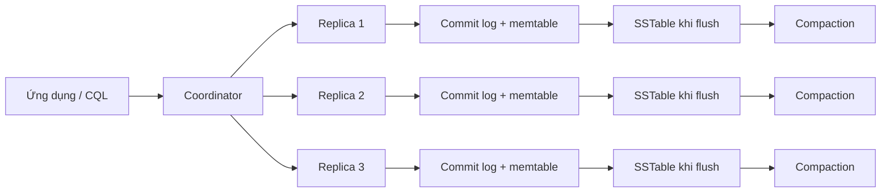

# Quan sát compaction, tombstone và đồng bộ replica sau sự cố

## 1. Mục tiêu và kịch bản thực hành

Trong chương **Thực hành tổng hợp** của module **DATABASE_ENGINE_WIDE_COLUMN_CASSANDRA**, chúng ta vận hành một cluster Apache Cassandra ba node, ghi dữ liệu bằng CQL, tạo nhiều SSTable, quan sát compaction và tombstone, cố ý làm một replica bỏ lỡ bản ghi, rồi dùng **anti-entropy repair** để đồng bộ lại. Bài tập kết nối kiến trúc phân tán/wide-column, partition key, thiết kế bảng theo truy vấn, mức nhất quán đọc ghi, replication, compaction, repair, xử lý lỗi và kết nối Java.

Khi hoàn thành, bạn có thể:

1. Giải thích vì sao một bản ghi đã `DELETE` hoặc hết TTL có thể vẫn chiếm chỗ trong SSTable.
2. Dùng `nodetool tablestats`, `compactionstats`, `compactionhistory`, `status` và log để thu thập bằng chứng về compaction và tình trạng replica.
3. Phân biệt **node đã UP** với **replica đã đồng bộ dữ liệu**.
4. Tạo một trường hợp thiếu dữ liệu có kiểm soát, đối chiếu trước/sau `nodetool repair --full`.
5. Chọn consistency level và xử lý timeout/retry ở tầng Java dựa trên yêu cầu ứng dụng.

**Phạm vi an toàn:** Toàn bộ thao tác dừng node, tắt hints, ép flush và chạy full repair trong bài chỉ dành cho **cluster thử nghiệm cô lập**, không thực hiện trực tiếp trên production. Những lệnh quan sát có thể dùng trong vận hành thật, nhưng phải cân nhắc tải và phiên bản Cassandra.

## 2. Kiến thức nền cần nhớ trước khi chạy lab

### 2.1. Đường đi của một bản ghi



- **Partition key** quyết định token và những replica chịu trách nhiệm lưu partition; clustering key quyết định thứ tự hàng trong partition.
- Ghi vào Cassandra trước hết đi qua **commit log và memtable** trên các replica đáp ứng. Flush tạo ra **SSTable bất biến**. Compaction trộn/chọn lọc các SSTable, giải quyết các phiên bản giá trị, đồng thời có thể loại dữ liệu hết hiệu lực khi thỏa điều kiện an toàn.
- **Tombstone** là dấu xóa logic được phát tán như dữ liệu ghi; xuất hiện sau `DELETE` hoặc hết hạn TTL. Việc `SELECT` không thấy hàng **không chứng minh** byte trên ổ đĩa đã được thu hồi.
- **Hinted handoff** có thể giúp replica bắt kịp sau sự cố ngắn, nhưng phụ thuộc vào cấu hình và cửa sổ lưu hints; nó **không thay thế repair**.
- **Read repair** cũng có thể sửa một số bất đồng khi đọc với consistency level phù hợp; vì vậy nếu muốn chứng minh replica lỗi đang thiếu dữ liệu, không nên chạy các truy vấn có thể kích hoạt sửa sai trước bước quan sát.
- **Anti-entropy repair** so sánh dữ liệu giữa replica, xác định phần khác biệt và truyền dữ liệu cần thiết. Một node báo `UN` (*Up/Normal*) trên ring chỉ chứng minh node tham gia cluster, không chứng minh mọi bản ghi đã hội tụ.

### 2.2. Sự khác biệt cần quan sát

| Hiện tượng | Biểu hiện có thể thấy | Điều **không** được suy ra |
| --- | --- | --- |
| Flush | SSTable mới xuất hiện trên đĩa; chỉ số SSTable thay đổi | Flush không đồng bộ dữ liệu giữa các replica |
| Compaction | SSTable được gộp, `compactionhistory` có tác vụ mới | Không phải mọi tombstone đều được xóa sau một lần compaction |
| TTL hết hạn | CQL không trả ô/hàng đã hết hạn | Không có nghĩa dung lượng đĩa giảm ngay |
| Replica khởi động lại | `nodetool status` chuyển về `UN` | Replica chưa chắc đã nhận đủ các write xảy ra khi nó tắt |
| Repair thành công | Log repair/streaming kết thúc thành công, probe hội tụ | Không thay cho giám sát định kỳ hoặc chiến lược backup |

## 3. Môi trường lab ba node

**Yêu cầu:** Docker Engine và Docker Compose v2; máy có đủ RAM và dung lượng cho ba tiến trình Cassandra (nên dành khoảng **8 GiB RAM trở lên** cho môi trường lab). Máy cần cổng `9042` trống nếu bạn muốn dùng `cqlsh` hoặc ứng dụng từ bên ngoài container. Ví dụ dùng **Apache Cassandra 4.1** qua image Docker `cassandra:4.1`; các thông báo và tùy chọn chi tiết có thể khác ở 5.x hoặc bản phân phối được quản lý.

Tạo một thư mục lab riêng trên máy học viên, lưu nội dung sau thành `compose.yaml`:

```yaml
services:
  node1:
    image: cassandra:4.1
    hostname: node1
    environment:
      CASSANDRA_CLUSTER_NAME: operations-lab
      CASSANDRA_DC: dc1
      CASSANDRA_RACK: rack1
      CASSANDRA_ENDPOINT_SNITCH: GossipingPropertyFileSnitch
      CASSANDRA_SEEDS: node1
      CASSANDRA_NUM_TOKENS: 16
    ports:
      - "9042:9042"
    volumes:
      - node1data:/var/lib/cassandra

  node2:
    image: cassandra:4.1
    hostname: node2
    environment:
      CASSANDRA_CLUSTER_NAME: operations-lab
      CASSANDRA_DC: dc1
      CASSANDRA_RACK: rack1
      CASSANDRA_ENDPOINT_SNITCH: GossipingPropertyFileSnitch
      CASSANDRA_SEEDS: node1
      CASSANDRA_NUM_TOKENS: 16
    volumes:
      - node2data:/var/lib/cassandra

  node3:
    image: cassandra:4.1
    hostname: node3
    environment:
      CASSANDRA_CLUSTER_NAME: operations-lab
      CASSANDRA_DC: dc1
      CASSANDRA_RACK: rack1
      CASSANDRA_ENDPOINT_SNITCH: GossipingPropertyFileSnitch
      CASSANDRA_SEEDS: node1
      CASSANDRA_NUM_TOKENS: 16
    volumes:
      - node3data:/var/lib/cassandra

volumes:
  node1data:
  node2data:
  node3data:
```

Khởi động node hạt giống trước, đợi node đầu tiên sẵn sàng, sau đó khởi động hai node còn lại:

```bash
docker compose up -d node1
docker compose exec -T node1 nodetool status

# Chỉ thực hiện khi node1 đã hiển thị UN:
docker compose up -d node2 node3
docker compose exec -T node1 nodetool status
```

Lặp lại lệnh `nodetool status` khi Cassandra vẫn đang khởi động; cluster đủ điều kiện cho các bước sau khi cả **ba node đều `UN` trong `dc1`**. Việc khởi động Cassandra có thể mất đáng kể thời gian tùy tài nguyên máy. Nếu lỗi, đọc `docker compose logs --tail=100 node1` (hoặc node tương ứng).

Đầu ra `nodetool status` có dạng khái quát:

```text
Datacenter: dc1
Status=Up/Down
|/ State=Normal/Leaving/Joining/Moving
--  Address          Load       Tokens  Owns (effective)  Host ID  Rack
UN  <IP-node1>       ...        16      ...               ...      rack1
UN  <IP-node2>       ...        16      ...               ...      rack1
UN  <IP-node3>       ...        16      ...               ...      rack1
```

`UN` là tiêu chí trạng thái tại thời điểm đo; hãy bảo đảm không còn node `UJ` (*joining*) trước khi dùng `CONSISTENCY ALL`.

## 4. Tạo keyspace và bảng theo truy vấn

Mở phiên `cqlsh` **bên trong** container:

```bash
docker compose exec node1 cqlsh
```

Trong prompt `cqlsh>`, chạy:

```sql
CREATE KEYSPACE IF NOT EXISTS lab_ops
WITH replication = {
  'class': 'NetworkTopologyStrategy',
  'dc1': 3
}
AND durable_writes = true;

-- Bảng 1: dữ liệu theo tenant và ngày, sử dụng STCS cho thí nghiệm.
CREATE TABLE IF NOT EXISTS lab_ops.events_by_tenant_day (
  tenant_id text,
  event_day date,
  event_id int,
  payload text,
  PRIMARY KEY ((tenant_id, event_day), event_id)
) WITH CLUSTERING ORDER BY (event_id ASC)
  AND compaction = {
    'class': 'SizeTieredCompactionStrategy',
    'min_threshold': '4',
    'max_threshold': '32'
  }
  AND gc_grace_seconds = 86400;

-- Bảng 2: dữ liệu nhỏ, tồn tại lâu để quan sát replica bị thiếu bản ghi.
CREATE TABLE IF NOT EXISTS lab_ops.replica_probe (
  tenant_id text,
  probe_id text,
  description text,
  PRIMARY KEY ((tenant_id), probe_id)
) WITH gc_grace_seconds = 86400;

DESCRIBE KEYSPACE lab_ops;
```

**Tại sao dùng hai bảng?** Bảng `events_by_tenant_day` giúp quan sát các SSTable và xóa/TTL mà không làm hỏng tập dữ liệu kiểm tra replica. Bảng `replica_probe` chỉ có vài bản ghi, không dùng TTL, để việc đối chiếu sau sự cố rõ ràng.

Thiết kế `PRIMARY KEY ((tenant_id, event_day), event_id)` cho phép:

```sql
SELECT event_id, payload
FROM lab_ops.events_by_tenant_day
WHERE tenant_id = 'shop-a'
  AND event_day = '2026-11-21';
```

Truy vấn xác định đúng **một partition** và duyệt các clustering rows theo `event_id`. Nếu dữ liệu thật tăng liên tục trong một ngày, phải đo kích thước partition và chia thêm bucket/shard khi cần; không biến thiết kế lab ngắn hạn thành mô hình production mặc định. Trong bài, `NetworkTopologyStrategy` với `RF=3` trên **ba node một DC** khiến cả ba node đều là replica cho các partition thuộc keyspace.

## 5. Thực hành A — flush và compaction

### 5.1. Tạo nhiều phiên bản SSTable

Giữ `cqlsh` đang mở, đặt consistency level để mọi replica cùng nhận bản ghi nền:

```sql
CONSISTENCY ALL;

INSERT INTO lab_ops.events_by_tenant_day
  (tenant_id, event_day, event_id, payload)
VALUES ('shop-a', '2026-11-21', 1, 'version-1');
```

Mở terminal khác tại thư mục `compose.yaml` và ép flush memtable của bảng trên node1:

```bash
docker compose exec -T node1 nodetool flush lab_ops events_by_tenant_day
docker compose exec -T node1 nodetool tablestats lab_ops.events_by_tenant_day
```

Lặp lại chu trình ghi → flush cho ba thay đổi sau, **mỗi thay đổi chạy trong `cqlsh`, sau đó mới chạy lệnh flush ở terminal**:

```sql
-- Thay đổi 2: tạo hàng mới.
INSERT INTO lab_ops.events_by_tenant_day
  (tenant_id, event_day, event_id, payload)
VALUES ('shop-a', '2026-11-21', 2, 'to-be-deleted');
```

```bash
docker compose exec -T node1 nodetool flush lab_ops events_by_tenant_day
```

```sql
-- Thay đổi 3: ghi phiên bản mới của hàng 1.
UPDATE lab_ops.events_by_tenant_day
SET payload = 'version-2'
WHERE tenant_id = 'shop-a' AND event_day = '2026-11-21' AND event_id = 1;
```

```bash
docker compose exec -T node1 nodetool flush lab_ops events_by_tenant_day
```

```sql
-- Thay đổi 4: xóa hàng 2; Cassandra ghi tombstone.
DELETE FROM lab_ops.events_by_tenant_day
WHERE tenant_id = 'shop-a' AND event_day = '2026-11-21' AND event_id = 2;
```

```bash
docker compose exec -T node1 nodetool flush lab_ops events_by_tenant_day
```

Kết quả CQL mong đợi sau chu trình:

```sql
SELECT event_id, payload
FROM lab_ops.events_by_tenant_day
WHERE tenant_id = 'shop-a' AND event_day = '2026-11-21';
```

```text
 event_id | payload
----------+-----------
        1 | version-2
(1 rows)
```

Những lần flush tạo ra các SSTable bất biến. Khi số SSTable và kích thước thỏa điều kiện **SizeTieredCompactionStrategy (STCS)**, compaction có thể tự khởi chạy. Thí nghiệm ít hàng sẽ chạy rất nhanh, nên trạng thái compaction đang chạy có thể biến mất trước khi bạn quan sát.

### 5.2. Quan sát compaction và giải thích số liệu

Chạy ở terminal:

```bash
docker compose exec -T node1 nodetool tablestats lab_ops.events_by_tenant_day
docker compose exec -T node1 nodetool compactionstats
docker compose exec -T node1 nodetool compactionhistory
docker compose logs --tail=100 node1
```

Tùy phiên bản, `tablestats` hiển thị các thông tin như `SSTable count`, `Space used (live)`, `Space used (total)`, số lượt đọc/ghi, thời gian đọc, thống kê partition và tombstone. `compactionstats` cho biết tác vụ **đang chạy hoặc đang chờ**; `compactionhistory` ghi lại các tác vụ **đã hoàn thành**. Do dữ liệu nhỏ, **không yêu cầu** phải nhìn thấy một tác vụ trong `compactionstats` mới coi là thành công.

Nếu chưa xuất hiện sự kiện compaction, có thể thực hiện **chỉ trong lab**:

```bash
docker compose exec -T node1 nodetool compact lab_ops events_by_tenant_day
docker compose exec -T node1 nodetool compactionhistory
docker compose exec -T node1 nodetool tablestats lab_ops.events_by_tenant_day
```

`nodetool compact` yêu cầu compaction thủ công; trên production có thể gây tải đĩa/I/O lớn và làm tăng rủi ro thiếu dung lượng tạm, vì vậy không dùng như lệnh “dọn rác” định kỳ. SSTable count có thể giảm nhưng **không nhất thiết** thành 1; quá trình tạo file mới, chính sách compaction và trạng thái đồng thời đều ảnh hưởng phép đo.

**Ghi vào sổ lab:** SSTable count trước/sau, dung lượng `live/total`, một dòng từ `compactionhistory` nếu có, và giải thích vì sao CQL chỉ thấy `version-2` dù trước đó đã từng ghi `version-1`.

## 6. Thực hành B — tombstone do DELETE và TTL

### 6.1. Tạo tombstone chủ động

Ở bước trước, `DELETE` của `event_id=2` đã tạo tombstone. Cassandra cần giữ thông tin xóa đủ lâu để replica đang tắt không đưa bản ghi cũ trở lại khi hồi phục (*zombie data*). `gc_grace_seconds=86400` nghĩa là có **24 giờ grace** cho bảng lab; đây không phải lịch xóa dữ liệu chính xác tại giây thứ 86.400.

Đọc lại partition:

```sql
TRACING ON;
CONSISTENCY ALL;
SELECT event_id, payload
FROM lab_ops.events_by_tenant_day
WHERE tenant_id = 'shop-a' AND event_day = '2026-11-21';
TRACING OFF;
```

`TRACING ON` giúp quan sát đường đi của truy vấn; các trace event cụ thể phụ thuộc phiên bản, vị trí replica và cache. Đọc một partition nhỏ chỉ cho thấy ý nghĩa của delete; chưa đủ tải để kết luận vấn đề hiệu năng tombstone.

### 6.2. Tạo tombstone khi dữ liệu hết hạn

Chèn một hàng với TTL ngắn:

```sql
INSERT INTO lab_ops.events_by_tenant_day
  (tenant_id, event_day, event_id, payload)
VALUES ('shop-a', '2026-11-21', 3, 'temporary')
USING TTL 30;

SELECT event_id, payload, TTL(payload)
FROM lab_ops.events_by_tenant_day
WHERE tenant_id = 'shop-a' AND event_day = '2026-11-21';
```

Giá trị `TTL(payload)` của hàng 3 là số giây còn lại, giảm theo thời gian (thường gần 30 nếu truy vấn ngay). **Flush trước khi TTL hết hạn** để chắc chắn dữ liệu TTL đã có mặt trong SSTable:

```bash
docker compose exec -T node1 nodetool flush lab_ops events_by_tenant_day
```

Sau khi qua 30 giây kể từ lúc ghi, truy vấn lại:

```sql
SELECT event_id, payload, TTL(payload)
FROM lab_ops.events_by_tenant_day
WHERE tenant_id = 'shop-a' AND event_day = '2026-11-21';
```

Kết quả thường chỉ còn hàng `event_id=1`. Cassandra coi ô `payload` đã hết TTL là bị xóa logic; việc giải phóng bytes vật lý còn phụ thuộc compaction và các điều kiện an toàn liên quan tombstone.

### 6.3. Quan sát chỉ số tombstone

```bash
docker compose exec -T node1 nodetool tablestats lab_ops.events_by_tenant_day
docker compose exec -T node1 nodetool compactionstats
```

Hãy tìm các chỉ số liên quan `Average tombstones per slice`, `Maximum tombstones per slice` hoặc cảnh báo tombstone trong log. Chỉ số này thường dựa trên **các lượt đọc đã diễn ra**, không phải số tombstone đang tồn tại tuyệt đối trên đĩa. Với vài hàng của lab, chỉ số có thể bằng 0 hoặc rất nhỏ do cache, timing và cách lấy mẫu; đó **không phải lỗi**. Muốn tái hiện tombstone scan nghiêm trọng cần workload đủ lớn, kiểm soát `tombstone_warn_threshold`, partition size và kết quả truy vấn, tránh quét dữ liệu trên môi trường có người dùng thật.

| Câu hỏi | Kỳ vọng | Nguyên nhân |
| --- | --- | --- |
| Đã `DELETE` mà dung lượng không giảm? | Hoàn toàn có thể | Tombstone phải tồn tại để che giá trị cũ tại các replica/SSTable |
| Hết TTL mà `SELECT` không thấy hàng? | Đúng | Hết TTL làm dữ liệu không còn hiển thị về mặt logic |
| Compaction chạy nhưng tombstone vẫn còn? | Có thể | Grace, SSTable chồng lấp và điều kiện loại tombstone chưa thỏa |
| Có thể giảm `gc_grace_seconds` về 0 để dọn nhanh? | Không nên trong bài toán replica có thể gián đoạn | Replica cũ có thể làm dữ liệu đã xóa xuất hiện trở lại nếu bỏ tombstone quá sớm |

**Liên hệ kiến trúc:** Với bảng sự kiện sử dụng TTL và dữ liệu cùng thời gian sống, **TimeWindowCompactionStrategy (TWCS)** thường là lựa chọn cần đánh giá. Lab dùng **STCS** để tạo compaction dễ quan sát; chọn TWCS trong hệ thống thật phải xét kiểu ghi, cửa sổ dữ liệu, late-arriving updates, overlap của SSTable và lịch repair. Thay compaction strategy không tự sửa được partition key kém hoặc truy vấn quét nhiều tombstone.

## 7. Thực hành C — replica thiếu bản ghi sau sự cố

Đây là phần trọng tâm: cố ý tạo một bản ghi **chỉ tồn tại trên hai replica**. Ta tạm tắt **hinted handoff** trên hai node còn sống để sự cố không được bù tự động trước khi có thể quan sát; sau đó dùng repair để xác nhận hội tụ. Không thay đổi replication factor hoặc `gc_grace_seconds` giữa bài.

### 7.1. Tạo dữ liệu nền và kiểm tra cluster

Đảm bảo `node1`, `node2`, `node3` đều `UN`:

```bash
docker compose exec -T node1 nodetool status
```

Trong `cqlsh` ở node1:

```sql
CONSISTENCY ALL;

INSERT INTO lab_ops.replica_probe
  (tenant_id, probe_id, description)
VALUES ('tenant-lab', 'baseline', 'created-before-failure');

SELECT probe_id, description FROM lab_ops.replica_probe
WHERE tenant_id = 'tenant-lab';
```

`ALL` trong cluster lab RF=3, DC=dc1 đòi cả ba replica trả lời, nên bản ghi `baseline` có thể dùng để xác nhận node3 đã nhận ghi trước sự cố. Nếu `ALL` timeout, kiểm tra ring và retry **sau khi chẩn đoán**; đừng tiếp tục khi môi trường chưa ổn định.

### 7.2. Tạm vô hiệu hinted handoff và dừng node3

Ở terminal:

```bash
# Cố tình vô hiệu một cơ chế phục hồi tự động để chứng minh repair.
docker compose exec -T node1 nodetool disablehints
docker compose exec -T node2 nodetool disablehints

docker compose stop node3
docker compose exec -T node1 nodetool status
```

Đợi node3 được node1 nhận diện là `DN` (*Down/Normal*). `docker compose stop` giữ volume của node3 cho lần khởi động lại; **không dùng** `down -v` ở giai đoạn này.

### 7.3. Ghi khi một replica vắng mặt

Trong `cqlsh` ở node1:

```sql
CONSISTENCY LOCAL_QUORUM;

INSERT INTO lab_ops.replica_probe
  (tenant_id, probe_id, description)
VALUES ('tenant-lab', 'written-during-outage', 'node3-missed-this-write');

SELECT probe_id, description
FROM lab_ops.replica_probe
WHERE tenant_id = 'tenant-lab';
```

Với `RF=3` trong một DC, `LOCAL_QUORUM=2`: node1 và node2 đủ để xác nhận write dù node3 tắt. Khi hints đã bị tắt trước sự cố, node3 không nhận write này lúc offline và không có hinted handoff thông thường bù lại khi lên.

Thử hình dung nếu dùng `CONSISTENCY ALL` cho write này: cần cả ba replica, vì vậy yêu cầu sẽ **không thể xác nhận thành công khi node3 còn down**. Một write timeout không đồng nghĩa chắc chắn không có replica nào đã ghi; ứng dụng phải thiết kế retry idempotent và kiểm tra trạng thái nghiệp vụ.

### 7.4. Khởi động node3 và quan sát dữ liệu bị thiếu

```bash
docker compose start node3
docker compose exec -T node1 nodetool status
```

Đợi node3 trở về `UN`. Đừng vội dùng `LOCAL_QUORUM` hoặc `ALL` để đọc probe trước khi lấy bằng chứng, vì đường đọc có thể liên quan đến hòa giải phiên bản/read repair.

**Phép đo quyết định trong cluster lab:** Tạm dừng node1 và node2, chỉ để node3 hoạt động. Lúc này mọi truy vấn `LOCAL_ONE` có thể hoàn tất chỉ với replica node3, vì hai replica khác đang down:

```bash
docker compose stop node1 node2
docker compose exec node3 cqlsh
```

Trong phiên `cqlsh` mới trên node3:

```sql
CONSISTENCY LOCAL_ONE;

SELECT probe_id, description
FROM lab_ops.replica_probe
WHERE tenant_id = 'tenant-lab';
```

**Kỳ vọng trước repair:** Chỉ thấy `baseline`; **không** thấy `written-during-outage`. Kết quả này được thiết kế để xác định trạng thái **replica node3**; nếu cả ba node cùng UP, truy vấn `LOCAL_ONE` qua coordinator node3 **không đảm bảo** thực sự đọc dữ liệu từ node3 vì coordinator có thể chọn replica khác.

Nếu truy vấn timeout dù node3 `UN`, kiểm tra log node3, chờ gossip cập nhật trạng thái down của node1/node2 và chạy lại. Nếu thấy bản ghi vừa ghi khi node3 down, kiểm tra xem hints có thật sự bị vô hiệu trước sự cố hay có thao tác sửa dữ liệu khác đã diễn ra; không báo “replica thiếu” khi dữ liệu quan sát không chứng minh điều đó.

Thoát phiên `cqlsh` ở node3:

```text
exit
```

Khởi động lại node1 và node2:

```bash
docker compose start node1 node2
docker compose exec -T node1 nodetool status
```

Tiếp tục khi ba node lại `UN`.

## 8. Thực hành D — anti-entropy repair và đối chiếu sau sự cố

### 8.1. Chạy full repair cho bảng probe

Vì lab gồm ba node và `RF=3`, cả ba node là replica của các partition trong keyspace. Chạy repair trên node1, yêu cầu **full repair** để thí nghiệm không bị phụ thuộc vào lịch sử incremental repair:

```bash
docker compose exec -T node1 nodetool repair --full -j 1 lab_ops replica_probe
```

`-j 1` giới hạn số job repair chạy song song để dễ quan sát trong lab. Đợi lệnh kết thúc thành công; lỗi hoặc timeout của `nodetool` cần được đọc trong log, **không** tự coi là repair thành công. Quan sát thêm:

```bash
docker compose exec -T node1 nodetool netstats
docker compose exec -T node1 nodetool status
docker compose logs --tail=150 node1
docker compose logs --tail=150 node3
```

Repair dùng đối soát anti-entropy giữa các replica và streaming khi có khác biệt. Phần log hiển thị và số lượng dữ liệu truyền có thể khác, tùy SSTable, nén và phiên bản; **thành công cần cả trạng thái lệnh, log hợp lệ và phép đối chiếu dữ liệu**.

Trong cluster production có nhiều node và RF nhỏ hơn số node, một lần repair từ một node **không bao phủ tất cả token ranges của cả cluster**. Phải lập lịch repair cho phạm vi token/replica thích hợp và theo cơ chế incremental/full tương ứng phiên bản, topology và công cụ vận hành. Không lấy thí nghiệm `RF=3` trên ba node làm chiến lược repair production.

### 8.2. Chứng minh node3 đã bắt kịp

Lặp lại cách ly để kết quả `LOCAL_ONE` bắt buộc đến từ node3:

```bash
docker compose stop node1 node2
docker compose exec node3 cqlsh
```

```sql
CONSISTENCY LOCAL_ONE;

SELECT probe_id, description
FROM lab_ops.replica_probe
WHERE tenant_id = 'tenant-lab';
```

**Kỳ vọng sau repair:** Cả hai hàng `baseline` và `written-during-outage` đều hiện diện trên node3. Nếu vẫn thiếu, đọc log repair; không mặc định dữ liệu đã phục hồi chỉ vì `nodetool repair` trả về.

Thoát `cqlsh`, khôi phục toàn bộ cluster và bật lại hints đã tắt:

```bash
docker compose start node1 node2
docker compose exec -T node1 nodetool status

# Chỉ bật lại khi cả ba node đã UN.
docker compose exec -T node1 nodetool enablehints
docker compose exec -T node2 nodetool enablehints
```

Cuối cùng, trong `cqlsh` khi cả ba node đã `UN`:

```sql
CONSISTENCY ALL;

SELECT probe_id, description
FROM lab_ops.replica_probe
WHERE tenant_id = 'tenant-lab';
```

### 8.3. Bảng bằng chứng trước và sau repair

| Mốc | Replica sẵn sàng | Mức nhất quán | Dữ liệu kỳ vọng |
| --- | --- | --- | --- |
| Trước sự cố | node1, node2, node3 | `ALL` | Có `baseline` |
| Khi node3 down | node1, node2 | `LOCAL_QUORUM` write | Ghi thành công `written-during-outage` |
| Node3 trở lại, trước repair, chỉ node3 UP | node3 | `LOCAL_ONE` read | Có `baseline`, thiếu `written-during-outage` |
| Sau repair, chỉ node3 UP | node3 | `LOCAL_ONE` read | Có cả hai hàng |
| Cuối bài, cả ba UP | node1, node2, node3 | `ALL` read | Có cả hai hàng |

**Giải thích bản chất:** `LOCAL_QUORUM` của write khi node3 down là một cam kết nhất quán theo quorum của thao tác ghi, **không có nghĩa mọi replica đều nhận write ngay lập tức**. Repair khôi phục đồng bộ bằng anti-entropy. Còn `ALL` ở cuối lab đòi cả ba replica sẵn sàng phản hồi, nhưng một truy vấn thành công tự nó không thay thế bằng chứng đối chiếu và theo dõi repair trên phạm vi lớn.

## 9. Thử nghiệm lỗi và mức nhất quán

Thực hiện thêm một lượt **không ghi dữ liệu mới**, chỉ quan sát tính sẵn sàng:

1. Dừng `node3` khi node1/node2 vẫn `UN`.
2. Trên node1, đặt `CONSISTENCY LOCAL_ONE`, rồi `LOCAL_QUORUM`, rồi `ALL` và đọc khóa `baseline`.
3. Ghi nhận truy vấn nào thành công và truy vấn nào báo `Unavailable` hoặc timeout.
4. Khởi động lại node3 và chờ ba node `UN`; kiểm tra `nodetool status`.

Với `RF=3` và một DC, ngưỡng phản hồi thường là:

| Consistency level | Số replica phản hồi cần thiết | Khi một node down |
| --- | ---: | --- |
| `LOCAL_ONE` | 1 | Có thể thành công, nhưng có thể đọc phiên bản cũ |
| `LOCAL_QUORUM` | 2 | Có thể thành công nếu hai replica còn lại khỏe |
| `ALL` | 3 | Không thể hoàn tất khi một replica thực sự không sẵn sàng |

Số replica phản hồi không phải bảo đảm tuyệt đối về latency hoặc ứng dụng sẽ luôn thấy bản ghi mới: độ trễ mạng, read repair, request timeout, lỗi coordinator và retry đều có thể ảnh hưởng kết quả. Với LWT, Cassandra còn có các consensus consistency level riêng và chi phí tương ứng.

**Bài học xử lý lỗi:** Nếu write báo `WriteTimeout`, không nên suy ra “không có replica nào lưu dữ liệu”. Đối với API, gắn ID thao tác ổn định, đặt deadline, retry có backoff/jitter và chỉ retry thao tác **idempotent**; tránh tạo ID mới cho cùng một thao tác nghiệp vụ khi retry.

## 10. Kết nối Java: đo consistency và xử lý kết quả

Ví dụ dưới đây minh họa **Java Driver 4.x** (`com.datastax.oss.driver`). Chạy ứng dụng Java trong cùng Docker network với cluster, hoặc cấu hình địa chỉ được Cassandra quảng bá để ứng dụng ngoài Docker truy cập đủ các node. Chỉ publish `9042` của node1 ra host **chưa bảo đảm** driver ngoài container có thể kết nối đúng mọi peer được tự động khám phá.

```java
import java.net.InetSocketAddress;
import java.time.Duration;

import com.datastax.oss.driver.api.core.CqlSession;
import com.datastax.oss.driver.api.core.cql.BoundStatement;
import com.datastax.oss.driver.api.core.cql.PreparedStatement;
import com.datastax.oss.driver.api.core.cql.Row;
import com.datastax.oss.driver.api.core.DefaultConsistencyLevel;

public final class ReplicaProbeExample {
    public static void main(String[] args) {
        // Host "node1" chỉ phân giải khi app ở cùng Docker network.
        try (CqlSession session = CqlSession.builder()
                .addContactPoint(new InetSocketAddress("node1", 9042))
                .withLocalDatacenter("dc1")
                .build()) {

            PreparedStatement find = session.prepare(
                "SELECT description FROM lab_ops.replica_probe " +
                "WHERE tenant_id = ? AND probe_id = ?"
            );

            BoundStatement statement = find.bind(
                    "tenant-lab", "written-during-outage")
                .setConsistencyLevel(DefaultConsistencyLevel.LOCAL_QUORUM)
                .setTimeout(Duration.ofSeconds(3));

            Row row = session.execute(statement).one();
            System.out.println(row == null
                    ? "Không tìm thấy probe"
                    : row.getString("description"));
        }
    }
}
```

Trong ứng dụng thật, tạo một `CqlSession` dài hạn theo cluster và tái sử dụng prepared statement; không tạo session theo request. Đo `p95/p99`, timeout, retry, số request đang xử lý và thông lượng ghi/đọc. Tách lỗi **không sẵn sàng** (`Unavailable`), **timeout**, lỗi kết nối, và kết quả truy vấn không có hàng; các trường hợp cần phản ứng khác nhau.

Gợi ý nâng cấp: Thay `LOCAL_QUORUM` bằng `LOCAL_ONE` cho thao tác đọc, dừng một replica rồi quan sát kết quả/độ trễ. Không kỳ vọng mỗi lần đọc `LOCAL_ONE` đi qua coordinator là lấy dữ liệu trên chính coordinator; để xác minh replica vật lý, dùng thí nghiệm cách ly như phần 7–8 hoặc công cụ đối soát chuyên dụng.

## 11. Phiếu ghi kết quả thí nghiệm

Điền số liệu thật thay cho dấu `...`. Không chép số mẫu của máy khác vì phụ thuộc timing và workload.

| Mốc đo | Số liệu cần ghi | Kết quả |
| --- | --- | --- |
| Ba node ban đầu | `nodetool status` | `...` |
| SSTable trước flush/compaction | `SSTable count`, `Space used (live/total)` | `...` |
| Sau bốn lần flush | SSTable count, compaction history | `...` |
| Sau `DELETE event_id=2` | Kết quả SELECT và chỉ số tombstone nếu có | `...` |
| Sau TTL của `event_id=3` | `TTL(payload)` trước hạn, kết quả sau hạn | `...` |
| Khi node3 down | Trạng thái `DN`, write `LOCAL_QUORUM` | `...` |
| Node3 UP trước repair, được cách ly | SELECT `LOCAL_ONE` thiếu hàng mới | `...` |
| Repair | Exit status, log, thời gian chạy/streaming nếu có | `...` |
| Node3 cách ly sau repair | SELECT `LOCAL_ONE` có cả hai hàng | `...` |
| Cluster cuối bài | Ba node `UN`, hints được bật lại | `...` |

Mỗi nhận định phải đi kèm lệnh đã chạy, thời điểm và dữ liệu quan sát. Nếu không tái hiện được kết quả kỳ vọng, ghi **kết quả thực tế** và phân tích thay vì xóa chứng cứ hoặc sửa output cho giống ví dụ.

## 12. Tình huống thường gặp và cách điều tra

| Triệu chứng | Hướng kiểm tra |
| --- | --- |
| `nodetool status` không đủ ba node `UN` | Kiểm tra Docker RAM, log node, seed `node1`, `dc1`, gossip, thời điểm schema/topology ổn định |
| `CONSISTENCY ALL` thất bại ở bước ghi nền | Chờ cả ba replica `UN`; phân biệt `Unavailable` với timeout, kiểm tra lỗi mạng/đĩa |
| `compactionstats` rỗng | Compaction có thể chạy rất nhanh; xem `compactionhistory`, `tablestats`; chỉ ép `nodetool compact` trong lab |
| SSTable count chưa giảm | Kiểm tra thời điểm flush, compaction đang chờ, size-tiered thresholds, compaction history và dung lượng thật |
| Không thấy metric tombstone tăng | Bảng ít dữ liệu, metric theo lượt đọc, cache hoặc compaction timing; không tự suy ra tombstone đã biến mất |
| Node3 có hàng outage **trước** repair | Kiểm tra thời điểm `disablehints`, có lần đọc `QUORUM/ALL` hay repair trước đó, và node đã được cách ly thật chưa |
| Node3 thiếu hàng **sau** repair | Kiểm tra exit code/log repair, trạng thái node, replication của keyspace, có chạy đủ phạm vi token và sự cố streaming không |
| Java ngoài Docker chỉ nối được node1 | Kiểm tra address translation và các peer Cassandra tự quảng bá; dùng app trong Docker network hoặc cấu hình network/driver đúng topology |
| Dừng hai node khiến `LOCAL_ONE` ở node3 timeout | Kiểm tra gossip, node3 `UN`, cqlsh đang kết nối đúng node3, log; không quy ngay thành mất dữ liệu |

## 13. Từ lab đến nguyên tắc vận hành production

1. **Repair định kỳ:** Thiết lập chiến lược repair thích hợp theo topology, phiên bản, `gc_grace_seconds` và thời gian node có thể offline. Repair không phải một thao tác chỉ chạy khi đã có lỗi nghiêm trọng.
2. **Không giảm `gc_grace_seconds` tùy tiện:** Nếu tombstone bị loại trong khi replica lỗi còn giữ bản ghi cũ, lần đồng bộ sau có nguy cơ tái tạo dữ liệu đã xóa (*zombie*).
3. **Lựa chọn compaction theo workload:** STCS có đặc tính khác LCS/TWCS về write amplification, read amplification, số SSTable và xử lý TTL. Cần load test trên partition shape thực tế.
4. **Theo dõi nhiều lớp:** Cassandra metrics về SSTable, tombstone, compaction backlog, repair/streaming, disk headroom, read/write timeout phải được đặt cạnh latency và error rate của API.
5. **Đưa replica về phục vụ có kiểm soát:** `UN` là tín hiệu topology, không chứng minh toàn bộ dữ liệu hội tụ. Dùng chính sách repair và kiểm tra dữ liệu quan trọng sau outage kéo dài.
6. **Kiểm soát tác động I/O:** Flush, compact và repair đều có thể gây áp lực lên ổ đĩa, mạng và CPU. Lập lịch/giới hạn tải bảo trì thay vì chạy đồng loạt các thao tác nặng.
7. **Thử nghiệm sự cố có giới hạn:** Thiết kế kill/restart scenario bằng workload kiểm thử, snapshot/backup phù hợp và tiêu chí rollback; không dùng công cụ thử nghiệm làm mất dữ liệu thật.

### Câu hỏi tự đánh giá

1. Khi CQL không còn trả hàng đã xóa, vì sao không thể kết luận SSTable đã được dọn sạch?
2. Khác biệt giữa `compactionstats` và `compactionhistory` là gì? Vì sao `compactionstats` rỗng vẫn có thể là trạng thái bình thường?
3. Trong lab RF=3, vì sao `LOCAL_QUORUM` vẫn chấp nhận write khi node3 down?
4. Tại sao cần tắt hints và cô lập node3 để chứng minh chênh lệch dữ liệu trước repair? Nếu đọc `LOCAL_ONE` trên node3 khi node1/node2 còn UP thì có chắc đang đọc node3 không?
5. Vì sao `nodetool repair` trên một node đủ cho trường hợp lab RF=3, ba node, nhưng không phải quy tắc tổng quát cho cluster production lớn?
6. Nêu điều kiện có thể làm dữ liệu đã xóa xuất hiện trở lại sau sự cố dài; cách phòng tránh?
7. Ứng dụng Java phải làm gì khi write timeout nhưng coordinator có thể đã ghi thành công một phần?

## 14. Dọn môi trường lab

Khi đã ghi đầy đủ kết quả và không cần giữ cluster chạy:

```bash
docker compose down
```

Lệnh trên dừng và xóa container/network nhưng **giữ named volumes**, nên dữ liệu có thể dùng lại khi khởi động. Nếu thật sự muốn **xóa toàn bộ dữ liệu lab** để làm mới từ đầu, chỉ trong thư mục compose chuyên dùng cho bài học và sau khi chắc chắn không cần dữ liệu nữa:

```bash
docker compose down -v
```

**Kết luận thực hành:** Flush biến memtable thành SSTable; compaction làm công việc gộp và loại phiên bản cũ khi an toàn; DELETE/TTL tạo tombstone để giữ tính đúng đắn phân tán. Sau khi replica offline trở lại, trạng thái `UN` chưa đủ để kết luận hội tụ. Hinted handoff và read repair có thể hỗ trợ, nhưng anti-entropy repair cùng phép đối chiếu rõ ràng vẫn cần trong chiến lược vận hành Cassandra.
