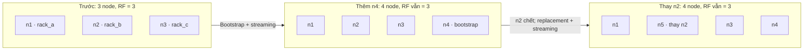

# Diễn tập thêm/thay nút và đối soát dữ liệu trong Apache Cassandra

> **Chương:** Thực hành tổng hợp  
> **Module:** `DATABASE_ENGINE_WIDE_COLUMN_CASSANDRA` — vận dụng kiến trúc phân tán, mô hình wide-column, partition key, thiết kế bảng theo truy vấn, consistency level, CQL, replication, compaction, repair, xử lý lỗi và kết nối Java.  
> **Môi trường:** Cluster Cassandra thử nghiệm riêng biệt; không thực hiện các bước dừng nút, thay nút hay xóa dữ liệu trên production.

## 1. Bài toán và kết quả cần bàn giao

Một dịch vụ đơn hàng dùng Apache Cassandra ban đầu có ba node ở cùng datacenter. Lưu lượng tăng, hệ thống cần **thêm một node** để tăng khả năng phân phối dữ liệu và tải. Sau đó một node cũ hỏng hoàn toàn; nhóm vận hành phải **thay node** bằng máy mới, bảo đảm ứng dụng tiếp tục đọc/ghi theo mức nhất quán đã chọn. Cuối cùng, nhóm phải **đối soát dữ liệu** thay vì kết luận thành công chỉ vì các node hiện `UN`.

Sau bài thực hành, người học cần chứng minh được:

1. Node mới vào cluster bằng **bootstrap** và nhận token ranges / dữ liệu từ replica đang có.
2. **Thêm node** khác với **thay node chết**: node thêm nhận token mới; node thay thế nhận trách nhiệm của node cũ.
3. Replication factor (RF) và mức nhất quán (`LOCAL_QUORUM`) được hiểu đúng khi số node thay đổi.
4. Dữ liệu mẫu vẫn đúng và truy vấn theo **partition key** vẫn hoạt động trước, trong và sau khi đổi topology.
5. Biết khi nào dùng `cleanup`, `repair`, cách theo dõi streaming, xử lý lỗi và ghi báo cáo đối soát có bằng chứng.

**Đầu ra bắt buộc:** một bản ghi thay đổi topology; số liệu trước/sau của `nodetool status`, `nodetool netstats`; biên bản thử đọc/ghi với CQL; kết quả chương trình Java đối chiếu giá trị mong đợi; trạng thái repair/cleanup và kết luận PASS/FAIL.

## 2. Kiến trúc phòng lab

Thực hành với Cassandra 4.1 hoặc 5.0, Java 11+ và Java Driver 4.x tương thích với môi trường của bạn. Lệnh khởi động dịch vụ, vị trí file cấu hình, cách cấp quyền và cách truyền JVM flags phụ thuộc hệ điều hành/cách cài đặt; minh họa bên dưới không phải script triển khai đa nền tảng.

| Vai trò | Địa chỉ minh họa | DC | Rack | Trạng thái đầu bài |
| --- | --- | --- | --- | --- |
| `n1` | `10.0.0.11` | `dc_lab` | `rack_a` | Up, Normal |
| `n2` | `10.0.0.12` | `dc_lab` | `rack_b` | Up, Normal |
| `n3` | `10.0.0.13` | `dc_lab` | `rack_c` | Up, Normal |
| `n4` | `10.0.0.14` | `dc_lab` | `rack_a` | Máy mới, chưa join |
| `n5` | `10.0.0.15` | `dc_lab` | `rack_b` | Máy thay thế cho `n2`, chưa join |

Đây là địa chỉ riêng ví dụ; thay bằng địa chỉ thực tế của mạng thử nghiệm. Ba node đầu đã được khởi tạo thành **một cluster** và đang chạy cùng phiên bản hỗ trợ tương thích. Node mới phải có địa chỉ mạng, dung lượng lưu trữ và đường truyền giữa các node phù hợp.



**Phân biệt số node với RF:** sau khi có bốn node, cấu hình `RF(dc_lab)=3` nghĩa là mỗi partition có ba replica được phân bố trên ba node thích hợp trong DC, **không** phải bốn bản sao. Khi thay `n2` bằng `n5`, số node khỏe cuối cùng vẫn là bốn.

### 2.1. Điều kiện bắt đầu

- `nodetool status` trên node đang sống hiện cả `n1`, `n2`, `n3` ở trạng thái `UN` (Up/Normal); không có bootstrap/replace khác chạy cùng lúc.
- Cluster có đúng một DC lab, cấu hình snitch/rack thống nhất, các node nhìn thấy nhau, giờ hệ thống tương đối đồng bộ, còn đủ tài nguyên lưu trữ, RAM và mạng cho streaming.
- Chỉ dùng dữ liệu giả lập. Lưu cấu hình hiện tại, bản snapshot/backup phù hợp, trạng thái schema và host ID để có đường khôi phục; các thao tác topology đều có thể ảnh hưởng đến dữ liệu thực.
- Ứng dụng đang dùng mức `LOCAL_QUORUM`: với RF=3 cần ít nhất **2 replica của partition** phản hồi trong `dc_lab`. Các lỗi tạm thời vẫn có thể xảy ra khi token range đổi hoặc node lỗi; không giả định mọi yêu cầu luôn thành công.
- Chọn một người ghi biên bản. Tạm dừng các tác vụ sửa topology, sửa RF hoặc compaction/repair chạy tay không liên quan trong suốt buổi thử.

### 2.2. Tên node, token và các dấu hiệu cần hiểu

| Thuật ngữ / trạng thái | Ý nghĩa khi kiểm tra |
| --- | --- |
| `UN` | Node đang được nhìn thấy là Up, trạng thái ring là Normal. Không phải bằng chứng từng row trên mọi replica đều khớp. |
| `UJ` | Node Up nhưng đang Joining/bootstrapping; cần quan sát streaming trước khi coi là bình thường. |
| `DN` | Node Down nhưng topology còn ghi nhận, khác với node đã được decommission/removenode. |
| Token / vnode | Dùng để phân bố ownership của các token ranges; partition key được hash thành token. |
| Host ID | Danh tính node trong metadata; lưu trước/sau để phân biệt node cũ và máy thay thế. |
| `nodetool netstats` | Theo dõi tiến độ gửi/nhận dữ liệu trong quá trình streaming. |
| `nodetool repair` | Anti-entropy để so sánh và đồng bộ dữ liệu trên các replica có cùng token range. |
| `nodetool cleanup` | Xóa dữ liệu nằm trên node nhưng node **không còn sở hữu** theo topology mới. Không đồng nghĩa repair. |

## 3. Khởi tạo keyspace, bảng wide-column và dữ liệu chuẩn

Từ `cqlsh` trên một node đang khỏe, tạo keyspace cho riêng lab:

```sql
CREATE KEYSPACE IF NOT EXISTS topology_lab
WITH replication = {
    'class': 'NetworkTopologyStrategy',
    'dc_lab': 3
}
AND durable_writes = true;

CREATE TABLE IF NOT EXISTS topology_lab.orders_by_customer_day (
    customer_id uuid,
    order_day date,
    order_no int,
    amount_cents bigint,
    state text,
    PRIMARY KEY ((customer_id, order_day), order_no)
) WITH CLUSTERING ORDER BY (order_no ASC);
```

Thiết kế bảng phục vụ truy vấn **lấy đơn của một khách trong một ngày**. `(customer_id, order_day)` là **composite partition key**; `order_no` là clustering key. Cấu hình này giúp đọc đúng partition mà không cần quét toàn cluster hay dùng `ALLOW FILTERING`. Trong hệ thống thực, cần kiểm soát số đơn/ngày, kích thước partition và chiến lược bucket phù hợp.

Đặt mức nhất quán trong `cqlsh`:

```sql
CONSISTENCY LOCAL_QUORUM;
```

Tạo dữ liệu giả lập với khóa và nội dung **cố định** để đối soát:

```sql
INSERT INTO topology_lab.orders_by_customer_day
(customer_id, order_day, order_no, amount_cents, state)
VALUES (11111111-1111-4111-8111-111111111111, '2026-11-21', 1001, 150000, 'CREATED');

INSERT INTO topology_lab.orders_by_customer_day
(customer_id, order_day, order_no, amount_cents, state)
VALUES (11111111-1111-4111-8111-111111111111, '2026-11-21', 1002, 220000, 'CREATED');

INSERT INTO topology_lab.orders_by_customer_day
(customer_id, order_day, order_no, amount_cents, state)
VALUES (22222222-2222-4222-8222-222222222222, '2026-11-21', 2001, 350000, 'PAID');

INSERT INTO topology_lab.orders_by_customer_day
(customer_id, order_day, order_no, amount_cents, state)
VALUES (33333333-3333-4333-8333-333333333333, '2026-11-21', 3001, 90000, 'CREATED');
```

Bảng kết quả mong đợi giai đoạn trước khi thay node:

| Customer (rút gọn) | `order_no` | `amount_cents` | `state` |
| --- | ---: | ---: | --- |
| `1111…` | 1001 | 150000 | CREATED |
| `1111…` | 1002 | 220000 | CREATED |
| `2222…` | 2001 | 350000 | PAID |
| `3333…` | 3001 | 90000 | CREATED |

Đọc đối chứng bằng khóa phân vùng:

```sql
SELECT order_no, amount_cents, state
FROM topology_lab.orders_by_customer_day
WHERE customer_id = 11111111-1111-4111-8111-111111111111
  AND order_day = '2026-11-21';
```

Kết quả phải có đúng hai dòng, theo thứ tự `order_no` tăng dần. Kiểm tra hai partition còn lại bằng cách thay `customer_id`, giữ `order_day`.

**Chốt mốc kiểm thử T0:** lưu thời điểm, schema, danh sách bốn dòng và output truy vấn. Những dòng này là nguồn kỳ vọng độc lập với replica; không lấy kết quả từ một node bất kỳ rồi mặc nhiên gọi nó là “sự thật” cho mọi lần đối chiếu về sau.

## 4. Runbook A — thêm node mới `n4` (bootstrap)

### Bước A1 — chụp trạng thái trước thay đổi

Trên `n1`, ghi output các lệnh:

```bash
nodetool status
nodetool ring
nodetool tablestats topology_lab
nodetool netstats
```

Lưu: số node `UN` (=3), các host ID, token count, load, các DC/rack, số lượng SSTables và lỗi streaming hiện có. Nếu cluster còn `DN`, schema chưa đồng bộ hoặc đang có tiến trình topology khác thì **dừng diễn tập** để xử lý nguyên nhân trước.

### Bước A2 — cấu hình `n4` với danh tính mới

Cài đúng nhánh Cassandra tương thích và thiết lập `n4` như một node **mới hoàn toàn**:

- `cluster_name` khớp `n1–n3`; snitch tương thích với cluster, ví dụ `GossipingPropertyFileSnitch`.
- `listen_address` / `broadcast_address` và `rpc_address`/client listen address chỉ đến địa chỉ hợp lệ của `n4`, tùy cấu hình phiên bản.
- `seed_provider` trỏ đến ít nhất một seed còn sống (ví dụ `n1`, `n3`); **seed chỉ giúp khám phá cluster**, không phải node nhận dữ liệu duy nhất.
- Trong `cassandra-rackdc.properties` của `n4` đặt `dc=dc_lab` và `rack=rack_a`.
- Giữ cơ chế **auto bootstrap** có hiệu lực đối với node gia nhập cluster đã có dữ liệu. Không đặt `auto_bootstrap: false` chỉ để tránh thời gian streaming.
- Node chưa từng gia nhập cluster, các thư mục lưu trạng thái phải là của một **instance mới**; không sao chép thư mục dữ liệu/system keyspace, commit log và host ID từ `n1–n3`.

Ví dụ **các giá trị cần đối chiếu** (không thay thế cho toàn bộ `cassandra.yaml` của phiên bản cài đặt):

```yaml
cluster_name: 'cassandra-node-lab'
endpoint_snitch: GossipingPropertyFileSnitch
listen_address: 10.0.0.14
rpc_address: 10.0.0.14
# seed_provider: cấu hình theo cú pháp tương ứng phiên bản,
# dùng các node đang sống, chẳng hạn 10.0.0.11 và 10.0.0.13
```

### Bước A3 — khởi động và quan sát streaming

Chỉ khởi động dịch vụ Cassandra trên `n4` sau khi đối chiếu cấu hình. Trên `n4` và `n1`:

```bash
nodetool status
nodetool netstats
nodetool tpstats
```

Dấu hiệu mong đợi:

1. `n4` xuất hiện ở trạng thái tham gia (thường `UJ`) rồi chuyển sang `UN`.
2. `nodetool netstats` thể hiện streaming đang thực hiện, sau đó hoàn tất; không còn phiên nhận/gửi đang chạy bất thường.
3. Tất cả bốn node cuối cùng là `UN`, schema ổn định, không có thông báo lỗi bootstrap nghiêm trọng.
4. Keyspace `topology_lab` vẫn có `RF(dc_lab)=3`. Không tự tăng RF lên bốn chỉ vì có thêm máy.

**Nếu bootstrap lỗi hoặc bị treo:** lưu log Cassandra, trạng thái `netstats` và thông điệp lỗi; xem cơ chế `nodetool bootstrap resume` của đúng phiên bản. Không tự xóa data directories, đặt `consistent.rangemovement=false` hoặc khởi tạo lại node khi chưa hiểu trạng thái streaming dở dang. Một bootstrap thiếu nguồn dữ liệu có thể để lại lỗ hổng replica.

### Bước A4 — kiểm tra sau khi thêm node

Trên các coordinator khỏe, đọc lại bốn dòng ở `LOCAL_QUORUM` và chạy công cụ đối soát Java trong mục 7 với chế độ `before`. Kỳ vọng:

- Cả bốn dòng đúng khóa, số tiền và trạng thái; không thiếu hoặc thừa dòng trong các partition mẫu.
- `n4` là `UN`, token ranges đã được phân bổ, streaming kết thúc.
- `nodetool tablestats topology_lab` và metrics có thể cho thấy dung lượng phân bổ lại dần; **kích thước dữ liệu từng node không phải tiêu chí đối soát đúng/sai**.
- Chưa có lỗi đọc/ghi tăng kéo dài, timeout hoặc backlog compaction/streaming bất thường.

### Bước A5 — cleanup có điều kiện

Sau khi đã xác minh `n4` phục vụ bình thường và không có range movement đang chạy, có thể chạy:

```bash
nodetool cleanup topology_lab
```

Thực hiện **lần lượt trên những node cũ đã mất ownership của một số token range** (thường `n1`, `n2`, `n3`); ghi lượng dữ liệu thu hồi và theo dõi `nodetool compactionstats`. `cleanup` có thể tốn I/O, nên chỉ làm sau mốc ổn định và trong cửa sổ bảo trì thích hợp. Lệnh xóa dữ liệu không còn thuộc trách nhiệm node theo ring mới; nó **không đảm bảo** mọi replica sở hữu dữ liệu đã đồng bộ. Muốn kiểm chứng/đồng bộ khác biệt cần xét `repair` ở mục 6.

## 5. Runbook B — thay node `n2` bị hỏng bằng `n5`

Kịch bản B bắt đầu **sau khi** runbook A kết thúc và cluster có `n1`, `n2`, `n3`, `n4` ở `UN`. Giả lập trường hợp đĩa/máy `n2` bị hỏng, không thể khởi động lại với dữ liệu hiện có. Chọn **replacement**, không thực hiện `decommission` hay `removenode` đối với `n2` trước khi thay.

### Bước B1 — ghi nhận node cần thay và cô lập nguồn cũ

Trước khi ngắt `n2`, ghi lại `nodetool status`, địa chỉ `10.0.0.12`, host ID, DC, rack và trạng thái dữ liệu mẫu. Dừng dịch vụ `n2` trong **lab**, bảo đảm instance cũ không thể tự khởi động/quay lại ring ngoài kế hoạch. Kiểm tra từ `n1`:

```bash
nodetool status
```

Kỳ vọng `n2` hiển thị `DN`; `n1`, `n3`, `n4` vẫn `UN`. Vì RF=3, đa số các partition vẫn có ít nhất hai replica khỏe sau một lỗi node, nên `LOCAL_QUORUM` thường còn phục vụ được; kết quả thực tế phụ thuộc trạng thái của các replica/đường mạng tại thời điểm thử.

**Thử ghi trong thời gian `n2` vắng mặt** để có mutation cần đối soát sau phục hồi:

```sql
CONSISTENCY LOCAL_QUORUM;

UPDATE topology_lab.orders_by_customer_day
SET state = 'PAID'
WHERE customer_id = 11111111-1111-4111-8111-111111111111
  AND order_day = '2026-11-21'
  AND order_no = 1001;
```

Kỳ vọng sau khi ghi được xác nhận: đơn `1001` đổi thành `PAID`; các dòng khác giữ nguyên. Chụp T1 và lưu thành công/thất bại, thời gian thực hiện và host coordinator. Nếu ghi timeout, **không** mặc định rằng mutation chưa từng tới replica; kiểm tra kết quả nghiệp vụ trước khi retry.

### Bước B2 — chuẩn bị `n5` là node thay thế

Cấu hình `n5` theo cluster đang có:

- Cùng `cluster_name`, snitch, DC `dc_lab` và rack `rack_b` với node bị thay; địa chỉ mạng mới là `10.0.0.15`.
- Seed trỏ đến những node đang sống (`n1`, `n3` hoặc `n4`); không dùng riêng `n2` đã chết.
- Node mới có môi trường dữ liệu sạch, không copy system keyspace/host ID của `n2`. Chuẩn bị dung lượng tương đương nhu cầu của token ranges cần nhận.
- Node `n2` phải thực sự down và không thể trở lại trước khi hoàn tất replacement; tránh hai instance tranh chấp cùng danh tính/token range.

Khởi động Cassandra trên `n5` **một lần đầu** với JVM property minh họa:

```text
-Dcassandra.replace_address_first_boot=10.0.0.12
```

Đây là **cờ JVM lúc khởi động node thay thế**, không phải câu lệnh gõ trong `cqlsh` hay lệnh `nodetool`. Cơ chế cấu hình cờ ở service manager, image/container hoặc `cassandra-env.sh` phải theo hướng dẫn của bản Cassandra cụ thể. Các phiên bản có thể có tùy chọn bổ sung; kiểm tra log để xác nhận node thực sự vào chế độ replacement, không bootstrap như một node thứ năm độc lập.

### Bước B3 — theo dõi replacement và hoàn tất

Từ `n5` và `n1` theo dõi liên tục:

```bash
nodetool netstats
nodetool status
nodetool tpstats
```

Trong lúc thay, trạng thái từ các node khác có thể chưa biểu diễn rõ tiến độ; **`netstats` và log streaming đáng tin hơn chỉ nhìn cột `UN/DN`**. Điều kiện kết thúc:

- `n5` hoàn tất bootstrap/streaming, đã thay trách nhiệm token ranges của `n2`.
- `n5` là `UN`, `n1`, `n3`, `n4` vẫn `UN`; `n2` cũ không còn là thành viên hoạt động.
- Không phát sinh node gia nhập ngoài kế hoạch; số thành viên hoạt động cuối cùng là bốn, RF vẫn ba.
- Các truy vấn `LOCAL_QUORUM` đọc được trạng thái mới của `1001` và ba dòng còn lại.

**Khi nào bắt buộc repair?** Tài liệu Cassandra yêu cầu repair sau replacement nếu node cũ down quá `max_hint_window` trước khi thay, hoặc thay cùng địa chỉ IP mà thời gian thay vượt cửa sổ hints. Với mọi trường hợp, hints chỉ là hỗ trợ *best effort*; kết quả streaming thành công chưa phải là bằng chứng mọi replica không còn chênh lệch. Trong lab này, tiếp tục bước repair đầy đủ ở mục 6 để diễn tập đối soát.

### Bước B4 — không nhầm lẫn các thao tác topology

| Thao tác | Tình huống | Kết quả logic |
| --- | --- | --- |
| **Bootstrap node mới** | Mở rộng cluster bằng `n4` | Cluster thêm một node với token ranges mới; số replica mỗi partition phụ thuộc RF không đổi. |
| **Replace dead node** | `n2` chết hẳn, `n5` thay | `n5` nhận trách nhiệm của `n2`, không phải tăng tổng số node mong đợi. |
| `nodetool decommission` | Node **còn sống** cần rời cluster có kế hoạch | Stream dữ liệu sang replica còn lại và rời ring; không phải cách thay trực tiếp một node đã chết. |
| `nodetool removenode` | Node **đã chết** cần bị xóa vĩnh viễn khỏi topology | Chuyển trách nhiệm về các node còn lại; không chạy trước replacement nếu định dùng cơ chế thay thế. |
| `nodetool cleanup` | Đã có chuyển ownership và dữ liệu cũ còn nằm ở node không sở hữu nữa | Thu hồi dữ liệu dư trên node; không chữa replica thiếu dữ liệu. |
| `nodetool repair` | Các replica cần so sánh và đồng bộ | Phát hiện/sửa chênh lệch theo token range; tốn CPU/I/O/mạng, cần lập lịch. |

Nếu chọn sai phương án (ví dụ vừa `removenode` `n2` vừa dùng `replace_address_first_boot`) có thể làm lệch giả định về danh tính/ownership. Dừng và lập phương án phục hồi từ topology thực tế; không thử hàng loạt lệnh quản trị mang tính phá hủy.

## 6. Đối soát replica: repair, compaction và bằng chứng

### 6.1. Ba lớp kiểm chứng khác nhau

**Lớp 1 — topology:** `nodetool status`/`ring` xác nhận node membership, token count, DC/rack và quá trình chuyển ownership hoàn tất. Chưa chứng minh dữ liệu đúng.

**Lớp 2 — replica:** `repair` so sánh các replica theo token range bằng Merkle tree, sau đó truyền các phần khác biệt. Hinted handoff không bảo đảm bù lại mọi mutation sau outage. `repair` không tự chạy chỉ vì có node mới (trừ cơ chế tự động riêng được bật và cấu hình hợp lệ).

**Lớp 3 — nghiệp vụ:** so khớp tập khóa và giá trị với nguồn kỳ vọng tại T0/T1 bằng CQL/Java. Một câu `SELECT` ở `LOCAL_QUORUM` phản ánh kết quả đọc ở CL đã chọn; **không phải bằng chứng rằng từng replica trên đĩa có cùng dữ liệu**. Vì vậy lớp 2 và lớp 3 bổ trợ nhau.

### 6.2. Thực hành repair có kiểm soát

Sau khi replacement đã ổn định, xác định thời gian window bảo trì và theo dõi I/O, disk, network. Dùng lệnh preview để ước lượng khác biệt và công việc cần làm:

```bash
nodetool repair --full --preview topology_lab
```

`--preview` xây Merkle tree/ước lượng streaming nhưng **không ghi dữ liệu sửa chữa**. Sau đó chạy full repair theo phạm vi đã lập kế hoạch. Với một DC có bốn node, cách bao phủ toàn cluster mà hạn chế trùng phạm vi là chạy **lần lượt trên từng node đang sống**:

```bash
nodetool repair --full -pr topology_lab
```

Chạy lệnh này ở `n1`, chờ hoàn tất thành công, rồi lần lượt `n3`, `n4`, `n5`; ghi log, exit code và lượng dữ liệu được stream cho **từng node**. Cờ `-pr` giới hạn primary token ranges của node gọi lệnh; **chạy một lần ở một node chưa phải full repair cả cluster**. Tùy phiên bản, lịch repair hiện có, phạm vi DC và dung lượng, đội vận hành cần điều chỉnh mức song song/cửa sổ bảo trì.

Sau repair, có thể chạy lại:

```bash
nodetool repair --full --preview topology_lab
nodetool netstats
nodetool compactionstats
```

Mong đợi không còn chênh lệch cần streaming trong phạm vi preview sau khi hệ thống ổn định. `--validate`, nếu sử dụng, chỉ kiểm tra **dữ liệu đã được đánh dấu repaired** theo cơ chế phiên bản; không dùng nó làm chứng nhận tuyệt đối mọi row đã khớp. Nếu preview còn khác biệt, đọc log, xem có ghi đồng thời hay lỗi ổ đĩa/mạng và khoanh vùng token ranges, thay vì chạy repair lặp vô hạn.

### 6.3. Cleanup và compaction không thay thế repair

- `cleanup` dựa trên **token ownership mới** để bỏ dữ liệu không còn cần giữ ở node cũ sau khi bootstrap/range movement; thường dùng sau mở rộng ring.
- `compaction` gộp SSTables theo chiến lược compaction, xử lý dữ liệu cũ/tombstone theo điều kiện phù hợp; không so sánh replica ở các node khác nhau.
- `repair` làm công việc **đối chiếu và đồng bộ replica**. Full repair kiểm tra cả repaired/unrepaired SSTables trong phạm vi; incremental repair chỉ xử lý dữ liệu chưa được đánh dấu repaired kể từ kỳ trước.

Đặc biệt cần repair trong giới hạn `gc_grace_seconds` của bảng để tránh rủi ro dữ liệu đã xóa xuất hiện trở lại nếu tombstone không đến được replica bị bỏ lỡ quá lâu. Giảm `gc_grace_seconds` để bài lab chạy nhanh hơn là một thay đổi không cần thiết và dễ tạo kết luận sai.

## 7. Đối soát từ Java Driver 4.x

Ứng dụng Java dùng `CqlSession` và prepared statement để xác minh **toàn bộ các partition mẫu bằng khóa chính**, so sánh trực tiếp với dữ liệu kỳ vọng được định nghĩa sẵn. Chương trình không sử dụng `SELECT COUNT(*)` trên bảng lớn vì điều này đòi hỏi quét dữ liệu và không chứng minh từng cột đúng.

### 7.1. Chương trình kiểm tra dữ liệu mẫu

Tạo lớp `LabAudit.java` trong dự án Java đã có dependency Cassandra Java Driver 4.x:

```java
import com.datastax.oss.driver.api.core.CqlSession;
import com.datastax.oss.driver.api.core.DefaultConsistencyLevel;
import com.datastax.oss.driver.api.core.cql.BoundStatement;
import com.datastax.oss.driver.api.core.cql.PreparedStatement;
import com.datastax.oss.driver.api.core.cql.Row;

import java.net.InetSocketAddress;
import java.nio.charset.StandardCharsets;
import java.security.MessageDigest;
import java.time.LocalDate;
import java.util.ArrayList;
import java.util.Arrays;
import java.util.LinkedHashMap;
import java.util.List;
import java.util.Map;
import java.util.UUID;

public final class LabAudit {
    public static void main(String[] args) throws Exception {
        if (args.length != 2 || (!args[1].equals("before")
                                 && !args[1].equals("after"))) {
            throw new IllegalArgumentException(
                "Usage: LabAudit <contact-point-ip> <before|after>");
        }

        String expected1001State = args[1].equals("after") ? "PAID" : "CREATED";
        Map<UUID, List<String>> expected = new LinkedHashMap<>();
        expected.put(UUID.fromString("11111111-1111-4111-8111-111111111111"),
            Arrays.asList("1001|150000|" + expected1001State,
                          "1002|220000|CREATED"));
        expected.put(UUID.fromString("22222222-2222-4222-8222-222222222222"),
            Arrays.asList("2001|350000|PAID"));
        expected.put(UUID.fromString("33333333-3333-4333-8333-333333333333"),
            Arrays.asList("3001|90000|CREATED"));

        MessageDigest sha256 = MessageDigest.getInstance("SHA-256");
        int checkedRows = 0;
        try (CqlSession session = CqlSession.builder()
                .addContactPoint(new InetSocketAddress(args[0], 9042))
                .withLocalDatacenter("dc_lab")
                .build()) {
            PreparedStatement read = session.prepare(
                "SELECT order_no, amount_cents, state " +
                "FROM topology_lab.orders_by_customer_day " +
                "WHERE customer_id = ? AND order_day = ?");

            for (Map.Entry<UUID, List<String>> fixture : expected.entrySet()) {
                BoundStatement statement = read.bind(
                        fixture.getKey(), LocalDate.of(2026, 11, 21))
                    .setConsistencyLevel(DefaultConsistencyLevel.LOCAL_QUORUM)
                    .setIdempotent(true);

                List<String> actual = new ArrayList<>();
                for (Row row : session.execute(statement)) {
                    actual.add(row.getInt("order_no") + "|" +
                        row.getLong("amount_cents") + "|" +
                        row.getString("state"));
                }

                if (!actual.equals(fixture.getValue())) {
                    throw new IllegalStateException(
                        "MISMATCH customer=" + fixture.getKey() +
                        " expected=" + fixture.getValue() +
                        " actual=" + actual);
                }

                // Gồm khóa phân vùng và các giá trị đã kiểm tra;
                // không phụ thuộc timestamp trả về hay thứ tự partition.
                String canonical = fixture.getKey() + "|" +
                    String.join(";", actual) + "\n";
                sha256.update(canonical.getBytes(StandardCharsets.UTF_8));
                checkedRows += actual.size();
            }
        }

        StringBuilder hex = new StringBuilder();
        for (byte b : sha256.digest()) {
            hex.append(String.format("%02x", b & 0xff));
        }
        System.out.println("PASS mode=" + args[1] +
            " partitions=" + expected.size() +
            " rows=" + checkedRows +
            " sha256=" + hex);
    }
}
```

Chạy với contact point còn sống, ví dụ:

```text
LabAudit 10.0.0.11 before
LabAudit 10.0.0.13 after
```

Trong đó `before` áp dụng **trước** bước B1 đổi trạng thái đơn `1001`; `after` áp dụng **sau** cập nhật được xác nhận. Cần chạy lớp theo cách dự án Java của bạn quản lý classpath/dependency, TLS và authentication; hai dòng trên là **đối số chương trình**, không phải lệnh shell đầy đủ.

Kết quả mong đợi: `PASS`, `partitions=3`, `rows=4` và SHA-256 có định dạng 64 ký tự hex. Hash ở chế độ `before` và `after` **khác nhau đúng vì dữ liệu kỳ vọng đổi**; chỉ so sánh hash giữa hai lần chạy khi dùng cùng mode, cùng dữ liệu nguồn và workload được giữ ổn định.

Nếu xuất hiện `MISMATCH`, giữ nguyên cả `expected`, `actual`, contact point, timestamp, CL, log và trạng thái node. Không sửa kỳ vọng cho “khớp” với output nếu chưa xác nhận ý nghĩa nghiệp vụ của giá trị.

**Giới hạn cần hiểu:** Java Driver có thể khám phá nhiều node từ một contact point và tự chọn coordinator theo load balancing/token-awareness. Truyền `10.0.0.11` hay `10.0.0.13` không ép mọi query chạy trên đúng node đó; và đọc quorum có thể che giấu một replica còn cũ. Dùng kết quả Java để kiểm chứng **giao diện đọc của ứng dụng**, kết hợp repair/streaming để kiểm chứng replica.

### 7.2. Bảng ghi đối soát

Điền số liệu thực tế; không tự ghi PASS nếu chưa chạy thao tác:

| Chỉ tiêu | Trước thêm node (T0) | Sau thêm n4 | Sau thay n2→n5 (T1) | Tiêu chí PASS |
| --- | --- | --- | --- | --- |
| Số node `UN` | 3 | 4 | 4 | Đúng topology dự kiến |
| Số node `DN` | 0 | 0 | 0 sau hoàn tất | Không còn node cũ hoạt động sai |
| RF `topology_lab` | 3 | 3 | 3 | Không thay đổi ngoài kế hoạch |
| Streaming | Không có | Bootstrap hoàn tất | Replacement hoàn tất | Không còn job lỗi/dở |
| Java `before` | 3 partition, 4 row | 3 partition, 4 row | — | Kết quả khớp fixture ban đầu |
| Java `after` | — | — | 3 partition, 4 row | Đơn 1001 là PAID, các dòng khác giữ nguyên |
| Full repair | Theo lịch ban đầu | Đánh giá theo topology | Chạy và hoàn tất theo kế hoạch | Có log, không còn lỗi đồng bộ chưa xử lý |
| Quorum read/write | Thành công | Thành công | Thành công hoặc lỗi đã phân tích | Không còn lỗi chưa giải thích |

Ghi thêm thời gian chuyển `UJ→UN`, byte streaming, CPU/disk pressure, số timeout, log lỗi, thời gian chuẩn bị/khôi phục và điều kiện dừng nếu tác động vượt mức cho phép. **Dữ liệu thực nghiệm** mới đủ để kết luận về thời gian phục hồi (RTO); RF không tự chứng minh RTO.

## 8. Kịch bản lỗi và cách xử lý

| Lỗi trong diễn tập | Dấu hiệu | Hướng xử lý |
| --- | --- | --- |
| `n4` không xuất hiện trong ring | Sai cluster name/seed, network, snitch, địa chỉ node, quyền truy cập | Kiểm tra cấu hình, kết nối và log khởi động trước khi thử lại. |
| Bootstrap thất bại khi replica nguồn không sẵn sàng | `netstats` báo stream fail/không đủ source | Khôi phục replica nguồn hoặc lập phương án resume theo phiên bản; không tắt kiểm tra consistent bootstrap để ép join. |
| `n5` vào như node thứ năm, `n2` vẫn `DN` | Thiếu/sai JVM flag replacement hoặc nhầm địa chỉ cũ | Dừng tiến trình thay thế, xem host ID/token/ring và log; xử lý topology theo thủ tục phục hồi. |
| Quorum read/write timeout khi `n2` down | Coordinator không thu đủ phản hồi kịp thời | Kiểm tra health replica, GC/CPU/network và timeout; không tự hạ CL trong bài đối soát. |
| Sau replace thiếu dữ liệu vừa ghi | Hints hết cửa sổ hoặc stream không phủ hết mutation | Đối chiếu bản ghi, chạy repair đúng phạm vi, điều tra lỗi disk/WAN và điều kiện bảo toàn dữ liệu. |
| Disk cũ không giảm sau thêm node | Token ownership đã đổi nhưng SSTables dư còn ở node cũ | Chỉ chạy `cleanup` sau khi bootstrap và kiểm chứng ổn định. |
| `nodetool repair` tốn tài nguyên cao | High disk I/O, compaction backlog, slow query | Giảm song song, chọn phạm vi/cửa sổ phù hợp; giám sát và ghi nhận trước khi tiếp tục. |
| Mismatch chỉ xảy ra với một trường | Ghi cạnh tranh/timestamp/TTL hoặc bộ fixture sai | Chốt mốc ghi, xác minh source of truth, kiểm tra log mutations; không dùng hash để che nguyên nhân. |

### 8.1. Tiêu chí dừng/khôi phục

Dừng chạy tiếp nếu mất thêm node ngoài kịch bản, không còn đáp ứng quorum cần thiết, dữ liệu chuẩn bị mất không thể giải thích, streaming bị treo kéo dài, hoặc replica bắt đầu báo lỗi ổ đĩa. Ghi mốc cuối thành công và thu log. Với cluster thử nghiệm, phục hồi theo bản snapshot/backup và sơ đồ topology đã ghi trước đó nếu cần; không tùy tiện sửa `system.local`, `system.peers`, commit log hoặc xóa SSTables để “đẩy nhanh” trạng thái `UN`.

Nếu `n2` thực chất chỉ lỗi mạng tạm thời và có thể quay lại với dữ liệu gốc, đánh giá **khôi phục node cũ** thay vì bắt đầu replacement. Không để cả node cũ và node thay thế đồng thời tham gia ring với trạng thái/token cạnh tranh.

## 9. Các câu hỏi giải thích kết quả

**1. Vì sao thêm node từ ba lên bốn không làm mỗi partition có bốn replica?**  
Vì RF do keyspace định nghĩa; `RF(dc_lab)=3` nghĩa là ba bản sao/partition ở DC, độc lập số node vật lý đủ điều kiện phân phối.

**2. Tại sao phải kiểm tra `UN` *và* chạy đối soát dữ liệu?**  
`UN` cho biết node hiện diện trong ring và được xem là khỏe ở thời điểm quan sát, nhưng không chứng minh mutation bị bỏ lỡ đã được phát lại hay các replica đã hội tụ.

**3. Khi nào nên dùng `replace_address_first_boot` thay vì `removenode`?**  
Khi thay một node đã chết bằng instance mới nhận lại trách nhiệm cũ. `removenode` dùng khi muốn loại node chết khỏi ring và phân bổ lại trách nhiệm, không phải bước chuẩn bị bắt buộc cho replacement.

**4. Vì sao `cleanup` không sửa được dữ liệu thiếu?**  
Cleanup chỉ loại dữ liệu node không còn sở hữu theo token ring mới; sửa thiếu/khác biệt replica phải dùng repair hoặc quy trình khôi phục phù hợp.

**5. Nếu Java trả đủ bốn dòng tại `LOCAL_QUORUM`, có thể tuyên bố ba replica của mọi partition đều giống nhau không?**  
Không. Quorum read chỉ xác nhận kết quả theo CL trong phạm vi đọc. Muốn đối soát replica cần thêm bằng chứng repair/streaming và theo dõi lỗi.

**6. Nếu viết cùng dữ liệu ở hai node lúc node khác down, kết quả có chắc đúng nghiệp vụ không?**  
Không tự động. Cassandra hòa giải giá trị theo timestamp/semantics của loại mutation; concurrent updates có thể cần điều kiện nghiệp vụ, idempotency và thiết kế nhất quán bổ sung.

## 10. Mẫu biên bản bàn giao diễn tập

```text
THỰC HÀNH: Diễn tập thêm/thay nút và đối soát dữ liệu
Ngày / thời gian:
Phiên bản Cassandra / Java Driver:
Cluster / DC / Rack:
Người thực hiện:

T0 - Trước thay đổi:
- N1/N2/N3 host ID, status, load:
- RF, keyspace, table:
- Fixture verified: 3 partitions / 4 rows
- Java BEFORE / SHA-256:
- Backup/snapshot reference:

A - Thêm n4:
- Thời gian bắt đầu và hoàn tất bootstrap:
- Netstats / byte streaming / lỗi:
- Node cuối: n1, n2, n3, n4 = UN
- Java BEFORE / SHA-256:
- Cleanup đã chạy trên node nào, kết quả:

B - Thay n2 bằng n5:
- N2 down từ:
- N2 old IP/host ID:
- Write order 1001 CREATED -> PAID, CL, kết quả:
- JVM replacement flag trên n5:
- Thời gian hoàn tất streaming:
- Node cuối: n1, n3, n4, n5 = UN
- Java AFTER / SHA-256:

ĐỐI SOÁT:
- Repair preview:
- Full repair -pr trên mỗi node, log/exit code:
- Preview sau repair:
- Mismatch / timeout chưa xử lý:
- Kiểm tra data residency/backup (nếu áp dụng):

KẾT LUẬN: PASS / FAIL / BLOCKED
Bằng chứng đính kèm (log, kết quả CQL, nodetool, Java):
Nguyên nhân và hành động tiếp theo nếu chưa PASS:
```

Chỉ kết luận **PASS** khi topology đúng, streaming và repair đã được kiểm tra ở phạm vi dự kiến, dữ liệu fixture khớp kết quả kỳ vọng sau thay đổi và không còn lỗi chưa giải thích. Một kịch bản chỉ có ba lệnh `nodetool status` đều đẹp nhưng thiếu đối soát theo khóa/giá trị mới được coi là hoàn thành **một phần**.

## Tài liệu tham khảo chính thức

- [Apache Cassandra — Adding, replacing, moving and removing nodes](https://cassandra.apache.org/doc/latest/cassandra/managing/operating/topo_changes.html): bootstrap, replacement, netstats, cleanup sau range movement.
- [Apache Cassandra — Repair](https://cassandra.apache.org/doc/stable/cassandra/managing/operating/repair.html): Merkle tree, full/incremental repair, `-pr`, preview và khuyến nghị vận hành.
- [Apache Cassandra — nodetool repair](https://cassandra.apache.org/doc/latest/cassandra/managing/tools/nodetool/repair.html): cú pháp các option repair.
- [Apache Cassandra — nodetool cleanup](https://cassandra.apache.org/doc/latest/cassandra/managing/tools/nodetool/cleanup.html): phạm vi và mục đích của cleanup.
- [Apache Cassandra — netstats](https://cassandra.apache.org/doc/stable/cassandra/managing/tools/nodetool/netstats.html): giám sát luồng dữ liệu.
- [Apache Cassandra Java Driver — Core documentation](https://apache.github.io/cassandra-java-driver/): session, prepared statement và consistency level.

> **Giới hạn buổi thực hành:** Bài này hướng dẫn kỹ thuật trong cluster lab đã kiểm soát. Một thay đổi production cần có lịch bảo trì, đánh giá dung lượng và tác động SLA, sao lưu/khôi phục đã kiểm chứng, giám sát theo phiên bản Cassandra và phê duyệt của đội vận hành.
