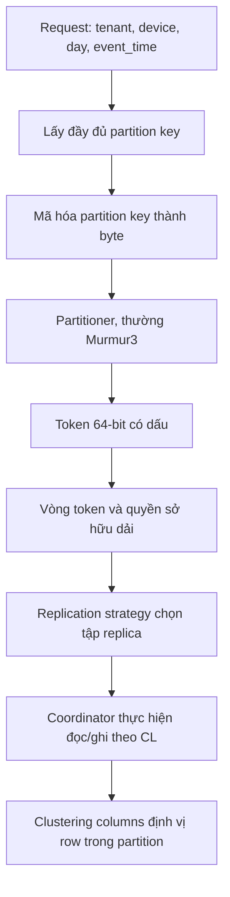
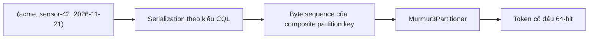
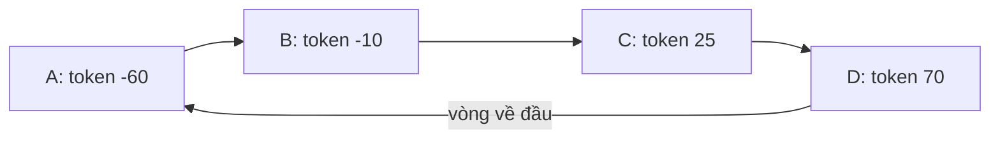
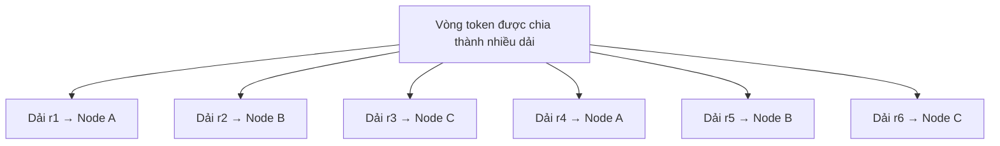
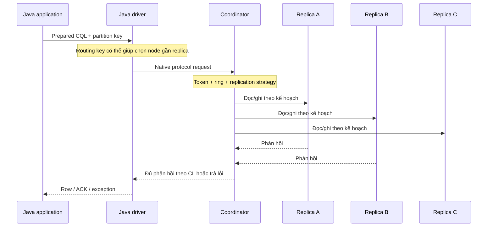
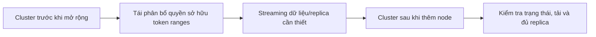

# Partitioner và ánh xạ khóa phân vùng thành token

> **Chương:** Token và sao chép  
> **Phạm vi:** Apache Cassandra là cơ sở dữ liệu NoSQL phân tán theo mô hình *wide-column*. Bài học tập trung vào chuỗi **partition key → biểu diễn nhị phân → partitioner → token → dải token → replica**, giải thích cách dữ liệu được đặt trên cluster và vì sao quyết định partition key ảnh hưởng đến khả năng mở rộng, consistency và đường truy vấn từ Java. Phần CQL, replication, compaction, repair và xử lý lỗi được đưa vào như những hệ quả thực hành của cơ chế token.

## 1. Mục tiêu học tập

Sau bài này, bạn có thể:

1. Phân biệt **partition key**, **clustering columns**, **token**, **token range**, **node sở hữu dải token** và **replica của partition**.
2. Diễn giải vai trò của **partitioner**, đặc biệt là `Murmur3Partitioner` thường dùng trong Apache Cassandra, và đặc điểm token 64-bit có dấu.
3. Mô tả cách khóa phân vùng ghép được mã hóa thành các byte để băm, thay vì nối các chuỗi một cách tùy tiện.
4. Đọc sơ đồ vòng token với quy tắc dải **`(previous_token, current_token]`**, kể cả đoạn vòng qua điểm kết thúc.
5. Giải thích vì sao **vnodes** làm một node có thể giữ nhiều token range, và tại sao **replication strategy** là bước khác với tính token.
6. Viết bảng CQL theo truy vấn, dùng `token(...)` để quan sát token của partition và biết khi nào không nên truy vấn theo dải token.
7. Dùng Java driver 4.x với prepared statement và đầy đủ partition key để hỗ trợ token-aware routing, không tự chế bộ băm tại client.
8. Phân tích hot partition, chuyển dữ liệu khi mở rộng node và giới hạn của consistency level, compaction, repair đối với bài toán phân phối tải.

## 2. Bài toán mở đầu: một sự kiện được lưu ở node nào?

Giả sử dịch vụ IoT nhận sự kiện từ thiết bị `sensor-42` thuộc tenant `acme`. Mỗi request gồm:

```text
tenant_id  = acme
device_id  = sensor-42
event_day  = 2026-11-21
event_time = 2026-11-21T08:05:00Z
event_id   = 11111111-1111-1111-1111-111111111111
```

Ứng dụng cần đọc 100 sự kiện mới nhất của thiết bị trong ngày. Để làm được, Cassandra phải trả lời những câu hỏi theo thứ tự:

1. **Partition nào chứa row này?** Tổ hợp `(tenant_id, device_id, event_day)`.
2. **Token của partition là gì?** Partitioner băm biểu diễn nhị phân của toàn bộ partition key thành token.
3. **Node nào quản lý token range chứa token đó?** Đọc metadata của vòng token và topology.
4. **Replica nào lưu bản sao partition?** Replication strategy cùng RF, data center và rack quyết định tập replica.
5. **Trong partition, row nào được đọc trước?** Clustering columns như `event_time` và `event_id` quyết định thứ tự.



**Điểm quan trọng:** token không được tính từ mỗi row riêng lẻ nếu các row dùng cùng partition key. Mọi row thuộc một partition có **cùng token và cùng tập replica**, cho dù `event_time` hoặc `event_id` khác nhau.

## 3. Hiểu đúng `PRIMARY KEY` trước khi tìm token

Cassandra không chia dữ liệu theo “tên bảng” hoặc “ID của mỗi row” một cách mặc định; nó dùng phần **partition key** được khai báo trong primary key.

Ví dụ:

```sql
PRIMARY KEY ((tenant_id, device_id, event_day), event_time, event_id)
```

| Thành phần | Vai trò | Có ảnh hưởng trực tiếp tới token? |
| --- | --- | --- |
| `tenant_id` | Thành phần thứ nhất của partition key ghép | **Có** |
| `device_id` | Thành phần thứ hai của partition key ghép | **Có** |
| `event_day` | Thành phần thứ ba của partition key ghép; bucket ngày | **Có** |
| `event_time` | Clustering column thứ nhất | **Không** |
| `event_id` | Clustering column thứ hai, phân biệt row trùng thời gian | **Không** |
| `temperature_c` | Regular column chứa giá trị | **Không** |

### 3.1. Một partition có thể chứa nhiều clustering row

Hai sự kiện sau:

```text
(acme, sensor-42, 2026-11-21, 08:05, event-A)
(acme, sensor-42, 2026-11-21, 08:06, event-B)
```

có chung partition key `(acme, sensor-42, 2026-11-21)`. Chúng được lưu trong **cùng partition logic**, dưới các clustering keys khác nhau.

Đổi `event_time` hoặc `event_id` nhưng giữ nguyên ba thành phần partition key thì token **không đổi**. Đổi `event_day` sang ngày tiếp theo sẽ tạo partition key mới; token thường khác, nhưng **không có bảo đảm toán học mọi partition key khác nhau đều cho token khác nhau**, vì không gian đầu vào lớn hơn không gian token.

### 3.2. Khóa đơn và khóa ghép

Hai dạng đều hợp lệ:

```sql
-- Một thành phần partition key, không có clustering column:
PRIMARY KEY (device_id)

-- Ba thành phần partition key, hai clustering columns:
PRIMARY KEY ((tenant_id, device_id, event_day), event_time, event_id)
```

Ở dạng thứ hai, cặp ngoặc trong cùng nhóm `((...))` phân biệt **partition key nhiều thành phần** với các clustering columns đi sau. Đừng nhầm `PRIMARY KEY (tenant_id, device_id, event_day)` với `PRIMARY KEY ((tenant_id, device_id, event_day))`: dạng đầu dùng `tenant_id` làm partition key và các cột còn lại làm clustering columns; dạng sau dùng cả ba cột làm partition key.

## 4. Partitioner thực sự làm gì?

**Partitioner** là thành phần ánh xạ **biểu diễn nhị phân của partition key** sang **token**. Token tạo ra một trật tự logic để Cassandra chia không gian khóa thành các vùng và xác định trách nhiệm lưu trữ.

Trong nhiều cluster Apache Cassandra hiện đại, lựa chọn thông dụng là **`Murmur3Partitioner`**, dựa trên hàm băm MurmurHash3. Đây là hàm băm phi mật mã (*non-cryptographic hash*), phục vụ phân phối chứ không bảo vệ bí mật.

### 4.1. Bốn bước từ khóa đến token

1. **CQL schema xác định partition key:** Ví dụ `(tenant_id text, device_id text, event_day date)`.
2. **Cassandra mã hóa giá trị theo kiểu CQL:** Các thành phần được biểu diễn thành byte theo định dạng khóa phân vùng mà server sử dụng.
3. **Partitioner băm các byte:** Với `Murmur3Partitioner`, kết quả được ánh xạ thành token dạng số nguyên có dấu 64-bit.
4. **Cluster dùng token để định vị dải:** Token được so với các điểm mốc token của các node/vnode để tìm token range tương ứng.



Không được tự làm:

```text
token = hash("acme" + "sensor-42" + "2026-11-21")
```

vì cách ghép chuỗi đơn giản có thể mơ hồ, bỏ qua ranh giới thành phần, kiểu dữ liệu và biểu diễn byte chuẩn của Cassandra. Ví dụ chuỗi `("ab", "c")` và `("a", "bc")` có thể tạo cùng văn bản `"abc"` nếu nối thẳng, nhưng phải được xem là hai khóa ghép khác nhau.

**Quy tắc thực hành:** để kiểm chứng token của một row, ưu tiên hàm `token(...)` của Cassandra hoặc metadata/routing của driver tương thích; không tự triển khai Murmur3 trên string để suy ra token production.

### 4.2. Những tính chất quan trọng của token

| Tính chất | Ý nghĩa |
| --- | --- |
| **Có tính xác định** | Cùng partition key đã mã hóa và cùng partitioner sẽ cho cùng token |
| **Phân bố theo hash** | Các khóa phân vùng khác nhau thường được trải trên không gian token |
| **Không giữ thứ tự nghiệp vụ** | `device_id = 100` không nhất thiết có token nhỏ hơn `device_id = 101` |
| **Không phải ID duy nhất** | Hai partition key khác nhau về lý thuyết có thể trùng token; cần giữ đủ partition key để phân biệt |
| **Không phải dữ liệu bảo mật** | Token không dùng để mã hóa hay ẩn giá trị khóa |
| **Không chứa replica list** | Token chỉ là đầu vào cho việc định vị; replication strategy mới quyết định các bản sao |
| **Không nói row được sắp ra sao** | Clustering columns sắp xếp các row bên trong partition |

## 5. Murmur3 token là số gì?

Với `Murmur3Partitioner`, token Cassandra được biểu diễn bằng một giá trị nguyên có dấu 64-bit, thường mô tả theo khoảng:

\[
-2^{63}\;\text{đến}\;2^{63}-1
\]

Các giá trị cụ thể của một khóa **phải được lấy từ cluster**, không suy ra bằng mắt nhìn tên `tenant_id` hay `device_id`. Một token âm không có nghĩa dữ liệu nằm ở node “phía trái”, node lỗi hoặc có ưu tiên thấp hơn. Dấu chỉ là một phần của thứ tự số trong vòng token.

### 5.1. Token khác hashing cho mục đích bảo mật

Murmur3 được chọn để phân phối khóa hiệu quả, **không** phải một password hash, chữ ký số hay cơ chế chống giả mạo. Không dùng token thay cho phân quyền theo tenant. Một API Java vẫn phải xác thực và kiểm tra quyền truy cập `tenant_id` trước khi truy vấn.

### 5.2. Token không thay thế primary key

Giả sử hai partition key khác nhau nhưng trùng token trong tình huống lý thuyết. Cassandra vẫn có thể phân biệt chúng bằng **byte khóa đầy đủ** và cơ chế lưu/so sánh thích hợp. Token chỉ giúp tìm **vùng** cần tới, không phải toàn bộ định danh row.

Tương tự, nếu ứng dụng lưu riêng một token để làm “ID của thiết bị”, nó có thể:

- Không biết partition key gốc khi cần query hoặc xác thực tenant.
- Tạo mối phụ thuộc với partitioner/kiểu dữ liệu.
- Không thể dựa vào uniqueness của token để làm uniqueness nghiệp vụ.

**Hãy dùng khóa nghiệp vụ/primary key để định danh, token để hiểu phân phối và định tuyến.**

## 6. Vòng token: biến số nguyên thành quyền sở hữu dải

Hãy tạm bỏ qua vnodes và tưởng tượng một cluster có bốn node, mỗi node nắm một token mốc trên **vòng token giả lập** từ `-100` đến `100`:

| Node | Token mốc giả định | Dải token node nhận trách nhiệm chính |
| --- | ---: | --- |
| A | `-60` | `(70, 100] ∪ [-100, -60]` — đoạn vòng qua điểm cuối |
| B | `-10` | `(-60, -10]` |
| C | `25` | `(-10, 25]` |
| D | `70` | `(25, 70]` |

Các con số **chỉ minh họa cách chia dải**, không phải token thật từ Murmur3 hoặc cấu hình mặc định của Cassandra. Quy tắc có thể đọc là: **một node nhận khoảng `(token mốc trước đó, token mốc của nó]` trên vòng**, dưới mô hình một token mốc/node đang minh họa.



### 6.1. Định vị một token trong ví dụ

- Token `-37` nằm trong `(-60, -10]` → **B** là node quản lý dải.
- Token `24` nằm trong `(-10, 25]` → **C** quản lý dải.
- Token `50` nằm trong `(25, 70]` → **D** quản lý dải.
- Token `90` vượt token mốc lớn nhất và quay vòng → **A** quản lý dải.

Khi token đúng bằng mốc `-10`, nó thuộc dải kết thúc ở `-10` theo quy tắc **mở trái, đóng phải**.

Trong không gian Murmur3 thật, token trải trên khoảng 64-bit có dấu; đừng đánh đồng kích thước các khoảng số minh họa với lượng dữ liệu hoặc lượng request thực tế. Phân bố phụ thuộc vào **giá trị partition key và workload**.

### 6.2. Vòng không có “node đầu tiên” cố định cho mọi request

Token ring là cấu trúc logic vòng. Nó không chỉ ra một master duy nhất. Node đóng vai trò coordinator **theo từng request**, còn dải token và replication strategy xác định các replica.

Một request có thể đến node D làm coordinator, nhưng partition key băm ra token `-37` thuộc dải B; coordinator sẽ liên hệ các replica thích hợp. Vậy **node nhận request** và **node giữ token range** là hai vai trò khác nhau.

## 7. Virtual nodes (vnodes): một node có thể sở hữu nhiều dải

Các cluster Cassandra thường dùng **virtual nodes**, viết tắt `vnodes`. Thay vì mỗi node chỉ giữ một token mốc liên tiếp như ví dụ đơn giản, một node có thể giữ **nhiều vị trí token/dải token** trên vòng.



### 7.1. Vì sao dùng vnodes?

Vnodes giúp phân bố quyền sở hữu nhiều dải trên các node và có thể giúp việc mở rộng, thay node và cân bằng tải trở nên linh hoạt hơn trong một số mô hình triển khai.

Nhưng vnodes cũng tạo đánh đổi:

- **Nhiều dải hơn** có thể tăng số mối quan hệ và công việc streaming/repair khi topology thay đổi.
- **Số vnodes phù hợp** phụ thuộc phiên bản, khả năng node, phân bố dữ liệu và hướng dẫn vận hành của cluster.
- **Có nhiều vnodes không chữa được hot partition**: một partition key vẫn băm ra **một token** và được đặt trên tập replica tương ứng.

Không nên chép một giá trị `num_tokens` từ ví dụ cũ rồi xem đó là cấu hình tốt nhất cho mọi phiên bản Cassandra. Việc chọn số token/node là quyết định **vận hành cluster**, không phải lựa chọn của mỗi truy vấn Java.

### 7.2. Token range ≠ một partition

Một token range có thể chứa **rất nhiều partition** có token rơi vào khoảng đó. Ngược lại, một partition có một token nhưng có thể chứa **rất nhiều clustering row**. Vì vậy ba đại lượng:

1. Số token range một node quản lý.
2. Số partition thuộc những dải ấy.
3. Số row và lưu lượng của mỗi partition.

**khác nhau**. Cân bằng về số token range không đảm bảo mọi node có cùng dung lượng hay throughput nếu có một số partition quá lớn hoặc quá nóng.

## 8. Partitioner quyết định token; replication strategy chọn replica

Đây là điểm phân biệt quan trọng nhất của chương **Token và sao chép**:

| Cơ chế | Đầu vào chính | Câu hỏi nó trả lời |
| --- | --- | --- |
| **Partitioner** | Byte của partition key | “Partition này có token nào?” |
| **Token metadata/ring** | Token của partition và các dải token node sở hữu | “Dải token nào chứa token này?” |
| **Replication strategy** | Vòng token, topology DC/rack, replication factor | “Những node nào giữ các bản sao của partition?” |
| **Consistency level (CL)** | Yêu cầu client, RF và phạm vi replica | “Cần bao nhiêu phản hồi để request được coi là hoàn tất?” |
| **Driver load balancing** | Topology, routing key, trạng thái node, policy | “Client gửi request tới coordinator nào?” |

Ví dụ token `-37` thuộc dải mà node B quản lý chính trong ví dụ bốn node. Nếu RF = 3, **không phải chỉ B giữ dữ liệu**: replication strategy chọn thêm hai node khác theo quy tắc topology, chẳng hạn B/C/D trong mô hình một DC rất đơn giản. Trong cluster thực với nhiều rack/DC và vnodes, **không** được suy luận bằng quy tắc “cứ lấy ba máy vật lý cạnh nhau” mà bỏ qua strategy.

### 8.1. NetworkTopologyStrategy và topology

Một cấu hình minh họa trong cluster có data center `dc1`:

```sql
CREATE KEYSPACE IF NOT EXISTS telemetry_tokens
WITH replication = {
    'class': 'NetworkTopologyStrategy',
    'dc1': 3
};
```

Ý nghĩa: Cassandra cố gắng đặt **ba bản sao của mỗi partition trong dc1** theo quy tắc của `NetworkTopologyStrategy` và topology sẵn có. Để thực hành đúng mức RF = 3, phải có đủ **ba node thích hợp**, và nên phân bố rack/miền lỗi phù hợp.

Trong lab một node, dùng `'dc1': 1` và `LOCAL_ONE`; có thể khai báo RF cao hơn số node nhưng **không tạo ra các node/replica còn thiếu**. Trên môi trường dịch vụ CQL-compatible, cách khai báo replication có thể được dịch vụ quản lý khác; ví dụ ở đây dành cho Apache Cassandra với topology đúng.

### 8.2. Vì sao local và global consistency khác nhau?

Nếu một keyspace có RF = 3 tại `dc1` và RF = 3 tại `dc2`:

```sql
CREATE KEYSPACE IF NOT EXISTS telemetry_two_dc
WITH replication = {
    'class': 'NetworkTopologyStrategy',
    'dc1': 3,
    'dc2': 3
};
```

mỗi partition có các replica trong **cả hai DC**, theo placement của chiến lược replication. `LOCAL_QUORUM` ở `dc1` thường cần phản hồi của **2/3 replica cục bộ**; `QUORUM` toàn cục tính trên tổng số replica theo phạm vi tương ứng, ví dụ cần 4/6.

Token của partition không đổi khi chỉ đổi RF hoặc CL. **Thay đổi RF làm tập replica và số bản sao thay đổi; thay đổi CL làm điều kiện xác nhận thay đổi; cả hai không tính lại giá trị token.**

## 9. Đường đọc/ghi sau khi đã biết token

Một request `SELECT` hoặc `INSERT` có đầy đủ partition key có thể được định tuyến có chủ đích.



Sơ đồ chỉ mô tả các vai trò; Cassandra có thể tối ưu số replica/loại phản hồi đọc, read reconciliation và các trường hợp retry tùy request/phiên bản.

### 9.1. Token-aware routing tại driver

Driver Java biết schema và metadata topology của cluster, có thể lấy **routing key** từ statement khi đã có đủ partition key. Với token-aware policy, driver có thể **ưu tiên coordinator phù hợp với tập replica và data center cục bộ**, giảm đường vòng mạng.

Nhưng:

- Nếu câu truy vấn thiếu giá trị partition key, driver có thể không tính được routing key.
- Nếu policy/topology/metadata chưa sẵn sàng, driver vẫn có thể chọn node theo chiến lược dự phòng.
- **Token-aware routing không quyết định nơi lưu dữ liệu**; replica placement là trách nhiệm server.
- Một prepared statement không tự biến câu quét rộng thành truy vấn theo partition hiệu quả.

### 9.2. Token không điều khiển số ACK

RF = 3 trong `dc1` và CL = `LOCAL_QUORUM` có thể yêu cầu **hai replica cục bộ** phản hồi. Với token khác, **tập node** có thể khác, nhưng **số phản hồi phải đáp ứng CL** vẫn theo RF/điều kiện đó.

Nếu một replica lỗi, request quorum có thể vẫn đạt khi hai replica còn lại phản hồi đúng hạn. Nếu có hai replica không đáp ứng, request quorum có thể không đạt. Điều này liên quan availability và failure handling, **không phải token bỗng đổi hoặc partition được hash lại khi node lỗi**.

## 10. Bài lab CQL: quan sát `token(...)` trên dữ liệu thật

Phần này chỉ yêu cầu môi trường lab Apache Cassandra có `cqlsh` và native CQL sẵn sàng. Nếu cluster có một node, sửa RF thành 1 và dùng CL phù hợp; không cần tắt node hoặc thay topology để làm bài quan sát token.

### 10.1. Tạo bảng

```sql
-- Giả định keyspace telemetry_tokens đã được tạo ở mục 8.1.
CREATE TABLE IF NOT EXISTS telemetry_tokens.events_by_device_day (
    tenant_id text,
    device_id text,
    event_day date,
    event_time timestamp,
    event_id uuid,
    event_type text,
    temperature_c double,
    PRIMARY KEY ((tenant_id, device_id, event_day), event_time, event_id)
) WITH CLUSTERING ORDER BY (event_time DESC, event_id ASC);
```

Schema có ba thành phần partition key, hai clustering columns. Hai row cùng ngày/thiết bị sẽ có cùng token dù timestamp khác nhau.

### 10.2. Ghi ba sự kiện

```sql
INSERT INTO telemetry_tokens.events_by_device_day (
    tenant_id, device_id, event_day, event_time,
    event_id, event_type, temperature_c
) VALUES (
    'acme', 'sensor-42', '2026-11-21',
    '2026-11-21T08:05:00Z',
    11111111-1111-1111-1111-111111111111,
    'READING', 27.4
);

INSERT INTO telemetry_tokens.events_by_device_day (
    tenant_id, device_id, event_day, event_time,
    event_id, event_type, temperature_c
) VALUES (
    'acme', 'sensor-42', '2026-11-21',
    '2026-11-21T08:06:00Z',
    22222222-2222-2222-2222-222222222222,
    'READING', 27.8
);

INSERT INTO telemetry_tokens.events_by_device_day (
    tenant_id, device_id, event_day, event_time,
    event_id, event_type, temperature_c
) VALUES (
    'acme', 'sensor-42', '2026-11-22',
    '2026-11-22T08:05:00Z',
    33333333-3333-3333-3333-333333333333,
    'READING', 28.1
);
```

### 10.3. Đọc giá trị token của partition

```sql
SELECT token(tenant_id, device_id, event_day) AS partition_token,
       event_time, event_id, temperature_c
FROM telemetry_tokens.events_by_device_day
WHERE tenant_id = 'acme'
  AND device_id = 'sensor-42'
  AND event_day = '2026-11-21';

SELECT token(tenant_id, device_id, event_day) AS partition_token,
       event_time, event_id
FROM telemetry_tokens.events_by_device_day
WHERE tenant_id = 'acme'
  AND device_id = 'sensor-42'
  AND event_day = '2026-11-22';
```

**Quan sát cần ghi lại:**

1. Hai row ngày `2026-11-21` trả **cùng giá trị `partition_token`**.
2. Row ngày `2026-11-22` có partition key khác; token **thường** khác.
3. Token là một số nguyên có dấu với Murmur3; không suy diễn node lưu dữ liệu chỉ từ dấu hoặc trị tuyệt đối của số.
4. Hai row trong cùng partition được sắp theo clustering columns, không phải theo token.

**Không đưa ra token số cụ thể bằng phỏng đoán.** Hãy ghi kết quả cluster thật của bạn, vì token phụ thuộc đúng biểu diễn khóa và partitioner.

### 10.4. Dùng `token(...)` để chứng minh hai khái niệm khác nhau

Thử truy vấn:

```sql
SELECT event_time, event_id, temperature_c
FROM telemetry_tokens.events_by_device_day
WHERE tenant_id = 'acme'
  AND device_id = 'sensor-42'
  AND event_day = '2026-11-21'
  AND event_time >= '2026-11-21T08:05:00Z'
LIMIT 100;
```

Ở đây, `WHERE` trên partition key **định vị** partition; điều kiện `event_time` **lọc theo clustering order bên trong partition**. Cassandra không tính lại token cho mỗi giá trị `event_time`.

## 11. Truy vấn theo token range: hữu ích nhưng dễ bị hiểu sai

CQL có thể dùng `token(partition_key_columns)` trong một số điều kiện phạm vi để xét các partition có token nằm trong một khoảng. Ví dụ:

```sql
-- Chỉ minh họa cách truy vấn dải token ở lab.
-- Đây KHÔNG phải mẫu đọc 100 sự kiện gần nhất của một thiết bị.
SELECT tenant_id, device_id, event_day, event_time
FROM telemetry_tokens.events_by_device_day
WHERE token(tenant_id, device_id, event_day) > -1000000
  AND token(tenant_id, device_id, event_day) <= 1000000
LIMIT 100;
```

Đừng nhầm giới hạn `LIMIT 100` ở đây với một point lookup rẻ:

- Điều kiện token range có thể liên quan **nhiều partition**, nhiều node và nhiều row.
- Các token không được sắp theo `device_id`, `event_day` hay `event_time`.
- Một dải số nhỏ không phải “một ngày dữ liệu” hay “một nhóm tenant”.
- Số row trả về phụ thuộc phân bố hash và dữ liệu thật; ví dụ trên có thể trả rất ít hoặc không có row.
- `LIMIT` giới hạn kết quả, **không hứa** chi phí tìm/lọc thấp hoặc thứ tự thời gian toàn cụm.

Token range phù hợp hơn cho một số công việc như chia việc đọc, kiểm tra/phân phối dữ liệu, migration hoặc tooling có kiểm soát; **không** thay thế query-first partition key cho API thường xuyên.

### 11.1. Không lấy token làm pagination key nghiệp vụ

Nếu API cần “100 sự kiện mới nhất của sensor-42”, phân trang phải dựa trên query contract, bucket và clustering columns, không dựa vào token tăng dần. Token order là thứ tự hash của partition key, **không phải thời gian**.

Khi phải đọc nhiều bucket ngày, ứng dụng xác định các partition, truy vấn có giới hạn và hợp nhất kết quả theo `event_time` cùng tie-break `event_id`. Paging state của driver cho một CQL query không tự trở thành cursor toàn cục trên nhiều partition.

## 12. Java driver 4.x: để driver làm đúng công việc định tuyến

Ứng dụng Java không cần tự tính token từ tên thiết bị. Điều quan trọng là tạo đúng schema và luôn bind **đầy đủ giá trị partition key**, giúp driver/server xác định routing key và replica đúng.

### 12.1. Ví dụ đọc token và row từ Java

Ví dụ Java 11+ dưới đây dùng Java driver 4.x, keyspace/bảng của lab. `dc1` và địa chỉ `127.0.0.1` phải được thay cho môi trường phù hợp; `LOCAL_QUORUM` đòi hỏi đủ replica cục bộ với RF tương ứng.

```java
import java.net.InetSocketAddress;
import java.time.LocalDate;

import com.datastax.oss.driver.api.core.CqlSession;
import com.datastax.oss.driver.api.core.DefaultConsistencyLevel;
import com.datastax.oss.driver.api.core.cql.PreparedStatement;
import com.datastax.oss.driver.api.core.cql.ResultSet;
import com.datastax.oss.driver.api.core.cql.Row;

public final class CassandraTokenDemo {
    public static void main(String[] args) {
        try (CqlSession session = CqlSession.builder()
                .addContactPoint(new InetSocketAddress("127.0.0.1", 9042))
                .withLocalDatacenter("dc1")
                .build()) {

            PreparedStatement query = session.prepare(
                "SELECT token(tenant_id, device_id, event_day) " +
                "AS partition_token, event_time, event_id " +
                "FROM telemetry_tokens.events_by_device_day " +
                "WHERE tenant_id = ? AND device_id = ? " +
                "AND event_day = ? LIMIT 100"
            );

            ResultSet rows = session.execute(
                query.bind(
                    "acme",
                    "sensor-42",
                    LocalDate.of(2026, 11, 21)
                ).setConsistencyLevel(DefaultConsistencyLevel.LOCAL_QUORUM)
                 .setIdempotent(true)
            );

            for (Row row : rows) {
                // Murmur3Partitioner trả token số nguyên 64-bit.
                long token = row.getLong("partition_token");
                System.out.printf(
                    "token=%d event=%s id=%s%n",
                    token,
                    row.getInstant("event_time"),
                    row.getUuid("event_id")
                );
            }
        }
    }
}
```

Ở lab một node và RF = 1, thay `LOCAL_QUORUM` bằng `LOCAL_ONE`. Trên dịch vụ tương thích CQL dùng partitioner khác, **không được mặc định `token(...)` luôn là một `long` Murmur3**; cần kiểm tra kiểu dữ liệu/token mà backend hỗ trợ trước khi dùng `getLong`.

### 12.2. Những điều driver có thể và không thể làm

| Driver có thể | Driver không thể |
| --- | --- |
| Bind `text`, `date`, `timestamp` và những kiểu CQL theo driver | Tự sửa partition key thiết kế sai |
| Sử dụng schema metadata và routing key khi đủ điều kiện | Quyết định replication strategy thay server |
| Ưu tiên coordinator phù hợp qua token-aware policy | Đảm bảo coordinator sẽ luôn là replica |
| Đặt consistency level và timeout trên statement/profile | Khiến mọi replica đồng bộ tức thời chỉ bằng một lệnh `setConsistencyLevel` |
| Trả exception khi timeout/unavailable | Biết chắc mutation chưa áp dụng chỉ vì client timeout |

Chuẩn bị một statement có partition key đầy đủ cũng giúp bạn giải thích **tại sao cùng một kiểu query thường đi tới cùng tập replica**, dù coordinator thực tế có thể khác vì load balancing, node lỗi hoặc chính sách local DC.

## 13. Hot partition: token phân phối partition, không phân phối từng request

Đây là ngộ nhận phổ biến nhất khi học consistent hashing: “Hash đủ đều thì hệ thống tự cân bằng mọi tải”.

Giả sử:

- 99.999 thiết bị gửi 1 sự kiện/phút.
- Một thiết bị lỗi gửi 20.000 sự kiện/giây.
- Partition key là `(tenant_id, device_id, event_day)`.

Murmur3 giúp **nhiều partition key khác nhau** trải rộng trên không gian token, nhưng **tất cả sự kiện của thiết bị lỗi trong cùng ngày** vẫn có **một token** và cùng tập replica. Tập replica đó có thể quá tải dù các node khác còn dư tài nguyên.

### 13.1. Phân biệt ba loại “phân bố đều”

| Điều muốn cân bằng | Token hash giúp trực tiếp? | Cần thêm gì? |
| --- | --- | --- |
| Số khóa phân vùng rải trên vòng | **Thường có ích** khi phân bố khóa đủ đa dạng | Kiểm tra cardinality và hash skew thực tế |
| Số byte lưu trữ giữa các node | Không bảo đảm tuyệt đối | Đo partition size, RF, streaming và compaction |
| Số request/giây trên mỗi replica | **Không bảo đảm** với workload lệch | Thiết kế bucket/shard, giới hạn ghi và backpressure |

### 13.2. Những khóa dễ tạo điểm nóng

| Partition key | Vấn đề |
| --- | --- |
| `(event_day)` | Tất cả sự kiện trong ngày có thể đổ vào một partition khổng lồ |
| `(tenant_id)` | Tenant lớn thành partition không giới hạn |
| `(device_id)` cho lịch sử vĩnh viễn | Partition một thiết bị tăng liên tục trong nhiều năm |
| `(tenant_id, device_id, event_day)` | Khá tốt cho nhiều thiết bị, nhưng một thiết bị cực nóng vẫn có thể nghẽn |
| `(tenant_id, device_id, event_hour)` | Chia lịch sử thành nhiều partition theo giờ; tăng số partition phải đọc |
| `(tenant_id, device_id, event_day, shard_id)` | Có thể trải tải hơn, nhưng đọc “mới nhất” phải fan-out qua shard |

### 13.3. Khi cần shard logic

Một cách tiếp cận là xác định `shard_id` từ một thuộc tính ổn định của sự kiện, ví dụ hash của `event_id` theo số shard hữu hạn. Các sự kiện được trải thành nhiều partition logic khác nhau:

```sql
-- Ý tưởng về primary key với shard logic:
PRIMARY KEY (
    (tenant_id, device_id, event_day, shard_id),
    event_time,
    event_id
)
```

**Đánh đổi:** muốn đọc 100 sự kiện mới nhất của thiết bị trong ngày, ứng dụng phải đọc nhiều shard rồi hợp nhất theo timestamp/ID và xử lý pagination. Không thêm shard chỉ vì “hash càng nhiều càng nhanh”: hãy đo peak QPS, partition size, số shard và fan-out.

**RF cao hơn không chia partition thành nhiều khóa**. RF tăng số bản sao của **chính partition đó**, không thay đổi cách tạo token hay ranh giới partition.

## 14. Thêm node, mất node và token movement

Token ring có tác dụng lớn khi topology thay đổi. Ở mức khái niệm:

1. **Bootstrap thêm node:** cluster xác định các token range node mới sẽ quản lý; dữ liệu cần thiết được **stream** từ các node hiện có để hình thành các bản sao theo topology mới.
2. **Thay thế node:** phục hồi quyền sở hữu và dữ liệu theo quy trình tương ứng, không phải chỉ đổi một IP trong Java.
3. **Decommission/di chuyển node:** cluster có thể streaming và phân phối lại ownership; cần kiểm tra đủ replica, dung lượng và độ ổn định.
4. **Node tạm không phản hồi:** token của partition **không tự đổi**; coordinator/driver xử lý tình trạng replica theo CL và policy.



### 14.1. Không phải mọi lần thêm node đều cho hiệu quả như nhau

Việc thêm node có thể cải thiện dung lượng và phân bố **nhiều partition**, nhưng:

- Quá trình bootstrap/streaming có thể dùng nhiều mạng và I/O.
- Nếu chỉ một partition nóng gây phần lớn tải, thêm node không tự chia partition đó.
- Số vnodes, đặc điểm ổ đĩa, rack/DC và phân bố dữ liệu có thể khiến quá trình tái cân bằng phức tạp.
- Nếu thêm node ở DC khác, replication strategy và RF theo DC quyết định dữ liệu nào được sao chép, không chỉ vòng token toàn cục.

Đây là lý do capacity planning phải đo **partition size, QPS, p95/p99, disk usage và công việc nền** trước và sau khi mở rộng.

### 14.2. Repair và compaction không tính lại token

- **Compaction** hợp nhất SSTable trên node, xử lý phiên bản và tombstone khi đủ điều kiện; nó không chuyển một partition sang token khác.
- **Repair** đối chiếu và đồng bộ dữ liệu giữa các replica của các dải liên quan; nó không tự đổi partition key hay tái băm dữ liệu để chữa hot partition.
- **Backup/restore** dùng để khôi phục dữ liệu; replication và repair không thay thế backup, đặc biệt khi có lệnh xóa nhầm đã lan đến các replica.

Khi thực hiện migration đổi partition key, phải chủ động **ghi lại dữ liệu với khóa mới**, không chỉ chạy repair hoặc compaction.

## 15. Quan sát token ring bằng công cụ quản trị

Trên cluster Apache Cassandra tự quản lý, có thể quan sát ở môi trường lab bằng những lệnh thông dụng:

```bash
nodetool status
nodetool ring
```

`nodetool status` giúp xem node trong các data center, trạng thái tham gia cluster và thông tin tải. `nodetool ring` có thể hiển thị nhiều token range, đặc biệt khi sử dụng vnodes, vì thế output có thể dài.

### 15.1. Quy trình quan sát an toàn

1. Ghi lại số node, data center, trạng thái của chúng.
2. Xem output vòng token và đếm xem một node có xuất hiện ở nhiều vị trí/dải không.
3. Chạy CQL `token(...)` trên hai partition keys của lab để lấy token thật.
4. So token với các dải và giải thích node nào chịu trách nhiệm chính theo metadata hiện tại.
5. Đối chiếu với replication strategy và RF để nêu tập replica, **không** dựa vào một token mốc duy nhất rồi kết luận mọi bản sao nằm cùng node.

Không chạy lệnh thay topology như bootstrap/decommission/replace/repair chỉ để “xem token” trên production. Lệnh chỉ đọc metadata đủ để học khái niệm trước.

### 15.2. Tracing có ích, nhưng không nên dùng làm kiểm thử tải mặc định

Trong `cqlsh`, có thể bật tracing cho một truy vấn lab:

```sql
TRACING ON;

SELECT event_time, event_id
FROM telemetry_tokens.events_by_device_day
WHERE tenant_id = 'acme'
  AND device_id = 'sensor-42'
  AND event_day = '2026-11-21'
LIMIT 5;

TRACING OFF;
```

Tracing có thể giúp quan sát luồng điều phối/replica tùy phiên bản và quyền truy cập; nó có overhead và không thay thế metrics/tracing của ứng dụng. Đừng giả định tracing luôn hiển thị toàn bộ nội bộ engine hoặc phải được bật thường trực.

## 16. Đổi partition key hay partitioner: việc gì thực sự thay đổi?

### 16.1. Đổi partition key là đổi vị trí dữ liệu

Giả sử bảng đầu dùng:

```sql
PRIMARY KEY ((tenant_id, device_id, event_day), event_time, event_id)
```

Sau khi đo, bạn muốn:

```sql
PRIMARY KEY ((tenant_id, device_id, event_hour), event_time, event_id)
```

Đây không phải việc “đổi tên một cột” mà là **đổi hàm ánh xạ khóa → token**, thay đổi partition chứa row. Cassandra không cho sửa tùy tiện cấu trúc primary key của bảng hiện có bằng một thao tác `ALTER TABLE` đơn giản.

Quy trình thường phải:

1. Thiết kế bảng mới với khóa mới và định nghĩa cách tính `event_hour`.
2. Backfill dữ liệu cũ vào bảng mới theo đúng bucket/ID.
3. Bắt kịp các ghi mới và đối soát dữ liệu trong giai đoạn chuyển tiếp.
4. Chuyển read/write traffic có kiểm soát; theo dõi lỗi, p99 và khả năng rollback.
5. Chỉ dừng bảng cũ khi đã chứng minh tính đầy đủ, retention và đường phục hồi.

### 16.2. Đổi partitioner còn rộng hơn đổi partition key

Apache Cassandra từng có/đề cập các kiểu partitioner khác `Murmur3Partitioner`, ví dụ `RandomPartitioner` ở những bối cảnh legacy. Khác partitioner có thể làm thay đổi **không gian token và cách phân bố khóa**; không được chỉ đổi một tham số cấu hình trên cluster chứa dữ liệu rồi kỳ vọng dữ liệu lập tức đúng vị trí.

Việc chuyển partitioner, nếu được hỗ trợ theo phiên bản và môi trường cụ thể, đòi hỏi **kế hoạch migration/rebuild dữ liệu theo hướng dẫn chính thức**, kiểm tra schema, routing, downtime và phục hồi. Đối với hệ mới, nên hiểu `Murmur3Partitioner` trước và tránh thay partitioner để giải quyết một workload có hot partition.

### 16.3. Thay clustering columns có làm token đổi không?

Nếu chỉ đổi giá trị clustering của một row trong cùng partition, **token vẫn thuộc partition key cũ**. Tuy nhiên, thay đổi clustering key của row tương đương **định danh row mới** theo primary key; ứng dụng phải cân nhắc việc ghi row mới và xóa row cũ, chứ không nghĩ mọi cột primary key đều cập nhật như regular column.

## 17. Bài tập suy luận token và replica

### Bài A — Xác định chủ dải

Với mô hình vòng token A = `-60`, B = `-10`, C = `25`, D = `70`, hãy cho biết chủ dải của các token `-37`, `25`, `50` và `90`.

**Gợi ý đáp án:** lần lượt B, C, D và A. Token `25` nằm trên biên **đóng phải** của dải C. Token `90` đi qua điểm cuối vòng và thuộc dải của A.

### Bài B — Cùng partition hay khác partition?

Cho primary key:

```sql
PRIMARY KEY ((tenant_id, device_id, event_day), event_time, event_id)
```

So sánh:

1. Hai row khác `event_time` nhưng cùng `tenant_id/device_id/event_day`.
2. Hai row cùng `event_time` nhưng khác `event_day`.
3. Hai row cùng `device_id` nhưng khác `tenant_id`.

**Gợi ý:** (1) cùng partition và cùng token; (2), (3) khác partition key nên thường khác token. Với các trường hợp khác khóa, không phát biểu “chắc chắn token khác” vì hash collision về lý thuyết là có thể.

### Bài C — RF, CL và token

Keyspace có `NetworkTopologyStrategy` RF = 3 trong `dc1`. Nếu tăng RF thành 4 với đủ node phù hợp thì token của `(acme, sensor-42, 2026-11-21)` có đổi không?

**Gợi ý:** **Không** vì partition key và partitioner không đổi. Số replica, tập node phải lưu dữ liệu và chi phí replication có thể đổi. Thay `LOCAL_QUORUM` cũng không đổi token; nó thay điều kiện xác nhận.

### Bài D — Có 10.000 node thì một partition có chạy nhanh vô hạn không?

Một thiết bị nhận mọi lượt đọc của hệ thống trong cùng một bucket ngày. Tại sao tăng node có thể không chữa được p99?

**Gợi ý:** Một partition có một token và một tập replica hữu hạn. Tăng node giúp phân phối **những partition khác**, không tự chia lưu lượng trên một partition thành nhiều partition. Cần đánh giá bucket/shard, caching, phân phối request và mục tiêu nhất quán.

### Bài E — Token-aware routing

Một truy vấn:

```sql
SELECT event_time
FROM telemetry_tokens.events_by_device_day
WHERE tenant_id = 'acme'
  AND device_id = 'sensor-42'
  AND event_day = '2026-11-21'
LIMIT 10;
```

Driver có thể tận dụng partition key như thế nào? Nếu bỏ `event_day`, chuyện gì xảy ra?

**Gợi ý:** Có đủ ba thành phần, driver có thể xác định routing key/token và ưu tiên coordinator phù hợp. Khi thiếu `event_day`, truy vấn không còn xác định partition đơn; CQL có thể từ chối hoặc yêu cầu một đường truy cập khác. Không coi fallback routing hay `ALLOW FILTERING` là cách sửa schema.

### Bài F — Thêm node và repair

Một đội vận hành vừa thêm node. Liệu chạy `nodetool repair` có thể thay cho mọi streaming và quyết định token range trong bootstrap không?

**Gợi ý:** Không. Bootstrap/streaming và metadata ownership xử lý phân phối dữ liệu theo topology; repair là cơ chế đồng bộ khác biệt replica theo phạm vi phù hợp. Phải theo quy trình vận hành cluster/phiên bản cụ thể.

## 18. Những ngộ nhận cần tránh

| Ngộ nhận | Cách hiểu đúng |
| --- | --- |
| “Token được tính từ `event_time` của mỗi row.” | Token dựa trên **partition key**, không dựa trên clustering columns. |
| “Token âm nghĩa là node bị lỗi.” | Dấu âm là bình thường trong không gian số nguyên có dấu của Murmur3. |
| “Token là ID duy nhất thay cho partition key.” | Hash collision có thể xảy ra; định danh cần khóa đầy đủ. |
| “Token của `device-1` phải nhỏ hơn `device-2`.” | Murmur3 không giữ thứ tự từ khóa gốc. |
| “Có token thì biết ngay đủ ba replica của RF = 3.” | Cần thêm metadata token ranges, replication strategy, DC/rack và RF. |
| “Node coordinator luôn là node sở hữu token.” | Coordinator là vai trò của node nhận request; có thể không phải replica. |
| “Một node chỉ có một token range.” | Với vnodes, một node thường có thể quản lý nhiều dải. |
| “Vnodes phân tán từng row của một partition ra mọi node.” | Một partition vẫn có một token, được sao chép tới tập replica của nó. |
| “RF cao hơn sẽ đổi token và hết hot partition.” | RF tăng bản sao, không thay partition key hay giá trị token. |
| “`LOCAL_QUORUM` tự thay đổi nơi lưu dữ liệu.” | CL thay số phản hồi cần thiết, không thay placement. |
| “`token(...)` là cách phân trang timeline theo thời gian.” | Token order là thứ tự hash của partition, không phải event time. |
| “Chỉ cần cộng chuỗi rồi chạy Murmur3 ở Java.” | Phải dùng đúng biểu diễn byte của composite partition key và metadata/phiên bản phù hợp. |
| “Compaction hoặc repair sẽ tái băm khi đổi partition key.” | Chuyển schema/key cần migration/backfill có chủ đích. |
| “Thêm node chắc chắn tăng throughput tuyến tính.” | Hot partition, I/O, streaming và skew có thể giới hạn hiệu quả. |

## 19. Checklist thực hành trước khi kết luận đã hiểu

- [ ] Chỉ được phần nào của `PRIMARY KEY` là partition key trong ví dụ khóa ghép.
- [ ] Phân biệt partition key với clustering key và regular column.
- [ ] Giải thích được vì sao Cassandra băm **byte của khóa đã mã hóa**, không phải chuỗi nối tự chế.
- [ ] Biết `Murmur3Partitioner` cho token số nguyên có dấu 64-bit và token không phải giá trị bảo mật.
- [ ] Xác định được node sở hữu dải bằng quy tắc `(previous_token, current_token]`, kể cả đoạn wrap-around.
- [ ] Giải thích vnodes và tại sao một node có thể giữ nhiều token range.
- [ ] Phân biệt rõ partitioner, token metadata, replication strategy, RF, CL và driver routing.
- [ ] Viết được CQL `token(tenant_id, device_id, event_day)`, quan sát hai row cùng partition có token như nhau.
- [ ] Biết vì sao token-range scan không thay thế point lookup theo partition key.
- [ ] Dùng Java prepared statement với đủ ba partition key columns.
- [ ] Không coi token hash phân bố đều là lời hứa cân bằng QPS hoặc chữa hot partition.
- [ ] Phân biệt bootstrap/streaming, compaction, repair và migration đổi partition key.
- [ ] Chỉ tuyên bố đã kiểm chứng RF/CL hoặc node failure nếu lab thực sự có topology phù hợp.

## 20. Tổng kết: token là chiếc cầu, không phải toàn bộ câu trả lời

Chuỗi cần nhớ của chương **Token và sao chép** là:

**Partition key theo query contract → biểu diễn byte của khóa → partitioner (thường Murmur3) → token có dấu 64-bit → token ring/vnode range → replication strategy chọn replica → coordinator đọc/ghi theo CL.**

Từ một token, Cassandra biết **nên nhìn vào vùng nào của vòng**, nhưng không thể kết luận đầy đủ nơi chứa các bản sao nếu chưa xét **replication strategy và topology**. Cũng không thể biết chất lượng phân bố tải nếu chưa đo **số partition, kích thước partition và lưu lượng thực**.

Đó là lý do bài toán thiết kế partition key theo truy vấn gắn chặt với kiến trúc phân tán của Apache Cassandra. Hiểu đúng cơ chế này sẽ giúp bạn học các phần tiếp theo của mô-đun **DATABASE_ENGINE_WIDE_COLUMN_CASSANDRA**: replication và consistency đọc/ghi, CQL, compaction, repair, xử lý lỗi và định tuyến từ ứng dụng Java mà không nhầm token với replica hoặc với business key.
