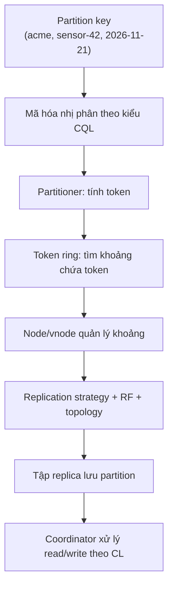
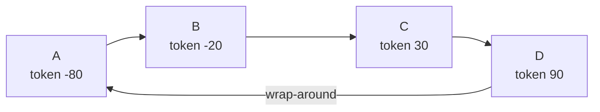
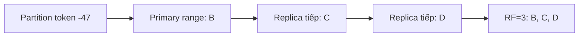
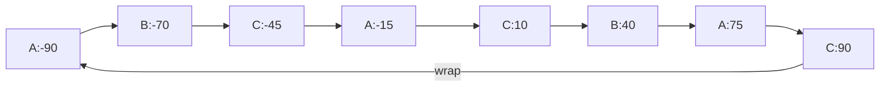
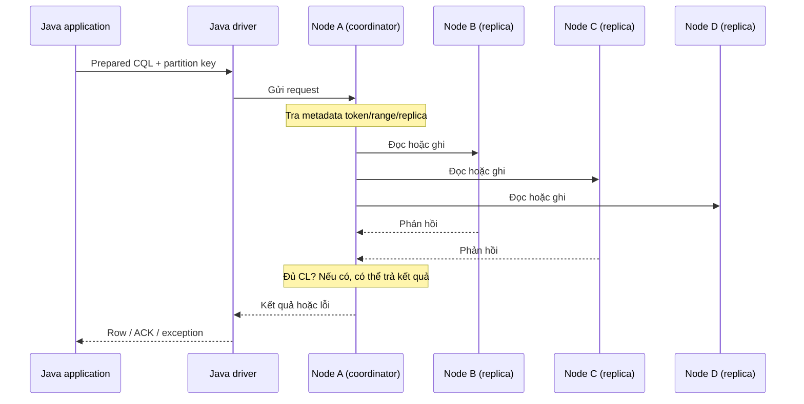
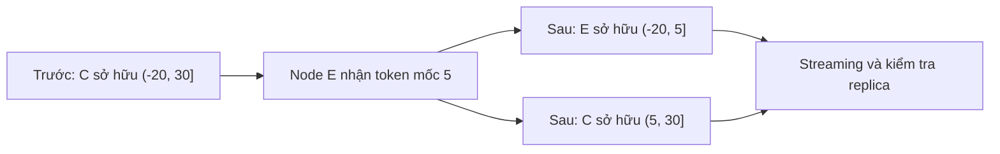

# Token ring, khoảng token và quyền sở hữu dữ liệu

> **Chương:** Token và sao chép  
> **Phạm vi:** Bài học giải thích cách Apache Cassandra tổ chức không gian token thành một **vòng logic**, ánh xạ token vào **khoảng token (token range)**, gán quyền sở hữu cho node/vnode và chọn các **replica** để lưu partition. Nội dung nối kiến trúc cụm phân tán, mô hình wide-column và partition key với CQL, consistency đọc/ghi, Java driver, mở rộng cụm, repair và xử lý lỗi.

## 1. Mục tiêu học tập

Sau bài này, bạn có thể:

1. Giải thích vì sao token ring là **không gian logic hình vòng**, không phải sơ đồ dây mạng hay danh sách các node có master.
2. Đọc chính xác quy ước khoảng `(previous_token, current_token]`, bao gồm **điểm đầu, điểm cuối** và trường hợp **wrap-around**.
3. Dùng một bảng token mốc giả định để xác định node quản lý một token và phân biệt **primary range ownership** với **replica ownership**.
4. Giải thích vnodes: một node vật lý có thể sở hữu nhiều khoảng token không liền kề.
5. Phân tích cách `Murmur3Partitioner`, metadata vòng token, replication strategy, RF, topology DC/rack và CL phối hợp mà **không đồng nhất các trách nhiệm**.
6. Dự đoán tác động của bootstrap, decommission, node hỏng hoặc đổi RF lên các khoảng token và các bản sao.
7. Sử dụng `token(...)` trong CQL, công cụ quan sát cluster và Java driver để kiểm tra đường định tuyến trên một workload có partition key ghép.
8. Nhận diện chênh lệch tải (skew), hot partition và giới hạn của việc cân bằng token range; đề xuất thí nghiệm an toàn trước khi vận hành.

## 2. Bắt đầu từ một row, không bắt đầu từ hình vẽ vòng tròn

Giả sử hệ thống IoT lưu lịch sử sự kiện theo tenant, thiết bị và ngày:

```sql
PRIMARY KEY ((tenant_id, device_id, event_day), event_time, event_id)
```

Một row có:

```text
tenant_id = acme
device_id = sensor-42
event_day = 2026-11-21
event_time = 2026-11-21T08:05:00Z
event_id = 11111111-1111-1111-1111-111111111111
```

Trong Cassandra, ba cột `tenant_id`, `device_id`, `event_day` tạo thành **composite partition key**. Hai cột `event_time` và `event_id` là **clustering columns**. Các row khác `event_time` nhưng cùng ba giá trị partition key sẽ thuộc **cùng một partition** và vì thế có **cùng token**.

Quá trình định vị dữ liệu có thể tóm tắt:



Nhìn vào sơ đồ, hãy tách hai câu hỏi:

- **Token của partition là gì?** Phụ thuộc **partition key đã mã hóa và partitioner**.
- **Những node nào giữ partition?** Phụ thuộc **token, metadata ownership, replication strategy, RF và topology**.

Đừng nhảy trực tiếp từ “token = X” sang “chắc chắn chỉ node Y chứa toàn bộ dữ liệu”; Cassandra thường **nhân bản partition**.

## 3. Từ partitioner tới một vòng token có thứ tự

**Partitioner** tính token từ byte của partition key. Trong nhiều cụm Apache Cassandra hiện đại, `Murmur3Partitioner` là lựa chọn phổ biến. Với partitioner này, token được biểu diễn bằng số nguyên 64-bit có dấu, trên không gian:

\[
[-2^{63},\,2^{63}-1]
\]

Khi được sử dụng như một vòng logic, thứ tự token **không kết thúc hẳn** ở giá trị lớn nhất: sau đoạn cuối là đoạn quay lại giá trị nhỏ nhất. Điều này giúp phân chia toàn bộ không gian token thành các khoảng, không bỏ sót phía “trước node đầu tiên”.

### 3.1. Token ring không phải vòng kết nối mạng

Một cluster có thể triển khai trên các máy nối với switch, mạng cloud, nhiều rack hoặc nhiều DC. Token ring **không** bắt các node gửi gói tin lần lượt qua láng giềng vật lý như một dây chuyền.

“Đi theo chiều kim đồng hồ” trong các hình Cassandra là cách diễn đạt **thứ tự tăng dần trên token ring**, phục vụ suy luận ownership và replication placement. Coordinator có thể gửi yêu cầu trực tiếp tới replica cần thiết theo mạng thực tế.

### 3.2. Token không phải khóa chính

Token là giá trị băm, không chứa bản gốc `tenant_id`, `device_id` hay `event_day`. Hai partition keys khác nhau **có thể** trùng token do giới hạn không gian 64-bit; Cassandra vẫn dùng khóa phân vùng đầy đủ để phân biệt.

Không dùng token làm khóa nghiệp vụ duy nhất, mã truy cập bảo mật hoặc cơ chế phân quyền tenant. Cũng không dùng so sánh token để xác định sự kiện nào mới hơn: Murmur3 không giữ thứ tự của ngày, ID thiết bị hoặc thời điểm.

## 4. Quy tắc khoảng token: mở trái, đóng phải

Trong mô hình vòng token một token mốc trên mỗi node, quy tắc thường được biểu diễn:

\[
(\text{previous\_token},\,\text{current\_token}]
\]

Nó có nghĩa:

- **Mở trái:** token đúng bằng `previous_token` **không** nằm trong khoảng đang xét.
- **Đóng phải:** token đúng bằng `current_token` **có** nằm trong khoảng đang xét.
- Khi khoảng vượt qua giá trị lớn nhất của không gian token, nó **quay vòng** về phía giá trị nhỏ nhất.

Trong sơ đồ đơn giản, node tại `current_token` chịu trách nhiệm chính (*primary range owner*) cho khoảng kết thúc ở token mốc của nó. Cần đặt quy tắc này trong đúng mô hình phân phối/token metadata; tập **replica** còn phụ thuộc vào replication strategy.

### 4.1. Vì sao cần xác định ranh giới chính xác?

Giả sử hai node có token mốc `-20` và `30`. Với khoảng `(-20, 30]`:

| Token ứng viên | Thuộc khoảng `(-20, 30]`? | Lý do |
| ---: | --- | --- |
| `-20` | Không | Bằng biên mở trái |
| `-19` | Có | Lớn hơn -20 |
| `0` | Có | Nằm giữa hai biên |
| `30` | Có | Bằng biên đóng phải |
| `31` | Không | Vượt biên phải |

Đổi cách đóng/mở hai biên có thể khiến một token mốc bị tính vào **hai** dải hoặc không được tính vào **dải nào** trong mô hình lý thuyết. Trong thực hành CQL, nên dùng metadata của cluster và API phù hợp thay vì tự viết code dự đoán ownership từ các điểm mốc không chắc đã mới.

## 5. Ví dụ vòng token bốn node

Để tính tay dễ hơn, ta dùng **không gian giả lập từ -100 đến 100**, không phải token thật của Murmur3. Có bốn node, mỗi node một token mốc:

| Node | Token mốc giả định | Dải token quản lý chính |
| --- | ---: | --- |
| **A** | `-80` | `(90, 100] ∪ [-100, -80]` |
| **B** | `-20` | `(-80, -20]` |
| **C** | `30` | `(-20, 30]` |
| **D** | `90` | `(30, 90]` |

Ở đây, `-100` và `100` chỉ là cách ghi **hai đầu của dải giả lập** cho dễ hình dung; với vòng token thực, giới hạn được xác định theo partitioner.



### 5.1. Xác định chủ dải

| Token của partition | Nằm trong dải | Node sở hữu dải chính |
| ---: | --- | --- |
| `-95` | `(90,100] ∪ [-100,-80]` | A |
| `-80` | Chính biên đóng phải của A | A |
| `-47` | `(-80,-20]` | B |
| `-20` | Chính biên đóng phải của B | B |
| `15` | `(-20,30]` | C |
| `30` | Chính biên đóng phải của C | C |
| `65` | `(30,90]` | D |
| `99` | Đoạn cuối rồi wrap-around | A |

**Bài học:** token lớn nhất không nhất thiết đến “node cuối” như danh sách tuyến tính. Node A, dù mốc của nó âm, vẫn chịu trách nhiệm cho phần **sau** mốc 90 và **trước hoặc bằng** -80.

### 5.2. Một token không được lấy từ mắt nhìn vào partition key

Ta không thể nhìn `device_id = sensor-42` và đoán token là `-47`. Những giá trị `-95`, `-47`, `15`... ở bảng này **được cho sẵn để luyện suy luận về khoảng**, không phải kết quả băm của bất kỳ CQL key nào trong ví dụ.

Với cụm thật, token phải được lấy bằng cơ chế server/driver tương thích với kiểu dữ liệu và partitioner.

## 6. Wrap-around: hai đoạn số, một khoảng liên tục trên vòng

Khoảng của node A ở trên là:

\[
(90,100]\;\cup\;[-100,-80]
\]

Nếu xem trục số, nó bị tách thành hai đoạn. Nếu xem **vòng**, đó là **một khoảng liên tục** đi từ token mốc 90 qua điểm cuối rồi tới token -80.

### 6.1. Điều dễ nhầm khi viết công cụ quét theo token

Một công cụ tự quét một khoảng qua điểm cuối không thể chỉ gửi điều kiện số thông thường:

```text
token > 90 AND token <= -80
```

vì trên trục số tuyến tính không có giá trị nào vừa lớn hơn 90 vừa nhỏ hơn hoặc bằng -80. Về mặt ý tưởng, phải xử lý **hai nhánh khoảng**:

```text
(token > 90) OR (token <= -80)
```

Điều này **không có nghĩa** CQL cho phép bạn ghép `OR` tùy ý trên partition-token predicates. Khi xây tooling, cần chia khoảng wrap-around thành các request được hỗ trợ, quản lý biên không trùng, phân trang, retry và cập nhật topology.

### 6.2. Cẩn thận với token nhỏ nhất

Trong không gian Murmur3 thật, giá trị token nhỏ nhất và biên modulo có những quy tắc/giá trị đặc biệt tùy API quản lý token range. Không tự giả định mọi thư viện biểu diễn khoảng dạng `[min,max]` hoặc `(min,max]` giống hệt nhau.

Hãy dùng metadata và các biểu diễn range được tài liệu hóa bởi **phiên bản Cassandra/driver bạn dùng**, nhất là với công cụ full-ring scan, restore hoặc migration. Các sơ đồ số nhỏ trong bài dùng để luyện **nguyên lý**.

## 7. “Quyền sở hữu” có ít nhất ba ý nghĩa cần tách

Thuật ngữ *ownership* có thể xuất hiện trong tài liệu, `nodetool` và bảng monitoring. Nó **không phải lúc nào cũng chỉ cùng một tỷ lệ**.

| Khái niệm | Ý nghĩa trong mô hình Cassandra | Có thể hiểu sai thành |
| --- | --- | --- |
| **Primary range ownership** | Các khoảng token mà token mốc/node quản lý chính theo cấu trúc ring | Toàn bộ các bản sao của node |
| **Replica ownership/effective ownership** | Tập khoảng/partition node giữ **do RF và replication strategy** | Chỉ những khoảng kết thúc ở token của node |
| **Dung lượng dữ liệu thực** | Số byte node đang chứa, chịu ảnh hưởng dữ liệu, nén, SSTable, RF, repair... | Tỷ lệ chiều dài dải token |
| **Lưu lượng request thực** | Đọc/ghi/compaction trên node do truy vấn và skew | Tỷ lệ token range mà node quản lý |

### 7.1. Tỷ lệ token range chỉ là hình học, không phải byte

Với không gian giả lập 200 đơn vị độ dài ở phần 5, chiều dài các khoảng:

| Node | Độ dài dải | Tỷ lệ hình học minh họa |
| --- | ---: | ---: |
| A | `(90→100) + (-100→-80) = 10 + 20 = 30` | 15% |
| B | `-80→-20 = 60` | 30% |
| C | `-20→30 = 50` | 25% |
| D | `30→90 = 60` | 30% |
| **Tổng** | **200** | **100%** |

Con số trên chỉ đo **chiều dài token ring giả lập** theo mô hình một token mốc/node, không tính replica. Không được suy ra node A chắc chắn có 15% byte, 15% row hoặc 15% QPS; một partition hot trên dải A có thể gây tải vượt xa tỉ lệ hình học.

### 7.2. Với RF > 1, effective ownership có thể vượt tổng 100%

Một partition có thể tồn tại trên nhiều node. Trong một cluster bốn node với RF = 3, nếu dữ liệu được nhân bản đầy đủ, mỗi partition có **ba bản sao** trên ba node vật lý khác nhau. Khi cộng các tỷ lệ node giữ các replica, không thể mặc định tổng đúng **100%** như cách cộng primary token ranges.

Khi đọc cột “Owns” hoặc “Owns (effective)” trong các công cụ, phải xem **keyspace cụ thể, RF, strategy và định nghĩa của phiên bản công cụ**. Không dùng một tỷ lệ ownership duy nhất để quyết định node đã cân tải tốt hay chưa.

## 8. Primary owner khác tập replica như thế nào?

Giả sử dùng vòng giả lập bốn node A/B/C/D ở trên, một DC, **mỗi node một token mốc**, và một chiến lược replication đơn giản đi theo thứ tự vòng để chọn **các node vật lý khác nhau**.

Nếu một partition có token `-47`:

1. Token `-47` nằm trong khoảng `(-80,-20]`.
2. **B** là node chịu trách nhiệm dải chính trong mô hình.
3. Với **RF = 1**, chỉ B giữ bản sao theo mô hình này.
4. Với **RF = 3** và cách chọn các node kế tiếp theo vòng, có thể minh họa tập replica là **B, C, D**.



**Cảnh báo phạm vi:** đây là ví dụ đơn giản để hiểu “chọn nhiều replica theo ring”. Với `NetworkTopologyStrategy`, nhiều rack, nhiều DC và vnodes, placement phải tuân thủ quy tắc topology; **không** tính replica production chỉ bằng “ba token mốc kế tiếp bất kể rack/DC”.

### 8.1. Thay RF không thay token

Nếu partition key và partitioner không đổi, nâng RF từ 1 lên 3 **không tính lại token** của partition. Điều đổi là **tập node có trách nhiệm giữ bản sao**, dung lượng/traffic replication, quy trình đảm bảo các replica mới được đồng bộ và các lựa chọn CL.

Sửa RF trong keyspace không có nghĩa dữ liệu đã tự sẵn có đầy đủ tức thì trên mọi replica mới. Phải theo **quy trình vận hành của phiên bản** để bảo đảm các bản sao bổ sung nhận đủ dữ liệu và đã được kiểm tra.

### 8.2. Consistency level không xác định ownership

`LOCAL_ONE`, `LOCAL_QUORUM` và `ALL` đặt **điều kiện phản hồi** cho read/write; chúng không đổi token, dải token hoặc định nghĩa partition. Cùng một partition và cùng RF, request có thể chọn CL khác mà **tập replica được cấu hình vẫn không đổi**.

## 9. Virtual nodes (vnodes): một node có thể nằm ở nhiều chỗ trên vòng

Mô hình một node/một token ở phần 5 rất hữu ích để học, nhưng Cassandra thực tế thường dùng **virtual nodes**.

Với vnodes, một node vật lý có thể có nhiều token mốc và nhiều khoảng không liền kề. Ví dụ minh họa:

```text
Token mốc theo thứ tự vòng:
  -90: Node A
  -70: Node B
  -45: Node C
  -15: Node A
   10: Node C
   40: Node B
   75: Node A
   90: Node C

=> A xuất hiện ba lần, B hai lần, C ba lần.
=> Mỗi lần xuất hiện là một điểm mốc/dải trong sơ đồ đơn giản.
```



### 9.1. Vnodes giúp gì?

- Phân phối nhiều khoảng token cho các node, hỗ trợ cân bằng không gian khóa.
- Có thể thuận tiện khi thêm/thay node và di chuyển dải theo topology.
- Giảm sự phụ thuộc vào việc một node vật lý nắm một đoạn liên tục rất lớn của ring.

Tuy nhiên, nhiều vnodes hơn **không mặc định tốt hơn**:

- Có thể tăng số công việc/luồng streaming, các dải cần repair và độ phức tạp điều phối.
- Số vnode/node phù hợp tùy phiên bản Cassandra, dung lượng node, tính chất dữ liệu và phương pháp phân bổ token.
- Một **partition** vẫn có một token dù node chứa nhiều vnodes; nó không được cắt thành các mảnh theo từng clustering row.

### 9.2. RF = 3 là ba node vật lý thích hợp, không phải ba vnode cùng một node

Nếu Node A có mười token mốc, nó **không** được tính là mười replica độc lập của cùng một partition. Cassandra phải lựa chọn các replica theo **node vật lý** và topology/strategy, tránh coi nhiều vnode cùng host là những bản sao chịu lỗi độc lập.

Vì vậy, một cluster chỉ có **một node vật lý** không trở thành cluster ba replica thực sự chỉ bằng cách đặt `num_tokens = 3` hay khai báo RF = 3.

## 10. Replication strategy và rack/DC

### 10.1. NetworkTopologyStrategy

Trong cluster Apache Cassandra có DC tên `dc1` và đủ node thích hợp, ví dụ:

```sql
CREATE KEYSPACE IF NOT EXISTS telemetry_ring
WITH replication = {
    'class': 'NetworkTopologyStrategy',
    'dc1': 3
};
```

`NetworkTopologyStrategy` chọn các replica theo các quy tắc có xét DC/rack; mục tiêu là phân bổ bản sao trên những miền lỗi phù hợp khi topology cho phép. Trong DC có nhiều rack, việc placement được thiết kế để phân tán replica theo rack theo chính sách của strategy.

**Không** đọc ví dụ này như lời hứa “ba replica sẽ luôn ở ba rack” nếu thực tế chỉ có một hoặc hai rack hoặc topology được khai báo sai. Cần kiểm tra snitch, DC/rack và metadata cluster.

### 10.2. SimpleStrategy là ví dụ để hiểu nguyên lý, không là mặc định production đa DC

`SimpleStrategy` giúp học nguyên tắc chọn replica theo vòng trong một số tình huống đơn giản. Nhưng trong môi trường có nhiều DC/rack, dùng `NetworkTopologyStrategy` thích hợp để có replica theo topology; không khuyến nghị áp `SimpleStrategy` một cách máy móc cho keyspace production nhiều DC.

### 10.3. Nhiều data center

Ví dụ một keyspace ở hai DC, mỗi DC đủ ba node:

```sql
CREATE KEYSPACE IF NOT EXISTS telemetry_multi_dc
WITH replication = {
    'class': 'NetworkTopologyStrategy',
    'dc1': 3,
    'dc2': 3
};
```

Mỗi partition có token do partitioner tính ra như cũ, nhưng topology có **các tập replica theo từng DC**. Với RF cục bộ bằng 3:

- `LOCAL_ONE` ở `dc1` cần một replica cục bộ phản hồi.
- `LOCAL_QUORUM` ở `dc1` thường cần hai replica cục bộ.
- `QUORUM` toàn cục, với tổng RF = 6 trong ví dụ, thường cần bốn replica theo phạm vi tính quorum tương ứng.

Một ghi được xác nhận ở `LOCAL_QUORUM` tại `dc1` **không chứng minh** mọi replica của `dc2` đã nhận đủ dữ liệu. Khi lập kế hoạch mất cả DC, phải đo **RPO/RTO**, failover/failback và quy trình hội tụ dữ liệu, không chỉ nhìn token ring.

## 11. Coordinator, driver và node lưu dữ liệu là ba vai trò khác nhau

Một ứng dụng Java có thể kết nối đến Node A, nhưng partition token thuộc primary range của B, và tập replica giả định của nó là B/C/D. Node A khi ấy vẫn có thể làm **coordinator**: tiếp nhận request, định vị replica và chờ phản hồi theo CL.



Sơ đồ chỉ minh họa; các yêu cầu đọc/ghi và tối ưu phản hồi thực tế thay đổi theo phiên bản, CL, trạng thái replica và cấu hình. Không phải mọi request đều gửi/đợi đầy đủ cùng một tập phản hồi theo cách vẽ.

### 11.1. Driver token-aware routing

Java driver có thể tính/nhận biết routing key và token từ **partition key đã bind đầy đủ**, kết hợp metadata topology để ưu tiên coordinator phù hợp, thường ưu tiên replica cục bộ khả dụng.

Việc token-aware giúp giảm đường vòng mạng trong nhiều trường hợp, nhưng:

- Coordinator **không bắt buộc** là primary range owner.
- Coordinator được chọn **không** làm thay đổi replica placement.
- Fallback có thể xảy ra khi driver thiếu metadata, node lỗi hoặc policy khác.
- Prepared statement không chữa một câu `SELECT` thiếu partition key hoặc quét rộng.

## 12. Node lỗi: token có đổi ngay không?

Giả sử partition có RF = 3 tại `dc1`, replica B/C/D. Node C tạm thời không phản hồi. Điều xảy ra:

1. **Partition key và token không đổi.** Không có chuyện Cassandra tự băm lại khóa chỉ vì một node bị lỗi.
2. Topology/membership có thể đánh dấu C chưa sẵn sàng; coordinator và driver điều chỉnh cách gửi request trong giới hạn cho phép.
3. Nếu B và D phản hồi đúng hạn, một yêu cầu `LOCAL_QUORUM` thường vẫn có thể đạt (2/3 replica cục bộ).
4. Nếu chỉ B phản hồi, `LOCAL_QUORUM` không đạt; `LOCAL_ONE` có thể còn thực hiện được nếu điều kiện khác phù hợp.
5. Khi C trở lại, dữ liệu có thể cần cơ chế hội tụ/đối chiếu như hinted handoff trong phạm vi hỗ trợ và anti-entropy repair.

| Tình huống | Token/partition key | Replica placement được cấu hình | Khả năng đạt RF = 3, `LOCAL_QUORUM` |
| --- | --- | --- | --- |
| B/C/D khỏe | Không đổi | B/C/D | Có thể đạt |
| C không phản hồi, B/D khỏe | Không đổi | Vẫn xét B/C/D theo topology, với C tạm lỗi | Có thể đạt |
| C/D không phản hồi, chỉ B khỏe | Không đổi | Không tự trở thành một tập ba replica mới ngay lập tức | Không đủ 2 replica cục bộ |
| Tái cấu hình/thay node theo quy trình | Token key không đổi | Metadata/quyền sở hữu replica có thể thay | Phải quan sát sau chuyển đổi |

**Lưu ý:** “có thể đạt theo số replica” không phải cam kết mọi request sẽ thành công; network, queue, compaction, disk I/O và deadline vẫn có thể gây timeout.

## 13. Thêm node: dải token thay đổi, khóa không đổi

Giả sử trước khi mở rộng, node C quản lý khoảng `(-20, 30]` trong ví dụ phần 5. Ta thêm node E với token mốc **`5`**:

| Trước khi thêm E | Sau khi E tham gia và ownership ổn định |
| --- | --- |
| C: `(-20,30]` | E: `(-20,5]` |
| — | C: `(5,30]` |

Token của partition có giá trị `-7` **không đổi**, nhưng khoảng chứa nó giờ thuộc node E theo mô hình primary ownership. Token `24` vẫn thuộc C.



### 13.1. Bootstrap không chỉ là thêm tên vào sơ đồ

Trong cụm thực, quá trình thêm node có thể bao gồm:

- Metadata/token ownership chuyển sang trạng thái chuyển tiếp.
- Tính những dải/replica sẽ được node mới nhận theo replication strategy.
- **Streaming dữ liệu** cần thiết giữa các node.
- Chờ node mới tham gia bình thường và kiểm chứng dữ liệu/metrics.
- Xử lý ảnh hưởng tới nguồn streaming, I/O, mạng và tail latency.

Với RF > 1, thay đổi primary owner có thể kéo theo thay đổi **nhiều vị trí replica** chứ không chỉ chuyển một dải dữ liệu từ C sang E. Với vnodes, một node mới có thể nhận nhiều khoảng từ nhiều node khác.

### 13.2. Pending ranges và tính nhất quán trong quá trình chuyển đổi

Khi topology thay đổi, metadata có thể biểu diễn những khoảng/vị trí **đang chờ nhận trách nhiệm** (*pending ranges*) để các mutation được xử lý an toàn theo cơ chế và phiên bản Cassandra. Đừng coi sơ đồ “trước” hoặc “sau” là ảnh chụp chính xác ở mọi thời điểm bootstrap.

Một hệ thống giám sát tốt cần phân biệt:

- **Ownership cuối cùng dự kiến** khi quá trình hoàn tất.
- **Replica hiện có và replica đang nhận dữ liệu** trong giai đoạn chuyển tiếp.
- **Trạng thái cluster và các thao tác streaming** chưa kết thúc.

Để biết node có thể phục vụ dữ liệu đúng hay không, cần xét **metadata/topology hiện thời và trạng thái stream**, không chỉ tính toán với một danh sách token mốc lưu từ hôm trước.

## 14. Decommission, replace, mất node vĩnh viễn và cleanup

Những thao tác khác nhau không nên gom thành “đổi chủ dữ liệu” chung:

| Tình huống | Ý nghĩa đối với ownership | Yêu cầu vận hành |
| --- | --- | --- |
| **Bootstrap** | Node mới nhận quyền sở hữu token ranges/replica | Streaming, capacity và kiểm tra trạng thái |
| **Decommission có kiểm soát** | Node rời cluster, trách nhiệm dữ liệu chuyển cho các node còn lại | Đủ dung lượng/replica, streaming và kiểm tra sau thay đổi |
| **Replace node lỗi** | Khôi phục chức năng node theo quy trình thay thế của phiên bản | Quy trình replace và đồng bộ dữ liệu, không tùy tiện đặt token |
| **Node tạm down** | Node có thể vẫn thuộc topology, nhưng không phục vụ đúng hạn | CL, quan sát replica còn lại, đưa node trở lại/hội tụ |
| **Cleanup khi thích hợp** | Sau thay đổi ownership, dữ liệu node không còn phải giữ có thể cần được dọn | Xác minh topology/streaming trước; cân nhắc công cụ và phiên bản |
| **Thay replication factor** | Số replica mục tiêu thay đổi, token của khóa không đổi | Đồng bộ replica mới/bổ sung, kiểm chứng CL và capacity |

Không tự chạy `nodetool decommission`, `replace`, `cleanup`, `repair` hoặc thay `num_tokens` trên production chỉ để học. Đây đều có thể là thao tác ảnh hưởng dữ liệu, dung lượng, tốc độ hoặc availability.

### 14.1. Token ring không tự đảm bảo cluster có dung lượng dự phòng

Ví dụ bốn node ban đầu đã gần đầy đĩa. Nếu một node rời cluster, dữ liệu/replica cần di chuyển sang các node còn lại; sơ đồ token có thể đẹp nhưng **không còn capacity** để giữ đủ bản sao.

Capacity planning phải dựa trên dữ liệu thực, RF, nén, compaction headroom, mạng/streaming và tình huống mất node. Không lấy mỗi % dải token làm căn cứ cho quyết định thay node.

## 15. Lab CQL: quan sát token của partition

Mục tiêu của lab này là chứng minh **cùng partition key → cùng token** và đối chiếu với dải trong cluster thật. Không cần gây lỗi hoặc thay topology.

### 15.1. Chuẩn bị keyspace

Giả định cluster **Apache Cassandra tự quản lý**, data center thực sự mang tên `dc1` và có ba node phù hợp để chạy RF = 3:

```sql
CREATE KEYSPACE IF NOT EXISTS telemetry_ring
WITH replication = {
    'class': 'NetworkTopologyStrategy',
    'dc1': 3
};
```

Nếu lab chỉ có **một node**, dùng `'dc1': 1` và `LOCAL_ONE`; không nhập RF = 3 rồi tuyên bố đã kiểm chứng ba bản sao.

### 15.2. Tạo bảng theo truy vấn

```sql
CREATE TABLE IF NOT EXISTS telemetry_ring.events_by_device_day (
    tenant_id text,
    device_id text,
    event_day date,
    event_time timestamp,
    event_id uuid,
    temperature_c double,
    event_type text,
    PRIMARY KEY ((tenant_id, device_id, event_day), event_time, event_id)
) WITH CLUSTERING ORDER BY (event_time DESC, event_id ASC);
```

Bảng dùng ba cột làm composite partition key, hai cột clustering. `CLUSTERING ORDER BY` chỉ ảnh hưởng thứ tự **trong partition**, không ảnh hưởng token của partition.

### 15.3. Ghi dữ liệu thuộc hai partition

```sql
INSERT INTO telemetry_ring.events_by_device_day (
    tenant_id, device_id, event_day, event_time,
    event_id, temperature_c, event_type
) VALUES (
    'acme', 'sensor-42', '2026-11-21',
    '2026-11-21T08:05:00Z',
    11111111-1111-1111-1111-111111111111,
    27.4, 'READING'
);

INSERT INTO telemetry_ring.events_by_device_day (
    tenant_id, device_id, event_day, event_time,
    event_id, temperature_c, event_type
) VALUES (
    'acme', 'sensor-42', '2026-11-21',
    '2026-11-21T08:06:00Z',
    22222222-2222-2222-2222-222222222222,
    27.8, 'READING'
);

INSERT INTO telemetry_ring.events_by_device_day (
    tenant_id, device_id, event_day, event_time,
    event_id, temperature_c, event_type
) VALUES (
    'acme', 'sensor-42', '2026-11-22',
    '2026-11-22T08:05:00Z',
    33333333-3333-3333-3333-333333333333,
    28.1, 'READING'
);
```

### 15.4. Dùng hàm `token(...)`

```sql
SELECT token(tenant_id, device_id, event_day) AS partition_token,
       event_time, event_id, temperature_c
FROM telemetry_ring.events_by_device_day
WHERE tenant_id = 'acme'
  AND device_id = 'sensor-42'
  AND event_day = '2026-11-21';

SELECT token(tenant_id, device_id, event_day) AS partition_token,
       event_time, event_id
FROM telemetry_ring.events_by_device_day
WHERE tenant_id = 'acme'
  AND device_id = 'sensor-42'
  AND event_day = '2026-11-22';
```

**Quan sát kỳ vọng:**

1. Hai row thuộc `2026-11-21` có cùng `partition_token`.
2. Row ngày `2026-11-22` có partition key khác, **thường** cho token khác.
3. Kết quả token là số nguyên có dấu nếu cluster dùng `Murmur3Partitioner`.
4. Không có token số cố định nào được bài học đoán trước; **ghi đúng giá trị cluster của bạn trả về**.

Lưu ý: hàm `token(...)` nhận các cột của **partition key theo đúng schema**, không lấy clustering column `event_time` làm thành phần của hash.

## 16. Đối chiếu ring bằng công cụ quản trị và tracing

Trên môi trường lab Apache Cassandra tự quản lý, những lệnh quan sát thường gặp:

```bash
nodetool status
nodetool ring
nodetool describering telemetry_ring
nodetool netstats
```

Tên lệnh, tham số, nội dung output và quyền sử dụng tùy phiên bản. `nodetool ring` có thể rất dài khi dùng vnodes; `nodetool describering` hoặc công cụ metadata phù hợp có thể hỗ trợ xem các khoảng/endpoint theo keyspace. `nodetool netstats` hữu ích khi quan sát **streaming** trong giai đoạn thay topology.

### 16.1. Kế hoạch quan sát từng bước

1. **Xác minh DC/rack và trạng thái node** bằng `nodetool status` hoặc giao diện giám sát tương đương.
2. **Quan sát token mốc** và dải trên vòng bằng `ring`/`describering` theo khả năng công cụ.
3. **Lấy token thật** của `(acme, sensor-42, 2026-11-21)` bằng CQL ở mục 15.
4. **Xác định dải chứa token** dựa trên metadata, chú ý ranh giới và wrap-around.
5. **Xác định replica thực tế** theo keyspace `telemetry_ring` và topology; không chỉ dựa vào một cột “Owns”.
6. **Ghi bằng chứng:** token, phạm vi dải, RF, CL, tên node/DC và thời gian quan sát.

Không cần và không nên chuyển topology thật chỉ để làm trọn bài lab quan sát ownership.

### 16.2. Tracing trong cqlsh

```sql
TRACING ON;

SELECT event_time, event_id, temperature_c
FROM telemetry_ring.events_by_device_day
WHERE tenant_id = 'acme'
  AND device_id = 'sensor-42'
  AND event_day = '2026-11-21'
LIMIT 5;

TRACING OFF;
```

Tracing giúp khảo sát một số bước điều phối theo phiên bản/thiết lập; nó **có overhead** và không phải bản chụp đầy đủ mọi bước internal. Không bật tracing thường trực trên production để quan sát token.

## 17. Java driver 4.x: dùng routing key thay vì tự đoán node

Ứng dụng Java nên chuẩn bị câu CQL có đủ partition key và để driver sử dụng schema/topology metadata khi phù hợp. Không tự giữ danh sách “thiết bị X nằm ở node Y” trong code ứng dụng, bởi membership và ownership có thể thay đổi khi bootstrap, replace hoặc decommission.

### 17.1. Ví dụ đọc dữ liệu và token của partition

Đoạn Java 11+ minh họa Java driver 4.x cho Apache Cassandra với keyspace/bảng lab. Cấu hình `dc1`, `127.0.0.1`, RF và CL phải khớp môi trường thực:

```java
import java.net.InetSocketAddress;
import java.time.LocalDate;

import com.datastax.oss.driver.api.core.CqlSession;
import com.datastax.oss.driver.api.core.DefaultConsistencyLevel;
import com.datastax.oss.driver.api.core.cql.PreparedStatement;
import com.datastax.oss.driver.api.core.cql.ResultSet;
import com.datastax.oss.driver.api.core.cql.Row;

public final class RingOwnershipDemo {
    public static void main(String[] args) {
        try (CqlSession session = CqlSession.builder()
                .addContactPoint(new InetSocketAddress("127.0.0.1", 9042))
                .withLocalDatacenter("dc1")
                .build()) {

            PreparedStatement read = session.prepare(
                "SELECT token(tenant_id, device_id, event_day) " +
                "AS partition_token, event_time, event_id, temperature_c " +
                "FROM telemetry_ring.events_by_device_day " +
                "WHERE tenant_id = ? AND device_id = ? " +
                "AND event_day = ? LIMIT 100"
            );

            ResultSet result = session.execute(
                read.bind(
                    "acme", "sensor-42", LocalDate.of(2026, 11, 21)
                ).setConsistencyLevel(DefaultConsistencyLevel.LOCAL_QUORUM)
                 .setIdempotent(true)
            );

            for (Row row : result) {
                // Kiểu token BIGINT tương ứng Murmur3Partitioner.
                long token = row.getLong("partition_token");
                System.out.printf(
                    "token=%d time=%s event=%s%n",
                    token,
                    row.getInstant("event_time"),
                    row.getUuid("event_id")
                );
            }
        }
    }
}
```

Với lab một node/RF = 1, đổi `LOCAL_QUORUM` thành `LOCAL_ONE`. Đừng giả định Java driver sẽ chấp nhận cùng cấu hình TLS/auth/CL hoặc token type trên **mọi dịch vụ Cassandra-compatible**, vì backend có thể dùng mô hình khác.

### 17.2. Những điều driver biết và không biết

| Driver có thể | Driver không thể |
| --- | --- |
| Bind `text`/`date`/`timestamp` và các kiểu CQL tương ứng | Sửa một partition key gây hot partition |
| Suy routing key từ prepared statement đủ điều kiện | Đảm bảo câu truy vấn thiếu partition key vẫn là point lookup |
| Nhận metadata topology và ưu tiên coordinator phù hợp | Tự đặt RF hoặc replica placement của server |
| Phát hiện node lỗi/đổi coordinator theo policy | Làm thay đổi token của partition đã tồn tại |
| Trả timeout/unavailable | Khẳng định mutation chưa ghi ở bất kỳ replica nào khi timeout |

Driver token-aware routing giúp **chọn đường gửi**. Server mới là nơi duy trì token ranges, topology và xử lý đọc/ghi.

## 18. Đường đọc theo token range không thay thế truy vấn theo khóa

Một số công cụ muốn duyệt dữ liệu theo dải token, chẳng hạn migration hoặc phân chia việc quét. CQL có thể hỗ trợ predicate dạng:

```sql
-- Minh họa cấu trúc truy vấn theo token range, không phải
-- query chính cho API "100 sự kiện mới nhất của một thiết bị".
SELECT tenant_id, device_id, event_day, event_time
FROM telemetry_ring.events_by_device_day
WHERE token(tenant_id, device_id, event_day) > -1000000
  AND token(tenant_id, device_id, event_day) <= 1000000
LIMIT 100;
```

Hãy phân biệt:

| Query | Phạm vi phục vụ | Rủi ro |
| --- | --- | --- |
| `WHERE tenant_id=? AND device_id=? AND event_day=?` | **Một partition** đã biết | Có thể nóng/lớn, nhưng định vị rõ |
| `WHERE token(...) > a AND token(...) <= b` | **Nhiều partition** thuộc dải token | Quét nhiều row/node; giới hạn và phân trang phức tạp |
| `WHERE event_time > ...` mà không có partition key | Không có đường định vị như Q1/Q2 | Có thể không được CQL hỗ trợ trực tiếp hoặc cực tốn kém |

Token order là thứ tự hash, không phải **event-time order** hay tenant order. Câu `LIMIT 100` không biến token range scan thành “100 sự kiện mới nhất toàn hệ thống”.

### 18.1. Full-ring scanning cần xử lý biên và membership

Một công cụ quét toàn bộ token ring an toàn phải xử lý:

- Khoảng token ở biên wrap-around.
- Ranh giới mở trái/đóng phải, tránh bỏ sót hoặc lặp partition.
- Retry/paging và những row mới được ghi trong khi quét.
- Metadata cluster thay đổi trong quá trình thêm/rút node.
- Rate limit/backpressure để không làm quá tải replica.
- Deduplication và đối soát khi yêu cầu dữ liệu chính xác.

Do vậy, những công việc như backup, export/migration hoặc phân tích toàn tập cần công cụ và quy trình phù hợp, không chỉ vòng lặp CQL theo token chạy trên production.

## 19. Ownership có liên hệ gì với compaction, repair và hot partition?

Ba câu hỏi này rất dễ bị trộn:

| Cơ chế | Mục đích | Có tự đổi token của partition? |
| --- | --- | --- |
| **Token ownership / bootstrap** | Xác định và chuyển phạm vi node phải phục vụ/lưu dữ liệu | Không đổi giá trị hash của khóa; có thể đổi node chịu trách nhiệm |
| **Replication strategy / RF** | Chọn số và vị trí các replica | Không |
| **Compaction** | Hợp nhất SSTable/phiên bản/tombstone cục bộ | Không |
| **Repair** | Đồng bộ khác biệt giữa replica theo phạm vi phù hợp | Không |
| **TTL / DELETE** | Xác định thời hạn hoặc trạng thái xóa của dữ liệu | Không |
| **Đổi partition key** | Chia lại partition logic thành khóa mới | **Có thể tạo token mới**; cần tạo schema và migration |

### 19.1. Vì sao % ownership cân bằng vẫn có thể chậm?

Giả sử node A và B có khoảng token gần bằng nhau, nhưng một `tenant_id/device_id` duy nhất tạo 20.000 sự kiện/giây trong cùng bucket ngày. Các ghi đó sẽ đến tập replica của **một partition/token**, không được trải đều chỉ vì hai node có tỷ lệ ring tương đương.

**Hot partition** là câu chuyện **tải theo khóa và tập replica**, khác với **lệch phân bổ token range**.

Các phương án đánh giá:

- Bucket nhỏ hơn, chẳng hạn theo giờ thay vì ngày, nếu ngữ nghĩa truy vấn phù hợp.
- Shard logic từ ID sự kiện ổn định để chia ghi thành nhiều partition, chấp nhận fan-out/merge khi đọc.
- Backpressure, batching phù hợp, giới hạn concurrency ở ứng dụng.
- Đo phân bố partition size/QPS thực, compaction backlog, p95/p99 latency.

**Không** chọn RF cao, chạy repair hoặc thay CL như giải pháp mặc định để “chia một partition” thành nhiều khóa; các cơ chế đó giải quyết vấn đề khác.

### 19.2. Khi nào ownership thay đổi còn dữ liệu trên đĩa chưa thay đổi hoàn toàn?

Trong lúc bootstrap/decommission và streaming, metadata chuyển tiếp, dữ liệu tồn tại tạm thời ở những node liên quan, và việc dọn bản sao cũ có thể diễn ra theo quy trình sau thay đổi. Vì thế:

- Không lấy số byte đĩa ngay giữa quá trình streaming làm bằng chứng cuối cùng của ownership.
- Không chạy cleanup khi chưa xác minh topology và dữ liệu đã được chuyển/nhân bản phù hợp.
- Cần metric trạng thái streaming, đủ replica, lỗi request và ổ đĩa dự phòng.

## 20. Tình huống thực hành và đáp án gợi ý

### Bài A — Xác định khoảng

Với vòng token giả lập `A=-80`, `B=-20`, `C=30`, `D=90`, node nào quản lý chính các token `-80`, `-47`, `30`, `99`?

**Gợi ý:** Theo quy tắc khoảng `(previous,current]`, lần lượt A, B, C, A. Token `99` nằm ở đoạn wrap-around của A; token đúng bằng biên phải thuộc dải kết thúc tại biên ấy.

### Bài B — Chọn replica theo mô hình đơn giản

Token `-47` có primary range owner B. Trong mô hình ring một DC, một token/node và chiến lược đặt ba bản sao trên các node tiếp theo, RF = 3 có thể đặt ở đâu?

**Gợi ý:** B/C/D theo ví dụ đơn giản. Nhưng trong production có NTS, rack, DC và vnodes, cần xem metadata/strategy thật; không lấy ví dụ đơn giản làm kết quả placement thực tế.

### Bài C — Tính % ownership giả lập

Trong không gian giả lập -100 đến 100, dải của A gồm hai đoạn `(90,100]` và `[-100,-80]`. Tỷ lệ chiều dài hình học là bao nhiêu?

**Gợi ý:** `(10+20)/200 = 15%`. Đây **không** nhất thiết là 15% byte lưu trữ hoặc 15% QPS, nhất là với RF > 1 hoặc hot partition.

### Bài D — Thêm E giữa B và C

Trước thay đổi, C sở hữu `(-20,30]`. Thêm E có token `5`, thì token `-7` và `24` thuộc primary owner nào sau khi topology ổn định?

**Gợi ý:** `-7` thuộc E và `24` thuộc C. Token của partition **không đổi**; node chịu trách nhiệm dải mới thay đổi.

### Bài E — Mất một replica

RF = 3 trong `dc1`, tập replica của partition B/C/D. C tạm lỗi, B và D khỏe. `LOCAL_QUORUM` cần bao nhiêu replica và kết quả nào có thể xảy ra?

**Gợi ý:** Cần hai replica cục bộ, nên **có thể** đạt; request vẫn có thể timeout vì tải/network/đĩa. Nếu B cũng lỗi, chỉ D đáp ứng thì không đạt quorum.

### Bài F — Token-aware routing và thay topology

Ứng dụng Java ghi cứng `sensor-42 → node C` vì hôm qua token của thiết bị thuộc dải C. Hôm nay cluster vừa bootstrap node E vào một phần dải ấy. Vì sao cách làm dễ hỏng?

**Gợi ý:** Ownership có thể đổi trong khi token key giữ nguyên. Cần driver có metadata và policy cập nhật, không tự mã hóa ánh xạ thiết bị → node trong ứng dụng.

### Bài G — Một node có sáu vnodes

Node A quản lý sáu khoảng rời nhau, cluster có hai node vật lý khác. Có được tính sáu vnode của A là sáu bản sao độc lập để chạy RF = 6 không?

**Gợi ý:** Không. Replica phục vụ chịu lỗi phải nằm trên những **node vật lý** thích hợp theo topology/strategy, không phải sáu vị trí token cùng một node.

### Bài H — Tại sao token-range scan không trả timeline?

Một analyst muốn lấy “100 sự kiện mới nhất toàn công ty” bằng `WHERE token(...) > X LIMIT 100`.

**Gợi ý:** Token là thứ tự hash của partition key, không phản ánh `event_time`. Cần read model/stream aggregation/OLAP hoặc một pipeline thích hợp.

## 21. Checklist kiểm tra hiểu bài

- [ ] Phân biệt được partition key với clustering columns và biết chỉ partition key tạo token.
- [ ] Giải thích token ring là vòng logic, không phải đường truyền mạng vật lý.
- [ ] Đọc được dải `(previous_token,current_token]` và trường hợp bằng biên trái/phải.
- [ ] Xác định đúng primary owner của token ở đoạn wrap-around.
- [ ] Không nhầm primary token-range ownership với danh sách replica hoặc byte lưu trữ thực.
- [ ] Biết vnodes cho một node nhiều dải nhưng không tạo thêm node vật lý.
- [ ] Phân biệt partitioner, metadata, replication strategy, RF, CL và coordinator.
- [ ] Diễn giải được khác biệt của `LOCAL_QUORUM` trong một DC và `QUORUM` toàn cục ở hai DC.
- [ ] Giải thích vì sao node down không tự làm token của partition đổi.
- [ ] Hiểu bootstrap/decommission/replace cần streaming/metadata và kiểm tra capacity.
- [ ] Quan sát được `token(...)` của hai row cùng partition bằng CQL trong lab.
- [ ] Biết dùng `nodetool status/ring/describering` hoặc giao diện tương đương tùy môi trường.
- [ ] Không tự hard-code `partition key → node` trong Java; ưu tiên routing metadata của driver.
- [ ] Không dùng token-range scan như một truy vấn sắp thời gian.
- [ ] Nhận diện hot partition dù tỷ lệ khoảng token giữa node có vẻ cân bằng.
- [ ] Chỉ tuyên bố có kết quả failure test khi thực sự chạy trên cluster lab phù hợp.

## 22. Tổng kết: vòng token là bản đồ quyền sở hữu logic

Chuỗi cần nhớ trong Apache Cassandra:

**Partition key → partitioner → token → khoảng token trên ring → node/vnode giữ dải → replication strategy và RF chọn tập replica → coordinator đọc/ghi theo CL.**

Ba mệnh đề giúp tránh phần lớn nhầm lẫn:

1. **Token cố định theo khóa/partitioner, ownership có thể đổi theo topology.** Thêm node có thể làm partition chuyển primary owner mà không đổi giá trị token.
2. **Primary owner không đồng nghĩa bản sao duy nhất.** RF và replication strategy xác định thêm replica theo DC/rack, và một node vật lý có nhiều vnode vẫn không phải nhiều replica độc lập.
3. **Tỷ lệ token range không đồng nghĩa cân bằng dữ liệu hoặc tải.** Partition lớn/hot, khác biệt row size và skew của truy vấn có thể chi phối thực tế.

Hiểu vòng token giúp bạn thiết kế partition key đúng theo truy vấn, đọc metadata cluster, phân tích tác động của replication/consistency, bootstrap, repair và compaction, đồng thời kết nối ứng dụng Java bằng driver có khả năng định tuyến phù hợp. Đó là nền tảng cho các bài tiếp theo về replication factor, chiến lược sao chép, xử lý lỗi và vận hành của mô-đun **DATABASE_ENGINE_WIDE_COLUMN_CASSANDRA**.
