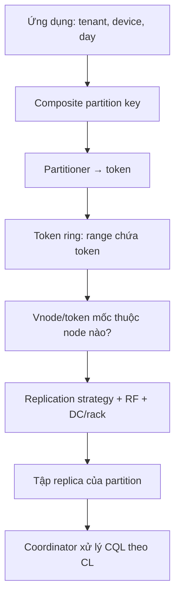
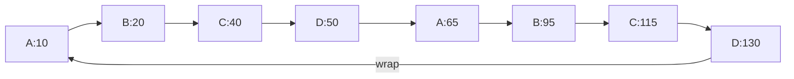
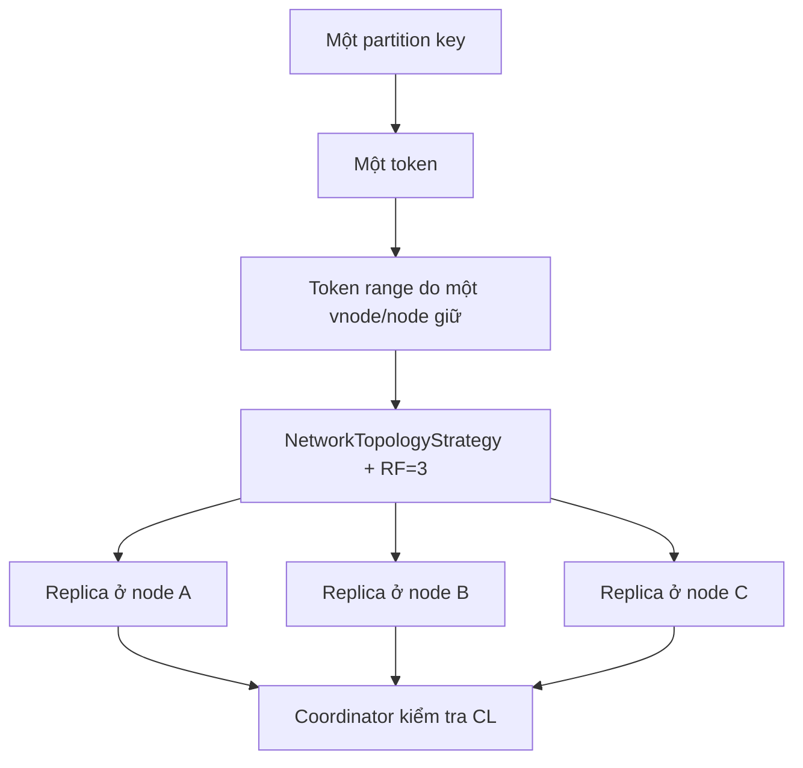
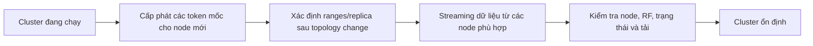

# Virtual node và đánh đổi trong phân phối/cân bằng

> **Chương:** Token và sao chép  
> **Phạm vi:** Apache Cassandra tổ chức dữ liệu theo partition key, token và replica. **Virtual node (vnode)** cho phép một node vật lý giữ nhiều vị trí trên token ring. Bài này tập trung vào **tại sao dùng vnodes, chúng thay đổi quyền sở hữu dải token như thế nào và đánh đổi ra sao khi cân bằng dữ liệu, tăng/giảm node, repair và xử lý lỗi**. CQL và Java driver được sử dụng để quan sát cơ chế, không phải để thay thế các quy trình vận hành cluster.

## 1. Mục tiêu học tập

Sau bài này, bạn có thể:

1. Phân biệt **node vật lý/tiến trình Cassandra**, **virtual node**, **token**, **token range** và **replica**; giải thích vì sao nhiều vnode trên một node không phải nhiều node chịu lỗi độc lập.
2. So sánh mô hình **một token cho mỗi node** với **nhiều token cho mỗi node**, kể cả ảnh hưởng tới dải dữ liệu khi thêm hoặc rút node.
3. Tính tỷ lệ **primary token-range ownership** bằng một vòng token giả lập, nhưng không đồng nhất tỷ lệ ấy với byte, partition hay request thực.
4. Giải thích các đánh đổi của số vnode: phân phối ban đầu, rebalance, bootstrap, replace, decommission, streaming, repair, metadata và độ phức tạp vận hành.
5. Nêu vai trò của `num_tokens` và lựa chọn/phân bổ token theo khả năng của từng phiên bản Cassandra, tránh coi một giá trị mặc định là quy tắc tối ưu chung.
6. Phân biệt ảnh hưởng của **partition key**, vnode, replication strategy, RF, DC/rack và consistency level trong phân phối tải và độ tin cậy.
7. Dùng CQL `token(...)`, `nodetool status`, `nodetool ring` và Java driver 4.x để quan sát phân phối dữ liệu.
8. Xây dựng cách đánh giá cân bằng dựa trên số liệu thật: hot partitions, dữ liệu trên đĩa, p95/p99 latency, streaming, repair và dung lượng dự phòng.

## 2. Bài toán: thêm node có làm dữ liệu tự cân bằng không?

Một hệ thống IoT có 4 node Cassandra. Có rất nhiều thiết bị, mỗi thiết bị tạo lịch sử sự kiện theo ngày. Đội vận hành thấy một node chứa nhiều byte hơn node khác và muốn thêm node để tăng dung lượng.

Hai câu hỏi cần tách:

- **Phân bổ token ranges** giữa các node có cân đối không?
- **Partition thực tế và tải truy vấn** có được trải đều không?

Chỉ cần một thiết bị cực nóng gửi 20.000 sự kiện/giây vào cùng partition, dù mỗi node có 1 hay 100 vnode, **partition đó vẫn có một partition key và một token**. Vnodes giúp phân bố **nhiều partition**, chứ không tự cắt một partition thành các mảnh độc lập.

### 2.1. Mô hình chuỗi trách nhiệm



**Vnode xuất hiện tại bước quyền sở hữu token range**, không phải khi tạo thêm ID sự kiện, tính clustering order hay quyết định số replica.

## 3. Phân biệt năm khái niệm thường bị gọi chung là “node”

| Khái niệm | Bản chất | Ví dụ |
| --- | --- | --- |
| **Node Cassandra** | Một thành viên cluster có tài nguyên CPU, RAM, đĩa, mạng và miền lỗi thực | Node A chạy Cassandra trên một VM |
| **Token** | Giá trị băm của partition key, hoặc điểm mốc trong metadata token ring | Token `-20` minh họa |
| **Token range** | Khoảng trong không gian token theo quy ước vòng | `(-80, -20]` |
| **Virtual node (vnode)** | Một trong nhiều vị trí token/range được gán cho một node Cassandra | Node A sở hữu các dải r1, r4, r7 |
| **Replica** | Một bản sao dữ liệu của partition trên một node phù hợp, theo replication strategy và RF | RF = 3 có ba replica của partition |

Vnode là **đơn vị chia quyền sở hữu token logic**, không phải container riêng, không có JVM, đĩa hoặc mạng riêng. Nếu cùng node A giữ 16 vnode mà host A mất điện, **cả 16 vnode của A đều không sẵn sàng**.

### 3.1. Vnode không phải clustering row

Xét bảng:

```sql
PRIMARY KEY ((tenant_id, device_id, event_day), event_time, event_id)
```

Ba cột trong ngoặc kép tạo **partition key**. Hai cột sau là **clustering columns**. Tất cả row cùng `tenant_id/device_id/event_day` có cùng token, dù `event_time` khác.

Một vnode giữ **một token range chứa nhiều partition**, còn một partition có thể chứa **nhiều clustering row**. Không có cơ chế “mỗi row được đưa sang một vnode khác” khi clustering timestamp tăng.

## 4. Vì sao mô hình một token cho mỗi node khó cân bằng?

Giả sử token ring được chia bằng **một điểm mốc/node**, và mỗi node quản lý khoảng `(previous_token, current_token]`. Nếu token mốc được phân bổ không đều, một node có thể chịu trách nhiệm một phần không gian token lớn hơn node khác.

Trong mô hình hash phân bố tốt, các partition key đủ đa dạng thường rải qua các dải. Khi một khoảng rộng gấp đôi khoảng khác, **kỳ vọng số partition** của khoảng rộng có thể lớn hơn, dù kết quả thực còn chịu ảnh hưởng dữ liệu và skew.

### 4.1. Hai tình huống đối lập

**Tình huống A — Token mốc tương đối đều:** mỗi node giữ khoảng gần tương đương; primary ownership theo không gian token nhìn cân đối.

**Tình huống B — Token mốc lệch:** node A giữ nhiều không gian token hơn node B. Nếu các partition phân bố gần đều theo hash, A có thể chứa nhiều dữ liệu hơn trước khi tính RF.

Với một token/node, thay đổi phân bố thường cần **di chuyển một hoặc vài khoảng lớn**. Vnodes tạo nhiều khoảng nhỏ hơn để các node có thể nắm quyền sở hữu ở nhiều vị trí.

**Không suy luận:** “một token/node là luôn sai”. Một số cấu hình hoặc phương pháp phân bổ token có kiểm soát vẫn có thể đạt mục tiêu vận hành; việc chọn cần xét phiên bản, độ lớn cụm và workload.

## 5. Vnodes thay đổi vòng token ra sao?

Với vnodes, mỗi node có thể được gán **nhiều token mốc**, phân tán ở nhiều vị trí vòng. Ví dụ một vòng logic có 8 điểm mốc, mỗi node xuất hiện hai lần:

```text
Thứ tự token mốc (không phải token Murmur3 thật):

  A: 10 → B: 20 → C: 40 → D: 50 →
  A: 65 → B: 95 → C: 115 → D: 130 → vòng về A: 10
```



Ở ví dụ này, **A có hai token mốc**, nhưng vẫn là **một node vật lý**. Tương tự với B, C, D. Các khoảng A giữ là `(130,10]` qua vòng và `(50,65]`.

### 5.1. Vì sao điều này tạo thêm lựa chọn cân bằng?

Với nhiều token range độc lập:

- Các dải thuộc cùng node có thể nằm cách xa nhau trên vòng.
- Khi thêm node, dữ liệu của node mới có thể đến từ **nhiều node nguồn**, thay vì một khoảng lớn duy nhất.
- Khi thay/rút node, những khoảng bị ảnh hưởng có thể được phân phối sang nhiều node đích theo metadata mới.
- Có nhiều mức độ tự do hơn để tối ưu phân bổ, dù **không hứa** chia byte/QPS đều tuyệt đối.

### 5.2. Vnodes không tự tạo thêm replica vật lý

Trong keyspace có RF = 3, ba replica cần được đặt trên **những node Cassandra phù hợp khác nhau**, theo khả năng và quy tắc placement. Hai vnode cùng thuộc node A **không** phải hai bản sao độc lập của một partition.

Một lab một node với `num_tokens = 16` vẫn là **một node**. Không thể nói lab đó đã kiểm chứng khả năng chịu lỗi ba node chỉ vì có 16 vị trí trên vòng token.

## 6. Bài tập định lượng: một node sở hữu bao nhiêu phần vòng?

Để tính tay, tạm dùng không gian token **giả lập** `0` đến `140`, với điểm 140 quay vòng về 0. Đây không phải khoảng token 64-bit thật. Tám mốc được chọn như sau:

| Thứ tự | Token mốc | Node |
| ---: | ---: | --- |
| 1 | `10` | A |
| 2 | `20` | B |
| 3 | `40` | C |
| 4 | `50` | D |
| 5 | `65` | A |
| 6 | `95` | B |
| 7 | `115` | C |
| 8 | `130` | D |

Quy tắc ownership đơn giản: node tại mốc `t` sở hữu khoảng **`(mốc trước, t]`**. Với mốc `10`, khoảng trước đó là `(130,10]` đi qua điểm wrap-around.

### 6.1. Tính độ dài từng khoảng

| Node | Khoảng thứ nhất | Khoảng thứ hai | Tổng độ dài | Tỷ lệ primary range minh họa |
| --- | --- | --- | ---: | ---: |
| A | `(130,10]` có độ dài `20` | `(50,65]` có độ dài `15` | **35** | **25,00%** |
| B | `(10,20]` có độ dài `10` | `(65,95]` có độ dài `30` | **40** | **28,57%** |
| C | `(20,40]` có độ dài `20` | `(95,115]` có độ dài `20` | **40** | **28,57%** |
| D | `(40,50]` có độ dài `10` | `(115,130]` có độ dài `15` | **25** | **17,86%** |
| **Tổng** | | | **140** | **100%** |

Ví dụ, tỷ lệ của A là:

\[
\frac{20+15}{140}\times 100\% =25\%
\]

D chỉ có khoảng `17,86%` diện tích vòng token **dù cũng có hai vnode**, nên **số vnode bằng nhau không bảo đảm tỷ lệ không gian token bằng nhau**.

### 6.2. Hai cảnh báo khi đọc tỷ lệ phần trăm

**Thứ nhất:** đây là **primary token-range ownership** trong mô hình một vòng logic, không phải tỷ lệ byte, số row, QPS hay CPU. Một thiết bị cực nóng có thể khiến node ít range hơn lại chịu tải lớn hơn.

**Thứ hai:** khi RF > 1, node còn lưu **replica** cho các partition có primary range do node khác quản lý. Tỷ lệ *effective ownership* theo keyspace/replication strategy khác tỷ lệ primary ring; các tỷ lệ effective của mọi node có thể cộng thành **hơn 100%** vì nhiều bản sao của cùng partition.

### 6.3. Kiểm tra hiểu bằng một token

Nếu partition được cho token `72` trong mô hình này:

1. `72` nằm trong khoảng `(65,95]`.
2. B là **primary range owner**.
3. Với RF = 1 trong mô hình đơn giản, B là replica duy nhất.
4. Với RF = 3, phải dùng **replication strategy, topology và các node vật lý** để xác định đủ ba replica; không coi “B có hai vnode” là hai trong ba replica.

## 7. Token ownership khác cân bằng lưu trữ và cân bằng tải

Ba thước đo dễ bị gộp làm một:

| Thước đo | Được tính từ đâu? | Điều nó chưa nói |
| --- | --- | --- |
| **Primary token ownership** | Phần không gian token mà các điểm mốc node chịu trách nhiệm | Kích thước/độ nóng partition và RF |
| **Replica/effective ownership** | Phạm vi partition mà node làm replica theo keyspace, RF, strategy | Byte đĩa chính xác hoặc latency |
| **Data/load balance** | Byte dữ liệu thực, read/write QPS, p95/p99, disk/CPU/network | Không thể rút ra chỉ từ số token ranges |

Nếu đo chỉ số `Owns` trong công cụ, cần xem đó là **loại ownership nào**, áp dụng **keyspace nào**, phiên bản công cụ nào và RF cụ thể. Không coi một phần trăm trên `nodetool status` là số byte đã cân bằng hoàn hảo.

### 7.1. Skew xuất hiện vì nhiều lý do

- **Skew về partition key:** có quá ít khóa khác nhau hoặc phân bố tải theo khóa quá lệch.
- **Skew về partition size:** vài partition lớn bất thường vì retention hoặc row size.
- **Skew về read/write traffic:** nhiều người cùng đọc một khóa nóng.
- **Skew về topology:** capacity node không đồng nhất hoặc RF/rack/DC khác nhau.
- **Skew khi vận hành:** streaming, repair, compaction, disk I/O tạo độ trễ khác nhau ở từng node.

Vnode count chỉ có thể hỗ trợ **một phần** của bài toán phân phối token; nó không thay thiết kế partition key, capacity planning hay giám sát.

## 8. `num_tokens` là gì và cần cẩn trọng ra sao?

Trong các cấu hình Apache Cassandra hỗ trợ vnodes, tham số `num_tokens` liên quan đến số vị trí token được cấp phát cho một node. Với cách cấu hình nhiều token/node, nó góp phần quyết định mức phân mảnh các token ranges trên vòng.

**Quan trọng:** giá trị mặc định, cơ chế **token allocation** và hướng dẫn tối ưu có thể thay đổi giữa phiên bản Cassandra hoặc cách triển khai. Không có một số cố định, chẳng hạn “cứ chọn 256”, luôn phù hợp cho mọi hệ.

### 8.1. Đừng đánh đồng số token với số shard nghiệp vụ

| Cấu hình/giải pháp | Ai quyết định? | Làm thay đổi điều gì? |
| --- | --- | --- |
| **`num_tokens`/token allocation** | Quản trị cluster theo phiên bản | Số và vị trí dải token node chịu trách nhiệm |
| **Partition key** | Thiết kế schema/CQL | Giá trị nào được băm thành một token |
| **Time bucket** | Schema và logic ghi/đọc | Số partition theo ngày/giờ/tháng |
| **Application shard_id** | Thiết kế ứng dụng | Chủ động chia một đối tượng logic thành nhiều partition |
| **Replication factor** | Keyspace/chiến lược replication | Số bản sao theo DC/topology |

Nếu một thiết bị quá nóng, tăng `num_tokens` trên node không làm row của thiết bị tự chia sang các token khác. Muốn chia, thường phải **đổi khóa phân vùng** và đánh đổi thêm fan-out khi đọc.

### 8.2. Cấu hình token không phải một nút chỉnh tức thì

Không sửa `num_tokens` trong cluster đang chạy rồi restart tùy tiện với kỳ vọng Cassandra tự cân bằng ngay. Token ownership liên quan trực tiếp đến **placement dữ liệu và streaming**. Việc thay cấu hình/chiến lược phân bổ token cần **quy trình topology/migration hoặc thay node theo hướng dẫn phiên bản**, có khả năng khôi phục, thời gian bảo trì và kiểm tra replica.

Ở một số phiên bản/môi trường, hệ thống có thể có **cơ chế cấp phát token có tính đến keyspace/replica** thay cho cách chọn ngẫu nhiên đơn giản. Tên tùy chọn và khả năng hỗ trợ phải được kiểm chứng trong tài liệu cấu hình của đúng bản Cassandra. Không suy ra mọi cluster hiện hữu dùng cùng thuật toán.

### 8.3. Chọn số vnode theo mục tiêu chứ không theo trào lưu

Đặt câu hỏi:

1. Cụm có bao nhiêu node và số node dự kiến tăng thế nào?
2. Node có cùng dung lượng CPU/đĩa/network hay không?
3. RF và phân bố DC/rack thực tế là gì?
4. Workload có nhiều partition nhỏ hay một số partition rất lớn/hot?
5. Mục tiêu bootstrap/replace/repair và thời gian phục hồi là bao lâu?
6. Hệ thống vận hành có đủ khả năng theo dõi rất nhiều token ranges không?

**Bằng chứng quan trọng hơn mặc định:** đo phân bố byte, token ownership, streaming/repair duration, p95/p99 và disk headroom trên môi trường đại diện.

## 9. Đánh đổi số vnode: ít so với nhiều

| Khía cạnh | Ít vnode/node | Nhiều vnode/node |
| --- | --- | --- |
| **Số token ranges** | Ít dải lớn hơn | Nhiều dải nhỏ hơn |
| **Khả năng chia quyền sở hữu** | Ít điểm mốc để phân bố | Nhiều điểm mốc hơn, linh hoạt hơn |
| **Bootstrap/rebalance** | Có thể phụ thuộc vài nguồn/dải lớn | Có thể chia nguồn/đích trên nhiều dải |
| **Streaming** | Ít dải cần quản lý nhưng mỗi dải có thể lớn | Có thể nhiều luồng/dải/phiên điều phối hơn |
| **Repair** | Ít phạm vi hơn ở mức metadata, có thể có dải lớn | Có thể tăng số phạm vi/đầu việc hoặc mức phân mảnh vận hành |
| **Metadata/monitoring** | Đơn giản hơn khi đọc ring | Token map/output và tooling phức tạp hơn |
| **Khả năng chịu mất một node vật lý** | Phụ thuộc RF và topology | **Không tự tăng** chỉ vì nhiều vnode |
| **Hot partition** | Không tự xử lý | **Cũng không tự xử lý** |

Không phải mọi ô “nhiều vnode” đều là ưu/nhược tuyệt đối. Thời gian thực tế phụ thuộc **số node, chiến lược chọn token, giới hạn streaming, repair tooling và phiên bản**. Một số workload thấy lợi ích cân bằng; workload khác có thể gặp thêm overhead điều phối.

### 9.1. Tại sao nhiều dải có thể giúp thay node?

Với một token/node và nhiều node lớn, một node mới có thể nhận chủ yếu một vùng tương đối lớn. Với vnodes, nó có thể nhận nhiều vùng nhỏ từ **nhiều node nguồn**, giúp chia lượng dữ liệu cần chuyển.

Nhưng song song hóa có giới hạn:

- Nhiều nguồn và nhiều dải làm tăng số mối quan hệ streaming.
- Đĩa/mạng/CPU của node **mới** vẫn hữu hạn.
- Các node hiện hữu đang phục vụ traffic production.
- Cần để đủ dung lượng cho compaction, repair và dữ liệu chuyển tiếp.

Vì vậy “nhiều vnode → bootstrap nhanh hơn” **không phải định luật**; phải đo.

### 9.2. Vì sao ít vnode đôi khi dễ vận hành hơn?

Ít token ranges có thể đơn giản hóa việc lập kế hoạch và kiểm tra metadata/repair, giảm sự phức tạp của một số thao tác bảo trì. Đổi lại, phải có phương án token allocation và topology đủ tốt để tránh một vài node có tỷ lệ ownership quá lệch.

**Quy tắc:** đánh giá cả **chất lượng cân bằng sau phân bổ** và **chi phí vận hành để đạt/duy trì cân bằng**.

## 10. Replication factor không giống vnode count

Giả sử một keyspace cấu hình RF = 3 tại data center `dc1`. Với partition key `(acme, sensor-42, 2026-11-21)`:

1. Partitioner băm khóa thành **một token**.
2. Metadata vòng chỉ ra vùng token tương ứng và những node/vnode sở hữu dải.
3. `NetworkTopologyStrategy` chọn **ba node replica phù hợp** theo DC/rack/topology.
4. Coordinator chờ phản hồi theo **consistency level** của request.



Việc node A có 8 hoặc 16 vnodes **không có nghĩa A có 8 hoặc 16 bản sao của cùng partition**. Các bản sao có vai trò phục hồi khi mất node phải được chọn trên những **node vật lý phù hợp khác nhau**, trong giới hạn topology.

### 10.1. Ví dụ RF/CL

| Tình huống RF = 3 trong một DC | Điều kiện phản hồi thường gặp | Lưu ý |
| --- | --- | --- |
| `LOCAL_ONE` | Một replica cục bộ | Có thể đọc bản cũ nếu replica chưa hội tụ |
| `LOCAL_QUORUM` | Hai trong ba replica cục bộ | Không tự trở thành giao dịch ACID đa partition |
| `ALL` | Ba replica | Một replica không phản hồi có thể làm yêu cầu không đạt |

Nếu node lỗi làm mất một replica tạm thời, **token của partition không đổi**. Topology có thể đánh dấu node unavailable, nhưng không tự sinh một node replica vật lý thứ tư chỉ vì các node còn lại có nhiều vnodes.

## 11. Data center và rack quan trọng hơn số vnode khi xét miền lỗi

`NetworkTopologyStrategy` trong Apache Cassandra lựa chọn replica có xét topology theo DC và rack. Mục tiêu là phân tán những bản sao tới các miền lỗi thích hợp nếu cluster có đủ node/rack.

Ví dụ với `dc1` có ba rack và RF = 3, có thể bố trí mỗi replica ở một rack **khi topology và vị trí token cho phép theo quy tắc của strategy**. Nếu cả ba node thực tế cùng nằm trên một hypervisor, việc khai báo ba rack khác nhau trong metadata **không tạo ra ba miền lỗi vật lý độc lập**.

### 11.1. Một tình huống phản chứng

Cluster A:

- Ba node Cassandra, mỗi node 64 vnodes.
- Tất cả nằm trên một host vật lý.
- RF = 3.

Cluster B:

- Ba node Cassandra trên ba host và miền lỗi tách biệt, mỗi node 8 vnodes.
- RF = 3.

Về **khả năng chịu lỗi host**, không thể kết luận A tốt hơn B vì A có nhiều vnode hơn. Điều quyết định là vị trí bản sao và miền lỗi thật, kèm cách deployment/khôi phục.

### 11.2. Nhiều DC không đổi hash của khóa

Với RF = 3 tại `dc1` và RF = 3 tại `dc2`, partition key vẫn tạo **một token** theo partitioner của cluster. Các node được chọn làm replica theo từng DC nhờ replication strategy.

`LOCAL_QUORUM` trong `dc1` thường chỉ yêu cầu quorum cục bộ. Nó không khẳng định mọi replica ở `dc2` đã nhận mutation. Vnodes không tự xóa bỏ độ trễ liên vùng hoặc tạo RPO bằng 0.

## 12. Bootstrap node mới: điểm mạnh và giá phải trả của vnodes

**Bootstrap** là quá trình node mới gia nhập cluster và nhận trách nhiệm lưu những phần dữ liệu do metadata/replication strategy xác định. Vnodes ảnh hưởng đến **số lượng và vị trí dải** mà node mới cần nhận.



### 12.1. Trong lúc streaming, ai sở hữu dữ liệu?

Không nên hình dung chuyển một dải là thao tác tức thời “xóa trên A, xuất hiện trên E”. Trong quá trình thay đổi topology, cluster có trạng thái chuyển tiếp, có thể xét **pending ranges** và phối hợp ghi tới những replica liên quan theo cơ chế/phiên bản.

Vì vậy cần phân biệt:

- **Ownership dự kiến sau bootstrap.**
- **Bản sao hiện có và bản sao đang được streaming.**
- **Các replica đã sẵn sàng phục vụ theo CL tại thời điểm thực.**

Không sử dụng một bản chụp token map cũ để hard-code đường đi của request sau khi cluster thay đổi.

### 12.2. Điều phải đo khi thêm node

| Chỉ số | Lý do cần đo |
| --- | --- |
| Lượng byte phải stream và tốc độ stream | Tác động tới thời gian tăng capacity |
| Số nguồn/đích và dải token liên quan | Dự đoán khả năng điều phối và nghẽn mạng |
| Disk headroom của node nguồn và đích | Tránh đầy đĩa giữa quá trình thay đổi |
| p95/p99 latency và timeout client | Nhận biết ảnh hưởng lên đường phục vụ |
| Pending compactions và repair backlog | Streaming có thể cạnh tranh I/O với tác vụ nền |
| Trạng thái replica, DC/rack và CL | Kiểm tra ứng dụng còn đạt điều kiện xác nhận |

**Đừng đánh giá bootstrap chỉ bằng “node đã xuất hiện trong `nodetool status`”.** Cần xem streaming, dữ liệu, tài nguyên và đường truy vấn thực.

## 13. Replace, decommission và cleanup với nhiều dải token

### 13.1. Replace một node lỗi

Khi node vật lý A hỏng, nhiều vnodes thuộc A đều bị ảnh hưởng. Quy trình **replace** phải khôi phục trách nhiệm dữ liệu theo token metadata/topology và streaming/repair cần thiết cho phiên bản Cassandra. Có thể có nhiều dải nhỏ phải phục hồi thay vì một dải lớn.

### 13.2. Decommission có kiểm soát

Nếu rút node A ra khỏi cụm, các dải/bản sao cần được chuyển cho node còn lại. Với vnodes, A có thể đã sở hữu nhiều dải rời nhau, nên việc rời cluster ảnh hưởng nhiều vị trí trên ring.

**Decommission không phải “tắt node rồi coi như hoàn tất”.** Cần có đủ node/dung lượng/replica đích, kiểm tra streaming và trạng thái metadata trước/sau thay đổi.

### 13.3. Cleanup và repair không thay bootstrap

**Cleanup** có thể dùng trong quy trình thích hợp để loại bỏ dữ liệu node không còn trách nhiệm giữ sau thay đổi token ranges/topology. **Repair** đối chiếu và đồng bộ replica. **Compaction** hợp nhất SSTable cục bộ.

Ba thao tác khác mục tiêu:

| Thao tác | Mục đích | Điều không nên hiểu |
| --- | --- | --- |
| **Bootstrap/streaming** | Tạo đủ bản sao theo ownership mới | Không chỉ là thay file cấu hình |
| **Cleanup** | Dọn dữ liệu ngoài phạm vi trách nhiệm trong điều kiện phù hợp | Không tự quyết định token allocation |
| **Repair** | Đối chiếu replica để đồng bộ dữ liệu | Không thay đổi partition key để cân tải |
| **Compaction** | Hợp nhất SSTable/tombstone cục bộ | Không tạo thêm node replica |

Không chạy `decommission`, `cleanup`, `repair`, `replace` hoặc chỉnh `num_tokens` trên production chỉ để thực hành. Bài học này ưu tiên **quan sát read-only trong lab** và thiết kế diễn tập trước.

## 14. Repair và số vnode: độ phân mảnh có cái giá riêng

Anti-entropy repair trong Cassandra làm việc trên dữ liệu/replica theo những phạm vi thích hợp. Nhiều token ranges có thể tăng **số dải cần lập kế hoạch hoặc theo dõi**, dù dữ liệu tổng không đổi.

Các hệ quả cần đánh giá:

- Số range, phiên repair và chi phí điều phối.
- Mức độ chia nhỏ công việc repair và khả năng chạy song song có giới hạn.
- Dung lượng/network/I/O phục vụ dữ liệu trong khi repair.
- Khả năng nhận biết repair nào đã hoàn tất, phạm vi nào cần tiếp tục.
- Quan hệ giữa repair schedule, tombstone retention và mục tiêu nhất quán.

Không kết luận “nhiều vnode chắc chắn repair chậm gấp N lần”. Công cụ, cách nhóm dải, incremental repair và thay đổi phiên bản ảnh hưởng nhiều đến kết quả. **Điều chắc chắn là phải đo**, không dùng số token làm đại diện duy nhất cho thời gian repair.

### 14.1. Tombstone và compaction

TTL/DELETE tạo tombstone để replica nhận biết dữ liệu đã bị xóa. Compaction thu gom SSTable và xử lý tombstone khi các điều kiện an toàn thỏa mãn. Vnodes **không thay đổi ngữ nghĩa xóa** và không cho phép tùy tiện giảm `gc_grace_seconds`.

Repair và chính sách lưu tombstone phải được thiết kế đồng bộ để tránh các trường hợp dữ liệu đã xóa quay trở lại khi replica quá lâu không hội tụ; không dựa vào “đã cân bằng vnodes” để bỏ lịch repair.

## 15. CQL lab: thấy một partition có token, không có “một token trên mỗi row”

Lab này chỉ cần cluster Apache Cassandra và `cqlsh`. Không phải thực sự thêm/bớt node để quan sát được sự khác nhau giữa token và vnode.

### 15.1. Chuẩn bị keyspace theo topology

Nếu có ba node trong DC tên `dc1`:

```sql
CREATE KEYSPACE IF NOT EXISTS vnode_lab
WITH replication = {
    'class': 'NetworkTopologyStrategy',
    'dc1': 3
};
```

Nếu chỉ có một node, dùng `'dc1': 1` và `LOCAL_ONE`. Một node không thể tạo ba bản sao vật lý chỉ bằng cách cấu hình RF = 3 hoặc tạo nhiều vnodes.

### 15.2. Tạo bảng lịch sử theo query contract

Yêu cầu: đọc 100 sự kiện gần nhất của một thiết bị trong ngày, biết đầy đủ tenant, device và ngày.

```sql
CREATE TABLE IF NOT EXISTS vnode_lab.events_by_device_day (
    tenant_id text,
    device_id text,
    event_day date,
    event_time timestamp,
    event_id uuid,
    event_type text,
    temperature_c double,
    PRIMARY KEY ((tenant_id, device_id, event_day), event_time, event_id)
) WITH CLUSTERING ORDER BY (event_time DESC, event_id ASC);
```

`(tenant_id, device_id, event_day)` là partition key ghép. `event_time` và `event_id` chỉ định row và thứ tự **bên trong partition**; chúng không tạo token mới cho từng sự kiện.

### 15.3. Ghi hai sự kiện cùng ngày và một sự kiện khác ngày

```sql
INSERT INTO vnode_lab.events_by_device_day (
    tenant_id, device_id, event_day, event_time,
    event_id, event_type, temperature_c
) VALUES (
    'acme', 'sensor-42', '2026-11-21',
    '2026-11-21T08:05:00Z',
    11111111-1111-1111-1111-111111111111,
    'READING', 27.4
);

INSERT INTO vnode_lab.events_by_device_day (
    tenant_id, device_id, event_day, event_time,
    event_id, event_type, temperature_c
) VALUES (
    'acme', 'sensor-42', '2026-11-21',
    '2026-11-21T08:06:00Z',
    22222222-2222-2222-2222-222222222222,
    'READING', 27.8
);

INSERT INTO vnode_lab.events_by_device_day (
    tenant_id, device_id, event_day, event_time,
    event_id, event_type, temperature_c
) VALUES (
    'acme', 'sensor-42', '2026-11-22',
    '2026-11-22T08:05:00Z',
    33333333-3333-3333-3333-333333333333,
    'READING', 28.1
);
```

### 15.4. Quan sát token của partition

```sql
SELECT token(tenant_id, device_id, event_day) AS partition_token,
       event_time, event_id, temperature_c
FROM vnode_lab.events_by_device_day
WHERE tenant_id = 'acme'
  AND device_id = 'sensor-42'
  AND event_day = '2026-11-21';

SELECT token(tenant_id, device_id, event_day) AS partition_token,
       event_time, event_id
FROM vnode_lab.events_by_device_day
WHERE tenant_id = 'acme'
  AND device_id = 'sensor-42'
  AND event_day = '2026-11-22';
```

**Kỳ vọng:** hai row cùng ngày 21 có cùng token; row ngày 22 có partition key khác và **thường** có token khác. Không tự bịa token số cụ thể: giá trị phải do server và partitioner của cluster trả về.

**Token collision về lý thuyết có thể có.** Khác partition key không có nghĩa tuyệt đối token khác, và Cassandra vẫn định danh row bằng khóa đầy đủ.

### 15.5. Truy vấn thực tế phải có đầy đủ khóa

```sql
SELECT event_time, event_id, temperature_c
FROM vnode_lab.events_by_device_day
WHERE tenant_id = 'acme'
  AND device_id = 'sensor-42'
  AND event_day = '2026-11-21'
LIMIT 100;
```

`LIMIT 100` chỉ giới hạn số row trả về; nếu partition cực lớn/nhiều tombstone, latency vẫn có thể cao. Đừng thêm `ALLOW FILTERING` để “sửa” truy vấn thiếu partition key rồi tin rằng việc tăng vnode sẽ làm query hiệu quả.

## 16. Quan sát vnode và ownership bằng công cụ quản trị

Trên cluster Apache Cassandra tự vận hành, có thể dùng các **lệnh đọc trạng thái** sau trong lab:

```bash
nodetool status
nodetool ring
nodetool describering vnode_lab
nodetool netstats
nodetool compactionstats
```

Tên tham số, hình thức output và khả năng truy cập phụ thuộc phiên bản/phân phối. Một số dịch vụ Cassandra-compatible/managed có thể không cấp quyền dùng `nodetool`.

### 16.1. Đọc `status` và `ring` sao cho đúng?

- `status` giúp quan sát các node/DC, tình trạng và một phần thông tin tải/ownership.
- `ring` có thể liệt kê nhiều token ranges, đặc biệt dài nếu cluster có nhiều vnodes.
- `describering` có thể cung cấp thông tin dải theo keyspace/endpoint phù hợp với phiên bản.
- `netstats` hỗ trợ quan sát hoạt động streaming khi topology thay đổi.
- `compactionstats` cho thấy công việc compaction nền, không phải số replica hoặc độ cân bằng partition tuyệt đối.

**Đừng nhầm:** “mỗi node xuất hiện nhiều lần trong ring” là **nhiều vnode**, không phải host bị nhân bản lên nhiều máy.

### 16.2. Checklist read-only

1. Ghi lại số **node vật lý**, DC/rack và keyspace RF.
2. Đọc số token mốc/ranges của từng node từ metadata công cụ.
3. Đo/tính tỷ lệ primary/effective ownership theo định nghĩa output.
4. Đối chiếu với byte/node, partition count/size, read/write QPS và p95/p99.
5. Chỉ ra một node có ownership cân nhưng disk/QPS bất thường nếu có.
6. Ghi phiên bản, thời gian quan sát và trạng thái streaming/repair/compaction.

Một ảnh `nodetool status` không đủ để kết luận cluster đã tối ưu cân bằng; cần nhiều tín hiệu và bối cảnh.

## 17. Java driver 4.x: token-aware routing không thay vnode allocation

Ứng dụng Java không cần biết rằng node A có hai hay mười hai vnode để tạo một `SELECT` hợp lệ. Nó cần **bind đầy đủ partition key**; driver có thể dùng schema/topology metadata để ưu tiên coordinator thích hợp theo token-aware policy.

### 17.1. Ví dụ đọc lịch sử và token

Ví dụ Java 11+ và Java driver 4.x dùng keyspace `vnode_lab` trên Apache Cassandra. Cấu hình `dc1`, contact point và CL phải khớp cluster thực:

```java
import java.net.InetSocketAddress;
import java.time.LocalDate;

import com.datastax.oss.driver.api.core.CqlSession;
import com.datastax.oss.driver.api.core.DefaultConsistencyLevel;
import com.datastax.oss.driver.api.core.cql.PreparedStatement;
import com.datastax.oss.driver.api.core.cql.ResultSet;
import com.datastax.oss.driver.api.core.cql.Row;

public final class VnodeRoutingExample {
    public static void main(String[] args) {
        try (CqlSession session = CqlSession.builder()
                .addContactPoint(new InetSocketAddress("127.0.0.1", 9042))
                .withLocalDatacenter("dc1")
                .build()) {

            PreparedStatement recent = session.prepare(
                "SELECT token(tenant_id, device_id, event_day) " +
                "AS partition_token, event_time, event_id " +
                "FROM vnode_lab.events_by_device_day " +
                "WHERE tenant_id = ? AND device_id = ? " +
                "AND event_day = ? LIMIT 100"
            );

            ResultSet rows = session.execute(
                recent.bind(
                    "acme",
                    "sensor-42",
                    LocalDate.of(2026, 11, 21)
                ).setConsistencyLevel(DefaultConsistencyLevel.LOCAL_QUORUM)
                 .setIdempotent(true)
            );

            for (Row row : rows) {
                // Ví dụ giả định Murmur3Partitioner (token kiểu bigint).
                long token = row.getLong("partition_token");
                System.out.printf(
                    "token=%d at=%s event=%s%n",
                    token,
                    row.getInstant("event_time"),
                    row.getUuid("event_id")
                );
            }
        }
    }
}
```

Trong lab một node/RF = 1, thay `LOCAL_QUORUM` bằng `LOCAL_ONE`. Với dịch vụ tương thích không sử dụng Murmur3 hoặc token type khác, đừng suy ra `getLong(...)` áp dụng được ở mọi backend.

### 17.2. Trách nhiệm các tầng

| Tầng | Chịu trách nhiệm |
| --- | --- |
| **Ứng dụng Java** | Chọn query contract, tenant, partition key, bucket, idempotency và retry |
| **Driver** | Bind, schema/topology metadata, routing key, chọn coordinator, xử lý connection |
| **Partitioner/server** | Mã hóa/băm khóa thành token đúng phiên bản |
| **Token allocation/cluster metadata** | Quản lý token mốc và dải của từng node/vnode |
| **Replication strategy** | Chọn replica theo RF và DC/rack |
| **Vận hành** | Capacity, repair, streaming, backup/restore, observability |

Driver token-aware routing không được hiểu là “client tự tạo vnodes” hay “client định nghĩa lại quyền sở hữu partition”.

## 18. Khi nào tăng vnode không giải quyết được bài toán?

### 18.1. Một thiết bị tạo hot partition

Giả sử `PRIMARY KEY ((tenant_id, device_id, event_day), event_time, event_id)`, và một thiết bị gửi 20.000 sự kiện/giây trong ngày.

Mọi row của thiết bị/ngày có **một token**. Nhiều vnode có thể giúp **các partition khác** phân bố đều hơn nhưng không tự phân tán 20.000 request/giây ấy ra nhiều partition độc lập.

Các lựa chọn cần đánh giá:

- **Bucket nhỏ hơn**, chẳng hạn giờ thay vì ngày, để giảm kích thước partition theo thời gian; trong một giờ cực nóng vẫn có thể nghẽn.
- **Sharding logic** theo `shard_id` ổn định, chấp nhận đọc nhiều partition và merge theo thứ tự thời gian.
- **Backpressure/rate limit** và điều tiết nguồn phát lỗi.
- **Read model/cache phù hợp** nếu phần lớn tải là đọc lại cùng dữ liệu.

### 18.2. Partition rất lớn dù request không nhiều

Một partition chứa hàng triệu row và tombstone có thể làm một SELECT rẻ trên giấy trở nên đắt. Đây là bài toán **partition size, TTL và compaction**, không phải “thiếu vnodes”. Thay đổi bucket/retention hoặc cấu trúc truy vấn thường quan trọng hơn tăng `num_tokens`.

### 18.3. Một DC/rack yếu hơn

Nếu một DC có I/O chậm, replica placement theo RF sẽ phụ thuộc capacity của các node trong DC đó. Vnode count không biến đĩa chậm thành nhanh, không làm mất ràng buộc CL và không thay thế việc đặt replica trên miền lỗi thật.

### 18.4. Tải OLAP quét toàn cụm

Nếu ứng dụng đòi `GROUP BY` toàn bộ sự kiện 90 ngày, nhiều vnode không tạo ra công cụ columnar analytics. Cần cân nhắc pipeline tổng hợp hoặc kho OLAP, trong khi Cassandra tiếp tục làm serving theo partition key.

## 19. Đánh giá thay đổi vnode bằng kế hoạch kiểm chứng

Thay vì bắt đầu bằng “đặt `num_tokens = N`”, hãy lập một tài liệu quyết định vận hành:

### 19.1. Đường cơ sở trước thay đổi

| Thuộc tính | Thông tin cần ghi |
| --- | --- |
| Cluster | Phiên bản Cassandra, số node, DC/rack, kiểu máy |
| Token metadata | Số token/node và cách cấp phát |
| Keyspace | RF/strategy của từng keyspace quan trọng |
| Dữ liệu | Tổng byte, byte/node, partition size distribution, TTL/tombstone |
| Workload | QPS đọc/ghi, p50/p95/p99, hot keys/partition |
| Vận hành | Thời gian repair/compaction/streaming, backlog, disk headroom |
| Độ tin cậy | SLO, số node có thể mất, RPO/RTO, backup/restore |

### 19.2. Giả thuyết và tiêu chí chấp nhận

Ví dụ mục tiêu “giảm độ lệch byte giữa các node sau khi thêm capacity” phải có tiêu chí đo được:

- Độ lệch **byte sau nén giữa các node cùng lớp năng lực** giảm đến mức chấp nhận.
- Không làm p95/p99 của read/write tệ hơn ngưỡng SLO trong quá trình chuyển đổi và sau khi ổn định.
- Streaming/repair hoàn tất trong khung vận hành cho phép.
- Các replica đạt RF/CL yêu cầu và không thiếu dữ liệu sau sự cố.
- Node có đủ dung lượng trống để xử lý compaction/repair tiếp theo.

Nếu bằng chứng cho thấy **hot partition** mới là nguyên nhân, giả thuyết “tăng vnode sẽ chữa QPS” bị bác bỏ; chuyển sang cải thiện partition key, shard hoặc luồng ghi.

### 19.3. Phương pháp thử an toàn

1. Dựng môi trường lab/staging có topology và workload đại diện.
2. Đo đường cơ sở với cấu hình hiện tại.
3. Dùng **quy trình cấp phát token và thay đổi topology được phiên bản hỗ trợ**, không sửa cấu hình production tùy tiện.
4. Lặp lại cùng tải, quan sát dữ liệu, latency, stream/repair, lỗi và chi phí.
5. Thực hành failure mode trên cluster lab cô lập.
6. Ghi giới hạn thử nghiệm: dữ liệu mẫu, phần cứng, số node, thời gian đo.

**Không tuyên bố một giá trị vnode tối ưu** nếu chưa chạy thử trên workload/cluster tương ứng.

## 20. Tình huống thực hành có lời giải

### Tình huống A — Một node có hai vnode là hai replica?

Cluster gồm ba node A/B/C, mỗi node có hai vnode. Keyspace RF = 3. Một đồng nghiệp nói “hai vnode của A đã đủ hai trong ba bản sao”.

**Giải:** Sai. Vnode là vị trí token logic. Cassandra cần ba replica trên những node phù hợp khác nhau, không tính hai vnode cùng node vật lý làm hai replica độc lập.

### Tình huống B — Tính primary token-range ownership

Trong vòng `0..140` ở mục 6, node D giữ `(40,50]` và `(115,130]`. D giữ bao nhiêu phần trăm vòng?

**Giải:** Tổng độ dài `10+15=25`. Tỷ lệ `25/140 ≈ 17,86%`. Đây là tỷ lệ dải token, **không** là tỷ lệ QPS hay byte.

### Tình huống C — Vnode count bằng nhau nhưng bytes khác nhau

A và B có cùng số vnode. A chứa 1,5 TB, B chứa 1,0 TB. Có thể khẳng định Cassandra sai thuật toán token không?

**Giải:** Không. Cần xem vị trí/độ dài token ranges, hiệu lực RF, partition size và skew dữ liệu, compaction, streaming/repair và capacity thực. Số vnode bằng nhau không buộc byte bằng nhau.

### Tình huống D — Mất host chứa nhiều vnodes

Node A có 32 vnodes và bị mất nguồn. Bao nhiêu miền lỗi được mất?

**Giải:** Mất **một node/host**, nhưng đồng thời mất quyền phục vụ các dải vnode của nó. Tính sẵn sàng của partition phụ thuộc tập replica trên những host khác và CL, không phụ thuộc việc A có bao nhiêu token mốc.

### Tình huống E — Thêm node vào cluster

Sau bootstrap, một số partition chuyển primary range ownership nhưng mã thiết bị và giá trị token CQL không đổi. Có mâu thuẫn không?

**Giải:** Không. Token là hàm của partition key/partitioner; **token metadata và node sở hữu dải** có thể đổi khi topology đổi. Dữ liệu phải được streaming theo trách nhiệm replica mới.

### Tình huống F — `LOCAL_QUORUM` khi một replica lỗi

Keyspace RF = 3 ở `dc1`, một replica tạm lỗi; hai replica khác còn đáp ứng. Có thể ghi `LOCAL_QUORUM` không?

**Giải:** Về số replica, **có thể** (hai trong ba). Nhưng network/queue/đĩa/timeout vẫn có thể làm request thất bại. Số vnode không thay điều kiện quorum.

### Tình huống G — Repair chậm sau khi tăng số vnode

Đội vận hành tăng số dải và nhận thấy một số phiên repair có nhiều range/task hơn. Có thể kết luận nguyên nhân duy nhất là vnode count không?

**Giải:** Không. Cần xem phiên bản, cách nhóm range, repair tooling, lượng dữ liệu, trạng thái replica, network/I/O và công việc nền. Vnode count là một yếu tố **có thể ảnh hưởng**, không phải lời giải thích duy nhất.

### Tình huống H — Một thiết bị cực nóng

Chỉ một `device_id` tạo phần lớn request. Tăng `num_tokens` từ ít lên nhiều có làm request của thiết bị tản đều không?

**Giải:** Không. Cùng partition key vẫn có một token. Cần đánh giá bucket/shard logic và khả năng hợp nhất kết quả ở ứng dụng, hoặc điều tiết nguồn phát.

### Tình huống I — Ứng dụng Java hard-code node

Java service lưu mapping `sensor-42 → node B`. Sau khi decommission B, request lỗi.

**Giải:** Application đã nhầm ownership có thể thay đổi thành invariant. Cần dùng driver/topology metadata và prepared statement có đủ partition key; không tự giữ mapping cố định đến node.

### Tình huống J — Managed Cassandra

Một nhà cung cấp nói “dịch vụ tự cân bằng vnode”. Có thể bỏ qua kiểm tra partition key và quota không?

**Giải:** Không. Managed service có thể ẩn quản trị token/repair nhưng vẫn có giới hạn throughput, partition nóng, latency và chi phí. Kiểm tra khả năng CQL, CL, monitoring và quota trên đúng dịch vụ.

## 21. Checklist review trước khi chọn cấu hình vnode

- [ ] Phân biệt đúng physical node, vnode, token, token range, partition và replica.
- [ ] Hiểu quy tắc khoảng `(previous_token, current_token]` và điểm wrap-around.
- [ ] Tính được primary ownership từ một bảng token mốc giả lập.
- [ ] Không nhầm số vnode với số node, replication factor hoặc số shard nghiệp vụ.
- [ ] Nhận diện rằng **độ dài token range, số byte và QPS là ba thước đo khác nhau**.
- [ ] Biết số token/node và phân bổ token có thể khác theo phiên bản/chiến lược triển khai.
- [ ] Không tự chỉnh `num_tokens` trực tiếp trên production đang phục vụ.
- [ ] Xác định được DC/rack và các miền lỗi thực, không chỉ metadata logic.
- [ ] Có RF/CL phù hợp và đã kiểm chứng đủ node replica vật lý.
- [ ] Đã đo partition size, hot keys, byte/node, latency và I/O.
- [ ] Đã cân nhắc chi phí bootstrap/replace/decommission, streaming và repair.
- [ ] Có phương án backup/restore và đủ disk headroom trước thay đổi topology.
- [ ] Biết cách quan sát `nodetool status/ring/describering` hoặc API phù hợp.
- [ ] Thực hành CQL `token(...)` và Java prepared statement có đủ partition key.
- [ ] Có tiêu chí chấp nhận **sau thay đổi**, không chỉ một giá trị `num_tokens` mong muốn.
- [ ] Nếu vấn đề là hot partition, đã đánh giá bucket/shard và đánh đổi khi đọc.

## 22. Tổng kết: vnode là lựa chọn phân phối, không phải phép nhân công suất vô hạn

Hãy nhớ chuỗi trách nhiệm:

**Partition key → token từ partitioner → token range thuộc vnode/node → replication strategy + RF chọn các replica thực → coordinator xử lý đọc/ghi theo CL.**

Vnodes cho phép một node giữ **nhiều vị trí trên token ring**, làm phân bổ quyền sở hữu linh hoạt hơn khi cluster mở rộng, thay node hoặc rút node. Đổi lại, nhiều dải có thể tạo thêm công việc phối hợp **streaming, repair, metadata và giám sát**; lợi ích thực phải được đo trên workload và phiên bản cụ thể.

**Một vnode không phải một máy, nhiều vnodes không đồng nghĩa nhiều replica, và nhiều token ranges không tự chữa hot partition.** Để cân bằng hệ thống đáng tin cậy, phải xem đồng thời phân phối partition key, kích thước partition, RF/topology, latency, tài nguyên đĩa, compaction, repair và lưu lượng đọc/ghi thực.

Đó là tư duy cần thiết để học sâu mô-đun **DATABASE_ENGINE_WIDE_COLUMN_CASSANDRA**: không chỉ chạy CQL và Java driver, mà hiểu dữ liệu được đặt và nhân bản thế nào, tại sao cluster có thể lệch tải và phải thay đổi topology/vận hành ra sao để tránh sự cố.
