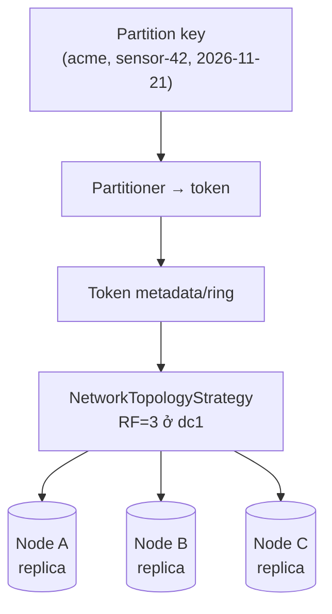
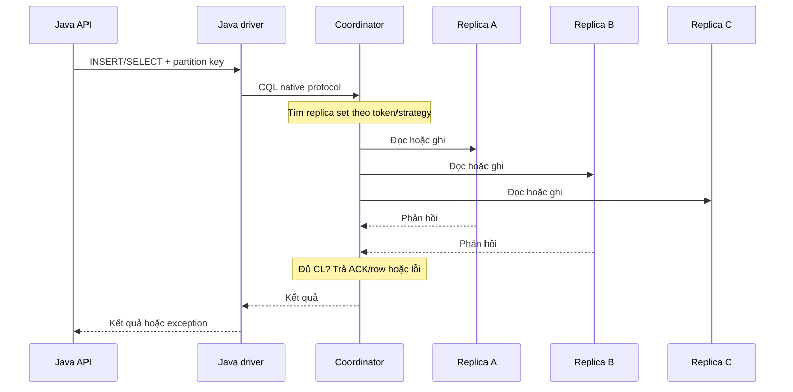
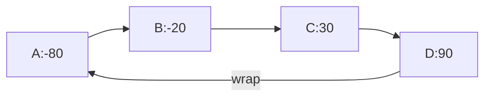
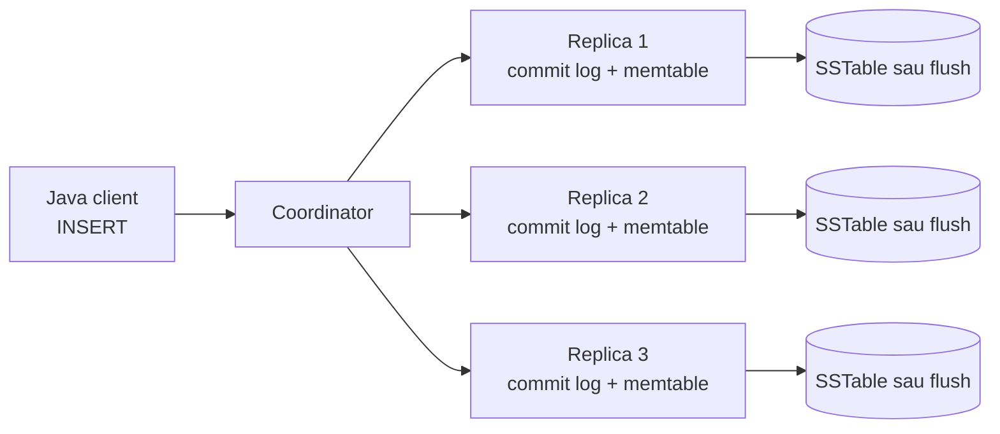

# Replication factor và tập bản sao của một phân vùng

> **Chương:** Token và sao chép  
> **Phạm vi:** Apache Cassandra là cơ sở dữ liệu NoSQL phân tán theo mô hình *wide-column*, đặt dữ liệu theo khóa phân vùng, token và replication strategy. Bài này đi sâu vào **replication factor (RF)** và **tập replica thực sự lưu một partition**, kể cả trường hợp nhiều data center, rack và virtual node. Nội dung liên hệ consistency đọc/ghi, CQL, Java driver, repair, compaction, thao tác thay RF và xử lý sự cố, nhưng không đánh đồng các cơ chế này.

## 1. Mục tiêu học tập

Sau bài này, bạn có thể:

1. Phân biệt **RF**, **partition key**, **token**, **token range**, **primary range owner**, **replica set** và **consistency level**.
2. Giải thích cách Cassandra chọn một tập bản sao từ token ring, chiến lược sao chép và topology thay vì coi RF là số row hay số shard.
3. Cấu hình `NetworkTopologyStrategy` cho một hoặc nhiều data center ở môi trường Apache Cassandra phù hợp.
4. Phân biệt RF **theo data center** và RF tổng cộng; tính quorum cho `LOCAL_QUORUM`, `QUORUM` và hiểu khác biệt với `EACH_QUORUM`.
5. Phân tích một, hai hoặc nhiều node lỗi ảnh hưởng ra sao tới khả năng đáp ứng những CL khác nhau, đồng thời tránh khẳng định sai rằng request timeout nghĩa là dữ liệu chưa ghi.
6. Hiểu vai trò rack-awareness, vnodes, membership và metadata khi xác định replica; không xem một node có nhiều vnode là nhiều bản sao vật lý độc lập.
7. Thiết kế và thực hành bảng CQL có partition key ghép, sử dụng Java driver 4.x để truy vấn theo khóa và chọn CL phù hợp.
8. Lập kế hoạch thay đổi RF có kiểm soát, kiểm chứng bản sao sau bootstrap/repair, đồng thời phân biệt **replication**, **repair**, **compaction** và **backup**.

## 2. Bài toán: cùng một partition có bao nhiêu bản sao?

Một ứng dụng IoT ghi sự kiện:

```text
tenant_id  = acme
device_id  = sensor-42
event_day  = 2026-11-21
event_time = 2026-11-21T08:05:00Z
event_id   = 11111111-1111-1111-1111-111111111111
```

Giả sử bảng được định nghĩa với:

```sql
PRIMARY KEY ((tenant_id, device_id, event_day), event_time, event_id)
```

Ba thành phần trong ngoặc kép tạo **partition key**. Chúng được mã hóa và băm bằng partitioner để tạo **một token**. Những row khác nhau về `event_time` hoặc `event_id` nhưng cùng ba thành phần partition key vẫn ở **một partition logic**.

Nếu keyspace đặt RF = 3 tại data center `dc1`, Cassandra sẽ chọn **ba node replica thích hợp** cho partition đó, dựa trên vòng token và replication strategy. Nó **không** tạo ba partition key khác nhau và không chia các row trong partition thành ba mảnh. Mỗi replica giữ dữ liệu của partition theo ngữ nghĩa Cassandra.



**Câu hỏi trọng tâm:** những node nào là replica của partition này, và có bao nhiêu node phải phản hồi để một request cụ thể được coi là thành công?

Hai vế có câu trả lời khác nhau:

- **RF + strategy + topology:** tập node **nên giữ** dữ liệu.
- **Consistency level (CL):** số phản hồi **cần nhận** theo yêu cầu đọc/ghi.

## 3. Năm lớp không được nhầm lẫn

| Lớp | Đầu vào chính | Kết quả | Điều không quyết định |
| --- | --- | --- | --- |
| **Partition key** | Các giá trị trong phần partition của `PRIMARY KEY` | Định danh partition logic | Không đặt trực tiếp RF hay CL |
| **Partitioner** | Biểu diễn byte của partition key | Token của partition | Không chọn số replica |
| **Token ring/metadata** | Token và các token range node/vnode quản lý | Vùng token và ownership logic | Không tự chứng minh node đang khỏe |
| **Replication strategy + RF** | Token ring, DC/rack, keyspace replication | Tập node replica mục tiêu | Không quy định số ACK của request |
| **Consistency level** | Loại request, RF, phạm vi DC, trạng thái node | Điều kiện xác nhận để trả kết quả | Không thay đổi token hoặc phân bổ partition |

Ví dụ: cùng token của `sensor-42` vẫn có thể nhận hai tập replica khác nhau **trước và sau khi thêm node**. Nếu chỉ đổi CL từ `LOCAL_ONE` sang `LOCAL_QUORUM`, **tập replica mục tiêu không đổi**, nhưng request cần nhiều phản hồi hơn.

### 3.1. Replica không phải coordinator

**Coordinator** là node tiếp nhận và điều phối một request. Nó có thể là replica hoặc không là replica của partition. Driver Java thường cố chọn coordinator phù hợp dựa trên routing metadata, nhưng server vẫn quyết định replica placement.



Sơ đồ là mô hình khái niệm; tối ưu đọc, thời điểm gửi request và loại phản hồi giữa các replica có thể thay đổi theo phiên bản, CL và trạng thái cụm.

## 4. Replication factor là gì?

**Replication factor (RF)** mô tả số bản sao mục tiêu của mỗi partition theo **cấu hình replication của keyspace**, có thể được đặt riêng cho từng data center với `NetworkTopologyStrategy`.

### 4.1. RF không đo những đại lượng nào?

| Phát biểu | Đánh giá |
| --- | --- |
| “RF = 3 nghĩa là mỗi partition được sao chép lên ba node phù hợp trong phạm vi cấu hình.” | Đúng về **mục tiêu placement**, nếu topology có đủ node và các bản sao đã đồng bộ |
| “RF = 3 nghĩa là ứng dụng phải chờ ba ACK cho mọi ghi.” | Sai; còn tùy CL |
| “RF = 3 nghĩa là một partition được chia thành ba shard.” | Sai; đó là ba bản sao, không phải ba phần khác nhau |
| “RF = 3 nghĩa là có thể mất ba node mà vẫn đọc ghi bình thường.” | Sai; phải xét replica nào mất, CL, DC và tải |
| “RF = 3 nghĩa là không cần backup.” | Sai; xóa nhầm/lỗi ứng dụng có thể lan tới tất cả replica |
| “RF = 3 nghĩa là server một node sẽ tự tạo thêm hai node ảo.” | Sai; vnode không phải node chịu lỗi độc lập |
| “RF cao hơn làm partition key có token mới.” | Sai; token phụ thuộc khóa và partitioner |

### 4.2. RF là cấu hình của keyspace

Trong Cassandra CQL, replication strategy thường được khai báo ở mức **keyspace**, không được tùy tiện coi là thuộc tính riêng của một row hoặc một statement Java.

```sql
CREATE KEYSPACE IF NOT EXISTS telemetry_rf
WITH replication = {
    'class': 'NetworkTopologyStrategy',
    'dc1': 3
};
```

Đây là cấu hình cho **Apache Cassandra** với data center thực sự có tên `dc1`, đủ node phù hợp. Một lab chỉ một node nên sử dụng RF = 1 để thực hành CQL cơ bản; gõ `'dc1': 3` không tạo thêm hai bản sao trên hai node chưa tồn tại.

### 4.3. RF khác số vnode và số partition

Giả sử một node sở hữu 16 vnodes, bảng có 1 triệu partition và keyspace RF = 3:

- **16 vnodes:** số điểm/token range logic mà node đó tham gia sở hữu.
- **1 triệu partition:** số nhóm dữ liệu theo partition key trong bảng.
- **RF = 3:** mỗi partition được đặt trên **ba replica node** thích hợp theo strategy trong phạm vi DC đang xét.

Ba con số **không thay thế nhau**.

## 5. Từ token ring tới tập replica: ví dụ tính tay

Xét vòng token **giả lập**, mỗi node một token mốc, các mốc theo chiều tăng token:

| Node | Token mốc | Primary token range |
| --- | ---: | --- |
| A | `-80` | `(90,100] ∪ [-100,-80]` |
| B | `-20` | `(-80,-20]` |
| C | `30` | `(-20,30]` |
| D | `90` | `(30,90]` |

Vòng giả lập từ -100 đến 100 chỉ để luyện suy luận; **không** phải không gian Murmur3 thực. Quy tắc `(previous_token,current_token]` dùng biên **mở trái, đóng phải**, có đoạn quay vòng sau token lớn nhất.



### 5.1. RF = 1

Giả sử một partition có token `-47`:

1. `-47` thuộc khoảng `(-80,-20]`.
2. Node B giữ **primary token range** ấy.
3. Với mô hình sao chép đơn giản RF = 1, B là node lưu một bản sao.

### 5.2. RF = 3 trong mô hình một DC đơn giản

Nếu dùng cách chọn các node kế tiếp trên vòng để minh họa replication, tập replica của token `-47` có thể là **B, C, D**:

```text
Token -47 → primary range B
RF = 1 → {B}
RF = 2 → {B, C}
RF = 3 → {B, C, D}
```

Đây là **mô hình minh họa** gần với nguyên lý sao chép theo vòng ở cấu hình đơn giản. Với `NetworkTopologyStrategy`, rack, nhiều data center và vnodes, không được suy luận “cứ lấy ba tên node cạnh nhau”. Phải sử dụng strategy và metadata topology thật.

### 5.3. Một token khác có thể có tập replica khác

Trong cùng mô hình, partition có token `15` thuộc primary range C; RF = 3 có thể minh họa replica là **C, D, A**. Mỗi partition key được băm thành token riêng, vì thế các partition khác nhau thường có những tập replica khác nhau.

**Lưu ý:** cùng một partition có nhiều clustering row vẫn thuộc cùng tập replica; clustering key không làm partition chuyển sang tập node khác.

## 6. Replication strategy: không phải chỉ đếm theo vòng

Cassandra có nhiều chiến lược sao chép tùy phiên bản. Hai tên bạn thường gặp khi học kiến trúc là **`SimpleStrategy`** và **`NetworkTopologyStrategy`**.

| Chiến lược | Ý tưởng chính | Hướng sử dụng |
| --- | --- | --- |
| **SimpleStrategy** | Sao chép theo thứ tự token ring mà không mô hình hóa mục tiêu theo DC/rack như NTS | Chủ yếu để hiểu nguyên lý hoặc môi trường rất đơn giản/legacy; không nên làm mặc định production nhiều DC |
| **NetworkTopologyStrategy (NTS)** | Cấu hình RF theo DC và sử dụng thông tin rack/topology để chọn replica | Lựa chọn thường phù hợp cho cluster sản xuất, nhất là khi có nhiều DC/rack |

### 6.1. Tại sao NTS quan trọng?

Giả sử có 6 node tại `dc1`, chia thành 3 rack. Khi RF = 3, ta muốn bản sao được phân tán qua các miền lỗi thay vì cả ba node nằm trên cùng một rack nếu có thể.

NTS sử dụng metadata DC/rack để ưu tiên placement phù hợp. Nếu có đủ rack và node, các replica có thể nằm ở những rack khác nhau. Tuy nhiên:

- Với **ít rack hơn RF**, strategy phải đặt thêm replica trong những rack đã có.
- Nếu DC/rack metadata khai báo sai, placement có thể không phản ánh miền lỗi vật lý.
- Nếu ba VM ở ba rack logic nhưng cùng host vật lý, chúng **không** tạo ba miền lỗi phần cứng thực sự.
- Khi node/vnode ownership thay đổi, tập replica của partition có thể thay đổi theo topology.

### 6.2. Vnode không thể làm hai bản sao cùng host trở thành độc lập

Một node có thể sở hữu nhiều vnode/token range, nhưng Cassandra không tính hai vnode cùng node vật lý là hai replica khác nhau của **cùng một partition**. Nếu RF = 3 cần ba replica độc lập ở mức node Cassandra, phải có đủ ba **node khác nhau** trong phạm vi phù hợp.

Vnodes chủ yếu giúp **chia quyền sở hữu token ranges**, không thay thế RF hoặc failure-domain planning.

## 7. RF một data center: mô hình cơ bản

Giả sử `dc1` có đúng ba node A, B và C, cùng tham gia một keyspace NTS RF = 3. Mỗi partition có thể cần đặt một bản sao trên cả ba node, nếu chúng sẵn sàng, khỏe và đã nhận đủ dữ liệu.

```sql
CREATE KEYSPACE IF NOT EXISTS telemetry_single_dc
WITH replication = {
    'class': 'NetworkTopologyStrategy',
    'dc1': 3
};
```

Để tránh nhầm giữa **mục tiêu** và **trạng thái thực**, phải phân biệt:

1. **RF được khai báo:** ba replica mục tiêu.
2. **Metadata replica placement:** cụ thể node nào thuộc tập replica của partition.
3. **Replica còn hoạt động:** bao nhiêu node phản hồi request ở thời điểm hiện tại.
4. **Replica có dữ liệu mới nhất:** còn phụ thuộc consistency, thời gian hội tụ, repair và trạng thái ghi trước đó.

Một node trong tập replica có thể vẫn nằm trong metadata nhưng đang down. RF = 3 **không** có nghĩa ứng dụng đang có ba bản sao khỏe mạnh tức thì trong mọi thời điểm.

## 8. RF nhiều data center: tổng RF khác RF cục bộ

Trong cluster hai data center, NTS có thể cấu hình:

```sql
CREATE KEYSPACE IF NOT EXISTS telemetry_multi_dc
WITH replication = {
    'class': 'NetworkTopologyStrategy',
    'dc1': 3,
    'dc2': 2
};
```

Giả định `dc1` có ít nhất ba node và `dc2` có ít nhất hai node phù hợp, replication mục tiêu của **mỗi partition** là:

- **3 replica ở dc1**.
- **2 replica ở dc2**.
- **Tổng 5 replica** trên toàn bộ cluster cho partition đó.

### 8.1. Tính toán với tổng RF = 5

| Mức nhất quán | Phạm vi | Số phản hồi thường yêu cầu trong ví dụ |
| --- | --- | ---: |
| `LOCAL_ONE` từ dc1 | Một replica cục bộ dc1 | 1 |
| `LOCAL_QUORUM` từ dc1 | Quorum trong RF cục bộ 3 | 2 |
| `LOCAL_QUORUM` từ dc2 | Quorum trong RF cục bộ 2 | 2 |
| `QUORUM` | Quorum của tổng RF = 5 | 3 |
| `ALL` | Tất cả replica toàn keyspace theo phạm vi CL | 5 |
| `EACH_QUORUM` *(áp dụng cho ghi khi được hỗ trợ)* | Quorum **ở mỗi DC** | dc1: 2 và dc2: 2 |

Khi nói “quorum của Cassandra là 2”, phải hỏi ngay: **RF nào? DC nào? CL local hay global?** Ví dụ trên có đồng thời quorum cục bộ 2, global quorum 3 và yêu cầu `EACH_QUORUM` theo từng DC.

### 8.2. Hai data center không đồng nghĩa hai bộ dữ liệu độc lập

Cùng một partition key được băm ra token theo partitioner của cluster. Replication strategy sử dụng token và topology để đặt **các bản sao của cùng partition** ở những node thuộc mỗi data center.

Việc dùng `LOCAL_QUORUM` ở `dc1` để ghi **không chứng minh** cả hai replica ở `dc2` đã xác nhận dữ liệu. Khi lập kế hoạch failover mất toàn bộ `dc1`, đội vận hành phải kiểm thử độ mới của dữ liệu ở `dc2`, RPO/RTO và quy trình phục hồi, thay vì chỉ dựa vào tổng RF.

## 9. CL và công thức quorum: đọc đúng ngữ cảnh

Với một tập replica có RF = \(N\), số replica tạo quorum thường được tính:

\[
Q = \left\lfloor \frac{N}{2} \right\rfloor + 1
\]

Ví dụ:

| RF áp dụng trong phạm vi tính | Quorum cần thiết |
| ---: | ---: |
| 1 | 1 |
| 2 | 2 |
| 3 | 2 |
| 4 | 3 |
| 5 | 3 |
| 6 | 4 |

### 9.1. Giao nhau giữa tập đọc và ghi

Một trực giác quan trọng cho số replica cần xác nhận là:

\[
W + R > RF
\]

Với RF = 3 trong một DC, `W = 2` và `R = 2` thỏa `2+2>3`. Nếu ghi được xác nhận bởi quorum cục bộ và đọc từ quorum cục bộ **trên cùng tập replica**, các tập xác nhận phải giao nhau.

Nhưng đây **không phải định lý mọi thao tác đều linearizable**. Cần xem thời điểm lỗi, cơ chế hòa giải, concurrent writes, write timestamps, topology đang thay đổi và loại thao tác. Điều kiện giao nhau không biến hai phép read-modify-write thông thường thành một giao dịch có kiểm tra phiên bản.

### 9.2. `LOCAL_QUORUM` và `QUORUM` không luôn tương đương

Với một DC RF = 3, hai mức này có thể cần cùng số phản hồi về mặt số học trong phạm vi thực tế của keyspace. Nhưng khi có nhiều DC, `LOCAL_QUORUM` tính trên RF **tại DC cục bộ của coordinator/client policy**; `QUORUM` tính trên **tổng RF**.

Đừng gắn cứng trong code câu “`LOCAL_QUORUM` = 2 node” khi có DC với RF khác 3 hoặc topology bị sửa.

### 9.3. `EACH_QUORUM` khác tổng quorum

Với `dc1:3` và `dc2:2`:

- `QUORUM` tổng cần **3 trong 5** replica theo điều kiện của CL.
- `EACH_QUORUM` cho ghi cần **2 trong 3** ở `dc1` **và** **2 trong 2** ở `dc2`.

Điều này có thể tăng chi phí/độ trễ và giảm khả năng đáp ứng khi một DC có lỗi. Không chọn `EACH_QUORUM` chỉ để “càng nhiều ACK càng tốt” mà không xét yêu cầu nghiệp vụ và sự cố liên vùng.

## 10. Cùng RF = 3 nhưng mức chịu lỗi khác nhau theo CL

Xét partition có replica **A, B, C** trong một data center. Bảng dưới đây chỉ tính điều kiện **đủ replica phản hồi**, giả định những node còn sống không bị nghẽn mạng/I/O:

| Replica sẵn sàng | `LOCAL_ONE` | `LOCAL_QUORUM` | `ALL` |
| --- | --- | --- | --- |
| A, B, C | Có thể đạt | Có thể đạt | Có thể đạt |
| A, B (C down) | Có thể đạt | Có thể đạt | Không đạt |
| A (B/C down) | Có thể đạt | Không đạt | Không đạt |
| Không còn replica nào | Không đạt | Không đạt | Không đạt |

**RF không thay CL:** việc Cassandra có ba bản sao theo metadata không buộc client phải chờ ba node. **CL không tăng RF:** dùng `ALL` trên keyspace RF = 1 cũng không tạo thêm bản sao.

### 10.1. “Có thể đạt” không đồng nghĩa request chắc chắn thành công

Ngay cả khi đủ replica còn sống, request vẫn có thể:

- Chậm vì queue, compaction, disk I/O hoặc network.
- Hết hạn ở driver hoặc coordinator.
- Bị ảnh hưởng bởi node vừa thay topology.
- Trả stale data tùy CL và tình trạng hội tụ.

Số replica là **một điều kiện**, không phải toàn bộ SLO.

### 10.2. Một replica mất dữ liệu cục bộ khác một replica tạm down

Node có thể tạm mất kết nối rồi quay lại với SSTable/commit log vẫn còn, hoặc mất đĩa và cần phục hồi dữ liệu. Hai tình huống này **không tương đương**. Cơ chế hinted handoff, streaming, repair, replace và backup/restore được chọn tùy tình huống, không thể suy ra chỉ từ RF.

## 11. RF, dữ liệu bền vững và giới hạn “đã ghi thành công”

Đường ghi điển hình của Cassandra gồm coordinator chuyển mutation tới các replica, nơi dữ liệu được ghi theo cơ chế **commit log/memtable**, sau đó có thể flush thành SSTable. Mức độ bền vững với mất nguồn hoặc lỗi phần cứng còn phụ thuộc cấu hình commit log, storage và loại sự cố.



### 11.1. Write timeout không chứng minh chưa replica nào ghi

Ví dụ RF = 3 và write CL = `LOCAL_QUORUM`. Coordinator chỉ nhận được ACK từ A đúng hạn; B có thể đã ghi nhưng ACK đến muộn; C có thể chưa ghi.

Client nhận timeout vì **chưa đủ hai ACK đúng hạn**, nhưng ít nhất một replica có thể đã lưu mutation. Nếu client tạo `event_id` mới và gửi lại, ứng dụng có thể tạo **hai row nghiệp vụ** thay vì retry cùng row.

Với sự kiện bất biến, giữ **partition key và event ID ổn định** qua retry giúp hạn chế trùng logic. Với counters, LWT, TTL, client timestamps hoặc side effects ngoài database, phải phân tích idempotency riêng; không bật retry mù cho mọi mutation.

### 11.2. RF không bảo vệ chống xóa nhầm

Một lệnh `DELETE` hợp lệ có thể được nhân bản tới toàn bộ replica. Sau khi hội tụ, mọi bản sao đều phản ánh việc xóa. Do đó:

**Replication giúp chịu một số sự cố của node/replica; backup và restore bảo vệ những loại sự cố dữ liệu khác**, như xóa nhầm hoặc triển khai code sai.

## 12. Phạm vi sao chép: mỗi partition có tập replica riêng

Không nên vẽ một sơ đồ “node A là master, node B/C là slave” cho toàn bộ cluster Cassandra. Một node có thể:

- Là primary range owner/replica của partition P1.
- Là replica bổ sung của partition P2.
- Không thuộc tập replica của partition P3.
- Là coordinator cho request của P3 dù không lưu P3.

### 12.1. Ví dụ ba partition

Giả sử vòng bốn node đơn giản với RF = 3, mỗi node một token mốc:

| Partition | Token giả định | Primary range owner | Tập replica minh họa |
| --- | ---: | --- | --- |
| P1 | `-47` | B | B, C, D |
| P2 | `15` | C | C, D, A |
| P3 | `65` | D | D, A, B |

Các tập replica **không giống nhau** giữa các partition, dù chúng cùng thuộc một keyspace RF = 3. Trong cluster thật, kết quả phải theo metadata NTS/DC/rack, không dựa duy nhất vào thứ tự minh họa.

### 12.2. Token collision về lý thuyết không làm mất định danh

Partitioner như Murmur3 tạo token từ **byte của partition key**, không biến token thành unique ID tuyệt đối. Hai khóa khác nhau có thể trùng token về lý thuyết. Cassandra vẫn dùng khóa đầy đủ khi lưu/đối chiếu partition, nên không dùng token làm ID nghiệp vụ hoặc thông tin xác thực.

## 13. Thực hành CQL: tạo một keyspace RF = 3

Phần này là bài lab **để người học tự chạy** trên Apache Cassandra, không phải báo cáo rằng một cluster đã thực sự được khởi động. Để thử RF = 3 và lỗi một replica, cần cluster tối thiểu ba node thích hợp trong cùng data center.

### 13.1. Kiểm tra topology trước khi tạo keyspace

Trên cluster tự quản lý, có thể bắt đầu bằng:

```bash
nodetool status
nodetool ring
```

Ghi lại data center/rack thực và số node. Ví dụ dùng `dc1` chỉ hợp lệ khi topology báo đúng tên này. Nếu lab chỉ một node, sửa RF thành 1 và dùng CL `LOCAL_ONE` ở các bước thực hành CQL; **không** coi đó là bài test chịu lỗi quorum.

### 13.2. Tạo keyspace và bảng lịch sử

```sql
CREATE KEYSPACE IF NOT EXISTS telemetry_rf
WITH replication = {
    'class': 'NetworkTopologyStrategy',
    'dc1': 3
};

CREATE TABLE IF NOT EXISTS telemetry_rf.events_by_device_day (
    tenant_id text,
    device_id text,
    event_day date,
    event_time timestamp,
    event_id uuid,
    event_type text,
    temperature_c double,
    PRIMARY KEY ((tenant_id, device_id, event_day), event_time, event_id)
) WITH CLUSTERING ORDER BY (event_time DESC, event_id ASC);
```

Ở schema này, partition key là `(tenant_id, device_id, event_day)`. `event_time` và `event_id` xác định row trong partition; chúng **không** làm mỗi row chọn một replica set khác.

### 13.3. Ghi các sự kiện

```sql
INSERT INTO telemetry_rf.events_by_device_day (
    tenant_id, device_id, event_day, event_time,
    event_id, event_type, temperature_c
) VALUES (
    'acme', 'sensor-42', '2026-11-21',
    '2026-11-21T08:05:00Z',
    11111111-1111-1111-1111-111111111111,
    'READING', 27.4
);

INSERT INTO telemetry_rf.events_by_device_day (
    tenant_id, device_id, event_day, event_time,
    event_id, event_type, temperature_c
) VALUES (
    'acme', 'sensor-42', '2026-11-21',
    '2026-11-21T08:06:00Z',
    22222222-2222-2222-2222-222222222222,
    'READING', 27.8
);
```

Hai row có cùng partition key, vậy **cùng token và cùng tập replica** trong topology tại thời điểm đọc/ghi. Câu lệnh này có thể thử trên lab; kết quả theo CL mặc định của session nếu chưa đặt riêng.

### 13.4. Truy vấn có đầy đủ partition key

```sql
SELECT event_time, event_id, temperature_c
FROM telemetry_rf.events_by_device_day
WHERE tenant_id = 'acme'
  AND device_id = 'sensor-42'
  AND event_day = '2026-11-21'
LIMIT 100;
```

Kết quả được sắp theo clustering columns trong partition. Truy vấn có thể định vị partition mà không quét toàn bộ bảng. `LIMIT 100` không tự chữa một partition quá lớn hoặc nhiều tombstone.

## 14. Quan sát token và tập replica từ metadata

### 14.1. Dùng `token(...)` để nhận dạng partition

```sql
SELECT token(tenant_id, device_id, event_day) AS partition_token,
       event_time, event_id
FROM telemetry_rf.events_by_device_day
WHERE tenant_id = 'acme'
  AND device_id = 'sensor-42'
  AND event_day = '2026-11-21';
```

Hai row trong ngày 21 sẽ cho cùng `partition_token`. Giá trị số chính xác phụ thuộc partitioner và biểu diễn khóa; **không đoán giá trị token** chỉ từ chuỗi `sensor-42`.

### 14.2. Đối chiếu với ring và replication strategy

Trên cluster Apache Cassandra tự quản lý có thể dùng:

```bash
nodetool status
nodetool ring
nodetool describering telemetry_rf
```

Kết hợp các nguồn dữ liệu:

1. Token thật của partition từ CQL.
2. Token ranges và endpoint trong metadata cluster.
3. Replication strategy/RF của keyspace.
4. DC/rack của các node, trạng thái node và topology đang chuyển đổi hay không.

**Không** lấy một tỷ lệ `Owns` trong `nodetool status` rồi kết luận đó là danh sách ba replica của partition. Phần trăm ownership là chỉ số phân phối dải/data theo định nghĩa công cụ, không phải danh sách endpoint của một partition cụ thể.

### 14.3. Tập replica có thể thay đổi khi topology đổi

Khi bootstrap, replace hoặc decommission, metadata có thể có trạng thái chuyển tiếp/pending ranges và các node streaming dữ liệu. Vì vậy output quan sát lúc đang thay topology **không nhất thiết giống** ảnh chụp trước hoặc sau khi cluster ổn định.

Nên ghi thời gian quan sát, phiên bản, keyspace, CL, số node và trạng thái streaming khi phân tích một replica set.

## 15. Java driver 4.x: truy vấn một partition và đặt CL đúng

Java driver không tự chọn RF. RF đến từ **keyspace replication strategy** của cluster. Driver có thể bind partition key, nhận topology/schema metadata và ưu tiên coordinator phù hợp với replica, nhưng **không thay server placement**.

### 15.1. Ví dụ truy vấn lịch sử bằng prepared statement

Ví dụ Java 11+ sử dụng Java driver 4.x. Giả định keyspace/tables từ lab và data center tên `dc1` thực sự tồn tại:

```java
import java.net.InetSocketAddress;
import java.time.LocalDate;

import com.datastax.oss.driver.api.core.CqlSession;
import com.datastax.oss.driver.api.core.DefaultConsistencyLevel;
import com.datastax.oss.driver.api.core.cql.PreparedStatement;
import com.datastax.oss.driver.api.core.cql.ResultSet;
import com.datastax.oss.driver.api.core.cql.Row;

public final class ReplicaSetReadExample {
    public static void main(String[] args) {
        try (CqlSession session = CqlSession.builder()
                .addContactPoint(new InetSocketAddress("127.0.0.1", 9042))
                .withLocalDatacenter("dc1")
                .build()) {

            PreparedStatement query = session.prepare(
                "SELECT event_time, event_id, event_type, temperature_c " +
                "FROM telemetry_rf.events_by_device_day " +
                "WHERE tenant_id = ? AND device_id = ? " +
                "AND event_day = ? LIMIT 100"
            );

            ResultSet rows = session.execute(
                query.bind(
                    "acme", "sensor-42",
                    LocalDate.of(2026, 11, 21)
                ).setConsistencyLevel(
                    DefaultConsistencyLevel.LOCAL_QUORUM)
                 .setIdempotent(true)
            );

            for (Row row : rows) {
                Double temperature = row.isNull("temperature_c")
                    ? null
                    : row.getDouble("temperature_c");
                System.out.printf(
                    "%s id=%s type=%s temp=%s%n",
                    row.getInstant("event_time"),
                    row.getUuid("event_id"),
                    row.getString("event_type"),
                    temperature
                );
            }
        }
    }
}
```

Với lab **một node và RF = 1**, đổi `LOCAL_QUORUM` sang `LOCAL_ONE`. Với RF = 3 trong `dc1`, `LOCAL_QUORUM` thường cần hai trong ba replica cục bộ.

### 15.2. Phân tách trách nhiệm Java và Cassandra

| Lớp | Điều kiểm soát |
| --- | --- |
| **Java service** | Chọn tenant, bucket ngày, quyền truy cập, event ID và chính sách timeout/retry |
| **Java driver** | Session, CQL bind, routing key, local DC, load balancing và CL request |
| **Partitioner/ring** | Token của partition và các ranges node sở hữu |
| **Replication strategy** | Những node giữ replica theo keyspace và topology |
| **Coordinator/replica** | Đọc/ghi, reconciliation và phản hồi theo CL |
| **Vận hành** | Duy trì RF thực tế, node health, capacity, repair, backup và restore |

Không mở `CqlSession` riêng cho mỗi HTTP request; ứng dụng nên tái sử dụng session và quan sát driver metrics. Cấu hình TLS, authentication, địa chỉ và tên DC phải đúng môi trường, đặc biệt với managed/CQL-compatible services.

## 16. Bài lab consistency: dự đoán trước, quan sát sau

Phần này chỉ thực hiện ở **cluster lab cô lập có ba node** phù hợp; không tắt node production để minh họa kiến thức.

### 16.1. Đặt CL trong cqlsh

```sql
-- Lệnh công cụ cqlsh, không phải một CQL DML statement.
CONSISTENCY LOCAL_QUORUM;

SELECT event_time, event_id
FROM telemetry_rf.events_by_device_day
WHERE tenant_id = 'acme'
  AND device_id = 'sensor-42'
  AND event_day = '2026-11-21'
LIMIT 100;
```

Bạn cũng có thể dùng tracing có kiểm soát ở lab để quan sát điều phối:

```sql
TRACING ON;

SELECT event_time, event_id
FROM telemetry_rf.events_by_device_day
WHERE tenant_id = 'acme'
  AND device_id = 'sensor-42'
  AND event_day = '2026-11-21'
LIMIT 5;

TRACING OFF;
```

Tracing có overhead; không bật thường trực cho traffic lớn. Tracing cũng không bảo đảm hiển thị mọi chi tiết nội bộ của phiên bản Cassandra.

### 16.2. Bảng dự đoán trước failure drill

| Kịch bản RF = 3, một DC | Đường đọc `LOCAL_ONE` | `LOCAL_QUORUM` | `ALL` |
| --- | --- | --- | --- |
| Cả ba replica khỏe | Dự kiến được | Dự kiến được | Dự kiến được |
| Một replica không phản hồi | Có thể được | Có thể được | Không đạt điều kiện |
| Hai replica không phản hồi | Có thể được | Không đạt điều kiện | Không đạt điều kiện |

Ghi rõ **thời gian lỗi, trạng thái node, CL, query, kết quả thực, timeout, log/metrics**. Không tuyên bố đã chứng minh chịu lỗi chỉ vì điền vào bảng dự đoán.

### 16.3. Khi nào thấy `Unavailable` khác với timeout?

- **Unavailable:** tại thời điểm coordinator đánh giá, không đủ replica có khả năng đáp ứng yêu cầu CL.
- **Timeout:** không thu được đủ phản hồi đúng hạn. Một phần replica có thể đã hoàn thành công việc.

Trong thực tế có thể có nhiều loại exception riêng theo driver/server. Xử lý retry dựa trên **ngữ nghĩa mutation và mức nhất quán**, không gộp mọi lỗi thành “cứ gửi lại một lần”.

## 17. Thay đổi RF: từ cấu hình tới bản sao dữ liệu thật

Giả sử keyspace ban đầu có RF = 2 tại `dc1` và cần tăng lên RF = 3. Sửa replication option là **thay mục tiêu placement**; nó không chứng minh các replica mới đã nhận đầy đủ dữ liệu ngay lập tức.

### 17.1. Ví dụ cú pháp thay đổi keyspace

```sql
-- Ví dụ dành cho một kế hoạch đã được phê duyệt và lab phù hợp.
-- Không chạy bừa trên production.
ALTER KEYSPACE telemetry_rf
WITH replication = {
    'class': 'NetworkTopologyStrategy',
    'dc1': 3
};
```

**Không được** áp dụng migration này khi chỉ có hai node trong `dc1` rồi tin rằng ba replica đã tồn tại. Cần kiểm tra topology, quyền quản trị, khả năng phiên bản và tình trạng cluster trước khi thực hiện.

### 17.2. Quy trình thay RF ở mức thiết kế

1. **Xác minh topology/miền lỗi:** có đủ node trong những DC dự định tăng RF không?
2. **Xác định trạng thái nguồn:** có thiếu replica, pending repairs, streaming, disk pressure hoặc sự cố nào chưa giải quyết?
3. **Lập kế hoạch capacity:** tăng RF thường tăng số bản sao được lưu, tạo thêm traffic và I/O đồng bộ.
4. **Thay metadata replication bằng quy trình phù hợp phiên bản.**
5. **Đồng bộ dữ liệu đến replica mới** theo hướng dẫn quản trị của đúng phiên bản, thường có bước repair/streaming/đối chiếu tương ứng; không coi riêng `ALTER KEYSPACE` là đủ.
6. **Kiểm tra metadata và dữ liệu:** RF mục tiêu, replica endpoints, trạng thái node, truy vấn đọc/ghi ở CL dự kiến.
7. **Theo dõi sau đổi:** dung lượng, compaction/repair backlog, p95/p99 latency, request errors, disk headroom.
8. **Có điều kiện rollback:** nếu phải quay lại RF cũ, cần xử lý an toàn dữ liệu/ownership và tác động tới CL; không tự giảm RF để bỏ qua sự cố.

**Cảnh báo:** câu lệnh và thứ tự vận hành chính xác khác nhau theo phiên bản Cassandra, topology và hướng thay đổi RF. Đối với production, phải dựa vào runbook đã kiểm chứng, không sao chép nguyên các bước học thuật thành lệnh tự động.

### 17.3. Hạ RF không giống tăng RF

Hạ RF làm giảm số bản sao mục tiêu và **giảm mức chịu lỗi tiềm năng**. Việc xóa/dọn dữ liệu trên những node không còn trách nhiệm phải diễn ra theo quy trình an toàn sau khi xác minh placement, backup và khả năng phục hồi.

Không giảm RF chỉ để có thêm dung lượng đĩa mà bỏ qua yêu cầu availability, RPO/RTO và số node còn lại.

## 18. Replication, hinted handoff, repair, compaction và backup

Những cơ chế này thường xuất hiện cùng nhau trong runbook nhưng giải quyết **các vấn đề khác nhau**.

| Cơ chế | Mục tiêu | Có làm đổi token của partition? |
| --- | --- | --- |
| **Replication/RF** | Đặt số bản sao mục tiêu trên các node theo strategy/topology | Không |
| **Hinted handoff** | Giúp chuyển các mutation bị lỡ tới replica tạm không phản hồi trong điều kiện/giới hạn hỗ trợ | Không |
| **Read reconciliation / read repair** | Hòa giải khác biệt replica khi đọc theo cơ chế/phiên bản | Không |
| **Anti-entropy repair** | Đối chiếu và đồng bộ dữ liệu giữa replica trong một phạm vi | Không |
| **Compaction** | Hợp nhất SSTable và xử lý tombstone/phiên bản cục bộ khi an toàn | Không |
| **Bootstrap/streaming** | Di chuyển bản sao cần thiết khi topology/ownership thay đổi | Không đổi hash, nhưng có thể đổi tập node lưu |
| **Backup/restore** | Có khả năng khôi phục khi dữ liệu bị mất/hỏng/xóa sai | Không phải cơ chế CL hay placement bình thường |

### 18.1. Hinted handoff không thay thế repair

Hint có điều kiện lưu trữ và giới hạn thời gian/cấu hình. Nếu replica offline lâu, hoặc có các loại lệch dữ liệu không được hint giải quyết, cần cơ chế đồng bộ/repair và quan sát riêng.

### 18.2. Repair không khôi phục xóa nhầm đã lan khắp cluster

Nếu mọi replica đã ghi nhận một lệnh `DELETE` hợp lệ, repair giúp chúng hội tụ theo trạng thái xóa — không tạo lại dữ liệu mà người vận hành muốn phục hồi. Để xử lý xóa nhầm cần **backup và quy trình restore** đã được thử nghiệm.

### 18.3. RF lớn có chi phí

Tăng RF có thể làm tăng:

- Số bản sao dữ liệu trên đĩa.
- Network traffic và I/O cho mutation/streaming.
- Công việc repair, compaction và backup tùy kiến trúc.
- Số failure domains cần quan sát và duy trì.

RF không phải tham số “càng cao càng tốt” bất kể ngân sách, SLO và khả năng vận hành.

## 19. Ước lượng chi phí dung lượng theo RF

Giả sử hệ thống thu thập **10 triệu sự kiện/ngày**, kích thước dữ liệu logic trung bình **250 byte/sự kiện** (đây là giả định minh họa):

\[
10{,}000{,}000 \times 250 = 2.5\ \text{GB dữ liệu logic/ngày}
\]

| RF tổng mục tiêu | Ước lượng thô theo số bản sao, chưa tính overhead |
| ---: | ---: |
| 1 | 2,5 GB/ngày |
| 2 | 5,0 GB/ngày |
| 3 | 7,5 GB/ngày |
| 5 | 12,5 GB/ngày |

Với retention 30 ngày và RF = 3, phép nhân thô là:

\[
2.5 \times 3 \times 30 = 225\ \text{GB}
\]

Đây **không phải dự báo dung lượng đĩa chính xác** của Cassandra. Cần tính compression, metadata, index/storage overhead, tombstone, cập nhật, replication thực, compaction headroom, snapshot/backup và phân bố dung lượng theo node. Đặc biệt, disk headroom phải đủ khi một node rời cụm hoặc khi streaming/repair.

### 19.1. Dữ liệu lớn không đồng nghĩa cân bằng tải

Ngay cả khi lượng dữ liệu mỗi replica được nhân lên gần RF, một partition nóng vẫn có thể chi phối QPS/latency. **RF không chia một partition thành nhiều partition key**; muốn phân tán ghi/hot key phải xem lại time bucket, logical shard hoặc kiến trúc ingest.

## 20. Những tình huống nghiệp vụ cần quyết định RF/CL

### Tình huống A — Lịch sử telemetry chịu mất một node

Yêu cầu: hệ thống phải tiếp tục ghi sự kiện khi một replica cục bộ lỗi tạm thời.

**Gợi ý:** Với RF = 3 và `LOCAL_QUORUM`, còn hai replica đáp ứng đúng hạn thì request có thể hoàn thành. Cần thêm monitoring, repair và kiểm thử timeout; không hứa mọi request đều thành công.

### Tình huống B — Một node lab nhưng khai báo RF = 3

Yêu cầu: người học muốn thử quorum trên máy cá nhân với một Cassandra node.

**Gợi ý:** Không đủ node độc lập cho ba replica. Dùng RF = 1 + `LOCAL_ONE` để học CQL; muốn kiểm chứng fault tolerance/quorum, xây cluster lab ít nhất ba node phù hợp.

### Tình huống C — Multi-DC RF = 3 + 2

Yêu cầu: API ở `dc1` ghi `LOCAL_QUORUM` và muốn chắc chắn `dc2` đã nhận mutation.

**Gợi ý:** `LOCAL_QUORUM` ở dc1 chỉ yêu cầu hai replica cục bộ; nó không chứng minh hai replica ở dc2 đã cập nhật. Cần xác định yêu cầu consistency liên vùng, CL hỗ trợ và kế hoạch kiểm chứng/failover.

### Tình huống D — Cần mã đơn hàng duy nhất

Yêu cầu: nhiều writer cùng tạo order ID. Đội phát triển muốn chỉ đặt RF = 3 và CL = quorum.

**Gợi ý:** RF/CL không tạo quy tắc unique nghiệp vụ qua nhiều khóa hoặc bảo vệ mọi cạnh tranh. Có thể dùng `IF NOT EXISTS`/LWT trên một khóa trong phạm vi được hỗ trợ, hoặc RDBMS/transaction nếu invariant đa thực thể cần bảo đảm mạnh.

### Tình huống E — Ghi timeout rồi gửi lại

Yêu cầu: client gửi một sự kiện nhưng không nhận ACK đủ theo CL; sau đó client tạo UUID mới để retry.

**Gợi ý:** Có thể tạo bản ghi trùng logic nếu mutation cũ đã đến một số replica. Giữ event ID/partition key ổn định và thiết kế idempotency/reconciliation.

### Tình huống F — Nâng RF từ 2 lên 3

Yêu cầu: quản trị viên sửa `ALTER KEYSPACE` rồi ngay lập tức tăng write CL.

**Gợi ý:** Phải bảo đảm có đủ node, đồng bộ dữ liệu tới replica mới theo quy trình phiên bản, xác minh metadata/health/capacity trước khi dựa vào RF mới; riêng đổi option không chứng minh mọi bản sao mới đã chứa đủ dữ liệu.

### Tình huống G — Mất một rack

Yêu cầu: RF = 3 và DC có ba rack logic, nhưng thực chất các node của hai rack chạy trên cùng một hypervisor.

**Gợi ý:** Khả năng chịu lỗi thực phụ thuộc **miền lỗi vật lý**, không chỉ metadata. Cần kiểm tra placement và thiết kế hạ tầng, tránh khẳng định mỗi rack logic là một miền lỗi độc lập.

### Tình huống H — Muốn giảm p99 bằng cách tăng RF

Yêu cầu: một thiết bị tạo 15.000 request/giây trong cùng partition, ứng dụng chịu hot key.

**Gợi ý:** RF lớn hơn có thể thay đổi số replica/đường đọc, nhưng không tự chia partition thành nhiều khóa. Cần đo bottleneck, cache, shard/bucket, write path và chi phí replica.

### Tình huống I — Repair sau xóa nhầm

Yêu cầu: lệnh xóa sai đã lan đến mọi replica và người vận hành chạy repair để “khôi phục dữ liệu”.

**Gợi ý:** Repair không đảo ngược xóa hợp lệ đã hội tụ; phục hồi cần bản backup và quy trình restore.

## 21. Checklist đánh giá trước khi triển khai

- [ ] Chỉ ra đúng phần **partition key** trong `PRIMARY KEY` của bảng.
- [ ] Giải thích được cùng partition có cùng token và tập replica theo topology tại thời điểm cụ thể.
- [ ] Phân biệt primary token range owner, coordinator và các replica.
- [ ] Biết RF được cấu hình theo keyspace và theo DC khi dùng NTS.
- [ ] Biết một vnode không phải node/replica vật lý độc lập.
- [ ] Có đủ node và miền lỗi phù hợp cho RF mục tiêu.
- [ ] Tính quorum đúng với RF = 1, 2, 3, 4, 5 và 6.
- [ ] Phân biệt `LOCAL_QUORUM` theo RF DC cục bộ và `QUORUM` theo tổng RF.
- [ ] Hiểu `EACH_QUORUM` cho ghi ở từng DC không giống `QUORUM` toàn cụm.
- [ ] Không suy luận RF = 3 nghĩa là cần ba ACK cho mọi request.
- [ ] Có bảng dự đoán khi mất một/hai replica tương ứng CL sử dụng.
- [ ] Biết write timeout có thể xảy ra sau một phần ACK; có ID ổn định và retry an toàn.
- [ ] Có thể tạo keyspace/table CQL và truy vấn theo partition key đầy đủ.
- [ ] Có khả năng quan sát token qua `token(...)` và topology/replica metadata bằng công cụ phù hợp.
- [ ] Java driver dùng prepared statement, local DC và CL đúng RF thực.
- [ ] Có kế hoạch đồng bộ dữ liệu và kiểm chứng khi thay RF.
- [ ] Có lịch repair/compaction và chính sách backup/restore; không coi replication là backup.
- [ ] Có số liệu disk/network/latency/capacity để đánh giá chi phí RF.
- [ ] Không gây lỗi trên production chỉ để chứng minh bảng bài tập.
- [ ] Phân biệt điều đã chạy thật trong lab với kết luận chỉ mới suy luận.

## 22. Tự kiểm tra kiến thức

1. **Partition key và RF trả lời cùng một câu hỏi không?** Không. Partition key định danh partition/token; RF quy định số bản sao mục tiêu theo keyspace/DC.
2. **Một partition có RF = 3 được chia thành ba mảnh dữ liệu khác nhau không?** Không. Đó là ba bản sao của cùng partition theo replica placement.
3. **Clustering column `event_time` có làm các row cùng partition đi tới node khác nhau không?** Không; nó tổ chức row trong partition.
4. **Node có 32 vnodes có phải 32 replica độc lập?** Không. Vnodes là token ranges logic trên cùng node.
5. **RF = 3, `LOCAL_QUORUM` cần bao nhiêu replica cục bộ?** Hai, trong phạm vi DC có RF cục bộ = 3.
6. **RF = 2, quorum cần bao nhiêu?** Hai.
7. **NTS có `dc1:3, dc2:2`. Tổng RF là bao nhiêu?** Năm.
8. **Với tổng RF = 5, `QUORUM` là bao nhiêu?** Ba.
9. **`LOCAL_QUORUM` từ dc2 với RF dc2 = 2 cần bao nhiêu ACK?** Hai.
10. **`EACH_QUORUM` cho ghi trong ví dụ 3 + 2 yêu cầu gì?** Quorum ở từng DC: dc1 cần hai, dc2 cần hai.
11. **Đổi CL từ ONE sang QUORUM có đổi token không?** Không.
12. **Tăng RF từ 2 lên 3 có tự chứng minh bản sao mới đã đầy đủ dữ liệu?** Không; cần kế hoạch đồng bộ và kiểm tra.
13. **Vì sao quorum không thay CAS?** Nó kiểm tra số replica phản hồi, không kiểm tra version/invariant nghiệp vụ thay ứng dụng.
14. **Tại sao timeout không chứng minh thao tác chưa được áp dụng?** Một số replica có thể đã lưu mutation trước khi hết hạn.
15. **Repair khác compaction và backup ở đâu?** Repair đồng bộ replica, compaction hợp nhất SSTable cục bộ, backup cung cấp nguồn khôi phục dữ liệu.

## 23. Tổng kết: số bản sao và điều kiện xác nhận là hai quyết định khác nhau

Chuỗi tư duy cốt lõi:

**Partition key → partitioner → token → token ring → replication strategy + RF + DC/rack → tập replica của partition → coordinator thực hiện request theo CL.**

Hãy giữ ba quy tắc:

1. **RF quyết định số replica mục tiêu**, không phải số ACK bắt buộc, số vnode hay số shard.
2. **Replica set phụ thuộc token và topology**; khi node tham gia/rời cụm hoặc cấu hình RF thay đổi, tập replica có thể đổi nhưng token của cùng partition key không tự thay.
3. **CL quyết định điều kiện phản hồi**, còn độ bền thực, hội tụ replica, repair và backup đòi hỏi thiết kế/vận hành riêng. Quorum không thay transaction nghiệp vụ; replication không thay backup.

Nắm chắc RF và tập replica giúp bạn diễn giải đúng CQL, phân vùng theo truy vấn, tính nhất quán đọc/ghi, compaction, repair, xử lý lỗi và định tuyến từ ứng dụng Java trong mô-đun **DATABASE_ENGINE_WIDE_COLUMN_CASSANDRA**, thay vì chỉ ghi nhớ “RF = 3” mà không biết ba bản sao ấy là những node nào, còn hoạt động không và client cần chờ những ai.
