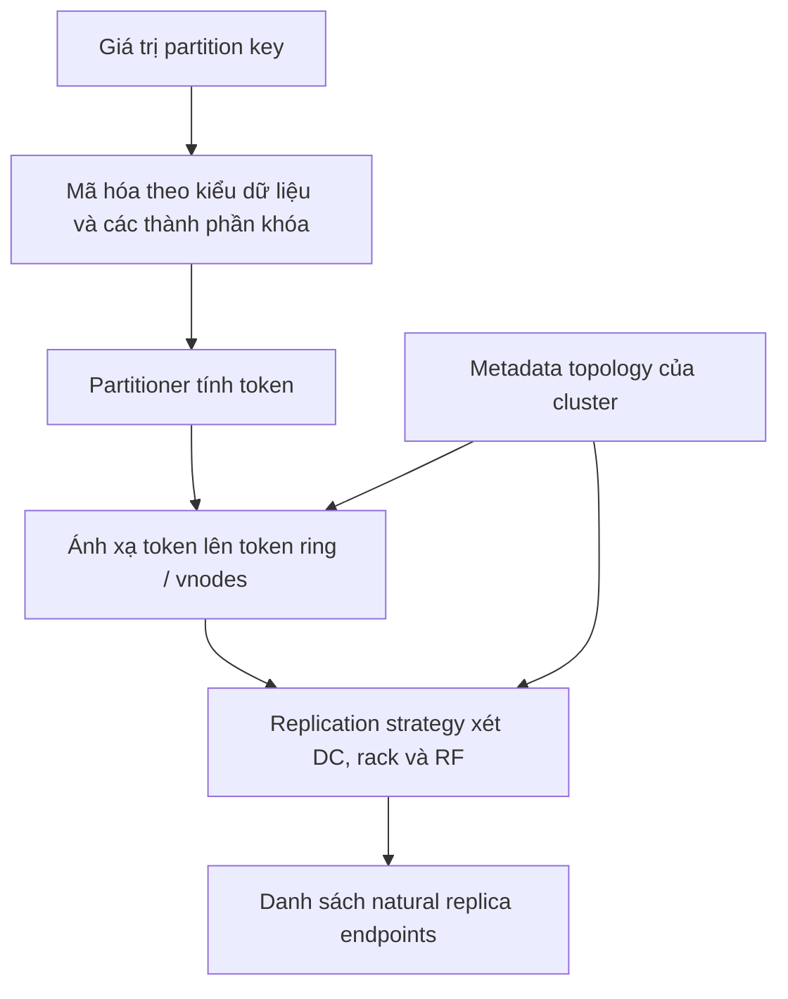

# Xác định endpoint của một khóa từ công cụ vận hành

## 1. Mục tiêu và bối cảnh

Trong Apache Cassandra, dữ liệu của một hàng không được đặt cố định trên một máy theo tên bảng hoặc theo thứ tự địa chỉ IP. Cassandra phân phối **partition** lên vòng token và sao chép partition sang nhiều node theo cấu hình replication của keyspace. Khi điều tra độ trễ, lỗi đọc/ghi, thay đổi topology hoặc nghi ngờ một node giữ dữ liệu, người vận hành cần trả lời được:

> Với **một giá trị partition key cụ thể**, những node nào đang là **natural replicas** (các endpoint chịu trách nhiệm lưu partition đó) theo topology mà cluster đang biết?

Bài thuộc chương **Token và sao chép**, trong phạm vi học về kiến trúc phân tán, thiết kế wide-column theo truy vấn, partition key và mức nhất quán đọc/ghi của Cassandra. Trọng tâm là dùng **CQL để xác minh schema** và **`nodetool getendpoints` để tra các endpoint**, sau đó đối chiếu với replication, trạng thái node và hành vi của ứng dụng Java. Các ví dụ giả định cluster Cassandra dùng `Murmur3Partitioner`, có quyền chạy `cqlsh` và `nodetool`; tên keyspace, DC, bảng và địa chỉ chỉ là ví dụ.

Sau bài này, bạn có thể xác định đúng partition key từ `PRIMARY KEY`, chạy lệnh tra replica, phân biệt replica với coordinator, giải thích vì sao kết quả đổi khi topology thay đổi, và biết cần kiểm tra gì khi `getendpoints` khác dự đoán.

## 2. Từ partition key đến endpoint

| Khái niệm | Ý nghĩa trong bài toán xác định endpoint |
| --- | --- |
| **Partition key** | Một hoặc nhiều cột trong phần khóa phân vùng của `PRIMARY KEY`; mọi hàng cùng partition key thuộc cùng một partition. |
| **Token** | Giá trị mà partitioner tính từ **biểu diễn nhị phân của toàn bộ partition key**; với `Murmur3Partitioner`, token là số nguyên có dấu 64 bit. |
| **Token ring / vnode** | Các khoảng token mà node sở hữu. Khi dùng virtual nodes (vnodes), một node thường sở hữu nhiều khoảng rời nhau. |
| **Replication strategy** | Quy tắc chọn thêm replica dựa trên token, replication factor và topology, ví dụ `NetworkTopologyStrategy` theo từng data center. |
| **Natural replica / endpoint** | Node được placement strategy chọn để giữ bản sao của partition. Endpoint thường được in ra dưới dạng địa chỉ IP. |
| **Coordinator** | Node nhận yêu cầu đọc/ghi từ client và điều phối các replica theo consistency level. Coordinator không nhất thiết nằm trong danh sách natural replicas. |



Ví dụ bảng khai báo `PRIMARY KEY ((tenant_id), event_time, event_id)`: **chỉ `tenant_id`** là partition key; `event_time` và `event_id` là clustering columns. Thay đổi `event_time` trong cùng `tenant_id` không làm thay đổi tập replica. Nếu khai báo `PRIMARY KEY ((tenant_id, bucket_day), event_time)`, partition key lại gồm **cả `tenant_id` và `bucket_day`**. Không được lấy mỗi `tenant_id` để tra endpoint của bảng thứ hai.

Về bản chất, `getendpoints` trả lời câu hỏi *cluster dự định đặt partition này ở đâu theo placement metadata hiện tại*. Nó không kiểm tra nội dung thực tế trên đĩa và không chứng minh bản ghi đã tồn tại, replica đã đồng bộ hay truy vấn đã đọc từ chính node đó.

## 3. Thu thập đúng đầu vào trước khi tra

Giả sử ứng dụng lưu sự kiện theo tenant trong bảng `app_ks.events_by_tenant`:

```sql
CREATE TABLE app_ks.events_by_tenant (
    tenant_id text,
    event_time timestamp,
    event_id timeuuid,
    payload text,
    PRIMARY KEY ((tenant_id), event_time, event_id)
);
```

Cần biết **keyspace, tên bảng, kiểu dữ liệu và toàn bộ partition key**. Trong `cqlsh`, xem DDL và replication như sau:

```sql
DESCRIBE TABLE app_ks.events_by_tenant;

SELECT keyspace_name, replication
FROM system_schema.keyspaces
WHERE keyspace_name = 'app_ks';

SELECT column_name, kind, position, type
FROM system_schema.columns
WHERE keyspace_name = 'app_ks'
  AND table_name = 'events_by_tenant';
```

Ví dụ `replication` của keyspace trả về ánh xạ có `class: NetworkTopologyStrategy` và `dc1: '3'`. Khi đó Cassandra cố gắng chọn **ba replica tại `dc1`** cho mỗi partition; các keyspace có nhiều DC sẽ có cấu hình RF riêng cho từng DC. Không được suy số replica chỉ từ số node đang chạy hoặc tên keyspace.

Phân biệt cách ghi giá trị khóa ở hai công cụ:

- Trong **CQL**, khóa kiểu `text` dùng literal có nháy đơn, ví dụ `WHERE tenant_id = 'tenant-42'`.
- Trong **shell**, `nodetool getendpoints` nhận khóa dưới dạng **đối số dòng lệnh**, ví dụ `tenant-42` (không thêm dấu nháy đơn CQL). Nếu khóa chứa khoảng trắng, bọc đối số theo cú pháp shell, ví dụ `"tenant 42"`.
- Khóa kiểu `uuid`, số, thời gian, `blob` hoặc khóa tổng hợp đòi hỏi biểu diễn đúng với kiểu CQL và khả năng phân tích đầu vào của **phiên bản `nodetool` đang sử dụng**. Không tự ghép các thành phần thành chuỗi có dấu phẩy rồi cho rằng đó là khóa tổng hợp hợp lệ.

## 4. Tra trực tiếp bằng `nodetool getendpoints`

Trên máy có `nodetool` và quyền truy cập dịch vụ quản trị của một node trong cluster, chạy:

```bash
# Cú pháp chung: nodetool getendpoints <keyspace> <table> <partition-key>
nodetool getendpoints app_ks events_by_tenant tenant-42

# Khi phải kết nối tới dịch vụ quản trị của một node cụ thể:
nodetool -h cassandra-node-1 getendpoints app_ks events_by_tenant tenant-42
```

`-h` trỏ tới **node Cassandra cung cấp kết nối quản trị cho `nodetool`** (thường qua JMX, tùy cấu hình/phiên bản), không phải địa chỉ CQL của ứng dụng. Với cluster cần xác thực, dùng cơ chế và tùy chọn quản trị đã được cấp cho môi trường đó.

Kết quả minh họa:

```text
192.0.2.11
192.0.2.12
192.0.2.13
```

Ba địa chỉ `192.0.2.x` ở đây chỉ dùng cho tài liệu. Lệnh đang cho biết ba **natural replica endpoints** của partition có `tenant_id = 'tenant-42'` theo metadata mà node được hỏi biết tại thời điểm chạy. Chúng không có thứ tự ưu tiên đọc/ghi mặc định và cũng không nhất thiết là ba node sẽ phản hồi một truy vấn cụ thể.

Kết quả tra phụ thuộc đồng thời vào **keyspace**, **bảng/kiểu partition key**, **giá trị khóa** và **topology/replication hiện tại**. Cùng giá trị `tenant-42` trong một keyspace hoặc bảng khác có thể có endpoint khác; token bằng nhau cũng không đủ để suy placement nếu keyspace có replication strategy khác.

### Đối chiếu với vòng token và trạng thái node

```bash
nodetool status
nodetool ring app_ks
nodetool describecluster
```

- `nodetool status` hiển thị node, data center, trạng thái và thông tin token/tải tổng quát. `UN` thường là **Up/Normal**, còn `DN` là **Down/Normal**. Một node `DN` vẫn có thể xuất hiện trong `getendpoints` vì nó **vẫn là replica được gán** dù chưa sẵn sàng phục vụ.
- `nodetool ring app_ks` cung cấp góc nhìn về các khoảng token và node; rất hữu ích để kiểm tra placement, nhưng ở cluster dùng vnodes đầu ra có thể rất dài. Không dựa vào một token hoặc một dòng ring để kết luận toàn bộ danh sách replica.
- `nodetool describecluster` giúp nhận diện cluster, partitioner và thông tin schema/topology hữu ích khi so sánh môi trường.

Nếu cần tra một **partition key khác**, chạy lại `getendpoints` với giá trị mới. Không lấy IP của một khóa làm kết luận cho tất cả tenant; hàm băm tạo token khác và có thể chọn tập replica khác.

## 5. Liên hệ token, replication và consistency level

Giả sử keyspace dùng `NetworkTopologyStrategy` với `dc1: 3`. Lệnh `getendpoints` có thể liệt kê ba node thuộc `dc1` cho một khóa. Khi keyspace còn có `dc2: 2`, danh sách natural replicas có thể bao gồm cả **ba node ở `dc1` và hai node ở `dc2`**. Phải đối chiếu kết quả theo DC và cấu hình thực tế; số node *đang sống* không tự thay đổi RF được cấu hình.

Token quyết định vị trí logic bắt đầu placement; replication strategy quyết định **những node nào** giữ các bản sao, thường có tính đến DC/rack. Vì thế phép tính đơn giản như `hash(key) % số_node` không mô phỏng đúng Cassandra, đặc biệt khi dùng vnodes hoặc cluster có nhiều DC. `nodetool getendpoints` là công cụ thích hợp để lấy kết quả placement thực tế từ node đang vận hành.

Consistency level (CL) là yêu cầu về **số phản hồi/acknowledgment cần thiết cho một thao tác**, chứ không phải bộ lọc làm thay đổi danh sách replica mà `getendpoints` trả về:

| Tình huống | Cách hiểu |
| --- | --- |
| RF = 3 tại `dc1`, `LOCAL_ONE` | Đối với thao tác thông thường, coordinator cần phản hồi phù hợp từ ít nhất một replica thuộc DC địa phương. |
| RF = 3 tại `dc1`, `LOCAL_QUORUM` | Ngưỡng quorum địa phương là `floor(3/2) + 1 = 2` phản hồi phù hợp. |
| Một natural replica bị `DN` | Nó vẫn có thể nằm trong kết quả `getendpoints`. Khả năng hoàn tất đọc/ghi phụ thuộc CL, replica còn sẵn sàng và tình trạng thực tế của thao tác. |
| Ứng dụng kết nối vào node ngoài tập replica | Node đó vẫn có thể làm coordinator rồi gửi yêu cầu tới các replica thích hợp. |

Không suy từ việc `getendpoints` in đủ ba IP rằng thao tác `LOCAL_QUORUM` chắc chắn thành công. Timeout, lỗi mạng, schema chưa hội tụ hoặc dữ liệu giữa replica chưa nhất quán vẫn có thể ảnh hưởng đến truy vấn. Với topology đang bootstrap, decommission, replace hoặc move, cách xử lý pending replicas/streaming cũng cần được đánh giá theo phiên bản Cassandra và trạng thái vận hành cụ thể.

## 6. Kiểm chứng giá trị token bằng CQL khi có dữ liệu

Với bảng có partition key đơn `tenant_id`, có thể xem token của **hàng đã tồn tại** bằng:

```sql
SELECT token(tenant_id) AS partition_token
FROM app_ks.events_by_tenant
WHERE tenant_id = 'tenant-42'
LIMIT 1;
```

Nếu truy vấn trả về một hàng, token giúp đối chiếu logic băm partition key với vòng token. Nếu **không có hàng**, CQL không hiển thị giá trị token trong kết quả; điều đó **không có nghĩa partition này không có endpoint**. Cassandra vẫn tính được nơi đặt một partition từ khóa của nó, kể cả khi chưa từng có dữ liệu được ghi.

Với bảng có partition key tổng hợp như `PRIMARY KEY ((tenant_id, bucket_day), event_time)`, cần truyền **đầy đủ các cột** vào biểu thức `token(tenant_id, bucket_day)` và các điều kiện truy vấn tương ứng. Dữ liệu được mã hóa thành routing key tổng hợp trước khi tính token, nên `token(tenant_id, bucket_day)` không tương đương với `token(tenant_id)` hoặc `token('tenant-42,2026-11-21')`.

**Giới hạn quan trọng:** `getendpoints` nhận một đối số khóa theo quy ước của công cụ quản trị; các phiên bản Cassandra có thể khác nhau ở khả năng nhận dạng khóa tổng hợp hoặc kiểu dữ liệu phức tạp. Với khóa tổng hợp, hãy xác nhận cú pháp của đúng phiên bản `nodetool` và so sánh với thông tin routing key/token từ driver hoặc công cụ vận hành được hỗ trợ. Không nhập chuỗi biểu diễn tùy ý rồi tin vào danh sách endpoint trả về.

## 7. Khi đầu ra không giống dự đoán

| Hiện tượng | Kiểm tra đầu tiên | Cách diễn giải / xử lý |
| --- | --- | --- |
| Số endpoint khác RF kỳ vọng | `system_schema.keyspaces`, DC và `nodetool status` | RF được định nghĩa theo từng DC; có thể đang nhầm keyspace, DC, hoặc cluster chưa đủ node/topology đang thay đổi. |
| Endpoint trả về không nằm trong danh sách node mong đợi | Đúng cluster, đúng node chạy `nodetool`, địa chỉ broadcast, `describecluster` | Địa chỉ được quảng bá cho internode có thể khác hostname hoặc địa chỉ mà ứng dụng Java sử dụng để kết nối. |
| Cùng khóa nhưng hai node trả khác danh sách | Trạng thái bootstrap/decommission, gossip, schema/topology convergence | Hai node có thể đang quan sát metadata khác nhau trong lúc cluster biến động; ghi thời điểm và kiểm tra hội tụ trước khi kết luận. |
| Một địa chỉ `DN` vẫn xuất hiện | `nodetool status` và connectivity | `DN` nói về tình trạng sống; `getendpoints` nói về phân bố replica theo placement. Hai thông tin không mâu thuẫn. |
| `getendpoints` báo lỗi hoặc kết quả vô lý với key | DDL, kiểu partition key, shell quoting, phiên bản công cụ | Kiểm tra cột `partition_key`, giá trị ký tự chính xác, `uuid`/số và cú pháp khóa tổng hợp; đừng truyền nguyên câu CQL làm đối số. |
| Đã xác định đúng endpoint nhưng đọc vẫn không thấy dữ liệu | CL, TTL, tombstone, lỗi ghi, timestamp, repair và logs | Placement không bảo đảm dữ liệu đang tồn tại hoặc mọi replica đã hội tụ. Điều tra consistency/repair riêng; không xem `getendpoints` là phép kiểm tra dữ liệu. |

Khi có sự cố thật, lưu lại **thời điểm chạy lệnh**, keyspace/bảng, partition key đã dùng (che hoặc băm nếu nhạy cảm), danh sách endpoint, RF theo DC và kết quả `nodetool status`. Những dữ liệu này cho phép so sánh hai lần chạy sau một lần thay đổi topology mà không nhầm thay đổi placement với lỗi mất dữ liệu.

## 8. Tình huống thực hành có thể lặp lại

**Bài toán:** Một nhóm báo cáo rằng truy vấn các sự kiện của `tenant-42` đôi lúc bị timeout. Cluster có ba node thuộc `dc1`, keyspace `app_ks` dùng `NetworkTopologyStrategy`, RF tại `dc1` bằng 3, và bảng lưu sự kiện có partition key là `tenant_id text`.

1. Xác minh `PRIMARY KEY` của `app_ks.events_by_tenant` qua `DESCRIBE TABLE`, đảm bảo `tenant_id` là toàn bộ partition key. Xem RF bằng `system_schema.keyspaces`.
2. Chạy `nodetool getendpoints app_ks events_by_tenant tenant-42` từ một node có metadata ổn định. Ghi lại những IP được liệt kê.
3. Chạy `nodetool status`; đối chiếu từng IP với DC và trạng thái `UN`/`DN`. Nếu một replica `DN`, đánh dấu đây là một hướng điều tra khả năng đáp ứng CL, **không xóa IP đó khỏi danh sách natural replicas**.
4. Kiểm tra consistency level mà client sử dụng. Với `LOCAL_QUORUM`, RF = 3 tại `dc1`, cần quorum hai replica địa phương. Nếu chỉ một node không sẵn sàng, hai node còn lại *có thể* đáp ứng quorum; vẫn phải kiểm tra timeout và lỗi thực tế.
5. Thử tra một partition key khác, ví dụ `tenant-99`, rồi so sánh endpoint. Sau khi cluster thêm hoặc thay node và topology hội tụ, chạy lại hai lệnh để quan sát khả năng thay đổi placement.

**Tiêu chí hoàn tất:** Bạn phải trả lời được (a) partition key chính xác là gì, (b) danh sách endpoint hiện tại của một khóa, (c) RF và DC tương ứng, (d) có endpoint nào đang `DN` hay không, và (e) vì sao danh sách endpoint không trực tiếp xác nhận kết quả của truy vấn đọc/ghi.

## 9. Liên hệ với ứng dụng Java

Trong ứng dụng Java sử dụng Cassandra Java Driver, truy vấn có điều kiện đầy đủ trên partition key và đặc biệt **prepared statement với bind parameters** giúp driver xác định routing key khi metadata đầy đủ. Chính sách định tuyến có nhận biết token có thể ưu tiên chọn coordinator phù hợp, giảm số hop mạng trong những trường hợp hỗ trợ. Tuy nhiên:

- Không mã hóa cứng danh sách IP từ `getendpoints` vào mã nguồn: topology thay đổi và driver quản lý metadata, kết nối, retry và phân phối request.
- Endpoint do `getendpoints` công bố là **natural replicas của partition**, còn IP mà driver chọn để gửi request là **coordinator cho lần thực thi**; hai tập này không buộc phải đồng nhất.
- Khi kiểm tra một truy vấn Java bị timeout, đối chiếu **routing key, keyspace, consistency level, data center địa phương, coordinator thực tế** với danh sách natural replicas để tìm nguyên nhân. Logging/metrics của driver hỗ trợ phần coordinator; `nodetool` hỗ trợ phần placement.

Thao tác xác định endpoint là một bước chẩn đoán quan trọng trong Cassandra, nhưng quyết định đặt partition phụ thuộc vào **khóa đã mã hóa, token, replication strategy và trạng thái topology**. Dùng `getendpoints` để xác định trách nhiệm lưu bản sao; dùng công cụ khác để xác minh tính sẵn sàng, tính nhất quán và đường đi thực tế của truy vấn.
