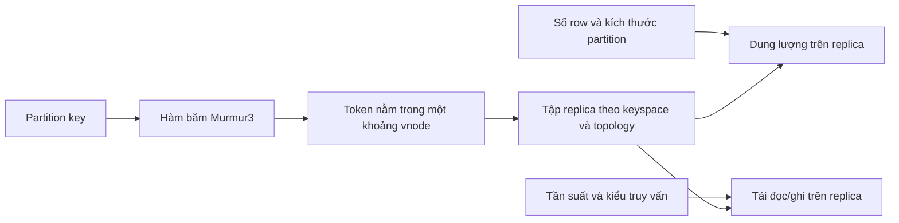

# Chênh lệch dung lượng hoặc tải dù số token tương đương trong Apache Cassandra

## 1. Vấn đề: các node có cùng số token nhưng không «cân» như nhau

Trong Apache Cassandra, dữ liệu được phân phối qua **partition key**, **token** và **replica**. Khi dùng virtual node (vnode), mỗi node vật lý thường quản lý nhiều vị trí token trên vòng băm. Nhìn thấy các node cùng có `Tokens = 16`, người vận hành dễ kỳ vọng chúng lưu lượng dữ liệu tương đương và xử lý lượng truy vấn tương đương. Kỳ vọng đó không luôn đúng.

Giả sử một cụm có bốn node cùng data center, keyspace dùng `NetworkTopologyStrategy` với replication factor (RF) bằng 2. Bảng sau là số **minh họa**, không phải tỷ lệ Cassandra bảo đảm:

| Node | Số token/vnode | `Owns (effective)` của keyspace | `Load` hiển thị | Số yêu cầu/giây quan sát được |
| --- | ---: | ---: | ---: | ---: |
| `node-a` | 16 | 49% | 690 GB | 12.000 |
| `node-b` | 16 | 51% | 650 GB | 11.000 |
| `node-c` | 16 | 50% | 320 GB | 3.000 |
| `node-d` | 16 | 50% | 340 GB | 3.500 |

**Cả bốn node có cùng số token; tỷ lệ sở hữu hiệu dụng gần nhau, nhưng dung lượng và tải khác nhau đáng kể.** Đây không nhất thiết là lỗi phân vùng hoặc replication. Đầu tiên phải xác định đang so sánh đại lượng nào, vì mỗi đại lượng đo một khía cạnh khác nhau.

Trong phạm vi mô hình **wide-column** của Cassandra, một partition có thể chứa rất nhiều clustering row. Toàn bộ các row thuộc cùng partition key dùng **một token** và được lưu trên cùng tập replica. Đây là nguyên nhân nền tảng của nhiều trường hợp lệch dữ liệu/tải.

## 2. Phân biệt năm khái niệm dễ nhầm

| Đại lượng | Ý nghĩa | Không cho biết trực tiếp |
| --- | --- | --- |
| **Số token** (`Tokens`, `num_tokens`) | Số vị trí token/vnode một node quản lý trong ring | Dung lượng byte, số partition, số request |
| **Khoảng token** | Phạm vi giá trị băm được ánh xạ đến một vnode, thường là khoảng `(token_trước, token_hiện_tại]` | Mỗi giá trị token chứa bao nhiêu dữ liệu |
| **Ownership hiệu dụng** (`Owns (effective)`) | Phần không gian token mà node có trách nhiệm làm replica, tính theo chiến lược sao chép của keyspace | Dung lượng thực tế của riêng bảng; QPS, CPU, latency |
| **Dung lượng thực tế** (`Load`, SSTable/disk usage) | Lượng dữ liệu/tệp đang chiếm chỗ theo phép đo tương ứng | Lượng truy vấn hoặc độ nóng của partition |
| **Tải vận hành** | Read/write rate, CPU, disk I/O, compaction, streaming, latency... | Số token hay ownership; các chỉ số này còn phụ thuộc loại truy vấn |

Với `Murmur3Partitioner` thông dụng, Cassandra băm **giá trị partition key đã mã hóa** thành một token. Một partition key ứng với một token; thay đổi clustering key không làm partition chuyển token. Vnode chia ring thành nhiều khoảng để thuận tiện phân phối/di chuyển dữ liệu. **Số vnode bằng nhau không bảo đảm các khoảng token dài bằng nhau**; ngay cả khi độ dài khoảng gần bằng nhau, số byte và tần suất truy cập trong các khoảng vẫn có thể rất khác.

Hình dung luồng ánh xạ:



Có thể biểu diễn gần đúng cho từng node `n`:

```text
logical_data_on(n) ≈ tổng size(partition p) với mọi p có n trong replica_set(p)
replica_work_on(n) ≈ tổng work(request tới p) mà n thực sự tham gia xử lý
disk_used_on(n)   ≈ logical_data_on(n) + chi phí lưu trữ và tệp tạm/thừa
```

Đây là **mô hình giải thích**, không phải công thức đo chính xác: thực tế còn có nhiều keyspace, nén, tombstone, cấu trúc SSTable, coordinator, caching và các tác vụ nền. Nếu chỉ biết `num_tokens`, ta chưa biết các thành phần trong ba biểu thức.

## 3. Vì sao dung lượng giữa các node vẫn chênh lệch?

### 3.1. Phân phối giá trị partition key không giống phân phối số byte

Hàm băm tốt có thể phân bố **nhiều partition key độc lập** tương đối đều trên ring. Nhưng Cassandra **không chia một partition lớn thành nhiều token**. Ví dụ bảng lưu sự kiện theo `tenant_id`, trong đó một tenant có 80 triệu row và hàng nghìn tenant khác mỗi tenant có vài trăm row. Tenant lớn chỉ có một token; RF = 3 khiến toàn bộ partition lớn nằm trên ba replica được chọn cho token đó.

Hệ quả:

- Số token có thể bằng nhau nhưng node thuộc tập replica của tenant lớn nhận nhiều byte hơn.
- Nếu tổng số partition nhỏ, hoặc kích thước partition biến thiên mạnh, tính đồng đều thống kê của hàm băm không đủ để cân byte.
- Dữ liệu chọn phân vùng theo khóa tuần tự cũng không tự động lệch chỉ vì tuần tự, miễn partitioner băm tốt và khóa đủ đa dạng. Cần xem **kích thước và mức độ tập trung của từng partition**, không chỉ hình dạng chuỗi khóa.

### 3.2. Ownership tương tự nhưng dữ liệu trong từng khoảng khác nhau

Một khoảng token chiếm 1% không gian băm có thể chứa 1% số partition nhưng 10% byte nếu các partition trong đó quá lớn. `Owns (effective)` là tỷ lệ trên **không gian token được quy trách nhiệm sau khi xét replication**, không phải phép cộng kích thước partition thực tế. Vì thế, hai node cùng `Owns = 50%` vẫn có thể có hàng trăm GB chênh lệch.

Khi so sánh các node, cần nhớ `nodetool status <keyspace>` hiển thị `Owns (effective)` theo **keyspace chỉ định**, trong khi `Load` phản ánh lượng dữ liệu node dùng theo cách `nodetool` đo trên node, không giới hạn ở keyspace đó. Nếu cụm có nhiều keyspace, không nên lấy hai cột đó làm phép đối chiếu byte theo cùng một phạm vi.

### 3.3. Replication và topology làm thay đổi tập dữ liệu trên mỗi node

Trong Cassandra, đường đi từ token đến replica phụ thuộc vào **chiến lược replication**, RF của từng data center và topology/rack. Với `NetworkTopologyStrategy`, RF thường được cấu hình riêng cho từng DC. Khi so sánh hai DC, hoặc hai keyspace có RF khác nhau, lượng byte trên từng node có thể khác dù số token tương đương.

Kiểm tra thêm liệu cụm có đang **bootstrap**, thêm/bớt node, di chuyển dữ liệu hoặc thay đổi RF hay không. Giai đoạn streaming, topology thay đổi hoặc cleanup chưa hoàn tất có thể khiến dung lượng tạm thời không cân. Không suy ra sai cấu hình chỉ từ số token.

### 3.4. Dung lượng trên đĩa còn chịu ảnh hưởng vòng đời SSTable

Hai replica giữ dữ liệu logic gần giống nhau vẫn có thể tạm thời dùng đĩa khác nhau vì:

- **Compaction:** các SSTable cũ và mới có thể cùng tồn tại trong lúc nén/gộp; áp lực ghi và lịch compaction giữa node khác nhau.
- **TTL, tombstone và thời điểm compaction:** bản ghi hết hạn/xóa không nhất thiết được thu hồi dung lượng tức thì; việc loại bỏ tombstone còn phụ thuộc điều kiện an toàn và chiến lược compaction.
- **Compression và kích thước SSTable:** dữ liệu nén, số SSTable và overhead lưu trữ không hoàn toàn giống nhau tại mọi thời điểm.
- **Snapshot/backup, commitlog, tệp tạm:** công cụ đo hệ thống tệp có thể tính cả những tệp không phản ánh dữ liệu logic còn sống. Cần phân biệt dung lượng `nodetool`, số liệu `tablestats`, và tổng dung lượng phân vùng đĩa (`df`/`du`).

Đừng vội kết luận rằng cần đổi token khi khác biệt chỉ xuất hiện trong thời gian compaction hoặc còn snapshot cũ.

## 4. Vì sao tải đọc/ghi chênh lệch dù dung lượng gần bằng?

**Dung lượng (GB) và tải (QPS/CPU/I/O) là hai bài toán khác nhau.** Một partition nhỏ có thể chiếm rất ít byte nhưng nhận phần lớn yêu cầu đọc. Với RF = 3, những replica chịu đọc/ghi cho partition nóng có thể bị quá tải trong khi các node khác rảnh.

Những tác nhân thường gặp:

| Hiện tượng | Cơ chế | Dấu hiệu cần tìm |
| --- | --- | --- |
| **Hot partition/hot key** | Một hoặc vài partition key nhận rất nhiều read/write; các replica của chúng bị tập trung tải | QPS/I/O/latency lệch dù dung lượng bảng gần bằng |
| **Partition quá rộng** | Một truy vấn đọc nhiều clustering row, tạo nhiều byte đọc, deserialize, page hoặc tombstone scan | Read latency cao, kích thước partition và số row/partition lớn |
| **Coordinator không cân** | Client/driver đẩy request vào một số node làm coordinator nhiều hơn | Request tại coordinator lệch; chưa chắc replica I/O lệch tương ứng |
| **Mức nhất quán và retry** | `LOCAL_ONE`, `LOCAL_QUORUM`, retry, speculative execution có số replica tham gia và chi phí khác nhau | Request/latency biến đổi theo CL, retry rate hoặc timeout |
| **Compaction/repair/streaming** | Tác vụ nền cạnh tranh CPU, mạng và disk I/O với truy vấn | Compaction pending, bytes streaming, repair đang chạy |
| **Năng lực hạ tầng khác nhau** | Disk, CPU, RAM, network, GC và cache hit rate khác nhau | Node tải cao dù dữ liệu và số request không vượt trội |

**Đặc biệt:** driver có token-aware routing chỉ giúp chọn coordinator thích hợp trong các điều kiện được hỗ trợ; nó **không thể** tự chia một partition key nóng sang các replica của token khác. Tăng RF có thể thay đổi số replica phục vụ đọc và khả năng chịu lỗi, nhưng không biến một partition thành nhiều partition và còn làm tăng chi phí lưu trữ/ghi. Đổi consistency level để giảm latency cũng thay đổi đánh đổi về nhất quán, không giải quyết tận gốc lệch khóa.

## 5. Quy trình chẩn đoán có thể lặp lại

Điều tra theo thứ tự: **xác nhận hiện tượng → xác định bảng/partition → phân biệt dữ liệu logic với overhead → kiểm tra replica và tải nền → lựa chọn can thiệp**. Thu thập cùng một khoảng thời gian trên mọi node, ưu tiên so sánh các node trong **cùng DC** và có vai trò tương đương.

### Bước 1 — Xác nhận token, ownership, DC và trạng thái node

```bash
# Lệnh chạy trên một node có quyền truy cập nodetool.
nodetool status app_ks
nodetool describering app_ks
```

Trong `nodetool status app_ks`, xem `Status/State` (`UN` là Up/Normal), `DC`, `Rack`, `Tokens`, `Owns (effective)` và `Load`. `describering` giúp quan sát các token range và endpoint/replica tương ứng của keyspace. Khi có nhiều DC, kiểm tra cấu hình keyspace trước khi so tải chéo DC:

```sql
SELECT keyspace_name, replication
FROM system_schema.keyspaces
WHERE keyspace_name = 'app_ks';
```

Đừng coi một node `Joining`, `Leaving`, `Moving` hoặc đang streaming như một node ổn định. Nếu node cùng số token nhưng ownership chênh đáng kể, kiểm tra cả vị trí token thực tế, topology và replication. Nếu ownership gần bằng nhau nhưng dung lượng/tải khác, chuyển sang phân tích phân phối dữ liệu và truy vấn.

### Bước 2 — Tìm keyspace/bảng tạo ra chênh lệch byte

Trên **từng node** cần so sánh, chạy:

```bash
nodetool tablestats app_ks.events_by_tenant
nodetool tablehistograms app_ks events_by_tenant
```

Tập trung vào số liệu dung lượng SSTable, số partition ước tính, số SSTable, phân bố kích thước partition, tombstone và độ trễ read/write. Tên chỉ số, cách trình bày và tùy chọn có thể khác theo phiên bản Cassandra; dùng `nodetool help <lệnh>` tại đúng phiên bản đang vận hành.

Nếu một bảng đóng góp phần lớn độ lệch, xem truy vấn thực tế và lựa chọn partition key của bảng đó. Một bảng khác nhau giữa hai node ở **số byte mỗi partition** là dấu hiệu khác với một bảng có nhiều partition nhỏ phân bố không đều. Tránh chạy `SELECT COUNT(*)` trên bảng lớn của production để ước lượng phân phối: thao tác này có thể quét lượng dữ liệu rất lớn và làm tăng tải.

### Bước 3 — Kiểm tra hot partition và điểm phát sinh tải

Từ metrics ứng dụng, driver và Cassandra, so sánh theo node và theo bảng:

- Số read/write request, byte đọc/ghi, read/write latency (p95/p99), timeout và retry.
- Kích thước partition lớn nhất, phân bố row/partition, partition key xuất hiện với tần suất bất thường (dùng khả năng quan sát/tracing hoặc công cụ hot-partition phù hợp phiên bản và chính sách vận hành).
- Coordinator nhận yêu cầu nào, replica nào thật sự đọc/ghi và mức sử dụng CPU, disk I/O, mạng, cache, GC.

Nếu node A nhận nhiều request với vai trò coordinator nhưng B/C mới là replica bị nghẽn I/O, cần xử lý nguyên nhân ở lớp tương ứng. Truy vết một số request đại diện giúp phân biệt hai vai trò; không bật tracing tràn lan trong lúc hệ thống đang quá tải.

### Bước 4 — Loại trừ hoạt động nền và tình trạng lưu trữ

```bash
nodetool compactionstats
nodetool netstats
nodetool tpstats
```

`compactionstats` cho biết công việc compaction đang chạy/đợi, `netstats` hỗ trợ kiểm tra streaming, còn `tpstats` giúp nhìn các hàng đợi/tác vụ trong hệ thống. Kết hợp metrics disk/CPU, log liên quan và lịch repair, bootstrap, snapshot, backup. Nếu tổng byte của ổ đĩa lệch nhưng `tablestats` không lệch tương ứng, kiểm tra snapshot, commitlog và tệp ngoài SSTable trước khi quyết định phân phối lại dữ liệu.

### Bước 5 — Ghi kết luận theo dấu hiệu, không theo số token

| Quan sát sau kiểm tra | Giả thuyết ưu tiên | Hướng xử lý ban đầu |
| --- | --- | --- |
| Ownership gần bằng, một số node chứa các partition cực lớn | **Lệch kích thước partition** | Thiết kế partition key/bucket/shard theo mẫu truy vấn |
| Byte gần bằng, một tập replica có read QPS và p99 cao | **Hot partition hoặc truy vấn đắt** | Phân tích top key, read pattern, pagination, cache và sharding |
| `tablestats` khá cân nhưng `df`/`du` lệch | **Overhead đĩa/snapshot/tệp tạm** | Kiểm tra vòng đời tệp, snapshot, compaction |
| Tải tăng mạnh đúng lúc thêm node/repair | **Streaming/repair/compaction cạnh tranh tài nguyên** | Điều chỉnh lịch/tốc độ tác vụ và theo dõi đến khi ổn định |
| Chênh lệch tập trung theo DC hoặc keyspace | **Khác RF, topology hoặc workload theo DC** | Kiểm tra `NetworkTopologyStrategy`, rack, local DC và lưu lượng client |
| Coordinator QPS lệch nhưng replica/tables tương đối cân | **Phân phối client/coordinator** | Kiểm tra contact points, driver load balancing, latency và retry |

## 6. Ví dụ CQL: một tenant lớn gây lệch byte và tải

Thiết kế ban đầu:

```sql
CREATE TABLE app_ks.events_by_tenant (
    tenant_id text,
    event_id timeuuid,
    payload text,
    PRIMARY KEY (tenant_id, event_id)
) WITH CLUSTERING ORDER BY (event_id DESC);

-- Truy vấn hợp lệ theo partition key, nhưng có thể rất nặng với tenant lớn.
SELECT event_id, payload
FROM app_ks.events_by_tenant
WHERE tenant_id = 'tenant-vip'
LIMIT 100;
```

`tenant_id` là partition key duy nhất. Mỗi tenant chỉ tạo **một partition**, dù chứa hàng triệu row. Tất cả sự kiện của `tenant-vip` băm tới một token. Nếu tenant này chứa phần lớn dữ liệu hoặc được đọc liên tục, các replica giữ token đó nhận phần lớn byte và I/O. Việc mọi node có cùng `num_tokens` không giúp tự chia partition này.

Một phương án cho workload sự kiện đọc theo ngày là **bucketing theo thời gian**; nếu một tenant/ngày vẫn quá nóng, thêm **shard** có giới hạn:

```sql
CREATE TABLE app_ks.events_by_tenant_day_shard (
    tenant_id text,
    event_day date,
    shard smallint,
    event_ts timestamp,
    event_id uuid,
    payload text,
    PRIMARY KEY ((tenant_id, event_day, shard), event_ts, event_id)
) WITH CLUSTERING ORDER BY (event_ts DESC, event_id ASC);

-- Ứng dụng đã tính shard ổn định cho sự kiện; ví dụ đọc một shard.
SELECT event_ts, event_id, payload
FROM app_ks.events_by_tenant_day_shard
WHERE tenant_id = 'tenant-vip'
  AND event_day = '2026-11-21'
  AND shard = 3
LIMIT 100;
```

Ví dụ quy tắc ghi `shard = positiveHash(event_id) % 16`: với mỗi cặp `(tenant_id, event_day)`, ứng dụng có tối đa 16 partition khác nhau thay vì một partition khổng lồ. `positiveHash` ở đây là hàm băm **do ứng dụng định nghĩa**, có kết quả ổn định giữa các lần chạy; nó không phải hàm CQL hay một cấu hình vnode của Cassandra. Phải lưu/khôi phục đúng quy tắc shard khi đọc hoặc cập nhật cùng sự kiện.

**Đánh đổi bắt buộc:** để lấy toàn bộ sự kiện một tenant trong một ngày, ứng dụng cần truy vấn các shard liên quan rồi hợp nhất/sắp xếp kết quả; một partition chỉ bảo đảm thứ tự clustering **bên trong chính partition đó**. Chọn số shard, độ rộng bucket, giới hạn phân trang và mức song song theo QPS, kích thước partition, SLA và mẫu truy vấn thực tế. Không tự ý tăng từ 16 lên 32 shard với dữ liệu cũ nếu chưa có chiến lược đọc và di chuyển dữ liệu phù hợp.

Nếu mục tiêu chủ yếu là giới hạn kích thước partition, bucket theo ngày/giờ có thể đã đủ; nếu mục tiêu là rải tải của một tenant cực nóng trong cùng bucket, sharding mới có thêm tác dụng. Sharding không cứu được truy vấn phải đọc mọi sự kiện một cách không giới hạn.

### Liên hệ với ứng dụng Java

Với Java Driver 4.x, sử dụng prepared statement chứa **đủ các thành phần partition key** để driver có thể suy ra token phục vụ routing, đồng thời cấu hình đúng local data center. Ví dụ (giả sử `CqlSession session` đã kết nối và cấu hình `local-datacenter`):

```java
PreparedStatement statement = session.prepare("""
    SELECT event_ts, event_id, payload
    FROM app_ks.events_by_tenant_day_shard
    WHERE tenant_id = ? AND event_day = ? AND shard = ?
    LIMIT ?
    """);

BoundStatement bound = statement.bind(
    "tenant-vip",
    java.time.LocalDate.of(2026, 11, 21),
    (short) 3,
    100
);

ResultSet result = session.execute(bound);
// result.getExecutionInfo().getCoordinator() cho biết coordinator đã phục vụ request.
```

Coordinator được driver chọn không nhất thiết là node duy nhất tham gia đọc: consistency level và trạng thái replica quyết định thêm phần công việc ở các node khác. Khi quan sát sự cố tải, thu thập cả metrics tại client (request/timeout/retry/coordinator) lẫn server (replica reads, disk I/O). Đừng xem kết quả `getCoordinator()` là toàn bộ tập replica.

## 7. Xử lý theo nguyên nhân và tránh thao tác gây tác dụng phụ

1. **Partition lớn hoặc hot partition:** ưu tiên sửa mô hình dữ liệu theo truy vấn: thêm bucket/shard có kiểm soát, giới hạn truy vấn và pagination, thiết kế luồng đọc hợp nhất. Với hệ thống đã có dữ liệu, cần kế hoạch backfill/migration và chuyển hướng đọc ghi.
2. **Không gian token/replica thật sự lệch:** kiểm tra phân bố vnode và topology; cân nhắc scale-out hoặc điều chỉnh phân phối token bằng quy trình tương thích **đúng phiên bản Cassandra**, trong giai đoạn bảo trì có giám sát. Chỉ đổi `num_tokens` trong cấu hình của node đang chạy **không** tự cân lại dữ liệu hiện có. Không áp dụng thao tác di chuyển token của mô hình single-token cho vnode nếu chưa xác minh hỗ trợ.
3. **Chênh dung lượng vật lý:** xử lý snapshot/backup/tệp tạm theo chính sách lưu giữ; tìm compaction backlog, TTL và tombstone. Chỉ cân nhắc cleanup sau khi topology và việc chuyển dữ liệu đã ổn định, và node thực sự không còn trách nhiệm giữ các range liên quan. Cần hiểu tác động trước khi chạy compaction thủ công trên bảng lớn.
4. **Coordinator hoặc lưu lượng lệch:** kiểm tra cấu hình load balancing và local DC của driver, retry/speculative execution, contact points, timeout và phân phối client. Nếu một partition vẫn quá nóng, sửa routing không thay thế được việc chia partition.
5. **Repair, RF và consistency:** repair phục vụ tính đồng bộ replica và khả năng khôi phục sau lỗi, **không phải** lệnh cân tải. Thay RF hoặc consistency level có ảnh hưởng đến dung lượng, số replica tham gia và các bảo đảm nhất quán; phải đánh giá riêng và thực hiện quy trình vận hành đầy đủ.

Sau mỗi can thiệp, theo dõi lại **trong một cửa sổ tải tương đương**: phân bố byte theo bảng/node, độ lớn partition, QPS và latency p95/p99, timeout/retry, disk I/O, compaction backlog, tình trạng node và replication. Một tỷ lệ `Owns` đẹp hơn chưa đủ để kết luận cụm đã ổn định.

## 8. Ghi nhớ khi đọc dashboard Cassandra

- `Tokens = 16` ở mọi node chỉ nói số vnode bằng nhau; **không** nói GB hay request bằng nhau.
- `Owns (effective)` cho biết tỷ lệ không gian token theo replication của **một keyspace**; **không** phải tỷ lệ byte thực hay tài nguyên CPU.
- Một partition key, kể cả có hàng triệu clustering row, chỉ có một token và một tập replica theo chiến lược sao chép.
- Lệch **byte** thường dẫn đến câu hỏi về kích thước partition, replication, compaction và tệp lưu trữ; lệch **tải** thường dẫn đến câu hỏi về hot key, loại truy vấn, coordinator/replica và tác vụ nền.
- Cách xử lý đúng bắt đầu từ **mẫu truy vấn và partition key**; tăng token, đổi RF hoặc chạy repair theo phản xạ có thể tốn tài nguyên mà không giải quyết nguyên nhân.

Với chủ đề *Token và sao chép*, quy tắc vận hành quan trọng nhất là: **Cassandra phân phối partition theo token và đặt replica theo topology; Cassandra không hứa phân phối đồng đều số byte hoặc số yêu cầu chỉ vì các node có cùng số token.**
