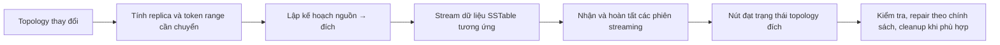

# Luồng truyền dữ liệu khi thêm, rút hoặc thay thế một nút

> **Chương:** Token và sao chép  
> **Mô-đun:** `DATABASE_ENGINE_WIDE_COLUMN_CASSANDRA` — Apache Cassandra, cơ sở dữ liệu wide-column phân tán.  
> **Trọng tâm:** Vì sao dữ liệu phải di chuyển khi topology thay đổi, Cassandra chọn nguồn/đích streaming như thế nào, và cách vận hành an toàn.

Trong Cassandra, thêm một máy không đơn giản là kết nối máy đó vào cụm; rút hoặc thay máy cũng không chỉ là xóa một địa chỉ IP. **Mỗi thay đổi topology có thể làm thay đổi tập nút chịu trách nhiệm lưu bản sao của từng partition.** Cassandra phải truyền dữ liệu giữa các nút để trạng thái lưu trữ phù hợp với token và replication strategy mới.

Bài này liên hệ trực tiếp các khái niệm **partition key, token, replication, consistency level** với việc streaming SSTable khi thêm/rút/thay nút. Đồng thời, nó chỉ ra tác động tới CQL, compaction, repair, xử lý sự cố và ứng dụng Java dùng Cassandra Driver.

## 1. Kết quả cần đạt

Sau bài học, bạn có thể:

1. Giải thích tại sao thay đổi membership làm thay đổi chủ sở hữu token range, dù partition key và dữ liệu CQL không đổi.
2. Phân biệt ba luồng **bootstrap** (thêm nút), **decommission** (rút nút đang sống) và **replace** (thay nút hỏng).
3. Xác định nguồn, đích, dữ liệu cần stream và những điều kiện tiên quyết cho từng luồng.
4. Theo dõi tiến độ bằng `nodetool status`, `nodetool netstats` và log; hiểu khi nào dùng `cleanup`, `repair` hoặc `removenode`.
5. Đánh giá rủi ro về replication factor (RF), consistency level (CL), dung lượng đĩa và ảnh hưởng tới truy vấn từ ứng dụng Java.

## 2. Nền tảng: token quyết định vị trí lưu dữ liệu

### 2.1. Từ partition key đến tập replica

Với bảng CQL, **partition key** là thành phần khóa chính xác định cách nhóm hàng thành partition. Partitioner (thường là `Murmur3Partitioner`) băm partition key thành **token**; các token xác định các khoảng trên token ring.

Một khoảng thường được ký hiệu `(t_trước, t_hiện_tại]`. Nút quản lý token kết thúc khoảng là một đầu mối trong quá trình xác định chủ sở hữu dữ liệu. Tuy nhiên, vị trí các **replica thực sự** còn phụ thuộc replication strategy của keyspace, số bản sao và cấu hình datacenter/rack.

- **RF = 3**: Cassandra cố bố trí ba bản sao của mỗi partition theo quy tắc replication của keyspace. RF không có nghĩa mọi bản sao nằm ở ba máy bất kỳ.
- **`NetworkTopologyStrategy`**: chọn các replica theo RF của từng datacenter và cố tôn trọng phân bố rack; rất quan trọng với cụm nhiều datacenter.
- **Virtual nodes (vnodes)**: một nút có thể sở hữu nhiều token và nhiều khoảng rời nhau. Khi thêm/rút/thay nút, quá trình dịch chuyển vì thế thường gồm **nhiều token range**, không phải một tập dữ liệu liền mạch.
- **Token range khác partition**: streaming chọn dữ liệu theo range, còn toàn bộ hàng thuộc cùng partition vẫn chia sẻ một partition key/token.

Ví dụ một keyspace có RF = 3 trong datacenter `dc1`:

```sql
CREATE KEYSPACE shop
WITH replication = {
  'class': 'NetworkTopologyStrategy',
  'dc1': 3
};

CREATE TABLE shop.events_by_account (
  account_id uuid,
  event_time timestamp,
  event_id timeuuid,
  event_type text,
  PRIMARY KEY ((account_id), event_time, event_id)
) WITH CLUSTERING ORDER BY (event_time DESC, event_id ASC);
```

Ở đây `account_id` quyết định token; `event_time` và `event_id` là clustering columns, **không** làm thay đổi nút mà partition được đặt vào. Khi topology thay đổi, ứng dụng tiếp tục truy vấn theo `account_id` như cũ, còn Cassandra cập nhật tập replica phục vụ partition đó.

### 2.2. Ví dụ về thay đổi tập replica

Giả sử cùng một token range `R` trong `dc1` có phân bố sau (đây là **ví dụ minh họa**, không phải thuật toán cố định cho mọi ring/rack):

| Thời điểm | Replica của range R | Ý nghĩa |
|---|---|---|
| Trước khi thêm nút D | A, B, C | A/B/C đang giữ các bản sao của R |
| Sau khi thêm D | B, C, D | D phải nhận dữ liệu của R |
| Sau khi hoàn tất và dọn dữ liệu thừa | B, C, D | A không còn cần giữ R nếu A không sở hữu R vì lý do khác |

```text
                  Streaming dữ liệu thuộc range R
  Trước:  [A] [B] [C]      ─────────────────────▶ [D] mới
            │   │   │        nguồn: replica       │
            └───┴───┘        đang có R hợp lệ       │
  Sau:          [B] [C] [D]  (RF vẫn bằng 3)
```

Không nhất thiết cả A, B và C đều truyền cùng một bản sao đầy đủ cho D: Cassandra lập kế hoạch chọn các nguồn có dữ liệu phù hợp để tạo tập dữ liệu cần thiết. Với nhiều vnodes, các range khác nhau của D có thể lấy dữ liệu từ các nút khác nhau.

**Thêm một nút không tự tăng RF.** Nó thay đổi phân phối trách nhiệm giữa các nút; tăng RF là thao tác riêng trên cấu hình keyspace và cần đồng bộ dữ liệu cho các replica mới.

## 3. Streaming thực sự truyền gì?

**Streaming** là cơ chế truyền dữ liệu giữa các Cassandra node, chủ yếu dựa trên dữ liệu lưu trong **SSTable** và phạm vi token cần đồng bộ. Mỗi tác vụ có nguồn, đích, tập range và các phiên truyền; dữ liệu đi trực tiếp giữa các nút, không phải qua CQL `SELECT` trên client rồi `INSERT` lại từng hàng.

Một luồng khái quát:



Có bốn khía cạnh cần phân biệt:

1. **SSTable và memtable:** dữ liệu được stream từ các cấu trúc lưu trữ bền vững; hệ thống có thể flush dữ liệu chưa nằm trên SSTable theo nhu cầu của quy trình và phiên bản.
2. **Range và replica:** Cassandra tính dữ liệu nào phải xuất hiện ở đích dựa trên ownership sau thay đổi. Một node mới không cần copy toàn bộ dữ liệu của mọi node cũ.
3. **Ghi đồng thời:** trong giai đoạn chuyển tiếp, cơ chế quản lý topology/replica và các replica đang chờ nhận range giúp định tuyến ghi mới. Tuy vậy, ứng dụng vẫn phải xử lý timeout và thực hiện đúng CL; streaming không biến một cụm đang thiếu quorum thành cụm có quorum.
4. **Repair khác streaming topology:** repair đối chiếu dữ liệu giữa các replica (thường bằng Merkle tree rồi đồng bộ phần khác biệt), còn bootstrap/decommission/replace chủ yếu đưa dữ liệu đến **đúng nơi sở hữu mới**. Streaming thành công không chứng minh tất cả bản sao từng có trước đó đã nhất quán tuyệt đối.

Streaming dùng mạng, I/O đĩa và CPU; nó có thể cạnh tranh tài nguyên với flush, compaction, repair và truy vấn CQL. Dữ liệu có tombstone, TTL hay partition lớn cũng có thể làm chi phí truyền/compaction tăng.

## 4. Thêm nút: bootstrap và luồng nhận dữ liệu

### 4.1. Tình huống và điều kiện

Cụm `dc1` đang hoạt động với các node A/B/C và cần thêm D để tăng dung lượng hoặc phân tán tải. D phải dùng cấu hình tương thích: đúng cluster, datacenter/rack, cơ chế xác định địa chỉ/seed, phiên bản được hỗ trợ và đủ ổ đĩa/mạng. Cần kiểm tra RF, mức độ sẵn sàng của replica nguồn và áp lực compaction trước khi bắt đầu.

**Bootstrap** là quá trình D gia nhập cụm và nhận dữ liệu ứng với các token range mà D sẽ phụ trách. Với vnodes, D có thể được gán nhiều token.

### 4.2. Trình tự

1. **Đăng ký tham gia:** D liên hệ cụm, nhận metadata topology/schema phù hợp và tham gia quy trình được phiên bản Cassandra hỗ trợ. Cluster xác định các token/range cần có trên D.
2. **Tính replica mới:** đối với mỗi keyspace, replication strategy tính tập replica mới; Cassandra tìm các range mà D cần nhận.
3. **Chọn nguồn:** một hoặc nhiều replica đang sống, chứa dữ liệu thuộc range đó, cung cấp dữ liệu streaming cho D.
4. **Stream dữ liệu:** các phiên truyền gửi phần SSTable cần thiết qua mạng; đồng thời cụm tiếp tục xử lý yêu cầu theo semantics của trạng thái topology đang chuyển tiếp.
5. **Hoàn tất:** khi bootstrap thành công, D trở thành thành viên bình thường (thường thấy là `UN` trên `nodetool status`). Những node cũ có thể còn giữ dữ liệu không còn thuộc trách nhiệm của chúng; xử lý bằng `cleanup` khi đã xác nhận topology ổn định.

```text
D bắt đầu JOIN
    │
    ├─ Nhận token/range phải sở hữu
    ├─ Tìm replica nguồn cho từng range
    ├─ Incoming streams từ A/B/C... đến D
    ├─ Hoàn tất các phiên và chuyển thành NORMAL
    └─ Kiểm tra dữ liệu, giám sát ổn định, cleanup node cũ nếu cần
```

Trong quá trình này, `UJ` thường biểu thị **Up/Joining**; khi gia nhập xong, `UN` là **Up/Normal**. Trạng thái hiển thị và thao tác khởi động cụ thể phụ thuộc phiên bản và cấu hình, nên cần đối chiếu runbook của cụm.

### 4.3. Ví dụ quan sát

Chạy từ máy được phép dùng `nodetool`:

```bash
nodetool status
nodetool netstats
nodetool compactionstats
```

- `status`: xem D đang Joining hay đã Normal; đối chiếu datacenter, rack, host ID.
- `netstats`: xem các phiên streaming gửi/nhận, số byte và tiến độ truyền; mỗi range có thể dùng nguồn riêng.
- `compactionstats` và dashboard hệ thống: xem I/O và hàng đợi công việc cạnh tranh với streaming.

**Chưa nên chạy `cleanup` khi bootstrap chưa kết thúc.** Sau khi D hoạt động ổn định và các replica mới đã được xác minh, có thể lên lịch `nodetool cleanup` trên node cũ để giải phóng dữ liệu không còn thuộc quyền sở hữu của chúng. Việc này tốn I/O, cần thực hiện có kiểm soát.

## 5. Rút nút đang sống: decommission và luồng gửi dữ liệu

### 5.1. Khi nào dùng decommission?

Dùng **`nodetool decommission`** khi nút cần loại bỏ **vẫn đang chạy và có thể tham gia quá trình streaming**. Ví dụ cụm năm node giảm xuống bốn node và RF vẫn có thể được đáp ứng với topology còn lại.

Decommission không phải là hành động tắt máy đột ngột. Cassandra phải chuyển dữ liệu mà node rời cụm đang giữ sang các replica sẽ đảm nhận những token range đó.

### 5.2. Trình tự

1. **Tính topology sau khi rút:** cluster biết node nào rời đi, xác định những range và các đích replica cần bổ sung.
2. **Lập kế hoạch chuyển:** node rời (cùng các nguồn khác khi cần, tùy range/cơ chế) truyền dữ liệu tương ứng tới những node sẽ sở hữu các bản sao mới.
3. **Chuyển trạng thái:** node rời được đưa vào trạng thái Leaving (thường thấy `UL` khi còn hoạt động); các node nhận dữ liệu tiếp tục xử lý tác vụ streaming.
4. **Hoàn tất và loại khỏi membership:** khi các yêu cầu truyền và thay đổi topology hoàn tất, node đã decommission được rời khỏi cụm; ứng dụng và hệ thống giám sát không còn dựa vào endpoint này.

```bash
# Thực thi trên chính node đang sống và đã được chọn để rút
nodetool decommission

# Theo dõi từ các node còn hoạt động
nodetool status
nodetool netstats
```

Trước thao tác, cần chắc chắn node đích có đủ dung lượng và số replica còn sống cho RF/CL hiện tại. Nếu có node khác đang hỏng, decommission có thể thất bại hoặc khiến dịch vụ giảm khả năng đáp ứng; không nên cố giảm cụm chỉ dựa vào việc tổng dung lượng đĩa vẫn còn trống.

**Sau decommission:** cập nhật danh sách máy, monitoring, kết nối ứng dụng/seed khi cần; xác nhận node cũ đã biến mất khỏi membership trước khi thu hồi tài nguyên. Tránh thao tác đồng thời nhiều thay đổi topology nếu runbook/phiên bản không hỗ trợ an toàn.

## 6. Nút hỏng: replace khác gì removenode?

### 6.1. Replace: thay vị trí của node chết bằng node mới

Giả sử C hỏng hoàn toàn, không thể khởi động để stream đi. Ta cần node D **thế chỗ C**. Trong luồng replace, D gia nhập với vai trò thay thế thành viên cũ và nhận dữ liệu/token range phù hợp từ **những replica còn sống**, vì C không thể làm nguồn.

Quy trình ở mức khái niệm:

1. **Xác nhận C thật sự không còn hoạt động và không thể tự tái gia nhập.** Cần cách ly/fence máy hoặc cấu hình cũ, tránh hai tiến trình cùng nhận vai trò node cũ.
2. **Kiểm tra khả năng phục hồi:** đối với mọi range của C, phải còn đủ bản sao ở các node khác hoặc nguồn phục hồi hợp lệ. RF = 1 và chỉ có dữ liệu trên C thì replace không thể tự tái tạo dữ liệu đã mất.
3. **Chuẩn bị D:** cấu hình đúng cluster, DC/rack, địa chỉ và tham số thay thế phù hợp **đúng phiên bản Cassandra**. Một số phiên bản hỗ trợ tùy chọn khởi động dạng `-Dcassandra.replace_address_first_boot=<old-address>`; đây là tham số khi khởi động, **không phải lệnh `nodetool`**. Hãy kiểm tra tài liệu và runbook của bản đang chạy, nhất là khi dùng lại IP/ổ đĩa hay cơ chế topology mới.
4. **D nhận dữ liệu:** các replica khỏe stream những range C từng nắm giữ sang D; theo dõi `nodetool netstats` và trạng thái tham gia cụm.
5. **Xác nhận:** D trở thành thành viên bình thường; kiểm tra truy vấn/CL, log và thực hiện repair theo chính sách của cụm khi cần đối chiếu các bản sao.

```text
C hỏng (không stream được)
       X
       │       RF cho range R trước sự cố: {A, B, C}
       └─────► nguồn phục hồi: A/B (nếu còn đủ dữ liệu)
                                      │
                                      └── stream R ──► D thay C
                Sau phục hồi: {A, B, D}
```

**Không khởi động lại C với danh tính/topology cũ sau khi D đã thay thế thành công.** Các bước xử lý ổ đĩa cũ, IP, host ID và seed phải theo quy trình thay node của đúng bản Cassandra.

### 6.2. Removenode: loại nút chết khỏi membership

Nếu C đã chết và mục tiêu chỉ là **loại C khỏi cụm**, có thể dùng `nodetool removenode` từ một node còn sống. Dữ liệu cần có trên các replica còn lại; hệ thống không thể stream từ C đã chết.

```bash
# Lấy đúng Host ID từ trạng thái cụm; không dùng địa chỉ IP thay cho Host ID
nodetool status

# Thực hiện từ node còn sống, với Host ID của node đã chết
nodetool removenode <host-id>
```

Cần chọn rõ **replace** hoặc **remove rồi tái cân bằng topology** theo mục tiêu; không chạy `removenode` bừa bãi trước replace vì cơ chế replace có thể cần thông tin node cũ còn tồn tại trong metadata. Nếu node chỉ mất kết nối tạm thời, chưa xác nhận hỏng vĩnh viễn, không dùng các thao tác loại bỏ này như cách sửa timeout thông thường.

### 6.3. So sánh nhanh ba tình huống

| Tiêu chí | Thêm nút — bootstrap | Rút nút sống — decommission | Thay nút hỏng — replace |
|---|---|---|---|
| Trigger | Mở rộng cụm | Thu hẹp/loại máy còn hoạt động | Máy mất khả năng phục vụ vĩnh viễn |
| Node chính tham gia | Node mới | Node sắp rút | Node thay thế |
| Nguồn streaming | Các replica hiện có | Node rời và/hoặc nguồn hợp lệ khác | Các replica còn sống; không phải máy hỏng |
| Đích streaming | Node mới cho range nhận | Các node sẽ thành replica | Node mới thế chỗ |
| Token ownership | Phân phối lại | Phân phối lại cho tập node còn lại | Thường kế thừa trách nhiệm của node bị thay |
| Điều cần tránh | Cleanup quá sớm; nguồn/đĩa quá tải | Tắt node trước khi stream xong | Node cũ quay lại; thiếu bản sao phục hồi |
| Lệnh/hình thức chính | Khởi động theo cấu hình bootstrap | `nodetool decommission` | Cấu hình/khởi động replace theo phiên bản |

## 7. Consistency level trong giai đoạn chuyển topology

Cassandra xác định replica từ partition key, topology và replication strategy. Khi replica set thay đổi, các request đọc/ghi đang diễn ra vẫn phải đáp ứng CL đã chọn; streaming chỉ là một phần của quá trình duy trì dữ liệu.

Ví dụ RF = 3 trong `dc1`:

| CL | Ý nghĩa thực hành khi topology thay đổi |
|---|---|
| `ONE` / `LOCAL_ONE` | Có thể phản hồi khi một replica phù hợp xác nhận; khả dụng hơn nhưng không bảo đảm dữ liệu mới nhất trong mọi tình huống lỗi |
| `LOCAL_QUORUM` | Với ba full replica ở `dc1`, cần quorum = 2 xác nhận trong DC; nên kiểm tra còn đủ replica khỏe trước khi rút/thay máy |
| `ALL` | Đòi hỏi tất cả replica thuộc CL; nhạy cảm hơn với node không khả dụng hoặc topology đang chuyển |
| `QUORUM` | Quorum tính trên tổng RF theo ngữ nghĩa của CL; trong cụm nhiều DC, không đánh đồng với `LOCAL_QUORUM` |

Ngưỡng quorum của ba full replicas là `floor(3 / 2) + 1 = 2`. Nhưng phép tính này **không đủ** để kết luận cụm chắc chắn sẵn sàng: placement theo rack/DC, các replica đang chuyển, timeout và tình trạng node đều ảnh hưởng. Tránh thay đổi RF, rút hàng loạt node hoặc tăng streaming quá mạnh khi ứng dụng đang cần độ trễ thấp.

Các cơ chế thường bị nhầm:

- **Hinted handoff:** lưu tạm thông tin ghi cho replica tạm thời không liên lạc được trong giới hạn cấu hình. Hint **không thay cho bootstrap hay repair** và không bảo đảm phục hồi một node mất dữ liệu lâu dài.
- **Read repair:** có thể điều chỉnh bất đồng phát hiện qua một số đường đọc, nhưng không thay cho anti-entropy repair trên tất cả range.
- **Anti-entropy repair:** đối chiếu các replica, bổ sung dữ liệu sai khác; cần chính sách và lịch vận hành riêng.
- **Streaming topology:** đưa dữ liệu đến vị trí cần lưu theo thay đổi ownership. Hoàn tất stream không tự chứng minh các bản sao nguồn đã đồng nhất.

## 8. Theo dõi một đợt streaming có kiểm soát

Trước khi thực hiện, hãy ghi lại ảnh chụp trạng thái và các chỉ số nền. Các lệnh đọc dưới đây dùng để quan sát:

```bash
nodetool status
nodetool describecluster
nodetool netstats
nodetool compactionstats
nodetool tpstats
```

| Tín hiệu | Cần xem điều gì? | Dấu hiệu đáng điều tra |
|---|---|---|
| `nodetool status` | Node ở đúng DC/rack; trạng thái Joining/Leaving/Normal; node Down | Node nguồn cần thiết Down, node mới không trở về Normal |
| `nodetool netstats` | Luồng gửi/nhận, peer, byte đã chuyển, phiên đang chờ | Không tăng tiến độ trong thời gian dài, stream lỗi/lặp |
| Log hệ thống Cassandra | Lỗi stream session, schema, authentication, timeout, địa chỉ hoặc đĩa | Stream abort, lỗi checksum/I/O, lỗi kết nối liên node |
| Dung lượng đĩa | Chỗ trống node nhận và headroom cho compaction | Đĩa gần đầy; streaming/compaction bị chặn |
| Mạng và CPU/I/O | Băng thông, độ trễ mạng, disk IOPS, load | Thắt cổ chai làm tăng timeout đọc/ghi |
| Tỷ lệ lỗi client | Timeout/unavailable, retry, p95/p99 latency, số kết nối | Ứng dụng mất quorum hoặc đổi topology không ổn định |
| Repair/compaction | Hàng đợi và tiến độ sau thay đổi | Stream xong nhưng có bất đồng dữ liệu hay áp lực compaction lớn |

Một số phiên bản hỗ trợ xem/chỉnh thông lượng bằng `nodetool getstreamthroughput` và `nodetool setstreamthroughput`. **Đơn vị, cờ và phạm vi tác dụng có thể thay đổi theo phiên bản**; kiểm tra `nodetool help` và cấu hình hiện tại trước khi áp giá trị. Không dùng việc tăng giới hạn băng thông để che giấu lỗi mạng hoặc nghẽn đĩa.

### Checklist vận hành

**Trước thay đổi**

1. Xác nhận tác vụ là thêm, rút **node còn sống**, hay thay **node đã hỏng**; chọn một quy trình duy nhất.
2. Ghi lại RF theo datacenter, token/vnodes, trạng thái replica, rack, phiên bản Cassandra và dung lượng dự kiến chuyển.
3. Kiểm tra backup/snapshot và quy trình khôi phục; giữ đủ headroom cho dữ liệu mới và compaction.
4. Xác nhận ứng dụng có xử lý timeout/retry đúng và CL hiện hành vẫn khả thi khi topology thay đổi.
5. Chọn thời điểm có tải phù hợp và quan sát các chỉ số trước khi bắt đầu.

**Trong thay đổi**

1. Theo dõi node nguồn/đích bằng `nodetool status` và `nodetool netstats`.
2. Quan sát log, disk, network, compaction, latency và các lỗi đọc/ghi.
3. Tránh khởi chạy thêm một đợt thay đổi topology nếu chưa biết cụm và phiên bản cho phép phối hợp an toàn hay không.
4. Nếu tiến độ đứng hoặc một replica khác hỏng, kiểm tra nguyên nhân và hướng dẫn phục hồi trước khi can thiệp vào membership.

**Sau thay đổi**

1. Xác nhận thành viên đích ở trạng thái Normal, các phiên streaming đã hoàn tất và không còn node đang Joining/Leaving ngoài kế hoạch.
2. Chạy kiểm tra dữ liệu CQL đại diện ở CL mong muốn; đối chiếu metrics truy vấn từ ứng dụng.
3. Thực hiện repair nếu quy trình và tình trạng dữ liệu yêu cầu; tránh coi streaming như chứng nhận nhất quán.
4. Sau **bootstrap**, cân nhắc `nodetool cleanup` trên các node cũ để loại dữ liệu đã mất quyền sở hữu; chỉ làm khi topology ổn định. Không áp dụng cleanup như lệnh bắt buộc cho mọi replace.
5. Cập nhật monitoring, địa chỉ liên hệ, hạ tầng và tài liệu topology.

## 9. Ví dụ thực hành CQL và ứng dụng Java

### 9.1. Thử nghiệm trong môi trường lab

Giả sử cụm thử nghiệm có keyspace `shop` như phần 2. Ghi một tập event theo nhiều `account_id` để phân bố trên nhiều token. Với `cqlsh`, đặt consistency khi kiểm tra:

```sql
CONSISTENCY LOCAL_QUORUM;

INSERT INTO shop.events_by_account
(account_id, event_time, event_id, event_type)
VALUES (
  11111111-1111-1111-1111-111111111111,
  '2026-11-20 10:00:00+0000',
  11111111-1111-1111-8111-111111111111,
  'created'
);

SELECT account_id, event_time, event_type
FROM shop.events_by_account
WHERE account_id = 11111111-1111-1111-1111-111111111111
LIMIT 10;
```

Sau đó, trong **lab**, thực hiện lần lượt các kịch bản độc lập:

- **Thêm node:** thêm một Cassandra instance đã cấu hình đúng cluster/DC, quan sát trạng thái Joining → Normal và incoming streams. Chạy lại truy vấn trước/sau để kiểm tra.
- **Rút node còn sống:** chọn node đủ điều kiện decommission; quan sát outgoing streams và membership sau khi hoàn tất.
- **Thay node hỏng:** mô phỏng lỗi theo runbook lab; đảm bảo máy cũ không tái gia nhập, dùng cấu hình replace phù hợp phiên bản và theo dõi stream từ các bản sao còn sống.

Đối chiếu số bản ghi và vài partition mẫu, nhưng nhớ rằng việc kiểm tra một vài câu `SELECT` chỉ chứng minh **mẫu** truy vấn hoạt động; để kiểm tra nhất quán toàn cụm vẫn cần monitoring và chính sách repair.

### 9.2. Tác động đến Java Driver

Ứng dụng Java không cần tự di chuyển hàng giữa các node. Driver Cassandra có cơ chế khám phá thay đổi topology, quản lý kết nối và token-aware routing dựa trên metadata cluster. Tuy nhiên, quá trình chuyển đổi vẫn có thể phát sinh timeout, unavailability và thay đổi latency.

Ví dụ cấu hình với **DataStax/Apache Cassandra Java Driver 4.x** (minh họa, tùy cách quản lý phiên bản và cấu hình ứng dụng):

```java
try (CqlSession session = CqlSession.builder()
        .addContactPoint(new InetSocketAddress("127.0.0.1", 9042))
        .withLocalDatacenter("dc1")
        .build()) {
    PreparedStatement ps = session.prepare(
        "SELECT event_time, event_type " +
        "FROM shop.events_by_account " +
        "WHERE account_id = ? LIMIT 10"
    );

    ResultSet rs = session.execute(
        ps.bind(UUID.fromString("11111111-1111-1111-1111-111111111111"))
          .setConsistencyLevel(DefaultConsistencyLevel.LOCAL_QUORUM)
    );
    rs.forEach(row -> System.out.println(row.getString("event_type")));
}
```

Các import dùng trong ví dụ gồm `java.net.InetSocketAddress`, `java.util.UUID` và những lớp `CqlSession`, `PreparedStatement`, `ResultSet`, `DefaultConsistencyLevel` của Java Driver 4.x.

Trong ứng dụng thực tế:

- Cấu hình đúng **local datacenter** và đủ contact points để bootstrap kết nối; không gắn cứng logic nghiệp vụ vào một node duy nhất.
- Dùng prepared statement có partition key phù hợp để driver hỗ trợ định tuyến; không viết lại dữ liệu thủ công vì token của node thay đổi.
- Đặt timeout và retry phù hợp; chỉ retry tự động khi thao tác an toàn/idempotent theo yêu cầu nghiệp vụ. Tránh nhân đôi các thao tác không idempotent trong lúc node chuyển.
- Theo dõi tỷ lệ timeout, unavailable, độ trễ p95/p99 và khả năng tái thiết lập kết nối khi node bị decommission/replaced.

## 10. Tình huống lỗi và cách suy luận

**Tình huống A: D thêm vào cụm nhưng `netstats` mãi không tiến.**  
Đầu tiên kiểm tra nguồn có đang Up và được phép kết nối liên node hay không; sau đó kiểm tra firewall, endpoint, địa chỉ quảng bá, đĩa, log stream/timeout, nghẽn I/O. Không mặc định dữ liệu đã an toàn chỉ vì D xuất hiện trong danh sách node.

**Tình huống B: Có thể decommission C khi C đang Down không?**  
Không dùng decommission thông thường vì C không thể chủ động stream. Cần xác nhận C hỏng hẳn rồi lựa chọn quy trình **replace** hoặc **removenode** dựa trên mục tiêu và số replica sống.

**Tình huống C: RF = 1, node duy nhất chứa range R hỏng.**  
Không có bản sao khỏe để stream R sang node thay thế. Topology repair/replacement không thể tạo lại dữ liệu không còn bản sao; phải dùng backup hợp lệ hoặc chấp nhận mất dữ liệu theo phương án khôi phục.

**Tình huống D: Sau bootstrap, đĩa A vẫn đầy.**  
A có thể còn giữ SSTable của các range đã chuyển quyền cho D. Kiểm tra D đã Normal, không còn stream và replica placement đúng, sau đó lên lịch `cleanup` thích hợp để lấy lại không gian. Đồng thời kiểm tra compaction/tombstone/TTL vì đĩa đầy có thể có nhiều nguyên nhân.

**Tình huống E: Sau replace, C cũ bất ngờ khởi động lại.**  
Đây là sự cố nghiêm trọng về danh tính và membership. Cách ly C, bảo vệ cluster khỏi việc có hai node tranh cùng vị trí, rồi thực hiện runbook phục hồi của phiên bản đang dùng. Không để C cũ tự động trở lại và ghi dữ liệu.

**Tình huống F: Vừa thêm node, vừa tăng RF lên 3 có giống nhau không?**  
Không. Thêm node phân phối lại token/range trên tập thành viên. Tăng RF thay đổi **số replica yêu cầu** cho mỗi partition và đòi hỏi quy trình đồng bộ/repair dữ liệu đến các bản sao bổ sung.

## 11. Câu hỏi tự kiểm tra

1. Với `PRIMARY KEY ((account_id), event_time)`, trường nào quyết định token và vì sao?
2. Khi một node bootstrap sở hữu 40 token range, có nhất thiết mọi range đều stream từ cùng một nguồn không?
3. Node đang Down vĩnh viễn: khi nào chọn replace và khi nào chọn removenode?
4. Vì sao `status = UN` và không còn stream chưa đủ để khẳng định tất cả bản sao đều nhất quán?
5. Với RF = 3 trong một DC và `LOCAL_QUORUM`, thông thường cần bao nhiêu replica xác nhận? Những yếu tố nào có thể khiến truy vấn vẫn lỗi?
6. Tại sao cần hoãn `cleanup` đến sau khi dữ liệu đã nằm an toàn trên những replica mới?

**Gợi ý trả lời:** (1) `account_id` vì là partition key; (2) không, nguồn thay đổi theo range/replica; (3) replace để thế chỗ node hỏng, removenode để loại thành viên chết mà không thay trực tiếp; (4) còn khả năng bất đồng dữ liệu giữa các replica, cần kiểm tra và repair phù hợp; (5) thường là 2 full replicas, nhưng còn phụ thuộc trạng thái node/topology/rack và timeout; (6) xóa dữ liệu khỏi nguồn trước khi xác nhận đích có đủ bản sao sẽ làm tăng nguy cơ mất khả năng phục hồi.

## 12. Ghi nhớ

- **Token + replication strategy** quyết định dữ liệu phải tồn tại ở đâu; thay node làm thay đổi tập replica theo range.
- **Bootstrap** đưa dữ liệu từ các replica hiện tại **vào node mới**; **decommission** truyền dữ liệu cần thiết **ra khỏi node đang sống**; **replace** phục hồi trách nhiệm của node hỏng nhờ **các replica còn sống**.
- Streaming truyền dữ liệu SSTable theo phạm vi token; nó khác CQL copy, hinted handoff và anti-entropy repair.
- Phải quan sát **trạng thái thành viên, netstats, log, dung lượng và CL của ứng dụng** trong toàn bộ quá trình.
- Mọi bước phụ thuộc phiên bản Cassandra và topology thực tế; trong vận hành production, chỉ kết luận thành công sau kiểm tra membership, streaming, truy vấn và tính nhất quán theo quy trình của cụm.
