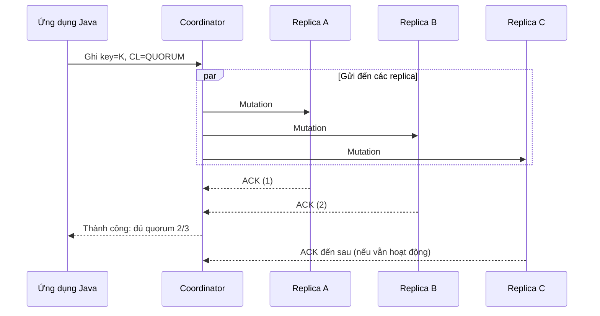

# Mức nhất quán điều khiển số phản hồi cần chờ cho từng thao tác

Trong Apache Cassandra, **consistency level (CL, mức nhất quán)** quy định một thao tác đọc hoặc ghi phải nhận đủ bao nhiêu phản hồi hợp lệ từ các replica trước khi **coordinator** trả kết quả cho ứng dụng. Đây là quyết định được đưa ra **cho từng yêu cầu**, vì vậy cùng một bảng có thể được ghi ở `LOCAL_QUORUM` nhưng đọc ở `LOCAL_ONE`, tùy yêu cầu về độ mới của dữ liệu, độ trễ và khả năng chịu lỗi.

Bài này thuộc phần **Nhất quán đọc/ghi** của mô-đun `DATABASE_ENGINE_WIDE_COLUMN_CASSANDRA`. Để hiểu và vận dụng CL, cần phân biệt rõ nó với replication, partition key, cách thiết kế bảng theo truy vấn và các cơ chế đồng bộ dữ liệu nền của Cassandra.

## Mục tiêu học tập

Sau bài này, bạn có thể:

1. Giải thích vai trò của coordinator, replica, replication factor (RF) và số phản hồi mà CL yêu cầu.
2. Tính quorum cho một datacenter và nhiều datacenter; chọn CL phù hợp cho từng truy vấn.
3. Phân tích trường hợp có khả năng đọc dữ liệu cũ, timeout hoặc mất khả dụng khi replica gặp lỗi.
4. Áp dụng CL bằng `cqlsh` và Apache Cassandra Java Driver; phân biệt CL thông thường với `SERIAL`/`LOCAL_SERIAL` của lightweight transaction (LWT).
5. Hiểu giới hạn của quorum và cách kết hợp với repair, xử lý retry và thiết kế ứng dụng.

## 1. Replica, coordinator và consistency level

Một hàng trong Cassandra nằm trong một **partition** được xác định bởi partition key. Cơ chế phân phối dữ liệu xác định các node sở hữu bản sao của partition đó, dựa trên replication strategy và **replication factor**. Ví dụ, RF=3 nghĩa là mỗi partition có ba replica được chỉ định trong phạm vi replication tương ứng; nó **không** có nghĩa là cả cụm chỉ có ba node.

Client gửi yêu cầu tới một node đóng vai trò **coordinator**. Coordinator xác định các replica liên quan, gửi/điều phối công việc và chờ đủ phản hồi cho CL của yêu cầu. Coordinator không nhất thiết là một trong những replica của partition đang truy vấn.



Sơ đồ minh họa một lần ghi thành công với RF=3. **Coordinator không cần chờ ACK thứ ba để trả lời**, nhưng Cassandra vẫn cố gắng đưa mutation tới các replica khác. Trong thực tế, các ACK có thể đến theo thứ tự khác, replica không phản hồi có thể cần được cập nhật về sau qua cơ chế phục hồi, và chi tiết xử lý còn tùy phiên bản Cassandra.

**Phân biệt ba cấu hình thường bị nhầm:**

| Khái niệm | Điều khiển điều gì? | Ví dụ |
| --- | --- | --- |
| **Partition key** | Chọn partition, tác động đến vị trí và phân bố dữ liệu, cũng như các truy vấn hiệu quả. | `PRIMARY KEY ((account_id), occurred_at)` |
| **Replication factor (RF)** | Số replica được cấu hình cho mỗi partition, thường theo datacenter. | `dc1: 3`, `dc2: 3` |
| **Consistency level (CL)** | Ngưỡng phản hồi cần thiết để **một lần đọc/ghi** được coi là thành công. | `ONE`, `LOCAL_QUORUM`, `ALL` |

Tăng CL **không** tạo thêm bản sao, không đổi partition key và không thay cách dữ liệu được lưu theo mô hình wide-column. CL cũng không có nghĩa là chỉ đúng từng ấy replica nhận yêu cầu: số request thực tế có thể lớn hơn ngưỡng phản hồi, đặc biệt khi đọc bằng digest, speculative retry hoặc khi node chậm.

## 2. Mức nhất quán khi ghi

Với một mutation thông thường (`INSERT`, `UPDATE`, `DELETE`), coordinator gửi công việc đến các replica liên quan. CL ghi quyết định **bao nhiêu xác nhận ghi phải được chờ** trước khi client nhận kết quả thành công.

Giả sử có **một datacenter, RF=3**:

| CL ghi | Ngưỡng thành công | Hệ quả |
| --- | --- | --- |
| `ANY` | Có thể thành công dù **không replica đích nào** ACK, nếu hệ thống chấp nhận lưu hint phù hợp. | Khả dụng cao cho ghi nhưng bảo đảm dữ liệu đã tới replica thấp nhất. **Chỉ dùng cho ghi**; không áp dụng thông thường cho counter/LWT. |
| `ONE` | 1 replica ACK. | Độ trễ thường thấp; hai replica còn lại có thể chưa cập nhật. |
| `TWO` | 2 replica ACK. | Trong RF=3, tương đương ngưỡng số lượng của quorum. |
| `THREE` | 3 replica ACK. | Mọi replica trong RF=3 phải phản hồi. |
| `QUORUM` | `floor(RF / 2) + 1` = 2 ACK. | Cần đa số replica trong phạm vi RF toàn cục. |
| `LOCAL_ONE` | 1 replica trong datacenter **cục bộ** ACK. | Tránh yêu cầu ACK từ datacenter xa. |
| `LOCAL_QUORUM` | Đa số replica trong datacenter cục bộ ACK; RF cục bộ = 3 thì cần 2. | Thường phù hợp ứng dụng chạy trong một datacenter. |
| `ALL` | Đủ cả 3 replica ACK. | Ngưỡng cao nhất, nhưng chịu lỗi replica kém nhất. |

`ANY` là ngoại lệ quan trọng: ACK có thể dựa trên **hint** được lưu để chuyển tiếp về sau, chưa phải ACK ghi dữ liệu vào replica đích. Vì vậy, `ANY` không phù hợp khi yêu cầu xác nhận rằng bản ghi đã có trên replica để truy vấn ngay sau đó.

Ở hệ thống nhiều datacenter còn có `EACH_QUORUM` dành cho **ghi**: phải nhận đủ quorum **ở từng datacenter**. Nếu `dc1` có RF=3 và `dc2` có RF=3 thì cần 2 ACK từ `dc1` **và** 2 ACK từ `dc2`; chỉ 4 ACK bất kỳ phân bố không đúng yêu cầu sẽ không đủ. Không dùng `EACH_QUORUM` cho thao tác đọc thông thường.

Một lần ghi `CL=ONE` thành công **không có nghĩa chỉ một bản sao được ghi**. Coordinator cố gắng thực hiện ghi tới các replica thích hợp; nó chỉ không bắt ứng dụng chờ các xác nhận còn lại. Dù trả về thành công, một replica chậm hoặc tạm mất kết nối vẫn có thể chưa chứa giá trị mới.

## 3. Mức nhất quán khi đọc

Khi đọc, coordinator cần nhận đủ phản hồi từ các replica theo CL đọc. Để kiểm tra tính thống nhất, Cassandra có thể nhận **một phản hồi chứa dữ liệu và những phản hồi digest** (mã kiểm tra dữ liệu), sau đó đối chiếu. Nếu phát hiện khác nhau, coordinator có thể phải lấy thêm dữ liệu và hòa giải giá trị trước khi trả về. Số request và số replica tham gia thực tế không nhất thiết đúng bằng số phản hồi tối thiểu.

Ví dụ với RF=3:

- `ONE` hoặc `LOCAL_ONE`: chỉ cần một replica phù hợp trả lời; độ trễ thường thấp nhưng có thể nhận **giá trị cũ** nếu replica đó chưa cập nhật.
- `QUORUM` hoặc `LOCAL_QUORUM` (RF cục bộ = 3): cần hai phản hồi phù hợp; kết quả có cơ hội phát hiện và hòa giải sự khác biệt giữa replica.
- `ALL`: yêu cầu ba replica cùng phản hồi; chỉ cần một replica không khả dụng hoặc quá chậm là truy vấn có thể thất bại.

`ANY` **không** phải CL đọc hợp lệ. `SERIAL`/`LOCAL_SERIAL` liên quan đến giao thức Paxos của LWT, nên được xem riêng ở phần sau.

### Vì sao quorum ghi + quorum đọc thường được chọn?

Trong một tập **N replica giống nhau** và không có ghi cạnh tranh, nếu đặt số phản hồi ghi là **W** và đọc là **R**, điều kiện:

\[
R + W > N
\]

đảm bảo tập replica xác nhận ghi và tập replica phản hồi đọc có **ít nhất một replica giao nhau**.

Với RF=3:

| Ghi `W` | Đọc `R` | Tổng | Có giao nhau chắc chắn? |
| --- | --- | --- | --- |
| `ONE` (1) | `ONE` (1) | 2 | Không. Có thể đọc bản cũ. |
| `QUORUM` (2) | `QUORUM` (2) | 4 | Có, nếu cùng tập replica và các điều kiện áp dụng đúng. |
| `ALL` (3) | `ONE` (1) | 4 | Có, nhưng ghi dễ thất bại khi một replica lỗi. |
| `ONE` (1) | `ALL` (3) | 4 | Có, nhưng đọc dễ thất bại khi một replica lỗi. |

Đây là lập luận về **giao nhau của các tập replica**, không phải lời hứa mọi thao tác Cassandra đều có tính **linearizable**. Cassandra giải quyết xung đột dữ liệu thông thường theo timestamp (last-write-wins), cho phép thao tác đồng thời, và không tự biến cặp ghi/đọc quorum thành transaction nguyên tử trên nhiều partition. Nếu cần bảo đảm kiểu “chỉ tạo khi chưa tồn tại” hoặc so sánh-đổi-giá-trị có điều kiện, phải đánh giá sử dụng **LWT/Paxos**.

Ngoài ra, công thức `R + W > N` không được áp dụng máy móc cho nhiều datacenter nếu ghi và đọc đang đếm các **nhóm replica khác nhau**.

## 4. Tính quorum trong nhiều datacenter

Giả sử dùng `NetworkTopologyStrategy`:

```text
dc1: RF = 3    [A1] [A2] [A3]
dc2: RF = 3    [B1] [B2] [B3]
Tổng replica của mỗi partition: 6
```

| CL | Số phản hồi cần thiết | Phạm vi |
| --- | --- | --- |
| `QUORUM` | `floor(6/2)+1` = **4** | Toàn bộ replica của partition, không cố định tỷ lệ giữa hai DC. |
| `LOCAL_QUORUM` tại `dc1` | `floor(3/2)+1` = **2** | Chỉ tính replica ở `dc1`. |
| `LOCAL_ONE` tại `dc1` | **1** | Chỉ tính replica ở `dc1`. |
| `EACH_QUORUM` khi ghi | **2 ở dc1 và 2 ở dc2** | Đạt quorum riêng tại **mỗi DC**. |
| `ALL` | **6** | Toàn bộ replica ở cả hai DC. |

**Ví dụ quan trọng:** Một ứng dụng ở `dc1` ghi với `LOCAL_QUORUM` và nhận hai ACK từ `dc1`. Ngay sau đó, ứng dụng ở `dc2` đọc cùng khóa bằng `LOCAL_QUORUM` và nhận hai phản hồi tại `dc2`. Nếu replication liên datacenter chưa theo kịp, lần đọc ở `dc2` **vẫn có thể thấy giá trị cũ**. Hai quorum đó không bắt buộc giao nhau vì thuộc hai datacenter khác nhau.

`LOCAL_QUORUM` thường giúp tránh độ trễ WAN trên đường phản hồi của thao tác, nhưng không thay thế một chiến lược rõ ràng cho ứng dụng đọc/ghi xuyên vùng. Nếu cần kiểm soát độ mới xuyên datacenter, phải phân tích các đường đọc/ghi và cân nhắc mức toàn cục, giao thức ứng dụng hoặc LWT cho nghiệp vụ phù hợp.

## 5. Đánh đổi giữa độ trễ, độ mới và khả dụng

CL là một lựa chọn **cho từng yêu cầu**. Việc tăng số phản hồi cần chờ thường tăng khả năng quan sát giá trị đã ghi, đồng thời tăng độ trễ và nguy cơ thất bại khi một số replica chậm hoặc hỏng. Không có CL “tốt nhất” cho tất cả truy vấn.

| Nhu cầu | Cách chọn thường gặp | Cần chú ý |
| --- | --- | --- |
| Đọc nhanh dữ liệu sự kiện, chấp nhận đôi lúc trễ | Ghi `LOCAL_ONE`, đọc `LOCAL_ONE`. | Có thể đọc giá trị cũ; phải chấp nhận eventual consistency và cơ chế phục hồi. |
| Đọc lại ngay sau ghi trong cùng DC, cần độ mới cao hơn | Ghi `LOCAL_QUORUM`, đọc `LOCAL_QUORUM`. | Với RF cục bộ thích hợp, hai tập ACK có giao nhau; chịu được ít nhất một replica lỗi nếu RF=3 và hai replica còn phản hồi. |
| Ghi xong cần quorum riêng ở hai DC | Ghi `EACH_QUORUM`. | Độ trễ và khả dụng phụ thuộc cả hai DC; không phải mức đọc. |
| Đảm bảo quy tắc tạo duy nhất/cập nhật có điều kiện | LWT (`IF NOT EXISTS`, `IF ...`) với serial CL phù hợp. | Quorum thông thường không thay cho so sánh và hoán đổi nguyên tử. |

Nếu RF=3 trong một DC và một replica bị lỗi, `LOCAL_QUORUM` (cần 2) vẫn có thể thành công; `ALL` (cần 3) thì không. Nếu tiếp tục chỉ còn một replica phản hồi, `LOCAL_ONE` có thể thành công nhưng `LOCAL_QUORUM` sẽ không đạt ngưỡng.

Các lỗi thường gặp có ý nghĩa khác nhau:

- **`Unavailable`**: coordinator xác định không đủ replica sẵn sàng để thỏa CL tại thời điểm kiểm tra.
- **`ReadTimeout` / `WriteTimeout`**: đã gửi/đang xử lý nhưng không nhận đủ phản hồi cần thiết trước hạn; một số replica **có thể** đã đọc/ghi thành công.
- **`ReadFailure` / `WriteFailure`**: phản hồi lỗi trong quá trình thực thi khiến CL không đạt, không đơn thuần là thiếu thời gian.

Đặc biệt, **write timeout không chứng minh thao tác chưa được áp dụng**. Khi retry, ứng dụng nên thiết kế khóa và thao tác idempotent nếu có thể, thận trọng với counter, thay đổi số lượng và thao tác có tác dụng phụ; tránh retry vô hạn khi nhiều node đang chậm.

## 6. Thực hành CQL với replication và consistency

Ví dụ một bảng wide-column được thiết kế theo truy vấn “lấy các sự kiện gần nhất của một tài khoản”. Ở đây partition key là `account_id`; `occurred_at` và `event_id` là clustering columns:

```sql
-- Tên dc1/dc2 chỉ là ví dụ; thay bằng tên datacenter thực tế.
CREATE KEYSPACE IF NOT EXISTS app_events
WITH replication = {
  'class': 'NetworkTopologyStrategy',
  'dc1': 3,
  'dc2': 3
};

CREATE TABLE IF NOT EXISTS app_events.account_event_by_account (
  account_id uuid,
  occurred_at timestamp,
  event_id uuid,
  event_type text,
  payload text,
  PRIMARY KEY ((account_id), occurred_at, event_id)
) WITH CLUSTERING ORDER BY (occurred_at DESC, event_id ASC);
```

Trong **`cqlsh`**, lệnh `CONSISTENCY` thiết lập CL mặc định cho những thao tác được chạy sau đó trong phiên shell. Đây là lệnh của **cqlsh**, không phải một phần của cú pháp câu lệnh `INSERT` hoặc `SELECT` chuẩn:

```sql
CONSISTENCY LOCAL_QUORUM;

INSERT INTO app_events.account_event_by_account
  (account_id, occurred_at, event_id, event_type, payload)
VALUES (
  11111111-1111-4111-8111-111111111111,
  '2026-11-01 09:00:00+0000',
  22222222-2222-4222-8222-222222222222,
  'LOGIN',
  '{"source":"web"}'
);

SELECT occurred_at, event_id, event_type
FROM app_events.account_event_by_account
WHERE account_id = 11111111-1111-4111-8111-111111111111
LIMIT 10;

-- Đổi CL cho các truy vấn tiếp theo, nếu chấp nhận dữ liệu có thể cũ.
CONSISTENCY LOCAL_ONE;

SELECT occurred_at, event_id, event_type
FROM app_events.account_event_by_account
WHERE account_id = 11111111-1111-4111-8111-111111111111
LIMIT 10;
```

Việc thay đổi `CONSISTENCY` **không thay đổi dữ liệu đã ghi**, không sinh thêm replica và không thay đổi thiết kế bảng. Nếu bạn chỉ có **một datacenter**, hãy cấu hình keyspace với DC thực có RF phù hợp thay vì chép nguyên `dc1`/`dc2`. RF cũng không thể vượt quá số node vật lý thực sự phù hợp trong DC mà vẫn mong đạt mức nhất quán cao.

## 7. Chỉ định CL theo từng request bằng Java Driver

Với **Apache Cassandra Java Driver 4.x**, ứng dụng có thể gắn CL lên từng statement. Điều này cho phép một luồng nghiệp vụ dùng CL chặt hơn, còn luồng truy vấn ít nhạy cảm có thể chọn CL nhanh hơn mà không cần thay cấu hình cả ứng dụng.

```java
import com.datastax.oss.driver.api.core.CqlSession;
import com.datastax.oss.driver.api.core.DefaultConsistencyLevel;
import com.datastax.oss.driver.api.core.cql.BoundStatement;
import com.datastax.oss.driver.api.core.cql.PreparedStatement;
import com.datastax.oss.driver.api.core.cql.ResultSet;

import java.time.Instant;
import java.util.UUID;

public class EventRepository {
    public static ResultSet addAndFind(
            CqlSession session, UUID accountId, UUID eventId) {

        PreparedStatement writeQuery = session.prepare(
            "INSERT INTO app_events.account_event_by_account " +
            "(account_id, occurred_at, event_id, event_type, payload) " +
            "VALUES (?, ?, ?, ?, ?)");

        BoundStatement write = writeQuery.bind(
                accountId, Instant.now(), eventId, "LOGIN", "{}")
            .setConsistencyLevel(DefaultConsistencyLevel.LOCAL_QUORUM);

        session.execute(write); // Đợi đủ ACK của LOCAL_QUORUM khi ghi.

        PreparedStatement readQuery = session.prepare(
            "SELECT occurred_at, event_id, event_type " +
            "FROM app_events.account_event_by_account " +
            "WHERE account_id = ? LIMIT 10");

        BoundStatement read = readQuery.bind(accountId)
            .setConsistencyLevel(DefaultConsistencyLevel.LOCAL_ONE);

        return session.execute(read); // Đọc nhanh; có thể thấy dữ liệu cũ.
    }
}
```

Trong ứng dụng thực tế, nên **chuẩn bị `PreparedStatement` một lần và tái sử dụng** thay vì `prepare()` cho mỗi request; ví dụ đặt hai lệnh `prepare` trong hàm chỉ để minh họa rõ CL trên từng `BoundStatement`. Khi cần đọc lại mới nhất sau ghi ở cùng DC, thay CL đọc thành `LOCAL_QUORUM` và đánh giá các giả định về concurrency.

`CqlSession` phải được cấu hình với contact points, datacenter cục bộ và thông tin xác thực phù hợp. CL và timeout cũng có thể cấu hình mặc định theo driver execution profile, nhưng phương thức `setConsistencyLevel(...)` trên statement cho phép chọn theo nghiệp vụ.

### Ghi có điều kiện: khác với quorum thông thường

Ví dụ `INSERT ... IF NOT EXISTS` là **lightweight transaction (LWT)**, dùng Paxos để xử lý điều kiện. Nó có **serial consistency level** (`SERIAL` hoặc `LOCAL_SERIAL`) riêng với CL thông thường của request. Với Java Driver 4.x:

```java
BoundStatement conditionalInsert = session.prepare(
    "INSERT INTO app_events.account_event_by_account " +
    "(account_id, occurred_at, event_id, event_type, payload) " +
    "VALUES (?, ?, ?, ?, ?) IF NOT EXISTS")
    .bind(accountId, Instant.now(), eventId, "LOGIN", "{}")
    .setConsistencyLevel(DefaultConsistencyLevel.LOCAL_QUORUM)
    .setSerialConsistencyLevel(DefaultConsistencyLevel.LOCAL_SERIAL);

boolean applied = session.execute(conditionalInsert)
    .one().getBoolean("[applied]");
```

`LOCAL_SERIAL` giới hạn pha đồng thuận serial trong DC cục bộ; khi truy cập và ghi cạnh tranh qua nhiều DC, cần hiểu rõ phạm vi trước khi chọn mức này. LWT đắt hơn ghi thường vì có thêm vòng đồng thuận. **Không dùng `SERIAL`/`LOCAL_SERIAL` để thay thế `ONE`, `QUORUM` hoặc `ALL` cho mọi lần đọc/ghi thông thường.**

## 8. Những giới hạn dễ hiểu sai

1. **“Ghi `ONE` nghĩa là chỉ một replica được cập nhật.”** Sai. `ONE` chỉ là số ACK cần chờ; các replica khác có thể đã nhận mutation hoặc được cập nhật sau.
2. **“Đọc `QUORUM` luôn lấy dữ liệu hoàn toàn mới.”** Không đủ điều kiện để khẳng định. Cần xét CL ghi, tập replica giao nhau, concurrency, timestamp và vị trí datacenter.
3. **“`LOCAL_QUORUM` ở hai DC là quorum toàn cụm.”** Sai. Mỗi lần `LOCAL_QUORUM` chỉ đếm trong DC cục bộ; quorum tại các DC khác nhau không bảo đảm giao nhau.
4. **“CL cao làm mọi replica đồng bộ vĩnh viễn.”** Sai. CL quyết định phản hồi của một thao tác. **Hinted handoff, repair, reconciliation và compaction** là những cơ chế riêng: repair giúp đối chiếu các replica; compaction quản lý SSTable và tombstone, không tự thay thế repair.
5. **“`QUORUM` giải quyết mọi xung đột cập nhật.”** Sai. Quorum không thay thế điều kiện nguyên tử, khóa ứng dụng hoặc LWT khi có cập nhật đồng thời cần quy tắc nghiệp vụ chặt chẽ.
6. **“Một lần timeout thì cứ gửi lại vô điều kiện.”** Sai. Ghi có thể đã được áp dụng một phần hoặc đủ mức ở server dù client chưa nhận thành công; chỉ retry theo chính sách có xét tính idempotent và loại thao tác.

## 9. Bài tập tự kiểm tra

**Tình huống A:** Một DC có RF=5. Hỏi `QUORUM` cần mấy ACK? Có hai replica không phản hồi thì đọc và ghi ở `QUORUM` còn có thể thành công không?

**Đáp án:** `floor(5/2)+1 = 3`. Nếu ba replica còn lại hoạt động và trả lời kịp, cả đọc và ghi `QUORUM` vẫn có thể thành công.

**Tình huống B:** `dc1` RF=3 và `dc2` RF=3. Ghi ở `dc1` với `LOCAL_QUORUM` thành công, đọc ngay tại `dc2` với `LOCAL_QUORUM`. Có chắc đọc thấy giá trị mới không?

**Đáp án:** Không. Hai tập replica được đếm thuộc hai DC khác nhau và việc chuyển tiếp mutation sang `dc2` có thể chưa hoàn tất.

**Tình huống C:** Một nghiệp vụ cần bảo đảm chỉ tạo hàng khi khóa chưa tồn tại. Chọn ghi `ALL` có đủ không?

**Đáp án:** Không. `ALL` chỉ tăng ngưỡng ACK cho một lần ghi; cần dùng thao tác có điều kiện như `INSERT ... IF NOT EXISTS` (LWT) để xử lý cạnh tranh theo điều kiện.

## Ghi nhớ

Khi thiết kế truy vấn Cassandra, hãy xác định **RF và nơi đặt replica**, rồi lựa chọn **CL ghi** và **CL đọc** cho từng luồng nghiệp vụ. Với cùng một tập replica, cặp đọc/ghi quorum tạo giao nhau giúp giảm khả năng đọc cũ trong các điều kiện phù hợp. Ở nhiều datacenter, phải xét rõ `LOCAL_*` chỉ đếm replica cục bộ. Luôn kiểm tra hành vi khi timeout, retry, replica hỏng và ghi đồng thời; CL là một công cụ điều chỉnh ngưỡng phản hồi, không tự thay thế mô hình dữ liệu, replication, repair hay transaction.
