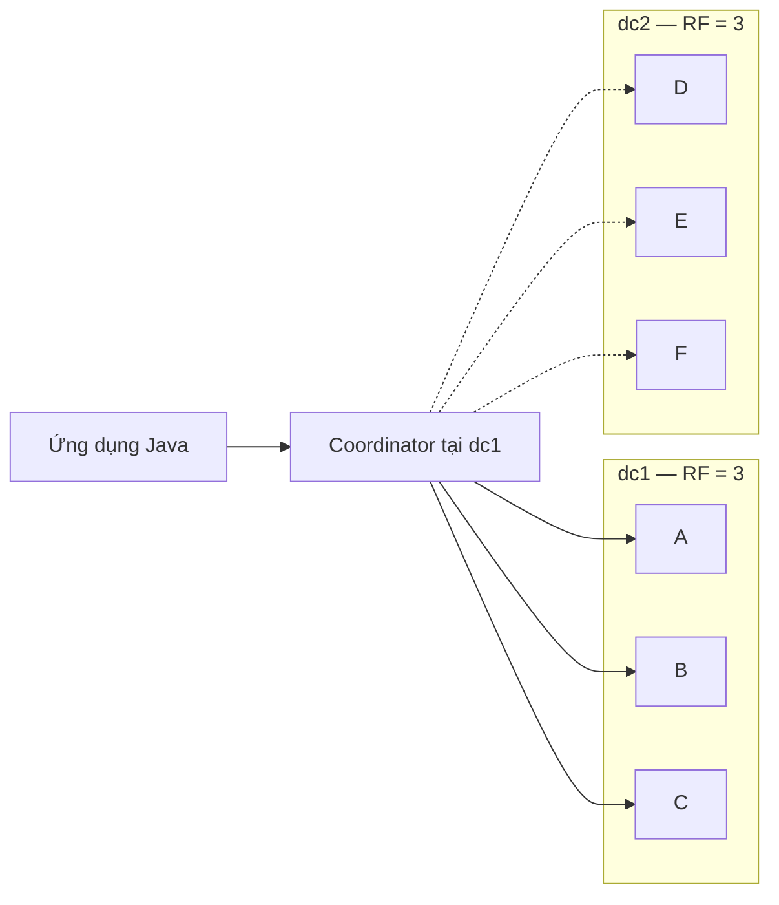
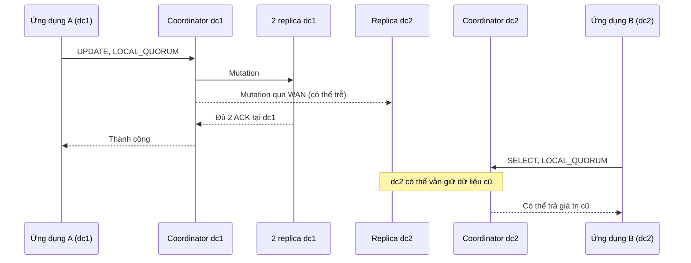

# LOCAL_ONE, LOCAL_QUORUM và EACH_QUORUM theo phạm vi hỗ trợ

Trong một cụm Apache Cassandra có nhiều **datacenter (DC)**, câu hỏi “cần bao nhiêu replica phản hồi?” vẫn chưa đủ. Ta còn phải hỏi **replica thuộc datacenter nào**. Ba mức nhất quán `LOCAL_ONE`, `LOCAL_QUORUM` và `EACH_QUORUM` giải quyết việc này theo những cách khác nhau: một hoặc đa số replica **cục bộ**, hay đa số replica **trong từng DC**.

Bài học nằm trong chương **Nhất quán đọc/ghi** của mô-đun `DATABASE_ENGINE_WIDE_COLUMN_CASSANDRA`. Trong lộ trình tìm hiểu kiến trúc phân tán, mô hình wide-column, partition key, thiết kế bảng theo truy vấn, CQL, replication, compaction, repair, xử lý lỗi và tích hợp Java, đây là bước cần thiết để tránh đặt consistency level (CL) đúng về **số lượng** nhưng sai về **phạm vi replica**.

> **Điểm quan trọng nhất:** Với Apache Cassandra OSS, `LOCAL_ONE` và `LOCAL_QUORUM` áp dụng cho cả **đọc và ghi thông thường**; `EACH_QUORUM` áp dụng cho **ghi**, **không hỗ trợ đọc thông thường**. Các sản phẩm tương thích Cassandra hoặc bản phân phối khác có thể có hành vi riêng; khi triển khai phải đối chiếu đúng sản phẩm và phiên bản.

## 1. Mục tiêu học tập

Sau bài này, bạn có thể:

1. Phân biệt **local DC** với **remote DC** theo góc nhìn coordinator.
2. Tính số ACK của `LOCAL_ONE`, `LOCAL_QUORUM` và `EACH_QUORUM` dựa trên replication factor của mỗi DC.
3. Chọn CL cho ứng dụng đọc/ghi trong một vùng hoặc trải rộng nhiều vùng.
4. Giải thích vì sao `LOCAL_QUORUM` ở DC này không tự bảo đảm việc đọc mới ở DC khác.
5. Nhận diện thao tác hợp lệ và không hợp lệ với từng CL, nhất là `EACH_QUORUM` trên `SELECT`.
6. Thử nghiệm bằng `cqlsh` và Java Driver, đồng thời phân tích tình huống replica hoặc cả DC gặp sự cố.

## 2. Datacenter, replica và coordinator

Cassandra nhân bản dữ liệu theo partition. Với `NetworkTopologyStrategy`, mỗi datacenter được cấu hình **replication factor (RF)** riêng cho keyspace; RF là số replica dự kiến của **mỗi partition** trong DC đó.

Giả sử keyspace có topology:

```text
                   Cluster Cassandra

    dc1 (RF = 3)                    dc2 (RF = 3)
    +-----------+                   +-----------+
    | Replica A |                   | Replica D |
    | Replica B |                   | Replica E |
    | Replica C |                   | Replica F |
    +-----------+                   +-----------+

              Sáu replica cho cùng một partition
```

Khi một client gửi yêu cầu đến một node trong `dc1`, node đó đóng vai trò **coordinator** và `dc1` là **local datacenter** của yêu cầu. Nếu coordinator nằm trong `dc2`, `dc2` mới là local DC. Từ “local” **không** được suy ra chỉ từ nơi người dùng đang ngồi, vị trí ứng dụng hay giá trị chuỗi đặt trong tên host.

Trong Java Driver, thiết lập local datacenter và cơ chế load balancing giúp chọn coordinator ở DC dự kiến. Với `cqlsh`, node nhận kết nối thường chính là coordinator. Vì vậy, một ứng dụng ở Việt Nam có thể vô tình sử dụng coordinator thuộc DC xa nếu routing bị cấu hình sai.

| Khái niệm | Quy định điều gì? |
| --- | --- |
| **Partition key** | Xác định partition, ảnh hưởng vị trí dữ liệu và cách truy vấn hiệu quả. |
| **RF theo DC** | Số replica mỗi partition được chỉ định cho từng datacenter. |
| **Coordinator / local DC** | Vị trí điều phối yêu cầu và phạm vi “local” tương ứng. |
| **Consistency level** | Những replica nào phải phản hồi và cần bao nhiêu phản hồi để thao tác thành công. |

CL **không tạo thêm replica**. Khi ghi ở `LOCAL_ONE` hoặc `LOCAL_QUORUM`, Cassandra vẫn cố gắng gửi mutation tới những replica được cấu hình, kể cả remote DC; CL chỉ quy định những **ACK phải chờ trước khi báo thành công**.

## 3. Định nghĩa ba mức nhất quán

Giả sử coordinator nằm trong `dc1`; `RF_local` là RF của `dc1`. Ký hiệu:

\[
Q(dc) = \left\lfloor \frac{RF(dc)}{2} \right\rfloor + 1
\]

là **quorum của từng DC**.

| Mức nhất quán | Phản hồi bắt buộc | Phạm vi | Hỗ trợ trong Apache Cassandra OSS |
| --- | --- | --- | --- |
| `LOCAL_ONE` | **1** replica tại local DC | Chỉ local DC | **Đọc và ghi** |
| `LOCAL_QUORUM` | **`Q(local DC)`** replica tại local DC | Chỉ local DC | **Đọc và ghi** |
| `EACH_QUORUM` | **`Q(dc)` tại mỗi DC** có replica của partition | **Tất cả DC liên quan** | **Ghi thông thường; không hỗ trợ đọc thông thường** |

### 3.1. `LOCAL_ONE`: chỉ cần một replica cục bộ

Với coordinator thuộc `dc1`, yêu cầu chỉ cần **một phản hồi hợp lệ của một replica ở `dc1`**.

- **Ghi `LOCAL_ONE`:** Thành công khi có một replica của partition trong `dc1` xác nhận ghi.
- **Đọc `LOCAL_ONE`:** Có thể trả dữ liệu khi một replica thuộc `dc1` trả lời; nếu replica đó chưa bắt kịp mutation mới thì có thể **đọc dữ liệu cũ**.
- **Khả dụng:** Có thể đạt ngưỡng ngay cả khi các replica thuộc DC khác không phản hồi. Nhưng nếu không có replica phù hợp nào hoạt động ở local DC, thao tác vẫn thất bại, dù remote DC có đủ dữ liệu.

`LOCAL_ONE` gần với `ONE` về **số lượng ACK** nhưng khác về **điều kiện địa lý**: `ONE` không buộc replica phản hồi phải nằm trong local DC; `LOCAL_ONE` buộc phản hồi trong local DC.

### 3.2. `LOCAL_QUORUM`: đa số replica của DC cục bộ

Quorum được tính từ **RF của DC chứa coordinator**, không từ tổng RF toàn cluster.

| RF trong local DC | Số phản hồi cho `LOCAL_QUORUM` |
| ---: | ---: |
| 1 | 1 |
| 2 | 2 |
| 3 | 2 |
| 4 | 3 |
| 5 | 3 |

Nếu local DC có RF = 3, yêu cầu cần **2/3 replica tại DC đó**; việc ba replica khác ở remote DC đều khỏe mạnh không bù được thiếu hụt local quorum.

`LOCAL_QUORUM` thường hữu ích cho ứng dụng **đọc và ghi trong cùng một DC**, muốn có giao nhau giữa tập replica xác nhận ghi và tập replica phản hồi đọc mà không chờ phản hồi WAN. Đổi lại, so với `LOCAL_ONE`, nó cần nhiều replica cục bộ hoạt động hơn.

### 3.3. `EACH_QUORUM`: ghi phải đạt quorum của từng DC

`EACH_QUORUM` là mức **ghi** nhằm yêu cầu coordinator nhận quorum ACK **trong từng DC** có replica:

```text
dc1: RF = 3  -> quorum(dc1) = 2 ACK
dc2: RF = 3  -> quorum(dc2) = 2 ACK

EACH_QUORUM ghi -> cần 2 ACK từ dc1 VÀ 2 ACK từ dc2
```

Chỉ cần `dc2` trả về **một** ACK trong khi `dc1` đã có ba ACK, tổng vẫn là bốn nhưng ghi `EACH_QUORUM` **chưa thành công**: `dc2` không đủ quorum của nó.

`EACH_QUORUM` trong Apache Cassandra OSS không phải CL hợp lệ cho truy vấn `SELECT` thông thường. Muốn đọc với quorum trong DC cục bộ, chọn `LOCAL_QUORUM`; muốn đọc bằng quorum toàn bộ cluster, chọn `QUORUM`. Chúng có **phạm vi khác nhau**, không phải cách thay thế tuyệt đối cho “quorum tại mọi DC”.

> Khi đặt `EACH_QUORUM` lên `SELECT`, driver có thể truyền mức này đến server nhưng yêu cầu đọc sẽ bị từ chối là không hợp lệ ở Cassandra OSS. Đây là lỗi **hỗ trợ loại thao tác**, không phải thông báo rằng “không đủ node”.

## 4. So sánh trên topology 2 DC, mỗi DC RF = 3

Giả sử coordinator ở `dc1`; sáu replica của partition được đặt theo sơ đồ:



| CL | Ngưỡng thành công | Phải đợi ACK từ `dc2`? | Đọc được không? |
| --- | --- | --- | --- |
| `LOCAL_ONE` | **1 ACK từ dc1** | Không | Có |
| `LOCAL_QUORUM` | **2 ACK từ dc1** | Không | Có |
| `EACH_QUORUM` | **2 từ dc1 + 2 từ dc2** | **Có** | **Không** |
| `QUORUM` (đối chiếu) | **4 ACK bất kỳ trong cả hai DC** | Trong topology này, có | Có |
| `ALL` (đối chiếu) | **6 ACK** | Có | Có |

Nhìn vào cột “ngưỡng thành công” thấy ngay rằng **`EACH_QUORUM` không giống `QUORUM`**:

- `QUORUM` với tổng RF = 6 chỉ cần **4 phản hồi** thuộc bất kỳ phân bố hợp lệ nào, chẳng hạn `3 + 1`.
- `EACH_QUORUM` với RF = `3 + 3` cần **ít nhất `2 + 2`**. Phân bố `3 + 1` dù có tổng bốn ACK cũng **không đạt**.

### Một tình huống sự cố

Giả sử cả ba replica `dc1` đang hoạt động, nhưng `dc2` chỉ còn **một** replica trả ACK:

| Yêu cầu từ coordinator `dc1` | Có thể thành công về mặt ngưỡng? | Tại sao? |
| --- | --- | --- |
| Đọc `LOCAL_ONE` | **Có** | `dc1` có ít nhất một replica. |
| Đọc `LOCAL_QUORUM` | **Có** | `dc1` có ít nhất hai replica. |
| Ghi `LOCAL_QUORUM` | **Có** | Chỉ đợi hai ACK ở `dc1`. |
| Ghi `QUORUM` | **Có** | Có thể thu được ba ACK ở `dc1` và một ở `dc2`, đạt bốn. |
| Ghi `EACH_QUORUM` | **Không** | `dc2` cần hai ACK nhưng chỉ có một. |

Kết luận áp dụng cho **ngưỡng CL**; trên thực tế, ngay cả yêu cầu “có thể thành công” vẫn có thể timeout vì mạng, tải, ổ đĩa hoặc coordinator gặp lỗi.

## 5. Khi replication factor giữa các DC khác nhau

Không phải lúc nào các DC cũng có RF bằng nhau. Giả sử:

```text
dc1: RF = 3   -> quorum 2
dc2: RF = 5   -> quorum 3
Tổng RF = 8
```

| CL | Số ACK cần có |
| --- | --- |
| `LOCAL_ONE` tại `dc1` | **1 ở dc1** |
| `LOCAL_QUORUM` tại `dc1` | **2 ở dc1** |
| `LOCAL_QUORUM` tại `dc2` | **3 ở dc2** |
| `EACH_QUORUM` ghi | **2 ở dc1 và 3 ở dc2** |
| `QUORUM` toàn cluster | **`floor(8/2)+1 = 5`** phản hồi tổng cộng |

Phân bố ACK **`3 ở dc1 + 2 ở dc2`** đạt tổng năm nên có thể đủ `QUORUM`, nhưng **chưa đạt `EACH_QUORUM`** vì `dc2` cần ba ACK. Không được chỉ cộng ngưỡng `EACH_QUORUM` rồi bỏ qua điều kiện **của từng DC**.

Ở các cụm có nhiều hơn hai datacenter, cách tính tương tự: cộng quorum của **từng DC có replica**, đồng thời kiểm tra đủ quorum **riêng từng DC**. Ví dụ RF = `3 + 3 + 3` cần ba nhóm ACK `2 + 2 + 2`, không phải sáu phản hồi bất kỳ.

## 6. Tính nhất quán giữa các DC: những bảo đảm và giới hạn

### 6.1. `LOCAL_QUORUM` ghi và đọc trong cùng DC

Tại `dc1` có RF = 3:

```text
Ghi LOCAL_QUORUM tại dc1  ->  2 replica dc1 ACK
Đọc LOCAL_QUORUM tại dc1 ->  2 replica dc1 phản hồi

2 + 2 > 3, nên hai tập replica dc1 bắt buộc giao nhau.
```

Nếu lần ghi đã thành công, lần đọc bắt đầu sau đó, cùng partition và cùng tập replica, **không có ghi cạnh tranh** và cách hòa giải timestamp không làm thay đổi thứ tự mong đợi, giao nhau giúp đọc thấy giá trị vừa ghi. Đây là lập luận nền tảng cho cặp `LOCAL_QUORUM`/`LOCAL_QUORUM` **trong một DC**.

### 6.2. Ghi ở `dc1` và đọc `LOCAL_QUORUM` ở `dc2`

Giả sử một mutation ghi ở `dc1` đạt `LOCAL_QUORUM` với hai ACK từ `dc1`. Coordinator có thể đã gửi mutation sang `dc2`, nhưng **không phải chờ ACK ở `dc2`** để báo thành công.

Ứng dụng khác ngay lập tức đọc bằng `LOCAL_QUORUM` với coordinator ở `dc2`. Hai replica đọc được ở `dc2` có thể **chưa nhận bản cập nhật**, do đó lần đọc **có thể trả giá trị cũ**.



Không thể áp dụng `R + W > N` bằng cách lấy `W = 2` ở `dc1` và `R = 2` ở `dc2` với `N = 3`. Hai nhóm này **không nằm trên cùng tập replica**.

### 6.3. Ghi `EACH_QUORUM`, sau đó đọc `LOCAL_QUORUM`

Trong mô hình RF = `3 + 3`, một lần ghi `EACH_QUORUM` thành công có ít nhất **hai ACK trong mỗi DC**. Đọc `LOCAL_QUORUM` sau đó ở **dc1 hoặc dc2** cần hai phản hồi trong DC ấy.

Trong từng DC, `2 + 2 > 3` nên tập replica đọc **giao nhau** với tập replica đã ACK ghi. Vì vậy, nếu không có ghi cạnh tranh và các điều kiện nhất quán thông thường được đáp ứng, cặp CL này là một cách cân nhắc khi muốn **ghi đã được xác nhận ở cả hai DC trước khi client nhận thành công**.

Đổi lại, `EACH_QUORUM` tăng phụ thuộc vào đường WAN và sự sẵn sàng của **tất cả DC**. Nếu chỉ cần tính nhất quán trong DC xử lý request và chấp nhận quá trình đồng bộ chéo DC có thể trễ, `LOCAL_QUORUM` thường giảm độ trễ.

### 6.4. `LOCAL_ONE` không cho bảo đảm “đọc ngay thấy ghi”

Ngay cả khi cả đọc và ghi ở cùng DC có RF = 3:

```text
Ghi LOCAL_ONE: W = 1
Đọc LOCAL_ONE: R = 1
R + W = 2 <= RF = 3
```

Hai replica được chọn có thể khác nhau. Một lần ghi thành công ở `LOCAL_ONE` rồi đọc `LOCAL_ONE` ngay sau đó **vẫn có thể thấy dữ liệu cũ**. Với dữ liệu phải “read your writes”, hãy cân nhắc CL và cơ chế phiên ứng dụng phù hợp.

> Điều kiện giao nhau là một **công cụ suy luận** về bản sao đã phản hồi, không biến Cassandra thành transaction tuyến tính hóa cho tất cả thao tác. Ghi đồng thời, clock/timestamp, last-write-wins và lightweight transaction (LWT) là những khía cạnh riêng cần phân tích.

## 7. Cấu hình keyspace và thử với `cqlsh`

Một ví dụ có hai datacenter với tên thực `dc1` và `dc2`, mỗi DC cần có đủ các node tương ứng với RF = 3:

```sql
CREATE KEYSPACE IF NOT EXISTS shipment_lab
WITH replication = {
  'class': 'NetworkTopologyStrategy',
  'dc1': 3,
  'dc2': 3
};

CREATE TABLE IF NOT EXISTS shipment_lab.shipment_by_id (
  shipment_id uuid PRIMARY KEY,
  status text,
  updated_at timestamp
);
```

**Chuẩn bị:** Xác minh tên DC thực được Cassandra nhận diện (ví dụ bằng công cụ quản trị phù hợp). `dc1` và `dc2` chỉ là tên minh họa. RF = 3 đòi hỏi số node khả dụng đủ lớn trong mỗi DC; ví dụ này không thể triển khai đúng trên một máy Cassandra đơn lẻ.

Khi `cqlsh` kết nối tới node trong `dc1`, câu lệnh `CONSISTENCY` có thể thiết lập CL cho các câu lệnh tiếp theo:

```sql
-- Ghi: cần 1 replica trong dc1 xác nhận.
CONSISTENCY LOCAL_ONE;

INSERT INTO shipment_lab.shipment_by_id
  (shipment_id, status, updated_at)
VALUES (
  11111111-1111-4111-8111-111111111111,
  'CREATED',
  '2026-11-21 00:00:00+0000'
);

-- Đọc: cần quorum của dc1 (RF=3 -> 2 phản hồi).
CONSISTENCY LOCAL_QUORUM;

SELECT shipment_id, status, updated_at
FROM shipment_lab.shipment_by_id
WHERE shipment_id = 11111111-1111-4111-8111-111111111111;

-- Ghi: cần quorum ở cả dc1 lẫn dc2.
CONSISTENCY EACH_QUORUM;

UPDATE shipment_lab.shipment_by_id
SET status = 'IN_TRANSIT',
    updated_at = '2026-11-21 01:00:00+0000'
WHERE shipment_id = 11111111-1111-4111-8111-111111111111;

-- Phải đổi CL trước SELECT: EACH_QUORUM không hỗ trợ đọc OSS.
CONSISTENCY LOCAL_QUORUM;

SELECT status, updated_at
FROM shipment_lab.shipment_by_id
WHERE shipment_id = 11111111-1111-4111-8111-111111111111;
```

Lưu ý:

1. `CONSISTENCY` là **lệnh của `cqlsh`**, không nằm trong ngữ pháp `INSERT`/`UPDATE`/`SELECT` tiêu chuẩn. Nó ảnh hưởng các lệnh được thực thi **sau đó trong cùng phiên shell**.
2. Phạm vi “local” tính theo **coordinator**, vì vậy hãy chắc chắn shell kết nối đúng DC trước khi so sánh kết quả.
3. Kiểm tra `HELP CONSISTENCY;` của `cqlsh` đang dùng; danh sách mức và cách hiển thị trợ giúp có thể khác nhau theo phiên bản. Nếu client không chấp nhận `EACH_QUORUM`, dùng driver hỗ trợ CL này và xác minh khả năng của server.
4. Không thực hiện `SELECT` khi shell vẫn đặt `EACH_QUORUM` với Apache Cassandra OSS; server sẽ từ chối vì CL không hợp lệ cho đọc.

## 8. Chọn CL theo statement trong Java Driver 4.x

Giả sử đã tạo `CqlSession` và cấu hình **local datacenter** là `dc1` ở lớp khởi tạo ứng dụng. Ví dụ dùng API `DefaultConsistencyLevel` để đặt CL trực tiếp trên từng statement.

```java
import com.datastax.oss.driver.api.core.CqlSession;
import com.datastax.oss.driver.api.core.DefaultConsistencyLevel;
import com.datastax.oss.driver.api.core.cql.Row;
import com.datastax.oss.driver.api.core.cql.SimpleStatement;

import java.time.Instant;
import java.util.UUID;

public final class ShipmentRepository {
    // Đọc ưu tiên độ trễ: một replica cục bộ.
    public String findStatusFast(CqlSession session, UUID shipmentId) {
        SimpleStatement read = SimpleStatement.newInstance(
                "SELECT status FROM shipment_lab.shipment_by_id " +
                "WHERE shipment_id = ?",
                shipmentId)
            .setConsistencyLevel(DefaultConsistencyLevel.LOCAL_ONE);

        Row row = session.execute(read).one();
        return row == null ? null : row.getString("status");
    }

    // Đọc cần đa số replica của DC chứa coordinator.
    public String findStatusLocalQuorum(CqlSession session, UUID shipmentId) {
        SimpleStatement read = SimpleStatement.newInstance(
                "SELECT status FROM shipment_lab.shipment_by_id " +
                "WHERE shipment_id = ?",
                shipmentId)
            .setConsistencyLevel(DefaultConsistencyLevel.LOCAL_QUORUM);

        Row row = session.execute(read).one();
        return row == null ? null : row.getString("status");
    }

    // Ghi cần quorum ở từng DC đã cấu hình replica.
    public void updateAcrossDatacenters(
            CqlSession session, UUID shipmentId, String newStatus) {
        SimpleStatement write = SimpleStatement.newInstance(
                "UPDATE shipment_lab.shipment_by_id " +
                "SET status = ?, updated_at = ? WHERE shipment_id = ?",
                newStatus, Instant.now(), shipmentId)
            .setConsistencyLevel(DefaultConsistencyLevel.EACH_QUORUM);

        session.execute(write);
    }
}
```

Trong ứng dụng thực, nên dùng **`PreparedStatement` chuẩn bị một lần rồi tái sử dụng**, execution profile cho các đường truy vấn có CL giống nhau và timeout/retry phù hợp. Đừng tái sử dụng `EACH_QUORUM` ở đường `SELECT` chỉ vì enum có mặt trong Java Driver: **enum được nhận diện không chứng minh server hỗ trợ mức đó cho mọi kiểu request**.

Khi tạo session, `withLocalDatacenter("dc1")` cần khớp tên DC thực và chính sách routing:

```java
// Ví dụ định hướng; contact point và bảo mật phải theo môi trường thực.
// CqlSession session = CqlSession.builder()
//     .addContactPoint(new InetSocketAddress("127.0.0.1", 9042))
//     .withLocalDatacenter("dc1")
//     .build();
```

Đoạn này chỉ minh họa vai trò của cấu hình local DC, không phải cấu hình đầy đủ để kết nối một cụm hai datacenter thật.

## 9. Khả dụng, độ trễ và xử lý lỗi

### Khi mất replica cục bộ

Với local DC RF = 3:

| Replica local còn phản hồi | Đọc/ghi `LOCAL_ONE` | Đọc/ghi `LOCAL_QUORUM` |
| ---: | --- | --- |
| 3 | Có thể thành công | Có thể thành công |
| 2 | Có thể thành công | Có thể thành công |
| 1 | Có thể thành công | Không đủ quorum |
| 0 | Không đủ phản hồi | Không đủ quorum |

Replica ở DC khác còn khỏe **không được tính** vào hai ngưỡng local này.

### Khi remote DC bị gián đoạn

Với RF = `3 + 3` và coordinator đặt ở DC còn khỏe, `LOCAL_ONE`/`LOCAL_QUORUM` có thể tiếp tục xử lý dựa trên replica local. Ghi `EACH_QUORUM` sẽ thất bại nếu remote DC không thể đạt quorum, dù toàn bộ local DC hoạt động tốt.

**Độ trễ:** `LOCAL_ONE` thường có ngưỡng phản hồi thấp hơn `LOCAL_QUORUM`; `EACH_QUORUM` phải chờ từ các DC ở xa, nên có thể tăng độ trễ do mạng liên DC và phụ thuộc vào replica chậm. Không thể dự đoán độ trễ chính xác chỉ từ tên CL, vì còn phụ thuộc tải, placement, coordinator, speculated reads và trạng thái node.

### Timeout không có nghĩa là mutation chắc chắn chưa ghi

Một `UPDATE` ở `EACH_QUORUM` có thể đã được nhiều replica áp dụng nhưng client vẫn nhận `WriteTimeoutException` vì một DC thiếu ACK đúng hạn.

- **Unavailable:** Coordinator xác định không đủ replica sẵn sàng để đạt CL.
- **WriteTimeout / ReadTimeout:** Không hoàn tất ngưỡng phản hồi/đường xử lý trong thời hạn; một phần công việc có thể đã thực hiện.
- **WriteFailure / ReadFailure:** Replica báo lỗi xử lý dẫn tới thao tác không đạt CL.

Ứng dụng không nên tự động kết luận thất bại đồng nghĩa “chưa có gì ghi”. Hãy thiết kế update **idempotent** khi phù hợp, đặt chính sách retry có giới hạn, chú ý counter và thao tác có tác dụng phụ. Lỗi trong DC xa có thể khiến `EACH_QUORUM` timeout ngay cả khi service local vẫn hoạt động.

Các cơ chế **hinted handoff, repair** giúp đồng bộ hoặc đối chiếu replica theo thời gian. **Compaction** xử lý SSTable và tombstone. Chúng không thay đổi điều kiện ACK của `LOCAL_*`/`EACH_QUORUM` trong từng request và không thay thế việc vận hành repair định kỳ phù hợp.

## 10. Phân biệt `EACH_QUORUM` với các cơ chế khác

| Cơ chế | Mục đích | Khác biệt cần nhớ |
| --- | --- | --- |
| `QUORUM` | Đa số replica **toàn cluster** phản hồi | Không bắt buộc quorum của **từng** DC. |
| `LOCAL_QUORUM` | Đa số replica tại **DC coordinator** | Đọc/ghi được; không yêu cầu ACK từ DC xa. |
| `EACH_QUORUM` | Ghi với quorum tại **mọi DC có replica** | Không dùng cho đọc thông thường trong Cassandra OSS. |
| `SERIAL` / `LOCAL_SERIAL` | Mức serial cho pha Paxos trong lightweight transaction | Dùng với thao tác có điều kiện; không phải cách gọi khác của `EACH_QUORUM`. |
| `ALL` | Chờ **mọi replica** phản hồi | Mạnh hơn về ngưỡng số lượng nhưng dễ mất khả dụng khi một replica lỗi. |

Một nghiệp vụ `INSERT ... IF NOT EXISTS` cần xem xét **LWT** để bảo đảm điều kiện trước ghi; ghi thường ở `EACH_QUORUM` **không tự cung cấp** compare-and-set nguyên tử. Việc chọn serial consistency cho LWT là chủ đề khác với đếm quorum ACK của ghi thông thường.

## 11. Bài tập kiểm tra

**Bài 1 — Tính quorum hai DC:** `dc1` RF = 3, `dc2` RF = 5. Coordinator tại `dc1`. Hỏi `LOCAL_ONE`, `LOCAL_QUORUM` và ghi `EACH_QUORUM` cần bao nhiêu phản hồi?

**Đáp án:** `LOCAL_ONE` cần 1 ở `dc1`; `LOCAL_QUORUM` cần 2 ở `dc1`; `EACH_QUORUM` cần **2 ở dc1 và 3 ở dc2**.

**Bài 2 — Phân bố ACK:** RF = `3 + 3`. Ghi nhận 3 ACK `dc1` và 1 ACK `dc2`. Có đạt `QUORUM` không? `EACH_QUORUM` thì sao?

**Đáp án:** Tổng 4/6 nên có thể đạt `QUORUM` toàn cục. Không đạt `EACH_QUORUM` vì `dc2` cần ít nhất 2 ACK.

**Bài 3 — Chọn CL đọc:** Một client gửi `SELECT` với `EACH_QUORUM` tới Cassandra OSS và được báo lỗi invalid consistency level. Đây có phải do thiếu node không? Cần dùng CL nào để đọc quorum ở local DC?

**Đáp án:** Không. `EACH_QUORUM` **không hỗ trợ đọc thông thường** trên Cassandra OSS. Chọn `LOCAL_QUORUM` nếu muốn đọc quorum trong local DC.

**Bài 4 — Đọc chéo DC:** Ghi `LOCAL_QUORUM` ở `dc1` thành công, đọc ngay `LOCAL_QUORUM` ở `dc2`. Có chắc thấy giá trị mới không?

**Đáp án:** Không. ACK của lần ghi chỉ bắt buộc đến từ `dc1`, nên dữ liệu tại `dc2` có thể chưa cập nhật.

**Bài 5 — Chịu lỗi:** `dc1` RF = 3 có hai replica khỏe; `dc2` RF = 3 chỉ có một replica khỏe. Coordinator `dc1`. Ghi `LOCAL_QUORUM` và `EACH_QUORUM` có thể thành công không?

**Đáp án:** `LOCAL_QUORUM` có thể thành công vì đạt 2/3 ở `dc1`. `EACH_QUORUM` không đạt vì `dc2` chỉ có 1/3, dưới quorum 2/3.

**Bài 6 — Quy tắc nghiệp vụ:** Cần tạo duy nhất một shipment khi ID chưa tồn tại. Dùng `EACH_QUORUM` cho `INSERT` thông thường có loại bỏ điều kiện cạnh tranh không?

**Đáp án:** Không. `EACH_QUORUM` điều chỉnh ngưỡng xác nhận, không tự kiểm tra tính duy nhất khi ghi đồng thời. Cần cân nhắc `IF NOT EXISTS` và LWT theo yêu cầu.

## 12. Ghi nhớ và tài liệu tham khảo

Để chọn đúng CL trong cụm nhiều DC, luôn trả lời bốn câu hỏi: **coordinator đang ở DC nào**, **RF của mỗi DC là bao nhiêu**, **đây là đọc hay ghi**, và **ứng dụng cần xác nhận local hay trên mọi DC**.

- **`LOCAL_ONE`:** 1 ACK trong DC của coordinator; hỗ trợ đọc và ghi; ưu tiên độ trễ thấp, có thể đọc cũ.
- **`LOCAL_QUORUM`:** đa số ACK trong DC của coordinator; hỗ trợ đọc và ghi; thích hợp khi cần giao nhau của các quorum **cùng DC**.
- **`EACH_QUORUM`:** quorum ACK **tại từng DC**; dùng cho **ghi thông thường** trong Apache Cassandra OSS; thêm phụ thuộc độ trễ và khả dụng của các DC xa.

Đọc/ghi theo CL còn phải kết hợp partition key, replication strategy, sửa chữa replica và xử lý lỗi phía Java. Chọn đúng ngưỡng chỉ giải quyết một phần của bài toán nhất quán trong hệ thống phân tán.

Tham khảo thêm:

1. [Apache Cassandra Documentation — Dynamo / Tunable Consistency](https://cassandra.apache.org/doc/stable/cassandra/architecture/dynamo.html).
2. [Apache Cassandra Documentation — cqlsh, lệnh CONSISTENCY](https://cassandra.apache.org/doc/stable/cassandra/managing/tools/cqlsh.html).
3. [DataStax Cassandra OSS — Configuring Consistency Levels](https://docs.datastax.com/en/cassandra-oss/3.x/cassandra/dml/dmlConfigConsistency.html), đặc biệt mục liệt kê CL hợp lệ khi đọc và ghi.
