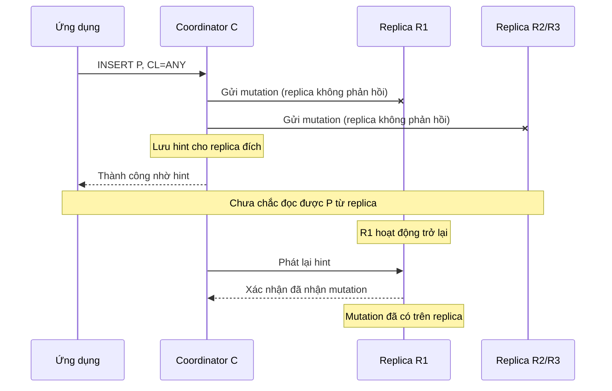

# ANY cho thao tác ghi và quan hệ với hinted handoff

Trong Apache Cassandra, consistency level **`ANY`** là lựa chọn đặc biệt dành cho **ghi**: coordinator có thể trả về thành công khi **một replica đích xác nhận mutation**, hoặc trong trường hợp các replica đích chưa thể nhận ghi, khi **coordinator lưu được một hint** để chuyển mutation cho replica sau này. Điều này giúp một số lần ghi vẫn được chấp nhận ngay cả khi **không replica đích nào đang phản hồi**. Tuy nhiên, thành công ở `ANY` **không đồng nghĩa dữ liệu đã nằm trên replica và có thể đọc ngay**.

Bài này thuộc chương **Nhất quán đọc/ghi** của mô-đun `DATABASE_ENGINE_WIDE_COLUMN_CASSANDRA`. Mô-đun hướng tới việc hiểu kiến trúc phân tán và mô hình wide-column của Cassandra, nhất là partition key, thiết kế bảng theo truy vấn, CL đọc/ghi, thực hành CQL, replication, compaction, repair, xử lý lỗi và tích hợp Java. Trọng tâm ở đây là **cách `ANY` liên quan đến hinted handoff, những bảo đảm thực sự và các tình huống ứng dụng nên tránh dùng `ANY`**.

> **Ghi nhớ ngay:** `ANY` là mức nhất quán cho **ghi thông thường**; Cassandra **không chấp nhận `ANY` cho `SELECT`**. Hint là bản ghi chờ giao lại mutation, **không phải** một replica đã lưu dữ liệu theo replication factor.

## 1. Mục tiêu học tập

Sau bài này, bạn có thể:

1. Giải thích chính xác điều kiện thành công của một lần ghi `ANY`.
2. Phân biệt **ACK từ replica** với **thành công nhờ hint**.
3. Mô tả đường đi của mutation qua coordinator, hint lưu cục bộ và quá trình **hinted handoff** khi replica hoạt động trở lại.
4. So sánh `ANY` với `ONE`, `LOCAL_ONE` và `QUORUM` về khả dụng, khả năng đọc sau ghi và nguy cơ mất dữ liệu.
5. Đọc đúng ý nghĩa các cấu hình, trạng thái và chỉ số giám sát hints.
6. Thiết lập `ANY` trong `cqlsh` và Java Driver; thiết kế ứng dụng đối phó với timeout, retry và thao tác chưa thể đọc.

## 2. Vì sao cần phân biệt replication và consistency level?

### Replica và coordinator

Trong Cassandra, **partition key** xác định partition mà một hàng thuộc về. **Replication strategy** và **replication factor (RF)** quyết định những node nào là replica đích cho partition. Client gửi lệnh CQL đến một node đóng vai trò **coordinator**, và coordinator điều phối mutation tới các replica liên quan.

Giả sử một keyspace có **RF = 3** trong một datacenter:

```text
                  Cassandra cluster

Ứng dụng --> Coordinator C
                |      |      |
                v      v      v
               R1     R2     R3

                  RF = 3
        Ba replica cho một partition
```

Việc chọn `ANY` **không làm RF giảm từ 3 xuống 1 hoặc 0**. Cassandra vẫn muốn đưa mutation đến **ba replica đích**. Điều thay đổi là **điều kiện để coordinator báo thành công cho client**.

| Khái niệm | Ý nghĩa | Điều gì không được suy ra? |
| --- | --- | --- |
| RF = 3 | Partition được cấu hình có ba replica đích. | Không có nghĩa ba replica đều đang hoạt động. |
| `CL=ONE` | Cần ít nhất **một replica đích** xác nhận ghi. | Lưu hint một mình chưa đủ để thỏa `ONE`. |
| `CL=ANY` | Một replica xác nhận **hoặc** coordinator lưu được hint phù hợp. | Không chắc replica nào đã nhận dữ liệu. |
| Hinted handoff | Chuyển lại mutation đã được giữ dưới dạng hint tới replica khi nó có thể nhận. | Không phải replica mới và không thay thế repair. |

### `ANY` là “ngưỡng phản hồi thấp nhất” theo cách đặc biệt

Khác với `ONE`, `TWO` và `QUORUM` — vốn đòi phản hồi từ replica — `ANY` có một **đường thành công thay thế**: lưu hint tại coordinator. Vì vậy, không nên mô hình hóa `ANY` đơn giản như “`W=1` từ một replica”, đặc biệt khi tất cả replica đều không khả dụng.

Hai kết quả trả về cho client đều có thể mang nhãn **ghi thành công**, nhưng ý nghĩa rất khác:

- **Trường hợp A:** Một replica đích đã nhận và ACK mutation. Dữ liệu có trên ít nhất một replica đích tại thời điểm phản hồi.
- **Trường hợp B:** Không replica đích nào ACK, nhưng coordinator giữ được hint. Dữ liệu có thể **chỉ tồn tại dưới dạng hint ở coordinator**, chưa đọc được qua những replica đích của partition.

Nếu coordinator cũng mất trước khi hint được chuyển đi và không bản sao nào khác chứa mutation, mutation đó có thể bị mất. Một thành công kiểu `ANY` **không có cùng mức bảo vệ dữ liệu với quorum đã ACK**.

## 3. Hinted handoff hoạt động thế nào?

**Hint** là thông tin về mutation mà replica đích đã bỏ lỡ. Cassandra lưu hint cục bộ tại node điều phối, ghi nhận replica cần nhận mutation, giá trị và metadata cần thiết. Khi replica trở lại hoặc có thể tiếp nhận ghi, dịch vụ **hinted handoff** phát lại hint cho replica đích.

Giả sử các node `R1`, `R2` và `R3` là replica của partition `P`, còn node `C` là coordinator **không thuộc ba replica đích**. Tất cả ba replica tạm thời không thể nhận mutation:



Trong sơ đồ này:

1. Ứng dụng ghi một mutation với `CL=ANY`.
2. Coordinator tìm các replica đích dựa trên partition key và replication strategy.
3. Không replica đích nào nhận/ACK được trong tình huống giả định.
4. Nếu coordinator **lưu được hint** phù hợp, nó có thể trả thành công cho client.
5. Khi replica đích quay lại, dịch vụ handoff chuyển hint và replica áp dụng mutation.
6. Các replica khác còn thiếu dữ liệu cần được cập nhật theo cơ chế phục hồi; repair vẫn có vai trò riêng.

**Điều kiện quan trọng:** Phải còn một coordinator đủ khỏe để nhận yêu cầu và lưu hint; nếu cả cluster đều không thể nhận kết nối, hay coordinator không thể lưu hint do lỗi/giới hạn tài nguyên, `ANY` **vẫn có thể thất bại**. Do đó câu “`ANY` luôn ghi thành công trong mọi sự cố” là không đúng.

### Hinted handoff không chỉ dành riêng cho `ANY`

Hãy xét **RF = 3** với `CL=QUORUM`. Nếu `R1` và `R2` ACK ghi, còn `R3` đang ngừng hoạt động:

- Ghi đã **đạt `QUORUM`** sau hai ACK; hint của `R3` **không phải** ACK quorum.
- Coordinator có thể giữ hint cho `R3` để replica này nhận mutation khi quay lại.
- Nếu ghi đặt `ANY` trong tình huống đó, yêu cầu cũng có thể thành công từ ACK của `R1`; **không nhất thiết** phải dùng hint làm điều kiện trả kết quả.

Hinted handoff là cơ chế hỗ trợ khắc phục **replica bỏ lỡ ghi**, còn `ANY` là một **mức nhất quán** cho phép dùng việc lưu hint để thỏa điều kiện thành công khi không replica đích nào phản hồi. Hai khái niệm liên quan nhưng không đồng nhất.

## 4. `ANY` và `ONE` khác nhau ra sao?

Trường hợp điển hình: một datacenter RF = 3, coordinator còn hoạt động:

| Tình trạng replica đích | Ghi `ANY` | Ghi `ONE` | Ghi `QUORUM` |
| --- | --- | --- | --- |
| Cả 3 replica đều phản hồi | Có thể thành công | Có thể thành công | Có thể thành công (cần 2 ACK). |
| Chỉ 1 replica phản hồi | Có thể thành công nhờ 1 ACK | Có thể thành công nhờ 1 ACK | Không đủ 2 ACK. |
| **0 replica phản hồi**, coordinator lưu được hint | **Có thể thành công nhờ hint** | **Không đạt `ONE`** | **Không đạt `QUORUM`**. |
| **0 replica phản hồi**, coordinator cũng không lưu được hint | **Không đạt `ANY`** | Không đạt `ONE` | Không đạt `QUORUM`. |

Giả định mọi phản hồi đến kịp thời hạn và không có lỗi khác. Bảng thể hiện **khả năng thỏa CL**, không phải bảo đảm mọi request đều hoàn tất.

### `ANY` không giống `LOCAL_ONE`

`LOCAL_ONE` cần **một replica trong datacenter của coordinator** xác nhận ghi. `ANY` không yêu cầu điều đó: nó có thể thành công nhờ **hint lưu cục bộ**, dù replica đích nào cũng không phản hồi. Đừng nhầm `LOCAL_ONE` là “`ANY` nhưng local”; hai mức này khác nhau về **loại phản hồi hợp lệ**.

### `ANY` không đủ để chứng minh dữ liệu đã được replication

RF = 3 vẫn là ba bản sao mong muốn, nhưng ngay sau khi ghi `ANY` dựa trên hint, **cả ba replica đích đều có thể chưa sở hữu mutation**. Hệ thống cần handoff hoặc cơ chế đồng bộ phù hợp để mutation đến replica. Một hint nằm trên coordinator **không phải** một replica thứ tư và không làm tăng mức bảo vệ dữ liệu.

## 5. Đọc sau khi ghi `ANY`: rủi ro lớn nhất

`ANY` chỉ hỗ trợ **ghi**. Câu lệnh `SELECT` với `CONSISTENCY ANY` không hợp lệ trong Cassandra. Tuy nhiên, nguy cơ thường gặp hơn là: ghi `ANY` thành công, sau đó ứng dụng đổi sang **đọc `ONE` hoặc `QUORUM`** và cho rằng dữ liệu chắc chắn có thể đọc.

### Dòng thời gian: thành công nhưng chưa đọc được

```text
t0: R1, R2, R3 không nhận được mutation.
t1: Coordinator lưu hint H cho partition P.
t2: INSERT ở ANY trả thành công.
t3: Ứng dụng SELECT P ở ONE.
    Nếu không replica đích nào khả dụng -> không đủ replica để đọc.
t4: R1 hồi phục nhưng hint H chưa được phát lại.
    SELECT ở ONE có thể chưa thấy P hoặc thấy giá trị cũ.
t5: Hint H được phát lại và R1 áp dụng mutation.
    SELECT có thể thấy P khi đọc từ replica đã cập nhật.
```

Đường đọc Cassandra lấy dữ liệu từ **replica của partition**, không tự xem hint chưa phát lại là một bản sao có thể đọc. Việc một lần ghi `ANY` được xác nhận **không tạo bảo đảm read-your-writes** cho request đọc tiếp theo.

### Vì sao không dùng công thức `R + W > N` như với `QUORUM`?

Quy tắc giao nhau của quorum:

\[
R + W > N
\]

được áp dụng khi `R` và `W` đếm **các replica tương ứng** trong cùng tập replica. Khi `ANY` thành công chỉ nhờ hint ở coordinator, **không replica đích nào nhất thiết đã ACK ghi**. Vì vậy không thể lấy `W = 1` rồi suy ra ghi `ANY` và đọc `ALL` sẽ có một replica giao nhau với tập ACK ghi.

Ngay cả khi tất cả replica đích hồi phục, một lần đọc thực hiện **trước khi hint được phát lại** vẫn không có bảo đảm thấy mutation đó. Nếu workload bắt buộc phải đọc lại ngay sau ghi, `ANY` thường là lựa chọn không phù hợp.

## 6. Hint có được bảo đảm giao thành công không?

**Không. Hinted handoff là best effort**, không phải cơ chế cam kết chắc chắn mọi mutation bị lỡ cuối cùng sẽ xuất hiện ở mọi replica.

Những lý do có thể khiến hint không được phát lại:

- **Coordinator mất dữ liệu hoặc hỏng hẳn:** Hint chưa gửi nằm trên coordinator có thể mất cùng ổ đĩa/node đó.
- **Replica đích ngừng hoạt động quá lâu:** Cassandra giới hạn cửa sổ **tiếp tục sinh hint** cho replica đang down. Sau cửa sổ đó, các mutation mới có thể không được giữ thành hint cho replica đó.
- **Tài nguyên/giới hạn lưu hint:** Đĩa, tốc độ giao lại và các giới hạn cấu hình ảnh hưởng khả năng lưu/phát lại hints.
- **Node được thay thế hoặc topology thay đổi:** Hints nhắm tới endpoint cũ có thể không được phát lại theo cách ứng dụng mong muốn; cần quy trình vận hành và repair phù hợp.
- **Handoff bị vô hiệu hóa hoặc tạm dừng:** Không thể giả định hints luôn được sinh/giao trong mọi cấu hình.

Ví dụ, tài liệu Cassandra hiện hành nêu cửa sổ tạo hint mặc định thường là **3 giờ** qua `max_hint_window`; tài liệu/phiên bản cũ có thể dùng tên `max_hint_window_in_ms`. Đây là giới hạn **thời gian một node đang down còn được tạo hint mới**, **không phải** lời hứa một hint sẽ tự hủy chính xác sau ba giờ hay mọi hint sẽ được giao trong ba giờ.

### Hinted handoff và repair khác nhau

| Hinted handoff | Anti-entropy repair |
| --- | --- |
| Ghi lại mutation mà coordinator biết replica đã bỏ lỡ. | Đối chiếu dữ liệu giữa các replica để phát hiện và khắc phục khác biệt. |
| Chủ yếu phục vụ việc replica tạm thời không nhận được ghi. | Giải quyết khác biệt có thể tồn tại sau sự cố dài, hint bị mất hoặc node thay đổi. |
| Phát lại dựa trên các hint còn được giữ. | Không đòi hỏi phải còn hint gốc cho từng mutation. |
| **Best effort**; không thay thế lịch repair. | Là công cụ vận hành quan trọng để duy trì dữ liệu nhất quán giữa replica. |

**Compaction** là cơ chế quản lý SSTable và tombstone, không thay thế quá trình repair. Trong môi trường có xóa dữ liệu và tombstone, việc bỏ qua repair còn có thể tạo rủi ro liên quan tới dữ liệu đã xóa xuất hiện lại nếu replica bị bỏ lỡ tombstone quá lâu; đó là lý do cần có chính sách repair phù hợp với `gc_grace_seconds` và đặc điểm workload.

## 7. Theo dõi và cấu hình hints ở mức vận hành

Các tham số dưới đây nằm trong cấu hình Cassandra (`cassandra.yaml`) và có thể khác tên hoặc giá trị theo **phiên bản**:

| Thiết lập | Tác dụng |
| --- | --- |
| `hinted_handoff_enabled` | Bật/tắt cơ chế hinted handoff. |
| `hinted_handoff_disabled_datacenters` | Các DC bị loại trừ khỏi việc tạo/giao hints. |
| `max_hint_window` | Khoảng thời gian một replica down còn được tạo hint mới; một số bản cũ gọi là `max_hint_window_in_ms`. |
| `hints_directory` | Nơi lưu các tệp hint trên node. |
| `hinted_handoff_throttle` | Giới hạn băng thông giao hints. |
| `max_hints_delivery_threads` | Số luồng chuyển hints song song. |
| `max_hints_size_per_host` | Giới hạn dung lượng hints theo endpoint, nếu phiên bản và cấu hình hỗ trợ. |

Với các bản Cassandra hiện đại, có thể bắt đầu quan sát bằng những lệnh **chỉ đọc trạng thái**:

```bash
# Thực hiện trên node có cài nodetool:
nodetool statushandoff
nodetool getmaxhintwindow
```

Một số phiên bản hoặc bản phân phối có cú pháp/khả năng khác nhau. Ngoài ra, có thể theo dõi **JMX metrics** liên quan đến `HintsService` và `HintedHandOffManager`, như số hints được tạo, hints không thể lưu và tiến độ chuyển hints. Đừng chỉ xem một lần ghi trả thành công: cần quan sát **backlog hints**, lỗi phát lại và tình trạng replica.

**Cảnh báo vận hành:** Việc tăng `max_hint_window` hoặc giảm throttle không tự làm hệ thống “nhất quán hơn” theo cách vô điều kiện; các giá trị này có thể làm tăng dung lượng đĩa và lượng dữ liệu cần truyền khi node trở lại. Cần tính theo lưu lượng ghi thực tế, dung lượng đĩa và thời gian hồi phục dự kiến.

## 8. Thực hành CQL: ghi `ANY`, đọc bằng CL hợp lệ

Giả sử cluster kiểm thử có **ít nhất bốn node trong datacenter `dc1`**; partition thuộc ba replica vì keyspace có RF = 3, còn một node khác có thể làm coordinator không thuộc tập replica của partition. **Không dùng cụm production để cố ý dừng hàng loạt replica.**

Tạo keyspace và bảng theo truy vấn “xem sự kiện mới nhất của một tài khoản”:

```sql
-- Thay dc1 bằng tên datacenter thực của cụm kiểm thử.
CREATE KEYSPACE IF NOT EXISTS any_lab
WITH replication = {
  'class': 'NetworkTopologyStrategy',
  'dc1': 3
};

CREATE TABLE IF NOT EXISTS any_lab.event_by_account (
  account_id uuid,
  occurred_at timestamp,
  event_id uuid,
  event_type text,
  payload text,
  PRIMARY KEY ((account_id), occurred_at, event_id)
) WITH CLUSTERING ORDER BY (occurred_at DESC, event_id ASC);
```

`account_id` là **partition key**, hai trường `occurred_at` và `event_id` là **clustering columns**. Thiết kế này giúp truy vấn các sự kiện gần nhất của một tài khoản mà không quét toàn bảng.

Trong `cqlsh`:

```sql
-- Ghi: một replica ACK hoặc coordinator giữ được hint.
CONSISTENCY ANY;

INSERT INTO any_lab.event_by_account (
  account_id, occurred_at, event_id, event_type, payload
) VALUES (
  11111111-1111-4111-8111-111111111111,
  '2026-11-21 08:00:00+0000',
  22222222-2222-4222-8222-222222222222,
  'SENSOR_READING',
  '{"temperature":27}'
);

-- ANY không hợp lệ cho SELECT: đổi CL trước khi đọc.
CONSISTENCY ONE;

SELECT occurred_at, event_id, event_type, payload
FROM any_lab.event_by_account
WHERE account_id = 11111111-1111-4111-8111-111111111111
LIMIT 10;
```

**Đừng suy luận từ việc `INSERT` thành công rằng `SELECT` chắc chắn thấy sự kiện.** Khi `ANY` dùng đường hint, lần đọc có thể không đủ replica, thấy dữ liệu cũ hoặc chưa thấy hàng mới cho tới khi hint được phát lại.

`CONSISTENCY` là **lệnh tương tác của `cqlsh`**, không phải mệnh đề gắn sau câu `INSERT`/`SELECT`. Nếu muốn kiểm tra hành vi khi replica down, hãy tạo topology kiểm thử và xác định thật rõ partition đang nằm trên replica nào trước khi mô phỏng lỗi; không suy từ thứ tự hoặc tên node.

## 9. Ghi `ANY` theo từng statement trong Java Driver 4.x

Ứng dụng Java có thể đặt `ANY` trên một statement ghi, trong khi đường đọc dùng mức khác. Đoạn sau dùng `CqlSession` đã cấu hình contact points, local datacenter và xác thực phù hợp:

```java
import com.datastax.oss.driver.api.core.CqlSession;
import com.datastax.oss.driver.api.core.DefaultConsistencyLevel;
import com.datastax.oss.driver.api.core.cql.BoundStatement;
import com.datastax.oss.driver.api.core.cql.PreparedStatement;
import com.datastax.oss.driver.api.core.cql.ResultSet;

import java.time.Instant;
import java.util.UUID;

public final class EventRepository {
    private final CqlSession session;
    private final PreparedStatement insertEvent;
    private final PreparedStatement readEvents;

    public EventRepository(CqlSession session) {
        this.session = session;
        this.insertEvent = session.prepare(
            "INSERT INTO any_lab.event_by_account " +
            "(account_id, occurred_at, event_id, event_type, payload) " +
            "VALUES (?, ?, ?, ?, ?)");
        this.readEvents = session.prepare(
            "SELECT occurred_at, event_id, event_type " +
            "FROM any_lab.event_by_account " +
            "WHERE account_id = ? LIMIT 10");
    }

    public void recordEvent(
            UUID accountId, Instant occurredAt, UUID eventId,
            String eventType, String payload) {
        BoundStatement write = insertEvent.bind(
                accountId, occurredAt, eventId, eventType, payload)
            .setConsistencyLevel(DefaultConsistencyLevel.ANY);

        session.execute(write);
        // Thành công có thể chỉ phản ánh việc coordinator đã lưu hint.
        // Không mặc nhiên đồng nghĩa event đã đọc được ngay.
    }

    public ResultSet recentEvents(UUID accountId) {
        BoundStatement read = readEvents.bind(accountId)
            .setConsistencyLevel(DefaultConsistencyLevel.LOCAL_QUORUM);
        return session.execute(read);
    }
}
```

**Lưu ý thiết kế retry:** Ví dụ nhận `eventId` và `occurredAt` từ bên ngoài để ứng dụng có thể dùng lại **cùng primary key** khi gửi lại một sự kiện. Nếu mỗi lần retry lại sinh ID mới, có thể tạo **nhiều hàng** cho cùng một sự kiện. Nếu client nhận timeout, không được kết luận mutation chắc chắn chưa được ghi; áp dụng chính sách retry có giới hạn và xét tính idempotent.

Đường đọc trong ví dụ dùng `LOCAL_QUORUM` để minh họa một CL đọc hợp lệ. **Nó không khắc phục ngay** trường hợp ghi `ANY` mới chỉ nằm trong hint. Trong ứng dụng cần xác nhận bản ghi đã có trên replica để đọc tiếp, cân nhắc viết `LOCAL_QUORUM` hoặc mức phù hợp thay vì `ANY`.

### Có nên dùng `ANY` với counter hoặc LWT?

- **Counter:** Cassandra không hỗ trợ ghi counter ở `CL=ANY` trong các phiên bản OSS phổ biến; counter có đường cập nhật đặc thù và không thể được xem như một mutation idempotent thông thường. Chọn CL được hỗ trợ cho counter và kiểm tra phiên bản triển khai.
- **LWT/ghi có điều kiện:** `INSERT ... IF NOT EXISTS` và `UPDATE ... IF` dùng Paxos, có ngữ nghĩa về serial consistency (`SERIAL`/`LOCAL_SERIAL`) riêng. Không xem thành công của ghi thường `ANY` là bằng chứng đã thực hiện so sánh điều kiện nguyên tử.
- **Batch:** Đừng cho rằng gom nhiều mutation vào batch rồi đặt `ANY` sẽ tạo transaction nguyên tử hoặc bảo đảm đọc lại tất cả hàng. Batch và CL giải quyết những vấn đề khác nhau.

## 10. Khi nào nên và không nên chọn `ANY`?

| Nhu cầu | Đánh giá `ANY` | Lý do |
| --- | --- | --- |
| Thu nhận tín hiệu ít quan trọng, ưu tiên chấp nhận ghi ngay cả khi replica tạm ngừng | **Có thể cân nhắc** | Cho phép lưu hint trong một số sự cố mà `ONE` không đạt. |
| Ghi rồi lập tức truy vấn bản ghi để thực hiện nghiệp vụ kế tiếp | **Thường không phù hợp** | Thành công nhờ hint không bảo đảm đọc được. |
| Giao dịch tài chính, trạng thái đơn hàng quan trọng, yêu cầu dữ liệu được nhân bản trước khi xác nhận | **Không phù hợp** | Một hint đơn lẻ ở coordinator có rủi ro mất dữ liệu. |
| Đếm lượt, cộng dồn bằng counter | **Không dùng `ANY`** | Counter write không hỗ trợ CL này trong Cassandra OSS phổ biến. |
| Muốn các bản sao tự nhất quán vĩnh viễn mà không cần repair | **Không phù hợp** | Hinted handoff chỉ là best effort. |

**Ví dụ thực tế:** Thiết bị IoT gửi một số đo nhiệt độ. Nếu mất một vài mẫu trong tình huống hỏng nặng không ảnh hưởng an toàn hoặc nghiệp vụ, ứng dụng **có thể** chấp nhận `ANY` để ưu tiên tính sẵn sàng. Nhưng nếu yêu cầu “mỗi mẫu phải được lưu bền vững dù coordinator mất ngay sau ACK”, một thành công dựa trên hint **không đủ**; hệ thống nên cân nhắc cơ chế ghi có nhiều ACK, hàng đợi bền vững hoặc chiến lược nhận dữ liệu có retry/đối soát phù hợp.

Đừng chọn `ANY` chỉ vì tên nghe có vẻ “chấp nhận tất cả”. Đặt câu hỏi rõ ràng: **Nếu response thành công nhưng replica chưa có dữ liệu, ứng dụng có chấp nhận được không?**

## 11. Bài tập thực hành tư duy

### Bài 1 — Zero replica

Một partition RF = 3 có ba replica đích đều không phản hồi, nhưng một coordinator khác vẫn hoạt động và có thể lưu hint. Ghi `ANY`, `ONE` và `QUORUM` có thể đạt CL không?

**Đáp án:** `ANY` **có thể** thành công nếu hint được lưu thành công. `ONE` và `QUORUM` **không** đạt vì không replica đích nào xác nhận. Không có gì đảm bảo lúc này có thể đọc hàng vừa ghi.

### Bài 2 — Đã ghi `ANY` nhưng đọc không thấy

Client ghi `ANY` nhận response thành công. Sau đó đọc bằng `ONE` và nhận giá trị cũ. Điều này có mâu thuẫn không?

**Đáp án:** Không. Mutation có thể mới chỉ ở hint hoặc replica được đọc chưa kịp cập nhật. `ANY` không bảo đảm read-your-writes.

### Bài 3 — Hints khi dùng `QUORUM`

Với RF = 3, `R1` và `R2` ACK mutation, `R3` down. Ghi ở `QUORUM` có cần hint làm một trong hai ACK không?

**Đáp án:** Không. Hai ACK đã đến từ replica. Hints có thể được lưu để hỗ trợ `R3` bắt kịp sau này, nhưng hint **không phải** ACK quorum.

### Bài 4 — Ngày hôm sau vẫn còn dữ liệu cũ

Một replica ngừng hoạt động lâu hơn cửa sổ tạo hints rồi quay lại. Có thể coi hinted handoff tự động giải quyết hết dữ liệu đã bỏ lỡ không?

**Đáp án:** Không. Có thể không còn hints cho những mutation bị bỏ lỡ; cần kiểm tra và thực hiện **anti-entropy repair** theo quy trình vận hành.

### Bài 5 — Vòng đời coordinator

Một ghi `ANY` thành công chỉ nhờ hint trên coordinator `C`; trước khi handoff, ổ đĩa `C` hỏng không thể phục hồi. Rủi ro chính là gì?

**Đáp án:** Nếu không replica nào nhận mutation và không còn bản sao hint, mutation có thể **mất vĩnh viễn**. Vì vậy không được coi `ANY` tương đương một ghi đã được replication.

### Bài 6 — Chọn CL theo nghiệp vụ

Một dịch vụ Java tạo hóa đơn, sau khi nhận ghi thành công phải đọc lại ngay để xác nhận và phát sự kiện giao hàng. Có nên chọn `ANY` chỉ để giảm khả năng timeout?

**Đáp án:** Thường không. `ANY` có thể trả thành công khi dữ liệu chỉ ở hint, chưa đọc được. Nên xác định CL đọc/ghi có bảo đảm phù hợp, thiết kế retry idempotent và cân nhắc xử lý nghiệp vụ bằng giao thức/transaction cần thiết.

## 12. Tổng kết

`ANY` là CL **ghi** có điều kiện thành công đặc biệt: **ACK từ ít nhất một replica đích hoặc lưu được hint để giao mutation sau**. Nó nâng khả năng chấp nhận ghi trong những tình huống replica tạm không sẵn sàng, nhưng cũng đặt ra khoảng cách giữa **“đã nhận ghi”** và **“đã có dữ liệu trên replica để đọc”**.

Hinted handoff giúp replica theo kịp sau sự cố ngắn, song là cơ chế **best effort** và phụ thuộc coordinator, ổ đĩa, cửa sổ tạo hint, topology và cấu hình vận hành. Cần kết hợp repair, theo dõi hints, kiểm soát retry và thiết kế dữ liệu có primary key ổn định. Khi ứng dụng Java cần đọc ngay sau ghi hoặc yêu cầu độ bền dữ liệu cao, `ANY` thường không đáp ứng được kỳ vọng đó.

### Tài liệu tham khảo

- [Apache Cassandra — Dynamo và tunable consistency](https://cassandra.apache.org/doc/stable/cassandra/architecture/dynamo.html): định nghĩa `ANY` và cách CL điều khiển phản hồi.
- [Apache Cassandra — Hints và hinted handoff](https://cassandra.apache.org/doc/stable/cassandra/managing/operating/hints.html): cơ chế lưu/phát lại hints, giới hạn best effort, cấu hình và vận hành.
- [Apache Cassandra — cassandra.yaml configuration](https://cassandra.apache.org/doc/stable/cassandra/managing/configuration/cass_yaml_file.html): các tùy chọn cấu hình handoff theo phiên bản.
