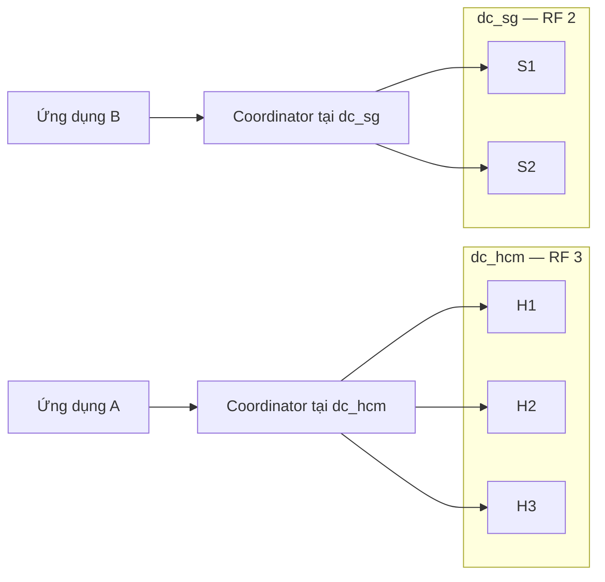

# Tính số phản hồi quorum từ RF và phạm vi datacenter

Trong Apache Cassandra, **quorum** là ngưỡng phản hồi của **đa số replica** thuộc một phạm vi xác định. Muốn tính đúng số phản hồi mà coordinator cần chờ, trước tiên phải biết **replication factor (RF)** và **phạm vi replica** của consistency level (CL) được chọn. Với nhiều datacenter (DC), chỉ nhớ “quorum là hơn một nửa” chưa đủ: **hơn một nửa của DC nào, hay của toàn bộ replica của partition?**

Bài này thuộc chương **Nhất quán đọc/ghi** trong mô-đun `DATABASE_ENGINE_WIDE_COLUMN_CASSANDRA`, nơi ta tìm hiểu kiến trúc phân tán, mô hình wide-column, partition key, thiết kế bảng theo truy vấn, thực hành CQL, replication, compaction, repair, xử lý lỗi và kết nối Cassandra từ ứng dụng Java. Trọng tâm của bài là **tính được ngưỡng phản hồi bằng số cụ thể**, giải thích được điều kiện theo datacenter và dùng kết quả để lựa chọn CL.

## 1. Mục tiêu học tập

Sau khi học, bạn có thể:

1. Giải thích RF, replica, coordinator và local DC trong bài toán quorum.
2. Tính `QUORUM` từ **tổng RF** của partition và `LOCAL_QUORUM` từ **RF của DC chứa coordinator**.
3. Tính `EACH_QUORUM` khi ghi bằng **quorum riêng của từng DC** và phân biệt ngưỡng theo phân bố ACK với số ACK tổng.
4. Phân tích xem một yêu cầu có thể thành công không khi replica hoặc một DC không phản hồi.
5. Dùng điều kiện giao nhau giữa tập ACK ghi và tập phản hồi đọc đúng phạm vi.
6. Vận dụng kết quả để thực hành `cqlsh` và Java Driver, xử lý `Unavailable` và `Timeout`.

## 2. Đặt bài toán: đếm replica của partition, không đếm mọi node

Cassandra sử dụng **partition key** để xác định partition chứa dữ liệu và các replica chịu trách nhiệm lưu partition đó. Khi dùng `NetworkTopologyStrategy`, mỗi DC trong cấu hình keyspace có một **RF** riêng.

Ví dụ một keyspace có:

```text
dc_hcm: RF = 3    Replica H1, H2, H3
dc_sg:  RF = 2    Replica S1, S2

Một partition có 3 + 2 = 5 replica đích.
```

Hai điều dễ nhầm:

- **RF = 3** ở `dc_hcm` nghĩa là mỗi partition có ba replica được chỉ định **trong DC đó**. Nó **không** có nghĩa toàn bộ cluster chỉ có ba node, và cũng không chứng minh cả ba replica đang sẵn sàng.
- **CL** quy định một yêu cầu cần nhận **bao nhiêu phản hồi hợp lệ từ những replica thuộc phạm vi CL** trước khi coordinator có thể báo thành công. Cassandra có thể gửi request đến nhiều replica hơn số ACK tối thiểu.

**Coordinator** là node nhận CQL request từ client và điều phối đọc/ghi. Với `LOCAL_QUORUM`, “local” nghĩa là **datacenter của coordinator**, không phải vị trí địa lý của người dùng và không mặc nhiên là DC chứa code ứng dụng. Driver cần được cấu hình/định tuyến để chọn coordinator trong DC mong muốn.

Trong bài, các phép tính giả định keyspace có **full replication thông thường**, topology đã ổn định và không xét các cấu hình transient replication hay thay đổi topology đang diễn ra. Với cấu hình đặc biệt, cần kiểm tra hành vi theo phiên bản Cassandra thực tế.

## 3. Công thức quorum: luôn lấy phần nguyên rồi cộng 1

Với một tập gồm **N replica**, ngưỡng đa số tuyệt đối là:

\[
Q(N) = \left\lfloor \frac{N}{2} \right\rfloor + 1
\]

Ký hiệu `⌊x⌋` là **lấy phần nguyên xuống**. Ví dụ `⌊5/2⌋ = 2`, nên `Q(5) = 3`.

| Số replica `N` | Phép tính | Quorum `Q(N)` | Số replica tối đa có thể không phản hồi mà vẫn đủ quorum |
| ---: | --- | ---: | ---: |
| 1 | `⌊1/2⌋ + 1` | **1** | 0 |
| 2 | `⌊2/2⌋ + 1` | **2** | 0 |
| 3 | `⌊3/2⌋ + 1` | **2** | 1 |
| 4 | `⌊4/2⌋ + 1` | **3** | 1 |
| 5 | `⌊5/2⌋ + 1` | **3** | 2 |
| 6 | `⌊6/2⌋ + 1` | **4** | 2 |
| 7 | `⌊7/2⌋ + 1` | **4** | 3 |

**Tại sao không làm tròn `N/2` lên?** Với `N=4`, làm tròn `4/2` vẫn là 2, nhưng **hai** replica không phải **đa số** của bốn; quorum phải là **3**. Công thức `floor(N/2)+1` luôn chọn đúng đa số.

### Thuật toán tính nhanh bằng tay

1. Đọc RF của **từng datacenter** từ replication strategy.
2. Xác định CL cần tính: `QUORUM`, `LOCAL_QUORUM` hay `EACH_QUORUM`.
3. Chọn tập replica được **đếm**: toàn cluster, DC coordinator hoặc từng DC.
4. Áp dụng `Q(N)` vào đúng số replica của tập đó.
5. Kiểm tra **phân bố ACK**, **loại thao tác đọc/ghi** và tình trạng replica.

## 4. `QUORUM`: tính từ tổng RF của partition

Nếu keyspace có `k` DC và RF ở các DC lần lượt là `RF₁, RF₂, …, RFₖ`, tổng replica của một partition là:

\[
N_{\mathrm{total}} = \sum_{i=1}^{k} RF_i
\]

Khi đó:

\[
Q_{\mathrm{global}} =
\left\lfloor \frac{\sum_{i=1}^{k} RF_i}{2} \right\rfloor + 1
\]

**`QUORUM`** dùng ngưỡng này cho **đọc hoặc ghi** thông thường. Các ACK có thể đến từ những DC khác nhau; **không yêu cầu mỗi DC phải đạt quorum riêng**.

### Ví dụ A — một DC, RF = 3

`N_total = 3`, nên `QUORUM = ⌊3/2⌋ + 1 = 2` ACK. Nếu chỉ còn hai replica phản hồi đúng hạn, yêu cầu vẫn **có thể** thành công.

### Ví dụ B — hai DC, RF = 3 + 3

`N_total = 6` và `QUORUM = ⌊6/2⌋ + 1 = 4`.

| ACK ở DC 1 | ACK ở DC 2 | Tổng ACK | Đạt `QUORUM`? |
| ---: | ---: | ---: | --- |
| 3 | 1 | 4 | **Có** |
| 2 | 2 | 4 | **Có** |
| 1 | 3 | 4 | **Có** |
| 3 | 0 | 3 | **Không** |
| 2 | 1 | 3 | **Không** |

Trong mô hình `3 + 3`, không DC nào có đủ **4** replica để đạt `QUORUM` một mình; yêu cầu `QUORUM` phải nhận ít nhất một phản hồi từ DC còn lại.

### Ví dụ C — hai DC không cân bằng, RF = 5 + 1

`N_total = 6` và `QUORUM = 4` như ví dụ B. Nhưng DC lớn có **5 replica**, nên có thể cung cấp **4 ACK chỉ trong DC lớn**, không cần ACK từ DC nhỏ.

Kết luận: **`QUORUM` không đồng nghĩa bắt buộc chờ WAN trong mọi topology đa DC**. Việc có cần ACK ở DC xa hay không phụ thuộc **tổng RF** và **số replica có thể phản hồi từ mỗi DC**.

## 5. `LOCAL_QUORUM`: chỉ tính từ RF của DC coordinator

Giả sử coordinator nằm ở `dc_hcm` và DC này có `RF_hcm = 3`:

\[
Q_{\mathrm{local,hcm}} =
\left\lfloor \frac{3}{2} \right\rfloor + 1 = 2
\]

Thao tác `LOCAL_QUORUM` cần **hai phản hồi hợp lệ của replica ở `dc_hcm`**. Replica ở các DC khác dù phản hồi nhanh cũng **không bù** vào ngưỡng local.

Nếu coordinator chuyển sang `dc_sg` với `RF_sg = 2`:

\[
Q_{\mathrm{local,sg}} =
\left\lfloor \frac{2}{2} \right\rfloor + 1 = 2
\]

Cùng một keyspace `RF = 3 + 2` nhưng `LOCAL_QUORUM` lấy **RF của DC đang đóng vai trò local**; đó có thể là một ngưỡng khác nếu RF các DC khác nhau.

### Vì sao phải biết coordinator nằm đâu?



- Ứng dụng A đi qua coordinator `dc_hcm`: `LOCAL_QUORUM` cần **2 trong 3** replica `dc_hcm`.
- Ứng dụng B đi qua coordinator `dc_sg`: `LOCAL_QUORUM` cần **2 trong 2** replica `dc_sg`.
- Nếu `dc_sg` chỉ còn **một replica**, thao tác `LOCAL_QUORUM` của B không đạt ngưỡng, dù cả ba replica tại `dc_hcm` vẫn khỏe mạnh.

`LOCAL_QUORUM` hỗ trợ **đọc và ghi thông thường**. Vì tập ACK chỉ thuộc local DC, mức này thường giúp tránh việc **phải chờ remote DC để thỏa CL** trên đường phản hồi. Điều đó không có nghĩa Cassandra ngừng gửi mutation đến remote DC hoặc remote DC sẽ ngay lập tức có dữ liệu mới.

## 6. `EACH_QUORUM`: quorum riêng ở mỗi DC khi ghi

Với `EACH_QUORUM`, cần tính quorum cho **từng DC có replica**, rồi kiểm tra **mọi DC** đều đạt ngưỡng:

\[
Q_i = \left\lfloor \frac{RF_i}{2} \right\rfloor + 1
\]

Nếu `k` DC đều có replica, tổng số ACK ít nhất về mặt số học là:

\[
W_{\mathrm{each,min}} = \sum_{i=1}^{k} Q_i
\]

**Nhưng chỉ cộng tổng là chưa đủ**: từng DC phải có **ít nhất `Q_i`** ACK. Cassandra OSS hỗ trợ `EACH_QUORUM` cho **ghi thông thường**, **không hỗ trợ đọc `SELECT` thông thường** ở CL này.

### Ví dụ D — RF = 3 + 3

`Q(dc1)=2` và `Q(dc2)=2`, vì vậy:

```text
EACH_QUORUM khi ghi với RF 3 + 3:

dc1: [ACK] [ACK] [   ]  -> đạt 2/3
dc2: [ACK] [ACK] [   ]  -> đạt 2/3

Tổng tối thiểu: 4 ACK, phân bố bắt buộc ít nhất 2 + 2.
```

Nếu nhận `3 + 1` ACK thì tổng **4** nhưng **không đạt `EACH_QUORUM`** vì DC 2 thiếu một ACK. Ngược lại, `3 + 1` có thể đạt `QUORUM` toàn cluster do `Q_global = 4`.

### Ví dụ E — RF = 3 + 2

`Q(dc1)=2`, `Q(dc2)=2`. Ghi `EACH_QUORUM` cần **2 ACK tại DC 1 và 2 ACK tại DC 2**, tổng ít nhất **4**.

Với cùng topology, `QUORUM` toàn cluster có:

\[
Q_{\mathrm{global}} = \left\lfloor \frac{3+2}{2} \right\rfloor + 1 = 3
\]

Như vậy `QUORUM` có thể thành công với `3 + 0` hoặc `2 + 1` ACK, trong khi `EACH_QUORUM` không đạt nếu không có đủ **2 ACK ở mỗi DC**.

### Ví dụ F — ba DC, RF = 3 + 3 + 3

- Tổng RF = `9` nên `QUORUM = ⌊9/2⌋ + 1 = 5`.
- `LOCAL_QUORUM` ở bất kỳ DC nào cũng cần **2 ACK tại DC đó**.
- Ghi `EACH_QUORUM` cần **2 ở DC 1 + 2 ở DC 2 + 2 ở DC 3 = tối thiểu 6 ACK**, với phân bố riêng từng DC.

Nếu có 3 ACK ở DC 1, 3 ACK ở DC 2 và **0** ở DC 3, `QUORUM` toàn cluster có thể đủ 5, nhưng `EACH_QUORUM` **không thể thành công**.

## 7. Bảng tổng hợp: chọn phạm vi trước khi tính

Các ví dụ sau giả định coordinator ở DC 1; “`a+b`” là RF tại DC 1 và DC 2.

| Topology RF | Tổng RF | `QUORUM` toàn cluster | `LOCAL_QUORUM` ở DC 1 | `LOCAL_QUORUM` ở DC 2 | `EACH_QUORUM` khi ghi |
| --- | ---: | ---: | ---: | ---: | --- |
| Chỉ DC 1: `3` | 3 | **2** | **2** | — | **2 ở DC 1** |
| `3 + 3` | 6 | **4** | **2** | **2** | **2 + 2** |
| `3 + 2` | 5 | **3** | **2** | **2** | **2 + 2** |
| `5 + 1` | 6 | **4** | **3** | **1** | **3 + 1** |
| `5 + 3` | 8 | **5** | **3** | **2** | **3 + 2** |
| `4 + 4` | 8 | **5** | **3** | **3** | **3 + 3** |

Ở bảng này, `QUORUM` toàn cluster và `EACH_QUORUM` đôi khi cần **cùng tổng số ACK** (ví dụ `3+3` và `5+3`). Tuy nhiên, **điều kiện phân bố ACK vẫn khác nhau**: `EACH_QUORUM` yêu cầu quorum **từng DC**, còn `QUORUM` chỉ xét **tổng**.

**Chú ý:** Với `EACH_QUORUM`, cách ghi `3 + 2` trong cột cuối là **phân bố ACK tối thiểu**, không chỉ là phép cộng; không được thay bằng năm ACK bất kỳ.

## 8. Đánh giá khả dụng khi replica hoặc DC gặp lỗi

RF và quorum mô tả **điều kiện cần về số phản hồi**, nhưng lỗi thực tế còn phụ thuộc mạng, coordinator, ổ đĩa, thời hạn request và tải. Nói “đủ node” chỉ có nghĩa CL **có khả năng** thành công nếu những replica còn lại thực sự trả lời đúng hạn.

### Trường hợp 1: RF = 3 + 3, coordinator ở DC 1

| Sự cố | `LOCAL_QUORUM` đọc/ghi tại DC 1 | `QUORUM` đọc/ghi toàn cluster | `EACH_QUORUM` ghi |
| --- | --- | --- | --- |
| Mỗi DC còn 2 replica khỏe | **Có thể** — DC 1 có 2 | **Có thể** — tổng 4 | **Có thể** — 2+2 |
| DC 1 còn 3, DC 2 còn 1 | **Có thể** — DC 1 có 3 | **Có thể** — tổng 4 | **Không** — DC 2 cần 2 |
| DC 1 còn 2, DC 2 còn 1 | **Có thể** — DC 1 có 2 | **Không** — tổng 3 | **Không** — DC 2 cần 2 |
| DC 1 còn 1, DC 2 còn 3 | **Không** — DC 1 thiếu quorum | **Có thể** — tổng 4 | **Không** — DC 1 thiếu quorum |
| DC 2 hoàn toàn không phản hồi | **Có thể** nếu DC 1 còn ít nhất 2 | **Không** — DC 1 tối đa 3 < 4 | **Không** — DC 2 thiếu quorum |

Trường hợp `DC 1 còn 1, DC 2 còn 3` cho thấy **`QUORUM` toàn cluster có thể thành công trong khi `LOCAL_QUORUM` tại DC 1 thất bại**. Không thể kết luận mức nào “cao hơn” chỉ dựa vào tên; chúng có **phạm vi khác nhau**.

### Trường hợp 2: RF = 5 + 1, coordinator ở DC lớn

Giả sử DC có RF 1 bị cô lập hoàn toàn, còn DC có RF 5 vẫn đủ cả năm replica:

- `QUORUM` toàn cluster cần `Q(6)=4`; **có thể đạt** bằng bốn ACK trong DC lớn.
- `LOCAL_QUORUM` tại DC lớn cần `Q(5)=3`; **có thể đạt**.
- `EACH_QUORUM` cần `Q(5)=3` **và** `Q(1)=1`; **không đạt** vì DC nhỏ không có ACK.

Điều này cho thấy cần **tính số liệu cụ thể từ RF thực** trước khi kết luận sự cố WAN chắc chắn làm mất khả dụng toàn bộ các mức nhất quán toàn cục.

### Từ số ACK đến lỗi client

Nếu Cassandra xác định trước rằng không đủ replica khả dụng để thỏa CL, client có thể nhận `UnavailableException`. Nếu request được gửi nhưng không hoàn tất đủ phản hồi hoặc không xử lý xong trước deadline, có thể nhận `ReadTimeoutException` hay `WriteTimeoutException`; replica cũng có thể báo `ReadFailureException`/`WriteFailureException`.

**Write timeout không đồng nghĩa mutation chắc chắn chưa được ghi**. Một số replica có thể đã áp dụng mutation dù coordinator không thu đủ ACK. Ứng dụng Java phải cân nhắc retry idempotent và giới hạn retry, đặc biệt với cập nhật có tác dụng phụ, counter hoặc yêu cầu dùng timestamp.

## 9. Giao nhau giữa tập đọc và tập ghi: tính đúng phạm vi

Khi một lần ghi thành công có **W replica đích ACK** và lần đọc cần **R replica phản hồi trong cùng tập N replica**, điều kiện:

\[
R + W > N
\]

buộc tập replica ACK ghi và tập replica phản hồi đọc **giao nhau ít nhất một replica**.

### Trường hợp cùng DC, RF = 3

Ghi `LOCAL_QUORUM` tại `dc1`: `W = 2`; đọc `LOCAL_QUORUM` tại **cùng dc1**: `R = 2`. Khi đó:

\[
R + W = 2 + 2 = 4 > 3
\]

Hai tập giao nhau. Với một lần ghi đã được xác nhận, không có ghi cạnh tranh và không có điều kiện bất thường về timestamp/hòa giải dữ liệu, đây là cơ sở để kỳ vọng đọc thấy bản ghi mới.

### Trường hợp ghi DC 1, đọc DC 2

Ghi `LOCAL_QUORUM` thành công tại `dc1` và đọc `LOCAL_QUORUM` ngay lập tức tại `dc2` **không có bảo đảm giao nhau**. Các ACK ghi và phản hồi đọc nằm trong **hai tập replica khác nhau**; mutation có thể chưa lan đến DC 2.

Không được lấy `W=2` ở DC 1, `R=2` ở DC 2 rồi đem cộng và so với `N=3` của một DC. Đây là cách dùng **sai phạm vi** của bất đẳng thức.

### Trường hợp `EACH_QUORUM` ghi, `LOCAL_QUORUM` đọc

Với RF `3 + 3`, một lần ghi `EACH_QUORUM` thành công cần tối thiểu `2 ACK ở từng DC`. Một lần đọc `LOCAL_QUORUM` ở **bất kỳ DC nào trong hai DC** đều cần hai replica của DC đó. Trong mỗi DC, `2+2>3` nên hai tập **giao nhau ở DC được đọc**.

Điều này giúp giải thích lợi ích của `EACH_QUORUM` khi nghiệp vụ muốn **ghi được xác nhận tại mỗi DC**, rồi cho phép đọc quorum trong từng DC.

**Giới hạn:** Giao nhau là tính chất của tập replica, không phải cam kết linearizability cho mọi thao tác Cassandra. Ghi đồng thời, timestamp và cơ chế last-write-wins vẫn có thể ảnh hưởng kết quả; quorum không thay thế lightweight transaction (LWT) cho điều kiện cập nhật nguyên tử.

## 10. Thực hành với keyspace và `cqlsh`

Giả sử hệ thống kiểm thử có hai datacenter thực sự tên `dc1` và `dc2`, mỗi DC có tối thiểu số node thích hợp để sử dụng RF được cấu hình:

```sql
CREATE KEYSPACE IF NOT EXISTS quorum_lab
WITH replication = {
  'class': 'NetworkTopologyStrategy',
  'dc1': 3,
  'dc2': 2
};

CREATE TABLE IF NOT EXISTS quorum_lab.order_by_id (
  order_id uuid PRIMARY KEY,
  order_status text,
  updated_at timestamp
);
```

Thiết kế bảng trên phục vụ truy vấn **đơn hàng theo `order_id`**, cũng chính là partition key. Phạm vi replica của mỗi partition được tính theo RF keyspace; **CL không thay đổi partition key hoặc số bản sao**.

Tính trước cho topology này:

```text
RF(dc1) = 3, RF(dc2) = 2, tổng RF = 5

QUORUM           = floor(5/2) + 1 = 3 ACK bất kỳ
LOCAL_QUORUM dc1  = floor(3/2) + 1 = 2 ACK tại dc1
LOCAL_QUORUM dc2  = floor(2/2) + 1 = 2 ACK tại dc2
EACH_QUORUM      = 2 ACK dc1 VÀ 2 ACK dc2 (chỉ ghi)
```

Trong một phiên `cqlsh` kết nối đến node coordinator tại `dc1`:

```sql
-- Ghi cục bộ: cần quorum dc1 = 2 ACK.
CONSISTENCY LOCAL_QUORUM;

INSERT INTO quorum_lab.order_by_id (order_id, order_status, updated_at)
VALUES (
  11111111-1111-4111-8111-111111111111,
  'CREATED',
  '2026-11-21 01:00:00+0000'
);

-- Đọc quorum toàn cluster: cần 3 phản hồi.
CONSISTENCY QUORUM;

SELECT order_id, order_status, updated_at
FROM quorum_lab.order_by_id
WHERE order_id = 11111111-1111-4111-8111-111111111111;

-- Ghi: cần 2 ACK ở dc1 VÀ 2 ACK ở dc2.
CONSISTENCY EACH_QUORUM;

UPDATE quorum_lab.order_by_id
SET order_status = 'PAID',
    updated_at = '2026-11-21 01:05:00+0000'
WHERE order_id = 11111111-1111-4111-8111-111111111111;

-- EACH_QUORUM không dùng cho SELECT trong Cassandra OSS.
CONSISTENCY LOCAL_QUORUM;

SELECT order_status, updated_at
FROM quorum_lab.order_by_id
WHERE order_id = 11111111-1111-4111-8111-111111111111;
```

`CONSISTENCY` là **lệnh điều khiển phiên của `cqlsh`**. Nó thay CL cho các truy vấn **tiếp theo**, không phải cú pháp đặt sau mỗi câu lệnh CQL. Nếu kết nối `cqlsh` sang coordinator trong `dc2`, `LOCAL_QUORUM` sẽ tính theo RF của `dc2` (ở ví dụ này là **2/2**).

### Gợi ý kiểm chứng trong môi trường thử nghiệm

1. Dùng cấu hình có topology/RF phù hợp và xác định node coordinator đang ở DC nào.
2. Tính sẵn ngưỡng ACK cho từng CL trước khi chạy truy vấn.
3. Quan sát độ trễ và lỗi khi **một replica** không phản hồi, sau đó kiểm tra lại ngưỡng.
4. Thử `QUORUM` và `LOCAL_QUORUM` khi một DC bị cách ly trong **lab**, không thực hiện phép thử phá kết nối trên cluster production.
5. Ghi lại: RF của từng DC, vị trí coordinator, CL đọc/ghi, replica còn phản hồi và kết quả client.

Việc số replica còn đủ ngưỡng không bảo đảm request luôn thành công: coordinator, mạng, disk hay timeout vẫn có thể gây lỗi.

## 11. Đặt CL theo từng statement trong Java Driver 4.x

Ví dụ dưới đây sử dụng `CqlSession` đã được cấu hình local datacenter, contact points và xác thực theo môi trường:

```java
import com.datastax.oss.driver.api.core.CqlSession;
import com.datastax.oss.driver.api.core.DefaultConsistencyLevel;
import com.datastax.oss.driver.api.core.cql.BoundStatement;
import com.datastax.oss.driver.api.core.cql.PreparedStatement;
import com.datastax.oss.driver.api.core.cql.Row;

import java.time.Instant;
import java.util.UUID;

public final class OrderRepository {
    private final CqlSession session;
    private final PreparedStatement insert;
    private final PreparedStatement select;

    public OrderRepository(CqlSession session) {
        this.session = session;
        this.insert = session.prepare(
            "INSERT INTO quorum_lab.order_by_id " +
            "(order_id, order_status, updated_at) VALUES (?, ?, ?)");
        this.select = session.prepare(
            "SELECT order_status FROM quorum_lab.order_by_id WHERE order_id = ?");
    }

    public void create(UUID orderId) {
        BoundStatement write = insert.bind(orderId, "CREATED", Instant.now())
            .setConsistencyLevel(DefaultConsistencyLevel.EACH_QUORUM);
        session.execute(write);
        // Với RF 3+2: cần 2 ACK ở dc1 và 2 ACK ở dc2.
    }

    public String findStatus(UUID orderId) {
        BoundStatement read = select.bind(orderId)
            .setConsistencyLevel(DefaultConsistencyLevel.LOCAL_QUORUM);
        Row row = session.execute(read).one();
        return row == null ? null : row.getString("order_status");
    }
}
```

Nếu session có coordinator ở `dc1`, lần đọc `LOCAL_QUORUM` cần 2 ACK ở `dc1`; nếu session điều phối tại `dc2`, ngưỡng là 2 ACK ở `dc2`. Điều quan trọng là **đọc `LOCAL_QUORUM` trong ví dụ chỉ phụ thuộc local DC**, còn ghi `EACH_QUORUM` phụ thuộc cả hai DC.

Một số chú ý khi triển khai:

- Xác định **local datacenter** trong cấu hình driver; thiết lập này ảnh hưởng lựa chọn coordinator và do đó ảnh hưởng nghĩa của `LOCAL_QUORUM`.
- Dùng `PreparedStatement` tái sử dụng như ví dụ; chọn CL phù hợp theo **nghiệp vụ** hoặc execution profile, không mặc nhiên đặt một CL cho mọi endpoint.
- `DefaultConsistencyLevel.EACH_QUORUM` là lựa chọn cho ghi; **không gắn nó lên `SELECT` thông thường** vì Cassandra OSS không hỗ trợ.
- Đặt timeout, tracing/metrics và chính sách retry có xét tính idempotent. Một `WriteTimeoutException` không chứng minh lệnh ghi chưa được áp dụng.
- Với `INSERT ... IF NOT EXISTS` hoặc `UPDATE ... IF`, phải xem xét **LWT/serial consistency** thay vì suy rằng quorum ACK thông thường bảo đảm tính nguyên tử của điều kiện.

## 12. Bài tập có lời giải

### Bài 1 — Một datacenter

Một keyspace chỉ có `dc1` với RF = 5. `QUORUM` và `LOCAL_QUORUM` cần mấy phản hồi? Tối đa bao nhiêu replica có thể không phản hồi?

**Đáp án:** Cả hai cần `⌊5/2⌋ + 1 = 3` ACK (coordinator ở `dc1`). Có thể thiếu tối đa `5-3=2` replica mà vẫn đạt ngưỡng.

### Bài 2 — Hai DC cân bằng

`dc1` RF = 3, `dc2` RF = 3. Tính `QUORUM`, `LOCAL_QUORUM` của `dc1` và `EACH_QUORUM` khi ghi.

**Đáp án:** `QUORUM = ⌊6/2⌋ + 1 = 4` ACK toàn cluster. `LOCAL_QUORUM(dc1) = 2` ở `dc1`. `EACH_QUORUM` cần **2 ở dc1 và 2 ở dc2**.

### Bài 3 — Tổng bằng nhau nhưng khác phân bố

RF = `3 + 3`. Một lệnh ghi được 3 ACK tại `dc1` và 1 ACK tại `dc2`. Nó đạt `QUORUM` không? Có đạt `EACH_QUORUM` không?

**Đáp án:** Đạt `QUORUM` vì tổng 4/6; không đạt `EACH_QUORUM` vì `dc2` chỉ có 1 ACK, dưới ngưỡng 2.

### Bài 4 — RF không cân bằng

RF tại `dc1` là 3, tại `dc2` là 2. Coordinator ở `dc2`. Hãy tính `LOCAL_QUORUM`, `QUORUM` và `EACH_QUORUM`.

**Đáp án:** `LOCAL_QUORUM(dc2)=⌊2/2⌋+1=2` tại `dc2`; `QUORUM=⌊5/2⌋+1=3` toàn cluster; `EACH_QUORUM` khi ghi cần **2 ở dc1 + 2 ở dc2**.

### Bài 5 — Mất cả remote DC

Keyspace có RF = `5 + 1`. Coordinator ở DC có RF 5; DC còn lại hoàn toàn không phản hồi, năm replica local đều hoạt động. `QUORUM`, `LOCAL_QUORUM` và ghi `EACH_QUORUM` có thể thành công không?

**Đáp án:** `QUORUM` có thể đạt 4/6 từ DC lớn. `LOCAL_QUORUM` có thể đạt 3/5 tại DC lớn. `EACH_QUORUM` không đạt vì DC nhỏ cần 1 ACK nhưng có 0.

### Bài 6 — Đọc tại DC khác

`dc1` RF = 3, `dc2` RF = 3. Ghi `LOCAL_QUORUM` tại `dc1` thành công, ngay lập tức đọc `LOCAL_QUORUM` tại `dc2`. Có chắc thấy dữ liệu mới không?

**Đáp án:** Không. Hai quorum thuộc **hai tập replica khác nhau**, không buộc giao nhau. Mutation có thể chưa đến các replica của `dc2`.

### Bài 7 — Quorum khi RF thay đổi

Một ứng dụng mặc định dùng `TWO`, trước đây RF = 3 ở một DC. Sau khi tăng RF lên 5, `TWO` có còn bằng quorum không?

**Đáp án:** Không. `TWO` vẫn cần 2 ACK, còn `QUORUM` của RF 5 là **3**. Cần rà lại CL khi replication topology thay đổi.

### Bài 8 — Đọc EACH_QUORUM

Ứng dụng Java đặt `EACH_QUORUM` cho câu `SELECT` trên Cassandra OSS. Truy vấn bị từ chối. Có phải vì thiếu node không?

**Đáp án:** Không nhất thiết. `EACH_QUORUM` không phải CL hợp lệ cho **đọc thông thường** trong Cassandra OSS. Muốn đọc quorum local dùng `LOCAL_QUORUM`; muốn đọc quorum toàn cluster dùng `QUORUM`.

## 13. Những nguyên tắc cần ghi nhớ

1. **Quorum của N replica:** `floor(N/2) + 1`.
2. **`QUORUM`:** lấy **tổng RF** của partition qua các DC rồi tính một ngưỡng chung; hỗ trợ đọc và ghi.
3. **`LOCAL_QUORUM`:** lấy **RF của DC coordinator**, chỉ tính phản hồi trong DC đó; hỗ trợ đọc và ghi.
4. **`EACH_QUORUM`:** tính quorum **riêng từng DC** và đòi đạt tất cả các nhóm; dùng cho **ghi thông thường** trong Cassandra OSS.
5. **Phân bố ACK quan trọng:** Tổng đủ cho `QUORUM` chưa chắc đủ cho `EACH_QUORUM`.
6. **Khả dụng phụ thuộc topology:** Không suy rằng `QUORUM` luôn phải chờ tất cả DC hoặc `LOCAL_QUORUM` luôn đạt khi remote DC khỏe.
7. **Đọc sau ghi phải xét cùng tập replica:** Chỉ dùng lập luận `R + W > N` khi `R` và `W` được đếm trong **cùng phạm vi** và hiểu rõ giới hạn của ghi đồng thời.

Đặt đúng câu hỏi trước mỗi thay đổi cấu hình: **RF của từng DC là bao nhiêu, coordinator nằm ở đâu, đây là đọc hay ghi và CL đang đòi ACK theo phạm vi nào?** Khi trả lời đủ bốn câu này, việc tính số phản hồi quorum trở thành phép toán đơn giản và có thể kiểm chứng bằng CQL, Java Driver và tình huống lỗi thực tế.

### Tài liệu tham khảo

- [Apache Cassandra — Dynamo: Tunable Consistency](https://cassandra.apache.org/doc/stable/cassandra/architecture/dynamo.html) — nguyên lý chọn CL và tính quorum.
- [Apache Cassandra — NetworkTopologyStrategy](https://cassandra.apache.org/doc/stable/cassandra/architecture/dynamo.html#replication) — quan hệ giữa replication và các datacenter.
- [Apache Cassandra — cqlsh](https://cassandra.apache.org/doc/stable/cassandra/managing/tools/cqlsh.html) — sử dụng lệnh `CONSISTENCY` khi thực hành.
