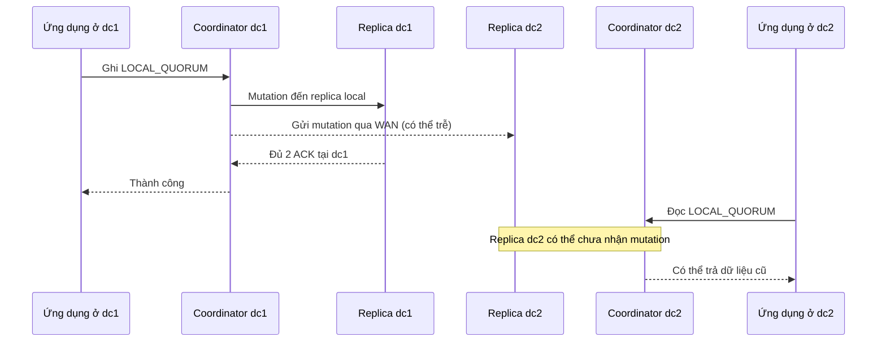

# Điều kiện giao nhau của quorum đọc/ghi và các giả định kèm theo

Trong Apache Cassandra, một cách chọn mức nhất quán thường gặp là ghi ở `QUORUM` và đọc ở `QUORUM`. Lý do nằm ở tính chất toán học đơn giản: **hai tập con đều chiếm đa số của cùng một tập replica thì bắt buộc có phần tử chung**. Viết tổng quát, với `N` replica, số xác nhận ghi `W` và số phản hồi đọc `R`, điều kiện

\[
R + W > N
\]

buộc tập replica đã xác nhận ghi và tập replica phản hồi đọc **giao nhau ít nhất một replica**. Nhưng để sử dụng kết quả này đúng trong Cassandra, cần làm rõ **replica nào được đếm**, **lần ghi đã thực sự thành công hay chưa**, **lúc nào đọc diễn ra**, và **Cassandra chọn phiên bản dữ liệu thế nào**. Giao nhau là tiền đề hữu ích để lập luận về độ mới của dữ liệu; bản thân nó **không phải lời hứa linearizability cho mọi thao tác**.

Bài học thuộc chương **Nhất quán đọc/ghi** của mô-đun `DATABASE_ENGINE_WIDE_COLUMN_CASSANDRA`. Trong chương trình tìm hiểu kiến trúc phân tán, mô hình wide-column, partition key, thiết kế bảng theo truy vấn, CQL, replication, compaction, repair, xử lý lỗi và tích hợp Java, đây là kiến thức quan trọng để chọn cặp consistency level đọc/ghi một cách có căn cứ.

## 1. Mục tiêu học tập

Sau bài này, bạn có thể:

1. Chứng minh tại sao `R + W > N` tạo giao nhau giữa tập phản hồi đọc và ghi.
2. Tính `R`, `W`, `N` từ replication factor (RF) và consistency level (CL).
3. Kiểm tra điều kiện giao nhau trong **một datacenter**, **nhiều datacenter**, với `QUORUM`, `LOCAL_QUORUM` và `EACH_QUORUM`.
4. Giải thích vì sao **đọc quorum tại DC khác** có thể thấy dữ liệu cũ sau một lần ghi local quorum.
5. Phân biệt **điều kiện giao nhau**, **khả năng đọc phiên bản mới**, **read-your-writes** và **linearizability**.
6. Vận dụng kết quả vào CQL, Java Driver, xử lý lỗi và tình huống thay đổi topology.

## 2. Xác định chính xác N, W và R

**Một partition** là đơn vị phân bố dữ liệu cơ bản của Cassandra. Partition key chọn partition; chiến lược replication và RF quyết định các node chứa replica của partition đó. Khi client gửi yêu cầu, một node đóng vai trò **coordinator** điều phối công việc tới các replica.

Giả sử partition `P` có ba replica đích:

```text
                           Coordinator
                         /      |      \
                       R1       R2      R3

                   Replica set S = {R1, R2, R3}
                           N = |S| = 3
```

Với một lần ghi thành công, gọi `A` là tập replica thực sự đã **ACK mutation**. Với lần đọc, gọi `B` là tập replica đã cung cấp các **phản hồi hợp lệ** được coordinator sử dụng để thỏa CL đọc.

- `N`: kích thước **cùng một tập replica đích `S`** đang xét, thông thường bằng RF trong một DC hoặc tổng RF trên các DC của partition.
- `W`: ngưỡng ACK replica mà lần ghi phải nhận; sau khi **ghi trả thành công**, ta có ít nhất `W` replica phù hợp đã xác nhận.
- `R`: ngưỡng phản hồi mà lần đọc phải nhận; sau khi **đọc trả thành công**, ta có ít nhất `R` replica phù hợp đã trả lời.

**Lưu ý:** `W` và `R` là ngưỡng, không phải số request mạng chính xác. Cassandra có thể gửi tới nhiều replica hơn ngưỡng do cơ chế điều phối, digest, speculative retry hoặc phục hồi. Khi phân tích điều kiện giao nhau, ta chỉ cần xét **những tập con nhỏ nhất vẫn đủ CL**: nếu chúng đã buộc giao nhau, tập phản hồi lớn hơn cũng sẽ giao nhau.

### Replica ACK khác coordinator và hint

Coordinator có thể **không phải replica** của partition. Nó không tự động được cộng vào `N` hoặc `W` chỉ vì đã nhận yêu cầu. Tương tự, **hinted handoff** không tạo thêm replica. Đặc biệt với `CL=ANY`, ghi có thể trả thành công do coordinator lưu **hint** khi không replica đích nào ACK; không được gán `W=1` từ một replica trong trường hợp này rồi áp dụng công thức giao nhau.

## 3. Chứng minh điều kiện giao nhau

Giả sử:

- `S` là tập `N` replica cố định.
- `A` là tập `W` replica đã ACK ghi, `A ⊆ S`.
- `B` là tập `R` replica đã phản hồi đọc, `B ⊆ S`.

Theo công thức cộng trừ số phần tử hai tập:

\[
|A \cup B| = |A| + |B| - |A \cap B|
\]

Do `A ∪ B ⊆ S`, nên `|A ∪ B| ≤ N`. Suy ra:

\[
|A \cap B| \ge R + W - N
\]

Vì thế, **nếu `R + W > N` thì `|A ∩ B| ≥ 1`**. Đây là điều kiện **đủ** để có ít nhất một replica chung, bất kể coordinator chọn replica nào trong cùng tập `S`.

Nếu `R + W ≤ N`, ta **không thể bảo đảm** có giao nhau chỉ từ số lượng. Hai tập có thể rời nhau; điều đó **không chứng minh** chắc chắn lần đọc sẽ cũ. Trong thực tế, nó vẫn có thể đọc bản mới nếu chọn đúng replica hoặc replication đã kịp lan truyền.

### Trực quan với RF = 3

```text
Replica:              R1      R2      R3

Ghi W=2:             [ACK]   [ACK]     .
Đọc R=2:               .     [READ]  [READ]
                               ^
             Giao nhau tại R2: 2 + 2 = 4 > 3

Ghi W=1:             [ACK]      .       .
Đọc R=2:               .     [READ]  [READ]

             Có thể rời nhau: 1 + 2 = 3 <= 3
```

### Một ví dụ tổng quát với RF = 5

Nếu ghi cần `W=3` và đọc cần `R=3`:

\[
R + W - N = 3 + 3 - 5 = 1
\]

Hai tập phải có **ít nhất một replica chung**. Nếu ghi cần `W=4` và đọc cần `R=3` thì phải có **ít nhất hai replica chung**, vì `4+3−5=2`. Phần giao không nhất thiết có đúng từng ấy replica; con số trên là **giới hạn tối thiểu**.

## 4. Áp dụng công thức cho các mức nhất quán trong một DC

Với một datacenter có `RF=N`:

| CL thông thường | Ngưỡng replica |
| --- | ---: |
| `ONE` | 1 |
| `TWO` | 2 |
| `THREE` | 3 |
| `QUORUM` | `⌊N/2⌋+1` |
| `ALL` | `N` |

**`QUORUM`** yêu cầu đa số:

\[
Q(N)=\left\lfloor\frac{N}{2}\right\rfloor+1
\]

Vì `Q(N) > N/2`, ta luôn có:

\[
Q(N)+Q(N)>N
\]

Đây là lý do một cặp **ghi `QUORUM` + đọc `QUORUM`** luôn có giao nhau nếu cả hai áp dụng cho **cùng tập replica**.

| RF `N` | Quorum `Q` | `Q+Q` | Có giao nhau? | Số replica có thể không phản hồi mà vẫn đạt mỗi quorum |
| ---: | ---: | ---: | --- | ---: |
| 1 | 1 | 2 > 1 | Có | 0 |
| 2 | 2 | 4 > 2 | Có | 0 |
| 3 | 2 | 4 > 3 | Có | 1 |
| 4 | 3 | 6 > 4 | Có | 1 |
| 5 | 3 | 6 > 5 | Có | 2 |
| 6 | 4 | 8 > 6 | Có | 2 |

**Giao nhau** và **khả dụng** là hai mục tiêu khác nhau. RF=2, quorum=2 vẫn có giao nhau nhưng không chịu được một replica không phản hồi. RF=5, quorum=3 có giao nhau đồng thời có thể chịu tối đa hai replica không phản hồi, nếu những replica còn lại hoạt động và trả lời đúng hạn.

### Không nhất thiết cả đọc và ghi đều phải là QUORUM

Với RF=3:

| CL ghi | W | CL đọc | R | `R+W` | Bắt buộc giao nhau? |
| --- | ---: | --- | ---: | ---: | --- |
| `ONE` | 1 | `ONE` | 1 | 2 | Không |
| `ONE` | 1 | `QUORUM` | 2 | 3 | Không |
| `QUORUM` | 2 | `ONE` | 1 | 3 | Không |
| `QUORUM` | 2 | `QUORUM` | 2 | 4 | **Có** |
| `ALL` | 3 | `ONE` | 1 | 4 | **Có** |
| `ONE` | 1 | `ALL` | 3 | 4 | **Có** |
| `TWO` | 2 | `THREE` | 3 | 5 | **Có** |

Ví dụ `W=ALL, R=ONE` có giao nhau trên lý thuyết, nhưng ghi `ALL` dễ thất bại khi một replica chậm. `W=ONE, R=ALL` cũng có giao nhau, nhưng lần đọc trở nên kém khả dụng. Đặt `QUORUM` cả hai chiều là lựa chọn cân bằng **trong số các lựa chọn phù hợp**, không phải quy tắc bắt buộc cho mọi workload.

### Khi tăng RF phải tính lại ngưỡng

`W=TWO, R=TWO` với RF=3 thỏa `2+2>3`. Nếu tăng RF lên 5 mà vẫn dùng `TWO` hai chiều, `2+2=4≤5`, **không còn bảo đảm giao nhau**. Tên mức nhất quán cố định không thay đổi theo RF, còn `QUORUM` tự động tăng ngưỡng với RF.

## 5. Nhiều datacenter: dùng đúng tập replica

Với `NetworkTopologyStrategy`, RF thường được khai báo cho từng datacenter. Giả sử:

```text
dc1: RF = 3       A1 A2 A3
dc2: RF = 3       B1 B2 B3

S_global = {A1, A2, A3, B1, B2, B3}
N_global = 6
S_dc1    = {A1, A2, A3}, N_dc1 = 3
S_dc2    = {B1, B2, B3}, N_dc2 = 3
```

**`QUORUM`** và **`LOCAL_QUORUM`** dùng những tập replica khác nhau:

- `QUORUM` toàn cluster cần `⌊6/2⌋+1 = 4` phản hồi từ **bất kỳ bốn replica phù hợp** trong toàn bộ sáu replica.
- `LOCAL_QUORUM` với coordinator ở `dc1` cần `⌊3/2⌋+1 = 2` phản hồi **chỉ từ dc1**.
- `LOCAL_QUORUM` với coordinator ở `dc2` cần **hai phản hồi chỉ từ dc2**.
- `EACH_QUORUM` cho **ghi thông thường** cần **2 ACK ở dc1 và 2 ACK ở dc2**; Apache Cassandra OSS **không hỗ trợ `EACH_QUORUM` cho đọc thông thường**.

### Tình huống A — QUORUM toàn cluster ở cả hai chiều

Ghi `QUORUM` đã được **bốn** replica bất kỳ trong sáu replica ACK. Đọc `QUORUM` nhận phản hồi từ **bốn** replica bất kỳ trong cùng sáu replica:

\[
W+R=4+4=8>6
\]

Có ít nhất `8−6=2` replica chung. Lý luận này không cần coordinator của hai lần request nằm cùng DC, **miễn là chúng đang sử dụng cùng tập replica của partition và thao tác đúng CL toàn cục**.

### Tình huống B — LOCAL_QUORUM ở cùng một DC

Ghi tại `dc1` với `LOCAL_QUORUM` cần hai ACK trong `S_dc1`. Đọc tại `dc1` bằng `LOCAL_QUORUM` cần hai phản hồi trong **cùng `S_dc1`**:

\[
W_{dc1}+R_{dc1}=2+2=4>3=N_{dc1}
\]

Hai tập cục bộ phải giao nhau. Các replica của `dc2` không cần được tính vào bất đẳng thức này.

### Tình huống C — LOCAL_QUORUM ghi dc1, đọc dc2

Ghi nhận hai ACK ở `dc1`; đọc nhận hai phản hồi ở `dc2`. Vì:

```text
Tập ACK ghi:      {A1, A2}  thuộc dc1
Tập phản hồi đọc: {B1, B2}  thuộc dc2

Giao nhau:        ∅
```

Hai tập **không giao nhau** dù mỗi tập đều là quorum của DC riêng. Mutation có thể chưa được truyền sang `dc2`. Do đó, lần đọc `LOCAL_QUORUM` tại `dc2` ngay sau ghi thành công ở `dc1` **có thể thấy dữ liệu cũ**.

Lỗi suy luận thường gặp là lấy `W=2` ở `dc1`, `R=2` ở `dc2` rồi so `W+R=4>3` với RF của một DC. Đây là phép tính **sai vì `W` và `R` thuộc hai tập replica khác nhau**.

### Tình huống D — QUORUM toàn cục kết hợp LOCAL_QUORUM

Ghi `QUORUM` cần `W=4` trên `N=6`; đọc `LOCAL_QUORUM` ở `dc1` cần `R=2` chỉ trong ba replica `dc1`. Ta có `4+2=6`, **không lớn hơn 6**, nên giao nhau **không chắc chắn**.

Ví dụ phản chứng:

```text
Ghi QUORUM:        {A1, B1, B2, B3}  -> 4 ACK
Đọc LOCAL_QUORUM:  {A2, A3}          -> 2 phản hồi

Hai tập rời nhau dù cả ghi và đọc đều đạt CL riêng.
```

Tương tự, ghi `LOCAL_QUORUM` tại `dc1` (W=2) và đọc `QUORUM` toàn cục (R=4) **không được bảo đảm giao nhau** chỉ dựa vào tên hai mức này.

### Tình huống E — EACH_QUORUM ghi, LOCAL_QUORUM đọc

Ghi `EACH_QUORUM` với RF=`3+3` thành công khi **ít nhất hai replica ở mỗi DC** đã ACK. Đọc `LOCAL_QUORUM` trong **bất kỳ một DC** cần hai phản hồi trong DC đó.

Tại DC nơi đọc:

\[
W_{dc}=2,\quad R_{dc}=2,\quad N_{dc}=3,\quad 2+2>3
\]

Vì vậy có giao nhau **trong DC nơi đọc**. Đây là lợi ích của ghi `EACH_QUORUM` nếu nghiệp vụ muốn nhận ACK quorum ở mỗi vùng trước khi trả thành công. Đổi lại, ghi phải chờ nhiều DC và dễ bị ảnh hưởng bởi lỗi đường truyền liên DC.

### Sơ đồ đường đọc/ghi chéo DC



Sơ đồ minh họa **khả năng** xảy ra đọc cũ, không khẳng định mọi lần đọc chéo DC đều cũ. Cassandra vẫn nỗ lực đưa mutation tới các replica và thường đồng bộ nhanh khi mạng khỏe.

## 6. Các giả định phải đúng trước khi rút ra kết luận về dữ liệu mới

Điều kiện `R + W > N` là một **định lý tập hợp**; dùng nó để đánh giá kết quả đọc Cassandra đòi hỏi thêm một số giả định.

### Giả định 1 — Cùng partition, cùng tập replica

Hai thao tác phải nói đến **cùng một dữ liệu/partition**, có cùng cách định danh replica liên quan. Không dùng RF của bảng này cho một keyspace khác, hoặc RF của `dc1` để chứng minh tập đọc ở `dc2`.

Khi cluster đang **bootstrap, decommission, replace node, thay đổi RF hoặc chuyển token**, tập replica có thể thay đổi. Chứng minh với một tập `S` cố định không tự áp dụng cho hai thời điểm mà tập replica hoặc topology đã khác. Cần xem tài liệu/vận hành theo phiên bản và xác minh topology ổn định trước khi suy luận theo cách đơn giản.

### Giả định 2 — Ghi đã được xác nhận với đủ replica

`W` phải biểu thị **những ACK từ replica đích được yêu cầu bởi CL ghi**, sau khi coordinator trả về **thành công**. Nếu client nhận `WriteTimeout` hoặc `Unavailable`, không thể xem như đã chắc chắn có `W` ACK, dù một số replica có thể đã nhận mutation.

**Đặc biệt:** Ghi `ANY` có thể thành công chỉ do coordinator lưu hint, mà không có replica đích nào ACK. Khi đó không thể dùng `W=1` giả định để chứng minh giao nhau với một lần đọc.

### Giả định 3 — Đọc được thực hiện sau khi ghi hoàn tất

Để bàn về **đọc thấy lần ghi vừa xác nhận**, request đọc cần bắt đầu **sau** khi lần ghi đó được xác nhận. Nếu đọc và ghi chồng thời gian, đọc có thể quan sát trạng thái trước hay sau khi ghi, ngay cả khi hai tập replica giao nhau.

Xét lịch sự kiện:

```text
Không chồng lấn:
  write gửi ---- write ACK ---- read bắt đầu ---- read hoàn tất
                  ^
        Dùng W của ghi đã thành công

Có chồng lấn:
  write gửi --------------------- write ACK
             read gửi ------ read hoàn tất
  Không thể suy chắc read phải thấy mutation mới.
```

### Giả định 4 — Không có ghi cạnh tranh làm thay đổi kết quả

Cassandra thường hòa giải giá trị theo **timestamp (last-write-wins)**, không theo “lần ACK cuối”. Nếu hai client ghi cùng cell với timestamp cạnh tranh, giá trị có timestamp lớn hơn có thể thắng, kể cả lần ghi đó bắt đầu sớm hơn theo đồng hồ thực. Đồng hồ lệch giữa client/node hoặc timestamp do ứng dụng cung cấp có thể làm thay đổi kết quả mong đợi.

Ví dụ:

```text
Ghi A (thời gian thực 10:00:00): value="new", timestamp=100
Ghi B (thời gian thực 09:59:59): value="old", timestamp=200

Nếu B vẫn là bản có timestamp thắng, read quorum có thể thấy "old".
Giao nhau không thể thay quy tắc hòa giải timestamp của Cassandra.
```

Do vậy, giao nhau giúp **ít nhất một replica mang thông tin ghi đã xác nhận** xuất hiện trong quá trình đọc dưới giả định phù hợp, nhưng không chứng minh giá trị đó là **giá trị cuối cùng theo thời gian thực** trong mọi tình huống concurrency.

### Giả định 5 — Đường đọc hòa giải phản hồi đúng và hoàn tất

Cassandra có thể đọc **dữ liệu đầy đủ** từ một replica, nhận **digest** từ replica khác rồi so sánh. Khi phát hiện khác biệt, coordinator có thể lấy thêm dữ liệu và hòa giải để trả kết quả thích hợp. Vì thế, **“đọc từ R replica” không nhất thiết là R lần tải toàn bộ dòng dữ liệu**.

Một replica trong phần giao **không bắt buộc là replica mà client trực tiếp nhìn thấy nội dung raw**; kết quả được coordinator xử lý theo ngữ nghĩa đọc. Nếu đường đọc bị timeout hoặc không hoàn tất reconciliation, client không thể dựa vào một lần đọc thất bại để khẳng định đã quan sát giá trị mới.

### Giả định 6 — Không suy tính giao nhau thành transaction/linearizability

Quorum là cơ chế **tunable consistency** cho yêu cầu thông thường, không tự tạo một thứ tự toàn cục cho nhiều client cùng ghi và cũng không cung cấp transaction nguyên tử qua nhiều partition.

- **Read-your-writes:** Với cùng partition, cùng tập replica, ghi đã hoàn tất và không có ghi cạnh tranh/timestamp bất thường, cặp CL có giao nhau giúp đưa ra kỳ vọng đọc lại giá trị vừa ghi. Nhưng chỉ `ONE`/`ONE` không có bảo đảm đó.
- **Monotonic reads:** Liệu các lần đọc liên tiếp có nhìn thấy giá trị “đi lùi” hay không còn phụ thuộc vào CL, cách reconciliation, cấu hình và hành vi read repair của phiên bản Cassandra.
- **Linearizability:** Cần ngữ nghĩa mạnh hơn việc hai tập replica giao nhau; không suy từ `R + W > N` rằng mọi thao tác đọc/ghi thường là linearizable.
- **Ghi có điều kiện:** `INSERT ... IF NOT EXISTS` và `UPDATE ... IF` sử dụng **lightweight transaction (LWT)/Paxos**. `SERIAL`/`LOCAL_SERIAL` là mức serial consistency riêng, không phải phép cộng `R+W` của ghi thường.

### Giả định 7 — Không nhầm CL với độ bền vững hoặc repair

Quorum xác nhận sự tham gia của một số replica vào thao tác, không chứng minh **mọi bản sao** đã đồng bộ vĩnh viễn. Các replica còn thiếu dữ liệu có thể bắt kịp qua đường ghi tiếp theo, hinted handoff hoặc anti-entropy repair. **Compaction** tối ưu/làm sạch SSTable và xử lý tombstone theo quy tắc, **không thay thế repair**.

Đặc biệt với xóa dữ liệu và tombstone, việc một replica bị bỏ lỡ deletion trong thời gian dài cùng các vấn đề repair/`gc_grace_seconds` có thể gây dữ liệu đã xóa xuất hiện lại. Phép toán giao nhau không giải quyết toàn bộ vòng đời dữ liệu.

## 7. Có giao nhau chắc chắn không? Bài toán RF không cân bằng

Một cấu hình thực tế có thể dùng:

```text
dc1: RF = 3
dc2: RF = 2
Tổng RF N = 5
```

Tính ngưỡng:

| Mức | Ngưỡng yêu cầu |
| --- | --- |
| `QUORUM` toàn cluster | `⌊5/2⌋+1 = 3` từ tổng năm replica |
| `LOCAL_QUORUM` tại dc1 | `⌊3/2⌋+1 = 2` ở dc1 |
| `LOCAL_QUORUM` tại dc2 | `⌊2/2⌋+1 = 2` ở dc2 |
| `EACH_QUORUM` ghi | `2 ở dc1 và 2 ở dc2` |

Một số cặp ví dụ:

| CL ghi | CL đọc | Kết luận về giao nhau |
| --- | --- | --- |
| `QUORUM` toàn cluster (3/5) | `QUORUM` toàn cluster (3/5) | **Có:** `3+3>5`. |
| `LOCAL_QUORUM` ở dc1 (2/3) | `LOCAL_QUORUM` cũng ở dc1 (2/3) | **Có:** `2+2>3` trong dc1. |
| `LOCAL_QUORUM` ở dc1 (2/3) | `LOCAL_QUORUM` ở dc2 (2/2) | **Không chắc:** hai tập khác DC. |
| `EACH_QUORUM` ghi (2+2) | `LOCAL_QUORUM` tại dc2 (2/2) | **Có:** trong dc2, cả hai replica đã ACK ghi. |
| `QUORUM` toàn cluster (3/5) | `LOCAL_QUORUM` tại dc1 (2/3) | **Không chắc:** có thể ghi 1 ở dc1 + 2 ở dc2, đọc 2 replica còn lại của dc1. |

**Phương pháp an toàn với các CL pha trộn:** Vẽ tập replica và mọi phân bố ACK có thể thỏa từng CL; kiểm tra xem **mọi** cặp phân bố ghi/đọc hợp lệ có chung replica không. Chỉ cộng `R+W>N` sau khi chắc chắn chúng đếm **cùng một tập** và các ngưỡng đó mô tả đúng tập phản hồi.

## 8. Thực hành CQL: thiết kế theo truy vấn và chọn CL

Giả sử có môi trường thử nghiệm với một datacenter thực tế tên `dc1` và ít nhất ba node phù hợp. Tạo keyspace RF=3 và bảng truy vấn theo `order_id`:

```sql
CREATE KEYSPACE IF NOT EXISTS consistency_lab
WITH replication = {
  'class': 'NetworkTopologyStrategy',
  'dc1': 3
};

CREATE TABLE IF NOT EXISTS consistency_lab.order_by_id (
  order_id uuid PRIMARY KEY,
  order_status text,
  updated_at timestamp
);
```

`order_id` là partition key, nên một lần đọc theo `order_id` nhắm tới **cùng partition** mà lần ghi cập nhật. `RF=3` tạo tập ba replica đích, còn CL của từng yêu cầu được chọn khi chạy:

```sql
-- Ghi cần 2/3 replica ACK.
CONSISTENCY QUORUM;

INSERT INTO consistency_lab.order_by_id
    (order_id, order_status, updated_at)
VALUES (
    11111111-1111-4111-8111-111111111111,
    'CREATED',
    '2026-11-21 02:00:00+0000'
);

-- Đọc cần 2/3 phản hồi; 2+2>3 nên quorum có giao nhau.
CONSISTENCY QUORUM;

SELECT order_status, updated_at
FROM consistency_lab.order_by_id
WHERE order_id = 11111111-1111-4111-8111-111111111111;

-- Để đối chiếu: đọc ONE không có bảo đảm giao nhau với ghi QUORUM.
CONSISTENCY ONE;

SELECT order_status, updated_at
FROM consistency_lab.order_by_id
WHERE order_id = 11111111-1111-4111-8111-111111111111;
```

Trong `cqlsh`, `CONSISTENCY` là lệnh **đổi CL của phiên shell** cho các câu lệnh sau đó, không phải phần của ngữ pháp `SELECT` hay `INSERT` chuẩn. Với cụm khỏe mạnh, cả `ONE` và `QUORUM` thường đều đọc được giá trị mới do replication diễn ra nhanh; **một lần thử không xuất hiện đọc cũ không chứng minh có bảo đảm giao nhau**.

Nếu muốn kiểm tra tình huống một replica chậm hoặc ngừng hoạt động, chỉ dùng **lab có topology xác định rõ**. Cần biết partition đang được đặt ở đâu, vì không phải dừng bất kỳ node nào cũng tác động đến partition đó. Không dùng dữ liệu production cho thử nghiệm gián đoạn dịch vụ.

## 9. Thực hành với Java Driver 4.x

Ví dụ dùng `CqlSession` đã được cấu hình contact points, local DC và xác thực phù hợp. Hai `PreparedStatement` được chuẩn bị một lần để tái sử dụng:

```java
import com.datastax.oss.driver.api.core.CqlSession;
import com.datastax.oss.driver.api.core.DefaultConsistencyLevel;
import com.datastax.oss.driver.api.core.cql.BoundStatement;
import com.datastax.oss.driver.api.core.cql.PreparedStatement;
import com.datastax.oss.driver.api.core.cql.Row;

import java.time.Instant;
import java.util.UUID;

public final class OrderRepository {
    private final CqlSession session;
    private final PreparedStatement writeQuery;
    private final PreparedStatement readQuery;

    public OrderRepository(CqlSession session) {
        this.session = session;
        this.writeQuery = session.prepare(
            "UPDATE consistency_lab.order_by_id " +
            "SET order_status = ?, updated_at = ? WHERE order_id = ?");
        this.readQuery = session.prepare(
            "SELECT order_status FROM consistency_lab.order_by_id " +
            "WHERE order_id = ?");
    }

    public void changeStatus(UUID orderId, String status) {
        BoundStatement write = writeQuery
            .bind(status, Instant.now(), orderId)
            .setConsistencyLevel(DefaultConsistencyLevel.LOCAL_QUORUM);

        session.execute(write); // Với RF local=3: đợi ít nhất 2 ACK local.
    }

    public String readStatus(UUID orderId) {
        BoundStatement read = readQuery
            .bind(orderId)
            .setConsistencyLevel(DefaultConsistencyLevel.LOCAL_QUORUM);

        Row row = session.execute(read).one();
        return row == null ? null : row.getString("order_status");
    }
}
```

Nếu ghi đã trả về thành công và đọc sau đó qua coordinator **cùng DC** với RF local=3, hai tập local quorum có giao nhau theo `2+2>3`. Giả định không có ghi cạnh tranh và timestamp phù hợp, đây là cơ sở để ứng dụng kỳ vọng đọc lại trạng thái vừa ghi.

**Không nên** xem ví dụ này là giao thức “transaction đơn hàng” an toàn trước nhiều tác nhân cập nhật đồng thời. Nếu nghiệp vụ cần chuyển trạng thái có điều kiện, ví dụ chỉ chuyển `CREATED` thành `PAID` một lần, hãy cân nhắc `UPDATE ... IF order_status = 'CREATED'` (LWT) và kiểm soát kết quả `[applied]`.

### Timeout và retry

Nếu `session.execute(write)` ném `WriteTimeoutException`, ta không biết chắc số replica thực tế đã áp dụng mutation — có thể một vài replica đã ghi, nhưng coordinator **không xác nhận thành công với CL đã chọn**. Không được ghi nhận `W=2` chỉ từ việc lệnh đã được gửi.

Khi retry, dùng thiết kế **idempotent** nơi phù hợp, giữ ổn định partition key, chú ý timestamp, counter và tác dụng phụ ngoài Cassandra. Cấu hình retry của Java Driver cần phản ánh tính chất request; tăng retry vô hạn có thể làm cluster quá tải.

## 10. Bài tập tự kiểm tra

### Bài 1 — Chứng minh giao nhau

Một partition có `N=7` replica; lần ghi nhận `W=4` ACK, lần đọc có `R=4` phản hồi. Ít nhất bao nhiêu replica chung?

**Đáp án:** `R+W−N=4+4−7=1`, nên **ít nhất một replica chung**.

### Bài 2 — Không đạt điều kiện có chắc đọc cũ?

RF=3, ghi `ONE` và đọc `QUORUM`. `R+W=1+2=3`. Có chắc lần đọc trả dữ liệu cũ?

**Đáp án:** **Không.** Điều kiện giao nhau không được bảo đảm nhưng dữ liệu có thể đã lan tới replica được đọc. Ta chỉ biết **có khả năng** tập ACK ghi và phản hồi đọc rời nhau.

### Bài 3 — Tăng RF nhưng giữ CL cố định

RF tăng từ 3 lên 5. Ứng dụng vẫn ghi và đọc ở `TWO`. Cặp CL này còn bảo đảm giao nhau không?

**Đáp án:** Không. `2+2=4≤5`; với RF=5 cần cân nhắc `QUORUM` (3 ACK mỗi chiều) hoặc cặp khác có tổng lớn hơn 5.

### Bài 4 — QUORUM toàn cluster

Hai DC có RF=3+3. Ghi và đọc đều dùng `QUORUM`. Ngưỡng mỗi thao tác là bao nhiêu và ít nhất mấy replica giao nhau?

**Đáp án:** Tổng RF=6; quorum cần `4` phản hồi mỗi chiều. Phần giao ít nhất `4+4−6=2` replica.

### Bài 5 — Local ở hai DC khác nhau

Ghi `LOCAL_QUORUM` ở `dc1` RF=3, rồi đọc `LOCAL_QUORUM` ở `dc2` RF=3. Có thể áp dụng `2+2>3` để bảo đảm đọc mới không?

**Đáp án:** Không. Tập ghi chỉ ở `dc1`, tập đọc chỉ ở `dc2`, chúng rời nhau về mặt vị trí replica. Dữ liệu có thể chưa truyền tới `dc2`.

### Bài 6 — EACH_QUORUM kết hợp LOCAL_QUORUM

RF=3+3. Ghi `EACH_QUORUM` thành công, đọc `LOCAL_QUORUM` tại `dc2`. Có giao nhau không?

**Đáp án:** Có. Ghi đã có ít nhất hai ACK trong `dc2`, đọc cần hai phản hồi trong chính `dc2`; `2+2>3`.

### Bài 7 — Ghi ANY và đọc ALL

RF=3. Ghi `ANY` trả thành công **chỉ nhờ hint**, rồi đọc `ALL`. Có thể nói `W=1, R=3` và bảo đảm thấy mutation mới không?

**Đáp án:** Không. Hint không phải ACK của replica đích. `ANY` có thể thành công dù `W=0` replica đã nhận mutation; đọc `ALL` trước khi hint được phát lại có thể vẫn không thấy dữ liệu mới.

### Bài 8 — Timeout và ghi đồng thời

Ghi `QUORUM` bị `WriteTimeout`. Một client khác ghi cùng cell với timestamp cao hơn; sau đó lần đọc `QUORUM` trả phiên bản của client thứ hai. Điều này có vi phạm công thức giao nhau không?

**Đáp án:** Không. Lần ghi đầu **không được xác nhận đã đạt W**, đồng thời có **ghi cạnh tranh** được hòa giải theo timestamp. Công thức tập hợp không hứa trả về giá trị của mutation đầu trong trường hợp này.

### Bài 9 — QUORUM và LOCAL_QUORUM pha trộn

RF=3+3. Ghi `QUORUM` lấy ACK từ `A1,B1,B2,B3`, rồi đọc `LOCAL_QUORUM` ở dc1 từ `A2,A3`. Hai thao tác có đạt CL riêng không? Có giao nhau không?

**Đáp án:** Cả hai đều đạt CL riêng (`4/6` và `2/3`), nhưng tập replica **không giao nhau**. Vì vậy không thể dùng riêng tên “quorum” để kết luận luôn đọc thấy bản ghi mới.

## 11. Danh sách kiểm tra trước khi chọn cặp CL

Khi đánh giá một đường đọc/ghi Cassandra, hãy trả lời lần lượt:

1. **Partition nào?** Hai thao tác có cùng partition key và cùng keyspace/replication strategy không?
2. **Replica ở đâu?** RF từng DC là bao nhiêu, topology có đang ổn định không?
3. **Coordinator ở DC nào?** `LOCAL_QUORUM` phải được tính trong DC của coordinator.
4. **W và R là bao nhiêu?** Ngưỡng của `QUORUM`, `LOCAL_QUORUM` hay `EACH_QUORUM` có áp dụng đúng loại thao tác không?
5. **Hai tập có cùng phạm vi?** Chỉ dùng `R+W>N` trực tiếp khi cùng `S`; nếu CL pha trộn, xét các phân bố ACK có thể.
6. **Ghi đã thành công chưa?** Timeout/Unavailable không phải một xác nhận rằng đã đạt `W`.
7. **Có ghi đồng thời hoặc timestamp bất thường không?** Giao nhau không loại bỏ xung đột last-write-wins.
8. **Ứng dụng cần điều gì?** Đọc lại sau ghi, chấp nhận đọc cũ, cập nhật có điều kiện hay bảo đảm giao dịch là các yêu cầu khác nhau.

## 12. Kết luận

**`R+W>N` là điều kiện đủ về mặt tập hợp**: khi `R` và `W` được đếm trên **cùng `N` replica**, một lần ghi đã được xác nhận và một lần đọc thành công bắt buộc có ít nhất một replica chung. Với RF=3, cặp `QUORUM`/`QUORUM` yêu cầu `2+2>3`; với RF=5, cặp này yêu cầu `3+3>5`.

Muốn suy luận đúng về Cassandra, cần kiểm tra thêm **phạm vi DC, thứ tự thời gian giữa ghi và đọc, ghi cạnh tranh, timestamp, reconciliation, trạng thái thành công của request và topology**. `LOCAL_QUORUM` ở hai DC khác nhau có thể không giao nhau; `ANY` thành công nhờ hint không tạo ACK từ replica; `QUORUM` không tự thay thế LWT hoặc quy trình repair. Hiểu rõ các giả định này giúp ứng dụng Java chọn được cặp CL đáp ứng nhu cầu thực tế thay vì dựa vào tên mức nhất quán.

### Tài liệu đọc thêm

- [Apache Cassandra — Dynamo: Tunable Consistency](https://cassandra.apache.org/doc/stable/cassandra/architecture/dynamo.html): replica, read/write consistency và quorum.
- [Apache Cassandra — Data Replication](https://cassandra.apache.org/doc/stable/cassandra/architecture/dynamo.html#replication): RF và phạm vi datacenter.
- [Apache Cassandra — Lightweight Transactions](https://cassandra.apache.org/doc/stable/cassandra/developing/cql/dml.html): điều kiện ghi và lý do LWT khác ghi thường.
