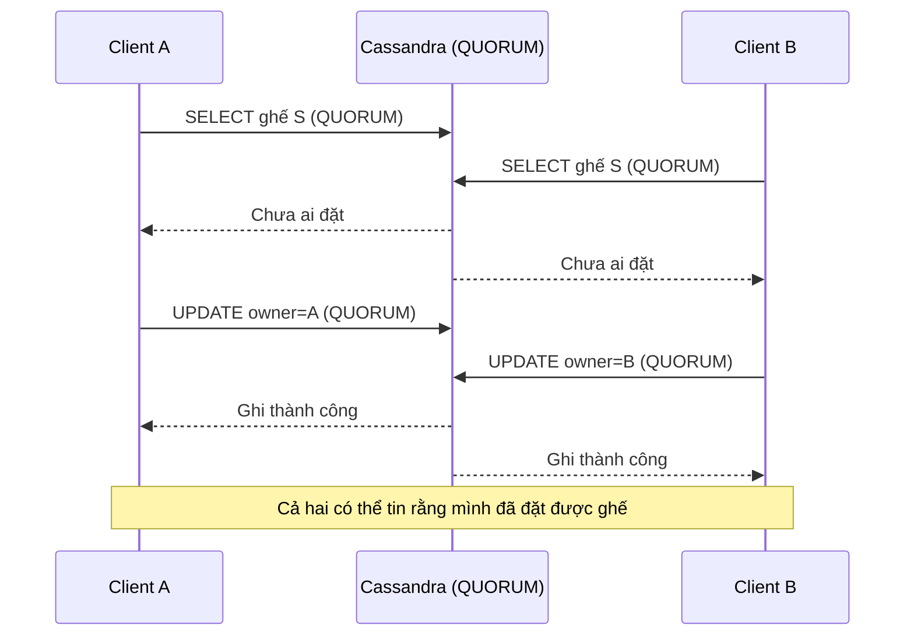

# Phân biệt giao nhau quorum với bảo đảm tuyến tính hóa mọi cập nhật đồng thời

Trong Apache Cassandra, người học thường gặp công thức **`R + W > N`**: số phản hồi đọc `R` cộng số xác nhận ghi `W` lớn hơn số replica `N`. Công thức này chứng minh **tập replica đã xác nhận ghi và tập replica phản hồi đọc có ít nhất một phần tử chung**, nếu cả hai thao tác xét trên **cùng tập replica**. Tuy nhiên, **quorum giao nhau không tự biến mọi cập nhật đồng thời thành các thao tác có thứ tự tuyến tính hóa (linearizable)**.

Sự phân biệt này quan trọng khi thiết kế nghiệp vụ như đặt chỗ duy nhất, chuyển trạng thái đơn hàng, trừ số lượng tồn kho hoặc cập nhật phiên bản dữ liệu. Đọc và ghi `QUORUM` có thể rất hữu ích cho tính nhất quán trong những điều kiện thích hợp, nhưng Cassandra vẫn phải xử lý **timestamp, ghi cạnh tranh, retry và các quy tắc hòa giải xung đột**. Những yêu cầu cập nhật có điều kiện cần một cơ chế khác, thường là **lightweight transaction (LWT)** sử dụng Paxos.

Bài thuộc chương **Nhất quán đọc/ghi** trong mô-đun `DATABASE_ENGINE_WIDE_COLUMN_CASSANDRA`. Mô-đun bao quát kiến trúc phân tán và mô hình wide-column của Cassandra, partition key, thiết kế bảng theo truy vấn, CQL, replication, compaction, repair, xử lý lỗi và tích hợp ứng dụng Java. Ở đây, ta tập trung vào **sự khác nhau giữa phép toán tập hợp của quorum và bảo đảm thứ tự thực thi khi nhiều client cập nhật đồng thời**.

## 1. Mục tiêu học tập

Sau bài học, bạn có thể:

1. Giải thích và chứng minh ngắn gọn điều kiện giao nhau `R + W > N`.
2. Phân biệt **quorum intersection**, **đọc thấy ghi vừa thành công**, **linearizability** và **cập nhật nguyên tử có điều kiện**.
3. Chỉ ra những giả định cần có khi suy luận về dữ liệu mới trong Cassandra.
4. Mô tả phản ví dụ timestamp/last-write-wins khiến ghi `QUORUM` thành công nhưng không thực hiện được ngữ nghĩa “ghi cuối theo thời gian thực”.
5. Giải thích vì sao luồng “`SELECT` kiểm tra rồi `INSERT`/`UPDATE`” có thể bị race condition dù hai truy vấn dùng quorum.
6. Sử dụng `IF NOT EXISTS`, `UPDATE ... IF ...` và serial consistency với LWT khi cần kiểm soát cạnh tranh trên một partition.
7. Thiết kế xử lý timeout/retry an toàn từ Java Driver và phân biệt phạm vi một DC với nhiều DC.

## 2. Ba khái niệm thường bị đánh đồng

Giả sử Cassandra có một partition được nhân bản trên ba node `R1`, `R2`, `R3`. Ứng dụng ghi với `QUORUM` và đọc với `QUORUM`. Mỗi thao tác cần hai phản hồi từ ba replica.

| Khái niệm | Câu hỏi cần trả lời | Điều nó thực sự bảo đảm |
| --- | --- | --- |
| **Quorum intersection (giao nhau)** | Tập node xác nhận ghi và tập node phản hồi đọc có chung node không? | Nếu cùng tập `N` và `R + W > N`, **chắc chắn có ít nhất một replica chung**. |
| **Đọc thấy lần ghi đã xác nhận** | `SELECT` sau `UPDATE` có thể thấy giá trị mới vừa ghi không? | Cần xét ghi thành công, cùng tập replica, thứ tự thao tác, reconciliation và không có xung đột/timestamp làm thay đổi kết quả. |
| **Linearizability (tuyến tính hóa)** | Có thể giải thích mọi thao tác như xảy ra tức thời theo một thứ tự duy nhất, **tôn trọng thứ tự thực tế của những thao tác không chồng lấn** không? | Đây là bảo đảm mạnh hơn giao nhau; không suy ra chỉ từ `R + W > N`. |

**Ví dụ trực giác:** Hai thư viện cùng giữ bản sao của một cuốn sổ. Nếu nhóm “đã xác nhận ghi” và nhóm “được hỏi khi đọc” đều là đa số, chắc chắn có **ít nhất một thư viện nằm trong cả hai nhóm**. Nhưng điều đó **không quyết định** ghi của khách A hay khách B có hiệu lực cuối cùng khi cả hai cập nhật cùng một ô; vẫn phải có **quy tắc chọn phiên bản**.

## 3. Chứng minh giao nhau của quorum

Gọi:

- `S`: tập replica của cùng partition, có `N = |S|` phần tử;
- `A`: tập replica ACK cho **một lần ghi đã thành công**, với `|A| ≥ W`;
- `B`: tập replica cung cấp phản hồi cho **một lần đọc đã thành công**, với `|B| ≥ R`.

Theo công thức tập hợp:

\[
|A \cap B| = |A| + |B| - |A \cup B|
\]

Vì `A ∪ B ⊆ S`, suy ra:

\[
|A \cap B| \ge R + W - N
\]

Do đó, nếu **`R + W > N`**, hai tập phải có **ít nhất một phần tử chung**.

### Minh họa RF = 3

```text
Replica:                  R1        R2        R3

Ghi W = 2:              [ACK]     [ACK]        .
Đọc R = 2:                .      [READ]     [READ]
                                    ^
                             Giao nhau tại R2

W + R = 2 + 2 = 4 > 3
```

Với `RF = 3`, quorum là `floor(3/2)+1 = 2`. Chọn `QUORUM` cho cả ghi và đọc khiến tập xác nhận ghi và tập phản hồi đọc giao nhau. Với `RF = 5`, quorum là `3`, và `3+3>5` vẫn đảm bảo giao nhau.

**Nhưng đây là định lý về vị trí replica, chưa phải định lý về thứ tự các giá trị dữ liệu.** Một replica chung không chứng minh nó giữ giá trị có ý nghĩa “mới nhất” theo thời gian thực, nếu có mutation khác với timestamp cao hơn hoặc có ghi cạnh tranh.

### Khi không đạt `R + W > N`

Nếu `R + W ≤ N`, hai tập **có thể** rời nhau; không có nghĩa chắc chắn lần đọc trả dữ liệu cũ. Ví dụ ghi `ONE` và đọc `QUORUM` tại RF=3 có `1+2=3`: Cassandra vẫn có thể đã kịp lan mutation sang replica được đọc. Ta chỉ mất **bảo đảm giao nhau theo số lượng**.

## 4. Linearizability thực sự yêu cầu điều gì?

Một lịch sử các thao tác được gọi là **linearizable** nếu có thể sắp xếp chúng thành một chuỗi thao tác đúng theo đặc tả của đối tượng dữ liệu, sao cho:

1. Mỗi thao tác có thể coi như có một **điểm hiệu lực** nằm giữa lúc bắt đầu và lúc trả kết quả.
2. Nếu thao tác `A` đã **hoàn tất trước khi** thao tác `B` **bắt đầu**, thứ tự trong chuỗi phải đặt `A` **trước `B`**.
3. Với các thao tác **chồng lấn thời gian**, hệ thống có thể chọn một thứ tự hợp lệ, nhưng thứ tự đó phải nhất quán với các kết quả mà client quan sát.

Ví dụ một thanh ghi chỉ lưu một chuỗi, ban đầu là `"initial"`:

```text
Thời gian thực ---->

Client A:  write("A") ---- ACK
Client B:                        write("B") ---- ACK
Client C:                                               read() --> ?

Nếu cả hai write đã thành công, không có write khác,
và write("B") bắt đầu sau khi write("A") hoàn tất:
  Một thanh ghi linearizable phải cho read() thấy "B".
```

**Ghi chú:** Linearizability không đồng nghĩa đơn giản với “mọi replica trả về cùng dữ liệu cùng lúc”. Nó là yêu cầu về **hành vi quan sát được của thao tác**, xét cả thứ tự thực tế của lời gọi và phản hồi.

### Một chiều so sánh

| Tính chất | Giao nhau quorum | Linearizability |
| --- | --- | --- |
| Đối tượng lập luận | Hai tập **replica** phản hồi. | Một **lịch sử thao tác** và thứ tự quan sát của client. |
| Cần biết thời gian bắt đầu/kết thúc thao tác? | Không, chứng minh tập hợp là tĩnh. | **Có**, để bảo toàn quan hệ trước/sau của thao tác không chồng lấn. |
| Tự quy định giá trị thắng khi có ghi cạnh tranh? | Không. | Mọi kết quả phải phù hợp một thứ tự hợp lệ của đối tượng. |
| `R + W > N` có đủ để suy ra? | Có, nếu cùng tập replica. | **Không.** |
| Phạm vi giao dịch | Một tập replica của partition. | Phụ thuộc đối tượng và giao thức cung cấp bảo đảm; không mặc nhiên có trên nhiều partition. |

## 5. Phản ví dụ chắc chắn: timestamp đảo thứ tự ghi trong thực tế

Cassandra dùng **timestamp** để hòa giải các giá trị cạnh tranh cho cùng cell, thường theo quy tắc **last-write-wins theo timestamp**, không dựa thuần túy vào thời gian phản hồi `ACK` của client.

Xét một partition có RF=3; cả đọc và ghi đều dùng `QUORUM`. Hai client thực hiện hai lệnh tuần tự, **không chồng lấn**:

```text
Thời gian thực ------------------------------------------->

Client A: UPDATE value='A', timestamp=200 -------- ACK
Client B:                                      UPDATE value='B',
                                               timestamp=100 ---- ACK
Client C:                                                       SELECT QUORUM
                                                                    -> 'A'

A hoàn tất trước khi B bắt đầu; cả A và B được ACK ở QUORUM.
Tuy vậy giá trị A có timestamp cao hơn B, nên A thắng khi hòa giải.
```

**Giải thích:**

1. Ghi `A` có timestamp 200, được ít nhất hai replica xác nhận.
2. Sau đó ghi `B` có timestamp 100, cũng được ít nhất hai replica xác nhận.
3. Khi Cassandra hòa giải hai mutation cho cùng cell, mutation của `A` có timestamp cao hơn và được ưu tiên.
4. Đọc `QUORUM` về sau có thể trả `A`. Điều kiện giao nhau đã được thỏa cho cả hai lần ghi, nhưng kết quả **không biểu diễn được một thanh ghi last-write theo thứ tự thực tế** nếu ta coi lần ghi `B` thành công phải thay giá trị `A`.

**Bài học:** `QUORUM` xác nhận mutation đã đạt đủ replica; nó không tự thay thế quy tắc về **thứ tự cập nhật hợp lệ**. Trong thực tế, vấn đề có thể đến từ:

- Client chỉ định `USING TIMESTAMP` khác nhau;
- clock của các node hoặc dịch vụ ghi bị lệch;
- hai client gửi update gần như đồng thời;
- retry giữ timestamp hoặc ứng dụng xử lý lại một mutation cũ.

Khi timestamp bằng nhau, Cassandra còn có cơ chế tie-break riêng; đừng giả định “request nào đến sau thì thắng”.

### Thử phản ví dụ bằng CQL

Trên **môi trường lab một DC** tên `dc1` có đủ ba replica, tạo keyspace và bảng:

```sql
CREATE KEYSPACE IF NOT EXISTS consistency_demo
WITH replication = {
  'class': 'NetworkTopologyStrategy',
  'dc1': 3
};

CREATE TABLE IF NOT EXISTS consistency_demo.profile_by_id (
  profile_id uuid PRIMARY KEY,
  display_name text
);
```

Đặt CL `QUORUM` rồi cố ý ghi **timestamp lớn trước**, **timestamp nhỏ sau**:

```sql
CONSISTENCY QUORUM;

INSERT INTO consistency_demo.profile_by_id
  (profile_id, display_name)
VALUES (
  11111111-1111-4111-8111-111111111111,
  'A'
) USING TIMESTAMP 2000000;

UPDATE consistency_demo.profile_by_id
USING TIMESTAMP 1000000
SET display_name = 'B'
WHERE profile_id = 11111111-1111-4111-8111-111111111111;

SELECT display_name
FROM consistency_demo.profile_by_id
WHERE profile_id = 11111111-1111-4111-8111-111111111111;
```

Trong một lab không có dữ liệu cạnh tranh khác và các thao tác hoàn tất, giá trị được chọn theo timestamp là **`A`**, dù lệnh `UPDATE ... 'B'` được gửi sau. `USING TIMESTAMP` nhận đơn vị **microsecond**; hai giá trị nhỏ trong ví dụ được chọn chỉ để dễ quan sát, không phải mẫu timestamp nên dùng ở production.

**Không chạy minh họa timestamp thủ công trên dữ liệu nghiệp vụ thật.** Nó có thể xung đột với timestamp được driver/server sinh ra, khiến các lần cập nhật sau hành xử ngoài dự kiến.

## 6. Đọc trước, kiểm tra rồi ghi vẫn có race condition

Giả sử nghiệp vụ cho phép **đặt một ghế duy nhất**. Hai khách cùng gọi `SELECT` để kiểm tra ghế trống, sau đó ghi người đặt:



Từng `SELECT` và từng `UPDATE` đều có thể đạt quorum. Tuy nhiên, bước **“kiểm tra điều kiện rồi ghi”** không phải **một thao tác nguyên tử**. Một client khác có thể thay đổi dữ liệu **giữa hai câu lệnh**.

Đặt `CL=ALL` cho câu `UPDATE` cũng **không giải quyết** race condition này: `ALL` chỉ buộc chờ tất cả replica của mutation thông thường, không tạo so sánh-và-ghi nguyên tử trên cùng một điều kiện.

### “Ghi thành công” không tương đương “tôi thắng cuộc đua”

Với các cập nhật thông thường cạnh tranh trên một cell, cả A lẫn B có thể nhận ACK thành công. Giá trị cuối cùng là kết quả của quy tắc hòa giải timestamp. Client A **không thể** suy ra “A đã giữ được ghế độc quyền” chỉ từ một `UPDATE` thành công ở `QUORUM`.

Khi một thao tác có ý nghĩa nghiệp vụ “chỉ một người được nhận”, điều cần bảo vệ là **toàn bộ điều kiện và mutation như một thao tác nguyên tử**.

## 7. Lightweight transaction (LWT): đưa điều kiện vào lệnh ghi

Cassandra cung cấp **lightweight transaction** thông qua các thao tác CQL có điều kiện như:

- `INSERT ... IF NOT EXISTS`: chỉ tạo khi hàng chưa tồn tại;
- `UPDATE ... IF column = value`: chỉ đổi khi trạng thái/phiên bản đang đúng điều kiện;
- `DELETE ... IF ...`: chỉ xóa khi điều kiện được thỏa.

LWT sử dụng **Paxos** để thống nhất kết quả cho cập nhật có điều kiện; về mặt khái niệm, nó tạo một điểm quyết định giữa những thao tác cạnh tranh trên **cùng partition**. Điều này mạnh hơn việc chỉ yêu cầu nhiều replica ACK một mutation thông thường.

### Ví dụ tạo đặt chỗ duy nhất

Thiết kế một hàng tương ứng với **một ghế trong một suất chiếu**. Partition key `seat_key` ghép từ mã suất chiếu và mã ghế do ứng dụng chuẩn hóa:

```sql
CREATE TABLE IF NOT EXISTS consistency_demo.seat_reservation_by_key (
  seat_key text PRIMARY KEY,
  reserved_by uuid,
  reserved_at timestamp
);

-- Hai client cạnh tranh trên đúng cùng seat_key.
INSERT INTO consistency_demo.seat_reservation_by_key (
  seat_key, reserved_by, reserved_at
) VALUES (
  'show-42:A07',
  11111111-1111-4111-8111-111111111111,
  '2026-11-21 08:00:00+0000'
) IF NOT EXISTS;
```

Lệnh có `IF NOT EXISTS` trả thông tin **`[applied]`**: `true` nếu điều kiện được áp dụng; `false` nếu hàng đã tồn tại và thao tác không được thực hiện.

Nếu hai khách gửi cùng lệnh này gần như đồng thời đến cùng partition, giao thức LWT sẽ không để **cả hai cùng có `[applied]=true`** cho việc tạo cùng một hàng, khi các request được xử lý thành công theo cùng phạm vi đồng thuận. Client chỉ xác nhận giữ chỗ khi **nhận và kiểm tra `[applied]`**, không chỉ dựa vào việc request không ném exception.

**Lưu ý về phạm vi:** LWT áp dụng cho **partition** liên quan, không biến nhiều partition riêng biệt thành một transaction ACID tổng quát. Muốn đặt ghế A07 và B08 như một nghiệp vụ nguyên tử duy nhất, cần thiết kế mô hình/giao thức riêng; không tự suy ra hai `IF NOT EXISTS` là một giao dịch chung.

### Ví dụ cập nhật có điều kiện theo phiên bản

Thiết kế một hàng quản lý trạng thái có số phiên bản:

```sql
CREATE TABLE IF NOT EXISTS consistency_demo.order_status_by_id (
  order_id uuid PRIMARY KEY,
  state text,
  version int
);

-- Giả sử hàng tồn tại với state='CREATED', version=1.
UPDATE consistency_demo.order_status_by_id
SET state = 'PAID', version = 2
WHERE order_id = 22222222-2222-4222-8222-222222222222
IF version = 1;
```

Hai client cùng muốn thay đổi từ `version=1` sẽ cạnh tranh ở điều kiện; khi một client đã cập nhật phiên bản, client còn lại phải đánh giá lại thay vì âm thầm ghi đè. Đây là kiểu **optimistic concurrency control** mà `QUORUM` đơn thuần không cung cấp cho cặp `SELECT` + `UPDATE` riêng lẻ.

## 8. SERIAL, LOCAL_SERIAL và CL thông thường

LWT có hai ý niệm cần phân biệt:

1. **Consistency level thông thường** (`QUORUM`, `LOCAL_QUORUM`, …) cho phần xác nhận/đường thao tác thích hợp.
2. **Serial consistency level** (`SERIAL` hoặc `LOCAL_SERIAL`) cho pha đồng thuận Paxos của LWT.

| Mức | Vai trò | Phạm vi cần hiểu |
| --- | --- | --- |
| `QUORUM` | Ngưỡng phản hồi đọc/ghi thông thường. | Đa số trong tổng replica của partition. |
| `LOCAL_QUORUM` | Ngưỡng phản hồi local. | Đa số replica trong DC của coordinator. |
| `SERIAL` | Mức nhất quán serial của Paxos/LWT. | Phạm vi serial toàn replica liên quan, phù hợp khi cần xét cạnh tranh qua các DC. |
| `LOCAL_SERIAL` | Mức serial local cho Paxos/LWT. | Phạm vi DC cục bộ; không nên tự suy ra thứ tự tuyến tính toàn cầu qua mọi DC. |

**Không sử dụng `SERIAL`/`LOCAL_SERIAL` để thay thế `QUORUM` cho một `UPDATE` thông thường.** Serial CL có ý nghĩa với giao thức LWT hoặc đường đọc serial hỗ trợ tương ứng.

Trong cụm nhiều DC, chọn `LOCAL_SERIAL` vì muốn giảm latency có hệ quả về **phạm vi bảo đảm**. Nếu ứng dụng có các client ở hai vùng cùng cạnh tranh giữ một tài nguyên độc quyền, phải đánh giá serial consistency toàn cục, cách định tuyến coordinator và hành vi của phiên bản Cassandra đang dùng; `LOCAL_SERIAL` riêng từng DC không phải lựa chọn mặc định để chứng minh độc quyền toàn cụm.

**LWT không miễn phí:** Paxos cần nhiều vòng trao đổi hơn ghi thường, ảnh hưởng độ trễ và throughput. Nên dùng cho những điều kiện nghiệp vụ cần bảo vệ, thay vì biến mọi thao tác ghi thành LWT.

## 9. Java Driver 4.x: chỉ công nhận đặt chỗ khi `[applied]` là true

Ví dụ một repository với `CqlSession` đã cấu hình contact points, local datacenter, xác thực và timeout phù hợp. `PreparedStatement` được chuẩn bị một lần:

```java
import com.datastax.oss.driver.api.core.CqlSession;
import com.datastax.oss.driver.api.core.DefaultConsistencyLevel;
import com.datastax.oss.driver.api.core.cql.BoundStatement;
import com.datastax.oss.driver.api.core.cql.PreparedStatement;
import com.datastax.oss.driver.api.core.cql.Row;

import java.time.Instant;
import java.util.UUID;

public final class SeatReservationRepository {
    private final CqlSession session;
    private final PreparedStatement reserveStatement;

    public SeatReservationRepository(CqlSession session) {
        this.session = session;
        this.reserveStatement = session.prepare(
            "INSERT INTO consistency_demo.seat_reservation_by_key " +
            "(seat_key, reserved_by, reserved_at) " +
            "VALUES (?, ?, ?) IF NOT EXISTS");
    }

    public boolean reserve(
            String seatKey, UUID customerId, Instant reservedAt) {
        BoundStatement request = reserveStatement
            .bind(seatKey, customerId, reservedAt)
            .setConsistencyLevel(DefaultConsistencyLevel.QUORUM)
            .setSerialConsistencyLevel(DefaultConsistencyLevel.SERIAL);

        Row result = session.execute(request).one();
        if (result == null) {
            throw new IllegalStateException("LWT returned no result row");
        }

        // true: đã tạo; false: điều kiện IF NOT EXISTS không đạt.
        return result.getBoolean("[applied]");
    }
}
```

Luồng xử lý ở tầng service cần phân biệt **ba kết quả**:

| Kết quả driver | Điều ứng dụng nên suy luận |
| --- | --- |
| `[applied] = true` | Điều kiện đã được chấp nhận, thao tác LWT áp dụng thành công. |
| `[applied] = false` | Điều kiện không còn đúng; ví dụ ghế đã được một client khác đặt. |
| Timeout hoặc lỗi không rõ trạng thái | **Chưa biết chắc** thao tác đã áp dụng hay chưa; phải kiểm tra/đối soát, không tự coi là `false`. |

Nếu lời gọi LWT bị timeout **sau khi thực tế đã áp dụng**, retry cùng `IF NOT EXISTS` có thể nhận `[applied]=false` vì hàng đã tồn tại từ lần trước. Ứng dụng cần đối soát chủ sở hữu hàng, giữ một **request ID/operation ID** hoặc khóa nghiệp vụ ổn định để phân biệt **đã áp dụng trước đó bởi chính yêu cầu này** với **bị người khác chiếm**.

### Ghi thường ở quorum vẫn có chỗ đứng

Không phải mọi cột đều cần LWT. Ví dụ lưu một sự kiện độc lập theo `event_id` đã được ứng dụng cấp trước có thể dùng ghi thường `LOCAL_QUORUM`; khi retry, giữ nguyên primary key giúp tránh tạo hàng trùng. Cần đặt LWT cho những **điều kiện cạnh tranh** có hậu quả nghiệp vụ, còn những mutation độc lập có thể dùng đường ghi thường để giảm chi phí.

## 10. Nhiều datacenter: giao nhau phải nằm trong cùng tập replica

Giả sử `NetworkTopologyStrategy` với:

```text
dc1: RF = 3  -> A1, A2, A3
dc2: RF = 3  -> B1, B2, B3
Tổng RF = 6
```

| Cặp thao tác | Ngưỡng | Có bắt buộc giao nhau? |
| --- | --- | --- |
| Ghi `QUORUM`, đọc `QUORUM` | `W=4, R=4, N=6` | **Có**, ít nhất 2 replica chung. |
| Ghi `LOCAL_QUORUM` dc1, đọc `LOCAL_QUORUM` dc1 | `W=2, R=2, N_dc1=3` | **Có**, trong dc1. |
| Ghi `LOCAL_QUORUM` dc1, đọc `LOCAL_QUORUM` dc2 | Hai nhóm thuộc DC khác nhau | **Không** có giao nhau bắt buộc. |
| Ghi `EACH_QUORUM` (2 mỗi DC), đọc `LOCAL_QUORUM` dc2 | Trong dc2: `2+2>3` | **Có**, trong dc2, đối với ghi thông thường. |

Đây vẫn là **giao nhau của replica**, chưa chứng minh các mutation cạnh tranh được thực thi theo một thứ tự tuyến tính hóa. Ví dụ, chọn `QUORUM` toàn cluster cho mọi `UPDATE` vẫn không giải quyết việc hai dịch vụ cùng đọc “chưa ai giữ ghế” rồi cùng ghi giá trị mới.

**Cẩn thận với giả định cố định về `N`:** Bootstrap/decommission node, thay RF hoặc chuyển token có thể thay tập replica; không sử dụng một phép tính của topology cũ để chứng minh bảo đảm cho một thao tác ở topology mới mà không xét cơ chế chuyển đổi.

## 11. Timeout, repair và tính đúng đắn nghiệp vụ

Một yêu cầu ghi `QUORUM` có thể được một số replica áp dụng nhưng coordinator không nhận đủ phản hồi trước deadline. Khi đó:

- `UnavailableException`: coordinator xác định không đủ replica khả dụng để đáp ứng CL.
- `WriteTimeoutException`: request chưa được xác nhận thành công theo CL trong thời gian cho phép; **một phần mutation có thể đã được áp dụng**.
- `ReadTimeoutException` hoặc `ReadFailureException`: không hoàn tất đường đọc do thời gian/lỗi replica; không có kết quả đọc thành công để áp dụng suy luận giao nhau.

Đối với ghi có điều kiện, **Paxos cũng có thể ở trạng thái client chưa biết kết quả** khi có timeout. Retry vô điều kiện, sinh thêm ID mới hoặc gửi lại lệnh với điều kiện không còn khớp có thể tạo phản ứng nghiệp vụ sai. Thiết kế nên bao gồm **khóa ổn định**, **mã idempotency/request ID**, đọc xác minh trạng thái và chính sách retry có giới hạn.

Các cơ chế **hinted handoff**, **read repair** (hành vi cụ thể tùy phiên bản) và **anti-entropy repair** hỗ trợ các replica hội tụ dữ liệu. **Compaction** quản lý SSTable/tombstone. Những cơ chế này **không tạo compare-and-set nguyên tử** và không làm một lịch sử ghi cạnh tranh tự động có tính tuyến tính hóa.

## 12. Ma trận chọn cách tiếp cận

| Yêu cầu nghiệp vụ | Cơ chế thường cân nhắc | Lý do |
| --- | --- | --- |
| Đọc lại một lần ghi đã thành công trong cùng DC, không có cập nhật cạnh tranh | Ghi và đọc `LOCAL_QUORUM` | Hai tập local quorum giao nhau nếu cùng tập replica, RF thích hợp. |
| Đọc/ghi trên các DC với cặp CL toàn cục | `QUORUM`/`QUORUM` | Đảm bảo giao nhau trong cùng tổng replica, nhưng tăng chi phí liên DC. |
| Hai client cùng tạo một tài nguyên duy nhất | `INSERT ... IF NOT EXISTS` (LWT) | Điều kiện tạo được quyết định nguyên tử trong phạm vi partition. |
| Chuyển trạng thái chỉ khi phiên bản chưa đổi | `UPDATE ... IF version = ?` (LWT) | Kiểm soát cạnh tranh theo phiên bản. |
| Ghi dữ liệu sự kiện độc lập, có khóa idempotent | Ghi thường ở CL phù hợp | Không cần trả chi phí Paxos cho một điều kiện không tồn tại. |
| Transaction nguyên tử trên nhiều partition | Thiết kế lại partition/luồng nghiệp vụ hoặc dùng hệ thống giao dịch phù hợp | Quorum/LWT trên một partition không mặc nhiên cung cấp transaction đa partition. |

## 13. Bài tập kiểm tra

### Bài 1 — Giao nhau có đủ cho tuyến tính hóa?

RF=3; ghi và đọc đều `QUORUM`. Có thể khẳng định mọi cập nhật cùng cell đều tuân thủ thứ tự thực tế không?

**Đáp án:** Không. `2+2>3` buộc tập replica giao nhau; Cassandra còn hòa giải giá trị theo timestamp và xử lý ghi cạnh tranh. Điều kiện giao nhau không chứng minh linearizability của mọi cập nhật.

### Bài 2 — Thao tác ghi có timestamp nhỏ hơn

Ghi `A` hoàn tất ở `QUORUM` với timestamp 200; sau đó ghi `B` hoàn tất ở `QUORUM` với timestamp 100. Đọc `QUORUM` thấy `A`. Công thức giao nhau bị vi phạm không?

**Đáp án:** Không. Hai quorum vẫn giao nhau; kết quả `A` đến từ quy tắc hòa giải timestamp. Nếu ta mong đợi một thanh ghi linearizable theo thời gian thực, kết quả này cho thấy chỉ chọn quorum chưa đủ.

### Bài 3 — Đặt chỗ duy nhất

Hai client cùng thấy ghế trống bằng `SELECT QUORUM`, rồi cùng `UPDATE QUORUM` để ghi người đặt. Tại sao cả hai vẫn có thể nhận thành công?

**Đáp án:** Hai lệnh `SELECT` và `UPDATE` tách rời không tạo một thao tác so sánh-và-ghi nguyên tử. Chọn `INSERT ... IF NOT EXISTS` (LWT) với cùng partition key cho tài nguyên cần giữ độc quyền.

### Bài 4 — Đọc cục bộ khác DC

RF=3+3. Ghi `LOCAL_QUORUM` ở dc1, đọc `LOCAL_QUORUM` ở dc2. Có giao nhau bắt buộc không?

**Đáp án:** Không. Hai quorum đếm hai tập replica khác nhau. Lần đọc ở dc2 có thể thấy dữ liệu cũ khi mutation chưa lan sang.

### Bài 5 — Ghi có điều kiện bị timeout

`INSERT ... IF NOT EXISTS` bị timeout. Gửi lại và nhận `[applied]=false`. Có thể kết luận người khác đã tạo hàng không?

**Đáp án:** Chưa thể. Lệnh trước có thể đã được áp dụng rồi bị mất phản hồi. Phải đọc/đối soát chủ sở hữu và request ID hoặc cơ chế idempotency trước khi phân loại kết quả.

### Bài 6 — Phạm vi của LWT

Hai lần `INSERT ... IF NOT EXISTS` trên **hai partition khác nhau** đều thành công. Điều đó chứng minh hai thao tác tạo thành một giao dịch đa partition nguyên tử không?

**Đáp án:** Không. Mỗi điều kiện được xử lý trên partition tương ứng; phải thiết kế riêng nếu nghiệp vụ yêu cầu cả hai cùng thành công hoặc cùng thất bại.

### Bài 7 — Ghi ALL có thay LWT?

RF=3, client chọn `ALL` cho `UPDATE owner=...`, trước đó đã kiểm tra `owner IS NULL` bằng `SELECT`. `ALL` có giải quyết cuộc đua giữa hai client không?

**Đáp án:** Không. `ALL` tăng ngưỡng ACK nhưng không biến hai lệnh thành kiểm tra-và-cập nhật nguyên tử. Cần LWT hoặc giao thức bảo vệ điều kiện nghiệp vụ.

### Bài 8 — Tại sao cần cùng tập replica?

Ghi `QUORUM` với RF=3, sau đó cluster thay đổi RF lên 5 trước khi đọc `QUORUM`. Có được dùng ngay `2+3>3` để chứng minh giao nhau không?

**Đáp án:** Không. Tập replica và RF đã thay đổi; phải xét replica placement và quy trình chuyển đổi của topology mới. Công thức cơ bản giả định cùng tập `N`.

## 14. Những điều cần nhớ

1. **`R + W > N` là định lý giao nhau của tập replica**, không phải bằng chứng mọi thao tác cập nhật sẽ tuyến tính hóa.
2. Muốn suy luận đọc thấy một lần ghi, phải xét **cùng partition/tập replica, lần ghi đã thành công, thứ tự đọc sau ghi, timestamp và các ghi cạnh tranh**.
3. Cassandra dùng **timestamp/last-write-wins** để hòa giải nhiều cập nhật thông thường. Hai lần ghi ở `QUORUM` vẫn có thể chọn phiên bản không khớp với thứ tự hoàn tất theo thời gian thực.
4. Cặp `SELECT` rồi `UPDATE` ở `QUORUM` không phải compare-and-set nguyên tử. Khi cần kiểm tra điều kiện đồng thời với mutation, xem **LWT/Paxos** với `IF NOT EXISTS` hoặc `IF ...`.
5. **LWT chỉ có phạm vi bảo đảm thích hợp của partition và serial consistency**, không tự cung cấp giao dịch đa partition hoặc độc quyền xuyên DC nếu chọn phạm vi serial không phù hợp.
6. **Timeout** mang kết quả chưa xác định: đừng tự coi ghi hoặc LWT chắc chắn thất bại; cần retry idempotent và đối soát trạng thái.

Nắm rõ sự phân biệt này giúp xây dựng hệ thống Cassandra vừa sử dụng quorum hiệu quả cho đọc/ghi thông thường, vừa lựa chọn đúng cơ chế cho các nghiệp vụ có cạnh tranh thực sự. **Hỏi “bao nhiêu replica ACK?” là chưa đủ khi yêu cầu là “chỉ một client được phép thay đổi trạng thái”.**

### Tài liệu đọc thêm

- [Apache Cassandra — Dynamo và tunable consistency](https://cassandra.apache.org/doc/stable/cassandra/architecture/dynamo.html): replication, quorum và đường đọc/ghi.
- [Apache Cassandra — Data manipulation và conditional statements](https://cassandra.apache.org/doc/stable/cassandra/developing/cql/dml.html): `INSERT`/`UPDATE` có điều kiện, LWT và quy tắc CQL.
- [Apache Cassandra — CQL SELECT](https://cassandra.apache.org/doc/stable/cassandra/developing/cql/dml.html#select): truy vấn và giới hạn về phạm vi dữ liệu.
