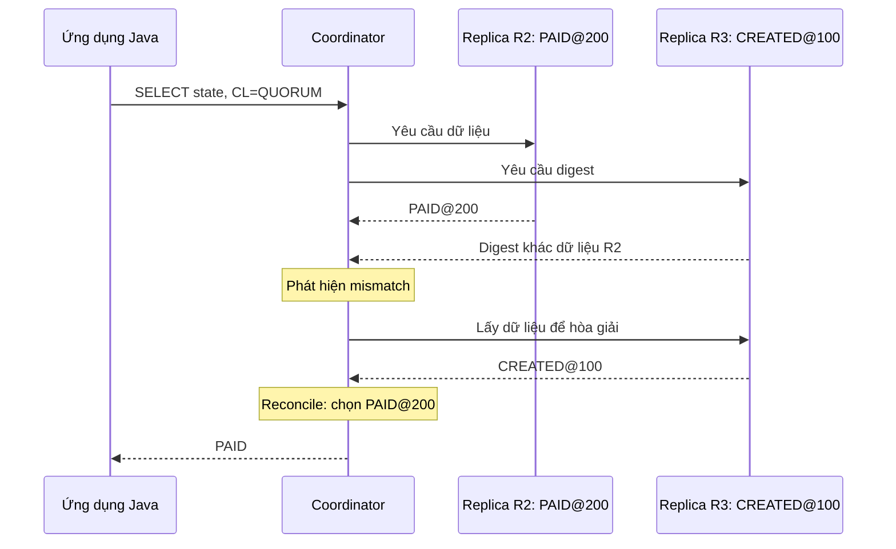

# Độ mới của kết quả đọc và xử lý nhiều phiên bản dữ liệu

Trong Apache Cassandra, **đọc thành công không luôn có nghĩa là đọc được giá trị vừa ghi gần nhất theo thời gian thực**. Một partition có nhiều replica; các replica có thể nhận mutation ở những thời điểm khác nhau. Hơn nữa, Cassandra thường dùng **timestamp của từng cell** để hòa giải những phiên bản dữ liệu cạnh tranh, thay vì dùng thứ tự request đến coordinator. Vì vậy, muốn đánh giá độ mới của một kết quả `SELECT`, ta cần xem cả **consistency level (CL)**, **trạng thái replica**, **timestamp**, **xóa/TTL** và những **ghi đồng thời**.

Bài này thuộc chương **Nhất quán đọc/ghi** của mô-đun `DATABASE_ENGINE_WIDE_COLUMN_CASSANDRA`. Trong lộ trình học về kiến trúc phân tán, mô hình wide-column, partition key, thiết kế bảng theo truy vấn, CQL, replication, compaction, repair, xử lý lỗi và kết nối từ ứng dụng Java, chủ đề này giải thích cách Cassandra **chọn dữ liệu trả về khi các bản sao chưa giống nhau**, cũng như những giới hạn của việc tăng mức nhất quán.

## 1. Mục tiêu học tập

Sau bài này, bạn có thể:

1. Phân biệt **độ mới theo thời gian thực**, **phiên bản thắng theo timestamp** và **nhất quán giữa replica**.
2. Mô tả đường đọc ở Cassandra: coordinator lấy dữ liệu, nhận digest, phát hiện sai khác, hòa giải và có thể thực hiện read repair.
3. Giải thích vì sao `ONE` có thể đọc cũ và trong những điều kiện nào cặp ghi/đọc `QUORUM` hoặc `LOCAL_QUORUM` giúp đọc thấy mutation đã xác nhận.
4. Trình bày quy tắc **last-write-wins** theo timestamp, xung đột giữa nhiều cell, tombstone và TTL.
5. Phân biệt **read repair** với **anti-entropy repair**, hinted handoff và compaction.
6. Dùng CQL (`WRITETIME`, `TTL`, `USING TIMESTAMP`) và Java Driver để quan sát, chọn CL và xử lý retry.
7. Đánh giá yêu cầu nghiệp vụ nào cần LWT hoặc một giao thức ứng dụng mạnh hơn đọc/ghi quorum thông thường.

## 2. “Dữ liệu mới nhất” có thể mang ba ý nghĩa khác nhau

Giả sử bảng chứa trạng thái đơn hàng:

```text
order_id = O-123
state = "CREATED" -> "PAID" -> "SHIPPED"
```

Một ứng dụng nói “muốn đọc trạng thái mới nhất” có thể đang yêu cầu một trong ba điều:

| Khái niệm | Câu hỏi | Điều cần lưu ý |
| --- | --- | --- |
| **Mới nhất theo thời gian thực** | Request cập nhật nào đã hoàn tất sau cùng và giá trị phải được nhìn thấy trong một thứ tự thời gian hợp lệ? | Liên quan đến **linearizability**, không tự suy ra chỉ từ quorum. |
| **Phiên bản thắng trong Cassandra** | Cell nào có timestamp quyết định theo quy tắc hòa giải? | Timestamp có thể do client chỉ định hoặc được tạo bởi client/driver/server theo cấu hình; **timestamp cao hơn không nhất thiết là request hoàn tất muộn hơn**. |
| **Replica đã bắt kịp chưa?** | Replica được truy vấn đã nhận các mutation liên quan chưa? | Phụ thuộc propagation, CL, lỗi mạng, hinted handoff và repair. |

Khi một replica trả giá trị `"CREATED"` sau khi ghi `"PAID"`, đó có thể là **đọc từ replica chưa cập nhật**. Nhưng nếu một mutation `"CREATED"` mang timestamp **cao hơn** mutation `"PAID"`, Cassandra có thể hợp lệ chọn `"CREATED"` theo last-write-wins, **ngay cả khi mọi replica đã nhận cả hai mutation**. Hai hiện tượng này có nguyên nhân và cách xử lý khác nhau.

> **Nguyên tắc:** Cassandra không tự so sánh “request nào vừa được client gửi sau” để chọn giá trị cuối. Với các ghi thông thường, việc hòa giải dữ liệu dựa trên metadata như **timestamp ở cấp cell** và các quy tắc xử lý xóa/TTL.

## 3. Replica và đường đọc của coordinator

Partition key xác định partition; replication strategy và replication factor (RF) xác định các replica đích của partition đó. Với một datacenter và RF = 3, ta có:

```text
                     Coordinator C
                       /   |   \
                      v    v    v
                     R1   R2   R3

          Cùng partition P, ba replica có thể
          tạm thời chứa trạng thái khác nhau.
```

Giả sử:

| Replica | Giá trị `state` đang có | Timestamp của cell |
| --- | --- | ---: |
| `R1` | `PAID` | 200 |
| `R2` | `PAID` | 200 |
| `R3` | `CREATED` | 100 |

Các con số timestamp chỉ để minh họa thứ tự. `R3` có thể chưa nhận mutation mới vì mạng chậm hoặc node từng tạm ngừng hoạt động.

### 3.1. Đọc ở `ONE`

Với `CL=ONE`, coordinator cần một phản hồi hợp lệ của replica. Nếu truy vấn được phục vụ từ `R3` trước khi `R3` bắt kịp, ứng dụng có thể nhận **`CREATED`**. Đây là kết quả đọc có thể **cũ** so với ghi `PAID` đã được các replica khác xác nhận.

`ONE` thường giảm số phản hồi phải chờ, nhưng **không buộc** coordinator đối chiếu với replica khác để tìm phiên bản mới nhất. Cassandra có thể liên hệ thêm replica trong một số hoàn cảnh, nhưng ứng dụng không nên dựa vào việc đó như một bảo đảm của `ONE`.

### 3.2. Đọc ở `QUORUM`

Với RF = 3, `QUORUM = floor(3/2) + 1 = 2`. Giả sử coordinator nhận phản hồi từ `R2` và `R3`, phát hiện khác biệt ở `state`. Nó phải **hòa giải dữ liệu** thay vì trả một phiên bản bất kỳ; trong ví dụ, phiên bản `PAID@200` thắng `CREATED@100`.



Sơ đồ mô tả luồng đơn giản thường gặp. **Không phải mọi `SELECT QUORUM` đều gửi đúng một data request và một digest request**; chiến lược đọc, speculative retry, replica bị chậm, số replica, phiên bản và cách tối ưu có thể thay đổi số thông điệp thực tế.

### 3.3. Data response, digest và reconciliation

Trên đường đọc, coordinator có thể:

1. Chọn các replica phù hợp với CL và vị trí datacenter.
2. Nhận **dữ liệu đầy đủ** từ một số replica và **digest** (dấu kiểm tra) từ các replica khác.
3. So sánh digest với dữ liệu đã nhận để phát hiện có hay không sự khác biệt.
4. Nếu có sai khác, đọc thêm dữ liệu cần thiết, **hòa giải** các phiên bản theo quy tắc Cassandra và trả kết quả sau khi hoàn tất yêu cầu.
5. Tùy phiên bản và cấu hình, tiến hành **read repair** cho những replica mà đường đọc phát hiện thiếu phiên bản được chọn.

**Digest** dùng để phát hiện khác biệt, **không phải dữ liệu giá trị được trả thẳng cho ứng dụng**. Việc CL đọc đòi hai phản hồi không có nghĩa coordinator luôn tải toàn bộ hàng hai lần.

Nếu reconciliation hoặc replica không phản hồi kịp thời hạn, truy vấn có thể nhận `ReadTimeout` hoặc `ReadFailure`. Một lần đọc **thất bại** không thể được dùng làm bằng chứng về phiên bản đã quan sát thành công.

## 4. Đọc `QUORUM` sau ghi `QUORUM`: khi nào kỳ vọng đọc mới là hợp lý?

Gọi `N` là số replica của **cùng một partition trong cùng phạm vi**, `W` là ngưỡng ACK ghi và `R` là ngưỡng phản hồi đọc. Nếu:

\[
R + W > N
\]

thì tập replica đã xác nhận ghi và tập replica phản hồi đọc phải giao nhau ít nhất một replica.

Ví dụ RF = 3:

```text
Ghi QUORUM thành công: {R1, R2}  -> W = 2
Đọc QUORUM:            {R2, R3}  -> R = 2

                    R2 thuộc cả hai tập
                    R + W = 4 > 3
```

Khi mutation `PAID@200` được ghi thành công ở quorum, đọc quorum **bắt đầu sau đó** và không có ghi cạnh tranh/timestamp bất thường, replica giao nhau giúp coordinator nhìn thấy phiên bản đã xác nhận và hòa giải với những bản cũ.

| RF trong một DC | Quorum | Ghi quorum + đọc quorum | Giao nhau bắt buộc? |
| ---: | ---: | ---: | --- |
| 3 | 2 | `2 + 2 > 3` | **Có** |
| 4 | 3 | `3 + 3 > 4` | **Có** |
| 5 | 3 | `3 + 3 > 5` | **Có** |

Tuy nhiên, câu “`QUORUM` luôn trả dữ liệu mới nhất” quá rộng. Để suy luận đúng, cần đủ các **giả định** sau:

- Ghi trước đó **đã được xác nhận thành công** ở CL phù hợp; không tự coi `WriteTimeout` là thành công.
- Đọc **bắt đầu sau** khi ghi hoàn tất; nếu hai request chồng lấn thời gian thì kết quả có thể phụ thuộc thứ tự thực thi.
- Hai request dùng **cùng partition và cùng tập replica đích**, với replication topology ổn định.
- Không có mutation khác với timestamp/cạnh tranh khiến một giá trị khác trở thành phiên bản thắng.
- Đường đọc đã thực sự thu đủ phản hồi và hoàn tất reconciliation.

Điều kiện giao nhau là **một chứng minh về tập replica**, không tự cung cấp transaction đa partition hay bảo đảm tuyến tính hóa mọi cập nhật đồng thời.

### 4.1. `ONE` và `QUORUM` không thể đánh đồng

Với RF = 3:

| CL ghi | W | CL đọc | R | `R + W` | Có giao nhau bắt buộc? |
| --- | ---: | --- | ---: | ---: | --- |
| `ONE` | 1 | `ONE` | 1 | 2 | Không |
| `ONE` | 1 | `QUORUM` | 2 | 3 | Không |
| `QUORUM` | 2 | `ONE` | 1 | 3 | Không |
| `QUORUM` | 2 | `QUORUM` | 2 | 4 | **Có** |
| `ALL` | 3 | `ONE` | 1 | 4 | **Có** |

Một lần đọc ở `QUORUM` vẫn **có thể cũ** sau một lần ghi `ONE` nếu tập replica phản hồi đọc không chứa replica đã xác nhận ghi và các bản sao còn lại chưa bắt kịp.

### 4.2. Ghi `ANY` thành công nhờ hint không áp dụng `W=1`

Với `ANY`, coordinator có thể trả về thành công khi chỉ **lưu được hint** mà **không replica đích nào ACK**. Không được lấy một hint làm “một replica đã ghi” trong bất đẳng thức trên. Đọc từ replica trước khi hint được phát lại **có thể không nhìn thấy mutation**, ngay cả khi ứng dụng nhận response ghi thành công.

## 5. Phạm vi datacenter quyết định tập replica nào được đối chiếu

Giả sử `NetworkTopologyStrategy` đặt hai datacenter:

```text
dc1: RF = 3  -> A1, A2, A3
dc2: RF = 3  -> B1, B2, B3

Tổng RF của partition = 6
```

| Cặp ghi/đọc | Phạm vi ACK | Kết quả phép tính |
| --- | --- | --- |
| `QUORUM`/`QUORUM` toàn cluster | `W=4, R=4, N=6` | `4 + 4 > 6`, **có giao nhau** nếu cùng tập replica. |
| `LOCAL_QUORUM` ghi và đọc **đều ở dc1** | `W=2, R=2, N_dc1=3` | `2 + 2 > 3`, **có giao nhau trong dc1**. |
| `LOCAL_QUORUM` ghi **dc1**, đọc **dc2** | Ghi chỉ cần ACK dc1, đọc chỉ cần phản hồi dc2 | **Không bắt buộc giao nhau**. |
| Ghi `EACH_QUORUM`, đọc `LOCAL_QUORUM` tại dc2 | Ghi đã có 2 ACK tại dc2, đọc cần 2 tại dc2 | **Có giao nhau trong dc2** theo các giả định thích hợp. |

**Tình huống cụ thể:** Ứng dụng A ghi `PAID` ở `dc1` với `LOCAL_QUORUM` và nhận hai ACK từ `A1, A2`. Cùng lúc, kết nối liên DC chậm nên `dc2` chưa nhận mutation. Ứng dụng B đọc ở `dc2` với `LOCAL_QUORUM` từ `B1, B2` và có thể thấy `CREATED`. Mỗi thao tác **đều đạt CL của mình**, nhưng hai tập phản hồi thuộc **hai DC khác nhau**.

Đừng lấy `2 + 2 > 3` để chứng minh “local quorum ở hai DC luôn giao nhau”. Công thức chỉ áp dụng trực tiếp khi `R`, `W` cùng đếm một tập `N`.

## 6. Cassandra hòa giải nhiều phiên bản ở cấp cell như thế nào?

Cassandra không chỉ lưu một file chứa “hàng hiện tại”. Các mutation có thể đi vào **memtable**, được flush thành **SSTable**, và những SSTable cũ hơn vẫn chứa các phiên bản/tombstone cho đến khi compaction và những quy tắc dọn dẹp tương ứng xử lý chúng.

Về mặt logic, một hàng Cassandra có thể gồm các **cell** với timestamp khác nhau. Trong lúc đọc, Cassandra hòa giải các bản của cùng cell theo metadata để tạo kết quả logic ứng dụng nhìn thấy.

### 6.1. Last-write-wins là theo timestamp, không theo thứ tự ACK

Giả sử hai mutation cho cùng cột `state`:

```text
Mutation A: state = 'PAID',     timestamp = 200
Mutation B: state = 'CREATED',  timestamp = 100

Theo timestamp: PAID@200 thắng CREATED@100.
```

Ngay cả khi B được gửi hoặc ACK **sau** A theo đồng hồ thực, Cassandra vẫn chọn A vì timestamp cao hơn. Timestamp có thể được ứng dụng cấp qua CQL `USING TIMESTAMP` hoặc được tạo bởi client/server theo đường ghi. Khi các node hoặc client có đồng hồ lệch, **giá trị thắng theo timestamp không nhất thiết là giá trị mới nhất theo thời gian thực**.

Nếu hai mutation cùng timestamp, Cassandra dùng các quy tắc hòa giải bổ sung; không nên dựa vào thứ tự request đến làm cơ chế quyết định thắng. Với hệ thống có tranh chấp cập nhật, cần thiết kế luồng trạng thái phù hợp, có thể dùng **LWT/Paxos** thay vì mặc định cho rằng quorum là cơ chế điều phối thứ tự.

### 6.2. Các cột trong cùng một hàng có thể có timestamp khác nhau

Ví dụ:

| Cell | Giá trị logic | Timestamp |
| --- | --- | ---: |
| `state` | `PAID` | 200 |
| `updated_by` | `service-A` | 150 |
| `comment` | `Đã xác nhận` | 175 |

Nếu ba client cập nhật từng cột độc lập, kết quả `SELECT` có thể kết hợp các phiên bản của **những mutation khác nhau**. Không nên giả định hàng thông thường là một “snapshot” nguyên khối mà mọi cột đều chia sẻ một phiên bản duy nhất. Với yêu cầu nhiều trường phải khớp nhau như một chuyển trạng thái, cần thiết kế phương pháp ghi, mô hình bảng và kiểm soát cạnh tranh tương ứng.

**Wide-column không đồng nghĩa MVCC truy vấn lịch sử.** Những phiên bản còn trong SSTable phục vụ quản lý lưu trữ và hòa giải; Cassandra không mặc nhiên cung cấp cú pháp “`SELECT AS OF timestamp`” để đọc tùy ý mọi phiên bản lịch sử như một hệ cơ sở dữ liệu temporal.

### 6.3. Đồng hồ và timestamp cần được kiểm soát

Do hòa giải dựa trên timestamp, các rủi ro thực tế gồm:

- Clock skew giữa những node/client sinh timestamp.
- Retry mutation với timestamp mới, vô tình thay đổi thứ tự thắng.
- Chỉ định timestamp thủ công cao bất thường khiến ghi bình thường tiếp theo không thể ghi đè cho đến khi timestamp của chúng vượt qua nó.
- Update hai trường có ý nghĩa liên kết nhưng dùng timestamp khác nhau.

Khi muốn so sánh phiên bản theo nghiệp vụ, **số phiên bản ứng dụng** và `UPDATE ... IF version = ?` thường rõ ý nghĩa hơn việc tự dùng timestamp như một cơ chế compare-and-set.

## 7. Tombstone và TTL cũng là một phần của hòa giải

### 7.1. Delete không chỉ “xóa ngay lập tức mọi bản sao”

Một `DELETE` trong Cassandra tạo **tombstone** để biểu diễn việc dữ liệu bị xóa và ngăn các replica chưa cập nhật làm sống lại phiên bản cũ. Tombstone cũng mang timestamp và tham gia quy tắc hòa giải.

```text
Replica R1: state = 'CREATED' @100
Replica R2: tombstone của state @200
Replica R3: state = 'CREATED' @100

Nếu đường đọc đối chiếu được tombstone @200 với cell cũ @100,
về logic state đã bị xóa, không trả lại 'CREATED'.
```

Nếu tombstone bị loại bỏ quá sớm trong khi một replica vẫn giữ dữ liệu cũ chưa được repair, dữ liệu cũ có thể **xuất hiện lại** (*zombie data*). Vì vậy các quy trình **anti-entropy repair**, vận hành node down lâu và cấu hình liên quan `gc_grace_seconds` cần được xem xét cùng nhau.

### 7.2. TTL hết hạn không phải lỗi đọc cũ

Một cell ghi với **TTL (time to live)** có thể tự hết hạn. Sau khi TTL hết hạn, cell không còn hiển thị trong kết quả logic, dù dữ liệu/tombstone liên quan vẫn có thể tồn tại trên đĩa một thời gian.

Ví dụ `state='TEMPORARY'` với TTL 60 giây:

```text
t0: Ghi state='TEMPORARY', TTL=60
t0+30s: Đọc có thể thấy 'TEMPORARY' (nếu đủ điều kiện nhất quán)
t0+70s: Cell đã hết TTL -> không còn được trả như giá trị sống
```

Khi một `SELECT` trả `null` hoặc không có cell, cần phân biệt **chưa được ghi**, **đã xóa**, **đã hết TTL** và **đọc từ replica chưa bắt kịp**. Những trường hợp đó cần cách điều tra khác nhau.

## 8. Read repair, hinted handoff, repair và compaction

Những cơ chế này cùng liên quan đến dữ liệu phân tán nhưng phục vụ mục tiêu khác nhau:

| Cơ chế | Khi nào tác động? | Vai trò đối với độ mới khi đọc |
| --- | --- | --- |
| **Read reconciliation** | Coordinator nhận các phản hồi đọc có phiên bản khác nhau. | Chọn dữ liệu logic theo timestamp/tombstone để trả kết quả đọc. |
| **Read repair** | Đường đọc phát hiện replica không đồng nhất, tùy phiên bản và cấu hình bảng. | Có thể cập nhật những replica liên quan nhằm giảm sai khác được phát hiện khi đọc. |
| **Hinted handoff** | Replica tạm thời bỏ lỡ mutation, coordinator còn lưu hint. | Phát lại mutation khi replica có thể nhận; **best effort**, không thay thế repair. |
| **Anti-entropy repair** | Vận hành chủ động hoặc theo lịch để đối chiếu replica. | Sửa các khác biệt còn tồn tại mà không nhất thiết phải có request đọc hoặc hint gốc. |
| **Compaction** | Công việc nền hợp nhất/dọn SSTable, xử lý phiên bản cũ và tombstone theo quy tắc. | Giúp quản lý lưu trữ và hiệu năng; không phải cơ chế đảm bảo mọi replica đồng bộ. |

### Tính chất read repair phụ thuộc phiên bản

Trong Cassandra 4.x, bảng có thể cấu hình `read_repair` với các giá trị như `BLOCKING` hoặc `NONE`. Với `BLOCKING`, một số đường đọc phát hiện sai khác sẽ chờ phần read repair cần thiết trước khi trả kết quả; điều này hỗ trợ thuộc tính **monotonic quorum reads** trong phạm vi áp dụng nhưng có thể ảnh hưởng độ trễ và tính nguyên tử quan sát được của một số ghi nhiều hàng trong cùng partition khi chỉ đọc một phần.

Với `NONE`, hành vi và đánh đổi khác đi. Các phiên bản Cassandra cũ có cơ chế read repair khác; **không suy luận từ tên CL rằng mọi lần đọc `QUORUM` đều sửa sạch toàn bộ replica**. Read repair thường chỉ liên quan phạm vi dữ liệu được yêu cầu/phát hiện khác biệt, không thay thế một chiến lược repair toàn cluster.

**Ví dụ:** Một `SELECT` chỉ truy vấn một hàng theo clustering key không nhất thiết kiểm tra và sửa mọi hàng khác trong cùng partition. Nếu ứng dụng muốn toàn bộ partition/bảng hội tụ, phải có kế hoạch repair riêng phù hợp với mô hình wide-column và lưu lượng ghi.

## 9. Thực hành CQL: quan sát timestamp và kết quả hòa giải

Ví dụ này giả định có một **cluster lab** với datacenter thực tên `dc1`, đủ ít nhất ba node cho RF=3. Thay tên DC và cấu hình xác thực theo môi trường của bạn.

```sql
CREATE KEYSPACE IF NOT EXISTS freshness_lab
WITH replication = {
  'class': 'NetworkTopologyStrategy',
  'dc1': 3
};

CREATE TABLE IF NOT EXISTS freshness_lab.order_state_by_id (
  order_id uuid PRIMARY KEY,
  state text,
  updated_by text
);
```

Với bảng trên, `order_id` là partition key và lệnh `SELECT ... WHERE order_id = ?` truy vấn đúng partition. RF=3 đặt tại **keyspace**; CL được chọn **cho mỗi yêu cầu**.

### 9.1. Ghi có timestamp minh họa và đọc `WRITETIME`

Trong `cqlsh`, `CONSISTENCY` thiết lập mức nhất quán cho **những câu lệnh tiếp theo của phiên shell**:

```sql
CONSISTENCY QUORUM;

INSERT INTO freshness_lab.order_state_by_id
  (order_id, state, updated_by)
VALUES (
  11111111-1111-4111-8111-111111111111,
  'PAID',
  'service-A'
) USING TIMESTAMP 2000000;

-- Mutation gửi sau nhưng mang timestamp nhỏ hơn.
UPDATE freshness_lab.order_state_by_id
USING TIMESTAMP 1000000
SET state = 'CREATED'
WHERE order_id = 11111111-1111-4111-8111-111111111111;

SELECT state, WRITETIME(state), updated_by, WRITETIME(updated_by)
FROM freshness_lab.order_state_by_id
WHERE order_id = 11111111-1111-4111-8111-111111111111;
```

Trong ví dụ độc lập không có ghi khác vào cùng khóa, kết quả logic của `state` vẫn là **`PAID`** vì timestamp `2000000` lớn hơn `1000000`. Hàm `WRITETIME(state)` cho biết timestamp ghi của cell đang thắng, tính theo **microsecond**; đây **không phải** lịch sử đầy đủ của mọi mutation trước đó. Cột `updated_by` được ghi trong mutation đầu và có timestamp của cell tương ứng.

**Chỉ sử dụng `USING TIMESTAMP` với giá trị tùy ý trong lab.** Tại production, việc sử dụng timestamp quá cao, quá thấp hoặc không đồng nhất có thể khiến dữ liệu mới bất ngờ không thắng được phiên bản cũ.

### 9.2. Quan sát TTL

```sql
CONSISTENCY QUORUM;

UPDATE freshness_lab.order_state_by_id
USING TTL 120
SET updated_by = 'temporary-worker'
WHERE order_id = 22222222-2222-4222-8222-222222222222;

SELECT updated_by, TTL(updated_by), WRITETIME(updated_by)
FROM freshness_lab.order_state_by_id
WHERE order_id = 22222222-2222-4222-8222-222222222222;
```

`TTL(updated_by)` cho biết số giây TTL còn lại của cell khi đang tồn tại. Sau khi TTL hết hạn, cell không còn hiển thị là giá trị sống. Không đồng nhất giữa các replica có thể ảnh hưởng việc quan sát trước lúc hội tụ, nhưng **TTL hết hạn** cũng là một nguyên nhân hợp lệ khiến giá trị biến mất.

### 9.3. Quan sát và xác định rủi ro đọc cũ

```sql
-- Thử CL thấp hơn trong lab.
CONSISTENCY ONE;

SELECT state
FROM freshness_lab.order_state_by_id
WHERE order_id = 11111111-1111-4111-8111-111111111111;

-- Đối chiếu với đọc quorum.
CONSISTENCY QUORUM;

SELECT state
FROM freshness_lab.order_state_by_id
WHERE order_id = 11111111-1111-4111-8111-111111111111;
```

Hai câu `SELECT` trong cluster khỏe mạnh **rất có thể trả cùng giá trị**. Điều này không chứng minh `ONE` có bảo đảm đọc mới như `QUORUM`; để quan sát sai khác cần môi trường có replica chậm/chưa bắt kịp và biết chính xác replica nào sở hữu partition. Không cố tình gây gián đoạn trên cluster production.

## 10. Java Driver 4.x: chọn CL và nhận biết kết quả chưa chắc chắn

Trong ứng dụng Java, CL có thể được đặt trên từng statement. Ví dụ sau dùng `CqlSession` đã cấu hình local datacenter, contact points và xác thực. `PreparedStatement` được chuẩn bị **một lần**:

```java
import com.datastax.oss.driver.api.core.CqlSession;
import com.datastax.oss.driver.api.core.DefaultConsistencyLevel;
import com.datastax.oss.driver.api.core.cql.BoundStatement;
import com.datastax.oss.driver.api.core.cql.PreparedStatement;
import com.datastax.oss.driver.api.core.cql.Row;

import java.util.UUID;

public final class OrderStateRepository {
    private final CqlSession session;
    private final PreparedStatement updateState;
    private final PreparedStatement readState;

    public OrderStateRepository(CqlSession session) {
        this.session = session;
        this.updateState = session.prepare(
            "UPDATE freshness_lab.order_state_by_id " +
            "SET state = ? WHERE order_id = ?");
        this.readState = session.prepare(
            "SELECT state FROM freshness_lab.order_state_by_id " +
            "WHERE order_id = ?");
    }

    public void changeState(UUID orderId, String newState) {
        BoundStatement write = updateState.bind(newState, orderId)
            .setConsistencyLevel(DefaultConsistencyLevel.LOCAL_QUORUM);

        session.execute(write); // Chỉ xác nhận khi đạt CL của yêu cầu.
    }

    public String readState(UUID orderId) {
        BoundStatement read = readState.bind(orderId)
            .setConsistencyLevel(DefaultConsistencyLevel.LOCAL_QUORUM);

        Row row = session.execute(read).one();
        return row == null ? null : row.getString("state");
    }
}
```

Với một DC có RF=3, ghi và đọc `LOCAL_QUORUM` cần hai phản hồi cục bộ mỗi chiều. Nếu ghi thành công, đọc bắt đầu sau đó, không có ghi cạnh tranh và cùng tập replica, hai quorum giao nhau. Đây là cơ sở **kỳ vọng đọc thấy mutation vừa ghi**, không phải cơ chế khóa tranh chấp cho nhiều client cập nhật cùng trạng thái.

### 10.1. Timeout không chứng minh chưa ghi

Một lần `UPDATE` ở `LOCAL_QUORUM` có thể được một replica áp dụng nhưng client nhận `WriteTimeoutException` vì không đủ hai ACK kịp hạn. Client lúc đó **không biết chắc** mutation đã được bao nhiêu replica chấp nhận. Nếu tự retry với timestamp khác, thay đổi thứ tự ghi hoặc phát sinh thêm hiệu ứng nghiệp vụ, kết quả có thể bất ngờ.

Cách xử lý nên bao gồm:

- Giữ **partition key và operation ID** ổn định để có thể đối soát sau lỗi.
- Thiết kế mutation **idempotent** khi phù hợp; tránh tăng counter, sinh khóa mới hoặc gửi sự kiện ngoài Cassandra vô điều kiện ở mọi lần retry.
- Giới hạn retry và quan sát timeout/latency, vì retry nhiều có thể gây áp lực thêm cho cluster.
- Nếu cần cập nhật có điều kiện hoặc chống mất cập nhật khi ghi đồng thời, dùng mô hình phiên bản và **LWT** phù hợp.

### 10.2. Đọc-kiểm-tra-ghi không phải một bước nguyên tử

Ví dụ hai service cùng đọc `state='CREATED'`, rồi cùng ghi một trạng thái mới:

```text
Service A: SELECT QUORUM -> CREATED
Service B: SELECT QUORUM -> CREATED
Service A: UPDATE QUORUM -> PAID
Service B: UPDATE QUORUM -> CANCELLED
```

Cả hai mutation vẫn có thể được xác nhận, sau đó Cassandra hòa giải theo timestamp. Nếu nghiệp vụ chỉ cho phép **một chuyển trạng thái từ CREATED**, phải dùng cập nhật có điều kiện như:

```sql
UPDATE freshness_lab.order_state_by_id
SET state = 'PAID'
WHERE order_id = 11111111-1111-4111-8111-111111111111
IF state = 'CREATED';
```

Lệnh `IF` là **lightweight transaction (LWT)**, sử dụng giao thức đồng thuận và trả `[applied]`. Ứng dụng cần đọc giá trị đó, phân biệt `true`, `false` và **timeout chưa rõ kết quả**. LWT có chi phí mạng/độ trễ cao hơn ghi thường; cũng cần lựa chọn phạm vi `SERIAL` hoặc `LOCAL_SERIAL` phù hợp, nhất là khi ghi cạnh tranh giữa các DC.

## 11. Điều tra khi người dùng báo “vừa ghi xong mà đọc vẫn cũ”

Một quy trình điều tra có thể đi theo các câu hỏi:

| Câu hỏi | Điều cần kiểm tra | Gợi ý diễn giải |
| --- | --- | --- |
| Ghi đã được xác nhận chưa? | Response thành công hay `WriteTimeout` / `Unavailable`? | Timeout không cho phép suy chắc đã đủ replica ACK. |
| CL ghi và đọc là gì? | `ONE`, `LOCAL_ONE`, `QUORUM`, `LOCAL_QUORUM`? | Tính `R+W` và kiểm tra phạm vi replica. |
| Coordinator nằm ở đâu? | Local DC trong driver, routing, contact points. | Hai local quorum khác DC không buộc giao nhau. |
| Partition key và RF có đúng không? | Keyspace, query, topology. | Truy vấn hai partition không thể dùng chung lập luận quorum. |
| Có mutation cạnh tranh không? | Log nghiệp vụ, `WRITETIME`, timestamp client. | Giá trị “cũ” có thể đang thắng theo timestamp. |
| Có TTL hoặc delete không? | `TTL`, tombstone, thời điểm hết hạn. | Cell biến mất có thể do TTL/tombstone, không phải đọc replica cũ. |
| Replica đang đồng bộ thế nào? | Node down, backlog hints, repair, lỗi đường đọc. | Replica chậm có thể chứa phiên bản cũ. |
| Đường đọc có hoàn tất không? | `ReadTimeout`, `ReadFailure`, latency. | Không có kết quả đọc thành công để dựa vào. |

**Cách diễn giải đúng:** Nếu đọc `ONE` cũ sau ghi `ONE` thành công, xem xét thiếu giao nhau và replication chậm. Nếu đọc `QUORUM` “cũ” dù ghi cũng `QUORUM`, trước khi kết luận Cassandra sai phải kiểm tra **timestamp, ghi chồng lấn, topology, phạm vi DC, thời điểm thao tác và timeout**.

## 12. Những sai lầm phổ biến

1. **“Đọc quorum thì luôn là bản mới nhất theo đồng hồ thực.”** Sai. Quorum có tính chất giao nhau; timestamp và ghi cạnh tranh vẫn quyết định phiên bản logic.
2. **“Một replica chung thì client nhận nguyên dữ liệu raw từ replica đó.”** Sai. Coordinator có thể dùng data/digest, phát hiện mismatch và hòa giải.
3. **“Read repair sẽ tự sửa mọi replica và mọi partition sau một lần SELECT.”** Sai. Phạm vi sửa phụ thuộc dữ liệu được đọc, phiên bản và cấu hình; vẫn cần anti-entropy repair phù hợp.
4. **“Có nhiều SSTable nghĩa là có thể SELECT lại mọi trạng thái lịch sử.”** Sai. Các phiên bản vật lý hỗ trợ reconciliation/compaction, không phải API MVCC lịch sử mặc định.
5. **“DELETE xóa sạch dữ liệu tức thời trên mọi node.”** Sai. Tombstone phải lan truyền, tham gia hòa giải và được dọn theo các quy tắc riêng.
6. **“Dùng timestamp tự tạo lớn là cách chắc chắn có cập nhật mới nhất.”** Nguy hiểm. Clock skew, retry và timestamp ngoài dải dự kiến có thể gây kết quả không đúng theo thứ tự nghiệp vụ.
7. **“Nếu SELECT trả null tức là không ai từng ghi.”** Sai. Có thể đã xóa, hết TTL, chưa lan replication hoặc lệnh chưa được xác nhận.
8. **“Ghi quorum + đọc quorum tự giải quyết cập nhật có điều kiện.”** Sai. Điều kiện nghiệp vụ như `IF NOT EXISTS` cần một giao thức compare-and-set/LWT.

## 13. Bài tập và đáp án

### Bài 1 — Đọc một replica chưa cập nhật

RF=3. `R1` và `R2` có `state=PAID@200`; `R3` có `state=CREATED@100`. Một lần đọc `ONE` chọn `R3` có thể trả gì?

**Đáp án:** Có thể trả `CREATED`. `ONE` không đòi so sánh với replica khác trước khi thành công.

### Bài 2 — Đọc quorum có dữ liệu khác nhau

Vẫn với RF=3, đọc `QUORUM` nhận phản hồi từ `R2` và `R3`. Nếu đường đọc phát hiện mismatch và reconciliation hoàn tất, phiên bản `state` nào thắng?

**Đáp án:** `PAID@200`, vì timestamp 200 lớn hơn 100; coordinator có thể lấy thêm dữ liệu để hòa giải.

### Bài 3 — QUORUM ghi, ONE đọc

RF=3; lần ghi `QUORUM` thành công ở `R1,R2` và đọc `ONE` từ `R3` trước khi nó nhận mutation. Điều kiện giao nhau có bảo đảm không?

**Đáp án:** Không. `W=2`, `R=1`, `N=3`, nên `R+W=3≤3`. Lần đọc có thể cũ.

### Bài 4 — Ghi muộn hơn nhưng timestamp thấp hơn

Client A ghi `PAID` với timestamp 300, hoàn tất ở `QUORUM`. Sau đó client B ghi `CREATED` với timestamp 100, cũng hoàn tất ở `QUORUM`. Đọc quorum trả `PAID`. Có vi phạm công thức giao nhau không?

**Đáp án:** Không. Hai tập phản hồi vẫn giao nhau; quy tắc last-write-wins theo timestamp chọn `PAID@300`. Đây là lý do giao nhau không tự bảo đảm thứ tự ghi theo thời gian thực.

### Bài 5 — Đọc chéo DC

`dc1` RF=3, `dc2` RF=3. Ghi `LOCAL_QUORUM` ở `dc1` thành công, rồi đọc `LOCAL_QUORUM` ngay ở `dc2`. Có chắc thấy mutation mới không?

**Đáp án:** Không. Tập ACK ghi nằm ở `dc1`, tập đọc nằm ở `dc2`, không buộc giao nhau. Replication qua WAN có thể chưa hoàn tất.

### Bài 6 — Xóa và dữ liệu cũ

Replica A chứa tombstone cho `state` timestamp 500, replica B chứa `state=PAID` timestamp 300. Khi đọc và hòa giải đủ dữ liệu, giá trị `PAID` có xuất hiện lại không?

**Đáp án:** Về logic, tombstone timestamp 500 thắng phiên bản cũ timestamp 300, nên `PAID` không được trả như cell sống. Hệ thống vẫn cần vận hành repair và quản lý tombstone đúng để tránh hồi sinh dữ liệu khi có replica bỏ lỡ delete quá lâu.

### Bài 7 — Đọc cell hết TTL

`updated_by` được ghi với TTL=60 giây. Sau 90 giây, `SELECT` không thấy cột này. Có thể kết luận ghi đã mất do lỗi replication không?

**Đáp án:** Không. Cell có thể đã **hết TTL** theo đúng thiết kế. Cần phân biệt expiration với lỗi replication.

### Bài 8 — Read repair có thay anti-entropy repair?

Ứng dụng thường đọc `order_id=A` ở quorum. Có thể bỏ mọi lịch repair vì các lần đọc sẽ sửa tất cả dữ liệu khác nhau không?

**Đáp án:** Không. Read repair chỉ phát hiện/đối chiếu phạm vi được đọc và tùy phiên bản/cấu hình. Các partition ít hoặc không được truy vấn vẫn cần chiến lược anti-entropy repair.

### Bài 9 — Hai service đổi trạng thái cùng lúc

Hai service cùng đọc `CREATED` rồi ghi `PAID` và `CANCELLED` ở `QUORUM`. Làm sao đảm bảo chỉ một chuyển trạng thái được chấp nhận?

**Đáp án:** Dùng cập nhật có điều kiện trên cùng partition như `UPDATE ... IF state='CREATED'` (LWT), kiểm tra `[applied]` và xử lý timeout như trạng thái chưa xác định; quorum thường không ghép bước đọc-kiểm-tra-ghi thành nguyên tử.

## 14. Tổng kết

Độ mới của một lần đọc Cassandra là kết quả của **phạm vi replica được hỏi**, **CL đọc/ghi**, **thứ tự các thao tác**, **metadata từng cell** và **quy tắc reconciliation**. `ONE` có thể nhanh nhưng đọc replica chưa cập nhật; `QUORUM`/`QUORUM` trên cùng tập replica tạo giao nhau, giúp đọc thấy mutation đã xác nhận khi những giả định phù hợp được đáp ứng.

Trong dữ liệu có nhiều phiên bản, **timestamp/last-write-wins**, tombstone và TTL quyết định giá trị logic, còn read repair, hinted handoff, anti-entropy repair và compaction xử lý những khía cạnh khác nhau của sự hội tụ và lưu trữ. Quorum không tự tạo transaction nguyên tử cho các cập nhật cạnh tranh. Khi nghiệp vụ phải bảo vệ điều kiện chuyển trạng thái, hãy đánh giá **LWT** và mô hình khóa/phiên bản ứng dụng thay vì chỉ tăng CL.

### Tài liệu tham khảo

- [Apache Cassandra — Dynamo / Tunable Consistency](https://cassandra.apache.org/doc/stable/cassandra/architecture/dynamo.html): đường đọc, digest, replicas và consistency level.
- [Apache Cassandra — Storage Engine](https://cassandra.apache.org/doc/stable/cassandra/architecture/storage-engine.html): memtable, SSTable, compaction và dữ liệu trên đĩa.
- [Apache Cassandra — CQL Data Manipulation](https://cassandra.apache.org/doc/stable/cassandra/developing/cql/dml.html): `USING TIMESTAMP`, `TTL`, `WRITETIME`, các thao tác điều kiện.
- [Apache Cassandra — Repair](https://cassandra.apache.org/doc/stable/cassandra/managing/operating/repair.html): vai trò anti-entropy repair.
