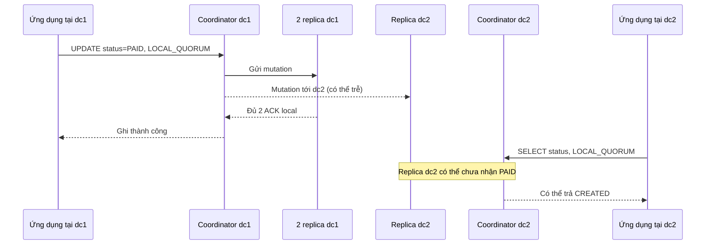

# Read-after-write, mức đọc/ghi và tập bản sao có liên quan

Trong Apache Cassandra, một yêu cầu ghi có thể được xác nhận thành công trước khi **mọi replica** của partition nhận được mutation. Vì vậy, ứng dụng thường đặt câu hỏi: **“Sau khi `INSERT` hoặc `UPDATE` thành công, câu `SELECT` ngay sau đó có đọc được giá trị tôi vừa ghi không?”** Đây là vấn đề **read-after-write** hay, khi xét những thao tác của cùng client, **read-your-writes**.

Câu trả lời phụ thuộc vào **cặp consistency level (CL) của ghi và đọc**, **tập replica mà mỗi thao tác sử dụng**, việc ghi đã **thực sự được xác nhận** hay chưa, cùng các yếu tố như timestamp và ghi cạnh tranh. Chọn `QUORUM` cho một phía chưa chắc đã đủ. Đặc biệt ở cụm nhiều datacenter, hai thao tác đều đặt `LOCAL_QUORUM` nhưng chạy qua **hai DC khác nhau** vẫn có thể không giao nhau.

Bài thuộc chương **Nhất quán đọc/ghi** của mô-đun `DATABASE_ENGINE_WIDE_COLUMN_CASSANDRA`. Trong lộ trình học kiến trúc phân tán, mô hình wide-column, partition key, thiết kế bảng theo truy vấn, CQL, replication, compaction, repair, xử lý lỗi và kết nối ứng dụng Java, bài này tập trung vào cách thiết kế **đường ghi rồi đọc** với những kỳ vọng nhất quán được diễn đạt chính xác.

> **Thông điệp cốt lõi:** Muốn lý giải read-after-write bằng quorum, phải xác định **ghi đã ACK ở những replica nào** và **đọc có buộc hỏi ít nhất một replica trong tập đó hay không**. Chỉ cộng các con số `R` và `W` khi chúng đếm **cùng một tập `N` replica**.

## 1. Mục tiêu học tập

Sau bài này, bạn có thể:

1. Giải thích read-after-write, read-your-writes và sự khác biệt với linearizability.
2. Tính `N`, `W`, `R` từ RF và các CL `ONE`, `QUORUM`, `ALL`, `LOCAL_ONE`, `LOCAL_QUORUM` và `EACH_QUORUM`.
3. Chứng minh khi nào `R + W > N` buộc tập replica ghi và đọc giao nhau.
4. Phân tích cặp CL trong cùng DC, qua hai DC và trường hợp RF không bằng nhau.
5. Nhận diện các ngoại lệ: `ANY` thành công nhờ hint, write timeout, ghi chồng lấn, timestamp và thay đổi topology.
6. Thực hành một luồng ghi rồi đọc trong `cqlsh` và Java Driver 4.x.
7. Chọn phương án phù hợp khi nghiệp vụ cần đọc lại ngay, chống cập nhật đồng thời hoặc chấp nhận eventual consistency.

## 2. Read-after-write nghĩa là gì?

Giả sử trạng thái đơn hàng ban đầu là `CREATED`. Ứng dụng thực hiện:

```text
t0  UPDATE order.status = 'PAID'
t1  Cassandra trả kết quả ghi thành công
t2  SELECT order.status      (t2 > t1)
t3  Ứng dụng nhận giá trị đọc
```

Ứng dụng mong đợi ở `t3` nhận `PAID`, không phải `CREATED`. Đây là một kỳ vọng **đọc sau ghi đã được xác nhận**. Nếu client thực hiện cả hai thao tác, ta thường gọi kỳ vọng đó là **read-your-writes**.

Để nói kỳ vọng này thành một bảo đảm có điều kiện, cần làm rõ:

- Hai thao tác nhắm **cùng partition/hàng/cell** và cùng hệ thống replica liên quan.
- Request đọc **bắt đầu sau** khi client đã nhận **phản hồi ghi thành công**.
- Không có một cập nhật cạnh tranh hợp lệ nào sau đó làm giá trị khác thắng theo quy tắc timestamp.
- Lần đọc thành công ở CL đã chọn, không bị timeout hay lỗi reconciliation.

**Read-after-write không đồng nghĩa với transaction đa hàng hoặc linearizability của mọi thao tác cạnh tranh.** Chứng minh một lần đọc có cơ hội bắt gặp mutation vừa ghi khác với chứng minh mọi client đều quan sát một thứ tự thời gian thực duy nhất cho các lần cập nhật.

### Khi Cassandra ghi thành công ở CL thấp

Một partition có ba replica `A`, `B`, `C`. Ghi ở `ONE` có thể trả thành công sau ACK của riêng `A`, trong khi `B` và `C` chưa nhận mutation:

```text
                           RF = 3

Ứng dụng -- ghi PAID --> Coordinator
                             |----> Replica A: PAID    (ACK)
                             |----> Replica B: CREATED (chưa cập nhật)
                             |----> Replica C: CREATED (chưa cập nhật)

Ghi ONE được báo thành công nhờ A.
Đọc ONE nếu lấy từ C có thể trả CREATED.
```

Đây là ví dụ điển hình của **eventual consistency**: các replica có thể hội tụ theo thời gian, nhưng lần đọc ngay sau ghi ở CL thấp không được bảo đảm thấy giá trị vừa xác nhận.

## 3. Tập replica và điều kiện giao nhau `R + W > N`

Gọi `S` là tập replica đích cho **một partition**, có `N = |S|` phần tử. Sau **một lần ghi đã thành công**, gọi `A` là tập những replica đã ACK mutation. Trong một lần **đọc thành công**, gọi `B` là tập replica có phản hồi hợp lệ được coordinator sử dụng.

Nếu:

- `|A| ≥ W`: ghi đạt ngưỡng `W` ACK replica;
- `|B| ≥ R`: đọc đạt ngưỡng `R` phản hồi;
- `A, B ⊆ S`: **cùng một tập replica `S`**;

thì:

\[
|A \cap B| \ge |A| + |B| - |S| \ge R + W - N
\]

Vì vậy:

\[
\boxed{R + W > N \quad\Longrightarrow\quad |A \cap B| \ge 1}
\]

Điều kiện này chứng minh **có ít nhất một replica chung**. Nếu `R + W ≤ N`, ta chỉ biết hai tập **có thể** rời nhau, chứ không kết luận dữ liệu chắc chắn cũ.

### Ví dụ RF = 3

```text
Replica:              A           B           C

Ghi QUORUM (W=2):    [ACK]       [ACK]          .
Đọc QUORUM (R=2):      .        [READ]       [READ]
                                   ^
                            Giao nhau ở B

W + R = 2 + 2 = 4 > 3
```

Replica `B` đã ACK ghi và có mặt trong đường đọc. Khi các điều kiện về thứ tự thao tác, timestamp và reconciliation được đáp ứng, đọc quorum có thể chọn phiên bản vừa ghi thay vì phiên bản cũ.

**Cassandra không nhất thiết tải toàn bộ dữ liệu từ đúng `R` replica**. Coordinator có thể nhận dữ liệu từ một replica và **digest** từ replica khác, đối chiếu kết quả và lấy thêm dữ liệu nếu phát hiện khác biệt. Đối với lập luận giao nhau, các phản hồi hợp lệ trong đường đọc vẫn là những thông tin liên quan đến trạng thái replica, nhưng không nên nhầm số ACK tối thiểu với số request nội bộ thực tế.

## 4. Tính cặp CL ghi/đọc trong một datacenter

Với RF = `N` trong một datacenter:

| CL | Ngưỡng replica |
| --- | ---: |
| `ONE` | 1 |
| `TWO` | 2 |
| `THREE` | 3 |
| `QUORUM` | `⌊N/2⌋ + 1` |
| `ALL` | `N` |

`QUORUM` là đa số tuyệt đối của replica. Với RF = 3, `QUORUM=2`; với RF = 5, `QUORUM=3`.

### Cặp đọc/ghi với RF = 3

| CL ghi | `W` | CL đọc | `R` | `R + W` | Có giao nhau bắt buộc? |
| --- | ---: | --- | ---: | ---: | --- |
| `ONE` | 1 | `ONE` | 1 | 2 | **Không** |
| `ONE` | 1 | `QUORUM` | 2 | 3 | **Không** |
| `QUORUM` | 2 | `ONE` | 1 | 3 | **Không** |
| `QUORUM` | 2 | `QUORUM` | 2 | 4 | **Có** |
| `ALL` | 3 | `ONE` | 1 | 4 | **Có** |
| `ONE` | 1 | `ALL` | 3 | 4 | **Có** |
| `TWO` | 2 | `THREE` | 3 | 5 | **Có** |

**Hai nhận xét quan trọng:**

1. Muốn giao nhau, **không bắt buộc** cả hai chiều đều dùng `QUORUM`: `ALL` ghi rồi `ONE` đọc, hoặc `ONE` ghi rồi `ALL` đọc cũng thỏa bất đẳng thức. Nhưng `ALL` rất nhạy với replica chậm hoặc lỗi và thường không phải lựa chọn cân bằng.
2. Một lần ghi `QUORUM` rồi đọc `ONE` **không** có bảo đảm giao nhau vì `2+1=3`. Dù đa số replica đã xác nhận ghi, lần đọc một replica vẫn có thể chọn bản sao chưa nhận mutation.

### RF = 5 làm thay đổi kết quả

Với RF = 5:

- `QUORUM` ghi và `QUORUM` đọc: `W=3, R=3`, nên `3+3>5`, có giao nhau.
- `THREE` ghi và `THREE` đọc cũng cho `3+3>5`.
- `TWO` ghi và `TWO` đọc chỉ cho `2+2=4≤5`, **không bảo đảm giao nhau**.

Nếu RF thay đổi mà ứng dụng vẫn dùng các mức **cố định** như `TWO` hoặc `THREE`, cần tính lại ngưỡng. `QUORUM` thay đổi theo RF, còn `TWO` luôn chỉ yêu cầu hai phản hồi.

## 5. Phạm vi datacenter: local quorum không phải global quorum

Với `NetworkTopologyStrategy`, mỗi datacenter có RF riêng. Xét topology:

```text
                  Một partition P

dc1, RF=3                      dc2, RF=3
 A1    A2    A3                B1    B2    B3

S_global = {A1,A2,A3,B1,B2,B3}  -> N_global = 6
S_dc1    = {A1,A2,A3}           -> N_dc1 = 3
S_dc2    = {B1,B2,B3}           -> N_dc2 = 3
```

Các mức nhất quán khác nhau có **phạm vi xác nhận khác nhau**:

- **`QUORUM`:** cần `⌊6/2⌋+1=4` phản hồi trong **tổng sáu replica**.
- **`LOCAL_QUORUM`:** cần `2` phản hồi **trong datacenter của coordinator**.
- **`LOCAL_ONE`:** cần một phản hồi từ một replica **trong datacenter của coordinator**.
- **`EACH_QUORUM`:** đối với **ghi thông thường**, cần `2` ACK **tại mỗi DC**, tức ít nhất `2+2` trong ví dụ. Cassandra OSS **không hỗ trợ `EACH_QUORUM` cho `SELECT` thông thường**.

“Local” không phụ thuộc trực tiếp vào nơi người dùng đang ngồi; nó phụ thuộc **DC của coordinator**. Ứng dụng Java cần cấu hình local datacenter và routing đúng, còn `cqlsh` cần kết nối đến node trong DC mong muốn.

### 5.1. Ghi và đọc `LOCAL_QUORUM` trong cùng DC

Ứng dụng có coordinator trong `dc1` ghi `LOCAL_QUORUM`, nhận hai ACK từ `A1,A2`. Sau đó ứng dụng đọc `LOCAL_QUORUM` qua coordinator **cũng trong dc1**, nhận phản hồi từ `A2,A3`:

```text
Ghi:   {A1, A2}  -> W=2 trong dc1
Đọc:   {A2, A3}  -> R=2 trong dc1
              ^
        A2 là replica chung

2 + 2 > N_dc1=3
```

Kết luận giao nhau đúng vì cả hai thao tác dùng **cùng tập replica `S_dc1`**. Không cần remote DC xác nhận để thỏa CL của hai thao tác này. Tuy nhiên, quá trình truyền mutation sang remote DC vẫn diễn ra theo đường replication riêng.

### 5.2. Ghi `LOCAL_QUORUM` tại dc1, đọc `LOCAL_QUORUM` tại dc2



Đường ghi chỉ bắt buộc nhận ACK từ `dc1`; đường đọc chỉ bắt buộc nhận phản hồi từ `dc2`. Hai tập có thể **hoàn toàn rời nhau**. Không được tính `2+2>3` bằng RF của một DC rồi khẳng định chúng giao nhau, vì `W` và `R` được lấy từ **hai DC khác nhau**.

Đây là nguyên nhân một dịch vụ ghi thành công ở vùng A nhưng dịch vụ ở vùng B ngay lập tức vẫn quan sát bản cũ, **dù cả hai đều dùng `LOCAL_QUORUM`**.

### 5.3. Ghi và đọc `QUORUM` toàn cluster

Với RF = `3+3`, cả hai yêu cầu `QUORUM` cần bốn phản hồi trên cùng sáu replica:

\[
R+W=4+4=8>6
\]

Tập ghi và đọc có **ít nhất hai replica chung**. Đổi lại, các request có thể phải chờ đường mạng liên DC: một DC có tối đa ba replica, không thể tự cung cấp bốn phản hồi.

### 5.4. Kết hợp `QUORUM` và `LOCAL_QUORUM`

Có một bẫy phổ biến: ghi `QUORUM` toàn cluster nhưng đọc `LOCAL_QUORUM` tại `dc1`.

```text
Ghi QUORUM:           {A1, B1, B2, B3} -> 4/6 ACK
Đọc LOCAL_QUORUM dc1: {A2, A3}         -> 2/3 phản hồi

Giao nhau = rỗng, dù mỗi thao tác đạt CL riêng.
```

`W=4, R=2, N_global=6` cho `R+W=6`, **không lớn hơn sáu**. Một cặp tên có chữ “quorum” ở cả hai phía **không tự bảo đảm** read-after-write.

Chiều ngược lại, ghi `LOCAL_QUORUM` ở `dc1` rồi đọc `QUORUM` toàn cluster, cũng có những tập phản hồi hợp lệ rời nhau. Phải xét chính xác mọi cách phân bố ACK, không chỉ tên CL.

### 5.5. `EACH_QUORUM` ghi và `LOCAL_QUORUM` đọc

Ghi `EACH_QUORUM` với RF=`3+3` thành công sau khi nhận tối thiểu **hai ACK từ dc1 và hai ACK từ dc2**. Đọc `LOCAL_QUORUM` tại một trong hai DC cần **hai phản hồi trong DC đó**. Vì:

\[
2 + 2 > 3
\]

nên hai tập **giao nhau trong chính DC thực hiện đọc**. Trong các điều kiện dữ liệu không xung đột và ghi đã hoàn tất, đây là lựa chọn khi nghiệp vụ yêu cầu **ghi được xác nhận ở mỗi DC** trước khi các client đọc local quorum.

Đổi lại, `EACH_QUORUM` buộc đường ghi phụ thuộc tính sẵn sàng của **mọi DC**, dễ tăng độ trễ do WAN và có thể thất bại khi một DC thiếu quorum.

### Tóm tắt các cặp thường gặp với RF = 3 + 3

| CL ghi và vị trí | CL đọc và vị trí | Giao nhau bắt buộc? |
| --- | --- | --- |
| `QUORUM` toàn cluster | `QUORUM` toàn cluster | **Có:** `4+4>6`. |
| `LOCAL_QUORUM` tại dc1 | `LOCAL_QUORUM` tại dc1 | **Có:** `2+2>3` trong dc1. |
| `LOCAL_QUORUM` tại dc1 | `LOCAL_QUORUM` tại dc2 | **Không:** hai tập khác DC. |
| `QUORUM` toàn cluster | `LOCAL_QUORUM` tại dc1 | **Không chắc:** có thể rời nhau. |
| `LOCAL_QUORUM` tại dc1 | `QUORUM` toàn cluster | **Không chắc:** có thể rời nhau. |
| `EACH_QUORUM` ghi tại cả hai DC | `LOCAL_QUORUM` đọc ở dc1 hoặc dc2 | **Có:** có quorum ghi trong từng DC. |

## 6. RF khác nhau giữa DC: kiểm tra trường hợp lệch phân bố

Giả sử `dc1` có RF=3 và `dc2` có RF=2:

```text
dc1: {A1,A2,A3} -> LOCAL_QUORUM = 2
dc2: {B1,B2}    -> LOCAL_QUORUM = 2
Toàn cluster: N = 5 -> QUORUM = 3
EACH_QUORUM ghi = 2 ở dc1 và 2 ở dc2
```

| Cặp thao tác | Có giao nhau theo phạm vi? | Lý do |
| --- | --- | --- |
| Ghi/đọc `QUORUM` toàn cluster | **Có** | `3+3>5`. |
| Ghi/đọc `LOCAL_QUORUM` cùng dc1 | **Có** | `2+2>3`. |
| Ghi/đọc `LOCAL_QUORUM` cùng dc2 | **Có** | `2+2>2`; nhưng mỗi lần cần **cả hai** replica dc2. |
| Ghi `LOCAL_QUORUM` dc1, đọc `LOCAL_QUORUM` dc2 | **Không** | Hai tập khác DC. |
| Ghi `EACH_QUORUM`, đọc `LOCAL_QUORUM` dc2 | **Có** | Ghi bắt buộc đã có cả hai ACK tại dc2. |

Topology lệch RF cho thấy chỉ tính tổng quorum mà bỏ qua **phạm vi** hoặc **phân bố bắt buộc của từng DC** sẽ dẫn đến kết luận sai.

## 7. Những giả định bắt buộc để kỳ vọng đọc thấy ghi

Điều kiện giao nhau là một bước suy luận, không đủ để khẳng định mọi lần `SELECT` luôn trả “giá trị gần đây nhất theo thời gian thực”.

### 7.1. Ghi phải được báo thành công ở CL đã chọn

`W` chỉ có thể xem là ngưỡng ACK đã đạt sau khi **ghi thành công**. Nếu client nhận `WriteTimeout`, `WriteFailure` hoặc `Unavailable`, kết quả không chứng minh đã có đủ `W` replica xác nhận. Một vài replica có thể đã áp dụng mutation, nhưng ứng dụng **không biết chắc** trạng thái ghi từ lỗi đó.

### 7.2. Đọc bắt đầu sau khi ghi hoàn tất

Read-after-write xét chuỗi:

```text
Ghi gửi ------- ghi ACK ------ đọc bắt đầu ------ đọc xong
```

Nếu đọc và ghi **chồng lấn**, kết quả có thể tương ứng trạng thái trước hoặc sau mutation, tùy thứ tự xử lý và reconciliation. Không nên dùng `R+W>N` để tuyên bố rằng mọi thao tác đọc đang chạy song song phải nhìn thấy mutation chưa hoàn tất.

### 7.3. Hai thao tác nhắm cùng dữ liệu và cùng tập replica

Cùng partition key, keyspace và replication strategy là điều kiện cần để xác định tập replica liên quan. Nếu ứng dụng ghi `order_id=A` rồi đọc `order_id=B`, phép toán giao nhau không có ý nghĩa với hai partition khác nhau.

Trong quá trình **bootstrap, decommission, thay RF, thay token hoặc thay node**, replica placement có thể thay đổi. Một lập luận với tập `S` cố định không tự áp dụng xuyên qua thay đổi topology; phải kiểm tra trạng thái chuyển đổi và cơ chế của phiên bản Cassandra.

### 7.4. Không có ghi cạnh tranh hoặc timestamp làm đổi phiên bản thắng

Cassandra thông thường hòa giải cell bằng **last-write-wins theo timestamp**. Timestamp cao hơn có thể thắng dù mutation đó được gửi **sớm hơn** theo thời gian thực.

```text
Client A: UPDATE status='PAID',     timestamp=200 --- ACK
Client B:                                             UPDATE status='CREATED',
                                                      timestamp=100 --- ACK
Client C:                                                                SELECT
                                                                         -> PAID
```

Nếu B được gửi sau A nhưng có timestamp thấp hơn, kết quả có thể vẫn là `PAID`. Hai lần ghi đều đã thành công theo CL mà không bảo đảm “request hoàn tất sau luôn thắng” như một thanh ghi tuyến tính hóa. Ghi cạnh tranh, clock skew, timestamp được cấp thủ công và retry với timestamp mới đều có thể làm kết quả không khớp dự đoán chỉ dựa vào thứ tự response.

Vì vậy, **“đọc thấy ghi của tôi”** phải được đặt trong giả định không có mutation khác hợp lệ làm phiên bản khác thắng, hoặc ứng dụng có giao thức xử lý cạnh tranh riêng.

### 7.5. Đường đọc phải hòa giải thành công

Coordinator có thể lấy dữ liệu đầy đủ từ một replica, digest từ replica khác, phát hiện khác biệt và thực hiện **reconciliation** theo timestamp/tombstone. Nếu yêu cầu bị timeout trong quá trình đó, client **không có một kết quả đọc thành công** để suy luận.

Read repair có thể cập nhật những replica phát hiện thiếu dữ liệu, tùy phiên bản/cấu hình, nhưng **không thay cho anti-entropy repair** trên các partition ít được đọc.

## 8. Các trường hợp đặc biệt dễ làm sai suy luận

### 8.1. `ANY` ghi thành công chỉ nhờ hint

`ANY` là CL cho **ghi**, không dùng cho `SELECT`. Trong một số tình huống, coordinator có thể báo ghi `ANY` thành công chỉ vì **lưu được hint** cho mutation, dù **không replica đích nào ACK**.

```text
Ghi ANY thành công:
  Replica A: chưa nhận mutation
  Replica B: chưa nhận mutation
  Replica C: chưa nhận mutation
  Coordinator: đã lưu hint

Đọc từ A/B/C trước khi hint được giao:
  Có thể chưa thấy mutation vừa ghi.
```

Do hint **không phải một replica đã ACK**, không được tính `W=1` rồi tuyên bố `R=ALL=3` chắc chắn đọc thấy giá trị. Hinted handoff là cơ chế **best effort** giúp chuyển mutation bị bỏ lỡ; không bảo đảm mutation đã có trên replica vào thời điểm ACK của `ANY`.

### 8.2. Write timeout và retry

Giả sử ghi ở `QUORUM` RF=3: `A` đã ACK, `B` nhận mutation nhưng ACK tới muộn, `C` không phản hồi. Coordinator có thể trả **`WriteTimeout`**, mặc dù một số replica đã thực hiện ghi.

Ứng dụng không nên kết luận:

- “Timeout thì chắc chắn chưa ghi.”
- “Gửi lại một mutation khác luôn an toàn.”
- “Sau timeout, đọc quorum chắc chắn xác định được thao tác trước đã áp dụng theo đúng mong đợi nghiệp vụ.”

Cần thiết kế **idempotency** cho retry, dùng cùng partition key/ID nghiệp vụ và xử lý trạng thái **chưa xác định**. Với thao tác tăng counter hoặc phát sự kiện ngoài Cassandra, retry mù có thể tạo tác dụng phụ trùng lặp.

### 8.3. Read repair, hinted handoff và repair không tạo bảo đảm tùy ý

- **Read reconciliation** chọn phiên bản logic trong phạm vi các phản hồi đọc.
- **Read repair** có thể sửa các replica khác biệt mà đường đọc phát hiện, tùy phiên bản và chính sách.
- **Hinted handoff** giúp replica tạm thời mất kết nối nhận các mutation bị lỡ.
- **Anti-entropy repair** đối chiếu replica để xử lý những khác biệt tồn tại lâu dài.
- **Compaction** hợp nhất/dọn SSTable, tombstone và phiên bản cũ theo quy tắc lưu trữ.

Chúng giúp dữ liệu hội tụ và hệ thống vận hành bền vững, nhưng **không thay thế** việc chọn đúng CL, xác định tập replica hoặc xử lý ghi đồng thời.

### 8.4. Truy vấn của ứng dụng phải dùng đúng partition key

CL không giải quyết sai sót trong mô hình bảng. Nếu nhu cầu là “đọc trạng thái một đơn hàng ngay sau cập nhật”, hãy có một bảng truy vấn trực tiếp bằng `order_id` (partition key), thay vì dựa vào scan hoặc một bảng materialized/denormalized khác chưa được cập nhật trong cùng luồng nghiệp vụ.

Nếu dữ liệu được ứng dụng **dual-write** sang hai bảng khác nhau, việc mỗi bảng đều đọc/ghi `QUORUM` không biến hai mutation thành transaction nguyên tử. Đọc lại từ bảng B sau khi mới ghi thành công bảng A **không phải** cùng một phép chứng minh quorum intersection.

## 9. Thực hành CQL trong một datacenter

Giả sử có cụm thử nghiệm với DC thực tế tên `dc1` và đủ ít nhất ba node cho RF=3. Tạo keyspace, bảng truy vấn theo `order_id`:

```sql
CREATE KEYSPACE IF NOT EXISTS raw_lab
WITH replication = {
  'class': 'NetworkTopologyStrategy',
  'dc1': 3
};

CREATE TABLE IF NOT EXISTS raw_lab.order_status_by_id (
  order_id uuid PRIMARY KEY,
  status text,
  updated_at timestamp
);
```

Đặt CL ghi/đọc lần lượt trong `cqlsh`:

```sql
-- W=2 ACK trong RF=3.
CONSISTENCY QUORUM;

INSERT INTO raw_lab.order_status_by_id
    (order_id, status, updated_at)
VALUES (
    11111111-1111-4111-8111-111111111111,
    'CREATED',
    '2026-11-21 09:00:00+0000'
);

UPDATE raw_lab.order_status_by_id
SET status = 'PAID',
    updated_at = '2026-11-21 09:05:00+0000'
WHERE order_id = 11111111-1111-4111-8111-111111111111;

-- R=2. Hai tập quorum có giao nhau theo 2+2>3.
CONSISTENCY QUORUM;

SELECT status, updated_at
FROM raw_lab.order_status_by_id
WHERE order_id = 11111111-1111-4111-8111-111111111111;

-- Đọc ONE có thể không giao với tập replica đã ACK ghi.
CONSISTENCY ONE;

SELECT status, updated_at
FROM raw_lab.order_status_by_id
WHERE order_id = 11111111-1111-4111-8111-111111111111;
```

`CONSISTENCY` là **lệnh tương tác của `cqlsh`**, thay mức nhất quán cho các câu lệnh chạy **sau đó trong cùng phiên shell**; nó không phải mệnh đề của `UPDATE` hay `SELECT`.

**Quan sát:** Nếu cả hai lần `SELECT` đều thấy `PAID`, điều đó là bình thường trong một cluster khỏe. Nó **không chứng minh** `ONE` có giao nhau bắt buộc; cần môi trường kiểm thử có replica thực sự chưa bắt kịp để minh họa dữ liệu cũ. Không gây gián đoạn trên cluster production chỉ để chứng minh một tình huống.

### Thử với hai datacenter

Nếu môi trường lab thực sự có hai DC, có thể khai báo:

```sql
CREATE KEYSPACE IF NOT EXISTS raw_multi_dc_lab
WITH replication = {
  'class': 'NetworkTopologyStrategy',
  'dc1': 3,
  'dc2': 3
};

CREATE TABLE IF NOT EXISTS raw_multi_dc_lab.order_by_id (
  order_id uuid PRIMARY KEY,
  status text
);
```

Mở **hai phiên `cqlsh` riêng**, một kết nối tới node coordinator ở `dc1`, một ở `dc2`. Ở mỗi phiên có thể đặt `CONSISTENCY LOCAL_QUORUM;`. Sau đó:

1. Phiên `dc1` ghi một `order_id` và chờ thành công `LOCAL_QUORUM`.
2. Phiên `dc2` lập tức đọc cùng `order_id` tại `LOCAL_QUORUM`.
3. Nếu dữ liệu đã được truyền sang `dc2` thì đọc có thể thấy giá trị mới. Nếu chưa, đọc có thể thấy bản cũ hoặc chưa có hàng.
4. Đổi CL ghi sang `EACH_QUORUM` trong một thử nghiệm khác, chỉ áp dụng cho **ghi**, để quan sát chi phí và sự phụ thuộc vào cả hai DC.

Không thể đảm bảo quan sát được kết quả cũ chỉ bằng cách chạy nhanh hai lệnh; replication có thể bắt kịp rất sớm.

## 10. Java Driver 4.x: ghi rồi đọc với cùng phạm vi CL

Trong Java Driver, đặt CL trên từng statement giúp thể hiện rõ yêu cầu nghiệp vụ. Ví dụ sau nhận một `CqlSession` đã cấu hình local datacenter `dc1`, contact points và bảo mật thích hợp. `PreparedStatement` được chuẩn bị một lần rồi tái sử dụng.

```java
import com.datastax.oss.driver.api.core.CqlSession;
import com.datastax.oss.driver.api.core.DefaultConsistencyLevel;
import com.datastax.oss.driver.api.core.cql.BoundStatement;
import com.datastax.oss.driver.api.core.cql.PreparedStatement;
import com.datastax.oss.driver.api.core.cql.Row;

import java.time.Instant;
import java.util.UUID;

public final class OrderStatusRepository {
    private final CqlSession session;
    private final PreparedStatement updateStatement;
    private final PreparedStatement selectStatement;

    public OrderStatusRepository(CqlSession session) {
        this.session = session;
        this.updateStatement = session.prepare(
            "UPDATE raw_lab.order_status_by_id " +
            "SET status = ?, updated_at = ? WHERE order_id = ?");
        this.selectStatement = session.prepare(
            "SELECT status FROM raw_lab.order_status_by_id " +
            "WHERE order_id = ?");
    }

    public void updateStatus(UUID orderId, String status) {
        BoundStatement write = updateStatement.bind(
                status, Instant.now(), orderId)
            .setConsistencyLevel(DefaultConsistencyLevel.LOCAL_QUORUM);

        session.execute(write);
        // Chỉ tiếp tục bước đọc nếu ghi trả về thành công.
    }

    public String findStatus(UUID orderId) {
        BoundStatement read = selectStatement.bind(orderId)
            .setConsistencyLevel(DefaultConsistencyLevel.LOCAL_QUORUM);

        Row row = session.execute(read).one();
        return row == null ? null : row.getString("status");
    }

    public String updateThenRead(UUID orderId, String status) {
        updateStatus(orderId, status);
        return findStatus(orderId);
    }
}
```

Với RF=3 ở `dc1`, các lệnh thành công ở `LOCAL_QUORUM` cần hai phản hồi local mỗi chiều. Nếu hai request chạy qua **coordinator cùng DC**, cùng tập replica và không có ghi cạnh tranh/timestamp bất thường, cặp này tạo giao nhau để phục vụ kỳ vọng đọc lại giá trị vừa ghi.

**Lưu ý:** Việc gọi các method liên tiếp trên cùng đối tượng `CqlSession` **không tự tạo session consistency** nếu một trong hai thao tác dùng CL khác, request bị lỗi hoặc session/driver định tuyến qua các DC khác nhau. Bảo đảm đến từ **cặp CL, tập replica và các điều kiện dữ liệu**, không chỉ từ việc sử dụng chung một connection object.

### Đặt CL theo luồng nghiệp vụ

Một service có thể phân biệt:

- **Đường đọc dữ liệu ít nhạy cảm với độ mới:** cân nhắc `LOCAL_ONE` để giảm chi phí chờ phản hồi.
- **Đường ghi rồi đọc cùng DC:** cân nhắc `LOCAL_QUORUM` cho cả hai chiều nếu cần giao nhau.
- **Đường ghi từ DC này, đọc ngay tại DC khác:** xem xét ghi `EACH_QUORUM` kết hợp đọc `LOCAL_QUORUM` (nếu yêu cầu tương ứng và chấp nhận độ trễ/khả dụng thấp hơn), hoặc một giao thức định tuyến/đồng bộ phù hợp.
- **Đường cập nhật có điều kiện cạnh tranh:** cân nhắc **lightweight transaction (LWT)**, không chỉ tăng CL.

Các ví dụ là mô hình suy luận, không phải một cấu hình tối ưu cho mọi ứng dụng. Cần đo latency, failure rate và đánh đổi nghiệp vụ trên cụm thực tế.

## 11. Khi read-after-write chưa đủ: cạnh tranh và LWT

Hai service có thể cùng thực hiện:

```text
Service A: SELECT status -> CREATED
Service B: SELECT status -> CREATED
Service A: UPDATE status=PAID       (QUORUM, thành công)
Service B: UPDATE status=CANCELLED  (QUORUM, thành công)
```

Các quorum có thể giao nhau mà **cả hai lần UPDATE đều được xác nhận**. Cassandra hòa giải kết quả theo timestamp; ứng dụng không thể dùng `QUORUM` như một khóa ngăn hai service cùng tin rằng mình đã chuyển trạng thái hợp lệ.

Nếu nghiệp vụ yêu cầu “chỉ chuyển đơn hàng từ `CREATED` sang `PAID` khi vẫn còn ở `CREATED`”, cần thao tác điều kiện nguyên tử:

```sql
UPDATE raw_lab.order_status_by_id
SET status = 'PAID'
WHERE order_id = 11111111-1111-4111-8111-111111111111
IF status = 'CREATED';
```

Đây là **LWT dùng Paxos**; kết quả có trường `[applied]` cho biết điều kiện có được áp dụng hay không. LWT có khái niệm `SERIAL` và `LOCAL_SERIAL` riêng cho pha đồng thuận. Nó mạnh hơn hai thao tác `SELECT` rồi `UPDATE` tách rời ở `QUORUM`, nhưng có chi phí mạng cao hơn và phạm vi bảo đảm cần phù hợp với topology.

Nếu client nhận timeout sau LWT, **không được tự coi `[applied]=false`**: quyết định có thể đã diễn ra nhưng phản hồi bị mất. Nên dùng khóa nghiệp vụ/operation ID ổn định và có cách đối soát trạng thái.

## 12. Bảng quyết định và các hiểu lầm thường gặp

| Nhu cầu | Lựa chọn thường cân nhắc | Điều phải kiểm tra |
| --- | --- | --- |
| Vừa ghi xong cần đọc lại trong **cùng DC** | Ghi `LOCAL_QUORUM`, đọc `LOCAL_QUORUM` | Cùng DC coordinator, cùng partition, ghi hoàn tất, không có xung đột. |
| Đọc/ghi với quorum toàn cụm | `QUORUM`/`QUORUM` | Tổng RF và chi phí chờ cross-DC. |
| Ghi tại DC1, đọc ngay DC2 | Ghi `EACH_QUORUM`, đọc `LOCAL_QUORUM`, hoặc thiết kế đồng bộ khác | `EACH_QUORUM` chỉ hỗ trợ ghi thông thường; độ trễ và khả dụng toàn vùng. |
| Có thể chấp nhận dữ liệu hiển thị trễ ngắn | `LOCAL_ONE`/`ONE` tùy phạm vi | Ứng dụng xử lý trạng thái chưa kịp cập nhật. |
| Chỉ một client được tạo/cập nhật nếu điều kiện đúng | LWT với `IF NOT EXISTS` hoặc `IF ...` | Pha serial, phạm vi partition, retry/idempotency. |
| Ghi bị timeout, muốn kiểm tra đã áp dụng chưa | Đọc/đối soát có kiểm soát | Timeout là kết quả chưa xác định, không tương đương “chưa ghi”. |

Những phát biểu **không đúng**:

1. “Ghi `QUORUM` thì đọc `ONE` chắc chắn thấy ngay.” **Sai:** tại RF=3, `2+1=3` không buộc giao nhau.
2. “Hai bên dùng `LOCAL_QUORUM` là đủ, bất kể DC nào.” **Sai:** hai quorum thuộc hai DC có thể rời nhau.
3. “`ANY` thành công nghĩa là đã có một replica giữ mutation.” **Sai:** có thể chỉ có hint.
4. “Có giao nhau là chắc chắn thấy request hoàn tất sau cùng theo thời gian thực.” **Sai:** timestamp và ghi cạnh tranh có thể thay đổi giá trị thắng.
5. “Một lần `SELECT` quorum sẽ sửa toàn bộ dữ liệu của cluster.” **Sai:** reconciliation/read repair chỉ xử lý phạm vi và điều kiện được hỗ trợ; cần anti-entropy repair riêng.
6. “Dùng chung `CqlSession` đảm bảo read-your-writes.” **Sai:** phải xét CL, phạm vi coordinator, thứ tự và trạng thái request.

## 13. Bài tập và lời giải

### Bài 1 — Cặp CL trong RF=3

RF=3, ghi `QUORUM` và đọc `QUORUM`. Tính `W`, `R`; hai tập ACK và phản hồi có giao nhau bắt buộc không?

**Đáp án:** `W=2`, `R=2`, `N=3`; `2+2=4>3`. Có **ít nhất một replica chung**.

### Bài 2 — Ghi QUORUM, đọc ONE

RF=3. Ghi thành công ở `QUORUM` tại `A,B`, đọc `ONE` từ `C` chưa cập nhật. Có vi phạm điều kiện quorum không?

**Đáp án:** Không. `W=2`, `R=1`, `W+R=3≤3`; hai tập có thể rời nhau, nên đọc cũ là kết quả có thể xảy ra.

### Bài 3 — Thay RF

Ở RF=3, ứng dụng dùng `TWO` cho cả đọc và ghi. Sau khi RF tăng lên 5, cặp CL này còn bảo đảm giao nhau không?

**Đáp án:** Không. Với RF=5, `W+R=2+2=4≤5`. Có thể chuyển sang `QUORUM`/`QUORUM` (3 ACK mỗi chiều) nếu yêu cầu nghiệp vụ và chi phí cho phép.

### Bài 4 — Hai DC khác nhau

RF=3+3; ghi `LOCAL_QUORUM` ở dc1 và đọc `LOCAL_QUORUM` ở dc2. Mỗi thao tác đều thành công. Có chắc lần đọc thấy giá trị mới không?

**Đáp án:** Không. ACK ghi và phản hồi đọc có thể nằm hoàn toàn ở **hai tập replica khác DC**, không có giao nhau bắt buộc.

### Bài 5 — QUORUM toàn cụm

RF=3+3; ghi `QUORUM` và đọc `QUORUM`. Số phản hồi tối thiểu là bao nhiêu và hai tập có ít nhất mấy replica chung?

**Đáp án:** Mỗi chiều cần `floor(6/2)+1=4` phản hồi; phần giao có **ít nhất `4+4−6=2` replica**.

### Bài 6 — Viết EACH_QUORUM, đọc LOCAL_QUORUM

RF=3+3. Ghi `EACH_QUORUM` thành công, sau đó đọc `LOCAL_QUORUM` tại dc2. Có giao nhau không?

**Đáp án:** Có. Ghi đã ACK tại ít nhất hai replica dc2; đọc hỏi ít nhất hai replica trong chính ba replica dc2. `2+2>3`.

### Bài 7 — Ghi ANY nhờ hint

RF=3, ghi `ANY` trả thành công nhưng coordinator mới chỉ lưu hint, chưa replica đích nào ACK. Đọc `ALL` ngay sau đó có bảo đảm thấy mutation không?

**Đáp án:** Không. Hint không phải ACK replica; trước khi hint được giao lại, ngay cả các replica khỏe mạnh trở lại có thể chưa có mutation. Không áp dụng `W=1` cho trường hợp này.

### Bài 8 — Timeout

Ghi `QUORUM` bị `WriteTimeout` nhưng một replica đã nhận mutation. Ứng dụng nên coi dữ liệu chắc chắn chưa được ghi và sinh ID mới để retry không?

**Đáp án:** Không. Kết quả ghi chưa rõ; một phần hoặc toàn bộ mutation có thể đã áp dụng. Retry nên **idempotent**, giữ khóa nghiệp vụ và có cách đối soát thay vì mặc định sinh dữ liệu trùng.

### Bài 9 — Timestamp và read-your-writes

Client ghi `PAID` ở `QUORUM`, nhưng một mutation cạnh tranh `CREATED` có timestamp lớn hơn và trở thành phiên bản thắng. Lần đọc `QUORUM` trả `CREATED`. Công thức giao nhau có sai không?

**Đáp án:** Không. Các tập replica vẫn giao nhau, nhưng có **mutation cạnh tranh** được Cassandra hòa giải theo timestamp. Read-after-write dựa trên quorum cần giả định không có thay đổi thắng hợp lệ khác.

### Bài 10 — Đổi trạng thái có điều kiện

Hai service cùng đọc `status=CREATED` rồi cùng `UPDATE` ở `QUORUM` sang hai trạng thái khác nhau. Vì sao một lần `SELECT`/`UPDATE` gồm hai bước không đáp ứng yêu cầu “chỉ một service được phép chuyển trạng thái”?

**Đáp án:** Hai bước không nguyên tử, cả hai service có thể thấy điều kiện đúng trước khi một trong hai ghi. Dùng **LWT** với `UPDATE ... IF status='CREATED'`, xử lý trường `[applied]` và timeout.

## 14. Checklist thiết kế read-after-write

Trước khi cam kết với nghiệp vụ rằng “ghi xong sẽ đọc thấy ngay”, hãy kiểm tra:

1. **Đọc lại dữ liệu nào?** Có đúng partition, keyspace và bảng vừa ghi không?
2. **RF là bao nhiêu?** RF từng datacenter, tổng RF của partition và trạng thái topology?
3. **CL ghi và CL đọc là gì?** Có thể tính `W` và `R` chính xác không?
4. **Hai tập replica có cùng phạm vi?** Global/global, local/local **cùng DC**, hay pha trộn và cần xét phân bố ACK?
5. **Ghi đã được xác nhận chưa?** Timeout không phải thành công hoặc thất bại chắc chắn.
6. **Đọc bắt đầu sau ghi không?** Request chồng lấn thời gian không thể dùng suy luận tuần tự đơn giản.
7. **Có ghi cạnh tranh, clock skew, timestamp tùy chỉnh không?** Phiên bản thắng có thể không phải request cuối theo thời gian thực.
8. **Có lỗi node, WAN, hints hoặc replica chưa repair không?** Xem điều kiện khả dụng và độ trễ.
9. **Nghiệp vụ cần điều kiện nguyên tử không?** Nếu có, cân nhắc LWT, không chỉ tăng CL.
10. **Đã thử trên topology đúng chưa?** Một lab khỏe mạnh luôn đọc đúng không chứng minh tình huống lỗi cũng đạt kỳ vọng.

## 15. Kết luận

**Read-after-write trong Cassandra là bài toán về cặp mức nhất quán và vị trí bản sao.** Với cùng một tập `N` replica, ghi đã thành công ở ngưỡng `W` và đọc thành công ở ngưỡng `R`, điều kiện `R+W>N` khiến hai tập phản hồi giao nhau. Ở một DC RF=3, ghi/đọc `QUORUM` với `2+2>3` đáp ứng điều kiện; ghi `QUORUM` rồi đọc `ONE` thì không.

Trong nhiều datacenter, việc chọn `LOCAL_QUORUM` cho hai thao tác **không đủ** nếu coordinator ở **hai DC khác nhau**. Ngoài giao nhau, phải xét thời điểm đọc/ghi, timeout, hinted handoff, timestamp và mutation cạnh tranh. Khi cần bảo vệ **một điều kiện nghiệp vụ trước cập nhật đồng thời**, hãy sử dụng LWT hoặc giao thức phù hợp thay vì coi read-after-write là một transaction.

### Tài liệu tham khảo

- [Apache Cassandra — Dynamo / Tunable Consistency](https://cassandra.apache.org/doc/stable/cassandra/architecture/dynamo.html): replication, cách tính mức nhất quán và đường đọc/ghi.
- [Apache Cassandra — CQL Data Manipulation](https://cassandra.apache.org/doc/stable/cassandra/developing/cql/dml.html): `INSERT`, `UPDATE`, `SELECT` và ghi có điều kiện.
- [Apache Cassandra — cqlsh](https://cassandra.apache.org/doc/stable/cassandra/managing/tools/cqlsh.html): lệnh `CONSISTENCY` khi thực hành.
- [Apache Cassandra — Hints](https://cassandra.apache.org/doc/stable/cassandra/managing/operating/hints.html): hinted handoff, bản sao bỏ lỡ mutation và giới hạn vận hành.
