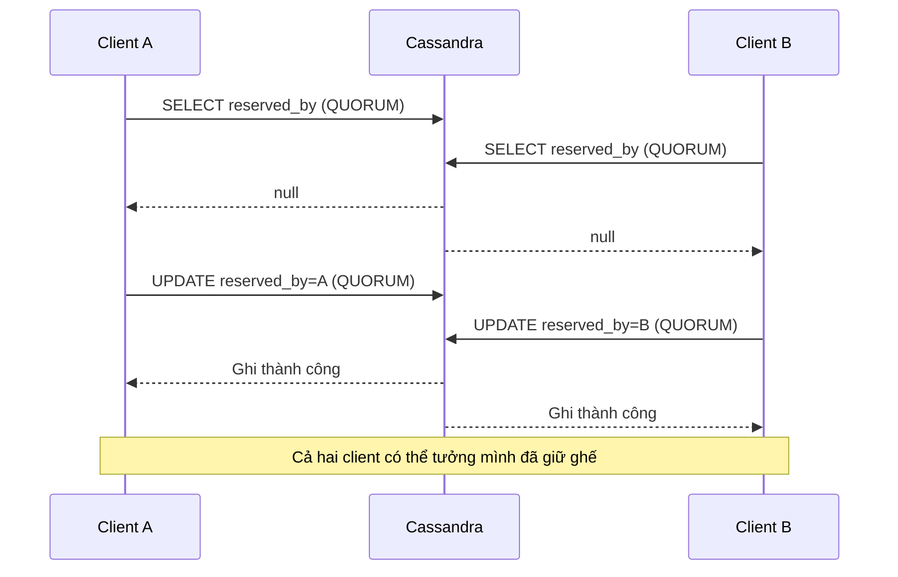
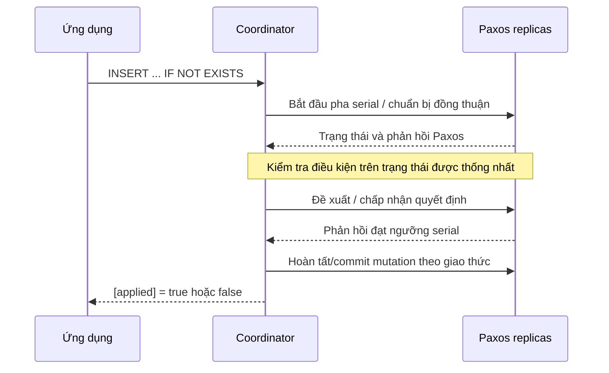

# SERIAL/LOCAL_SERIAL và phân biệt với mức nhất quán thông thường

Khi học về **nhất quán đọc/ghi** trong Apache Cassandra, ta thường gặp `ONE`, `QUORUM`, `LOCAL_QUORUM` hoặc `ALL`. Các mức này chủ yếu xác định **bao nhiêu replica phải phản hồi cho một thao tác đọc/ghi thông thường**. Nhưng nếu hai client đồng thời cố tạo một bản ghi duy nhất hoặc chuyển trạng thái chỉ khi thỏa điều kiện, việc tăng số ACK **không biến thao tác thành compare-and-set nguyên tử**.

Cassandra cung cấp **lightweight transaction (LWT)** dựa trên Paxos để thực hiện các câu lệnh có điều kiện như `INSERT ... IF NOT EXISTS` hoặc `UPDATE ... IF ...`. Khi dùng LWT, có thêm hai mức **serial consistency**: `SERIAL` và `LOCAL_SERIAL`. Chúng điều khiển **phạm vi đồng thuận cho pha serial/Paxos**, khác với CL thông thường điều khiển phản hồi của đường đọc/ghi dữ liệu.

Bài này thuộc chương **Nhất quán đọc/ghi** của mô-đun `DATABASE_ENGINE_WIDE_COLUMN_CASSANDRA`. Trong quá trình tìm hiểu kiến trúc phân tán và mô hình wide-column của Cassandra, partition key, thiết kế bảng theo truy vấn, replication, CQL, compaction, repair, xử lý lỗi và tích hợp Java, mục tiêu ở đây là biết **khi nào cần LWT**, **chọn SERIAL hay LOCAL_SERIAL**, và **phối hợp chúng với mức nhất quán thông thường mà không nhầm lẫn các bảo đảm**.

> **Ý chính:** `QUORUM`/`LOCAL_QUORUM` là mức phản hồi cho các request đọc/ghi thông thường; `SERIAL`/`LOCAL_SERIAL` là mức đồng thuận của **LWT** (và có ý nghĩa với những lần đọc serial được hỗ trợ). Chúng **không phải hai tên khác của cùng một ngưỡng**.

## 1. Mục tiêu học tập

Sau bài này, bạn có thể:

1. Giải thích vì sao quorum đọc/ghi không tự ngăn hai client cùng cập nhật một bản ghi.
2. Mô tả nguyên lý Paxos/LWT và ý nghĩa của `[applied]` trong câu lệnh có `IF`.
3. Phân biệt **normal consistency level** với **serial consistency level**.
4. Nêu sự khác nhau về **phạm vi datacenter** giữa `SERIAL` và `LOCAL_SERIAL`.
5. Chọn cặp serial CL + normal CL phù hợp cho thao tác điều kiện, đặc biệt ở cụm nhiều DC.
6. Thực hành CQL và Java Driver 4.x, xử lý `[applied]=false`, timeout và retry chưa rõ kết quả.
7. Nhận diện giới hạn của LWT theo partition, chi phí hiệu năng và các lỗi thiết kế thường gặp.

## 2. Bài toán: vì sao ghi QUORUM vẫn không phải một phép kiểm tra-và-ghi?

Giả sử có một hàng mô tả một ghế trong suất chiếu phim:

```text
seat_key = "show-42:A07"
reserved_by = null
```

Hai client cùng muốn đặt ghế. Nếu ứng dụng tách bước kiểm tra và bước ghi:



Với RF=3, ghi `QUORUM` cần hai ACK. **Cả hai lần `UPDATE` vẫn có thể đạt hai ACK**; Cassandra sẽ hòa giải giá trị cuối cùng theo timestamp. Quorum ACK không tự cấp quyền độc quyền cho người ghi đầu tiên.

Kể cả khi thay `QUORUM` bằng `ALL`, hai câu `SELECT` và `UPDATE` vẫn **không phải một thao tác nguyên tử**. Khoảng trống giữa kiểm tra điều kiện và ghi là một **race condition**.

Thứ ứng dụng thật sự cần là một yêu cầu duy nhất: **“Chỉ tạo đặt chỗ nếu ghế chưa được đặt; trả lời tôi có phải người thắng hay không.”**

## 3. LWT là gì? Paxos giải quyết cạnh tranh ra sao?

**Lightweight transaction (LWT)** là cơ chế Cassandra sử dụng **Paxos** để thực hiện một mutation **có điều kiện**. Nó cho phép nhiều coordinator cạnh tranh trên cùng partition đạt được quyết định nhất quán về việc có áp dụng điều kiện hay không.

Các câu lệnh thường tạo LWT:

- `INSERT ... IF NOT EXISTS` — chỉ tạo hàng nếu hàng chưa tồn tại.
- `UPDATE ... IF column = value` — chỉ cập nhật khi điều kiện hiện tại đúng.
- `DELETE ... IF ...` — xóa có điều kiện, theo cú pháp được phiên bản hỗ trợ.
- Một số câu lệnh `BATCH` có điều kiện với ràng buộc phù hợp; **không** suy ra có transaction ACID đa partition.

### Vòng đời đơn giản hóa

Paxos vận hành bằng nhiều lượt trao đổi giữa coordinator và các replica tham gia, thường có các bước khái niệm **prepare/promise**, **đề xuất và chấp nhận**, rồi **chốt/quảng bá quyết định**. Chi tiết tối ưu và số lượt thông điệp có thể thay đổi theo phiên bản Cassandra và trạng thái cạnh tranh.



Đây là **sơ đồ khái niệm**, không phải dấu vết mạng chính xác của mọi phiên bản Cassandra. Điểm quan trọng là các lần cập nhật có điều kiện trên **cùng partition, cùng phạm vi đồng thuận** được phân xử bởi giao thức Paxos, thay vì hai client tự chạy một câu `SELECT` rồi ghi thường.

### Ý nghĩa của kết quả LWT

| Kết quả client nhận | Ý nghĩa nghiệp vụ có thể rút ra |
| --- | --- |
| `[applied] = true` | Điều kiện đã được chấp nhận và mutation có điều kiện được áp dụng theo kết quả request. |
| `[applied] = false` | Điều kiện không thỏa tại thời điểm được đánh giá bởi giao thức; client không được coi mình là người thắng. |
| Timeout / lỗi không xác định | **Chưa biết chắc** quyết định đã được áp dụng hay chưa; không tương đương `[applied]=false`. |

Đặc biệt: một request `INSERT ... IF NOT EXISTS` có thể **đã thành công** nhưng phản hồi bị mất. Nếu client retry, lần thứ hai có thể thấy hàng đã tồn tại và nhận `[applied]=false`. Cần cơ chế nhận diện yêu cầu cũ hoặc đối soát người sở hữu, thay vì vội kết luận một client khác đã thắng.

## 4. Hai trục nhất quán: normal CL và serial CL

Một thao tác LWT liên quan đến **hai khái niệm độc lập**:

1. **Normal consistency level** — ngưỡng/phạm vi của phần xử lý/commit đọc-ghi thông thường và phản hồi dữ liệu, ví dụ `QUORUM` hoặc `LOCAL_QUORUM`.
2. **Serial consistency level** — ngưỡng/phạm vi mà **pha đồng thuận Paxos** phải đáp ứng, dùng `SERIAL` hoặc `LOCAL_SERIAL`.

| Thuộc tính | Normal CL | Serial CL |
| --- | --- | --- |
| Ví dụ | `ONE`, `QUORUM`, `LOCAL_ONE`, `LOCAL_QUORUM`, `ALL` | `SERIAL`, `LOCAL_SERIAL` |
| Câu hỏi chính | Bao nhiêu replica phải phản hồi cho đường thao tác theo CL? | Paxos phải đạt đồng thuận trong phạm vi replica nào? |
| Dùng cho đọc/ghi thông thường? | **Có.** | Không thay thế normal CL cho ghi thường; có thể dùng trong **đọc serial** được hỗ trợ. |
| Vai trò trong LWT | Chọn mức nhất quán thông thường cho yêu cầu có điều kiện. | Chọn phạm vi đồng thuận cho điều kiện `IF`. |
| Đủ để bảo vệ `IF NOT EXISTS` khi dùng riêng? | **Không.** | Chỉ có ý nghĩa bảo vệ điều kiện khi **thực sự chạy LWT**. |

Một cấu hình minh họa trong Java Driver:

```java
BoundStatement statement = prepared.bind(seatKey, customerId, now)
    .setConsistencyLevel(DefaultConsistencyLevel.LOCAL_QUORUM)
    .setSerialConsistencyLevel(DefaultConsistencyLevel.SERIAL);
```

Đọc câu lệnh này là: **mutation có điều kiện** sử dụng normal CL `LOCAL_QUORUM` và pha serial dùng `SERIAL`. **Không** được đọc thành “có hai quorum cộng lại thành một quorum mạnh hơn” hay “`SERIAL` thay thế `LOCAL_QUORUM`”.

### Nếu không có `IF` thì sao?

```sql
UPDATE keyspace.table_name
SET value = 'B'
WHERE id = 11111111-1111-4111-8111-111111111111;
```

Đây là **ghi thông thường**, không phải LWT. Chỉ cấu hình `SERIAL` ở một tham số driver **không** làm câu `UPDATE` trên tự nhiên trở thành compare-and-set. Phải thể hiện điều kiện trong CQL, ví dụ `IF value = 'A'`, rồi kiểm tra `[applied]`.

## 5. `SERIAL`: phạm vi đồng thuận toàn replica liên quan

`SERIAL` yêu cầu pha serial của LWT sử dụng **quorum theo phạm vi replica toàn cục** của partition, không giới hạn trong một DC cụ thể. Với `NetworkTopologyStrategy` có nhiều DC, điều này có thể cần trao đổi qua mạng liên DC.

Giả sử:

```text
Keyspace:
  dc1: RF = 3  -> R1, R2, R3
  dc2: RF = 3  -> R4, R5, R6

Tổng số replica của partition: 6
Quorum toàn cục: floor(6/2) + 1 = 4
```

Về phép tính phạm vi, `SERIAL` đòi một **quorum Paxos của sáu replica**, tức ngưỡng đa số toàn cục là **4** trong ví dụ. Không bắt buộc phải nhận quorum **riêng từng DC**: đó là khái niệm khác với `EACH_QUORUM`.

**Ứng dụng phù hợp:** nhiều client ở các vùng khác nhau cùng muốn tạo **một tài nguyên duy nhất trên cùng partition**. Khi yêu cầu quyết định chung cho các cập nhật có điều kiện qua vùng, cần nhất quán phạm vi serial, định tuyến và cách chọn CL theo đúng topology.

**Đánh đổi:** `SERIAL` có thể tăng độ trễ vì Paxos phải hoàn tất nhiều lượt trao đổi; trong topology cân bằng `3+3`, một quorum toàn cục 4 phản hồi không thể chỉ đến từ một DC. Mất kết nối liên DC có thể làm các LWT cần `SERIAL` không đủ khả dụng.

## 6. `LOCAL_SERIAL`: phạm vi đồng thuận tại DC coordinator

`LOCAL_SERIAL` giới hạn pha đồng thuận Paxos trong **datacenter cục bộ của coordinator**. Quorum cho pha serial được tính bằng RF của DC đó.

Với `dc1` RF=3 và coordinator ở `dc1`:

\[
Q_{\text{local,dc1}} = \left\lfloor\frac{3}{2}\right\rfloor + 1 = 2
\]

Hai replica `dc1` đủ cho quorum Paxos local, không cần chờ một quorum `dc2` chỉ để thỏa `LOCAL_SERIAL`.

| Tiêu chí | `SERIAL` | `LOCAL_SERIAL` |
| --- | --- | --- |
| Phạm vi đồng thuận | Quorum trên tập replica toàn cục. | Quorum trong local DC của coordinator. |
| RF = `3+3` | Đa số **6**, tức 4 phản hồi cho ngưỡng quorum toàn cục. | Đa số **3** của DC coordinator, tức 2 phản hồi local. |
| Độ nhạy với WAN | Có thể phải đợi giao tiếp liên DC. | Không cần quorum xa cho riêng pha serial. |
| Phù hợp khi | Cần một phạm vi đồng thuận chung cho cạnh tranh qua DC. | LWT được tổ chức/định tuyến theo một DC và chấp nhận giới hạn phạm vi. |
| Rủi ro hiểu nhầm | Không phải transaction nhiều partition. | **Không mặc nhiên có quyết định serial thống nhất xuyên mọi DC** nếu những client ở các DC khác nhau cùng tranh chấp. |

### Cảnh báo: cùng tài nguyên nhưng hai local DC

Giả sử cùng một `seat_key` được client ở `dc1` và `dc2` đặt có điều kiện gần như đồng thời, nhưng mỗi client dùng `LOCAL_SERIAL` với coordinator tại DC riêng. Hai quorum Paxos local có thể **không giao nhau**:

```text
dc1: {A1, A2, A3}  -> local quorum {A1, A2}
dc2: {B1, B2, B3}  -> local quorum {B1, B2}

{A1, A2} ∩ {B1, B2} = ∅
```

Vì không có phần giao **bắt buộc** giữa hai nhóm, **không được suy ra từ `LOCAL_SERIAL` rằng các client ở mọi DC đều được phân xử bởi cùng một thứ tự serial toàn cục**. Nếu nghiệp vụ cần độc quyền qua nhiều DC, hãy cân nhắc `SERIAL` và một chiến lược sử dụng LWT nhất quán trong toàn ứng dụng, thay vì chọn `LOCAL_SERIAL` chỉ vì độ trễ thấp.

Ngược lại, khi mọi request cạnh tranh được định tuyến **vào cùng DC** và dùng cùng phạm vi Paxos, `LOCAL_SERIAL` có thể là lựa chọn phù hợp để giảm phụ thuộc WAN; điều kiện quan trọng nằm ở **phạm vi cạnh tranh của nghiệp vụ**.

## 7. Cặp CL thực tế trong cụm một và nhiều DC

### 7.1. Một DC, RF=3

Trong một datacenter duy nhất, `SERIAL` và `LOCAL_SERIAL` cùng xét ba replica của partition về **phạm vi**; quorum serial là 2. Dù ngưỡng giống nhau trong trường hợp này, **tên mức vẫn có ý nghĩa** khi topology được mở rộng sang DC khác.

Giả sử LWT dùng normal CL `QUORUM`: phần xử lý theo normal CL cũng cần quorum 2/3. Không nên coi đây là “một lần ghi đơn giản có hai ACK”; **Paxos phát sinh trao đổi bổ sung** và chi phí có thể khác đáng kể so với ghi thường.

### 7.2. Hai DC, RF=3+3

| Serial CL | Normal CL | Diễn giải |
| --- | --- | --- |
| `SERIAL` | `QUORUM` | Đồng thuận serial theo quorum toàn cục; normal CL cũng dùng quorum toàn cục. |
| `SERIAL` | `LOCAL_QUORUM` | Pha serial toàn cục; normal CL local theo DC coordinator. Hai ngưỡng **khác phạm vi**. |
| `LOCAL_SERIAL` | `LOCAL_QUORUM` | Pha serial và ngưỡng normal đều local; thường giảm chờ WAN nhưng cần xét cạnh tranh chéo DC. |
| `LOCAL_SERIAL` | `QUORUM` | Pha serial local, normal CL toàn cục; **normal quorum toàn cục không tự nâng pha Paxos thành SERIAL toàn cục**. |

**Điểm cần nhớ:** Không thể chỉ nhìn vào normal CL rồi kết luận **mức đồng thuận của điều kiện**. Ví dụ normal `QUORUM` và serial `LOCAL_SERIAL` **không đồng nghĩa** đã chạy Paxos toàn cục.

### 7.3. RF bất đối xứng

Giả sử `dc1: RF=3` và `dc2: RF=2`:

| Phạm vi | Ngưỡng quorum tính theo số replica |
| --- | --- |
| Serial `SERIAL` toàn cluster | `floor((3+2)/2)+1 = 3` |
| Serial `LOCAL_SERIAL` với coordinator dc1 | `floor(3/2)+1 = 2` |
| Serial `LOCAL_SERIAL` với coordinator dc2 | `floor(2/2)+1 = 2` |

Ví dụ này cho thấy **local DC của coordinator** là một phần của cấu hình nhất quán có ý nghĩa nghiệp vụ, không chỉ là lựa chọn hiệu năng. Không thể thay RF một DC rồi giữ nguyên tất cả giả định về quorum và độ sẵn sàng mà không tính lại.

## 8. CQL thực hành: IF NOT EXISTS và IF với SERIAL/LOCAL_SERIAL

Ví dụ môi trường **lab** có datacenter thực tên `dc1` và đủ ít nhất ba node phù hợp cho RF=3. Đổi tên DC theo topology thật trước khi chạy:

```sql
CREATE KEYSPACE IF NOT EXISTS serial_lab
WITH replication = {
  'class': 'NetworkTopologyStrategy',
  'dc1': 3
};

CREATE TABLE IF NOT EXISTS serial_lab.seat_reservation_by_key (
  seat_key text PRIMARY KEY,
  reserved_by uuid,
  reserved_at timestamp
);

CREATE TABLE IF NOT EXISTS serial_lab.order_state_by_id (
  order_id uuid PRIMARY KEY,
  state text,
  version int
);
```

Các bảng được thiết kế theo **truy vấn một partition**. `seat_key` và `order_id` là partition key; các request LWT cạnh tranh trên **cùng khóa** mới hướng tới cùng tập replica và cùng đối tượng đồng thuận.

### 8.1. INSERT có điều kiện

Trên `cqlsh`, normal CL được điều khiển bằng lệnh tương tác `CONSISTENCY`. Tùy phiên bản `cqlsh`, lệnh `SERIAL CONSISTENCY` cho phép đặt serial CL cho các câu lệnh LWT tiếp theo:

```sql
-- Lệnh của cqlsh; không phải phần của cú pháp INSERT.
CONSISTENCY QUORUM;
SERIAL CONSISTENCY SERIAL;

INSERT INTO serial_lab.seat_reservation_by_key (
  seat_key, reserved_by, reserved_at
) VALUES (
  'show-42:A07',
  11111111-1111-4111-8111-111111111111,
  '2026-11-21 09:00:00+0000'
) IF NOT EXISTS;
```

Kết quả minh họa khi tạo mới:

```text
 [applied]
-----------
      True
```

Nếu client khác thử tạo lại **cùng `seat_key`** với người đặt khác, câu lệnh có thể trả:

```text
 [applied] | seat_key    | reserved_by
-----------+-------------+--------------------------------------
     False | show-42:A07 | 11111111-1111-4111-8111-111111111111
```

Các cột thông tin hiện ra khi điều kiện không đạt phụ thuộc câu lệnh/phiên bản; **thành phần bắt buộc ứng dụng phải kiểm tra là `[applied]`**, không dựa vào việc bảng kết quả có đúng các cột minh họa.

### 8.2. UPDATE theo phiên bản

```sql
-- Giả sử hàng hiện có state='CREATED', version=1.
CONSISTENCY QUORUM;
SERIAL CONSISTENCY SERIAL;

UPDATE serial_lab.order_state_by_id
SET state = 'PAID',
    version = 2
WHERE order_id = 22222222-2222-4222-8222-222222222222
IF version = 1;
```

Khi được áp dụng, request trả `[applied]=true`. Nếu một client khác đã thay `version` từ 1 thành 2 trước đó, request sẽ trả `false`. Đây là kiểu **optimistic concurrency control** mà `SELECT` rồi `UPDATE` thường ở `QUORUM` không tự tạo ra.

**Cảnh báo:** Nếu hàng chưa tồn tại, điều kiện `IF version = 1` không đúng; hãy chuẩn bị hàng ban đầu hoặc chọn luồng `IF NOT EXISTS` thích hợp. Đừng dùng `USING TIMESTAMP` tùy ý như một cách mô phỏng thứ tự commit của LWT: timestamp ứng dụng và Paxos xử lý vấn đề khác nhau.

### 8.3. Thử LOCAL_SERIAL có kiểm soát

Trong một **lab một DC**, có thể chuyển serial consistency của `cqlsh`:

```sql
CONSISTENCY LOCAL_QUORUM;
SERIAL CONSISTENCY LOCAL_SERIAL;

INSERT INTO serial_lab.seat_reservation_by_key (
  seat_key, reserved_by, reserved_at
) VALUES (
  'show-42:A08',
  33333333-3333-4333-8333-333333333333,
  '2026-11-21 09:05:00+0000'
) IF NOT EXISTS;
```

Với RF=3 trong một DC, cả `SERIAL` và `LOCAL_SERIAL` đều hướng tới quorum của cùng ba replica về phạm vi. Khi làm bài thực hành nhiều DC, **không tự kết luận** `LOCAL_SERIAL` có cùng bảo đảm toàn cục chỉ vì hành vi một DC trông giống `SERIAL`.

Nếu `cqlsh` của bản phân phối không có lệnh đặt serial consistency như minh họa, hãy kiểm tra `HELP` của phiên bản đó và dùng Java Driver đặt thuộc tính trên statement; **không** ghép từ khóa `SERIAL` vào cuối `INSERT` hay `UPDATE` như một mệnh đề CQL.

## 9. Java Driver 4.x: đặt hai CL cho một statement LWT

Java Driver cho phép đặt normal CL và serial CL **độc lập** trên `BoundStatement`. Đoạn dưới đây giả định đã có `CqlSession` với local datacenter, contact points và bảo mật cấu hình đúng:

```java
import com.datastax.oss.driver.api.core.CqlSession;
import com.datastax.oss.driver.api.core.DefaultConsistencyLevel;
import com.datastax.oss.driver.api.core.cql.BoundStatement;
import com.datastax.oss.driver.api.core.cql.PreparedStatement;
import com.datastax.oss.driver.api.core.cql.ResultSet;

import java.time.Instant;
import java.util.UUID;

public final class SeatReservationRepository {
    private final CqlSession session;
    private final PreparedStatement insertIfAbsent;

    public SeatReservationRepository(CqlSession session) {
        this.session = session;
        this.insertIfAbsent = session.prepare(
            "INSERT INTO serial_lab.seat_reservation_by_key " +
            "(seat_key, reserved_by, reserved_at) " +
            "VALUES (?, ?, ?) IF NOT EXISTS");
    }

    public boolean reserveGlobally(
            String seatKey, UUID customerId, Instant reservedAt) {
        BoundStatement request = insertIfAbsent.bind(
                seatKey, customerId, reservedAt)
            .setConsistencyLevel(DefaultConsistencyLevel.QUORUM)
            .setSerialConsistencyLevel(DefaultConsistencyLevel.SERIAL);

        ResultSet result = session.execute(request);
        return result.wasApplied();
    }

    public boolean reserveWithinLocalScope(
            String seatKey, UUID customerId, Instant reservedAt) {
        BoundStatement request = insertIfAbsent.bind(
                seatKey, customerId, reservedAt)
            .setConsistencyLevel(DefaultConsistencyLevel.LOCAL_QUORUM)
            .setSerialConsistencyLevel(DefaultConsistencyLevel.LOCAL_SERIAL);

        ResultSet result = session.execute(request);
        return result.wasApplied();
    }
}
```

Ở đây:

- `setConsistencyLevel(...)` đặt **normal CL**.
- `setSerialConsistencyLevel(...)` đặt **serial CL**.
- `result.wasApplied()` kiểm tra kết quả điều kiện; **không** coi việc `execute()` không ném lỗi là bằng chứng `IF` thành công.

Đây là ví dụ về hai **phạm vi nghiệp vụ khác nhau**, không phải hai phương thức nên dùng luân phiên cho **cùng tài nguyên**. Với dữ liệu cần độc quyền giữa các vùng, nên áp dụng một quy tắc nhất quán cho mọi client; pha trộn các phạm vi serial có thể làm giả định về đồng thuận bị sai.

### Dùng execution profile

Khi nhiều truy vấn LWT có chung chính sách, có thể đặt normal/serial consistency trong **execution profile** của Java Driver và vẫn override cho từng statement khi cần. Tuy nhiên, hồ sơ cấu hình không thay thế việc xác định **đây có phải một truy vấn có điều kiện** và phạm vi tranh chấp của nó hay không.

### Không nhầm serial CL với lựa chọn coordinator

`LOCAL_SERIAL` tính theo **DC của coordinator**, không phải theo tên môi trường hoặc vùng của người sử dụng. Cấu hình local DC trong driver và cách routing yêu cầu là một phần quan trọng của thiết kế. Nếu ứng dụng cố ý ghi từ nhiều DC, phải phân tích lại tính đúng đắn của việc dùng `LOCAL_SERIAL` tại từng nơi.

## 10. Đọc ở SERIAL/LOCAL_SERIAL là gì?

Ngoài vai trò trong LWT, Cassandra có đường **serial read** được hỗ trợ. Về mặt ý nghĩa, đọc với `SERIAL` hoặc `LOCAL_SERIAL` có thể kiểm tra một giao dịch Paxos đang ở trạng thái chưa hoàn tất và tham gia xử lý để kết quả đọc phù hợp với trạng thái LWT trong **phạm vi serial tương ứng**.

Điều đó **khác** với một `SELECT` thường ở `QUORUM`:

- `SELECT` ở `QUORUM`/`LOCAL_QUORUM` chủ yếu dựa vào phản hồi replica, data/digest và reconciliation thông thường.
- Đọc serial còn có ngữ nghĩa liên quan đến **các LWT đang chờ hoàn tất**, nên có thể cần thêm trao đổi và tốn chi phí hơn.
- Đọc serial **không** biến mọi mutation bình thường không có `IF` thành các transaction Paxos đã được đồng thuận.

**Không mặc định áp dụng serial read cho toàn bộ truy vấn** chỉ để “mạnh hơn quorum”. Hãy dùng khi yêu cầu nghiệp vụ cần quan sát trạng thái LWT và phiên bản Cassandra/driver hỗ trợ đường đọc đó; kiểm tra kỹ phạm vi local hay global, đặc điểm latency và cấu hình thực tế.

## 11. Lỗi timeout, retry và kết quả chưa xác định

Một LWT cần nhiều bước trao đổi nên vẫn có thể xảy ra timeout hoặc coordinator mất kết nối ở các thời điểm khác nhau. Phân biệt:

| Tình huống | Kết luận an toàn |
| --- | --- |
| `[applied]=true` | Điều kiện đã thành công theo kết quả LWT. |
| `[applied]=false` | Điều kiện không đạt; mutation có điều kiện không được áp dụng như client yêu cầu. |
| Timeout ở pha Paxos hoặc phản hồi commit | **Chưa biết chắc** điều kiện đã áp dụng hay chưa. |
| Không đủ replica đạt serial quorum | Không thể xác nhận quyết định LWT ở phạm vi đã chọn. |
| Không đủ replica đạt normal CL | Request không thể được xác nhận ở normal CL yêu cầu; cần xem lỗi cụ thể. |

Trên đường thất bại có thể gặp các lỗi thuộc nhóm **Unavailable**, **WriteTimeout**, **WriteFailure** hoặc lỗi/timeout đặc thù của CAS tùy driver và phiên bản. Tên exception cụ thể không thay đổi nguyên tắc: **không coi timeout là `[applied]=false`**.

### Mẫu retry an toàn cho đặt ghế

Giả sử `reserveGlobally("show-42:A07", customerA, t)` timeout:

1. **Giữ nguyên** `seat_key`, `customerId` và một mã yêu cầu/operation ID ổn định.
2. Đọc trạng thái hiện tại theo đường nhất quán phù hợp, có thể dùng đường đọc serial khi cần xem trạng thái LWT đang chờ hoàn tất.
3. Nếu hàng đã thuộc về chính yêu cầu trước đó, xử lý theo quy tắc **idempotent** của ứng dụng; không nhất thiết gửi tạo mới một ghế khác.
4. Nếu hàng thuộc người khác, xử lý như xung đột nghiệp vụ.
5. Nếu trạng thái vẫn chưa xác định, retry có giới hạn và ghi nhận sự kiện để đối soát, tránh gửi vô hạn khi cluster đang lỗi.

Nếu chỉ có `reserved_by` mà không có mã operation ID, hai yêu cầu của cùng khách hàng có thể khó phân biệt. Với nghiệp vụ quan trọng, thiết kế cột/khóa để nhận diện lần đặt chỗ, chứ không dựa hoàn toàn vào việc request có trả `true` hay không.

### Race condition không biến mất khi trộn ghi thường và LWT

Nếu một dịch vụ dùng `UPDATE` thông thường để sửa `reserved_by` trong khi dịch vụ khác dùng `INSERT ... IF NOT EXISTS`, không thể khẳng định mọi thay đổi trên tài nguyên đều được bảo vệ theo cùng một trật tự Paxos. Muốn duy trì một bất biến nghiệp vụ, **tất cả các đường ghi ảnh hưởng bất biến đó** phải tuân thủ giao thức thích hợp; tránh “lối tắt” ghi thường có thể ghi đè kết quả LWT.

## 12. LWT không phải transaction đa partition và không thay thế vận hành cluster

LWT cung cấp bảo đảm cập nhật có điều kiện trong **phạm vi partition** được xác định bởi CQL. Nó **không tự mang lại**:

- Giao dịch ACID nguyên tử cho hai partition khác nhau.
- Ràng buộc khóa ngoại hay unique constraint trên mọi partition.
- Một lịch sử linearizable cho tất cả thao tác đọc/ghi thường không dùng Paxos.
- Việc mọi replica ở mọi DC đều đã đồng bộ ngay tại cùng thời điểm theo một chính sách bất kỳ.
- Khả năng đọc/ghi không bị lỗi khi mạng chia cắt, replica down hoặc coordinator timeout.

Ví dụ đặt **hai ghế khác nhau** bằng hai câu `INSERT ... IF NOT EXISTS` không phải một thao tác “cả hai thành công hoặc cả hai thất bại” một cách mặc định. Nếu một đơn hàng cần đồng thời đặt hai ghế ở **hai partition khác nhau**, ứng dụng cần thiết kế mô hình dữ liệu, trạng thái bù trừ hoặc một hệ thống giao dịch phù hợp.

Các cơ chế **hinted handoff, anti-entropy repair, read reconciliation** và **compaction** vẫn có vai trò riêng trong duy trì và vận hành Cassandra. Chúng không thay thế Paxos để phân xử cạnh tranh, còn Paxos không thay thế lịch repair cho các replica bị bỏ lỡ mutation.

## 13. Chọn cách làm theo yêu cầu nghiệp vụ

| Nhu cầu | Cơ chế thường cân nhắc | Điều cần chú ý |
| --- | --- | --- |
| Ghi sự kiện độc lập với primary key ổn định | Ghi thường ở `LOCAL_QUORUM` hoặc CL phù hợp | Không cần Paxos nếu không có điều kiện cạnh tranh. |
| Đọc sau ghi trong cùng DC, không có cập nhật cạnh tranh | Ghi/đọc `LOCAL_QUORUM` | Giao nhau quorum trong cùng replica set, nhưng không bảo vệ `IF`. |
| Chỉ một client được tạo một khóa | `INSERT ... IF NOT EXISTS` + serial CL thích hợp | Kiểm tra `[applied]` và xử lý timeout chưa rõ kết quả. |
| Chuyển trạng thái theo version | `UPDATE ... IF version = ?` | Kết hợp version ứng dụng với LWT, không tách `SELECT` rồi ghi. |
| Cạnh tranh tạo cùng tài nguyên từ nhiều DC | Cân nhắc `SERIAL` và định tuyến/phạm vi toàn cục phù hợp | `LOCAL_SERIAL` riêng từng DC không tự bảo đảm đồng thuận xuyên DC. |
| Cạnh tranh chỉ trong một DC, ưu tiên giảm WAN | Cân nhắc `LOCAL_SERIAL` + normal `LOCAL_QUORUM` | Phải bảo đảm các client cạnh tranh sử dụng cùng local scope. |
| Cần transaction nguyên tử giữa nhiều partition | Thiết kế lại mô hình/giao thức nghiệp vụ hoặc công nghệ giao dịch khác | LWT riêng từng partition chưa giải quyết. |

## 14. Bài tập và đáp án

### Bài 1 — QUORUM có thay LWT không?

RF=3. Hai client cùng `SELECT QUORUM` thấy ghế trống, rồi cùng `UPDATE QUORUM` để đặt. Hai client có thể cùng được ACK thành công không?

**Đáp án:** Có. Hai câu `SELECT` và `UPDATE` không tạo một phép kiểm tra-và-ghi nguyên tử. Dùng `INSERT ... IF NOT EXISTS` hoặc `UPDATE ... IF ...` cho bất biến “chỉ một người đặt”.

### Bài 2 — Hai consistency level của một LWT

Trong Java Driver, một statement có `setConsistencyLevel(LOCAL_QUORUM)` và `setSerialConsistencyLevel(SERIAL)`. Phần nào điều khiển Paxos?

**Đáp án:** `SERIAL` điều khiển **pha serial/Paxos**; `LOCAL_QUORUM` điều khiển **normal CL**. Không được xem `LOCAL_QUORUM` là phạm vi Paxos trong trường hợp này.

### Bài 3 — Một DC RF=3

Một cụm chỉ có `dc1` RF=3. Tính quorum về số replica cho `SERIAL` và `LOCAL_SERIAL`.

**Đáp án:** Cả hai có phạm vi cùng ba replica trong cấu hình một DC; quorum là `floor(3/2)+1=2`. Khi mở rộng sang nhiều DC, ý nghĩa phạm vi sẽ khác nhau.

### Bài 4 — Hai DC RF=3+3

Cần bao nhiêu replica cho quorum serial toàn cục? Quorum local của `dc1` là bao nhiêu?

**Đáp án:** `SERIAL` toàn cục xét 6 replica, quorum=4. `LOCAL_SERIAL` tại `dc1` xét 3 replica, quorum=2.

### Bài 5 — Tranh chấp giữa hai DC

Hai client đặt cùng `seat_key`, một ở `dc1` và một ở `dc2`, mỗi client chọn `LOCAL_SERIAL` của DC mình. Có thể chỉ dựa vào `LOCAL_SERIAL` để chứng minh chỉ một client thắng trên toàn cluster không?

**Đáp án:** Không. Hai quorum Paxos local có thể không giao nhau. Muốn bảo vệ bất biến toàn vùng, cần phạm vi serial phù hợp, thường cân nhắc `SERIAL` và bảo đảm các đường truy cập tuân thủ cùng giao thức.

### Bài 6 — Ý nghĩa `[applied]`

Lệnh `INSERT ... IF NOT EXISTS` trả `[applied]=false` nhưng driver không ném exception. Có nên trả HTTP 201 Created không?

**Đáp án:** Không. Điều kiện không thỏa; ứng dụng cần phân loại xung đột/đã tồn tại theo nghiệp vụ, thay vì suy rằng request thành công chỉ vì không ném lỗi.

### Bài 7 — Timeout rồi retry

LWT tạo ghế bị timeout. Retry cùng khóa trả `[applied]=false`. Có chắc một client khác đã thắng không?

**Đáp án:** Không. Request đầu có thể đã được áp dụng nhưng mất phản hồi. Cần đọc/đối soát `reserved_by` và operation ID để nhận diện yêu cầu trước.

### Bài 8 — Normal QUORUM + LOCAL_SERIAL

Trong cụm `3+3`, client dùng normal `QUORUM` nhưng serial `LOCAL_SERIAL`. Điều đó có biến pha Paxos thành quorum toàn cluster không?

**Đáp án:** Không. Normal CL và serial CL được điều khiển độc lập; pha Paxos vẫn theo phạm vi `LOCAL_SERIAL`.

### Bài 9 — Nhiều partition

Ứng dụng phải giữ hai ghế có hai `seat_key` khác nhau cùng lúc. Hai lệnh `INSERT ... IF NOT EXISTS` thành công có chứng minh tính nguyên tử của cả nhóm ghế không?

**Đáp án:** Không. Mỗi điều kiện được giải quyết ở partition tương ứng; muốn “cả hai hoặc không ghế nào” cần thiết kế quy trình/giao dịch phù hợp.

### Bài 10 — Đọc serial

Một nhóm muốn dùng `SERIAL` cho mọi `SELECT` thay vì `QUORUM` để “luôn có dữ liệu mới nhất” mà không chạy LWT. Đề xuất này có đúng không?

**Đáp án:** Không. Serial read có ý nghĩa liên quan trạng thái các giao dịch Paxos/LWT chưa hoàn tất và tốn chi phí riêng; nó không biến những ghi thường thành lịch sử linearizable hoặc thay thế thiết kế CL đúng.

## 15. Checklist trước khi chọn SERIAL/LOCAL_SERIAL

Trước khi triển khai LWT cho một dịch vụ Java, hãy kiểm tra:

1. **Bất biến nào phải bảo vệ?** Chỉ một người đặt ghế, chỉ một transition theo version hay một yêu cầu khác?
2. **Partition key nào đại diện cho tài nguyên?** Hai client cạnh tranh phải cùng hướng tới một partition phù hợp.
3. **Mọi đường ghi có cùng giao thức không?** Ghi thường ngoài LWT có thể phá bất biến.
4. **Client có cạnh tranh xuyên datacenter không?** Nếu có, đừng dựa mù quáng vào `LOCAL_SERIAL` riêng từng DC.
5. **Normal CL được chọn riêng chưa?** `setConsistencyLevel` và `setSerialConsistencyLevel` giải quyết hai việc khác nhau.
6. **Có kiểm tra `[applied]` không?** Không chỉ kiểm tra request có ném exception hay không.
7. **Timeout xử lý thế nào?** Giữ khóa và operation ID ổn định, phân biệt chưa rõ kết quả với điều kiện `false`.
8. **Đã đo chi phí Paxos chưa?** Latency, contention, retry và throughput có thể khác đáng kể so với ghi thường.
9. **Topology/RF có ổn định không?** Tính quorum theo đúng phạm vi và DC coordinator.
10. **Có giả định transaction đa partition không?** Nếu có, cần thiết kế/giao thức bổ sung.

## 16. Kết luận

`SERIAL` và `LOCAL_SERIAL` là hai mức **serial consistency** của Cassandra cho pha đồng thuận Paxos trong **lightweight transaction**. `SERIAL` xét quorum toàn bộ replica liên quan; `LOCAL_SERIAL` chỉ xét quorum trong datacenter của coordinator. Chúng khác với normal CL như `QUORUM` hay `LOCAL_QUORUM`, vốn điều khiển đường phản hồi đọc/ghi thông thường và là một trục cấu hình riêng trong LWT.

**Quorum có giao nhau không đồng nghĩa thao tác kiểm tra-và-ghi nguyên tử.** Khi hai client có thể cùng cập nhật một tài nguyên, hãy biểu diễn điều kiện trực tiếp trong `IF NOT EXISTS` hoặc `IF ...`, chọn serial scope phù hợp với nơi các client cạnh tranh, kiểm tra `[applied]` và xử lý timeout như **kết quả chưa xác định**. Khi không có bất biến cần tranh chấp, ghi thường ở CL phù hợp có thể đơn giản và tiết kiệm chi phí hơn.

### Tài liệu tham khảo

- [Apache Cassandra — Dynamo / Tunable Consistency](https://cassandra.apache.org/doc/stable/cassandra/architecture/dynamo.html): quorum, replica và nguyên lý nhất quán điều chỉnh được.
- [Apache Cassandra — CQL Data Manipulation](https://cassandra.apache.org/doc/stable/cassandra/developing/cql/dml.html): `INSERT`, `UPDATE` với `IF` và các thao tác có điều kiện.
- [Apache Cassandra — CQL](https://cassandra.apache.org/doc/stable/cassandra/developing/cql/index.html): cú pháp CQL và bối cảnh của LWT.
- [Apache Cassandra — cqlsh](https://cassandra.apache.org/doc/stable/cassandra/managing/tools/cqlsh.html): các lệnh tương tác `CONSISTENCY` và khả năng đặt serial consistency theo phiên bản.
