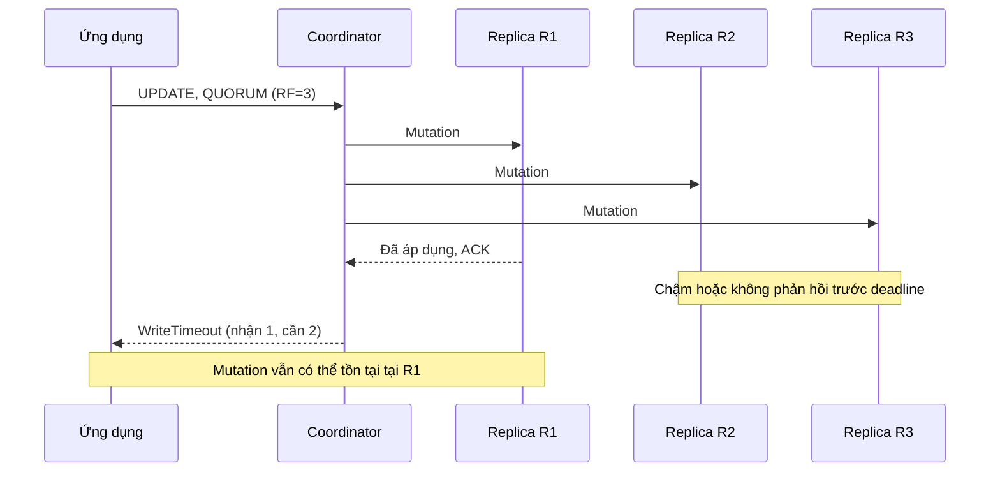

# Timeout và kết quả chưa biết của thao tác ghi

Một ứng dụng Java gọi `UPDATE` vào Apache Cassandra và nhận **`WriteTimeoutException`**. Có thể kết luận bản ghi chưa được cập nhật rồi gửi lại một lệnh ghi mới không? **Không.** Timeout chỉ cho biết một yêu cầu **chưa được xác nhận hoàn tất theo điều kiện đang chờ trước thời hạn**, chứ không chứng minh mọi replica đều từ chối mutation. Một hoặc nhiều replica có thể đã áp dụng ghi; thậm chí coordinator có thể đã nhận đủ ACK nhưng client không nhận được phản hồi cuối vì đường mạng hoặc timeout phía driver.

Bài này thuộc chương **Nhất quán đọc/ghi** của mô-đun `DATABASE_ENGINE_WIDE_COLUMN_CASSANDRA`. Mô-đun tìm hiểu kiến trúc phân tán và mô hình wide-column của Cassandra, partition key, thiết kế bảng theo truy vấn, CQL, replication, compaction, repair, xử lý lỗi và kết nối từ ứng dụng Java. Trọng tâm ở đây là **phân biệt lỗi thời gian chờ với kết quả thực tế của thao tác ghi**, sau đó thiết kế **retry, idempotency và đối soát** đúng với các mức nhất quán.

> **Quy tắc cốt lõi:** **Không nhận ACK thành công ≠ biết chắc chưa ghi.** Với `WriteTimeout`, `WriteFailure`, timeout phía client hoặc kết nối bị cắt, trạng thái cuối cùng của mutation đối với ứng dụng có thể **chưa xác định** (*unknown outcome*). Hãy giữ ổn định định danh nghiệp vụ, tránh retry mù các thao tác không idempotent và có quy trình xác minh.

## 1. Mục tiêu học tập

Sau bài này, bạn có thể:

1. Mô tả các giai đoạn của một request ghi: client, coordinator, replica, ACK và phản hồi về client.
2. Phân biệt `UnavailableException`, `WriteTimeoutException`, `WriteFailureException` và timeout/kết nối phía driver.
3. Lập luận vì sao một mutation có thể đã được áp dụng một phần hoặc toàn bộ khi client vẫn thấy lỗi.
4. Hiểu ảnh hưởng của `ONE`, `QUORUM`, `LOCAL_QUORUM`, `ALL`, `ANY` và `EACH_QUORUM` đối với số ACK cần chờ và kiểu failure.
5. Phân loại thao tác **có thể retry an toàn** và những thao tác đòi idempotency key hoặc đối soát.
6. Thực hành CQL và Java Driver 4.x với consistency level, timestamp ổn định, timeout và chính sách retry có giới hạn.
7. Xử lý tình huống LWT, batch, counter và ghi liên quan nhiều bảng mà không suy luận quá mức từ response.

## 2. Một thao tác ghi đi qua những đâu?

Trong Cassandra, partition key và replication strategy xác định những **replica đích** giữ một partition. Client kết nối tới một node làm **coordinator**; node này điều phối mutation tới các replica thích hợp. Consistency level (CL) xác định **bao nhiêu phản hồi hợp lệ từ replica, trong phạm vi nào**, phải được nhận trước khi báo ghi thành công.

Giả sử keyspace có **RF = 3** ở một datacenter, partition `P` nằm trên `R1`, `R2`, `R3` và ghi ở `QUORUM`:

```text
Ứng dụng Java          Coordinator C             Replica của P
      |                      |                         R1 R2 R3
      |---- UPDATE P ------->|------------------------> |  |  |
      |                      |<---- ACK R1 ------------|  |  |
      |                      |<-------- ACK R2 -----------|  |
      |                      |    R3 có thể chưa ACK          |
      |<--- thành công ------|                         |

Với RF=3, QUORUM = floor(3/2)+1 = 2 ACK.
```

Ở replica, một mutation ghi thông thường được xử lý qua cơ chế lưu trữ của Cassandra, thường liên quan **commit log** và **memtable**, trước khi dữ liệu được flush/compaction theo chu trình riêng. Điều kiện phản hồi của CL không phải lời khẳng định **mọi replica đã flush SSTable** hoặc tất cả bản sao đang đồng nhất.

### Hai việc tách biệt

| Câu hỏi | Ai quyết định/chứng minh? |
| --- | --- |
| Replica có áp dụng mutation không? | Trạng thái thực tế của replica; client thường không quan sát trực tiếp từng replica. |
| Coordinator đã thu đủ ACK cho CL chưa? | Coordinator dựa vào phản hồi từ replica và ngưỡng CL. |
| Client đã nhận được phản hồi thành công chưa? | Đường truyền và deadline giữa client, driver và coordinator. |
| Mutation có được những client khác đọc thấy ngay không? | CL đọc/ghi, phạm vi replica, timestamp, reconciliation và ghi cạnh tranh. |
| Mutation cuối cùng có bền vững trước sự cố tiếp theo không? | Số bản sao đã nhận, cấu hình lưu trữ/commit log, tình trạng node, repair và đặc tính workload. |

Một thao tác có thể đã **được replica áp dụng**, nhưng **chưa được coordinator xác nhận đủ CL**; hoặc đã đạt CL nhưng **ACK trả về client bị mất**. Cả hai đường đều có thể tạo **unknown outcome** ở tầng ứng dụng.

## 3. Ba dòng thời gian gây hiểu lầm

### Trường hợp A — Một replica đã ghi, chưa đạt quorum



Kết quả: **request ghi không được xác nhận thành công ở `QUORUM`**, nhưng **không phải mọi replica đều chưa ghi**. Nếu ứng dụng tạo một bản ghi mới với ID khác để retry, có thể tạo dữ liệu trùng nghiệp vụ.

### Trường hợp B — Replica đã ghi nhưng ACK đến quá muộn

```text
t0: Coordinator gửi mutation cho R1, R2, R3.
t1: R1 đã áp dụng mutation và ACK.
t2: R2 đã áp dụng mutation; ACK của R2 bị trễ.
t3: Hết thời hạn chờ tại coordinator -> WriteTimeout.
t4: ACK của R2 hoặc dữ liệu của R3 có thể đến sau deadline.
```

Tại `t3`, coordinator không thể cam kết `QUORUM` đúng hạn, dù `R2` có thể đã ghi. Do đó, **số ACK quan sát được ở thời điểm timeout không nhất thiết bằng số replica đã áp dụng mutation**.

### Trường hợp C — Server đã thành công, client không nhận được phản hồi

```text
t0: Client gửi UPDATE.
t1: Coordinator nhận đủ 2/3 replica ACK.
t2: Coordinator gửi kết quả thành công.
t3: Mạng client/coordinator gián đoạn; kết quả bị mất.
t4: Driver hết deadline, hoặc kết nối báo lỗi.

Trạng thái server: có thể đã đạt CL.
Trạng thái client: không nhận được xác nhận thành công.
```

Đây là ví dụ rõ nhất cho sự khác nhau giữa **thực thi trên server** và **kết quả quan sát được ở client**. Một hệ thống phân tán không thể suy ra trạng thái của mutation chỉ từ việc client không thấy response.

## 4. Phân loại lỗi: Unavailable, WriteTimeout, WriteFailure và driver timeout

| Lỗi hoặc tín hiệu | Nguyên nhân thường gặp | Ý nghĩa an toàn cho ứng dụng |
| --- | --- | --- |
| `UnavailableException` | Coordinator đánh giá không đủ replica *được coi là sống* để thỏa CL. | Yêu cầu **không được xác nhận theo CL**. Không khẳng định dữ liệu trước đó hoặc request khác chưa ghi. |
| `WriteTimeoutException` | Coordinator không thu đủ phản hồi hoặc không hoàn tất đường ghi trước timeout của server. | **Không biết chắc** mutation đã được áp dụng ở bao nhiêu replica. |
| `WriteFailureException` | Có replica báo lỗi xử lý khiến yêu cầu không thể đạt CL. | **Có thể đã có replica khác áp dụng mutation**; phải xét trạng thái chưa xác định. |
| `DriverTimeoutException` | Deadline chờ kết quả ở Java Driver kết thúc. | Driver không biết kết quả cuối; **server có thể vẫn đang xử lý hoặc đã hoàn tất**. |
| Lỗi kết nối/coordinator không còn liên lạc | Request hoặc phản hồi bị ngắt giữa chừng. | Có thể chưa đến server, đã đến server hoặc đã được áp dụng; cần đối soát. |
| Lỗi validation/CQL không hợp lệ | Câu lệnh không đúng cú pháp, schema, quyền truy cập… | Khác với timeout. Phải sửa nguyên nhân, không retry vô hạn. |

### 4.1. `Unavailable` là kiểm tra khả dụng theo CL

Nếu một partition RF=3 chỉ có một replica được coordinator coi là UP, ghi `QUORUM` cần hai ACK nhưng chưa đủ replica được xem là khả dụng. Coordinator có thể trả `UnavailableException` **mà không bắt đầu một lần ghi có thể thỏa CL**.

Điều này khác với timeout của một request đã được gửi tới replica. Tuy nhiên, đừng dùng câu “Unavailable chắc chắn không ghi gì” làm quy tắc nghiệp vụ tổng quát: hệ thống có thể có **request trước đó bị timeout, request từ client khác, hoặc trạng thái chưa hội tụ**, và client chỉ biết yêu cầu hiện tại không được xác nhận thành công.

### 4.2. `WriteTimeout` là thiếu xác nhận đúng hạn

`WriteTimeoutException` là một phản hồi lỗi từ phía Cassandra/coordinator khi không đạt điều kiện trong thời gian chờ được phép. Lỗi có thể đi kèm:

- CL đang dùng;
- số phản hồi nhận được và ngưỡng cần có;
- loại ghi (*write type*) như ghi thông thường, batch, counter hoặc CAS tùy giao thức/phiên bản.

**Đừng đọc trường `received` như số replica chắc chắn chưa áp dụng.** Nó là thông tin coordinator đã **nhận được**, không mô tả chính xác dữ liệu đang nằm ở đâu sau thời điểm lỗi.

### 4.3. `WriteFailure` là lỗi thực thi, không chỉ chậm

Một replica có thể trả về lỗi do I/O, tài nguyên hoặc xử lý nội bộ. Coordinator thấy số replica thành công còn lại không thể đáp ứng CL và trả `WriteFailureException`. Dù thế, những replica không lỗi **có thể đã ghi**. Chính sách retry phải cân nhắc nguyên nhân thật sự thay vì chỉ tăng timeout.

### 4.4. `DriverTimeout` xảy ra ở lớp khác

Driver có timeout tổng thể của request và cơ chế chọn host/retry riêng. Một `DriverTimeoutException` không phải thông điệp nói rằng coordinator **đã hủy toàn bộ mutation**. Việc client ngừng đợi không nhất thiết hủy những công việc đang thực hiện tại replica.

Khi điều tra, luôn phân biệt **server-side timeout** và **client-side timeout**, đặc biệt nếu deadline driver thấp hơn thời gian coordinator cần để xử lý request ở CL cao.

## 5. Mức nhất quán làm thay đổi ngưỡng timeout như thế nào?

Với **một DC, RF=3**, ngưỡng đọc/ghi thông thường là:

| CL | Ngưỡng ACK ghi | Nếu chỉ 1 replica phản hồi | Nếu 2 replica phản hồi | Đánh đổi |
| --- | ---: | --- | --- | --- |
| `ONE` | 1 | Có thể thành công | Có thể thành công | Ít phải chờ nhưng xác nhận từ ít replica. |
| `TWO` | 2 | Không đủ | Có thể thành công | Cần hai ACK. |
| `THREE` | 3 | Không đủ | Không đủ | Đòi cả ba ACK. |
| `QUORUM` | 2 | Không đủ | Có thể thành công | Đa số replica. |
| `ALL` | 3 | Không đủ | Không đủ | Rất nhạy với một replica chậm/lỗi. |
| `ANY` | Một replica ACK **hoặc** lưu hint thành công | Có thể thành công | Có thể thành công | Có thể trả thành công **chỉ nhờ hint**, không bảo đảm đọc thấy ngay. |

Nếu **0 replica đích phản hồi**, `ANY` vẫn **có thể** thành công khi coordinator còn hoạt động và lưu được hint phù hợp; `ONE` và `QUORUM` không đạt chỉ nhờ một hint. `ANY` **không hợp lệ cho `SELECT` thông thường**.

**Số lượng replica đủ theo bảng là điều kiện cần để có khả năng thành công, không phải bảo đảm deadline.** Hai replica UP nhưng đều bị mạng/ổ đĩa làm chậm vẫn có thể tạo `WriteTimeout` ở `QUORUM`.

### Hạ CL không “chữa” một trạng thái ghi chưa biết

Giả sử ghi `QUORUM` timeout khi một replica ACK. Nếu ứng dụng tự động retry ở `ONE` và nhận thành công:

- Lần thử mới chỉ chứng minh đạt ngưỡng `ONE`, không chứng minh lần thử trước đã thất bại.
- Hợp đồng nghiệp vụ đã thay đổi từ “đa số xác nhận” sang “một bản sao xác nhận”.
- Nếu retry dùng payload/ID/timestamp khác, có thể tạo hiệu ứng khác với mutation ban đầu.

**Không âm thầm giảm CL** khi API cam kết một mức bảo vệ dữ liệu cụ thể. Thay đổi đó phải là quyết định được thiết kế và chấp nhận rõ ràng.

## 6. Nhiều datacenter: timeout còn phụ thuộc phạm vi ACK

Giả sử `NetworkTopologyStrategy` với:

```text
dc1: RF=3 -> A1, A2, A3
dc2: RF=3 -> B1, B2, B3
Coordinator tại dc1
```

| CL ghi | Ngưỡng phải chờ | Mất hoàn toàn liên lạc với dc2, dc1 vẫn khỏe |
| --- | --- | --- |
| `LOCAL_ONE` | 1 ACK trong dc1 | Có thể thành công. |
| `LOCAL_QUORUM` | 2 ACK trong dc1 | Có thể thành công. |
| `QUORUM` | 4 ACK trong tổng 6 replica | Không đạt nếu dc1 tối đa chỉ có 3 ACK. |
| `EACH_QUORUM` | 2 ACK dc1 **và** 2 ACK dc2 | Không đạt do dc2 không phản hồi. |
| `ALL` | Đủ 6 ACK | Không đạt. |

**Lưu ý thời điểm phát hiện lỗi:** Nếu coordinator đã xác định replica xa DOWN trước khi gửi, lỗi có thể là `Unavailable`. Nếu chúng vẫn được xem là UP nhưng ACK qua WAN quá chậm, có thể là `WriteTimeout`. Một mạng chia cắt có thể xuất hiện dưới **nhiều dạng lỗi** tùy trạng thái liveness và deadline.

### QUORUM khác EACH_QUORUM

RF=`3+3` cho `QUORUM=4` ACK **bất kỳ**, còn ghi `EACH_QUORUM` cần **ít nhất 2 từ mỗi DC**. Nếu nhận `3 ACK dc1 + 1 ACK dc2`:

- `QUORUM` đã có thể đạt ngưỡng tổng là 4.
- `EACH_QUORUM` vẫn **thiếu một ACK ở dc2**, có thể timeout.

Vì vậy, khi log cho biết “đã nhận bốn phản hồi”, không được tự kết luận mọi CL đều được thỏa.

### RF không cân bằng

Với `dc1: RF=5` và `dc2: RF=1`, tổng RF=6 nên `QUORUM=4` có thể được đáp ứng **chỉ từ dc1** nếu dc1 còn đủ replica. Ghi `EACH_QUORUM` vẫn cần **một ACK từ dc2**. Nói “QUORUM nhiều DC luôn cần ít nhất một ACK WAN” là sai khi RF lệch.

## 7. Ghi timeout rồi đọc lại: có đủ để biết kết quả không?

Một cách xử lý thường gặp là: **nếu ghi timeout, hãy `SELECT` để xem giá trị hiện tại**. Đây có thể là bước **đối soát hữu ích**, nhưng cần hiểu phạm vi của nó.

### Ví dụ một cell

Trước đó:

```text
shipment_id = S
status = CREATED
```

Client gửi `UPDATE status='IN_TRANSIT'` với CL `QUORUM` rồi nhận `WriteTimeout`. Đọc `QUORUM` sau đó:

| Giá trị quan sát | Có thể rút ra | Chưa được phép khẳng định |
| --- | --- | --- |
| `IN_TRANSIT` | Mutation mong muốn có thể đã được áp dụng/quan sát qua đường đọc. | Không nhất thiết mọi replica đã hội tụ; có thể client khác ghi cùng giá trị. |
| `CREATED` | Đọc đang quan sát trạng thái cũ hoặc phiên bản thắng khác. | **Không chứng minh mutation chưa được replica nào áp dụng.** |
| Không có hàng | Có thể chưa tạo, đã xóa, TTL hết hạn hoặc đọc trạng thái khác. | Không chứng minh request timeout chắc chắn chưa tới server. |
| `ReadTimeout` | Không hoàn tất được bước đối soát. | Không suy ra trạng thái ghi. |

Tại sao đọc giá trị cũ không đủ để kết luận “chưa ghi”? Có thể chỉ **một replica** đã nhận mutation, chưa đạt ghi quorum và tập replica của lần đọc quorum **không chứa replica ấy**. Điều kiện giao nhau `R+W>N` chỉ áp dụng khi **lần ghi đã đạt W**; không thể lấy `W=2` cho một lần ghi `QUORUM` bị timeout.

### Ghi cạnh tranh và timestamp

Cassandra hòa giải nhiều phiên bản của cùng cell thường bằng **timestamp (last-write-wins)**. Một mutation ghi sau theo đồng hồ thực nhưng có timestamp **nhỏ hơn** mutation cũ có thể không thắng. Một read sau timeout thấy `CREATED` còn có thể do một mutation cạnh tranh có timestamp cao hơn, không nhất thiết là lần ghi timeout chưa từng tới replica.

Nếu nghiệp vụ cần xác nhận **chính thao tác nào** đã thành công, chỉ so sánh `status` thường không đủ. Nên thiết kế **operation ID**, **event ID** hoặc **version** rõ ràng để đối soát, tránh giả định giá trị giống nhau là bằng chứng của cùng request.

### Không dùng trạng thái đọc làm transaction log

Một `SELECT` ngay sau timeout cho biết trạng thái logic **tại lúc đọc**, theo CL và replica được hỏi. Nó không tự cung cấp lịch sử “mutation nào đã từng được áp dụng rồi bị ghi đè”. Nếu cần **audit**, **chính xác một lần theo nghiệp vụ** hoặc giao hàng sự kiện, hãy thiết kế luồng sự kiện/idempotency riêng thay vì mong Cassandra tự khôi phục lịch sử từ giá trị mới nhất.

## 8. Idempotency: nền tảng của retry an toàn

Một thao tác được gọi là **idempotent** khi thực hiện nó nhiều lần có cùng hiệu quả logic như một lần, trong phạm vi giả định được nêu rõ. Đây là thuộc tính **của ngữ nghĩa thao tác**, không phải nhãn mà driver có thể làm cho một lệnh bất kỳ trở nên an toàn.

| Thao tác | Có thể retry đơn giản? | Vì sao? |
| --- | --- | --- |
| `UPDATE ... SET status='PAID'` cho cùng primary key, cùng timestamp và payload | **Thường có thể**, nếu không có side effect khác. | Lặp cùng mutation không thay đổi giá trị mong muốn. |
| `INSERT` với một primary key/event ID ổn định, nội dung ổn định | **Thường có thể**, cần kiểm tra timestamp/TTL. | Không tạo hàng mới mỗi lần gửi. |
| `INSERT` sinh UUID/event ID mới mỗi lần retry | **Không** theo nghĩa chống trùng sự kiện. | Có thể tạo nhiều hàng cho cùng nghiệp vụ. |
| `UPDATE counter SET count = count + 1` | **Không**. | Mỗi lần thực thi có thể tăng thêm một lần. |
| Thêm phần tử vào list bằng phép nối/cập nhật danh sách | **Không mặc định**. | Tùy loại mutation, có thể tạo phần tử lặp. |
| Lệnh ghi kết hợp gửi email/thanh toán bên ngoài | **Không mặc định**. | Cassandra không tự loại bỏ side effect ngoài database. |
| `INSERT ... IF NOT EXISTS` (LWT) lặp lại | **Cần đối soát**. | Lần đầu có thể đã thành công; lần sau trả `[applied]=false`. |

### 8.1. Khóa ổn định

Ứng dụng nên cấp **operationId** hoặc **eventId** **trước lần gửi đầu tiên** và tái sử dụng khi retry. Với mô hình wide-column, ví dụ một sự kiện được xác định bởi `(shipment_id, event_id)`; hãy **tạo keyspace `timeout_lab` ở Mục 9 trước khi chạy** ví dụ DDL này:

```sql
CREATE TABLE IF NOT EXISTS timeout_lab.event_by_shipment (
  shipment_id uuid,
  event_id uuid,
  occurred_at timestamp,
  event_type text,
  PRIMARY KEY ((shipment_id), event_id)
);
```

Nếu retry giữ nguyên `shipment_id` và `event_id`, ứng dụng không tạo một hàng mới chỉ vì mất ACK. Truy vấn sự kiện theo `shipment_id` phù hợp partition key; nếu cần sắp theo thời gian, nên cân nhắc mô hình clustering `(occurred_at, event_id)` và giữ **cả bộ khóa** ổn định.

### 8.2. Timestamp ổn định

Khi gửi lại cùng giá trị nhưng **timestamp mới**, Cassandra có thể coi đó là một phiên bản mới hơn. Điều này có thể ảnh hưởng các cập nhật từ client khác.

Ví dụ:

```text
t0: Client A ghi status='IN_TRANSIT' @ timestamp 100 -> timeout.
t1: Client B ghi status='DELIVERED'  @ timestamp 200 -> thành công.
t2: Client A retry status='IN_TRANSIT' @ timestamp 300.

Nếu A retry với timestamp mới 300, trạng thái IN_TRANSIT có thể
thắng DELIVERED dù về nghiệp vụ A chỉ đang retry request cũ.
```

Vì thế, với những mutation thường cần retry ổn định, hãy cân nhắc **giữ cùng timestamp CQL (microsecond) và cùng payload** giữa các lần thử; đồng thời xác định rõ chính sách sinh timestamp cho các request khác nhau. **Không tự dùng một timestamp quá cao** để “ép thắng” — điều đó có thể chặn những cập nhật hợp lệ về sau.

**Cảnh báo TTL:** Lặp lại lệnh có TTL có thể ảnh hưởng thời điểm hết hạn và metadata của cell; không nên mặc định rằng `INSERT/UPDATE` có TTL là idempotent hoàn toàn chỉ vì giá trị và primary key giống nhau. Counter, collection mutation và LWT cũng cần quy tắc riêng.

### 8.3. Đánh dấu idempotent cho Java Driver

Java Driver hỗ trợ đánh dấu một statement là **idempotent** để retry/speculative execution policy biết liệu việc gửi lại có thể an toàn **theo cam kết của ứng dụng**.

```java
BoundStatement write = prepared.bind(
        timestampMicros, status, eventTime, shipmentId)
    .setConsistencyLevel(DefaultConsistencyLevel.LOCAL_QUORUM)
    .setIdempotent(true);
```

`setIdempotent(true)` **không** tự cấp transaction ID, khử trùng lặp, điều chỉnh timestamp hay bảo đảm server chỉ thực thi một lần. Chỉ bật khi mutation thực sự được thiết kế an toàn nếu thực thi lại. Retry/speculative execution còn phụ thuộc cấu hình driver; tránh policy có thể tạo **retry storm** khi cluster đang quá tải.

## 9. Thực hành CQL: tái hiện vấn đề trong lab

Giả sử có **cluster kiểm thử** thực sự chứa DC tên `dc1` và ít nhất ba node thích hợp cho RF=3. Chỉ dùng dữ liệu giả, không cố ý cắt mạng trên production.

```sql
CREATE KEYSPACE IF NOT EXISTS timeout_lab
WITH replication = {
  'class': 'NetworkTopologyStrategy',
  'dc1': 3
};

CREATE TABLE IF NOT EXISTS timeout_lab.shipment_by_id (
  shipment_id uuid PRIMARY KEY,
  status text,
  updated_at timestamp
);

CREATE TABLE IF NOT EXISTS timeout_lab.event_by_shipment (
  shipment_id uuid,
  event_id uuid,
  occurred_at timestamp,
  event_type text,
  PRIMARY KEY ((shipment_id), event_id)
);
```

### 9.1. Ghi ở QUORUM rồi đọc đối soát

```sql
CONSISTENCY QUORUM;

INSERT INTO timeout_lab.shipment_by_id (
  shipment_id, status, updated_at
) VALUES (
  11111111-1111-4111-8111-111111111111,
  'CREATED',
  '2026-11-21 10:00:00+0000'
);

-- Ghi một trạng thái mới với timestamp được cố định trong lab.
UPDATE timeout_lab.shipment_by_id
USING TIMESTAMP 1795260000000000
SET status = 'IN_TRANSIT',
    updated_at = '2026-11-21 10:05:00+0000'
WHERE shipment_id = 11111111-1111-4111-8111-111111111111;

-- Đọc cùng partition ở QUORUM để xem trạng thái logic hiện tại.
SELECT status, updated_at, WRITETIME(status)
FROM timeout_lab.shipment_by_id
WHERE shipment_id = 11111111-1111-4111-8111-111111111111;
```

`CONSISTENCY` là lệnh **của `cqlsh`**, đặt CL cho các câu lệnh thực thi sau nó. `USING TIMESTAMP` là phần **CQL**, giá trị tính bằng **microsecond**. Timestamp ở ví dụ chỉ mang tính minh họa và **không nên sao chép vào dữ liệu thật**.

`WRITETIME(status)` cho biết timestamp của cell logic đang thắng; nó **không** là bằng chứng rằng mọi replica đã ghi và cũng không cung cấp lịch sử của tất cả lần retry.

### 9.2. Thay đổi CL để thấy ngưỡng

```sql
CONSISTENCY ONE;

SELECT status
FROM timeout_lab.shipment_by_id
WHERE shipment_id = 11111111-1111-4111-8111-111111111111;

CONSISTENCY ALL;

SELECT status
FROM timeout_lab.shipment_by_id
WHERE shipment_id = 11111111-1111-4111-8111-111111111111;
```

Trong cluster khỏe mạnh, các lệnh thường cho cùng kết quả. Điều đó **không** chứng minh chúng sẽ cùng thành công khi replica bị chậm: RF=3, `ONE` cần 1 phản hồi, `QUORUM` cần 2 và `ALL` cần cả 3.

### 9.3. Tình huống quan sát lỗi có kiểm soát

Chỉ trong **lab được phép thao tác**, sau khi biết rõ replica của partition:

1. Ghi nhận RF, DC coordinator, CL và thời gian chờ đang cấu hình.
2. Thực hiện một baseline khi ba replica khỏe mạnh.
3. Mô phỏng **một replica chậm hoặc không phản hồi** bằng công cụ quản trị phù hợp của môi trường test.
4. Quan sát `QUORUM` còn có thể đạt 2/3; `ALL` không đạt nếu một replica không phản hồi.
5. Phân biệt `Unavailable` (replica bị coi là DOWN) với `WriteTimeout` (replica còn được coi là UP nhưng phản hồi chậm).
6. Khôi phục lab, kiểm tra log, hints và repair; đối soát dữ liệu cùng khóa.

Đừng cố “tạo timeout” bằng cách đẩy timeout toàn hệ thống xuống cực thấp trên cluster production. Bài học là **cách diễn giải và xử lý lỗi**, không phải gây lỗi để tái hiện bằng mọi giá.

## 10. Java Driver 4.x: kết quả ghi phải có trạng thái UNKNOWN

Một thiết kế tốt không ép mọi kết quả về hai trạng thái “đã ghi” và “chưa ghi”. Ví dụ sau dùng ba loại kết quả **`ACKNOWLEDGED`**, **`UNAVAILABLE`** và **`UNKNOWN`**.

Đoạn mã sử dụng `CqlSession` đã cấu hình local datacenter, contact points và authentication phù hợp; câu `UPDATE` được chuẩn bị một lần:

```java
import com.datastax.oss.driver.api.core.CqlSession;
import com.datastax.oss.driver.api.core.DefaultConsistencyLevel;
import com.datastax.oss.driver.api.core.DriverTimeoutException;
import com.datastax.oss.driver.api.core.cql.BoundStatement;
import com.datastax.oss.driver.api.core.cql.PreparedStatement;
import com.datastax.oss.driver.api.core.servererrors.UnavailableException;
import com.datastax.oss.driver.api.core.servererrors.WriteFailureException;
import com.datastax.oss.driver.api.core.servererrors.WriteTimeoutException;

import java.time.Instant;
import java.util.UUID;

public final class ShipmentWriter {
    public enum WriteOutcome {
        ACKNOWLEDGED,    // Server xác nhận đủ CL.
        UNAVAILABLE,     // Không đủ replica sẵn sàng theo coordinator.
        UNKNOWN          // Có thể đã ghi; client không xác nhận được.
    }

    private final CqlSession session;
    private final PreparedStatement update;

    public ShipmentWriter(CqlSession session) {
        this.session = session;
        this.update = session.prepare(
            "UPDATE timeout_lab.shipment_by_id USING TIMESTAMP ? " +
            "SET status = ?, updated_at = ? WHERE shipment_id = ?");
    }

    public WriteOutcome updateStatus(
            UUID shipmentId, String newStatus,
            Instant eventTime, long timestampMicros) {
        // timestampMicros và toàn bộ payload phải ổn định giữa các retry.
        BoundStatement statement = update.bind(
                timestampMicros, newStatus, eventTime, shipmentId)
            .setConsistencyLevel(DefaultConsistencyLevel.LOCAL_QUORUM)
            .setIdempotent(true); // Chỉ đúng nếu ngữ nghĩa mutation cho phép.

        try {
            session.execute(statement);
            return WriteOutcome.ACKNOWLEDGED;
        } catch (UnavailableException e) {
            // Không đủ replica theo đánh giá coordinator cho lần thử này.
            // Không khẳng định trạng thái toàn hệ thống "chưa ghi".
            return WriteOutcome.UNAVAILABLE;
        } catch (WriteTimeoutException
                 | WriteFailureException
                 | DriverTimeoutException e) {
            // Một số replica có thể đã áp dụng mutation, hoặc phản hồi bị mất.
            // Tầng nghiệp vụ phải đối soát/đưa vào quy trình retry có kiểm soát.
            return WriteOutcome.UNKNOWN;
        }
    }
}
```

Ví dụ không cố bắt **mọi loại exception**. Lỗi CQL sai, lỗi host đặc thù hoặc các lỗi ứng dụng khác phải được log và phân loại riêng; không nên im lặng chuyển tất cả thành `UNKNOWN` rồi lặp lại request.

**Giới hạn của `ACKNOWLEDGED`:** có nghĩa server xác nhận **đủ CL** đã chọn, **không** có nghĩa mọi replica đều đã đồng bộ hoặc mutation có một transaction toàn cục. Nếu dùng `LOCAL_QUORUM`, ACK chỉ bị ràng buộc bởi quorum trong DC coordinator.

### 10.1. Tách kỹ thuật ghi với nghiệp vụ

Tầng service có thể áp dụng cách xử lý:

| `WriteOutcome` | Hành vi nghiệp vụ |
| --- | --- |
| `ACKNOWLEDGED` | Ghi nhận response thành công theo CL; chỉ kích hoạt bước tiếp theo nếu hợp đồng API cho phép. |
| `UNAVAILABLE` | Trả lỗi hoặc xếp retry sau khi hạ tầng phục hồi; không tự hạ CL. |
| `UNKNOWN` | Trả trạng thái đang xác minh/đối soát, không khẳng định chắc đã ghi hay chưa; retry có kiểm soát nếu idempotent. |

Với API HTTP, một phương án là gán **operation ID** cho yêu cầu và cho client truy vấn trạng thái xử lý; mã HTTP cụ thể phụ thuộc hợp đồng API và cơ chế hàng đợi/đối soát, không được mặc định dùng một mã chung cho mọi hệ thống.

### 10.2. Timestamp phải được cấp có chủ đích

Trong ví dụ Java, `timestampMicros` được truyền vào như một phần của **định danh mutation lặp lại**. Nếu tự dùng `Instant.now()` và chuyển thành timestamp khác nhau ở từng lần thử, retry có thể vô tình ghi đè một trạng thái mới hơn.

Với các hệ thống có nhiều nguồn ghi, cần thêm quy tắc đồng bộ clock, thứ tự nghiệp vụ hoặc kiểm soát cạnh tranh. **Timestamp cố định chỉ giảm tác dụng ngoài ý muốn của retry**, không thay thế compare-and-set cho cập nhật có điều kiện.

## 11. LWT: timeout khi chưa biết `[applied]`

Khi cần bảo vệ điều kiện như “tạo shipment nếu chưa tồn tại” hoặc “chỉ chuyển trạng thái từ `CREATED` sang `PAID`”, Cassandra hỗ trợ **lightweight transaction (LWT)** thông qua `IF NOT EXISTS` hoặc `IF ...`.

```sql
CREATE TABLE IF NOT EXISTS timeout_lab.reservation_by_key (
  reservation_key text PRIMARY KEY,
  owner_id uuid,
  operation_id uuid
);

INSERT INTO timeout_lab.reservation_by_key (
  reservation_key, owner_id, operation_id
) VALUES (
  'seat:show-42:A07',
  11111111-1111-4111-8111-111111111111,
  22222222-2222-4222-8222-222222222222
) IF NOT EXISTS;
```

Nếu LWT hoàn tất, kết quả có `[applied]=true` hoặc `[applied]=false`. Nhưng nếu **timeout trước khi client nhận kết quả**, có thể xảy ra:

1. Điều kiện chưa được chốt; mutation chưa áp dụng.
2. Paxos đã chấp nhận hoặc commit mutation, nhưng client mất phản hồi.
3. Một lần retry `IF NOT EXISTS` trả `[applied]=false` **vì chính lần đầu đã tạo hàng**.

Vì vậy:

- **`[applied]=false` sau retry không tự chứng minh người khác đã thắng**.
- Đọc lại `owner_id` và `operation_id` để xác định hàng có thuộc **đúng yêu cầu đã gửi trước** hay không.
- Giữ cùng `reservation_key` và `operation_id` giữa các lần thử; có quy trình đối soát khi request vẫn chưa rõ kết quả.

`SERIAL` và `LOCAL_SERIAL` điều khiển **phạm vi đồng thuận Paxos**, còn normal CL như `QUORUM`/`LOCAL_QUORUM` là một trục riêng. Khi hai DC cùng cạnh tranh một tài nguyên, không được mặc định rằng hai `LOCAL_SERIAL` ở các DC khác nhau tạo một thứ tự serial toàn cục.

**Đừng trộn ghi thường và ghi LWT** trên cùng bất biến nghiệp vụ: một đường `UPDATE` không có `IF` có thể ghi đè trạng thái mà luồng LWT đang cố bảo vệ.

## 12. Batch, counter, TTL và các trường hợp retry nguy hiểm

### Counter: tránh retry mù

Một increment counter thường **không idempotent**:

```sql
-- Minh họa; bảng counter phải được định nghĩa với kiểu counter phù hợp.
UPDATE timeout_lab.counter_by_key
SET count = count + 1
WHERE key_id = 11111111-1111-4111-8111-111111111111;
```

Nếu server đã tăng một lần nhưng client mất ACK, gửi lại increment có thể tăng **lần thứ hai**. Không thể dùng cùng primary key để tự biến phép cộng thành idempotent.

Với yêu cầu “mỗi sự kiện chỉ tính một lần”, cân nhắc thiết kế **bảng ghi nhận event ID**, quy trình khử trùng lặp hoặc luồng tính tổng từ những sự kiện đã được định danh. Cơ chế đó cần được đánh giá đúng với mức cạnh tranh và yêu cầu chính xác của nghiệp vụ.

### Batch: không đồng nghĩa rollback khi lỗi

Cassandra có **logged batch** và **unlogged batch**, nhưng chúng **không phải** transaction SQL tổng quát có rollback/đọc snapshot trên nhiều partition. Logged batch dùng cơ chế batchlog để hỗ trợ mutation trong batch cuối cùng được giao tới các replica; nó không tạo bảo đảm rằng mọi client luôn thấy mọi hàng đổi đồng thời.

Khi một batch timeout:

- Một số mutation có thể đã tới replica.
- Batchlog có thể tiếp tục đóng vai trò phục hồi theo cơ chế hỗ trợ.
- Retry phải xét từng mutation, đặc biệt nếu có counter, list mutation, side effect hoặc khóa mới.
- Không kết luận tất cả đã rollback chỉ từ phản hồi lỗi.

### TTL: ghi lặp không phải lúc nào cũng tương đương

Một lệnh `UPDATE ... USING TTL 60` tạo giá trị hết hạn theo ngữ nghĩa TTL của Cassandra. Nếu retry sau nhiều giây với metadata khác, thời điểm hết hạn có thể thay đổi. Đừng cho rằng “cùng primary key và cùng giá trị” luôn đủ để retry **mọi** mutation có TTL.

### Ghi qua nhiều bảng hoặc hệ thống

Ví dụ ứng dụng ghi Cassandra rồi gửi một sự kiện vào message broker. Nếu ghi Cassandra timeout, ứng dụng có thể không biết nó đã thực hiện bước nào. Retry toàn bộ có thể gửi trùng sự kiện hoặc tạo hai bản ghi.

Những nghiệp vụ này cần **operation ID**, cơ chế **deduplication**, **outbox/dispatcher** hoặc một workflow có trạng thái bù trừ và đối soát. Cassandra không thể tự phối hợp transaction nguyên tử với một hệ thống bên ngoài chỉ nhờ tăng CL.

## 13. Hinted handoff, repair và dữ liệu sau khi request lỗi

### Replica bỏ lỡ mutation

Cassandra vẫn cố gắng đồng bộ những replica bị lỡ ghi. **Hinted handoff** giúp giữ và phát lại mutation cho replica khi nó phục hồi, trong giới hạn cấu hình và khả năng lưu trữ. Đây là cơ chế **best effort**, không bảo đảm mọi mutation bị bỏ lỡ đều được giao lại.

**Anti-entropy repair** đối chiếu replica để giải quyết khác biệt lâu dài, kể cả khi hint không còn. **Read reconciliation/read repair** có thể xử lý sai khác được phát hiện trên đường đọc tùy phiên bản/cấu hình. **Compaction** hợp nhất SSTable và xử lý tombstone, **không thay thế repair**.

Một lần ghi timeout có thể tạo trạng thái replica khác nhau mà các cơ chế này cần xử lý theo thời gian. Điều đó không làm response timeout ban đầu biến thành một ACK thành công; ứng dụng vẫn phải quản lý trạng thái **unknown** của yêu cầu.

### Tại sao không chỉ chờ rồi đọc lại một lần?

Sau một khoảng chờ, nhiều replica có thể bắt kịp, nhưng:

- Hint có thể chưa được phát lại hoặc không còn tồn tại.
- Replica có thể down lâu hơn cửa sổ tạo hint.
- Timestamp cạnh tranh hoặc tombstone có thể khiến giá trị đọc khác giá trị muốn xác nhận.
- Đọc một lần ở CL thấp có thể chọn replica chưa cập nhật.

Đối soát cần **xác định đối tượng nghiệp vụ**, **CL đọc**, **mốc thời gian** và **quy tắc thành công**. Với một yêu cầu tạo duy nhất, việc kiểm tra operation ID thường đáng tin cậy hơn chỉ so sánh một trường trạng thái.

## 14. Runbook khi WriteTimeout tăng bất thường

Đừng phản xạ đầu tiên bằng cách **tăng timeout** hoặc **hạ CL**. Trước hết, hãy thu thập:

| Nhóm chẩn đoán | Câu hỏi quan trọng |
| --- | --- |
| **Ngữ cảnh request** | Query nào, keyspace nào, partition key nào, CL nào, request/operation ID nào? |
| **Replica/placement** | RF từng DC, replica nào sở hữu partition, node nào đang UP/DOWN? |
| **Coordinator** | Request đi vào DC nào? Coordinator có thay đổi hoặc quá tải không? |
| **Ngưỡng phản hồi** | CL cần bao nhiêu ACK? Coordinator đã nhận được bao nhiêu đúng hạn? |
| **Mạng** | RTT và packet loss nội DC/liên DC có tăng? Có network partition không? |
| **Tài nguyên replica** | CPU, GC, disk, pending tasks, queue, compaction, flush và commitlog có bất thường không? |
| **Timeout** | Driver request timeout hay server write timeout? Config/cấu hình đã thay đổi không? |
| **Retry** | Driver hoặc service có tăng số lần retry, tạo hot partition hoặc khuếch đại tải không? |
| **Hội tụ dữ liệu** | Hints backlog, repair chưa hoàn tất, replica vừa phục hồi? |

### Công cụ quan sát cơ bản

Trong môi trường có quyền vận hành Cassandra, có thể bắt đầu bằng các lệnh đọc thông tin:

```bash
nodetool status
nodetool describecluster
```

Các công cụ và metrics khác phụ thuộc phiên bản, đặc biệt theo nhóm read/write latency, client request timeout, dropped messages, hinted handoff và pending compactions. **`nodetool status` không chứng minh riêng một mutation đã commit hoặc chưa commit**; đó chỉ là thông tin về trạng thái node/topology theo góc nhìn hệ thống.

### Thứ tự xử lý phù hợp

1. **Bảo toàn dấu vết nghiệp vụ:** giữ operation ID, partition key, payload, timestamp và lỗi gốc.
2. **Phân loại nguyên nhân:** `Unavailable`, `WriteTimeout`, `WriteFailure`, driver timeout hay mất kết nối.
3. **Kiểm tra RF/CL/DC:** tránh nhầm các ACK của DC này với ngưỡng `LOCAL_QUORUM` của DC khác.
4. **Đánh giá retry:** thao tác có idempotent không, có counter/TTL/LWT/side effect không?
5. **Đối soát có kiểm soát:** đọc cùng khóa ở CL phù hợp, kiểm tra operation ID/version và các ghi cạnh tranh.
6. **Khắc phục nguyên nhân hạ tầng:** replica down, disk, queue, network, hot partition, backlog hints/repair.
7. **Đo lại sau khắc phục:** tỷ lệ timeout, p95/p99 latency, backlog và độ hội tụ; không chỉ kiểm tra một request tình cờ thành công.

Với **hot partition** hoặc bảng thiết kế sai theo truy vấn, việc tăng số node không tự phân phối lại tải của **cùng một partition** lên mọi node. Thiết kế partition key và mô hình wide-column là một phần của khả năng đáp ứng CL khi tải lớn.

## 15. Một số bài tập và lời giải

### Bài 1 — Timeout có đồng nghĩa chưa ghi?

RF=3, ghi `QUORUM` cần hai ACK. Coordinator nhận một ACK rồi timeout. Có thể kết luận mutation không nằm ở bất kỳ replica nào không?

**Đáp án:** Không. Replica đã ACK đã xử lý mutation; các replica khác cũng có thể đã áp dụng nhưng ACK đến muộn hoặc bị mất. Client chỉ biết request **không được xác nhận đủ quorum**.

### Bài 2 — Lỗi ở lớp driver

Server nhận đủ hai ACK của `QUORUM` và chuẩn bị trả thành công, nhưng đường mạng tới client bị ngắt. Client nhận `DriverTimeoutException`. Điều gì là chắc chắn?

**Đáp án:** Chắc chắn client **không nhận được xác nhận** trong deadline; không được kết luận server chưa ghi. Trong tình huống đã cho, server đã đủ quorum.

### Bài 3 — Unavailable khác WriteTimeout

RF=3. Request A thấy chỉ một replica được coi là UP. Request B thấy hai replica UP, nhưng một ACK quá chậm. Với `QUORUM`, mỗi request có thể gặp lỗi gì?

**Đáp án:** A có thể gặp `UnavailableException`; B có thể gặp `WriteTimeoutException`. Liveness và khả năng trả ACK đúng hạn là hai vấn đề khác nhau.

### Bài 4 — Thay CL lúc retry

Ghi `QUORUM` timeout, ứng dụng tự động retry `ONE` và trả “ghi quorum thành công” cho API. Sai ở đâu?

**Đáp án:** `ONE` không chứng minh `QUORUM`; việc hạ CL âm thầm phá hợp đồng nhất quán của API.

### Bài 5 — Cross-DC

RF=3+3, coordinator ở dc1. Mất toàn bộ dc2 nhưng dc1 có đủ ba replica. Ghi `LOCAL_QUORUM`, `QUORUM` và `EACH_QUORUM` có thể thành công không?

**Đáp án:** `LOCAL_QUORUM` có thể đạt 2/3 ở dc1. `QUORUM` cần 4/6, dc1 chỉ có tối đa 3. `EACH_QUORUM` cần 2 ACK ở dc2 nên không đạt.

### Bài 6 — Đọc lại giá trị cũ

Ghi `QUORUM` RF=3 timeout sau một ACK tại R1. Đọc `QUORUM` từ R2 và R3 trả giá trị cũ. Có thể nói R1 chưa ghi không?

**Đáp án:** Không. Vì ghi không được xác nhận đủ W, tập đọc hai replica có thể **không chứa R1**. Đọc cũ không loại trừ mutation đã áp dụng tại R1.

### Bài 7 — Retry counter

Lệnh tăng counter một đơn vị bị timeout. Client retry cùng lệnh và kết quả đếm tăng hai đơn vị. Đây có thể là hành vi hợp lý không?

**Đáp án:** Có. Increment không idempotent: lần đầu có thể đã được áp dụng rồi mất ACK, lần hai tiếp tục tăng. Cần cơ chế chống trùng theo event/operation ID nếu nghiệp vụ đòi mỗi sự kiện chỉ tính một lần.

### Bài 8 — Retry với timestamp mới

Client A gửi `status=IN_TRANSIT@100` rồi timeout; B ghi `DELIVERED@200` thành công; A retry `IN_TRANSIT@300`. Rủi ro là gì?

**Đáp án:** Retry dùng timestamp lớn hơn có thể làm `IN_TRANSIT` thắng `DELIVERED`, đảo thứ tự nghiệp vụ. Nên giữ mutation/timestamp ổn định khi phù hợp và dùng kiểm soát cạnh tranh nếu trạng thái có điều kiện.

### Bài 9 — LWT timeout

`INSERT ... IF NOT EXISTS` bị timeout; retry trả `[applied]=false`. Có thể khẳng định một client khác tạo hàng trước không?

**Đáp án:** Không. Lần đầu có thể đã tạo hàng nhưng phản hồi bị mất. Đối soát `operation_id` và chủ sở hữu của hàng.

### Bài 10 — Batch timeout

Một logged batch chứa ghi hai partition trả timeout. Có được mặc định cả hai đều rollback không?

**Đáp án:** Không. Logged batch không phải transaction SQL có rollback đa partition; một phần mutation có thể đã được áp dụng và batchlog có thể còn xử lý. Cần kiểm tra ngữ nghĩa từng mutation và đối soát.

### Bài 11 — Phát sự kiện ngoài database

Ứng dụng ghi Cassandra, bị timeout rồi retry toàn bộ workflow trong đó có gửi email. Rủi ro nào xảy ra?

**Đáp án:** Ghi Cassandra có thể đã áp dụng lần đầu, và email có thể được gửi nhiều lần. Cần operation ID, deduplication hoặc outbox/workflow có kiểm soát side effect.

### Bài 12 — ANY chỉ nhờ hint

Không replica đích nào ACK nhưng coordinator lưu được hint và trả thành công ở `ANY`. Đọc `ONE` ngay sau đó có chắc thấy mutation mới không?

**Đáp án:** Không. Hint không phải replica đích đã lưu dữ liệu để đọc; mutation có thể chưa được phát lại.

## 16. Checklist thiết kế hệ thống Java chịu được timeout

Trước khi đưa một API ghi Cassandra vào production:

1. **Xác định chính xác một mutation nghiệp vụ** bằng khóa ổn định và, khi cần, operation ID.
2. **Nắm RF/CL/DC:** biết yêu cầu cần bao nhiêu ACK tại đâu và điều gì được hứa khi response thành công.
3. **Có trạng thái UNKNOWN:** không ép timeout thành “đã ghi” hoặc “chưa ghi”.
4. **Phân loại exception** theo server/driver, không biến mọi lỗi thành một chính sách retry chung.
5. **Định nghĩa idempotency theo ngữ nghĩa:** đặc biệt với counter, collection, TTL, LWT và side effect.
6. **Giữ payload/timestamp ổn định** cho retry an toàn, nếu quy tắc dữ liệu cho phép.
7. **Không tự động hạ CL** khi mạng/replica lỗi nếu hợp đồng nghiệp vụ không cho phép.
8. **Có đường đối soát** cùng partition và operation ID/version, thay vì suy luận từ một lần `SELECT` bất kỳ.
9. **Giới hạn retry/backoff**, theo dõi retry storm, coordinator tải cao và hot partition.
10. **Vận hành repair/hints/metrics** và thử nghiệm phân vùng mạng trên lab, không trên dữ liệu thật.

## 17. Kết luận

**Timeout là sự thiếu xác nhận, không phải bằng chứng mutation chưa xảy ra.** Với Cassandra, kết quả của thao tác ghi phụ thuộc replica placement, CL, coordinator, mạng và thời gian phản hồi. `Unavailable` nói nhiều về việc **không đủ replica được coi là sống**; `WriteTimeout` về **không đạt đủ phản hồi đúng hạn**; timeout phía driver có thể xảy ra cả khi server đã hoàn tất. Trong các trường hợp đó, một mutation có thể đã nằm trên một phần replica hoặc đã được xác nhận nội bộ nhưng không đến được client.

Cách tiếp cận an toàn là thiết kế ứng dụng từ đầu cho **unknown outcome**: dùng primary key và operation ID ổn định, kiểm tra idempotency trước khi retry, xử lý timestamp/counter/TTL/LWT đúng ngữ nghĩa, đối soát có kiểm soát và không hạ CL âm thầm. Khi kết hợp với thiết kế bảng theo truy vấn, replica repair và quan sát độ trễ, ứng dụng Java có thể phục hồi từ lỗi mà không biến một timeout thành dữ liệu trùng hoặc trạng thái nghiệp vụ sai.

### Tài liệu tham khảo

- [Apache Cassandra — Dynamo / Tunable Consistency](https://cassandra.apache.org/doc/stable/cassandra/architecture/dynamo.html): coordinator, replica, mức nhất quán và điều kiện ACK.
- [Apache Cassandra — CQL Data Manipulation](https://cassandra.apache.org/doc/stable/cassandra/developing/cql/dml.html): `UPDATE`, `INSERT`, `USING TIMESTAMP`, TTL và lệnh có điều kiện.
- [Apache Cassandra — Hints](https://cassandra.apache.org/doc/stable/cassandra/managing/operating/hints.html): hinted handoff và giới hạn khi replica bỏ lỡ mutation.
- [Apache Cassandra — Repair](https://cassandra.apache.org/doc/stable/cassandra/managing/operating/repair.html): anti-entropy repair sau sự cố.
- [Apache Cassandra — cqlsh](https://cassandra.apache.org/doc/stable/cassandra/managing/tools/cqlsh.html): lệnh `CONSISTENCY` khi thực hành.
