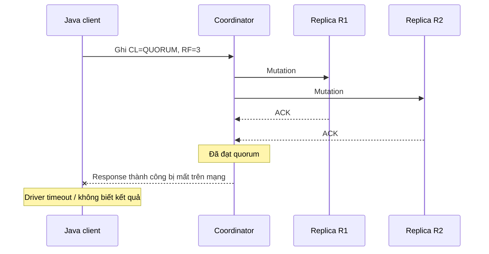
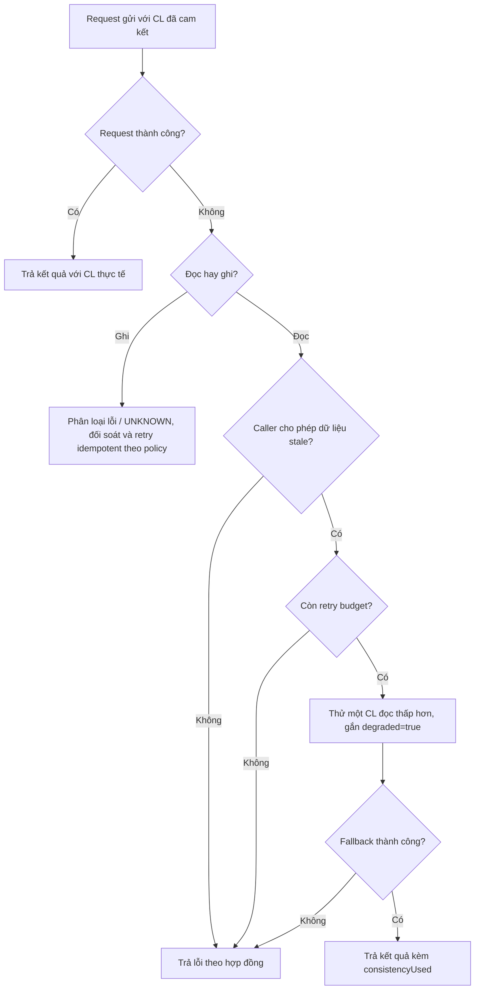

# Giới hạn hạ mức nhất quán khi retry

Trong Apache Cassandra, một thao tác có thể thất bại ở mức nhất quán (consistency level, **CL**) đã chọn vì không đủ replica phản hồi, replica quá chậm hoặc mạng liên datacenter gặp sự cố. Một ý tưởng dễ xuất hiện là: **“Nếu ghi/đọc ở `QUORUM` thất bại, tự động retry ở `ONE` để cứu request.”** Cách làm này có thể giúp một số yêu cầu nhận được kết quả, nhưng cũng **thay đổi điều kiện thành công mà ứng dụng hứa với người dùng**.

Hạ CL khi retry **không phải luôn bị cấm về mặt kỹ thuật**. Vấn đề là **khi nào được phép thay đổi ngưỡng**, **kết quả trả về phải được diễn giải như thế nào**, và **làm sao không biến timeout thành ghi trùng, đọc cũ hoặc vi phạm bất biến nghiệp vụ**. Đặc biệt, nếu lần thử đầu tiên đã được một số replica thực thi nhưng không phản hồi đúng hạn, lần retry có thể tương tác với dữ liệu đã được ghi mà client chưa biết.

Bài học thuộc chương **Nhất quán đọc/ghi** của mô-đun `DATABASE_ENGINE_WIDE_COLUMN_CASSANDRA`. Ngoài kiến trúc phân tán và mô hình wide-column, partition key, thiết kế bảng theo truy vấn, CQL, replication, compaction, repair, xử lý lỗi và kết nối từ Java, bài này tập trung vào **ranh giới an toàn khi áp dụng retry và consistency downgrade**.

> **Nguyên tắc:** Một lần retry được xác nhận ở `ONE` chỉ cho phép ứng dụng tuyên bố **đã đạt `ONE`** cho lần thực thi đó; không được giữ nguyên cam kết **`QUORUM`**, **`LOCAL_QUORUM`** hay **`EACH_QUORUM`** đã thất bại trước đó. Nếu kết quả lần đầu chưa rõ, tuyệt đối không suy rằng nó chắc chắn chưa được thực thi.

## 1. Mục tiêu học tập

Sau bài này, bạn có thể:

1. Giải thích vì sao retry ở CL thấp hơn **làm đổi bảo đảm của phản hồi**.
2. Phân biệt **retry cùng CL**, **đổi coordinator**, **hạ CL**, **fallback đọc eventual** và **đối soát ghi chưa rõ kết quả**.
3. Tính ngưỡng ACK khi thay `QUORUM` bằng `ONE`, `LOCAL_QUORUM` bằng `LOCAL_ONE` hoặc `EACH_QUORUM` bằng CL chỉ xét một DC.
4. Nhận diện trường hợp **`QUORUM` và `LOCAL_QUORUM` khác phạm vi chứ không chỉ khác độ mạnh**.
5. Phân loại `Unavailable`, `ReadTimeout`, `WriteTimeout`, `WriteFailure` và timeout phía Java Driver.
6. Xây dựng chính sách retry có ngân sách, backoff, idempotency và **không hạ CL ngầm**.
7. Viết một đường đọc best-effort **chỉ fallback khi được cho phép rõ ràng**, nhưng không áp dụng cách đó cho ghi dữ liệu quan trọng.
8. Phân tích giới hạn khi retry counter, LWT/Paxos, batch, TTL và mutation có side effect.

## 2. CL là một phần của hợp đồng dữ liệu

Trong Cassandra, **partition key** và replication strategy xác định replica đích của một partition. **Coordinator** nhận request và điều phối đến các replica. CL quy định **bao nhiêu phản hồi hợp lệ phải đến từ tập replica nào** trước khi coordinator có thể báo thành công.

Giả sử keyspace có một DC với **RF = 3**:

```text
                          Coordinator
                              |
               +--------------+--------------+
               |              |              |
             R1             R2             R3

Ghi QUORUM: yêu cầu >= 2 replica ACK.
Ghi ONE:    yêu cầu >= 1 replica ACK.
Ghi ALL:    yêu cầu cả 3 replica ACK.
```

Nếu một API tuyên bố “trạng thái đơn hàng chỉ được báo **đã lưu** khi đa số replica xác nhận”, thì **`QUORUM` không chỉ là một tham số hiệu năng**; nó là điều kiện chấp nhận của API.

### Hợp đồng nào có thể bị thay đổi?

| Yêu cầu nghiệp vụ | CL có thể cân nhắc | Hạ CL tùy tiện có thể gây ra |
| --- | --- | --- |
| Cập nhật trạng thái đơn hàng và đọc lại ngay trong cùng DC | Ghi/đọc `LOCAL_QUORUM` | Đọc lại ở `LOCAL_ONE` có thể thấy trạng thái cũ. |
| Xác nhận mutation được quorum mỗi DC tiếp nhận | Ghi `EACH_QUORUM` | Retry `LOCAL_ONE` chỉ có một ACK tại DC cục bộ, không chứng minh DC khác đã nhận. |
| Lưu sự kiện đo đạc có thể mất/hiển thị trễ | CL được chọn theo mức chịu rủi ro | Có thể chấp nhận degraded mode nếu hợp đồng nói rõ. |
| Tạo một tài nguyên duy nhất | LWT với serial CL phù hợp | Ghi thông thường ở CL thấp không có kiểm tra điều kiện nguyên tử. |
| Truy vấn dashboard có thể hơi trễ | `LOCAL_ONE` hoặc fallback được cho phép | Cần đánh dấu kết quả best-effort, không trình bày như dữ liệu mạnh nhất quán. |

**CL cao hơn không đồng nghĩa “transaction mạnh hơn” theo mọi nghĩa.** `QUORUM` bảo đảm ngưỡng phản hồi và giao nhau trong những điều kiện phù hợp, không biến `SELECT` rồi `UPDATE` thành compare-and-set nguyên tử. Khi có bất biến nghiệp vụ về tranh chấp, phải chọn **LWT** hoặc giao thức thích hợp.

## 3. Retry và downgrade là hai quyết định khác nhau

**Retry** là gửi lại một request sau thất bại hoặc khi chưa nhận được kết quả. **Consistency downgrade** là thay đổi CL trên lần thử mới sao cho request có thể hoàn tất với **ít phản hồi hơn hoặc phạm vi khác**.

Các lựa chọn:

1. **Retry cùng CL:** vẫn yêu cầu cùng ngưỡng và phạm vi, nhưng có thể qua coordinator khác hoặc sau khi replica hồi phục. Lần thử trước vẫn có thể đã được thực thi.
2. **Retry với CL thấp hơn:** tăng khả năng request mới hoàn tất nếu lỗi do thiếu replica ở ngưỡng cũ, nhưng **giảm điều kiện được xác nhận**.
3. **Đọc fallback được cho phép:** trả một kết quả có thể cũ với **nhãn degraded**, cho endpoint chấp nhận dữ liệu best-effort.
4. **Ghi trả trạng thái UNKNOWN và đối soát:** không giả vờ đã thành công ở CL cũ; giữ operation ID, truy vấn trạng thái theo chính sách nghiệp vụ hoặc xử lý qua workflow.
5. **Không retry:** trả lỗi có kiểm soát khi việc lặp lại có thể gây tác dụng phụ, hoặc khi hệ thống đang quá tải/partition mạng.

### Ví dụ: QUORUM thất bại, ONE thành công

RF=3. Ghi lần một ở `QUORUM`:

```text
Lần 1 — CL=QUORUM (cần 2 ACK)
  R1: ACK
  R2: không phản hồi đúng hạn
  R3: không phản hồi đúng hạn
  -> WriteTimeout

Lần 2 — CL=ONE (cần 1 ACK)
  R1: ACK
  -> thành công ở ONE
```

Ứng dụng **có thể biết** lần hai đã đáp ứng `ONE`. Ứng dụng **không biết chắc** lần một có được thêm ACK muộn hay không. Nhưng **không được tuyên bố** “lần ghi đã được xác nhận ở `QUORUM`” chỉ vì retry ở `ONE` đã thành công.

Đối với cùng một mutation, dữ liệu cuối cùng có thể lan đến mọi replica nhờ các cơ chế bình thường; điều đó **khác với số replica đã xác nhận trước khi API trả response**.

## 4. Hạ CL đọc: dữ liệu có thể cũ dù trả thành công

Xét RF=3. Client vừa ghi `status=PAID` ở `QUORUM` với hai ACK từ `R1,R2`, trong khi `R3` vẫn có `status=CREATED`.

Nếu đọc tiếp ở `QUORUM`:

\[
W = 2,\quad R = 2,\quad N = 3,\quad R+W=4>3
\]

Tập replica xác nhận ghi và tập replica phản hồi đọc phải giao nhau. Khi ghi đã hoàn tất, không có mutation cạnh tranh thắng theo timestamp và đường đọc hòa giải thành công, cặp này là cơ sở để kỳ vọng đọc thấy mutation đã xác nhận.

Nếu truy vấn `QUORUM` thất bại rồi retry ở `ONE`:

\[
W = 2,\quad R = 1,\quad N = 3,\quad R+W=3\le N
\]

Không còn bảo đảm giao nhau. Nếu đọc từ `R3` trước khi nó nhận bản cập nhật, kết quả có thể là `CREATED`.

```text
Ghi QUORUM đã ACK:   R1=PAID    R2=PAID    R3=CREATED
                        ^          ^
Đọc ONE fallback:                              ^ ------> CREATED

Client nhận response đọc hợp lệ ở ONE,
nhưng response có thể cũ so với ghi QUORUM trước đó.
```

**Điều cần ghi trong contract:** endpoint trả kết quả best-effort ở `ONE` **không được đồng thời quảng bá read-after-write mạnh như endpoint đọc `QUORUM`**. Có thể cho client biết mức nhất quán thật sự đã dùng, ví dụ `consistencyUsed=LOCAL_ONE` và `degraded=true`.

### Đọc lỗi không giống đọc không có dữ liệu

- `ReadTimeout`: yêu cầu đọc không hoàn tất đúng hạn.
- `Unavailable`: coordinator không thấy đủ replica sống cho CL.
- `null` hoặc không có hàng: **kết quả truy vấn thành công**, có thể do hàng chưa tồn tại, đã xóa hoặc TTL hết hạn.

Không được xử lý `ReadTimeout` bằng cách tự trả `null` rồi coi hàng không tồn tại. Nếu muốn dùng CL thấp hơn để fallback, cần gửi **một truy vấn mới**, công bố đúng CL và chấp nhận rủi ro đọc cũ.

## 5. Hạ CL ghi: thành công ở mức mới không kế thừa ACK của mức cũ

Giả sử RF=3, trạng thái ghi mong muốn là `SHIPPED`. Một request ở `QUORUM` bị `Unavailable` hoặc `WriteTimeout`; ứng dụng retry ở `ONE`.

| Điều quan sát | Điều có thể suy ra | Điều không thể suy ra |
| --- | --- | --- |
| `QUORUM` thất bại do unavailable | Không đủ replica được coordinator coi là sống để thỏa `QUORUM` ở lần thử đó. | Không chứng minh mọi request khác chưa ghi. |
| `QUORUM` nhận `WriteTimeout` | Không được xác nhận đủ quorum đúng hạn. | Không chứng minh replica nào cũng chưa áp dụng mutation. |
| Retry `ONE` thành công | Lần thử mới đã có ít nhất một ACK replica phù hợp. | **Không xác nhận** đã đạt `QUORUM` cho mutation theo hợp đồng ban đầu. |
| Sau đó đọc `ONE` thấy `SHIPPED` | Ít nhất đường đọc đã quan sát giá trị này. | Không chứng minh mọi replica đang chứa `SHIPPED` hoặc nó không thể bị mutation cạnh tranh thay thế. |
| Sau đó đọc `QUORUM` thành công | Trạng thái logic quan sát được theo CL đọc mới. | Không tự phục hồi chứng từ ACK quorum của lần ghi ban đầu hoặc biến nhiều bước thành transaction. |

### Vì sao giữ nguyên primary key rất quan trọng?

Nếu retry tạo **UUID mới** hoặc khóa mới cho cùng một sự kiện nghiệp vụ, cả hai lần ghi có thể để lại **hai hàng**. Vì client không biết lần đầu đã xảy ra chưa, việc tạo khóa mới làm khả năng trùng lặp tăng lên.

Với dữ liệu sự kiện, nên có `event_id` do ứng dụng cấp **trước lần gửi đầu tiên**. Với cập nhật trạng thái, cần kiểm soát **operation ID**, **timestamp** và điều kiện chuyển trạng thái nếu có nhiều client cạnh tranh.

**Đặc biệt:** retry cùng primary key nhưng timestamp **mới hơn** có thể làm một mutation cũ về nghiệp vụ thắng một mutation hợp lệ đến sau. Idempotency không chỉ là “cùng `WHERE`”.

## 6. Ma trận một DC RF=3: đổi CL làm đổi ngưỡng bao nhiêu?

Giả định coordinator phục vụ được request, các replica được liệt kê có thể phản hồi đúng hạn và chỉ xét **ngưỡng số lượng**:

| Từ CL | Sang CL retry | Ngưỡng ban đầu → ngưỡng mới | Điều bị thay đổi |
| --- | --- | --- | --- |
| `ALL` | `QUORUM` | 3 → 2 | Không còn chờ replica thứ ba. |
| `QUORUM` | `ONE` | 2 → 1 | Không còn xác nhận đa số. |
| `TWO` | `ONE` | 2 → 1 | Giảm một ACK. |
| `THREE` | `TWO` | 3 → 2 | Không còn yêu cầu đủ ba ACK. |
| `ONE` | `ANY` khi **ghi** | 1 replica ACK → có thể chỉ lưu hint | Có thể **không replica đích nào có dữ liệu** khi trả thành công. |
| `LOCAL_QUORUM` | `LOCAL_ONE` | 2 local → 1 local | Giảm khả năng chứng minh giao nhau trong DC. |

**`ANY` không dùng cho đọc** trong Cassandra OSS. Ghi `ANY` có thể thành công nhờ coordinator lưu **hint** khi không replica đích nào ACK, nhưng dữ liệu có thể chưa sẵn sàng để đọc; hinted handoff là cơ chế best effort, không phải một bản sao thứ tư.

### Khi hạ CL có thật sự cải thiện khả dụng?

Nếu RF=3 và chỉ một replica còn phản hồi:

- `QUORUM` cần hai ACK nên không đạt.
- `ONE` có thể đạt với một ACK.

Nhưng nếu **coordinator chết**, **driver không kết nối được node nào** hoặc **replica duy nhất cũng quá chậm**, hạ CL **không bảo đảm** request sẽ thành công. CL giải quyết ngưỡng ACK, không sửa được mọi sự cố mạng, CPU, disk, schema hoặc authentication.

## 7. Nhiều DC: đổi phạm vi không giống đơn giản giảm một con số

Trong Cassandra dùng `NetworkTopologyStrategy`, replica của cùng partition có thể trải trên nhiều datacenter. Ví dụ:

```text
                 partition P

dc1: RF=3                         dc2: RF=3
  A1 A2 A3                          B1 B2 B3

Tổng RF = 6
QUORUM = 4 ACK bất kỳ
LOCAL_QUORUM = 2 ACK trong DC coordinator
EACH_QUORUM = 2 ACK ở mỗi DC (chỉ ghi)
```

### 7.1. QUORUM → LOCAL_QUORUM

Nếu coordinator ở `dc1`:

- `QUORUM` cần **4 trong tổng 6 replica**.
- `LOCAL_QUORUM` cần **2 trong ba replica của dc1**.

Trong topology cân bằng này, chuyển từ `QUORUM` sang `LOCAL_QUORUM` thường giúp tránh phải chờ ACK từ remote DC để thỏa CL. Nhưng **ngưỡng và phạm vi đã đổi**; các client ở `dc2` không được bảo đảm đọc ngay mutation vừa được xác nhận local ở `dc1`.

**Không xếp hai CL thành thứ tự mạnh/yếu tuyệt đối trong mọi tình huống**:

| Phản hồi khả dụng | `QUORUM` toàn cụm | `LOCAL_QUORUM` dc1 |
| --- | --- | --- |
| 3 ở dc1, 0 ở dc2 | Không đạt (3 < 4). | Có thể đạt (3 ≥ 2). |
| 1 ở dc1, 3 ở dc2 | Có thể đạt (1+3=4). | Không đạt (1 < 2). |
| 2 ở dc1, 1 ở dc2 | Không đạt (2+1=3). | Có thể đạt (2 ≥ 2). |

Do các tập replica khác nhau, việc chuyển từ `QUORUM` sang `LOCAL_QUORUM` **không phải một phép “giảm ACK” có hiệu lực giống nhau ở mọi cách phân bố sự cố**.

### 7.2. EACH_QUORUM → LOCAL_QUORUM

Ghi `EACH_QUORUM` với RF=3+3 cần **2 ACK ở dc1 và 2 ACK ở dc2**. Ghi `LOCAL_QUORUM` ở dc1 chỉ cần **2 ACK ở dc1**.

Giả sử dc2 bị cô lập: lần ghi `EACH_QUORUM` không đạt; retry `LOCAL_QUORUM` có thể thành công. Tuy nhiên, không được báo rằng ghi này đã được **xác nhận quorum tại cả hai DC**. Hệ thống vẫn cố truyền mutation đến replica dc2 khi có thể, nhưng **không có ACK dc2 làm chứng cho response đã trả**.

### 7.3. RF bất đối xứng: 5+1

Với `dc1 RF=5` và `dc2 RF=1`:

- `QUORUM` toàn cụm cần `floor(6/2)+1=4` ACK.
- `LOCAL_QUORUM` ở dc1 cần `floor(5/2)+1=3` ACK.
- Ghi `EACH_QUORUM` cần **3 ACK dc1 và 1 ACK dc2**.

Nếu dc2 bị cô lập nhưng dc1 còn năm replica, ghi `QUORUM` **vẫn có thể thành công** bằng bốn ACK ở dc1. Hạ sang `LOCAL_QUORUM` trong trường hợp đó **không cần thiết chỉ vì mất dc2**, nếu nguyên nhân thật sự vẫn đủ cho global quorum. Đừng áp dụng quy tắc “cứ mất WAN là hạ từ global xuống local” không xét RF.

## 8. Không phải lỗi nào cũng có cách retry phù hợp

| Kết quả/lỗi | Thông tin đáng tin cậy | Hành động thường phù hợp |
| --- | --- | --- |
| `UnavailableException` | Coordinator đánh giá không đủ replica sống cho CL yêu cầu. | Kiểm tra RF, local DC, tình trạng replica; chờ phục hồi hoặc trả lỗi theo contract. Không hạ CL tự động. |
| `ReadTimeoutException` | Đọc chưa hoàn tất đủ phản hồi/dữ liệu đúng hạn. | Có thể retry có giới hạn ở **cùng CL**; chỉ fallback CL thấp khi caller chủ động chấp nhận đọc cũ. |
| `ReadFailureException` | Replica báo lỗi trên đường đọc. | Phân loại lỗi và tình trạng node; không chỉ giảm CL để che lỗi. |
| `WriteTimeoutException` | Không được xác nhận đủ ghi theo CL trước deadline. | Trạng thái mutation **có thể chưa rõ**; yêu cầu idempotency/đối soát. |
| `WriteFailureException` | Có lỗi khi replica xử lý mutation. | Một số replica khác có thể đã ghi; cần đánh giá nguyên nhân và trạng thái chưa rõ. |
| `DriverTimeoutException` hoặc mất kết nối | Client không nhận kết quả trước deadline hoặc đường kết nối đứt. | Server có thể đã hoàn tất; không mặc định là no-op, nhất là với ghi. |
| `InvalidQueryException`, lỗi syntax/schema/quyền | Request không hợp lệ theo máy chủ. | **Sửa request/cấu hình**, không dùng CL thấp hơn như một retry policy. |

### Timeout không có nghĩa là không đủ replica sống

Một coordinator có thể biết đủ hai replica UP cho `QUORUM` RF=3, nhưng một ACK đến quá hạn do GC, I/O, mạng hoặc tải. Lúc đó có thể xảy ra `WriteTimeout`. Nếu nguyên nhân là replica chậm trên cùng đường đi, retry ở `ONE` đôi khi trả nhanh hơn, nhưng **nó không sửa lỗi gốc** và có thể tăng áp lực hệ thống.

### Không phản hồi từ client là kết quả chưa biết

Lịch sự kiện có thể là:



**Không thể suy từ driver timeout rằng ghi chưa đạt quorum.** Nếu ứng dụng gửi lại mutation với ID hoặc timestamp mới, nó có thể tạo ra một **thao tác thứ hai** chứ không chỉ “hoàn tất thao tác trước”.

## 9. Giới hạn khi retry ghi: idempotency và điều kiện nghiệp vụ

### 9.1. Mutation idempotent trong phạm vi phù hợp

Một mutation có thể được coi là idempotent nếu thực thi nhiều lần không gây thay đổi logic vượt quá một lần, theo **thiết kế dữ liệu và các điều kiện đã nêu**.

| Thao tác | Phân loại thận trọng khi retry |
| --- | --- |
| `INSERT` dùng lại **cùng primary key và payload**, metadata ổn định | Thường có thể thiết kế idempotent. |
| `UPDATE status='PAID'` dùng lại khóa, payload và timestamp | Thường có thể an toàn với giả định không có tác dụng phụ khác. |
| `INSERT` sinh `event_id` mới ở mỗi lần thử | Không idempotent theo nghĩa chống tạo nhiều sự kiện. |
| `UPDATE counter SET count=count+1` | **Không idempotent**: có thể tăng nhiều lần. |
| Append/list mutation | **Không mặc định** idempotent; có thể nhân bản phần tử. |
| Mutation kèm email, thanh toán hoặc publish message | Cần deduplication/outbox; Cassandra không transaction với hệ thống ngoài. |
| `INSERT ... IF NOT EXISTS` qua LWT | Phải đối soát `[applied]` và request ID khi timeout. |
| Ghi có TTL | Cần kiểm tra timestamp/expiration; retry với metadata khác có thể thay đổi thời điểm hết hạn. |

**Primary key ổn định là nền tảng**, nhưng không đủ nếu mỗi lần retry sinh timestamp mới. Khi một client khác vừa ghi phiên bản mới hơn, retry mutation cũ với timestamp lớn hơn có thể **ghi đè trạng thái hợp lệ**.

### 9.2. Minh họa timestamp phá thứ tự nghiệp vụ

```text
t0: Client A ghi status=IN_TRANSIT, timestamp=100 -> timeout.
t1: Client B ghi status=DELIVERED, timestamp=200 -> thành công.
t2: Client A retry status=IN_TRANSIT, timestamp=300 -> thành công ở ONE.

Khi hòa giải theo last-write-wins, IN_TRANSIT@300 có thể thắng
DELIVERED@200, mặc dù A chỉ muốn retry một request cũ.
```

Nếu muốn lặp lại **đúng cùng mutation**, có thể cần giữ **cùng timestamp CQL (microsecond)**, partition key và payload. Với luồng nhiều client cạnh tranh hoặc cập nhật có điều kiện, timestamp ổn định **không thay thế** LWT/versioning.

### 9.3. Counter và batch cần chính sách riêng

Counter increment bị timeout có thể **đã được áp dụng**; retry increment có thể làm tăng thêm lần nữa. Logged batch hỗ trợ cơ chế batchlog để chuyển các mutation còn thiếu, nhưng **không tương đương transaction SQL có rollback/snapshot đa partition**. Nếu batch timeout, một phần mutation có thể đã được áp dụng hoặc tiếp tục được xử lý; đừng tự coi cả batch đã rollback rồi gửi lại mọi bước với khóa mới.

### 9.4. Không trộn side effect vào retry mù

Nếu một workflow gồm:

1. ghi Cassandra,
2. gửi email,
3. publish sự kiện,

thì retry toàn bộ do Cassandra timeout có thể gửi email/sự kiện nhiều lần. Để đạt hiệu quả “mỗi sự kiện nghiệp vụ một lần”, cần **operation ID**, deduplication và một workflow/outbox thích hợp. Hạ CL không giải quyết vấn đề **exactly-once** của nhiều hệ thống độc lập.

## 10. LWT: không được hạ SERIAL thành LOCAL_SERIAL một cách tùy tiện

**Lightweight transaction (LWT)** sử dụng Paxos cho các câu lệnh `IF NOT EXISTS` hoặc `UPDATE ... IF ...`. Nó có hai trục cần phân biệt:

- **Normal CL** như `QUORUM` hoặc `LOCAL_QUORUM` cho phần thao tác thông thường.
- **Serial CL** như `SERIAL` và `LOCAL_SERIAL` cho **phạm vi đồng thuận Paxos**.

Trong cụm `dc1 RF=3, dc2 RF=3`:

| Serial CL | Phạm vi quorum đồng thuận |
| --- | --- |
| `SERIAL` | Đa số của **toàn bộ sáu replica**, thường là 4 phản hồi Paxos. |
| `LOCAL_SERIAL` ở dc1 | Đa số của ba replica ở **dc1**, tức 2 phản hồi Paxos local. |

Nếu LWT dùng `SERIAL` không đạt vì mất WAN, retry với `LOCAL_SERIAL` ở dc1 **thay đổi phạm vi đồng thuận**. Nếu client tại dc2 cũng đang thực hiện LWT `LOCAL_SERIAL` cho cùng khóa, hai nhóm local có thể không giao nhau. Không thể tuyên bố đã phân xử **duy nhất toàn cluster** chỉ bằng những local quorum rời nhau.

**Hạ normal CL không tự hạ serial CL; hạ serial CL cũng không tự thay đổi normal CL.** Cả hai quyết định cần được thiết kế theo phạm vi cạnh tranh của nghiệp vụ.

### Timeout LWT là kết quả chưa chắc chắn

Giả sử `INSERT ... IF NOT EXISTS` bị timeout. Một lần retry cùng khóa có thể trả `[applied]=false` **vì lần trước đã tạo hàng thành công nhưng client không nhận ACK**. Không được diễn giải `false` sau retry là bằng chứng một client khác đã thắng.

Cách tiếp cận phù hợp:

- Dùng `operation_id` được tạo **trước lần thử đầu**.
- Duy trì cùng partition key/định danh tài nguyên.
- Đọc và đối soát `operation_id` hoặc chủ sở hữu sau timeout.
- Chọn một serial scope phù hợp với **mọi client có thể cạnh tranh** trên tài nguyên.
- Không lẫn ghi thông thường không có `IF` vào một bất biến đang được bảo vệ bằng LWT.

## 11. CQL thực hành: CL của lần retry cần được ghi lại

Giả sử có **cluster lab** với DC tên `dc1` và đủ ba node cho RF=3:

```sql
CREATE KEYSPACE IF NOT EXISTS downgrade_lab
WITH replication = {
  'class': 'NetworkTopologyStrategy',
  'dc1': 3
};

CREATE TABLE IF NOT EXISTS downgrade_lab.shipment_by_id (
  shipment_id uuid PRIMARY KEY,
  status text,
  operation_id uuid,
  updated_at timestamp
);
```

`shipment_id` là partition key; bảng được thiết kế theo truy vấn “xem trạng thái một shipment theo ID”. `operation_id` giúp đối soát **yêu cầu nghiệp vụ** khi một mutation đã được ghi nhưng phản hồi bị mất.

### 11.1. Ghi ở QUORUM và đọc lại ở QUORUM

Trong `cqlsh`:

```sql
CONSISTENCY QUORUM;

UPDATE downgrade_lab.shipment_by_id
SET status = 'IN_TRANSIT',
    operation_id = 22222222-2222-4222-8222-222222222222,
    updated_at = '2026-11-21 11:00:00+0000'
WHERE shipment_id = 11111111-1111-4111-8111-111111111111;

SELECT status, operation_id
FROM downgrade_lab.shipment_by_id
WHERE shipment_id = 11111111-1111-4111-8111-111111111111;
```

Nếu request ghi trả thành công ở `QUORUM`, ứng dụng có bằng chứng CL ghi đã đạt. Nếu request **timeout**, không dùng phép tính `W=2` như thể write đã thành công. Đọc `QUORUM` có thể dùng để đối soát trạng thái **đang quan sát**, nhưng không tái dựng chắc chắn lịch sử mọi mutation trước đó.

### 11.2. Minh họa hạ CL trong lab, không phải khuyến nghị production

```sql
-- Giả sử một truy vấn QUORUM đã thất bại trong lab có replica chậm.
-- Đổi CL của phiên cqlsh cho TRUY VẤN TIẾP THEO:
CONSISTENCY ONE;

SELECT status, operation_id
FROM downgrade_lab.shipment_by_id
WHERE shipment_id = 11111111-1111-4111-8111-111111111111;

-- Khôi phục hợp đồng đọc mạnh hơn cho các truy vấn tiếp theo:
CONSISTENCY QUORUM;
```

**Quan trọng:** `CONSISTENCY` là **lệnh của `cqlsh`**, áp dụng cho các câu lệnh sau đó; **không** phải mệnh đề gắn trực tiếp vào `SELECT`. Một lần đọc ở `ONE` trả thành công **không có nghĩa** đã đạt `QUORUM`; nếu giá trị được phục vụ bởi replica chưa bắt kịp, nó có thể cũ.

Không dùng thao tác hạ CL minh họa này để giả lập sự cố trên dữ liệu production. Trong cluster khỏe, đọc ở `ONE` và `QUORUM` có thể tình cờ cho kết quả giống nhau; đó không phải bằng chứng hai CL có cùng bảo đảm.

### 11.3. Multi-DC phải kiểm tra RF từng DC

Trong lab thực sự có hai DC:

```sql
CREATE KEYSPACE IF NOT EXISTS downgrade_multi_dc_lab
WITH replication = {
  'class': 'NetworkTopologyStrategy',
  'dc1': 3,
  'dc2': 3
};
```

Với topology này, hạ ghi `EACH_QUORUM` xuống `LOCAL_QUORUM` là đổi từ **2 ACK mỗi DC** sang **2 ACK chỉ trong DC coordinator**. Nếu yêu cầu nghiệp vụ là “sẵn sàng phục vụ tại DC còn lại sau khi ghi”, việc chuyển CL không được thực hiện chỉ vì thấy remote DC có độ trễ cao.

## 12. Java Driver 4.x: không tự động hạ mức trên đường ghi

Thiết kế bên dưới dùng `CqlSession` đã cấu hình local datacenter, contact points, bảo mật và request timeout đúng môi trường. Prepared statements được tái sử dụng.

### 12.1. Ghi quan trọng: cố định CL và báo UNKNOWN

```java
import com.datastax.oss.driver.api.core.CqlSession;
import com.datastax.oss.driver.api.core.DefaultConsistencyLevel;
import com.datastax.oss.driver.api.core.DriverTimeoutException;
import com.datastax.oss.driver.api.core.cql.BoundStatement;
import com.datastax.oss.driver.api.core.cql.PreparedStatement;
import com.datastax.oss.driver.api.core.servererrors.UnavailableException;
import com.datastax.oss.driver.api.core.servererrors.WriteFailureException;
import com.datastax.oss.driver.api.core.servererrors.WriteTimeoutException;

import java.time.Instant;
import java.util.UUID;

public final class ShipmentWriter {
    public enum WriteStatus {
        ACKNOWLEDGED, UNAVAILABLE, UNKNOWN
    }

    private final CqlSession session;
    private final PreparedStatement update;

    public ShipmentWriter(CqlSession session) {
        this.session = session;
        this.update = session.prepare(
            "UPDATE downgrade_lab.shipment_by_id USING TIMESTAMP ? " +
            "SET status = ?, operation_id = ?, updated_at = ? " +
            "WHERE shipment_id = ?");
    }

    public WriteStatus updateStatus(
            UUID shipmentId, String status, UUID operationId,
            Instant updatedAt, long timestampMicros) {
        BoundStatement statement = update.bind(
                timestampMicros, status, operationId, updatedAt, shipmentId)
            .setConsistencyLevel(DefaultConsistencyLevel.LOCAL_QUORUM)
            .setIdempotent(true);
        // setIdempotent(true) chỉ đúng khi khóa, payload, timestamp,
        // hiệu ứng ngoài Cassandra và cạnh tranh được kiểm soát.

        try {
            session.execute(statement);
            return WriteStatus.ACKNOWLEDGED;
        } catch (UnavailableException e) {
            // Không tự chuyển sang ONE: contract vẫn là LOCAL_QUORUM.
            return WriteStatus.UNAVAILABLE;
        } catch (WriteTimeoutException
                 | WriteFailureException
                 | DriverTimeoutException e) {
            // Ghi có thể đã xảy ra một phần hoặc đã hoàn tất nhưng mất ACK.
            return WriteStatus.UNKNOWN;
        }
    }
}
```

Đây là minh họa phân loại ba trạng thái; lỗi host, CQL không hợp lệ và những lỗi khác cần được xử lý riêng, không bắt tất cả rồi tự coi là `UNKNOWN`. **`ACKNOWLEDGED` có nghĩa đạt `LOCAL_QUORUM` của request**, không chứng minh mọi replica hoặc DC đều đã hội tụ.

### 12.2. Đọc dashboard: fallback có sự đồng ý rõ ràng

Giả sử một endpoint dashboard **được phép hiển thị dữ liệu có thể trễ**. Service có thể cho caller bật `allowStaleRead` và chỉ khi đó thực hiện một **lần đọc fallback có giới hạn**:

```java
import com.datastax.oss.driver.api.core.CqlSession;
import com.datastax.oss.driver.api.core.DefaultConsistencyLevel;
import com.datastax.oss.driver.api.core.cql.BoundStatement;
import com.datastax.oss.driver.api.core.cql.PreparedStatement;
import com.datastax.oss.driver.api.core.cql.Row;
import com.datastax.oss.driver.api.core.servererrors.ReadTimeoutException;
import com.datastax.oss.driver.api.core.servererrors.UnavailableException;

import java.util.UUID;

public final class DashboardReader {
    public static final class ReadResult {
        public final String status;
        public final String consistencyUsed;
        public final boolean degraded;

        public ReadResult(String status, String consistencyUsed,
                          boolean degraded) {
            this.status = status;
            this.consistencyUsed = consistencyUsed;
            this.degraded = degraded;
        }
    }

    private final CqlSession session;
    private final PreparedStatement select;

    public DashboardReader(CqlSession session) {
        this.session = session;
        this.select = session.prepare(
            "SELECT status FROM downgrade_lab.shipment_by_id " +
            "WHERE shipment_id = ?");
    }

    public ReadResult readStatus(UUID shipmentId, boolean allowStaleRead) {
        try {
            BoundStatement strict = select.bind(shipmentId)
                .setConsistencyLevel(DefaultConsistencyLevel.LOCAL_QUORUM);
            Row row = session.execute(strict).one();
            return new ReadResult(
                row == null ? null : row.getString("status"),
                "LOCAL_QUORUM", false);
        } catch (UnavailableException | ReadTimeoutException e) {
            if (!allowStaleRead) {
                throw e; // Không hạ CL nếu caller không đồng ý.
            }
            // Chỉ một bước fallback, không loop vô hạn.
            BoundStatement relaxed = select.bind(shipmentId)
                .setConsistencyLevel(DefaultConsistencyLevel.LOCAL_ONE);
            Row row = session.execute(relaxed).one();
            return new ReadResult(
                row == null ? null : row.getString("status"),
                "LOCAL_ONE", true);
        }
    }
}
```

Đoạn mã có dụng ý **chỉ hạ CL ở đường đọc cho phép stale**, không bao giờ tự động hạ CL ghi. Nếu lần fallback cũng lỗi, exception được trả ra; mã **không ngụy tạo giá trị `null`** như thể query thành công. Ở production, cần giới hạn tổng deadline và retry budget, log/metrics số lần degraded, đồng thời công khai `degraded` cho API/client.

### 12.3. Chính sách retry của driver không thay cho contract

Java Driver có chính sách retry, load balancing và speculative execution tùy phiên bản/cấu hình. Không nên giả định rằng **chính sách mặc định tự động hạ CL**, hoặc một policy tùy chỉnh “tự phục hồi” sẽ giữ nguyên bảo đảm nghiệp vụ. Trước khi cấu hình retry policy:

- Xác định query có **idempotent** không; không đánh dấu mọi ghi là idempotent chỉ để driver retry.
- Kiểm tra retry có thể thay **host/coordinator**, **số lần thử**, **CL** hoặc chạy song song speculative execution hay không.
- Giới hạn retry theo ngân sách thời gian và số lần; tránh khuếch đại tải khi cluster đang chậm.
- Ghi log/metrics **CL thực tế của lần trả kết quả**, không chỉ CL dự kiến ban đầu.
- Không chuyển `WriteTimeout` sang một CL khác rồi trả response như thể request ban đầu đã đạt ngưỡng.

## 13. Thiết kế retry budget và degraded mode

Nếu có lý do nghiệp vụ rõ ràng để fallback, quy trình cần được mô tả như một **trạng thái dịch vụ** chứ không phải mẹo ẩn trong driver.

### Một quyết định có cấu trúc



**Đây là ví dụ về một policy an toàn theo một loại endpoint**, không phải yêu cầu tất cả API đều phải hỗ trợ degraded mode. API đơn hàng, tiền, tồn kho hoặc chuyển trạng thái quan trọng có thể quyết định **không hạ CL trong bất kỳ tình huống nào**.

### Retry budget nên gồm những gì?

| Thành phần | Vì sao cần? |
| --- | --- |
| Số lần thử tối đa | Tránh retry vô hạn. |
| Deadline tổng thể | Tránh để nhiều lần retry làm vượt SLA quá xa. |
| Backoff và jitter phù hợp | Hạn chế các client retry đồng loạt khi hệ thống hồi phục. |
| Kiểm soát concurrency | Không để retry nhân tải trên hot partition. |
| Chỉ retry request được đánh giá an toàn | Tránh tăng counter, tạo hàng trùng hoặc phát side effect nhiều lần. |
| Nhãn degraded và actual CL | Giữ sự minh bạch của kết quả đọc ở mức thấp hơn. |
| Metrics và cảnh báo | Phát hiện sự cố kéo dài thay vì che bằng fallback. |

**Lưu ý:** Hạ CL có thể làm một tỷ lệ request thành công hơn, nhưng nếu nguyên nhân là disk/CPU/GC quá tải, tăng số request retry lại có thể làm cluster xấu đi. Cần chẩn đoán nguyên nhân thực tế trước khi coi fallback là giải pháp ổn định.

## 14. Các cơ chế phục hồi không nâng ngược bảo đảm của ACK

Cassandra có nhiều cơ chế giúp các replica hội tụ:

- **Hinted handoff:** phát lại mutation đã bỏ lỡ, phụ thuộc hint còn tồn tại và khả năng giao lại; là best effort.
- **Read reconciliation/read repair:** hòa giải phiên bản được quan sát trên đường đọc, có thể sửa replica liên quan tùy phiên bản/cấu hình.
- **Anti-entropy repair:** đối chiếu dữ liệu giữa replica để xử lý khác biệt lâu dài, kể cả khi không còn hint.
- **Compaction:** quản lý SSTable, phiên bản cũ và tombstone; không thay thế repair.

Giả sử ghi `ONE` thành công, sau đó hệ thống repair và cả ba replica đều có mutation. Điều này **không làm response `ONE` tại thời điểm ban đầu trở thành một response `QUORUM`**. Các mức độ đồng bộ về sau là thông tin khác, trong khi hợp đồng ACK xác định **điều kiện đã đạt trước khi trả thành công**.

Với delete/tombstone, việc hạ CL ghi và để replica bỏ lỡ deletion kéo dài có thể tạo rủi ro hội tụ, nhất là khi repair không được vận hành phù hợp với `gc_grace_seconds`. Retry policy không thể thay thế chiến lược repair và quản lý node down lâu.

## 15. Runbook khi ứng dụng đề nghị tự động hạ CL

Trước khi bật tính năng, nhóm kỹ thuật nên trả lời theo thứ tự:

1. **Endpoint nào?** Đọc best-effort hay ghi trạng thái quan trọng?
2. **Contract hiện tại?** Response thành công đang hứa mức ACK/độ mới nào?
3. **Đang gặp lỗi gì?** `Unavailable`, server timeout, driver timeout, replica failure hay lỗi CQL?
4. **RF và local DC?** Tính ngưỡng của cả CL ban đầu lẫn CL fallback, kể cả DC coordinator.
5. **Có cùng tập replica không?** Đặc biệt khi chuyển `QUORUM` ↔ `LOCAL_QUORUM` hoặc giữa DC.
6. **Ghi đã thành công một phần chưa?** Với timeout, trạng thái có thể chưa xác định.
7. **Mutation có idempotent không?** Khóa, timestamp, TTL, counter, collection và side effect?
8. **Có LWT/bất biến cạnh tranh không?** Không tự đổi `SERIAL` thành `LOCAL_SERIAL`.
9. **Client có đồng ý nhận dữ liệu stale không?** Nếu không, không fallback đọc.
10. **Kết quả được gắn nhãn gì?** Ghi lại `consistencyUsed`, `degraded` và operation ID.
11. **Retry budget là bao nhiêu?** Deadline, số lần thử, backoff và chống retry storm?
12. **Làm sao thoát degraded mode?** Theo dõi metrics, replica/hints/repair và có điều kiện tắt fallback.

Khi điều tra timeout, các công cụ như `nodetool status` và logs/metrics giúp xác định replica down hoặc mạng chậm, nhưng **không chứng minh một mutation cụ thể đã hoặc chưa commit**. Nên giữ correlation ID và operation ID để đối soát chính xác.

## 16. Bài tập và lời giải

### Bài 1 — Ghi QUORUM bị timeout rồi hạ ONE

RF=3. Ghi `QUORUM` nhận một ACK rồi `WriteTimeout`. Retry `ONE` thành công. Có được trả “ghi quorum thành công” không?

**Đáp án:** Không. Retry thành công chỉ xác nhận ngưỡng `ONE` của lần thử đó. Lần `QUORUM` trước có thể đã được một số replica áp dụng, nhưng không có response thành công chứng minh đã đạt ngưỡng đúng hạn.

### Bài 2 — Hạ CL đọc làm mất giao nhau

RF=3. Ghi `QUORUM` thành công; đọc `QUORUM` thất bại rồi fallback `ONE`. Có chắc vẫn thấy ghi vừa xác nhận?

**Đáp án:** Không. `W=2`, `R=1` nên `R+W=3≤N=3`; replica được đọc ở `ONE` có thể chưa nhận mutation.

### Bài 3 — DC xa mất kết nối

RF=3+3, coordinator ở dc1. Ghi `EACH_QUORUM` không đạt do dc2 down. Retry `LOCAL_QUORUM` thành công ở dc1. Điều gì không được tuyên bố?

**Đáp án:** Không được tuyên bố dc2 đã đạt quorum hoặc mutation đã được xác nhận tại cả hai DC. Lần mới chỉ cần hai ACK tại dc1.

### Bài 4 — QUORUM so với LOCAL_QUORUM không có thứ tự tuyệt đối

RF=3+3, coordinator ở dc1. Chỉ 1 replica dc1 và 3 replica dc2 phản hồi. `QUORUM` và `LOCAL_QUORUM` dc1 có thể đạt không?

**Đáp án:** `QUORUM` cần 4/6 nên **có thể** đạt (1+3). `LOCAL_QUORUM` cần 2/3 dc1 nên **không** đạt. Hai CL khác phạm vi, không chỉ khác ngưỡng số.

### Bài 5 — Hạ ONE xuống ANY

RF=3, không replica đích nào phản hồi nhưng coordinator còn khỏe và lưu được hint. Ghi `ANY` thành công có chứng minh một replica đã chứa dữ liệu để đọc không?

**Đáp án:** Không. Thành công có thể chỉ dựa vào hint; dữ liệu chưa chắc sẵn có trên replica. `ANY` không hợp lệ cho `SELECT`.

### Bài 6 — Không phải lỗi nào cũng cần retry

Request bị từ chối do câu CQL sai schema. Giảm `QUORUM` xuống `ONE` có giúp không?

**Đáp án:** Không. Phải sửa cú pháp/schema hoặc quyền. CL không khắc phục lỗi validation.

### Bài 7 — Timestamp bị tăng khi retry

Client A ghi `IN_TRANSIT@100` rồi timeout; client B ghi `DELIVERED@200` thành công; A retry `IN_TRANSIT@300`. Rủi ro là gì?

**Đáp án:** Phiên bản `IN_TRANSIT@300` có thể thắng `DELIVERED@200` theo last-write-wins dù A chỉ retry một thao tác cũ. Cần giữ metadata ổn định hoặc sử dụng kiểm soát cạnh tranh phù hợp.

### Bài 8 — Counter

Ghi counter tăng một đơn vị bị timeout và client retry ở CL thấp hơn. Tại sao không thể xem retry là vô hại?

**Đáp án:** Một lần tăng trước đó có thể đã được áp dụng; lần retry có thể tăng thêm lần nữa. Counter increment không idempotent.

### Bài 9 — LWT đổi phạm vi

Hai client tại dc1 và dc2 cùng tranh một `seat_key`. Sau khi `SERIAL` timeout, ứng dụng tự chuyển sang `LOCAL_SERIAL` riêng ở từng DC. Có thể khẳng định Paxos quyết định duy nhất toàn cluster không?

**Đáp án:** Không. Hai local serial quorum có thể không giao nhau; phải chọn một serial scope phù hợp với phạm vi tranh chấp và áp dụng thống nhất cho mọi client.

### Bài 10 — Driver timeout

Coordinator đã đủ ACK quorum nhưng response tới client bị mất; driver báo timeout. Client có được suy rằng ghi chưa áp dụng rồi tạo operation ID mới không?

**Đáp án:** Không. Mutation có thể đã hoàn tất trên server. Cần giữ operation ID/primary key ổn định và đối soát.

### Bài 11 — Dashboard best-effort

Dashboard cho phép trạng thái hiển thị chậm và công khai thông tin độ tin cậy. Khi `LOCAL_QUORUM` đọc không đạt, hạ xuống `LOCAL_ONE` có thể được chấp nhận trong điều kiện nào?

**Đáp án:** Khi hợp đồng API/caller **chấp nhận dữ liệu có thể cũ**, kết quả ghi rõ `consistencyUsed=LOCAL_ONE`/`degraded=true`, có giới hạn số lần thử/deadline, và lỗi fallback tiếp tục được báo đúng.

### Bài 12 — Ghi quan trọng

API thanh toán hứa chỉ trả thành công sau khi ghi được quorum mỗi DC xác nhận. Khi WAN chậm, có nên tự retry `EACH_QUORUM` ở `LOCAL_ONE` để giữ tỷ lệ HTTP 200 cao không?

**Đáp án:** Không. Điều kiện ACK đã thay đổi đáng kể; response sẽ không còn đáp ứng cam kết của API. Nên trả trạng thái lỗi/đang xác minh, sử dụng idempotency và khắc phục hoặc chờ hạ tầng phục hồi.

### Bài 13 — RF lệch 5+1

dc1 RF=5 và dc2 RF=1. DC2 mất kết nối, dc1 đủ năm replica. Ghi `QUORUM` còn có thể đạt không? Có bắt buộc hạ sang `LOCAL_QUORUM` không?

**Đáp án:** `QUORUM` toàn cụm cần `floor(6/2)+1=4` ACK và có thể lấy bốn từ dc1. Không bắt buộc hạ CL chỉ vì dc2 mất kết nối.

## 17. Kết luận

**Hạ mức nhất quán khi retry là thay đổi hợp đồng về số lượng hoặc phạm vi phản hồi được xác nhận**, không chỉ là tối ưu để request “qua được lỗi”. Với đọc, `QUORUM` → `ONE` có thể làm mất bảo đảm giao nhau và trả dữ liệu cũ. Với ghi, `QUORUM` → `ONE` hoặc `EACH_QUORUM` → `LOCAL_QUORUM` có thể tăng khả dụng nhưng không cho phép tuyên bố những ACK của ngưỡng ban đầu đã đạt.

Vì timeout ghi thường dẫn tới **kết quả chưa biết**, chính sách an toàn cần kết hợp **CL cố định cho những API nghiêm ngặt**, **idempotency và operation ID ổn định**, **đối soát thay vì retry mù**, **giới hạn retry budget**, và degraded mode **chỉ cho những đường đọc mà nghiệp vụ cho phép**. Với LWT, `SERIAL`/`LOCAL_SERIAL` quyết định phạm vi Paxos và không được đổi tùy tiện để cứu những thao tác đang cạnh tranh xuyên DC.

### Tài liệu tham khảo

- [Apache Cassandra — Dynamo, replication và tunable consistency](https://cassandra.apache.org/doc/stable/cassandra/architecture/dynamo.html): replica, RF, ngưỡng xác nhận và phạm vi CL.
- [Apache Cassandra — CQL Data Manipulation](https://cassandra.apache.org/doc/stable/cassandra/developing/cql/dml.html): ghi thường, `USING TIMESTAMP`, counter và ghi có điều kiện.
- [Apache Cassandra — Hints](https://cassandra.apache.org/doc/stable/cassandra/managing/operating/hints.html): hinted handoff và giới hạn khi replica bỏ lỡ mutation.
- [Apache Cassandra — Repair](https://cassandra.apache.org/doc/stable/cassandra/managing/operating/repair.html): anti-entropy repair và sự hội tụ giữa replica.
- [Apache Cassandra — cqlsh](https://cassandra.apache.org/doc/stable/cassandra/managing/tools/cqlsh.html): lệnh `CONSISTENCY` khi thực hành.
