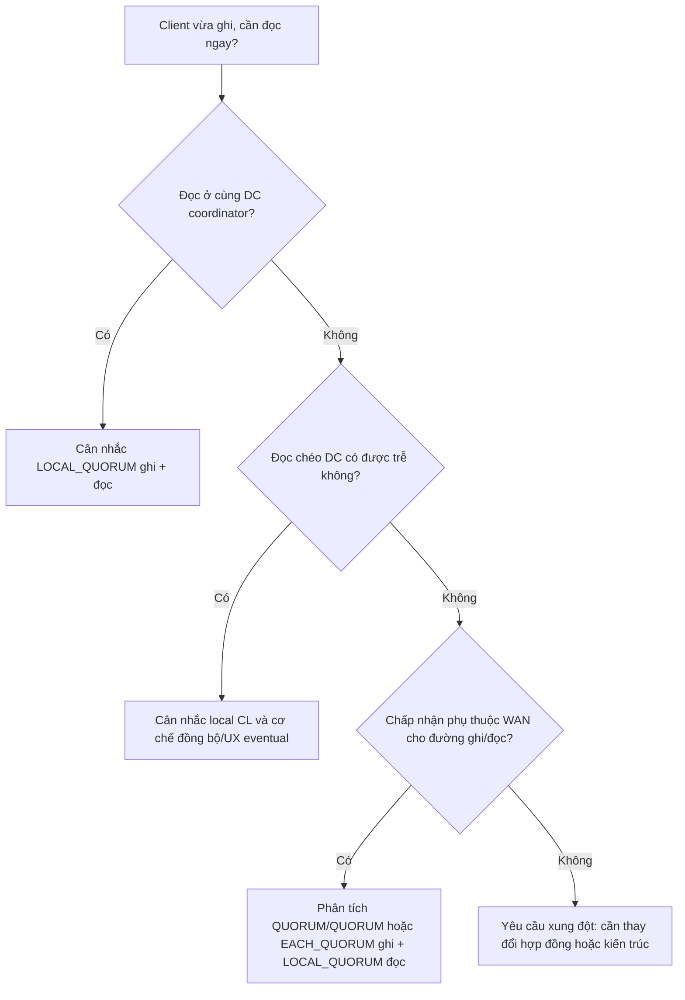

# Thiết kế mức nhất quán từ yêu cầu nghiệp vụ

Không có một **consistency level (CL)** duy nhất phù hợp với mọi hệ thống Apache Cassandra. Dashboard phân tích có thể chấp nhận dữ liệu trễ trong thời gian ngắn; trang trạng thái đơn hàng có thể cần **đọc lại ngay sau khi cập nhật**; còn thao tác đặt một ghế duy nhất phải ngăn **hai client cùng thắng cuộc đua**. Ba nhu cầu đó khác nhau về **độ mới của dữ liệu**, **tính khả dụng**, **độ trễ** và **cạnh tranh**, nên có thể cần ba chiến lược nhất quán khác nhau.

Trong Cassandra, CL chủ yếu xác định **số lượng và phạm vi phản hồi từ replica** mà coordinator cần chờ cho một thao tác. Bản thân việc tăng CL **không** biến ghi thường thành transaction có điều kiện, **không** giải quyết mọi lỗi retry và **không** đảm bảo các datacenter có dữ liệu mới cùng lúc.

Bài này thuộc chương **Nhất quán đọc/ghi** của mô-đun `DATABASE_ENGINE_WIDE_COLUMN_CASSANDRA`. Nội dung gắn việc thiết kế CL với kiến trúc phân tán, mô hình wide-column, partition key, bảng theo truy vấn, CQL, replication, compaction, repair, xử lý lỗi và kết nối từ ứng dụng Java. Mục tiêu là hình thành **một quy trình thiết kế có thể kiểm chứng**, thay vì chọn `ONE` hay `QUORUM` theo thói quen.

> **Câu hỏi mở đầu:** Khi API trả “thành công”, doanh nghiệp đang yêu cầu điều gì được xác nhận: **một replica đã nhận**, **đa số replica của một DC đã nhận**, **đa số của toàn cụm đã nhận**, **quorum của từng DC đã nhận**, hay **một điều kiện cạnh tranh đã được quyết định nguyên tử**? Phải trả lời trước khi đặt CL.

## 1. Mục tiêu học tập

Sau bài này, bạn có thể:

1. Chuyển yêu cầu nghiệp vụ thành **hợp đồng đọc/ghi**: độ mới, phạm vi, mức chấp nhận lỗi và hành vi khi request chưa rõ kết quả.
2. Tính ngưỡng phản hồi từ replication factor (RF) và chọn `ONE`, `LOCAL_ONE`, `QUORUM`, `LOCAL_QUORUM`, `EACH_QUORUM` hay `ALL` theo đúng loại thao tác.
3. Áp dụng `R + W > N` để đánh giá read-after-write khi **cùng tập replica** và xác định giới hạn của phép tính.
4. Lựa chọn chiến lược một datacenter và nhiều datacenter, kể cả khi RF không bằng nhau.
5. Phân biệt CL đọc/ghi thông thường với **LWT/Paxos và `SERIAL`/`LOCAL_SERIAL`** cho cập nhật có điều kiện.
6. Thiết kế timeout, retry, idempotency, phương án degraded mode và cơ chế đối soát kết quả ghi chưa rõ.
7. Tạo bảng quyết định và thử nghiệm trên lab bằng `cqlsh` và Java Driver 4.x.

## 2. Bắt đầu từ hành vi nghiệp vụ, không bắt đầu từ tên CL

Hãy mô tả yêu cầu dưới dạng **quan sát được** bởi client:

| Câu hỏi thiết kế | Ví dụ yêu cầu cụ thể | Hệ quả cần đánh giá |
| --- | --- | --- |
| **Đọc được phép cũ không?** | Dashboard được phép hiển thị số đo trễ ngắn. | Có thể cân nhắc đọc `LOCAL_ONE` nếu ứng dụng xử lý stale data. |
| **Có phải đọc lại sau ghi?** | Người dùng bấm “Đã thanh toán” và tải lại trang trong cùng vùng. | Cần cặp CL có giao nhau trên đúng tập replica, cùng các giả định về thứ tự/timestamp. |
| **Client đọc ở DC khác?** | Viết ở Việt Nam, lập tức đọc tại DC Singapore. | Local quorum ở hai DC **không buộc giao nhau**. |
| **Một hay nhiều DC cần xác nhận?** | Ghi quan trọng phải được quorum mỗi DC ACK trước khi trả thành công. | Ghi `EACH_QUORUM` là một ứng viên; phải chấp nhận phụ thuộc WAN. |
| **Có bất biến cạnh tranh?** | Chỉ một khách đặt được ghế A07. | Cần điều kiện nguyên tử bằng **LWT**, không chỉ tăng normal CL. |
| **Chấp nhận kết quả chưa biết không?** | Ghi timeout phải có thể tra cứu lại bằng operation ID. | Thiết kế idempotency, trạng thái UNKNOWN và đối soát. |
| **Sự cố nào phải tiếp tục phục vụ?** | Một replica down hoặc toàn DC xa bị cô lập. | Tính ngưỡng CL theo RF và vùng còn phản hồi. |

### Bốn đầu ra bắt buộc của một quyết định thiết kế

Mỗi đường nghiệp vụ quan trọng nên ghi rõ:

1. **Normal CL ghi** và điều kiện server cần ACK.
2. **Normal CL đọc** và cam kết độ mới/khả dụng.
3. **Serial CL (nếu có LWT)** và phạm vi cạnh tranh được bảo vệ.
4. **Chính sách khi lỗi**: trả lỗi, UNKNOWN, retry cùng CL, đối soát hay đọc degraded có sự đồng ý.

Đừng chỉ viết “dùng quorum” trong tài liệu kỹ thuật. `QUORUM` của tổng RF `3+3` khác `LOCAL_QUORUM` của DC có RF=3; `EACH_QUORUM` lại có điều kiện phân bố ACK riêng.

## 3. Từ replication factor đến số phản hồi phải chờ

**Partition key** quyết định partition, còn **replication strategy** và **RF** quyết định những replica đích cho partition đó. Coordinator có thể không phải replica đích. CL chỉ định **ngưỡng phản hồi**, không thay đổi số bản sao được cấu hình.

Với một tập `N` replica, quorum là:

\[
Q(N) = \left\lfloor \frac{N}{2} \right\rfloor + 1
\]

Trong `NetworkTopologyStrategy` có nhiều DC, đặt `RF_i` là RF tại DC `i`:

\[
N_{\text{global}} = \sum_i RF_i,\qquad
Q_{\text{global}} = \left\lfloor \frac{\sum_i RF_i}{2} \right\rfloor +1
\]

Với coordinator tại DC `d`:

\[
Q_{\text{local},d} = \left\lfloor\frac{RF_d}{2}\right\rfloor+1
\]

Ghi `EACH_QUORUM` yêu cầu **`Q_{\text{local},i}` ACK ở mỗi DC `i`**, không chỉ tổng bằng `\sum_i Q_{\text{local},i}`.

### Bảng mức nhất quán cần nhớ

| CL | Phạm vi/phản hồi cần chờ | Đọc thường | Ghi thường |
| --- | --- | --- | --- |
| `ONE` | Một replica đích, không nhất thiết trong local DC. | Có | Có |
| `TWO` / `THREE` | Hai / ba replica đích. | Có khi RF đủ | Có khi RF đủ |
| `QUORUM` | Đa số **tổng RF** của partition. | Có | Có |
| `ALL` | Mọi replica đích của partition. | Có | Có |
| `LOCAL_ONE` | Một replica trong **DC coordinator**. | Có | Có |
| `LOCAL_QUORUM` | Đa số replica trong **DC coordinator**. | Có | Có |
| `EACH_QUORUM` | Quorum riêng **ở từng DC**. | **Không** trong Cassandra OSS thông thường | Có |
| `ANY` | Một replica ACK **hoặc** coordinator giữ được hint theo ngữ nghĩa hỗ trợ. | **Không** | Có |
| `SERIAL` / `LOCAL_SERIAL` | Quorum **Paxos** toàn cục / local cho LWT. | Đọc serial được hỗ trợ theo ngữ nghĩa riêng | Pha serial của LWT; không phải normal CL thay cho các hàng trên |

**Mặc định cho ví dụ:** full replicas, topology ổn định và Cassandra OSS phổ biến; với cấu hình transient replication hoặc thay đổi topology đang diễn ra cần kiểm tra riêng theo phiên bản.

### Bài toán với một DC

Nếu RF=3 thì `QUORUM=2`. Khi một replica không phản hồi, ghi/đọc quorum **có thể** còn đủ ngưỡng hai phản hồi. `ALL` cần ba nên không đạt; `ONE` chỉ cần một nhưng có ít ACK hơn và đọc có thể thấy bản cũ.

### Bài toán với hai DC

Giả sử `dc1=3` và `dc2=3`:

```text
             Một partition với RF = 3 + 3

dc1:       A1       A2       A3
dc2:       B1       B2       B3

QUORUM         = 4 ACK trong cả 6 replica.
LOCAL_QUORUM   = 2 ACK trong DC coordinator.
EACH_QUORUM    = 2 ACK tại dc1 VÀ 2 ACK tại dc2 (ghi).
ALL            = 6 ACK.
```

Đây là nền để trả lời câu hỏi **đang tối ưu cho vùng nào**: bảo đảm đọc lại trong cùng DC, cần ACK ở nhiều DC, hay ưu tiên tiếp tục ghi khi WAN gián đoạn.

## 4. Xác định mức độ mới: eventual, read-after-write và cạnh tranh

Một cách phân loại thực tế:

### 4.1. Đọc có thể cũ: ưu tiên khả dụng và độ trễ

Ví dụ bảng hiển thị số đo cảm biến:

- Dữ liệu mới nhất không cần xuất hiện ngay sau từng lần ghi.
- Một lần đọc từ replica chậm bắt kịp sau vài giây là điều ứng dụng chấp nhận theo thiết kế.
- Khi thiếu replica, vẫn muốn dashboard có kết quả nếu còn một replica local khỏe.

**Ứng viên:** ghi ở một CL được chọn theo yêu cầu xác nhận (có thể `LOCAL_ONE` hoặc `LOCAL_QUORUM`), đọc `LOCAL_ONE`. Đây là **đánh đổi có chủ đích**, không phải khẳng định đọc luôn mới.

Không nên đồng nhất “chấp nhận dữ liệu cũ” với “chấp nhận mất dữ liệu”. Nếu mẫu dữ liệu không được phép mất, CL thấp một mình chưa đủ để tạo một giao thức thu nhận bền vững; có thể cần hàng đợi, retry idempotent và kiểm soát rủi ro coordinator/replica.

### 4.2. Read-after-write: hai tập ACK và đọc phải giao nhau

Giả sử partition có `N` replica, ghi thành công với ít nhất `W` ACK, đọc sau đó thành công với `R` phản hồi trong **cùng tập replica**. Khi:

\[
R+W>N
\]

thì hai tập phản hồi **có ít nhất một replica chung**. Ví dụ một DC RF=3, ghi `QUORUM` và đọc `QUORUM`:

\[
W=2,\quad R=2,\quad 2+2=4>3
\]

Tính chất giao nhau hỗ trợ kỳ vọng đọc lại mutation đã được xác nhận khi **đọc bắt đầu sau khi ghi hoàn tất**, không có mutation cạnh tranh/timestamp bất thường, cùng replica set, và đường đọc reconciliation hoàn tất.

**Không phải** mọi cặp có chữ quorum đều giao nhau:

- Ghi `QUORUM` (W=2) rồi đọc `ONE` (R=1) ở RF=3: `2+1=3≤3`. Một replica chưa cập nhật có thể trả giá trị cũ.
- Ghi `LOCAL_QUORUM` tại `dc1` rồi đọc `LOCAL_QUORUM` tại `dc2`: hai tập replica **khác DC**, không bắt buộc giao nhau dù mỗi phía đạt quorum của DC riêng.

### 4.3. Cập nhật có điều kiện: cần LWT thay vì chỉ CL cao

Hai client cùng đọc `seat_status='FREE'` rồi đều `UPDATE ... SET seat_status='TAKEN'` ở `QUORUM` vẫn có thể nhận **hai ACK ghi thành công** cho hai mutation thường. Cassandra hòa giải các cell cạnh tranh theo timestamp; quorum không biến cặp `SELECT`/`UPDATE` thành thao tác nguyên tử.

Nếu yêu cầu là **“chỉ một client được đặt ghế”**, dùng một `INSERT ... IF NOT EXISTS` hoặc `UPDATE ... IF version = ?` phù hợp với **LWT/Paxos**, rồi kiểm tra kết quả `[applied]`. Serial consistency là một trục riêng với normal CL.

### 4.4. Độ mới không đồng nghĩa linearizability

Cassandra thường chọn phiên bản của một cell theo **timestamp (last-write-wins)**. Nếu mutation B được ACK sau A nhưng có timestamp nhỏ hơn A, đọc quorum có thể vẫn thấy giá trị A. Do đó, ngay cả cặp quorum có giao nhau cũng **không tự tuyến tính hóa mọi cập nhật đồng thời theo thời gian thực**.

Khi thiết kế trạng thái nghiệp vụ nhiều người cập nhật, cần nêu rõ **điều kiện chuyển trạng thái**, **version**, **nguồn sinh timestamp** và **cơ chế giải quyết cạnh tranh**.

## 5. Chọn phạm vi datacenter theo nơi ghi và nơi đọc

### 5.1. Ứng dụng hoạt động chủ yếu trong một DC

Nếu tất cả request cần read-after-write được điều phối qua **cùng DC**, cặp ghi/đọc `LOCAL_QUORUM` là ứng viên phổ biến.

Với RF=3 local:

```text
Write LOCAL_QUORUM:  A1, A2 ACK.
Read LOCAL_QUORUM:   A2, A3 phản hồi.
                      ^
               Có replica giao nhau.
```

Nếu DC xa tạm thời không liên lạc, request local vẫn **có thể** thành công khi đủ replica local. Nhưng ứng dụng ở DC xa **không tự được bảo đảm** đọc ngay mutation đó.

### 5.2. Ghi một DC, đọc ngay tại DC khác

Với RF=`3+3`:

| Chiến lược | Điều có thể đạt | Đánh đổi chính |
| --- | --- | --- |
| Ghi `LOCAL_QUORUM` dc1, đọc `LOCAL_QUORUM` dc2 | Hai request có thể thành công độc lập. | **Không bảo đảm** read-after-write chéo DC. |
| Ghi `QUORUM` toàn cục, đọc `QUORUM` toàn cục | `W=4, R=4, N=6` nên có giao nhau bất kể DC coordinator, khi cùng replica set. | Đường request có thể phụ thuộc WAN; RF cân bằng 3+3 không đủ bốn ACK chỉ trong một DC. |
| Ghi `EACH_QUORUM`, đọc `LOCAL_QUORUM` trong bất kỳ DC nào | Ghi đã nhận ít nhất 2 ACK **trong mỗi DC**; đọc cần 2 trong DC đó, nên có giao nhau tại DC đọc. | Ghi phải đợi quorum ở **mọi DC**, nhạy với lỗi WAN và DC xa. |
| Định tuyến lần đọc về DC đã ghi cùng `LOCAL_QUORUM` | Giao nhau trong cùng DC ghi, nếu không có thay đổi topology và các giả định phù hợp. | Phải quản lý routing/latency liên vùng; không có nghĩa replica DC xa đã bắt kịp. |

**Quan trọng:** `EACH_QUORUM` dành cho **ghi thông thường**. Không thử `SELECT` với `EACH_QUORUM` trong Cassandra OSS.

### 5.3. RF không cân bằng làm thay đổi kết luận

Ví dụ `dc1 RF=5`, `dc2 RF=1`:

- Tổng RF=6, `QUORUM` cần **4 ACK**.
- `LOCAL_QUORUM` ở `dc1` cần **3 ACK**.
- `LOCAL_QUORUM` ở `dc2` cần **1 ACK**.
- Ghi `EACH_QUORUM` cần **3 ACK dc1 và 1 ACK dc2**.

Nếu `dc2` không liên lạc được, `QUORUM` toàn cục **vẫn có thể đạt bốn ACK chỉ trong dc1**. Vì vậy không thể nói `QUORUM` nhiều DC luôn phải chờ WAN. Ngược lại, `EACH_QUORUM` vẫn không đạt do thiếu DC thứ hai.

Việc RF local bằng 1 cũng có nghĩa `LOCAL_QUORUM` của DC đó thực chất chỉ cần **một** ACK; không nên lấy tên “quorum” rồi suy ra có nhiều replica đã xác nhận.

### 5.4. Local DC trong Java Driver

“Local” trong `LOCAL_ONE`, `LOCAL_QUORUM` và `LOCAL_SERIAL` là **DC của coordinator**, không phải quốc gia của người dùng hay tên dịch vụ. Cấu hình local datacenter, load balancing và routing là một phần của thiết kế tính nhất quán. Cùng một đoạn code chạy qua coordinator ở hai DC khác nhau có thể được áp dụng lên **hai tập local replica khác nhau**.

## 6. Thiết kế mức chịu lỗi, độ trễ và tính khả dụng

Một yêu cầu không thể tối ưu đồng thời mọi mục tiêu trong mọi kiểu network partition. Cần mô tả **sự cố nào bắt buộc hệ thống tiếp tục phục vụ**:

| Tình huống (RF=3+3, coordinator dc1) | `LOCAL_ONE` dc1 | `LOCAL_QUORUM` dc1 | `QUORUM` global | Ghi `EACH_QUORUM` |
| --- | --- | --- | --- | --- |
| dc1 còn 3, dc2 còn 3 | Có thể | Có thể | Có thể | Có thể |
| dc1 còn 2, dc2 còn 1 | Có thể | Có thể | **Không đủ** 4/6 | **Không đủ** 2 ACK dc2 |
| dc1 còn 3, dc2 còn 0 | Có thể | Có thể | **Không đủ** 4/6 | **Không đủ** ACK dc2 |
| dc1 còn 1, dc2 còn 3 | Có thể | **Không đủ** 2 local | Có thể, 4/6 | **Không đủ** 2 ACK dc1 |
| dc1 còn 0, dc2 còn 3 | Không đủ local | Không đủ local | Không đủ 4/6 | Không đủ dc1 |

“Có thể” ở bảng chỉ nghĩa **đủ số replica được giả định là có khả năng phản hồi đúng hạn**; thực tế vẫn có thể lỗi do mạng, tải, coordinator hoặc timeout.

### Phân biệt ngưỡng replica và latency

- `ONE` / `LOCAL_ONE` chờ ít phản hồi nhưng vẫn có thể chậm nếu replica được chọn nghẽn I/O.
- `QUORUM` có thể phải đợi thêm replica; với RF cân bằng nhiều DC, có thể phát sinh độ trễ WAN.
- `ALL` dễ bị ảnh hưởng bởi **một replica** chậm hoặc down.
- `EACH_QUORUM` cần quorum ở mọi DC, nên độ trễ hoặc mất kết nối ở một DC có thể tác động toàn bộ đường ghi.

Ngưỡng thấp hơn **không tự làm cluster khỏe hơn**. Nếu vấn đề là hot partition, CPU, GC, disk, commit log, compaction hoặc retry storm, việc đổi CL có thể che triệu chứng mà không giải quyết nguyên nhân.

### RPO/RTO có liên quan nhưng không bằng CL

Trong kế hoạch phục hồi thảm họa:

- **RPO** mô tả mức mất dữ liệu tối đa chấp nhận được theo mục tiêu vận hành.
- **RTO** mô tả thời gian mục tiêu khôi phục dịch vụ.

CL là **một yếu tố ảnh hưởng mức phản hồi/bảo vệ dữ liệu tại thời điểm ghi**, nhưng **không tự tạo cam kết RPO/RTO**. Muốn đáp ứng RPO/RTO còn cần replica placement, chính sách commit log, backups, repair, khôi phục node/DC, kiểm thử failover, monitoring và thiết kế client.

Không tuyên bố “`LOCAL_QUORUM` đảm bảo RPO=0 giữa hai DC” hoặc “`EACH_QUORUM` nghĩa là không thể mất dữ liệu trong mọi sự cố”. Những kết luận đó vượt quá bảo đảm của CL.

## 7. Phân biệt lỗi trước khi đề xuất fallback

Trong hệ phân tán, **không nhận thành công** không đồng nghĩa biết chắc **không ghi gì**.

| Lỗi | Diễn giải thận trọng | Cách phản ứng phù hợp |
| --- | --- | --- |
| `UnavailableException` | Coordinator đánh giá không đủ replica sống theo CL. | Kiểm tra RF, liveness, DC; thường không retry liên tục khi trạng thái chưa thay đổi. |
| `ReadTimeoutException` | Chưa hoàn tất đủ phản hồi/dữ liệu đọc đúng hạn. | Retry có giới hạn ở CL đã chọn; fallback đọc chỉ khi nghiệp vụ chấp nhận dữ liệu cũ. |
| `WriteTimeoutException` | Không xác nhận đủ ACK ghi theo CL trước deadline. | **Unknown outcome**: có replica đã áp dụng mutation; đối soát và retry idempotent khi an toàn. |
| `WriteFailureException` | Replica có thể báo lỗi xử lý; request không đạt CL. | Điều tra lỗi và phần mutation có thể đã thực thi. |
| `DriverTimeoutException`/mất kết nối | Client không nhận response trong deadline của driver. | Server có thể vẫn xử lý hoặc đã đạt CL; không mặc định no-op. |
| LWT timeout | Client chưa biết quyết định Paxos/commit cuối. | Giữ operation ID, đối soát `[applied]` và tài nguyên đã được tạo. |

### Vì sao không tự hạ CL ghi khi retry?

Giả sử API hứa “ghi chỉ thành công khi `QUORUM` ACK”. Lần đầu ghi `QUORUM` timeout, ứng dụng tự retry `ONE` rồi trả HTTP thành công với thông báo “quorum đã xác nhận”.

Điều này sai ở **hợp đồng phản hồi**: lần retry mới chỉ đạt **một ACK**. Dù mutation cuối cùng có thể được nhân bản, **không có cơ sở nói đã đạt quorum trước khi trả response**.

Hạ ghi `EACH_QUORUM` xuống `LOCAL_QUORUM` khi mất WAN cũng có vấn đề tương tự: không được khẳng định remote DC đã xác nhận.

### Fallback đọc có thể hợp lệ khi được mô tả rõ

Đối với dashboard không cần đọc mới nhất ngay lập tức:

- Thử `LOCAL_QUORUM` nếu đó là đường đọc ưu tiên.
- Khi unavailable/timeout, chỉ fallback `LOCAL_ONE` nếu **caller/contract cho phép stale data**.
- Gắn metadata như `degraded=true` và `consistencyUsed=LOCAL_ONE`.
- Giới hạn tổng thời gian retry; nếu fallback vẫn lỗi, **trả lỗi**, không tự chuyển thành “không có dữ liệu”.

Với các luồng tiền, tồn kho hoặc quyết định an toàn, câu trả lời có thể đơn giản là **không có degraded mode**.

## 8. Idempotency và kết quả ghi chưa xác định

Nếu client nhận `WriteTimeout` sau khi một replica đã áp dụng mutation, retry có thể thực hiện **cùng nghiệp vụ lần thứ hai**. Vì thế, ngay từ lúc thiết kế CL phải xác định cách lặp request an toàn.

| Kiểu mutation | Rủi ro khi retry | Hướng kiểm soát |
| --- | --- | --- |
| `INSERT` sự kiện với cùng `event_id` và primary key ổn định | Thường tránh tạo hàng mới, nhưng vẫn phải xét timestamp/TTL. | Cấp ID **trước lần thử đầu** và dùng lại. |
| `UPDATE` đặt giá trị cố định cho cùng khóa | Có thể ghi đè một cập nhật hợp lệ mới hơn nếu retry dùng timestamp mới. | Giữ payload/timestamp của mutation hoặc dùng kiểm soát cạnh tranh. |
| Counter increment | Có thể tăng **hai lần** nếu lần đầu đã áp dụng. | Không retry mù; xem xét deduplication theo event ID. |
| List append/cập nhật collection | Có thể tạo tác dụng lặp tùy mutation. | Đánh giá ngữ nghĩa riêng, không mặc định idempotent. |
| LWT `IF NOT EXISTS` | Retry có thể trả `[applied]=false` do **lần đầu đã tạo thành công**. | Operation ID và đối soát chủ sở hữu/tài nguyên. |
| Ghi có TTL | Retry với metadata mới có thể làm đổi hiệu lực hết hạn. | Kiểm soát timestamp/TTL và ngữ nghĩa expiration. |
| Ghi Cassandra cộng publish/email ngoài | Có thể phát sự kiện hoặc gửi email lặp. | Outbox/workflow và deduplication nghiệp vụ. |

**Lưu ý:** `setIdempotent(true)` trên Java Driver **không tự bảo vệ** thao tác; nó chỉ cung cấp thông tin để retry/speculative policy ra quyết định. Tính idempotent phải được **người thiết kế bảo đảm**.

### Timestamp và ghi cạnh tranh

Giả sử:

```text
t0: A ghi status=IN_TRANSIT @ timestamp 100 -> timeout.
t1: B ghi status=DELIVERED  @ timestamp 200 -> thành công.
t2: A retry IN_TRANSIT     @ timestamp 300.
```

Vì Cassandra hòa giải cell theo timestamp, `IN_TRANSIT@300` có thể thắng `DELIVERED@200`. Do đó, cùng primary key nhưng mỗi lần retry tạo timestamp mới **không đủ an toàn** để bảo vệ thứ tự nghiệp vụ. Đối với chuyển trạng thái có điều kiện hoặc nhiều client cạnh tranh, cân nhắc `LWT` và version thay vì chỉ chọn CL cao.

## 9. LWT/Paxos khi yêu cầu là “chỉ một client được thắng”

Đây là câu hỏi **khác** với “cần bao nhiêu replica ACK?”.

Ví dụ một ghế duy nhất được xác định bằng `seat_key` (hãy **tạo keyspace và bảng theo DDL tại Mục 14 trước khi chạy** câu lệnh minh họa này):

```sql
INSERT INTO business_lab.seat_reservation_by_key (
  seat_key, customer_id, operation_id
) VALUES (
  'show-42:A07',
  11111111-1111-4111-8111-111111111111,
  22222222-2222-4222-8222-222222222222
) IF NOT EXISTS;
```

Lệnh `IF NOT EXISTS` là **lightweight transaction**; Cassandra sử dụng Paxos để phân xử điều kiện. Kết quả có `[applied]=true/false`. `QUORUM` cho ghi thường **không tạo** ngữ nghĩa này.

Một LWT có hai thành phần nhất quán:

| Thành phần | Ví dụ | Vai trò |
| --- | --- | --- |
| **Normal CL** | `QUORUM` hoặc `LOCAL_QUORUM` | Ngưỡng phản hồi cho phần xử lý thông thường của thao tác. |
| **Serial CL** | `SERIAL` hoặc `LOCAL_SERIAL` | Phạm vi đồng thuận Paxos cho điều kiện. |

Với RF=`3+3`, `SERIAL` xét quorum trên tổng sáu replica, còn `LOCAL_SERIAL` xét quorum trong DC coordinator. Nếu hai client ở **hai DC khác nhau** cùng tranh chấp một khóa và mỗi bên dùng `LOCAL_SERIAL` riêng, không thể chỉ dựa vào hai quorum local rời nhau để bảo đảm **một quyết định toàn cục**. Cần thiết kế serial scope và định tuyến **thống nhất cho mọi client cạnh tranh**.

### Giới hạn của LWT

- Phạm vi bảo vệ điều kiện gắn với **partition** theo ngữ nghĩa CQL, không tự tạo transaction ACID nhiều partition.
- Paxos có chi phí lượt mạng/độ trễ và contention cao hơn ghi thường.
- Một timeout của LWT có thể xảy ra sau khi điều kiện đã được quyết định; lần retry trả `[applied]=false` **không tự chứng minh người khác đã thắng**.
- Không trộn đường ghi thường có thể sửa cùng bất biến với đường LWT rồi kỳ vọng mọi client vẫn được phân xử bởi Paxos.

LWT không thay thế thiết kế bảng, repair hay backups.

## 10. Ma trận lựa chọn ban đầu theo loại nghiệp vụ

Đây là các **ứng viên thiết kế**, không phải cấu hình chuẩn bắt buộc. Giả định cần kiểm tra RF, routing, SLO và các kiểu lỗi thật trước khi quyết định.

| Bài toán | Yêu cầu cốt lõi | Đọc | Ghi | Điểm cần xác nhận |
| --- | --- | --- | --- | --- |
| Dashboard đo đạc | Chấp nhận dữ liệu hiển thị trễ; ưu tiên phục vụ local. | `LOCAL_ONE` | `LOCAL_ONE` hoặc `LOCAL_QUORUM` tùy yêu cầu thu nhận. | Không bảo đảm read-your-writes; cần xử lý dữ liệu chậm. |
| Hồ sơ người dùng tại một DC | Đọc lại ngay sau cập nhật trong cùng DC. | `LOCAL_QUORUM` | `LOCAL_QUORUM` | Giao nhau nếu cùng local replica set, ghi đã thành công, không có mutation cạnh tranh thắng. |
| Đơn hàng đọc/ghi toàn cụm | Yêu cầu cặp CL toàn cục có giao nhau. | `QUORUM` | `QUORUM` | RF và WAN quyết định latency/availability. |
| Dữ liệu ghi một vùng, đọc ngay vùng khác | Mutation cần được xác nhận quorum trong mỗi vùng. | `LOCAL_QUORUM` ở vùng đọc | `EACH_QUORUM` | `EACH_QUORUM` chỉ ghi; mọi DC ảnh hưởng availability của ghi. |
| Giữ ghế hoặc tài nguyên duy nhất | Một client được áp dụng điều kiện. | Tùy luồng | LWT `IF NOT EXISTS` | Chọn normal và serial CL phù hợp phạm vi tranh chấp; xử lý `[applied]`. |
| Ingest sự kiện với retry | Mỗi sự kiện không tạo nhiều hàng. | Theo nhu cầu | CL phù hợp + event ID ổn định | Idempotency, timeout UNKNOWN, deduplication. |
| Transaction xuyên nhiều partition | Cả nhóm thao tác cùng thành công/thất bại. | Không giải quyết bằng CL | Không giải quyết bằng CL | Thiết kế lại dữ liệu/workflow hoặc dùng công nghệ giao dịch phù hợp. |

### Phân biệt “ít nhạy với độ mới” và “ít quan trọng”

Không nên suy luận **dashboard** luôn ít quan trọng hay **đơn hàng** luôn phải dùng một CL cố định. Một dashboard cảnh báo an toàn có thể yêu cầu dữ liệu cực mới; một bản ghi đơn hàng được xử lý bất đồng bộ có thể chấp nhận eventual consistency khi workflow đã thiết kế đúng.

**Đặc tả nghiệp vụ phải ghi được**: khoảng trễ nào chấp nhận được, điều gì xảy ra khi replica không đáp ứng, có được trả dữ liệu cũ không, và có được từ chối ghi để giữ bảo đảm hay không.

## 11. Case study A: trạng thái đơn hàng trong một DC

**Yêu cầu:** Sau khi API cập nhật `status='PAID'` và nhận thành công, cùng ứng dụng ở DC đó có thể đọc lại trạng thái ngay. Hệ thống phải còn hoạt động khi một replica local down.

**Topology đề xuất để phân tích:** `NetworkTopologyStrategy`, local RF=3, coordinator ở đúng local DC.

**Cặp CL ứng viên:** ghi `LOCAL_QUORUM`, đọc `LOCAL_QUORUM`, mỗi thao tác cần 2/3 local.

**Lý do:**

- Hai tập quorum local giao nhau vì `2+2>3`.
- Một replica local không phản hồi vẫn có khả năng đạt hai ACK.
- Không phải đợi remote DC để thỏa CL local.

**Giả định phải ghi lại:** đọc bắt đầu sau khi ghi đã trả thành công; không có ghi cạnh tranh/timestamp khiến phiên bản khác thắng; request cùng partition/tập replica; reconciliation hoàn tất. Nếu dịch vụ điều phối lần đọc ở DC khác, bảo đảm giao nhau này **không tự giữ nguyên**.

**Khi sự cố:** nếu ghi nhận `WriteTimeout`, không coi là `PAID` chưa ghi. API phải trả lỗi/trạng thái UNKNOWN và có đường đối soát bằng operation ID, không tự hạ xuống `LOCAL_ONE` rồi khẳng định “đã đạt local quorum”.

## 12. Case study B: ghi ở DC1, đọc tại DC2

**Yêu cầu:** Sau khi giao dịch tạo một sự kiện trạng thái được xác nhận, ứng dụng ở DC thứ hai cần đọc ngay mutation này.

Với RF=`3+3`, ba phương án có thể phân tích:

1. **Ghi `LOCAL_QUORUM` ở DC1, đọc `LOCAL_QUORUM` ở DC2:** không có giao nhau bắt buộc. Không đáp ứng yêu cầu mạnh nếu không bổ sung routing/synchronization khác.
2. **Ghi `QUORUM`, đọc `QUORUM` toàn cụm:** `4+4>6`, có giao nhau trên cùng tập replica. Cả đọc và ghi có thể chịu WAN latency.
3. **Ghi `EACH_QUORUM`, đọc `LOCAL_QUORUM` ở DC2:** ghi có ít nhất 2 ACK ở DC2; đọc có ít nhất 2 phản hồi trong ba replica DC2, nên có giao nhau tại DC2. Ghi phụ thuộc cả hai DC.

**Chọn phương án nào?** Không thể quyết định chỉ từ tính đúng đắn: cần thêm ngân sách độ trễ, tính khả dụng khi WAN lỗi và khả năng routing. Nếu ghi không được phép dừng khi DC2 down, việc bắt `EACH_QUORUM` có thể không đáp ứng SLO khả dụng; doanh nghiệp cần nới yêu cầu đọc chéo DC, chọn cơ chế điều phối khác hoặc chấp nhận từ chối một số yêu cầu.

### Sơ đồ trade-off



## 13. Case study C: đặt chỗ độc quyền với hai client cạnh tranh

**Yêu cầu:** Với cùng `seat_key`, chỉ một client được nhận `[applied]=true` cho lệnh đặt chỗ; client khác phải biết điều kiện không thỏa.

**Không nên dùng:** `SELECT` ở `QUORUM` để kiểm tra chưa đặt, rồi `INSERT`/`UPDATE` thường ở `QUORUM`. Hai client có thể đọc cùng trạng thái trống rồi cùng ghi thành công.

**Thiết kế ứng viên:**

- Bảng một hàng theo `seat_key`.
- `INSERT ... IF NOT EXISTS` với **LWT/Paxos**.
- Dùng `SERIAL` nếu cùng tài nguyên có thể bị tranh chấp qua các DC và cần phạm vi đồng thuận chung; `LOCAL_SERIAL` chỉ khi phân vùng/routing nghiệp vụ bảo đảm phạm vi phù hợp.
- Chọn normal CL riêng; phân loại `[applied]=true`, `false` và timeout UNKNOWN.
- Giữ `operation_id` để nhận diện retry của cùng yêu cầu.

**Lưu ý:** Đặt hai ghế thuộc **hai partition khác nhau** không tự trở thành một transaction nguyên tử chỉ vì mỗi ghế được tạo bằng LWT.

## 14. CQL lab: thiết kế bảng theo truy vấn và đặt CL

Giả sử lab có DC thực tế tên `dc1` và đủ ít nhất ba replica cho RF=3. Chỉ chạy trên môi trường kiểm thử hoặc thay cấu hình đúng với cụm được quản trị.

### 14.1. Tạo keyspace và bảng

```sql
CREATE KEYSPACE IF NOT EXISTS business_lab
WITH replication = {
  'class': 'NetworkTopologyStrategy',
  'dc1': 3
};

CREATE TABLE IF NOT EXISTS business_lab.order_by_id (
  order_id uuid PRIMARY KEY,
  status text,
  operation_id uuid,
  updated_at timestamp
);

CREATE TABLE IF NOT EXISTS business_lab.seat_reservation_by_key (
  seat_key text PRIMARY KEY,
  customer_id uuid,
  operation_id uuid
);
```

`order_id` và `seat_key` là **partition key** của từng bảng. Đường truy vấn ở ví dụ luôn có `WHERE` trên partition key để tập replica được xác định rõ. Đây là thiết kế **theo truy vấn**, không phải cố bắt Cassandra làm phép join ngẫu nhiên như cơ sở dữ liệu quan hệ.

### 14.2. Read-after-write cùng DC

Trong `cqlsh`:

```sql
-- Lệnh cqlsh: áp dụng cho các statement tiếp theo.
CONSISTENCY LOCAL_QUORUM;

UPDATE business_lab.order_by_id
SET status = 'PAID',
    operation_id = 22222222-2222-4222-8222-222222222222,
    updated_at = '2026-11-21 12:00:00+0000'
WHERE order_id = 11111111-1111-4111-8111-111111111111;

SELECT status, operation_id, updated_at
FROM business_lab.order_by_id
WHERE order_id = 11111111-1111-4111-8111-111111111111;
```

`CONSISTENCY` là **lệnh điều khiển phiên `cqlsh`**, không phải mệnh đề CQL nối sau `SELECT` hoặc `UPDATE`. Với RF local=3, mỗi request cần 2 phản hồi local. Nếu ghi trả về thành công và các giả định về concurrency đúng, đây là cơ sở của kỳ vọng đọc sau ghi trong cùng DC.

### 14.3. Đặt chỗ có điều kiện

```sql
-- Đặt normal CL; serial CL được cấu hình riêng nếu phiên cqlsh hỗ trợ.
CONSISTENCY QUORUM;

INSERT INTO business_lab.seat_reservation_by_key (
  seat_key, customer_id, operation_id
) VALUES (
  'show-42:A07',
  33333333-3333-4333-8333-333333333333,
  44444444-4444-4444-8444-444444444444
) IF NOT EXISTS;
```

Kết quả LWT có trường `[applied]`. `true` nghĩa là điều kiện đã được áp dụng; `false` nghĩa là điều kiện không thỏa. **Timeout** không đồng nghĩa `false` — request trước đó có thể đã tạo hàng nhưng mất phản hồi.

### 14.4. Multi-DC

Nếu lab thực tế có **hai DC** với đủ node:

```sql
CREATE KEYSPACE IF NOT EXISTS business_multi_dc
WITH replication = {
  'class': 'NetworkTopologyStrategy',
  'dc1': 3,
  'dc2': 3
};

CREATE TABLE IF NOT EXISTS business_multi_dc.order_by_id (
  order_id uuid PRIMARY KEY,
  status text
);
```

Để thử ghi ở mỗi DC, có thể chạy `CONSISTENCY EACH_QUORUM;` **trước một `INSERT`/`UPDATE`**, rồi đổi lại `CONSISTENCY LOCAL_QUORUM;` **trước `SELECT`**. `EACH_QUORUM` không phải CL đọc hợp lệ trong Cassandra OSS.

**Không thử cắt mạng hoặc dừng replica trên cluster production** chỉ để quan sát unavailable; sử dụng lab có topology đã xác minh và kế hoạch phục hồi.

## 15. Java Driver 4.x: tách normal CL, serial CL và chính sách lỗi

Ví dụ dùng `CqlSession` đã cấu hình contact points, local datacenter và xác thực đúng. Prepared statements được tạo một lần, CL đặt trên từng `BoundStatement` để làm rõ mục tiêu.

### 15.1. Luồng ghi rồi đọc ở LOCAL_QUORUM

```java
import com.datastax.oss.driver.api.core.CqlSession;
import com.datastax.oss.driver.api.core.DefaultConsistencyLevel;
import com.datastax.oss.driver.api.core.cql.BoundStatement;
import com.datastax.oss.driver.api.core.cql.PreparedStatement;
import com.datastax.oss.driver.api.core.cql.Row;

import java.time.Instant;
import java.util.UUID;

public final class OrderRepository {
    private final CqlSession session;
    private final PreparedStatement write;
    private final PreparedStatement read;

    public OrderRepository(CqlSession session) {
        this.session = session;
        this.write = session.prepare(
            "UPDATE business_lab.order_by_id " +
            "SET status = ?, operation_id = ?, updated_at = ? " +
            "WHERE order_id = ?");
        this.read = session.prepare(
            "SELECT status, operation_id FROM business_lab.order_by_id " +
            "WHERE order_id = ?");
    }

    public void changeStatus(
            UUID orderId, String status, UUID operationId, Instant at) {
        BoundStatement request = write.bind(status, operationId, at, orderId)
            .setConsistencyLevel(DefaultConsistencyLevel.LOCAL_QUORUM);
        session.execute(request);
        // Chỉ đi tiếp nếu ghi đã trả về thành công theo CL.
    }

    public String findStatus(UUID orderId) {
        BoundStatement request = read.bind(orderId)
            .setConsistencyLevel(DefaultConsistencyLevel.LOCAL_QUORUM);
        Row row = session.execute(request).one();
        return row == null ? null : row.getString("status");
    }
}
```

**Giới hạn:** Ví dụ không xử lý ghi đồng thời; nếu trạng thái đơn hàng phải chuyển theo điều kiện, dùng LWT/versioning hoặc quy trình phù hợp. Với retry, nên quản lý `operationId` và timestamp theo một mutation ổn định thay vì sinh giá trị mới mỗi lần gửi lại.

### 15.2. LWT và hai trục nhất quán

```java
import com.datastax.oss.driver.api.core.CqlSession;
import com.datastax.oss.driver.api.core.DefaultConsistencyLevel;
import com.datastax.oss.driver.api.core.cql.BoundStatement;
import com.datastax.oss.driver.api.core.cql.PreparedStatement;
import com.datastax.oss.driver.api.core.cql.ResultSet;

import java.util.UUID;

public final class SeatRepository {
    private final CqlSession session;
    private final PreparedStatement reserve;

    public SeatRepository(CqlSession session) {
        this.session = session;
        this.reserve = session.prepare(
            "INSERT INTO business_lab.seat_reservation_by_key " +
            "(seat_key, customer_id, operation_id) " +
            "VALUES (?, ?, ?) IF NOT EXISTS");
    }

    public boolean reserveOnce(
            String seatKey, UUID customerId, UUID operationId) {
        BoundStatement request = reserve.bind(
                seatKey, customerId, operationId)
            .setConsistencyLevel(DefaultConsistencyLevel.QUORUM)
            .setSerialConsistencyLevel(DefaultConsistencyLevel.SERIAL);

        ResultSet result = session.execute(request);
        return result.wasApplied();
    }
}
```

`setConsistencyLevel` là **normal CL**; `setSerialConsistencyLevel` là **phạm vi Paxos**. `result.wasApplied()` cần được kiểm tra; không được coi “`execute()` không ném exception” là một câu trả lời rằng điều kiện `IF` đã thắng.

### 15.3. Đường xử lý timeout của ứng dụng

Ở tầng dịch vụ:

| Kết quả quan sát | Hành vi được khuyến nghị |
| --- | --- |
| Mutation ghi thường hoàn tất theo CL | Có thể trả `ACKNOWLEDGED` kèm mức nhất quán đã dùng. |
| `UnavailableException` | Trả lỗi có kiểm soát; điều tra replica/DC, không tự hạ CL. |
| `WriteTimeoutException` hoặc `WriteFailureException` | Trả/ghi nhận `UNKNOWN`, đối soát bằng operation ID, chỉ retry khi an toàn. |
| `DriverTimeoutException` hay mất kết nối | Không biết server đã xử lý đến đâu; cũng phải tránh retry mù. |
| LWT `[applied]=false` | Trả kết quả điều kiện không thỏa, không xem là lỗi kết nối. |
| LWT timeout | Đối soát `operation_id` và chủ sở hữu; không tự coi `[applied]=false`. |

Java Driver có retry policy và speculative execution tùy cấu hình. `setIdempotent(true)` chỉ là **khai báo của ứng dụng về tính an toàn nếu lặp request**; nó không tự tạo deduplication hoặc bảo đảm exactly-once. Không bật retry không giới hạn để bù latency.

## 16. Kiểm thử quyết định CL trước khi phát hành

Mỗi lựa chọn nên được kiểm tra theo **topology thực**, không chỉ trong cluster một node.

### Ma trận kiểm thử đề xuất

| Tình huống | Điều cần quan sát |
| --- | --- |
| Cluster khỏe | Latency p50/p95/p99, khả năng đạt CL, thông lượng. |
| Một replica của partition down | `LOCAL_QUORUM`/`QUORUM` có còn đủ ngưỡng không? `ALL` phản ứng thế nào? |
| Replica UP nhưng phản hồi rất chậm | Phân biệt `ReadTimeout`/`WriteTimeout` với `Unavailable`. |
| Remote DC mất liên lạc | `LOCAL_QUORUM` còn phục vụ không; `QUORUM`/`EACH_QUORUM` phụ thuộc topology thế nào? |
| Ghi thành công rồi đọc ngay | Đọc ở cùng DC/khác DC và theo CL nào? Có stale result không? |
| Write timeout rồi retry | Có trùng hàng, đè timestamp hoặc tác dụng phụ ngoài DB không? |
| Hai client cùng đặt một tài nguyên | Có đúng một kết quả `[applied]=true` theo phạm vi LWT đã chọn không? |
| Node khôi phục sau sự cố | Hints, repair và dữ liệu hội tụ theo chính sách vận hành như thế nào? |

Để xác định node/topology có thể dùng `nodetool status` và cấu hình keyspace; nhưng **một node UP không phải bằng chứng replica của một partition đã có mutation mới nhất**.

### Các chỉ số cần theo dõi

- Latency của đường đọc/ghi theo **CL và DC**, không chỉ latency trung bình toàn dịch vụ.
- `Unavailable`, read/write timeout, failure, driver timeout và retry rate.
- Tỷ lệ request được trả dưới **degraded mode**, CL thực tế của response.
- Hot partitions, queue/pending tasks, disk/GC/compaction và network RTT.
- Hints backlog, repair status, chênh lệch dữ liệu giữa replica sau node down.
- LWT contention, tỷ lệ `[applied]=false`, CAS timeout và thời gian hoàn tất.

Nếu một CL thường xuyên timeout do **hot partition**, điều chỉnh RF hoặc hạ CL không tự sửa được thiết kế partition key. Cassandra theo mô hình wide-column cần bảng phục vụ đúng truy vấn và phân bố tải hợp lý.

## 17. Quy trình ra quyết định từ yêu cầu tới cấu hình

Khi review thiết kế với nhóm sản phẩm và vận hành, có thể làm theo trình tự:

1. **Viết câu cam kết từ góc nhìn client.** Ví dụ: “Khi cập nhật trạng thái trả thành công, lần đọc tiếp theo trong DC này phải thấy mutation nếu không có cập nhật cạnh tranh.”
2. **Chỉ rõ phạm vi.** Client ở DC nào, coordinator ở đâu, dữ liệu được đọc từ cùng partition hay từ bảng khác?
3. **Chọn RF/topology trước.** Đọc cấu hình replica thật của partition và tính ngưỡng theo từng DC.
4. **Chọn cặp normal CL.** Đối chiếu `R+W>N` khi cùng replica set, hoặc phân tích phân bố ACK khi CL pha trộn.
5. **Xem có điều kiện cạnh tranh không.** Nếu có `IF NOT EXISTS`/`IF version`, đánh giá LWT và serial scope.
6. **Thống nhất trade-off failure.** Khi thiếu replica/WAN bị cách ly, được phép trả lỗi hay giảm bảo đảm?
7. **Viết chính sách timeout.** UNKNOWN outcome, operation ID, timestamp, retry budget, phương án đối soát.
8. **Thiết kế observability.** Ghi CL thực tế, DC, exception, latency và correlation ID vào logs/metrics phù hợp, tránh lộ thông tin nhạy cảm.
9. **Thử với lỗi có kiểm soát ở lab.** Kiểm tra đúng các trường hợp node chậm, node down và network partition.
10. **Ghi lại hợp đồng API.** CL là cách thực hiện; thứ nghiệp vụ cần thấy là **ngữ nghĩa của response**, không phải chỉ tên enum.

## 18. Bài tập và lời giải

### Bài 1 — Dashboard và trạng thái đơn hàng

Một dashboard chấp nhận dữ liệu hiển thị trễ; một trang đơn hàng phải đọc lại ngay sau khi cập nhật tại cùng DC. Có nên dùng cùng cặp `LOCAL_ONE`/`LOCAL_ONE` cho cả hai?

**Đáp án:** Không bắt buộc. Dashboard có thể dùng đọc `LOCAL_ONE` nếu chấp nhận stale data; trang đơn hàng có thể cần cặp `LOCAL_QUORUM`/`LOCAL_QUORUM` trong cùng DC để có giao nhau, cùng các giả định về thời điểm/timestamp.

### Bài 2 — RF=3, ghi QUORUM, đọc ONE

Ứng dụng ghi `QUORUM` thành công rồi đọc `ONE`. Điều kiện giao nhau có được bảo đảm không?

**Đáp án:** Không. `W=2`, `R=1`, `N=3` nên `2+1=3≤3`. Đọc có thể đến replica chưa cập nhật.

### Bài 3 — Hai local quorum khác DC

RF=3+3. Ghi `LOCAL_QUORUM` tại dc1, đọc `LOCAL_QUORUM` tại dc2. Cả hai thành công có chứng minh đọc thấy mutation vừa ghi không?

**Đáp án:** Không. Tập ACK ghi chỉ cần ở dc1, tập phản hồi đọc chỉ ở dc2, không có giao nhau bắt buộc.

### Bài 4 — Ghi EACH_QUORUM, đọc LOCAL_QUORUM

RF=3+3. Ghi `EACH_QUORUM` thành công và đọc `LOCAL_QUORUM` tại dc2. Có giao nhau không?

**Đáp án:** Có: ghi cần ít nhất 2 ACK tại dc2, đọc cần ít nhất 2 phản hồi trong ba replica dc2, nên `2+2>3` ở DC đó. Cần xét thêm concurrency/timestamp và request thành công.

### Bài 5 — RF lệch 5+1

DC lớn RF=5 còn đủ cả năm replica, DC nhỏ RF=1 không liên lạc được. `QUORUM` global có thể thành công không? `EACH_QUORUM` ghi thì sao?

**Đáp án:** `QUORUM` cần 4/6 và có thể lấy bốn ACK tại DC lớn. `EACH_QUORUM` cần một ACK ở DC nhỏ nên không đạt.

### Bài 6 — Đặt ghế duy nhất

Hai client cùng đọc ghế trống bằng `QUORUM` rồi cùng ghi `QUORUM`. Làm sao chỉ cho một client thắng?

**Đáp án:** Dùng `INSERT ... IF NOT EXISTS` hoặc cập nhật có điều kiện qua LWT trên cùng partition, chọn serial scope phù hợp và kiểm tra `[applied]`. Hai query đọc rồi ghi riêng không nguyên tử.

### Bài 7 — Retry sau WriteTimeout

Client gửi `UPDATE` ở `LOCAL_QUORUM`, bị `WriteTimeout`. Có thể kết luận chưa replica nào ghi và tạo operation ID mới để thử lại không?

**Đáp án:** Không. Một số replica có thể đã áp dụng mutation. Giữ operation ID, cân nhắc idempotency, timestamp và đối soát theo CL phù hợp.

### Bài 8 — Tự hạ CL khi WAN lỗi

API cam kết ghi được quorum ở mỗi DC xác nhận. Khi WAN chậm, driver retry từ `EACH_QUORUM` sang `LOCAL_ONE` và trả thành công. Sai ở đâu?

**Đáp án:** `LOCAL_ONE` không chứng minh quorum tại bất kỳ DC xa nào; đổi CL đã phá hợp đồng ACK của API. Không được hạ ngầm.

### Bài 9 — Timeout LWT

`INSERT ... IF NOT EXISTS` bị timeout; lần retry trả `[applied]=false`. Có chứng minh một client khác đã tạo tài nguyên không?

**Đáp án:** Không. Lần đầu có thể đã tạo tài nguyên và mất phản hồi. Kiểm tra `operation_id` và chủ sở hữu để đối soát.

### Bài 10 — SLO và RPO

Một nhóm nói “chỉ cần dùng `EACH_QUORUM` thì chắc chắn RPO=0, RTO=0 trong mọi thảm họa”. Nhận xét này có đúng không?

**Đáp án:** Không. `EACH_QUORUM` xác định ngưỡng ACK tại từng DC cho ghi thông thường. RPO/RTO còn phụ thuộc loại sự cố, độ bền lưu trữ, backup, quy trình phục hồi, repair, routing và vận hành.

### Bài 11 — Partition nóng

RF=3, latency p99 tăng do một partition quá nóng. Hạ tất cả đọc từ `QUORUM` xuống `ONE` có giải quyết vấn đề căn bản không?

**Đáp án:** Không. Có thể làm một số request giảm số phản hồi phải chờ, nhưng hot partition vẫn gây áp lực lên tập replica của nó. Cần điều tra mô hình khóa phân vùng và tải/độ trễ của replica, đồng thời cân nhắc hệ quả đọc cũ.

### Bài 12 — API cho phép degraded read

Dashboard cho phép dữ liệu cũ. Đọc `LOCAL_QUORUM` timeout, fallback `LOCAL_ONE` thành công. Phải thể hiện kết quả thế nào?

**Đáp án:** Gắn metadata `consistencyUsed=LOCAL_ONE`, `degraded=true` và bảo đảm caller/contract đã cho phép dữ liệu stale. Không tự mô tả là đọc local quorum thành công.

## 19. Checklist bàn giao quyết định thiết kế

Một hồ sơ thiết kế CL đầy đủ nên có:

- **Use case và data ownership:** bảng, partition key, truy vấn chính và owner nghiệp vụ.
- **Cam kết response:** độ mới, số replica/DC cần xác nhận, có read-your-writes không.
- **Topology:** RF theo DC, cách đặt coordinator và trường hợp failover.
- **Normal CL:** đọc/ghi từng loại endpoint; phép tính quorum kèm phạm vi.
- **Serial CL:** nếu dùng LWT, nêu phạm vi Paxos và các client có thể cạnh tranh.
- **Failure policy:** unavailable, server/driver timeout, write failure, UNKNOWN outcome.
- **Retry/dedup:** operation ID, payload/timestamp ổn định, quy tắc idempotency.
- **Degraded mode:** có hay không, CL fallback, nhãn phản hồi, giới hạn thử lại.
- **Vận hành:** latency, error rate, hints, repair, compaction, DR và kiểm thử.
- **Giới hạn đã công bố:** các bảo đảm **không** được hứa, ví dụ transaction đa partition hoặc linearizability cho ghi thường.

## 20. Tổng kết

Thiết kế mức nhất quán Cassandra là một quá trình **dịch yêu cầu nghiệp vụ thành điều kiện xác nhận và quan sát được**. `LOCAL_ONE` có thể thích hợp cho dữ liệu chấp nhận stale; `LOCAL_QUORUM`/`LOCAL_QUORUM` trong cùng DC là ứng viên cho read-after-write; `QUORUM`/`QUORUM` toàn cụm hoặc `EACH_QUORUM` ghi + `LOCAL_QUORUM` đọc có thể phù hợp với những yêu cầu chéo DC khác nhau. Không lựa chọn nào miễn phí: mỗi cách có đánh đổi về latency, availability, WAN và rủi ro dữ liệu cũ.

Điều quan trọng nhất không phải chọn “CL mạnh nhất”, mà là **không hứa vượt quá điều CL thực sự chứng minh**. Giao nhau quorum không đồng nghĩa mọi cập nhật đồng thời tuyến tính hóa; timeout ghi không đồng nghĩa mutation chưa xảy ra; hạ CL khi retry không giữ nguyên hợp đồng ACK; và LWT không tự mở rộng thành transaction đa partition. Kết hợp CL đúng với **partition key đúng, replica topology rõ ràng, idempotency, retry có kiểm soát, repair và quan sát hệ thống** mới tạo ra giải pháp phù hợp với nghiệp vụ.

### Tài liệu tham khảo

- [Apache Cassandra — Dynamo và tunable consistency](https://cassandra.apache.org/doc/stable/cassandra/architecture/dynamo.html): RF, replica, giao thức đọc/ghi và ngưỡng nhất quán.
- [Apache Cassandra — CQL Data Manipulation](https://cassandra.apache.org/doc/stable/cassandra/developing/cql/dml.html): `INSERT`, `UPDATE` và điều kiện `IF` cho LWT.
- [Apache Cassandra — cqlsh](https://cassandra.apache.org/doc/stable/cassandra/managing/tools/cqlsh.html): sử dụng `CONSISTENCY` trong lab.
- [Apache Cassandra — Hints](https://cassandra.apache.org/doc/stable/cassandra/managing/operating/hints.html): hinted handoff khi replica bỏ lỡ ghi.
- [Apache Cassandra — Repair](https://cassandra.apache.org/doc/stable/cassandra/managing/operating/repair.html): vai trò anti-entropy repair trong vòng đời dữ liệu.
