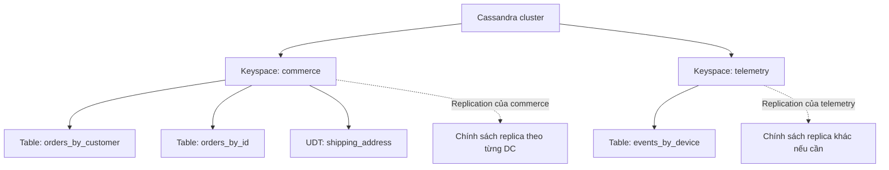
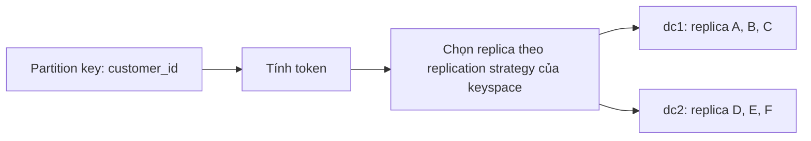

# Keyspace là phạm vi cấu hình sao chép và chứa đối tượng dữ liệu

## 1. Keyspace đứng ở đâu trong Apache Cassandra?

Trong Apache Cassandra, **keyspace** là đơn vị tổ chức dữ liệu ở cấp cao nhất bên trong một cluster. Nó có hai vai trò gắn liền với nhau:

1. **Không gian tên (namespace):** chứa các bảng (table), kiểu dữ liệu do người dùng định nghĩa (user-defined type, UDT) và các đối tượng schema liên quan.
2. **Ranh giới cấu hình replication:** xác định cách Cassandra đặt các bản sao dữ liệu của **mọi bảng trong keyspace** lên các node và các data center (DC).

Có thể hình dung keyspace gần với khái niệm *database/schema* trong hệ quản trị quan hệ về mặt tổ chức tên. Tuy nhiên, keyspace **không** ngụ ý có một máy chủ riêng, một ổ đĩa riêng, một transaction bao trùm toàn bộ bảng hay cơ chế JOIN/foreign key như cơ sở dữ liệu quan hệ.



Với module `DATABASE_ENGINE_WIDE_COLUMN_CASSANDRA`, hãy tách bạch ba tầng quyết định:

| Tầng | Quyết định chính | Ví dụ |
| --- | --- | --- |
| **Cluster** | Tập hợp node, topology DC/rack, tài nguyên và vận hành chung | Cluster có DC `dc1` và `dc2` |
| **Keyspace** | Tên miền dữ liệu, chiến lược và hệ số sao chép, `durable_writes` | `commerce`, RF = 3 trong mỗi DC |
| **Table** | Partition key, clustering columns, các cột, compaction, TTL mặc định và thiết kế theo truy vấn | `orders_by_customer` với partition key `customer_id` |

Ứng dụng Java có thể truy vấn tên đầy đủ `commerce.orders_by_customer` hoặc đặt `commerce` làm keyspace mặc định của session. Việc đặt keyspace mặc định **không thay đổi** vị trí đặt replica; nó chỉ giúp phân giải tên bảng/kiểu dữ liệu.

## 2. Vì sao replication được cấu hình ở cấp keyspace?

Cassandra là cơ sở dữ liệu wide-column phân tán, được thiết kế để phân phối partition và duy trì bản sao trên nhiều node. Đối với mỗi partition, quy trình tư duy là:

1. **Partition key** của hàng được băm thành một token; token giúp xác định vị trí logic của partition trong hệ thống phân phối dữ liệu.
2. **Replication strategy** của keyspace kết hợp với topology để chọn các node lưu replica của partition.
3. **Replication factor (RF)** quy định số bản sao mong muốn trong phạm vi mà chiến lược sao chép xác định.
4. **Consistency level (CL)** của từng thao tác đọc/ghi quyết định số phản hồi replica cần nhận để thao tác được coi là thành công.



Sơ đồ minh họa keyspace có RF = 3 tại `dc1` và RF = 3 tại `dc2`. **Mỗi partition có sáu replica theo cấu hình này**, giả sử topology có đủ node phù hợp. Không có nghĩa mọi node trong cluster đều giữ toàn bộ dữ liệu của keyspace. Các partition khác nhau có thể được đặt trên những tập node khác nhau.

Một ý rất quan trọng: **hai bảng trong cùng keyspace dùng chung replication strategy và cấu hình RF**, dù chúng có partition key, clustering order, compaction hoặc TTL khác nhau. Muốn áp dụng chính sách sao chép khác hẳn cho một nhóm bảng, thông thường phải thiết kế chúng vào keyspace khác.

### Replication strategy và replication factor

| Thuộc tính | Ý nghĩa | Điều cần nhớ |
| --- | --- | --- |
| `replication.class` | Chiến lược chọn replica | `NetworkTopologyStrategy` phù hợp cho cluster có topology DC/rack; `SimpleStrategy` chủ yếu dành cho môi trường thử nghiệm đơn giản |
| `dc1`, `dc2`, ... | RF của từng DC khi dùng `NetworkTopologyStrategy` | **Tên DC phải khớp** topology thực tế, bao gồm chữ hoa/chữ thường |
| RF | Số replica mong muốn cho mỗi partition trong phạm vi chỉ định | RF = 3 không có nghĩa là ba bản sao trên mỗi bảng *tại mỗi node* |
| `durable_writes` | Bật/tắt ghi commit log cho keyspace | Thông thường để `true`; `false` làm tăng nguy cơ mất dữ liệu khi node gặp sự cố |

`NetworkTopologyStrategy` có xét cấu trúc DC/rack khi đặt replica và được ưu tiên cho môi trường production. Nếu trong một DC không có đủ node hoặc rack phù hợp, mức chịu lỗi thực tế có thể thấp hơn kỳ vọng; chỉ đặt RF trong câu lệnh CQL không tự tạo thêm node hay rack.

### Keyspace và data center không phải cùng một khái niệm

**Data center** là nhóm node theo topology do cluster khai báo. **Keyspace** là cấu hình logic cho dữ liệu ứng dụng. Một keyspace có thể đặt replica ở nhiều DC; một DC có thể chứa replica của nhiều keyspace. Ví dụ:

- Keyspace `commerce` cần phục vụ giao dịch ở `dc1` và `dc2`, RF = 3 tại mỗi nơi.
- Keyspace `telemetry` chỉ cần replica ở `dc1`, RF = 2 tại đó.

Đây là hai chính sách của hai keyspace trong **cùng cluster**. Nếu một DC không được khai báo trong replication map, DC đó không được cấu hình để giữ replica của keyspace ấy; coordinator vẫn có thể phải liên hệ các DC có replica để phục vụ truy vấn.

## 3. Tạo keyspace bằng CQL

Giả sử cluster có hai DC tên **chính xác** là `dc1` và `dc2`, mỗi DC có ít nhất ba node được bố trí topology hợp lý. Cấu hình minh họa:

```sql
CREATE KEYSPACE IF NOT EXISTS commerce
WITH replication = {
    'class': 'NetworkTopologyStrategy',
    'dc1': 3,
    'dc2': 3
}
AND durable_writes = true;
```

Giải thích từng thành phần:

- `CREATE KEYSPACE`: tạo một phạm vi dữ liệu và replication policy.
- `IF NOT EXISTS`: bỏ qua lỗi nếu keyspace đã tồn tại; **không** cập nhật cấu hình của keyspace cũ nếu nó khác câu lệnh hiện tại.
- `'class': 'NetworkTopologyStrategy'`: đặt chính sách sao chép theo topology.
- `'dc1': 3`, `'dc2': 3`: yêu cầu ba replica của mỗi partition tại từng DC tương ứng.
- `durable_writes = true`: duy trì việc ghi commit log. Đây là lựa chọn thông thường cho dữ liệu ứng dụng cần độ bền.

**Trước khi chạy:** xác nhận tên DC đang sử dụng bằng công cụ quản trị, chẳng hạn `nodetool status`, và kiểm tra cấu hình topology của các node. Các tên `dc1`, `dc2` ở đây là ví dụ, không phải giá trị mặc định áp dụng cho mọi cluster.

Với **môi trường lab chỉ có một node**, cần dùng đúng tên DC thực tế và RF = 1 để các ví dụ đọc/ghi có thể hoạt động. Chẳng hạn, nếu node duy nhất thuộc DC `datacenter1`:

```sql
CREATE KEYSPACE IF NOT EXISTS commerce_lab
WITH replication = {
    'class': 'NetworkTopologyStrategy',
    'datacenter1': 1
}
AND durable_writes = true;
```

Đừng áp dụng RF = 3 trong lab một node rồi kết luận Cassandra bị lỗi khi một mức nhất quán yêu cầu nhiều replica không thể được đáp ứng.

### Kiểm tra cấu hình vừa tạo

Trong `cqlsh`, có thể dùng:

```sql
DESCRIBE KEYSPACES;
DESCRIBE KEYSPACE commerce;

SELECT keyspace_name, replication, durable_writes
FROM system_schema.keyspaces
WHERE keyspace_name = 'commerce';
```

`DESCRIBE` là lệnh hỗ trợ của `cqlsh` để xem schema; truy vấn `system_schema.keyspaces` đọc metadata schema mà Cassandra lưu. Hãy kiểm tra replication map nhận được có khớp **toàn bộ** topology dự kiến không.

## 4. Keyspace chứa các đối tượng dữ liệu nào?

Một bảng có tên đầy đủ theo dạng **`keyspace.table`**. Các UDT và những đối tượng schema liên quan cũng thuộc phạm vi keyspace. Ví dụ tiếp theo sử dụng `commerce` đã tạo ở phần trên.

```sql
USE commerce;

CREATE TYPE shipping_address (
    street text,
    city text,
    country text
);

CREATE TABLE orders_by_customer (
    customer_id uuid,
    created_at timestamp,
    order_id uuid,
    total_amount decimal,
    shipping frozen<shipping_address>,
    PRIMARY KEY ((customer_id), created_at, order_id)
) WITH CLUSTERING ORDER BY (created_at DESC, order_id ASC);
```

Trong bảng này:

- `customer_id` là **partition key**. Các đơn hàng của cùng khách hàng thuộc cùng partition về mặt logic, nên cần kiểm soát kích thước partition trong thiết kế thực tế.
- `created_at` và `order_id` là **clustering columns**, giúp xác định thứ tự hàng và đảm bảo khóa chính đủ phân biệt các bản ghi.
- `shipping_address` là UDT do keyspace `commerce` quản lý; `frozen<...>` biểu diễn giá trị UDT như một giá trị đơn ở cột này.
- Cấu hình replication của bảng **không nằm trong** `CREATE TABLE`. Bảng kế thừa replication policy của keyspace `commerce`.

Ta có thể ghi và đọc dữ liệu với tên bảng đã được phân giải bởi `USE commerce`:

```sql
INSERT INTO orders_by_customer (
    customer_id, created_at, order_id, total_amount
) VALUES (
    11111111-1111-1111-1111-111111111111,
    '2026-10-03T10:00:00Z',
    aaaaaaaa-aaaa-4aaa-8aaa-aaaaaaaaaaaa,
    129000.00
);

SELECT order_id, created_at, total_amount
FROM commerce.orders_by_customer
WHERE customer_id = 11111111-1111-1111-1111-111111111111;
```

Lệnh `SELECT` có thể dùng `commerce.orders_by_customer` dù session hiện đặt keyspace nào, miễn quyền truy cập cho phép. Với ứng dụng Java, cũng có thể cấu hình keyspace mặc định cho session hoặc truyền tên bảng đầy đủ trong câu CQL. **Keyspace không quyết định partition key**: khóa phân vùng và các truy vấn chủ đạo phải được thiết kế ở cấp bảng theo nhu cầu truy xuất.

### Không phải mọi cấu hình đều nằm ở keyspace

| Cần cấu hình | Đặt ở đâu? | Lý do |
| --- | --- | --- |
| Replication strategy và RF từng DC | **Keyspace** | Cùng chính sách cho toàn bộ bảng thuộc keyspace |
| `durable_writes` | **Keyspace** | Điều khiển commit log cho các ghi trong keyspace |
| Partition key và clustering columns | **Table** | Quyết định nhóm partition và cách truy vấn dữ liệu |
| Compaction strategy, caching, `default_time_to_live` | **Table** | Phụ thuộc đặc điểm ghi/đọc và vòng đời dữ liệu từng bảng |
| `ONE`, `LOCAL_QUORUM`, `ALL`... | **Mỗi thao tác đọc/ghi** hoặc cấu hình thực thi của client | Chọn số replica cần phản hồi, không phải thuộc tính cố định của keyspace |

## 5. RF của keyspace tương tác với consistency ra sao?

Giả sử `commerce` có RF = 3 trong `dc1`. Ứng dụng ở `dc1` thực hiện đọc và ghi với **`LOCAL_QUORUM`**:

- Ghi `LOCAL_QUORUM` cần phản hồi thành công từ ít nhất **2 trong 3 replica tại `dc1`**.
- Đọc `LOCAL_QUORUM` cần phản hồi theo yêu cầu của mức nhất quán từ ít nhất **2 trong 3 replica tại `dc1`**.
- Hai tập hợp bất kỳ gồm 2 phần tử trong một tập 3 replica luôn giao nhau ít nhất một phần tử. Đây là trực giác cho cấu hình quorum đọc/ghi, với giả thiết cần thiết về replica và không có các ghi cạnh tranh làm thay đổi kết quả.

Công thức quorum cho RF = \(N\) là:

\[
Q = \left\lfloor \frac{N}{2} \right\rfloor + 1
\]

| RF trong DC | Số replica cần cho `LOCAL_QUORUM` tại DC đó |
| ---: | ---: |
| 1 | 1 |
| 3 | 2 |
| 5 | 3 |

**Hai khái niệm dễ nhầm:**

- **RF** quy định Cassandra cố gắng giữ *bao nhiêu bản sao* cho mỗi partition.
- **CL** quy định một lần đọc/ghi cần *bao nhiêu phản hồi* để được trả về là thành công.

CL thấp như `ONE` thường cho phép tiếp tục phục vụ khi ít replica sẵn sàng hơn nhưng có thể quan sát dữ liệu chưa đồng bộ; CL cao hơn đánh đổi yêu cầu phản hồi và độ sẵn sàng. `LOCAL_QUORUM` chỉ tính replica trong DC nội bộ của coordinator, còn mức `QUORUM` được xác định trên tập replica toàn cục. Trong nhiều DC, lựa chọn CL ảnh hưởng trực tiếp đến độ trễ liên vùng và khả năng chịu lỗi của ứng dụng.

Quorum không tự thay thế quy trình repair, cũng không biến các thao tác thông thường thành transaction tuyến tính hóa trước những cập nhật đồng thời. Trường hợp cần điều kiện kiểu **“chỉ ghi nếu phiên bản chưa đổi”** có thể cần lightweight transaction (LWT) với `IF` và đánh giá riêng chi phí của nó.

## 6. Khi nào tách thành nhiều keyspace?

Không nên tạo keyspace mới chỉ để chia từng loại truy vấn: Cassandra vốn khuyến khích tạo nhiều bảng theo truy vấn trong **cùng một miền dữ liệu** nếu chúng cần chung chính sách replication. Tạo keyspace riêng khi có lý do rõ ràng về namespace hoặc chính sách sao chép.

Ví dụ trong một cluster:

| Nhu cầu | Quyết định hợp lý | Lý do |
| --- | --- | --- |
| Đơn hàng cần bản sao ở hai DC để phục vụ hai vùng | Keyspace `commerce` với RF cho cả hai DC | Các bảng đơn hàng có chung mục tiêu chịu lỗi và phân bố dữ liệu |
| Sự kiện đo đạc chỉ cần lưu tại một DC | Keyspace `telemetry` chỉ khai báo RF cho DC đó | Khác phạm vi lưu replica so với `commerce` |
| Cần tra đơn hàng theo `order_id` và theo `customer_id` | Hai bảng truy vấn trong keyspace `commerce` | Khác mô hình partition, **không** đòi hỏi keyspace mới |
| Một bảng có TTL ngắn còn bảng khác cần giữ lâu | Có thể ở cùng keyspace, cấu hình TTL theo bảng/dữ liệu | TTL không phải một tùy chọn replication ở cấp keyspace |

Keyspace cung cấp tên và replication policy chung; bản thân việc tách keyspace **không đảm bảo** cô lập CPU, bộ nhớ, I/O, mạng hay quyền truy cập. Phân quyền và giới hạn tài nguyên cần được cấu hình/đánh giá riêng theo phiên bản và môi trường triển khai.

## 7. Thay đổi replication của keyspace: điều gì thực sự xảy ra?

Có thể sửa replication bằng `ALTER KEYSPACE`. Ví dụ, sau khi đã triển khai và cấu hình xong DC `dc3`, một phương án mở rộng chính sách của `commerce` là:

```sql
ALTER KEYSPACE commerce
WITH replication = {
    'class': 'NetworkTopologyStrategy',
    'dc1': 3,
    'dc2': 3,
    'dc3': 3
};
```

Đây là **thao tác thay đổi metadata/chính sách replica**, không phải một lời đảm bảo rằng dữ liệu hiện có đã lập tức được sao chép đầy đủ sang `dc3`. Cần có node/topology thật, thực hiện quy trình truyền dữ liệu phù hợp (ví dụ `nodetool rebuild` khi bổ sung DC, hoặc repair khi điều chỉnh RF trong DC), quan sát trạng thái đồng bộ và xác minh đầy đủ trước khi xem việc chuyển đổi hoàn tất.

Quy trình tư duy an toàn:

1. **Xác định mục tiêu:** tăng/giảm RF, thêm/bỏ DC hay sửa sai tên DC; phân tích yêu cầu CL và khả năng chịu lỗi.
2. **Kiểm tra topology:** tên DC/rack, số node thực tế, tình trạng node và dung lượng còn trống; RF không thể bù cho thiếu node vật lý.
3. **Cập nhật schema:** dùng `ALTER KEYSPACE`, giữ chính xác các DC vẫn cần replica trong replication map; không vô tình loại DC cũ.
4. **Đồng bộ dữ liệu hiện có:** lên kế hoạch streaming/rebuild/repair phù hợp với kiểu thay đổi và phiên bản Cassandra đang vận hành.
5. **Xác minh:** kiểm tra metadata, trạng thái node, tiến độ streaming/repair và khả năng đáp ứng CL của ứng dụng trước khi hoàn tất thay đổi.

Giảm RF cũng cần quy trình vận hành riêng để xác nhận bản sao không còn cần thiết đã được xử lý và thu hồi dữ liệu phù hợp. Với một keyspace đang phục vụ production, nên lên lịch thay đổi và đánh giá ảnh hưởng lên mạng, đĩa, tải đọc/ghi và tính sẵn sàng.

### Xóa keyspace có phạm vi ảnh hưởng rất lớn

`DROP KEYSPACE commerce` sẽ xóa **schema và dữ liệu của toàn bộ đối tượng** thuộc keyspace đó, không chỉ một bảng. Vì vậy, cần kiểm tra chính xác đích, quyền thao tác, bản sao lưu/khả năng khôi phục và phạm vi ứng dụng phụ thuộc trước khi thực hiện. `TRUNCATE` hoặc `DROP TABLE` có phạm vi khác, chỉ tác động tới bảng được chỉ định.

## 8. Những ngộ nhận thường gặp

| Ngộ nhận | Cách hiểu đúng |
| --- | --- |
| “RF = 3 nghĩa là cả cluster có đúng ba node.” | RF nói về số replica của **mỗi partition** trong phạm vi strategy; cluster có thể có nhiều node hơn. |
| “Mỗi bảng có thể chọn RF riêng ngay trong `CREATE TABLE`.” | Replication policy được khai báo ở **keyspace**. Bảng trong cùng keyspace dùng chung policy đó. |
| “Đã `CREATE KEYSPACE` với RF = 3 thì dữ liệu sẽ an toàn dù cluster chỉ có một node.” | Cần đủ node/topology để đặt replica và thỏa mãn CL; cấu hình RF không sinh ra node mới. |
| “`USE commerce` làm dữ liệu chạy sang keyspace khác.” | `USE` chỉ đặt ngữ cảnh tên mặc định cho session CQL. |
| “`LOCAL_QUORUM` là cài đặt bên trong `CREATE KEYSPACE`.” | `LOCAL_QUORUM` là CL do truy vấn hoặc client chọn; keyspace cung cấp RF để xác định ngưỡng. |
| “`IF NOT EXISTS` sẽ tự sửa RF nếu khác.” | `IF NOT EXISTS` tránh tạo trùng, không đồng bộ cấu hình keyspace đã tồn tại. |
| “Đổi `ALTER KEYSPACE` là mọi replica cũ/mới đã đồng bộ.” | Thay đổi chính sách replica cần đi kèm thao tác vận hành để dữ liệu hiện hữu được chuyển/đồng bộ. |
| “Keyspace là một database độc lập về CPU và ổ đĩa.” | Các keyspace thường chia sẻ tài nguyên của cùng cluster; cô lập tài nguyên cần cơ chế khác. |

## 9. Bài thực hành ngắn và tiêu chí kiểm tra

Trên cluster thử nghiệm đã biết topology, hãy:

1. Xem danh sách DC/node thực tế bằng `nodetool status`.
2. Tạo keyspace `commerce_lab` với `NetworkTopologyStrategy`, RF phù hợp số node sẵn có, `durable_writes = true`.
3. Dùng `SELECT ... FROM system_schema.keyspaces` kiểm tra replication map và `durable_writes`.
4. Tạo bảng nhỏ có `PRIMARY KEY ((device_id), event_time)` trong `commerce_lab`; `INSERT` và `SELECT` theo `device_id`.
5. Tự giải thích vì sao đổi tên hoặc RF của keyspace có thể ảnh hưởng mọi bảng, còn đổi partition key là quyết định thiết kế bảng và thường đòi hỏi mô hình/bảng mới.

Bạn đã nắm trọng tâm khi có thể trả lời chính xác: **Keyspace chứa những đối tượng gì? Điều gì được cấu hình cho toàn bộ keyspace? Một partition được đặt replica theo cơ chế nào? RF liên hệ thế nào với CL của thao tác đọc/ghi?** Những câu hỏi này là nền tảng cho các chủ đề tiếp theo về thiết kế bảng theo truy vấn, sửa chữa replica, compaction và tích hợp Cassandra từ ứng dụng Java.
