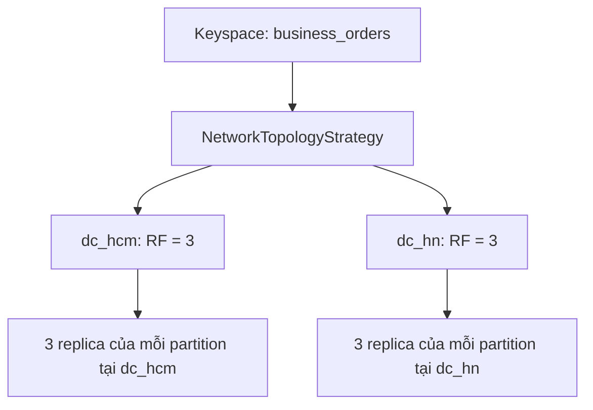

# CREATE/ALTER/DROP KEYSPACE và kiểm tra thuộc tính replication

## 1. Mục tiêu và bối cảnh thực hành

Trong Apache Cassandra, **keyspace** là không gian tên chứa bảng và các đối tượng schema liên quan, đồng thời là nơi xác định **chính sách sao chép (replication)** áp dụng cho toàn bộ bảng thuộc keyspace. Vì Cassandra là hệ quản trị wide-column phân tán, câu lệnh quản lý keyspace không chỉ tổ chức tên dữ liệu: nó còn ảnh hưởng đến cách các partition được đặt trên node và data center (DC).

Sau bài học thuộc chương **Keyspace và schema** của module `DATABASE_ENGINE_WIDE_COLUMN_CASSANDRA`, bạn cần thực hiện được bốn việc:

1. Tạo keyspace với `CREATE KEYSPACE`, chọn replication strategy và replication factor (RF) phù hợp topology.
2. Đọc lại replication map và thuộc tính `durable_writes` từ metadata, thay vì đoán cấu hình đã áp dụng.
3. Dùng `ALTER KEYSPACE` khi yêu cầu sao chép thay đổi; nhận biết phần công việc đồng bộ dữ liệu phải làm **sau** khi đổi schema.
4. Biết phạm vi ảnh hưởng của `DROP KEYSPACE` và xác minh đúng đối tượng trước khi xóa.

Nội dung kết nối với các chủ đề khác của Cassandra: partition key quyết định phân vùng dữ liệu ở cấp bảng; replication policy quyết định replica ở cấp keyspace; consistency level (CL) của thao tác đọc/ghi quyết định số phản hồi cần thiết. Khi ứng dụng Java sử dụng CQL, các tầng này tương tác nhưng không thay thế lẫn nhau.

### Chuẩn bị môi trường

Ví dụ trong bài dùng `cqlsh` để chạy CQL và `nodetool` để quan sát topology. Cần có quyền phù hợp để tạo, sửa và xóa keyspace. Trước tiên xem node đang thuộc các DC nào:

```bash
nodetool status
```

Trong kết quả, tìm tên DC dưới nhãn `Datacenter: ...`, số node và trạng thái node. **Tên DC trong CQL phải khớp chính xác tên DC thực tế.** Ví dụ lab bên dưới giả định một node thuộc `datacenter1`; nếu môi trường của bạn dùng `dc1` hoặc tên khác, hãy thay đúng tên đó trong mọi lệnh.

Không chạy các lệnh thay đổi hoặc xóa keyspace ví dụ trên dữ liệu production. Tên `lab_orders` được chọn riêng cho thực hành.

## 2. CREATE KEYSPACE: tạo phạm vi dữ liệu và chính sách sao chép

Cấu trúc CQL thường dùng là:

```sql
CREATE KEYSPACE [ IF NOT EXISTS ] ten_keyspace
WITH replication = {
    'class': 'NetworkTopologyStrategy',
    'ten_dc': 'so_replica'
}
AND durable_writes = true;
```

Trong đó `ten_keyspace` là tên keyspace, `class` xác định cách Cassandra chọn replica và cặp `ten_dc: so_replica` khai báo RF của mỗi DC khi dùng `NetworkTopologyStrategy`. Giá trị RF trong ví dụ được đặt trong chuỗi ký tự để tương thích với biểu diễn thuộc tính replication dạng map.

### Ví dụ A: lab một node

Giả sử `nodetool status` cho biết DC là `datacenter1` và chỉ có một node đang hoạt động:

```sql
CREATE KEYSPACE IF NOT EXISTS lab_orders
WITH replication = {
    'class': 'NetworkTopologyStrategy',
    'datacenter1': '1'
}
AND durable_writes = true;
```

RF = 1 giúp lab một node có thể đọc/ghi với số replica sẵn có. Đây chỉ là cấu hình phù hợp để **học CQL**, không cung cấp khả năng chịu lỗi khi node duy nhất ngừng hoạt động.

### Ví dụ B: cluster có hai data center

Giả sử một cluster thật có `dc_hcm` và `dc_hn`, mỗi DC có đủ node và được bố trí rack phù hợp:

```sql
CREATE KEYSPACE IF NOT EXISTS business_orders
WITH replication = {
    'class': 'NetworkTopologyStrategy',
    'dc_hcm': '3',
    'dc_hn': '3'
}
AND durable_writes = true;
```

Với cấu hình này, Cassandra nhắm tới **ba replica cho mỗi partition ở từng DC**. Nếu đủ hạ tầng, mỗi partition có tổng cộng sáu replica qua hai DC; điều đó **không** có nghĩa mỗi node giữ toàn bộ nội dung keyspace. Các partition khác nhau có thể nằm trên tập node khác nhau.



**Không được sao chép nguyên tên DC từ ví dụ** nếu cluster có tên khác. Cấu hình RF cũng không tạo thêm node: khi topology không đủ node hoặc rack phù hợp, khả năng chịu lỗi và khả năng thỏa mãn CL có thể thấp hơn dự kiến.

### Các thuộc tính cần hiểu

| Thuộc tính/cú pháp | Tác dụng | Điểm cần lưu ý |
| --- | --- | --- |
| `IF NOT EXISTS` | Bỏ qua lỗi tạo trùng tên | **Không cập nhật** replication nếu keyspace đã tồn tại với cấu hình khác |
| `replication.class` | Chọn cách bố trí replica | `NetworkTopologyStrategy` phù hợp môi trường nhiều DC và production; `SimpleStrategy` chủ yếu có ý nghĩa cho ví dụ đơn giản |
| `'dc_hcm': '3'` | Yêu cầu ba replica của mỗi partition trong DC `dc_hcm` | Tên DC là tên topology thực tế, không phải tên tự đặt tùy ý |
| `durable_writes = true` | Bật ghi commit log cho ghi dữ liệu trong keyspace | Thông thường giữ `true` để hỗ trợ độ bền khi node gặp sự cố |
| Tên keyspace | Xác định namespace cho bảng, UDT và các đối tượng schema khác | Chọn tên đơn giản dạng `snake_case`; tên không đặt ra ranh giới tài nguyên riêng |

**Lưu ý với `SimpleStrategy`:** chiến lược này dùng RF cho cluster theo cách đơn giản, không có cấu hình RF tách biệt cho từng DC như `NetworkTopologyStrategy`. Khi lên môi trường có nhiều DC/rack hoặc production, nên thiết kế replication theo topology thực tế.

## 3. Kiểm tra replication sau CREATE

Đừng dừng ở thông báo câu lệnh thành công. Hãy kiểm tra **schema hiện được Cassandra ghi nhận** bằng ít nhất một trong hai cách sau.

### Cách 1: xem schema bằng cqlsh

```sql
DESCRIBE KEYSPACES;
DESCRIBE KEYSPACE lab_orders;
```

`DESCRIBE` là lệnh tiện ích của **`cqlsh`** để in định nghĩa schema, không phải câu lệnh CQL DML được mọi Cassandra driver hỗ trợ. Kết quả của `DESCRIBE KEYSPACE lab_orders` cần cho thấy replication strategy, RF và `durable_writes` của keyspace đang tồn tại.

### Cách 2: truy vấn bảng metadata hệ thống

```sql
SELECT keyspace_name, replication, durable_writes
FROM system_schema.keyspaces
WHERE keyspace_name = 'lab_orders';
```

`system_schema.keyspaces` cung cấp metadata schema; cột `replication` chứa map với `class` và thông số RF. Một kết quả **minh họa** là:

```text
keyspace_name | replication                                                     | durable_writes
--------------+-----------------------------------------------------------------+---------------
lab_orders    | {'class': 'org.apache.cassandra.locator.NetworkTopologyStrategy',
              |  'datacenter1': '1'}                                            | True
```

Tên class trong cách hiển thị metadata có thể là tên đầy đủ của class; hãy kiểm tra **ý nghĩa của strategy và cặp tên DC/RF** thay vì so sánh chuỗi đầu ra một cách máy móc.

Nếu chỉ muốn liệt kê các keyspace và xem map của chúng:

```sql
SELECT keyspace_name, replication, durable_writes
FROM system_schema.keyspaces;
```

Khi viết ứng dụng Java hoặc công cụ migration, câu truy vấn metadata này giúp xác minh cấu hình thực sự sau khi chạy DDL. Tuy nhiên, một schema đã được ghi nhận **không chứng minh** các bản sao dữ liệu hiện hữu đã hoàn toàn đồng bộ.

### Đối chiếu ba nguồn thông tin

| Nguồn | Trả lời câu hỏi gì? | Không đảm bảo điều gì? |
| --- | --- | --- |
| `nodetool status` | Có những DC/node nào và trạng thái node ra sao? | Không cho biết chính sách RF riêng của từng keyspace |
| `DESCRIBE KEYSPACE` hoặc `system_schema.keyspaces` | Keyspace khai báo replication strategy, RF, `durable_writes` nào? | Không chứng minh các replica đã chứa đầy đủ dữ liệu |
| Theo dõi streaming/repair, sức khỏe cluster và kiểm tra dữ liệu | Quá trình đồng bộ và khả năng phục vụ có đáp ứng yêu cầu không? | Không thay thế việc đọc đúng replication map |

Đối với thao tác thay đổi schema, cần quan sát thêm **schema agreement** giữa các node (ví dụ `nodetool describecluster` có thông tin phiên bản schema, tùy bản Cassandra) trước khi coi thay đổi đã được cluster tiếp nhận thống nhất.

## 4. ALTER KEYSPACE: thay đổi RF và replication policy

`ALTER KEYSPACE` cập nhật thuộc tính keyspace. Cần nhớ hai pha khác nhau: **pha schema** thay đổi chính sách chọn replica; **pha vận hành** làm cho dữ liệu hiện hữu được đưa đến/tái đồng bộ trên các replica theo chính sách mới.

### Tăng RF trong một DC hiện có

Giả sử lab đã được mở rộng thành **ít nhất ba node phù hợp** trong `datacenter1`, đồng thời bạn muốn đổi RF của `lab_orders` từ 1 lên 3:

```sql
ALTER KEYSPACE lab_orders
WITH replication = {
    'class': 'NetworkTopologyStrategy',
    'datacenter1': '3'
};
```

Sau câu lệnh này, hãy đọc lại metadata:

```sql
SELECT replication
FROM system_schema.keyspaces
WHERE keyspace_name = 'lab_orders';
```

**Tăng RF không có nghĩa dữ liệu cũ lập tức xuất hiện đầy đủ trên các replica bổ sung.** Phải lập kế hoạch chạy repair/đồng bộ theo hướng dẫn vận hành tương ứng với phiên bản Cassandra và topology; theo dõi tiến độ và xác nhận toàn bộ replica cần thiết đã nhận dữ liệu. Khi chỉ thay đổi metadata mà bỏ qua giai đoạn này, thao tác đọc ở mức consistency cao có thể gặp thiếu dữ liệu hoặc thất bại trong điều kiện sự cố.

Không chạy ví dụ tăng RF = 3 trên môi trường chỉ có một node. Nếu sau đó ứng dụng đặt CL yêu cầu nhiều replica, thao tác có thể thất bại vì không đủ replica sẵn sàng.

### Thêm data center mới vào replication map

Giả sử keyspace `business_orders` hiện có replica ở hai DC, và cluster đã xây dựng DC mới tên `dc_danang`. Câu lệnh mở rộng chính sách là:

```sql
ALTER KEYSPACE business_orders
WITH replication = {
    'class': 'NetworkTopologyStrategy',
    'dc_hcm': '3',
    'dc_hn': '3',
    'dc_danang': '3'
};
```

Lưu ý **ghi lại đầy đủ các DC cần giữ replica**. Thay cả replication map bằng map chỉ chứa `dc_danang` có thể làm mất cấu hình sao chép của các DC cũ. Việc thêm DC mới đòi hỏi topology/nodes đã sẵn sàng và quy trình đưa dữ liệu đến DC đó (thường có bước streaming/rebuild, cùng kiểm tra/repair tùy topology và phiên bản Cassandra). Chỉ thực thi `ALTER KEYSPACE` sẽ không hoàn tất việc chuyển dữ liệu.

Khi cần **giảm RF** hoặc **ngừng sao chép tới một DC**, cũng phải có kế hoạch kiểm tra vị trí replica, sự phụ thuộc của ứng dụng, sao lưu, repair và thu hồi dữ liệu không còn cần thiết theo quy trình vận hành phù hợp. Việc giảm RF làm giảm số bản sao dự phòng cho partition và có thể thay đổi mức chịu lỗi.

### Thay đổi `durable_writes`

Nếu cần xác lập lại thuộc tính commit log của keyspace:

```sql
ALTER KEYSPACE lab_orders
WITH durable_writes = true;
```

Trong hầu hết ứng dụng cần bảo toàn dữ liệu, nên giữ `durable_writes = true`. Đặt `false` khiến ghi dữ liệu không được bảo vệ bởi commit log của Cassandra theo cách thông thường, làm tăng nguy cơ mất ghi khi node gặp sự cố; không nên dùng như một cách tối ưu hiệu năng mặc định.

**`ALTER KEYSPACE` không hỗ trợ đổi tên keyspace** như một phép `RENAME` đơn giản. Nếu cần chuyển từ namespace cũ sang namespace mới, phải thiết kế kế hoạch tạo keyspace mới, tạo schema, sao chép/di chuyển dữ liệu và đổi ứng dụng.

## 5. Phân biệt replication factor và consistency level

Giả sử `business_orders` có RF = 3 tại `dc_hcm`. Với một request được điều phối từ `dc_hcm`:

| CL của request | Điều kiện thành công ở mức đơn giản | Nhận xét |
| --- | --- | --- |
| `ONE` | Một replica trả lời theo yêu cầu | Ít phản hồi hơn, có thể quan sát dữ liệu chưa đồng bộ khi đọc |
| `LOCAL_QUORUM` | Đa số replica thuộc DC cục bộ: 2/3 | Thường dùng khi ứng dụng cần nhất quán mạnh hơn trong một DC |
| `ALL` | Tất cả replica của partition cần đáp ứng | Nhạy với một replica lỗi hoặc không sẵn sàng |

Quorum của RF = \(N\) trong một DC là:

\[
Q = \lfloor N/2 \rfloor + 1.
\]

`LOCAL_QUORUM` tại RF = 3 tương ứng hai phản hồi từ replica trong DC cục bộ. CL là lựa chọn ở **từng thao tác** (hoặc được client cấu hình mặc định), **không** là trường được đặt trong `CREATE KEYSPACE`. Với cluster đa DC, `QUORUM` và `LOCAL_QUORUM` không tương đương: `QUORUM` tính đa số trên tập replica toàn cục, còn `LOCAL_QUORUM` xét đa số trong DC cục bộ.

Khi RF thay đổi, ngưỡng replica cần cho các mức CL cũng có thể thay đổi. Vì thế, trước khi tăng/giảm RF, cần kiểm tra các CL mà ứng dụng Java dùng cho đọc, ghi và thao tác có điều kiện. Quorum thường giúp đọc/ghi quan sát dữ liệu mới hơn khi không có ghi cạnh tranh và các điều kiện liên quan được đáp ứng, nhưng **không thay thế repair**, cũng không biến ghi thông thường thành transaction tuyến tính hóa.

## 6. DROP KEYSPACE: xóa toàn bộ phạm vi dữ liệu

`DROP KEYSPACE` xóa schema của keyspace cùng **toàn bộ bảng, kiểu dữ liệu và dữ liệu thuộc keyspace** trong phạm vi thao tác xóa. Phần lớn thao tác sử dụng namespace này sau đó sẽ không còn hoạt động như trước.

Ví dụ **chỉ dùng trong lab** sau khi đã hoàn tất thực hành:

```sql
DROP KEYSPACE IF EXISTS lab_orders;
```

`IF EXISTS` giúp tránh lỗi khi keyspace không tồn tại, **không** cung cấp cơ chế khôi phục. Nếu có dữ liệu cần giữ, phải xác định chính xác phương án sao lưu và khôi phục **trước** khi xóa; đừng mặc định keyspace có thể lấy lại nhờ replication, vì việc xóa schema được áp dụng trên cluster.

Một quy trình tối thiểu trước khi `DROP`:

1. Dùng `SELECT ... FROM system_schema.keyspaces WHERE keyspace_name = ...` và `DESCRIBE KEYSPACE ...` để xác nhận **chính xác tên và các đối tượng** sẽ bị ảnh hưởng.
2. Kiểm tra phụ thuộc của ứng dụng, job xử lý dữ liệu, driver Java và quyền thao tác.
3. Xác nhận dữ liệu đã được sao lưu và phương án khôi phục đã được thử nghiệm nếu có yêu cầu lưu giữ.
4. Thực hiện câu lệnh trên đúng môi trường; kiểm tra keyspace không còn nằm trong metadata.

Sau khi xóa:

```sql
SELECT keyspace_name
FROM system_schema.keyspaces
WHERE keyspace_name = 'lab_orders';
```

Truy vấn không có hàng kết quả là dấu hiệu metadata không còn keyspace đó. Nó **không** phải bằng chứng độc lập về việc mọi bản sao vật lý đã được dọn ngay lập tức; cơ chế xử lý dữ liệu còn phụ thuộc phiên bản và tác vụ vận hành.

So sánh phạm vi các lệnh để tránh nhầm lẫn:

| Câu lệnh | Phạm vi tác động |
| --- | --- |
| `DELETE ... FROM keyspace.table WHERE ...` | Xóa dữ liệu được chỉ định theo điều kiện hợp lệ của bảng |
| `TRUNCATE keyspace.table` | Xóa toàn bộ dữ liệu của **một bảng**, giữ lại định nghĩa bảng |
| `DROP TABLE keyspace.table` | Xóa **một bảng** và dữ liệu của bảng đó |
| `DROP KEYSPACE keyspace` | Xóa **cả keyspace**, các đối tượng schema bên trong và dữ liệu liên quan |

## 7. Luồng thực hành hoàn chỉnh trên lab một node

Các bước dưới đây giả định bạn có một node thuộc DC `datacenter1` và quyền tạo/xóa keyspace thử nghiệm.

**Bước 1 — Tạo keyspace với RF = 1:**

```sql
CREATE KEYSPACE IF NOT EXISTS lab_orders
WITH replication = {
    'class': 'NetworkTopologyStrategy',
    'datacenter1': '1'
}
AND durable_writes = true;
```

**Bước 2 — Xác minh schema ngay sau khi tạo:**

```sql
DESCRIBE KEYSPACE lab_orders;

SELECT keyspace_name, replication, durable_writes
FROM system_schema.keyspaces
WHERE keyspace_name = 'lab_orders';
```

Bạn cần thấy `NetworkTopologyStrategy`, RF = 1 tại đúng DC và `durable_writes = true`. Nếu keyspace đã tồn tại trước đó, `IF NOT EXISTS` không bảo đảm thông số mới được áp dụng; phải so sánh với cấu hình kỳ vọng.

**Bước 3 — Tạo bảng để thấy quan hệ keyspace–table:**

```sql
CREATE TABLE IF NOT EXISTS lab_orders.events_by_device (
    device_id text,
    event_time timestamp,
    temperature double,
    PRIMARY KEY ((device_id), event_time)
) WITH CLUSTERING ORDER BY (event_time DESC);

INSERT INTO lab_orders.events_by_device (
    device_id, event_time, temperature
) VALUES (
    'sensor-01', '2026-11-20T08:00:00Z', 27.5
);

SELECT device_id, event_time, temperature
FROM lab_orders.events_by_device
WHERE device_id = 'sensor-01';
```

Lệnh `CREATE TABLE` không có RF riêng. Partition key của bảng là `device_id`; policy sao chép các partition của bảng này lấy từ keyspace `lab_orders`. Trong module Cassandra, đây là điểm nối từ bài toán thiết kế bảng theo truy vấn sang bài toán replication/consistency của dữ liệu được phân phối.

**Bước 4 — Kiểm tra một ALTER không làm thay đổi topology:**

```sql
ALTER KEYSPACE lab_orders
WITH durable_writes = true;

SELECT keyspace_name, replication, durable_writes
FROM system_schema.keyspaces
WHERE keyspace_name = 'lab_orders';
```

Ở bước này chỉ xác lập lại `durable_writes = true`. **Không đổi RF lên 3** trong khi lab vẫn chỉ có một node. Nếu triển khai bài tập trên cluster nhiều node, hãy thiết kế bài thực hành tăng RF kèm quy trình repair riêng.

**Bước 5 — Chỉ khi không cần dữ liệu lab nữa, xóa keyspace và xác minh:**

```sql
DROP KEYSPACE IF EXISTS lab_orders;

SELECT keyspace_name
FROM system_schema.keyspaces
WHERE keyspace_name = 'lab_orders';
```

Không còn hàng metadata cho `lab_orders` là kết quả mong đợi. Bảng `events_by_device` thuộc keyspace này cũng không còn truy cập được.

## 8. Lỗi thường gặp và cách chẩn đoán

| Hiện tượng | Nguyên nhân thường gặp | Cách kiểm tra hoặc khắc phục |
| --- | --- | --- |
| Tạo keyspace thành công nhưng RF khác dự kiến | `IF NOT EXISTS` gặp keyspace đã tồn tại | Đọc `system_schema.keyspaces`; dùng `ALTER KEYSPACE` có chủ đích nếu cần đổi |
| `InvalidRequest` khi tạo/sửa replication | Sai cú pháp CQL, replication strategy hoặc giá trị thuộc tính | Kiểm tra lại map `replication` và giá trị được Cassandra phiên bản đó hỗ trợ |
| RF ghi trong metadata nhưng request với CL cao báo `Unavailable` | Không đủ replica hoạt động/topology không đáp ứng CL | So sánh RF, CL, số node và trạng thái node trong DC liên quan |
| Thêm DC vào map nhưng dữ liệu cũ chưa có ở DC mới | Đã đổi chính sách replica nhưng chưa truyền/đồng bộ dữ liệu | Thực hiện quy trình streaming/rebuild/repair và kiểm tra dữ liệu |
| Thay map chỉ có DC mới khiến DC cũ bị mất khỏi cấu hình | Câu `ALTER` đã thay toàn bộ replication map | Khôi phục map với **tất cả DC mong muốn** và thực hiện các bước vận hành tương ứng |
| `DESCRIBE KEYSPACE` không chạy từ code Java | `DESCRIBE` là lệnh của `cqlsh`, không phải CQL truy vấn chuẩn | Dùng `system_schema.keyspaces` hoặc API metadata của Cassandra Java Driver |
| Xóa nhầm keyspace khiến nhiều bảng không còn truy cập | `DROP KEYSPACE` xóa toàn bộ namespace | Xác minh trước khi xóa, quản trị quyền, sử dụng sao lưu và kế hoạch khôi phục đã kiểm chứng |

**Một tình huống dễ đánh giá sai:** metadata ghi RF = 3 và cả ba node có trạng thái bình thường, nhưng bản sao mới thêm gần đây vẫn thiếu dữ liệu cũ. `nodetool status` cùng `SELECT replication` **chưa đủ** để kết luận repair/streaming đã hoàn thành. Cần thêm bằng chứng về tiến độ đồng bộ, lỗi hệ thống và kiểm tra thực tế theo kế hoạch vận hành.

## 9. Checklist trước khi đưa thay đổi keyspace vào vận hành

| Câu hỏi xác minh | Cách chứng minh |
| --- | --- |
| Đúng cluster và đúng tên keyspace chưa? | Kiểm tra môi trường kết nối, `DESCRIBE KEYSPACE` và metadata |
| RF có hợp với số node, DC, rack thực tế không? | `nodetool status`, topology, đánh giá khả năng chịu lỗi |
| Mọi DC cần giữ replica đã nằm trong map chưa? | Đọc lại `system_schema.keyspaces.replication` |
| Ứng dụng dùng CL nào khi đọc và ghi? | Kiểm tra cấu hình Java Driver và từng statement liên quan |
| Đổi RF/DC có cần dữ liệu lịch sử ở replica mới không? | Có kế hoạch rebuild/streaming/repair, xác minh kết quả |
| Đã có tiêu chí kiểm tra thành công và phương án xử lý sự cố chưa? | So sánh metadata trước/sau, quan sát node, lỗi, tải và tính sẵn sàng |
| Nếu xóa keyspace, đã kiểm tra phụ thuộc và khả năng khôi phục chưa? | Danh sách bảng, ứng dụng phụ thuộc, sao lưu và diễn tập khôi phục |

Ghi nhớ quy tắc trung tâm: **`CREATE/ALTER/DROP KEYSPACE` quản lý namespace và chính sách replication; `system_schema.keyspaces` cho biết cấu hình schema đã ghi nhận; dữ liệu có thực sự được phân phối và đồng bộ đúng theo chính sách mới hay chưa phải được xác minh riêng.** Phân biệt được ba việc này sẽ giúp bạn tránh lỗi cấu hình replication, chọn CL hợp lý cho ứng dụng Java và chuẩn bị cho các chủ đề về repair, compaction và vận hành cluster Cassandra.
