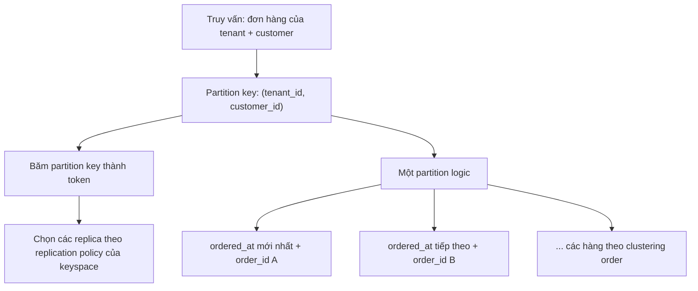

# CREATE TABLE, cột, primary key và table option

## 1. Học cách thiết kế một bảng Cassandra từ truy vấn

Trong Apache Cassandra, lệnh `CREATE TABLE` khai báo các cột, kiểu dữ liệu, **primary key** và các **table option**. Đây là bước quyết định dữ liệu được chia thành partition như thế nào, hàng trong cùng partition được sắp xếp ra sao, và bảng sẽ được lưu trữ, nén, cache hoặc tự hết hạn theo chính sách nào.

Ở chương **Keyspace và schema** của module `DATABASE_ENGINE_WIDE_COLUMN_CASSANDRA`, cần phân biệt ba tầng cấu hình:

| Tầng | Thuộc tính chính | Phạm vi tác động |
| --- | --- | --- |
| **Keyspace** | `replication`, replication factor (RF), `durable_writes` | Chính sách sao chép của **mọi bảng** trong keyspace |
| **Table** | Định nghĩa cột, `PRIMARY KEY`, `CLUSTERING ORDER BY`, compaction, compression, caching, TTL mặc định | Cách tổ chức và quản lý dữ liệu của **một bảng** |
| **Request/client** | Consistency level (CL), timeout, paging, tham số truy vấn | Cách một lần đọc/ghi được thực hiện |

**Mục tiêu học tập:** sau bài này bạn có thể tạo bảng phù hợp truy vấn, giải thích chính xác partition key và clustering columns, chọn kiểu cột hợp lý, nhận biết table option phổ biến, kiểm tra schema và tránh các lỗi khiến partition quá lớn hoặc truy vấn không hiệu quả. Những kiến thức này là nền tảng cho thiết kế theo truy vấn, điều chỉnh compaction, repair và kết nối Cassandra từ ứng dụng Java.

## 2. Cú pháp CREATE TABLE và một ví dụ chạy được

Giả sử ứng dụng thương mại điện tử cần hiển thị **20 đơn hàng mới nhất của một khách hàng thuộc một tenant**. Truy vấn cần cung cấp `tenant_id` và `customer_id`, sau đó lấy kết quả theo thời điểm đặt hàng giảm dần.

Chuẩn bị keyspace trong môi trường thử nghiệm một node (đổi `datacenter1` thành **tên DC thực tế** lấy từ `nodetool status`):

```sql
CREATE KEYSPACE IF NOT EXISTS shop_lab
WITH replication = {
    'class': 'NetworkTopologyStrategy',
    'datacenter1': '1'
}
AND durable_writes = true;
```

Trong cluster thật, RF phải được chọn theo số node, DC, rack và yêu cầu chịu lỗi; ví dụ RF = 1 ở đây chỉ dành cho lab. Nếu `shop_lab` đã tồn tại, `IF NOT EXISTS` không tự sửa replication. Kiểm tra lại keyspace nếu cần.

Tạo bảng phục vụ truy vấn vừa nêu:

```sql
CREATE TABLE IF NOT EXISTS shop_lab.orders_by_customer (
    tenant_id uuid,
    customer_id uuid,
    ordered_at timestamp,
    order_id timeuuid,
    status text,
    total_amount decimal,
    note text,
    PRIMARY KEY ((tenant_id, customer_id), ordered_at, order_id)
)
WITH CLUSTERING ORDER BY (ordered_at DESC, order_id DESC)
AND comment = 'Don hang theo khach hang, moi nhat truoc'
AND default_time_to_live = 0;
```

Giải thích các thành phần:

- `shop_lab.orders_by_customer`: tên đầy đủ `keyspace.table`; có thể dùng khi session chưa gọi `USE shop_lab`.
- Phần trong ngoặc là **định nghĩa cột** với kiểu CQL; `PRIMARY KEY` nêu khóa phân vùng và khóa gom/sắp xếp.
- `(tenant_id, customer_id)` ở **cặp ngoặc trong** là composite partition key, gồm hai cột.
- `ordered_at` và `order_id` nằm **sau** composite partition key, là clustering columns theo thứ tự khai báo.
- `WITH CLUSTERING ORDER BY` đặt thứ tự mặc định trong partition; `comment` và `default_time_to_live` là table options.

Những bảng khác trong `shop_lab` có thể có primary key và table option khác, nhưng cùng dùng replication policy của keyspace.

### Ghi và đọc theo khóa đã thiết kế

```sql
INSERT INTO shop_lab.orders_by_customer (
    tenant_id, customer_id, ordered_at, order_id,
    status, total_amount, note
) VALUES (
    11111111-1111-1111-1111-111111111111,
    22222222-2222-2222-2222-222222222222,
    '2026-11-20T09:30:00Z',
    now(),
    'PAID',
    159000.00,
    'Giao trong gio hanh chinh'
);

SELECT ordered_at, order_id, status, total_amount
FROM shop_lab.orders_by_customer
WHERE tenant_id = 11111111-1111-1111-1111-111111111111
  AND customer_id = 22222222-2222-2222-2222-222222222222
ORDER BY ordered_at DESC, order_id DESC
LIMIT 20;
```

`now()` sinh một `timeuuid` dùng trong ví dụ. Với hệ thống thật, ứng dụng nên có chiến lược tạo và truyền ID ổn định phù hợp yêu cầu idempotency. `LIMIT 20` giới hạn số hàng trả về, **không** bảo đảm partition không phình to theo thời gian; chiến lược bucket sẽ được thảo luận bên dưới.

## 3. Primary key: partition key và clustering columns

Một primary key trong Cassandra được hiểu là:

**Primary key = partition key + clustering columns (nếu có).**

Partition key quyết định **partition logic** mà hàng thuộc về. Cassandra băm partition key để lấy token; replication strategy của keyspace dùng token và topology để lựa chọn các replica. Clustering columns phân biệt và xác định thứ tự các hàng **bên trong cùng partition**.



### Ba cách viết PRIMARY KEY dễ nhầm

| Cú pháp | Partition key | Clustering columns | Kết quả |
| --- | --- | --- | --- |
| `PRIMARY KEY (customer_id)` | `customer_id` | Không có | Mỗi partition có tối đa một hàng logic ứng với khóa đó |
| `PRIMARY KEY (customer_id, ordered_at)` | `customer_id` | `ordered_at` | Nhiều hàng của khách hàng, được phân biệt/sắp xếp theo thời điểm |
| `PRIMARY KEY ((tenant_id, customer_id), ordered_at, order_id)` | Cặp `tenant_id` + `customer_id` | `ordered_at`, `order_id` | Nhiều đơn hàng của một khách trong một tenant; phân biệt được hai đơn cùng thời điểm |

Ví dụ `PRIMARY KEY (tenant_id, customer_id, ordered_at)` **khác hẳn** `PRIMARY KEY ((tenant_id, customer_id), ordered_at)`: ở cách viết thứ nhất chỉ `tenant_id` là partition key, còn `customer_id` trở thành clustering column. Với số lượng khách hàng lớn, cách viết sai có thể tạo partition theo cả tenant, quá lớn so với mong muốn ban đầu.

**Quy tắc cú pháp quan trọng:** dùng **hai tầng ngoặc** khi muốn partition key có nhiều cột. `PRIMARY KEY ((a, b), c)` nghĩa là `a` và `b` cùng xác định partition; `PRIMARY KEY (a, b, c)` nghĩa là chỉ `a` xác định partition.

### Primary key khác primary key trong SQL quan hệ

- Cassandra không tạo `AUTO_INCREMENT` và không đảm bảo ràng buộc foreign key hoặc JOIN giữa các bảng như RDBMS.
- Mọi thành phần của primary key phải có giá trị khi định danh một hàng; không được dùng `null` cho các cột khóa.
- Tổ hợp **đầy đủ** partition key và clustering columns định danh một hàng logic. Ghi lại cùng khóa thường tạo một phép **upsert** trên các cột được ghi, không tự sinh lỗi `duplicate key`.
- Cột thuộc primary key là một phần của cách bố trí dữ liệu. Không thể đơn giản sửa primary key hiện hữu bằng `ALTER TABLE`; thường cần tạo bảng mới, backfill dữ liệu và chuyển truy vấn.
- Khác với index quan hệ, primary key Cassandra chủ yếu giúp định vị partition và sắp xếp hàng, không có nghĩa mọi điều kiện tìm kiếm trên mọi cột khóa đều được hỗ trợ hiệu quả.

## 4. Clustering columns, thứ tự đọc và giới hạn truy vấn

Với bảng `orders_by_customer`, Cassandra tổ chức các hàng trong partition theo cặp `ordered_at DESC, order_id DESC`. Khi đã biết **đầy đủ partition key**, ứng dụng có thể đọc các đơn gần nhất theo thứ tự đó.

Một ví dụ truy vấn giới hạn khoảng thời gian:

```sql
SELECT ordered_at, order_id, status
FROM shop_lab.orders_by_customer
WHERE tenant_id = 11111111-1111-1111-1111-111111111111
  AND customer_id = 22222222-2222-2222-2222-222222222222
  AND ordered_at >= '2026-11-01T00:00:00Z'
  AND ordered_at < '2026-12-01T00:00:00Z'
LIMIT 20;
```

Với mô hình này, hai điều kiện bằng nhau trên `tenant_id`, `customer_id` xác định đúng partition; điều kiện khoảng trên clustering column đầu tiên `ordered_at` thu hẹp phần dữ liệu cần đọc. Cassandra hỗ trợ một số dạng lọc/range theo clustering columns theo **thứ tự được khai báo**; không nên suy diễn rằng nó có thể sử dụng tùy ý mọi tổ hợp cột như một chỉ mục quan hệ đa năng.

Ví dụ truy vấn tưởng hợp lý nhưng **không khớp access path**:

```sql
-- Không cung cấp đủ partition key cho bảng hiện tại.
SELECT *
FROM shop_lab.orders_by_customer
WHERE customer_id = 22222222-2222-2222-2222-222222222222;
```

Thiếu `tenant_id`, Cassandra không có đủ thông tin để định vị một partition duy nhất. Nó thường từ chối truy vấn theo cách viết này hoặc cần một cơ chế truy xuất khác. Cố thêm `ALLOW FILTERING` để chạy truy vấn rộng thường làm tăng số partition/hàng phải quét và dễ gây độ trễ khó dự đoán. Nếu ứng dụng thực sự cần tra theo riêng `customer_id`, hãy đánh giá bảng phục vụ truy vấn đó hoặc mô hình indexing phù hợp.

### Nguy cơ partition quá lớn

Thiết kế `PRIMARY KEY ((tenant_id, customer_id), ordered_at, order_id)` gom **mọi đơn hàng lịch sử** của một khách vào một partition. Với khách có rất nhiều đơn trong nhiều năm, partition có thể trở nên lớn, gây áp lực lên đọc dữ liệu, compaction và repair.

Một cách thường dùng là thêm **bucket thời gian** vào partition key để giới hạn khối lượng một partition:

```sql
CREATE TABLE shop_lab.orders_by_customer_month (
    tenant_id uuid,
    customer_id uuid,
    order_month text,
    ordered_at timestamp,
    order_id timeuuid,
    status text,
    total_amount decimal,
    PRIMARY KEY (
        (tenant_id, customer_id, order_month),
        ordered_at,
        order_id
    )
) WITH CLUSTERING ORDER BY (ordered_at DESC, order_id DESC);
```

Ứng dụng phải tính `order_month` nhất quán, chẳng hạn `2026-11` theo UTC, cho cả ghi và đọc. Truy vấn muốn lấy nhiều tháng sẽ phải đọc nhiều partition và hợp nhất kết quả phía ứng dụng. Kích thước bucket cần dựa trên lưu lượng/khối lượng thực tế; **bucket tháng không phải khuyến nghị cố định cho mọi workload**.

## 5. Khai báo cột và kiểu dữ liệu CQL

Cú pháp một cột thường có dạng `column_name cql_type`, có thể thêm `STATIC` trong trường hợp phù hợp. Chọn kiểu dữ liệu theo ý nghĩa nghiệp vụ và cách Java Driver ánh xạ dữ liệu; không nên dùng `text` cho mọi giá trị chỉ vì dễ lưu.

| Nhóm | Các kiểu phổ biến | Ví dụ hoặc lưu ý |
| --- | --- | --- |
| Chuỗi và nhị phân | `text`, `ascii`, `blob` | Mã trạng thái, mô tả, payload nhị phân |
| Số nguyên | `tinyint`, `smallint`, `int`, `bigint`, `varint` | Bộ đếm thống kê, mã số, đại lượng rời rạc |
| Số thập phân | `decimal`, `float`, `double` | `decimal` cho số cần biểu diễn thập phân chính xác; `double` cho đo đạc gần đúng |
| Định danh | `uuid`, `timeuuid` | ID độc lập hoặc ID có thành phần thời gian |
| Thời gian | `timestamp`, `date`, `time`, `duration` | Thời điểm UTC, ngày lịch, giờ trong ngày, khoảng thời gian |
| Boolean và mạng | `boolean`, `inet` | Cờ nghiệp vụ, địa chỉ IP |
| Collection/kiểu phức | `list<T>`, `set<T>`, `map<K,V>`, UDT, `tuple<...>` | Dữ liệu nhỏ gắn với một hàng, cần xét kích thước và cách cập nhật |

Ví dụ:

```sql
CREATE TABLE shop_lab.product_snapshots (
    product_id uuid PRIMARY KEY,
    title text,
    price decimal,
    available boolean,
    last_updated timestamp,
    labels set<text>,
    dimensions map<text, double>
);
```

Collection tiện cho tập dữ liệu nhỏ gắn với hàng; collection lớn, cập nhật thường xuyên hoặc không có giới hạn rõ ràng có thể dẫn tới áp lực bộ nhớ, tombstone và compaction. Khi dữ liệu tăng không giới hạn, hãy xem liệu nó có nên trở thành các hàng/partition riêng. `frozen<...>` thường được dùng cho một số cấu trúc lồng nhau hoặc UDT khi cần xử lý giá trị như một đơn vị; hãy kiểm tra quy tắc của kiểu dữ liệu và phiên bản Cassandra.

### Cột STATIC thuộc về partition

Một `STATIC` column có **một giá trị logic cho cả partition**, thay vì mỗi hàng clustering một giá trị. Nó chỉ có ý nghĩa trong bảng có clustering columns; không dùng `STATIC` cho chính cột thuộc primary key.

```sql
CREATE TABLE shop_lab.sensor_events (
    sensor_id text,
    event_time timestamp,
    location text STATIC,
    temperature double,
    PRIMARY KEY (sensor_id, event_time)
) WITH CLUSTERING ORDER BY (event_time DESC);

-- Có thể cập nhật riêng giá trị STATIC bằng partition key.
UPDATE shop_lab.sensor_events
SET location = 'Kho A'
WHERE sensor_id = 'sensor-01';

INSERT INTO shop_lab.sensor_events (
    sensor_id, event_time, temperature
) VALUES ('sensor-01', '2026-11-20T09:00:00Z', 28.5);
```

Các hàng `sensor-01` nhìn thấy cùng `location` của partition đó. Không nên lạm dụng `STATIC` làm cơ chế tổ chức quan hệ phức tạp; thay đổi giá trị static áp dụng chung cho mọi hàng thuộc partition.

### Quy tắc đặt tên cột

Ưu tiên định danh không cần dấu nháy, dạng `snake_case` như `ordered_at`. Cassandra thường chuẩn hóa định danh CQL **không đặt trong dấu nháy kép** về chữ thường. Tên đặt trong dấu nháy kép có thể phân biệt chữ hoa/chữ thường và buộc bạn phải trích dẫn chính xác ở các truy vấn tiếp theo. Tránh các từ khóa CQL làm tên cột nếu không thực sự cần.

## 6. Table option: điều chỉnh hành vi lưu trữ của bảng

Table option xuất hiện sau `WITH`; nhiều tùy chọn được nối bằng `AND`. Các tùy chọn này **không thay thế** replication của keyspace và **không sửa** định nghĩa primary key.

| Table option | Chức năng | Cân nhắc khi sử dụng |
| --- | --- | --- |
| `CLUSTERING ORDER BY` | Đặt hướng sắp xếp cho các clustering columns | Thiết kế theo thứ tự truy vấn chính, khai báo hợp lệ theo thứ tự clustering key |
| `comment` | Ghi chú mục đích bảng trong schema | Nên mô tả access path và dữ liệu của bảng |
| `default_time_to_live` | TTL mặc định (giây) cho các lần ghi mới; `0` nghĩa là không tự hết hạn do tùy chọn này | Đừng dùng TTL toàn bảng nếu dữ liệu cần lưu lâu |
| `compaction` | Chọn chiến lược gom và tối ưu SSTable | Phụ thuộc mô hình ghi, đọc, update, TTL và tombstone |
| `compression` | Cấu hình nén dữ liệu SSTable | Cân nhắc không gian đĩa so với CPU và đặc điểm dữ liệu |
| `caching` | Điều chỉnh caching key/row ở cấp bảng | Cần đo cache hit, bộ nhớ và truy vấn trước khi tinh chỉnh |
| `gc_grace_seconds` | Khoảng bảo vệ tombstone trước khả năng thu gom trong compaction | Thay đổi phải tính tới repair và nguy cơ dữ liệu xóa xuất hiện trở lại |
| `bloom_filter_fp_chance` | Tỷ lệ false positive mục tiêu của Bloom filter | Cân đối RAM của Bloom filter và disk I/O |
| `speculative_retry` | Chính sách gửi thêm replica request cho một số lần đọc chậm | Chỉ chỉnh khi có số liệu độ trễ và hiểu tác động lên tải cluster |

**Đừng tự sao chép các giá trị tuning từ bài học sang production.** Mặc định và cú pháp của một số tùy chọn có thể khác giữa các phiên bản Cassandra. Chọn giá trị sau khi đo workload và xác minh tài liệu tương ứng với bản đang chạy.

### Ví dụ đặt comment, TTL và compression

Tạo bảng sự kiện được giữ trong bảy ngày theo chính sách TTL mặc định:

```sql
CREATE TABLE shop_lab.events_by_device (
    device_id text,
    event_time timestamp,
    event_id timeuuid,
    metric_name text,
    metric_value double,
    PRIMARY KEY (device_id, event_time, event_id)
)
WITH CLUSTERING ORDER BY (event_time DESC, event_id DESC)
AND comment = 'Su kien sensor: du lieu ngan han'
AND default_time_to_live = 604800
AND compression = {'class': 'LZ4Compressor'};
```

Giá trị `604800` tương ứng 7 ngày. TTL áp dụng cho các lần ghi mới theo cấu hình; các giá trị đã được ghi trước đó **không tự động nhận TTL mới chỉ vì thay table option**. TTL hết hạn tạo tombstone mà Cassandra xử lý theo các quy tắc lưu trữ và compaction. Không hạ `gc_grace_seconds` tùy tiện để cố dọn tombstone nhanh hơn: điều này liên quan trực tiếp tới repair và an toàn dữ liệu khi có replica từng bị offline.

Nếu workload là time-series có TTL tương đối đều, có thể cân nhắc `TimeWindowCompactionStrategy` (TWCS); nhưng hiệu quả phụ thuộc phân bố ghi theo thời gian, dữ liệu đến muộn và TTL. Bảng giao dịch với cập nhật và đọc đa dạng có thể cần chiến lược khác. Việc chọn `SizeTieredCompactionStrategy` (STCS), `LeveledCompactionStrategy` (LCS) hay TWCS là bài toán vận hành cần đo và thử nghiệm.

## 7. Kiểm tra schema của bảng sau CREATE

Trong `cqlsh`, dùng:

```sql
DESCRIBE TABLE shop_lab.orders_by_customer;
DESCRIBE TABLE shop_lab.events_by_device;
```

`DESCRIBE` là tiện ích của **cqlsh** để hiển thị DDL, không phải câu lệnh CQL chuẩn để ứng dụng Java gửi qua driver. Trong code hoặc công cụ kiểm tra metadata, có thể truy vấn các bảng schema:

```sql
-- Các tùy chọn của bảng.
SELECT keyspace_name, table_name, comment,
       default_time_to_live, compaction, compression,
       gc_grace_seconds
FROM system_schema.tables
WHERE keyspace_name = 'shop_lab'
  AND table_name = 'orders_by_customer';

-- Cột, kiểu CQL và vai trò của từng cột.
SELECT column_name, kind, position, type, clustering_order
FROM system_schema.columns
WHERE keyspace_name = 'shop_lab'
  AND table_name = 'orders_by_customer';
```

Trong `system_schema.columns`, `kind` giúp phân biệt `partition_key`, `clustering`, `regular` và `static`; `position` thể hiện thứ tự của các thành phần khóa. `clustering_order` thể hiện hướng sắp xếp đối với clustering column. Khi kiểm tra bảng vừa tạo, so sánh cả **các thành phần partition key, thứ tự clustering key và table option**, không chỉ danh sách tên cột.

Với Cassandra Java Driver, có thể sử dụng API metadata của driver để đọc schema; nội dung bảng vẫn nên được xác minh với metadata Cassandra khi triển khai migration. Driver cần nhận thông tin schema thống nhất giữa các node trước khi ứng dụng phụ thuộc vào bảng mới.

## 8. Thay đổi cột và table option sau khi đã tạo

Với những thay đổi được CQL hỗ trợ, dùng `ALTER TABLE`:

```sql
-- Thêm một cột thường.
ALTER TABLE shop_lab.orders_by_customer
ADD delivery_channel text;

-- Cập nhật ghi chú nghiệp vụ của bảng.
ALTER TABLE shop_lab.orders_by_customer
WITH comment = 'Don hang theo tenant va khach hang';
```

Không tự suy rằng mọi thay đổi đều hỗ trợ trực tiếp: **đổi partition key, số lượng clustering columns hoặc cấu trúc PRIMARY KEY** thường cần bảng mới và quá trình chuyển dữ liệu. Một số thao tác đổi/xóa cột, thay kiểu dữ liệu hoặc cập nhật collection bị hạn chế tùy schema và phiên bản Cassandra. Việc xóa cột có thể ảnh hưởng dữ liệu hiện hữu và ứng dụng; cần đánh giá tương thích trước khi thực hiện.

Ví dụ điều chỉnh TTL mặc định:

```sql
ALTER TABLE shop_lab.events_by_device
WITH default_time_to_live = 1209600;
```

Giá trị này là 14 ngày cho các lần ghi mới thuộc phạm vi tùy chọn. Dữ liệu cũ không được tự động kéo dài TTL; các ghi mới có thể dùng `USING TTL` với TTL theo statement nếu cần chính sách riêng. Việc đổi compaction hoặc compression có thể dẫn đến công việc nền trên SSTable, làm tăng I/O/CPU; nên kiểm tra tác động vận hành trước khi thay đổi.

### IF NOT EXISTS và quản lý schema

`CREATE TABLE IF NOT EXISTS` chỉ tránh lỗi khi **đã có bảng cùng tên**. Nó không kiểm tra rằng cấu trúc bảng đang tồn tại khớp với DDL mong đợi. Sau khi chạy migration, luôn đọc lại schema để phát hiện khác biệt primary key, kiểu cột hoặc table option. Cũng không nên để nhiều instance ứng dụng Java tự thay đổi schema trong quá trình khởi động mà không có quy trình kiểm soát migration.

## 9. Chọn bảng theo truy vấn: hai access path, hai primary key

Giả sử hệ thống cần hai truy vấn nghiệp vụ:

1. Xem các đơn hàng mới nhất theo `tenant_id + customer_id`.
2. Mở chi tiết một đơn hàng bằng `tenant_id + order_id`.

Bảng `orders_by_customer` ở trên giải quyết truy vấn thứ nhất nhưng không tối ưu cho việc tìm một `order_id` bất kỳ không biết `customer_id`. Cassandra thường giải quyết bằng cách **denormalize** thành một bảng khác phục vụ access path thứ hai:

```sql
CREATE TABLE shop_lab.orders_by_id (
    tenant_id uuid,
    order_id timeuuid,
    customer_id uuid,
    ordered_at timestamp,
    status text,
    total_amount decimal,
    PRIMARY KEY ((tenant_id, order_id))
);
```

Vì bảng này có đầy đủ partition key `(tenant_id, order_id)` và không có clustering columns, mỗi partition tương ứng một đơn hàng logic. Ứng dụng có thể truy vấn trực tiếp:

```sql
SELECT customer_id, ordered_at, status, total_amount
FROM shop_lab.orders_by_id
WHERE tenant_id = 11111111-1111-1111-1111-111111111111
  AND order_id = f47ac10b-58cc-11cf-a447-001122334455;
```

Giá trị `order_id` ở ví dụ SELECT trên là **minh họa một timeuuid định dạng hợp lệ**, không có nghĩa bản ghi ấy đã tồn tại. Trong ứng dụng, hãy truyền ID thực đã được gán khi ghi đơn hàng (chẳng hạn timeuuid ứng dụng tạo trước khi ghi vào cả hai bảng) qua prepared statement.

Trong thực tế, cả hai bảng cần được ghi/đồng bộ theo logic nghiệp vụ; Cassandra không có ràng buộc foreign key tự động duy trì tính nhất quán giữa hai bản sao dữ liệu ở hai bảng. Hai bảng vẫn cùng chịu chính sách RF của keyspace `shop_lab`. Chọn CL và cách xử lý retry trong Java giúp kiểm soát kết quả đọc/ghi, nhưng không thay thế thiết kế truy vấn và cơ chế phối hợp giữa các bảng.

## 10. Những lỗi thường gặp và cách sửa

| Vấn đề | Nguyên nhân | Hướng xử lý |
| --- | --- | --- |
| Một tenant có partition cực lớn | Nhầm `PRIMARY KEY (tenant_id, customer_id, ...)` với composite partition key | Thiết kế lại thành `PRIMARY KEY ((tenant_id, customer_id), ...)`, cân nhắc bucket |
| Truy vấn theo `customer_id` bị Cassandra từ chối | Chỉ cung cấp một phần composite partition key | Cung cấp đủ `tenant_id` hoặc tạo access path phù hợp |
| Muốn truy vấn/sắp xếp toàn bộ bảng theo `ordered_at` | Clustering chỉ có ý nghĩa trong partition đã xác định | Thiết kế thêm bảng theo truy vấn hoặc kiến trúc truy xuất khác |
| Ghi lại cùng primary key làm thay đổi giá trị cũ | `INSERT`/update của Cassandra thường có hành vi upsert | Đảm bảo khóa duy nhất đúng ý nghĩa và xử lý idempotency |
| Tạo bảng `IF NOT EXISTS` nhưng tùy chọn vẫn cũ | Bảng đã tồn tại và lệnh bỏ qua tạo mới | `DESCRIBE TABLE` hoặc truy vấn `system_schema` rồi migration rõ ràng |
| Hàng mới tự hết hạn ngoài dự kiến | `default_time_to_live > 0` | Kiểm tra option, chính sách TTL của statement và nghiệp vụ lưu trữ |
| Dữ liệu nhiều tombstone, đọc/compaction chậm | TTL, delete, cập nhật hoặc mô hình lưu trữ không phù hợp | Đo tombstone, xem lại TTL, partition, compaction và repair |
| Thay primary key bằng `ALTER TABLE` không được | Khóa gắn với cách phân phối/sắp xếp dữ liệu | Tạo bảng mới, backfill và chuyển ứng dụng |
| Thao tác trên bảng thiếu RF hoặc mức nhất quán | Nhầm cấu hình table với keyspace/request | Kiểm tra replication ở keyspace, CL ở client/statement |

## 11. Bài thực hành và câu hỏi tự kiểm tra

**Thực hành A — phân biệt khóa:** Viết ba câu `CREATE TABLE` cho các tình huống: (1) một bản ghi hồ sơ theo `user_id`; (2) danh sách hoạt động của người dùng theo `user_id` và `event_time`; (3) danh sách hoạt động theo `tenant_id + user_id` và `event_time`. Xác định chính xác partition key, clustering columns và số hàng logic có thể có trong mỗi partition.

**Thực hành B — xác minh CQL:** Trên lab một node, tạo `shop_lab.orders_by_customer`, ghi một đơn, truy vấn theo đủ hai phần của composite partition key. Dùng `DESCRIBE TABLE` và `system_schema.columns` để đối chiếu `kind`, `position`, `clustering_order`. Kiểm tra `default_time_to_live = 0` và `comment` trong `system_schema.tables`.

**Thực hành C — tư duy thiết kế theo truy vấn:** Giả sử mỗi khách có 100 đơn/ngày trong 5 năm. Đánh giá rủi ro của partition chỉ theo `customer_id`, thử thiết kế bucket theo tháng hoặc tuần, rồi nêu phần việc ứng dụng Java phải làm khi hiển thị danh sách liên tiếp qua ranh giới bucket.

**Câu hỏi kiểm tra kiến thức:**

1. `PRIMARY KEY (a, b, c)` khác `PRIMARY KEY ((a, b), c)` ở đâu?
2. Vì sao thêm `ORDER BY ordered_at DESC` không biến Cassandra thành công cụ sắp xếp toàn bộ bảng?
3. `CLUSTERING ORDER BY` có thay đổi vị trí replica giữa các DC không?
4. Vì sao không thể dùng `CREATE TABLE IF NOT EXISTS` để đảm bảo schema hiện có giống bản migration mới?
5. Khi đổi `default_time_to_live` từ 7 thành 14 ngày, các giá trị đã ghi trước đó có tự được gia hạn không?
6. Khi nào cần bảng `orders_by_id` bên cạnh `orders_by_customer`, và điều gì chịu trách nhiệm duy trì dữ liệu ở cả hai bảng?

Nếu trả lời được những câu hỏi này, bạn đã phân biệt được **cấp keyspace (replication)**, **cấp table (khóa và lưu trữ)** và **cấp truy vấn Java/CQL (access path và CL)**. Đó là nền tảng để học sâu về phân vùng, thiết kế theo truy vấn, compaction, repair và xử lý lỗi của Cassandra trong hệ phân tán.
