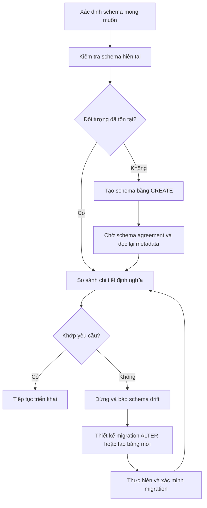

# IF NOT EXISTS/IF EXISTS và giới hạn kiểm tra định nghĩa đã tồn tại

## 1. Vấn đề: chạy lại câu lệnh không đồng nghĩa với schema đúng

Trong Apache Cassandra, nhiều câu lệnh CQL quản lý schema hỗ trợ `IF NOT EXISTS` hoặc `IF EXISTS`. Chúng rất tiện khi triển khai môi trường mới, chạy lại script và xử lý một số trường hợp đối tượng đã có hoặc đã bị xóa. Tuy nhiên, **hai mệnh đề chỉ kiểm tra sự tồn tại của đối tượng theo tên; chúng không xác nhận định nghĩa hiện có phù hợp định nghĩa mong muốn**.

Đây là nội dung của chương **Keyspace và schema** trong module `DATABASE_ENGINE_WIDE_COLUMN_CASSANDRA`. Với Cassandra phân tán và mô hình wide-column, schema sai có thể kéo theo hậu quả lớn: replication factor (RF) không đúng, partition key không phù hợp truy vấn, TTL không đúng thời gian lưu dữ liệu hoặc ứng dụng Java đọc/ghi sai kiểu cột.

Kết thúc bài, bạn cần giải thích và thực hành được:

1. `IF NOT EXISTS` trong `CREATE KEYSPACE`/`CREATE TABLE` giúp làm gì, và **không kiểm tra** điều gì.
2. `IF EXISTS` trong `DROP KEYSPACE`/`DROP TABLE` có ích thế nào, và vì sao xóa vẫn có thể gây mất dữ liệu.
3. Cách đọc `system_schema` để đối chiếu **schema thực tế** với schema mong muốn.
4. Cách tổ chức migration và khởi tạo ứng dụng Java có kiểm tra hậu điều kiện, xử lý schema agreement và tránh các thay đổi âm thầm.
5. Phân biệt điều kiện tồn tại của **DDL schema** với điều kiện dữ liệu `INSERT ... IF NOT EXISTS` của lightweight transaction (LWT).

## 2. Hai mệnh đề hoạt động như thế nào?

### `CREATE ... IF NOT EXISTS`

Ví dụ:

```sql
CREATE KEYSPACE IF NOT EXISTS inventory_lab
WITH replication = {
    'class': 'NetworkTopologyStrategy',
    'datacenter1': '1'
}
AND durable_writes = true;
```

Nếu keyspace tên `inventory_lab` **chưa có**, Cassandra tạo nó theo cấu hình được yêu cầu. Nếu tên đó **đã có**, mệnh đề `IF NOT EXISTS` cho phép lệnh bỏ qua việc tạo trùng **mà không dùng các thuộc tính mới để sửa đối tượng cũ**.

Tức là nếu keyspace đã tồn tại với RF khác, lệnh trên **không biến RF thành 1**. Đây là điều phải xác minh riêng bằng metadata.

Tương tự, với bảng:

```sql
CREATE TABLE IF NOT EXISTS inventory_lab.items_by_id (
    item_id uuid PRIMARY KEY,
    sku text,
    price decimal
);
```

Nếu bảng `inventory_lab.items_by_id` đã tồn tại nhưng có partition key, kiểu cột, tập cột hoặc tùy chọn bảng khác, `IF NOT EXISTS` **không tiến hành đồng bộ các điểm khác biệt ấy**.

> `IF NOT EXISTS` nghĩa là “nếu đối tượng đã tồn tại thì bỏ qua việc tạo”, không phải “nếu đối tượng đã tồn tại thì đảm bảo nội dung nó giống câu `CREATE` này”.

### `DROP ... IF EXISTS`

Ví dụ:

```sql
DROP TABLE IF EXISTS inventory_lab.items_by_id;
DROP KEYSPACE IF EXISTS inventory_lab;
```

Nếu đối tượng đích không còn tồn tại, `IF EXISTS` giúp tránh lỗi do cố xóa đối tượng không có. **Nếu đối tượng có tồn tại, câu `DROP` vẫn xóa nó**. Mệnh đề này không xác minh đối tượng thuộc môi trường lab, không so sánh schema với kỳ vọng, không kiểm tra bảng rỗng hay không và không sao lưu dữ liệu.

| Tình huống | Có `IF NOT EXISTS`/`IF EXISTS` | Hệ quả |
| --- | --- | --- |
| `CREATE`, đối tượng chưa tồn tại | `IF NOT EXISTS` | Tạo đối tượng mới theo lệnh |
| `CREATE`, đối tượng đã tồn tại cùng tên | `IF NOT EXISTS` | Bỏ qua tạo; **không so sánh đầy đủ định nghĩa** |
| `CREATE`, đối tượng đã tồn tại cùng tên | Không có `IF NOT EXISTS` | Thường báo lỗi đối tượng đã tồn tại |
| `DROP`, đối tượng đã tồn tại | `IF EXISTS` | Xóa đối tượng theo phạm vi của `DROP` |
| `DROP`, đối tượng không tồn tại | `IF EXISTS` | Bỏ qua lỗi đối tượng không tồn tại |
| `DROP`, đối tượng không tồn tại | Không có `IF EXISTS` | Thường báo lỗi không tìm thấy đối tượng |

Ngay cả khi có mệnh đề điều kiện, cú pháp lệnh vẫn phải hợp lệ; quyền truy cập và các kiểm tra khác của Cassandra vẫn có thể khiến thao tác thất bại.

## 3. Phạm vi áp dụng trong CQL schema

Các thao tác schema thường thấy gồm:

```sql
-- Tạo keyspace nếu chưa có.
CREATE KEYSPACE IF NOT EXISTS inventory_lab
WITH replication = {
    'class': 'NetworkTopologyStrategy',
    'datacenter1': '1'
};

-- Tạo bảng nếu chưa có.
CREATE TABLE IF NOT EXISTS inventory_lab.items_by_id (
    item_id uuid PRIMARY KEY,
    sku text,
    price decimal
);

-- Xóa bảng nếu có.
DROP TABLE IF EXISTS inventory_lab.items_by_id;

-- Xóa toàn bộ keyspace nếu có.
DROP KEYSPACE IF EXISTS inventory_lab;
```

Ngoài keyspace/table, một số lệnh tạo/xóa type, index hoặc materialized view cũng hỗ trợ dạng điều kiện tồn tại, tùy loại câu lệnh và phiên bản Cassandra. **Không suy rộng** rằng mọi câu lệnh `ALTER` hoặc mọi cấu trúc CQL đều có thể thêm `IF EXISTS`/`IF NOT EXISTS` ở bất kỳ vị trí nào; phải kiểm tra đúng cú pháp tài liệu cho phiên bản đang dùng.

Các mệnh đề trong bài là cơ chế kiểm tra sự tồn tại của **đối tượng schema**. Chúng không tự tạo keyspace cha trước khi tạo bảng; nếu `inventory_lab` không tồn tại, câu `CREATE TABLE inventory_lab.items_by_id` không thể dùng `IF NOT EXISTS` để bỏ qua yêu cầu phải có keyspace.

## 4. Ví dụ phản trực giác: tên giống nhưng keyspace sai replication

Giả sử cluster có DC thật tên `dc1`, và nhóm vận hành đã tạo:

```sql
CREATE KEYSPACE inventory_prod
WITH replication = {
    'class': 'NetworkTopologyStrategy',
    'dc1': '1'
}
AND durable_writes = true;
```

Sau này ứng dụng cần RF = 3 để chịu được lỗi node khi môi trường `dc1` đã có đủ ba node phù hợp. Script triển khai mới chạy:

```sql
CREATE KEYSPACE IF NOT EXISTS inventory_prod
WITH replication = {
    'class': 'NetworkTopologyStrategy',
    'dc1': '3'
}
AND durable_writes = true;
```

Kết quả quan trọng: vì `inventory_prod` **đã tồn tại**, Cassandra không dùng lệnh `CREATE` này để nâng RF lên 3. Script có thể chạy qua bước này mà không báo lỗi tạo trùng, nhưng replication policy thực tế vẫn có thể là RF = 1.

Kiểm tra bằng:

```sql
SELECT keyspace_name, replication, durable_writes
FROM system_schema.keyspaces
WHERE keyspace_name = 'inventory_prod';
```

Kết quả minh họa cho thấy sự khác nhau:

| Mục cần kiểm tra | Schema mong muốn | Schema hiện có sau `CREATE IF NOT EXISTS` |
| --- | --- | --- |
| Replication strategy | `NetworkTopologyStrategy` | `NetworkTopologyStrategy` |
| RF tại `dc1` | `3` | **`1`** |
| `durable_writes` | `true` | `true` |

**Cách sửa đúng:** thiết kế một migration có chủ đích với `ALTER KEYSPACE`, sau đó thực hiện quy trình đồng bộ dữ liệu cần thiết. Ví dụ **chỉ chạy khi đã có đủ node và kế hoạch vận hành**:

```sql
ALTER KEYSPACE inventory_prod
WITH replication = {
    'class': 'NetworkTopologyStrategy',
    'dc1': '3'
};
```

`ALTER KEYSPACE` cập nhật **chính sách replica trong schema**; nó không có nghĩa dữ liệu lịch sử đã lập tức có đầy đủ trên các replica mới. Khi tăng RF, cần lên kế hoạch repair/streaming phù hợp phiên bản và topology, rồi kiểm tra dữ liệu, trạng thái node và khả năng phục vụ theo consistency level (CL) mong muốn.

**Điểm kết nối với kiến trúc phân tán:** RF là thuộc tính keyspace; CL như `ONE` hoặc `LOCAL_QUORUM` được chọn khi đọc/ghi. Nếu RF không đạt kỳ vọng, ngưỡng replica và mức chịu lỗi thực tế của ứng dụng Java cũng có thể sai so với thiết kế.

## 5. Ví dụ phản trực giác: tên bảng giống nhưng định nghĩa khác

Giả sử bảng hiện hữu được tạo để tra cứu hàng hóa theo ID:

```sql
CREATE TABLE inventory_lab.items_by_id (
    item_id uuid PRIMARY KEY,
    sku text,
    price decimal
) WITH default_time_to_live = 0;
```

Một phiên bản ứng dụng mới vô tình dùng câu lệnh sau:

```sql
CREATE TABLE IF NOT EXISTS inventory_lab.items_by_id (
    item_id text PRIMARY KEY,
    sku text,
    price decimal,
    warehouse_id text
) WITH default_time_to_live = 86400;
```

Nếu bảng cùng tên đã tồn tại, câu `CREATE TABLE IF NOT EXISTS` **không** đổi:

- Kiểu `item_id` từ `uuid` sang `text`.
- Cấu trúc khóa chính vốn được lưu trong bảng cũ.
- Tập cột bằng cách tự thêm `warehouse_id`.
- `default_time_to_live` từ `0` sang `86400` giây.

Vì thế, mã Java mới gửi `item_id` kiểu text hoặc tham chiếu `warehouse_id` có thể gặp lỗi truy vấn dù script khởi tạo không báo lỗi tạo trùng. Tệ hơn, TTL sai có thể làm dữ liệu được giữ lâu hoặc hết hạn khác thiết kế.

### Phải so sánh cả khóa chính, kiểu dữ liệu và table options

Trong CQL, `PRIMARY KEY ((partition_key), clustering_key)` quyết định cách nhóm partition và thứ tự hàng trong partition. Nếu định nghĩa hiện hữu dùng partition key khác so với mã mong muốn, điều đó **không thể được xử lý bằng cách chạy lại `CREATE TABLE IF NOT EXISTS`**.

Lược đồ Cassandra cũng không tự chuyển đổi kiểu cột, thêm cột, đổi partition key hoặc đổi compaction chỉ nhờ `CREATE` có điều kiện. Với thay đổi được hỗ trợ, dùng `ALTER TABLE` có chủ đích; với thay đổi khóa chính hoặc thiết kế truy vấn, thường cần tạo bảng mới và lên kế hoạch chuyển dữ liệu.

| Thành phần | Phải xác minh sau `IF NOT EXISTS` | Tác động nếu sai |
| --- | --- | --- |
| Tên bảng và keyspace | Bảng thuộc đúng keyspace không? | Có thể truy vấn sai namespace |
| Partition key | Đúng cột/kiểu/thứ tự chưa? | Sai cách phân bố partition, có thể không hỗ trợ truy vấn |
| Clustering columns | Đúng cột/kiểu/thứ tự và hướng sort chưa? | Sai thứ tự dữ liệu hoặc điều kiện truy vấn |
| Regular/static columns | Đúng tên, kiểu và tính chất `static`? | Lỗi bind, giải mã dữ liệu, logic nghiệp vụ |
| `default_time_to_live` | Có đúng TTL yêu cầu không? | Dữ liệu tồn tại quá ngắn hoặc quá lâu |
| Compaction/compression | Có đúng profile vận hành không? | Thay đổi tài nguyên đĩa, I/O và độ trễ |
| Replication của keyspace | RF/DC có đúng chính sách không? | Sai khả năng chịu lỗi, CL và phân bố replica |

## 6. Kiểm tra schema thực tế bằng `cqlsh` và `system_schema`

Để thực hành an toàn, dùng keyspace **lab** với một node tại DC `datacenter1`. Nếu DC của bạn có tên khác, phải thay tên trong replication map cho đúng thực tế:

```sql
CREATE KEYSPACE IF NOT EXISTS inventory_lab
WITH replication = {
    'class': 'NetworkTopologyStrategy',
    'datacenter1': '1'
}
AND durable_writes = true;

CREATE TABLE IF NOT EXISTS inventory_lab.items_by_id (
    item_id uuid PRIMARY KEY,
    sku text,
    price decimal
) WITH default_time_to_live = 0;
```

Trước khi thực hành, xem tên DC/node thật bằng `nodetool status`. RF = 1 giúp lab một node hoạt động, **không phải** cấu hình chịu lỗi cho production.

### 6.1. Kiểm tra keyspace

```sql
DESCRIBE KEYSPACE inventory_lab;

SELECT keyspace_name, replication, durable_writes
FROM system_schema.keyspaces
WHERE keyspace_name = 'inventory_lab';
```

Trong kết quả, kiểm tra class của replication strategy, **mọi tên DC và RF**, cùng `durable_writes`. Tên class có thể hiển thị đầy đủ như `org.apache.cassandra.locator.NetworkTopologyStrategy`; khi so sánh chương trình cần xử lý cách biểu diễn đó.

### 6.2. Kiểm tra table options

```sql
DESCRIBE TABLE inventory_lab.items_by_id;

SELECT table_name, default_time_to_live, compaction, compression
FROM system_schema.tables
WHERE keyspace_name = 'inventory_lab'
  AND table_name = 'items_by_id';
```

`DESCRIBE` là tiện ích của `cqlsh`, còn `system_schema.tables` là metadata có thể truy vấn bằng CQL. Khi đọc table options, nên so sánh các thuộc tính **quan trọng với yêu cầu**; Cassandra có thể bổ sung giá trị mặc định mà câu `CREATE` ban đầu không viết ra.

### 6.3. Kiểm tra cột và khóa

```sql
SELECT column_name, kind, position, type
FROM system_schema.columns
WHERE keyspace_name = 'inventory_lab'
  AND table_name = 'items_by_id';
```

Trong metadata cột:

- `kind = 'partition_key'` chỉ cột tham gia partition key.
- `kind = 'clustering'` chỉ cột tham gia clustering key.
- `kind = 'regular'` hoặc `'static'` cho biết vai trò của các cột dữ liệu.
- `position` cho biết vị trí của cột khóa khi có nhiều thành phần.
- `type` cho biết kiểu CQL thực tế của cột.

Đừng chỉ kiểm tra bảng có tên `items_by_id`. Một tên giống nhau nhưng `kind`, `position` hoặc `type` khác có thể là **mô hình truy vấn hoàn toàn khác**. Nếu thiết kế yêu cầu một thứ tự clustering cụ thể, đọc thêm metadata clustering order/DDL của bảng để xác minh.

### 6.4. Đối chiếu ngữ cảnh namespace

```sql
SELECT keyspace_name, table_name
FROM system_schema.tables
WHERE keyspace_name = 'inventory_lab';
```

Bảng `items_by_id` trong `inventory_lab` và bảng `items_by_id` thuộc keyspace khác là **hai đối tượng khác nhau**. Ứng dụng Java nên xác định rõ keyspace mặc định của session hoặc dùng tên đầy đủ `inventory_lab.items_by_id` khi cần tránh nhầm.

## 7. “Idempotent” có nhiều cấp độ: cần xác định mục tiêu

Một thao tác gọi là *idempotent* khi áp dụng nhiều lần có cùng trạng thái kết quả mong muốn như một lần, trong điều kiện nhất định. `IF NOT EXISTS` hỗ trợ **tránh lỗi tạo trùng theo tên**, nhưng không bảo đảm toàn bộ quy trình triển khai schema có thể chạy lại một cách đúng đắn.

| Mức độ | Câu hỏi cần trả lời | `IF NOT EXISTS` tự giải quyết? |
| --- | --- | --- |
| Chạy lại không lỗi “đã tồn tại” | Tên đối tượng đã có? | Thường có |
| Định nghĩa hiện tại đúng | Partition key, kiểu cột, RF, TTL có khớp không? | **Không** |
| Schema thống nhất trong cluster | Các node đã biết cùng phiên bản schema? | **Không** |
| Dữ liệu hiện hữu đã phù hợp schema/chính sách mới | Đã migrate/repair/stream đầy đủ? | **Không** |
| Có thể khôi phục khi xóa hoặc migration thất bại | Backup/rollback đã được chuẩn bị? | **Không** |

Ngay cả việc lệnh đầu chạy xong rồi lệnh kế tiếp bắt đầu cũng chưa tự chứng minh mọi node đã đạt **schema agreement**. Trong cluster phân tán, schema change cần được lan truyền; công cụ deploy nên theo dõi schema agreement, xử lý retry có kiểm soát và chỉ chạy các bước phụ thuộc khi schema đã sẵn sàng.

### So sánh quy trình “cứ chạy CREATE” và quy trình có hậu điều kiện



Trong quy trình này, **schema drift** là khi cấu hình thực tế khác với cấu hình mà ứng dụng hoặc tài liệu triển khai mong muốn. Có thể xử lý drift bằng migration, nhưng đó phải là quyết định rõ ràng, đặc biệt với partition key, loại dữ liệu, RF/DC hoặc TTL.

## 8. `IF EXISTS` làm cho DROP dễ chạy lại, nhưng không làm DROP an toàn

Hãy xem hai câu lệnh:

```sql
DROP TABLE IF EXISTS inventory_lab.items_by_id;
DROP KEYSPACE IF EXISTS inventory_lab;
```

Với `DROP TABLE`, Cassandra xóa bảng và dữ liệu của bảng đó nếu có. Với `DROP KEYSPACE`, Cassandra xóa keyspace cùng các bảng, kiểu dữ liệu và dữ liệu thuộc phạm vi keyspace. Không có cơ chế bảo vệ chỉ vì có `IF EXISTS`.

**Ví dụ lỗi quy trình:** script dọn lab dùng tên `inventory_prod` thay vì `inventory_lab`. Nếu `inventory_prod` tồn tại, `DROP KEYSPACE IF EXISTS inventory_prod` vẫn có thể xóa dữ liệu production khi người chạy có đủ quyền. Mệnh đề `IF EXISTS` không xác nhận môi trường hoặc dữ liệu có thể xóa.

Trước khi xóa trong quy trình có kiểm soát:

1. Xác nhận đúng cluster, keyspace và đối tượng đích trong metadata.
2. Kiểm tra các bảng, ứng dụng phụ thuộc và dữ liệu cần lưu giữ.
3. Xác nhận sao lưu và phương án phục hồi nếu dữ liệu quan trọng.
4. Kiểm tra quyền của account chạy migration và yêu cầu phê duyệt vận hành tương ứng.
5. Thực thi trên đúng môi trường rồi **đọc lại metadata**, không suy đoán từ việc lệnh không báo lỗi.

Để chỉ xác minh đối tượng còn tồn tại hay không, dùng truy vấn metadata **read-only**:

```sql
SELECT keyspace_name
FROM system_schema.keyspaces
WHERE keyspace_name = 'inventory_lab';

SELECT table_name
FROM system_schema.tables
WHERE keyspace_name = 'inventory_lab'
  AND table_name = 'items_by_id';
```

Nếu không thấy hàng metadata, đối tượng không còn được khai báo trong schema được truy vấn. Đây **không** phải bằng chứng rằng mọi file dữ liệu vật lý đã được dọn sạch ngay lập tức trên tất cả node.

## 9. Đừng nhầm DDL `IF NOT EXISTS` với LWT `INSERT ... IF NOT EXISTS`

CQL cũng có cú pháp điều kiện **trên dữ liệu**:

```sql
INSERT INTO inventory_lab.items_by_id (item_id, sku, price)
VALUES (
    11111111-1111-4111-8111-111111111111,
    'SKU-001',
    199000.00
)
IF NOT EXISTS;
```

Đây là **lightweight transaction (LWT)** áp dụng điều kiện cho hàng dữ liệu được ghi. Nó dùng cơ chế đồng thuận của Cassandra để quyết định có áp dụng thao tác điều kiện hay không; kết quả có thể chứa cột `[applied]` thể hiện thao tác đã được áp dụng hay chưa. Phí hiệu năng và nhất quán của LWT khác ghi CQL thông thường.

| Câu lệnh | Đối tượng kiểm tra | Điều kiện kiểm tra | Mục đích |
| --- | --- | --- | --- |
| `CREATE TABLE IF NOT EXISTS` | **Tên bảng trong schema** | Bảng đã tồn tại chưa? | Tránh lỗi tạo trùng |
| `CREATE KEYSPACE IF NOT EXISTS` | **Tên keyspace trong schema** | Keyspace đã tồn tại chưa? | Tránh lỗi tạo trùng |
| `DROP TABLE IF EXISTS` | **Tên bảng trong schema** | Nếu có thì xóa | Dọn schema |
| `INSERT ... IF NOT EXISTS` | **Dữ liệu hàng** | Hàng đích đã tồn tại chưa? | Ghi có điều kiện/LWT |

**Không** dùng lập luận “`CREATE ... IF NOT EXISTS` có cơ chế điều kiện giống LWT” để suy ra schema migration là một giao dịch mạnh có thể đồng thời kiểm tra tất cả ràng buộc định nghĩa. Chúng giải quyết hai bài toán khác nhau.

## 10. Khuyến nghị triển khai schema với ứng dụng Java

Ứng dụng Java dùng Cassandra Driver thường có hai phần: script migration hoặc trình triển khai quản lý schema, và mã nghiệp vụ đọc/ghi bằng CQL. Nếu ứng dụng tự khởi tạo schema khi startup, phần này phải phân biệt **đã có đối tượng** với **đối tượng đã phù hợp**.

Một quy trình thực tế:

1. Duy trì định nghĩa schema chuẩn trong file migration có phiên bản hoặc nguồn quản lý có kiểm soát.
2. Khi khởi tạo, kiểm tra keyspace và bảng bằng metadata hoặc API metadata của driver.
3. Nếu chưa có đối tượng: thực hiện `CREATE ... IF NOT EXISTS` phù hợp và chờ schema agreement.
4. Nếu đã có: so sánh RF, tên DC, `durable_writes`, partition/clustering key, kiểu cột và table options cần thiết.
5. Nếu khác: báo **schema drift** và thực hiện migration đã thiết kế; không tự động tiếp tục với giả định schema đúng.
6. Sau migration: đọc lại metadata và kiểm tra điều kiện ứng dụng cần trước khi cho truy vấn phụ thuộc chạy.

### Ví dụ Java: đọc replication thực tế

Đoạn sau minh họa Cassandra Java Driver 4.x, với `CqlSession session` đã được cấu hình, kết nối và quản lý vòng đời bởi ứng dụng:

```java
import com.datastax.oss.driver.api.core.CqlSession;
import com.datastax.oss.driver.api.core.cql.Row;
import java.util.Map;

// Chỉ minh họa đọc metadata; session có sẵn và đang kết nối.
Row row = session.execute("""
    SELECT replication, durable_writes
    FROM system_schema.keyspaces
    WHERE keyspace_name = 'inventory_lab'
    """).one();

if (row == null) {
    throw new IllegalStateException("Missing keyspace: inventory_lab");
}

Map<String, String> replication =
    row.getMap("replication", String.class, String.class);
String strategy = replication == null ? null : replication.get("class");
String rf = replication == null ? null : replication.get("datacenter1");
boolean durable = row.getBoolean("durable_writes");

boolean networkTopologyStrategy =
    "NetworkTopologyStrategy".equals(strategy)
    || "org.apache.cassandra.locator.NetworkTopologyStrategy".equals(strategy);

if (!networkTopologyStrategy || !"1".equals(rf) || !durable) {
    throw new IllegalStateException(
        "Schema drift in inventory_lab: unexpected replication or durability");
}
```

Ví dụ so sánh RF = 1 dành cho **lab** có DC tên `datacenter1`. Với production, kiểm tra **toàn bộ** các DC và RF mong muốn, không chỉ một mục trong map; cần xử lý cả sự khác biệt biểu diễn strategy của các phiên bản. Khi mã vừa thực thi schema change, nên chờ schema agreement và có retry đọc metadata có giới hạn trước khi coi kết quả là sai.

Không dùng bind marker `?` để thay thế identifier của keyspace/bảng/cột. Bind marker dành cho giá trị truy vấn; tên schema phải được chọn từ cấu hình/allowlist tin cậy.

Một hướng khác là dùng API metadata của Driver 4, chẳng hạn truy cập metadata keyspace/table qua `CqlIdentifier`; cách nào cũng cần **so sánh các thuộc tính quan trọng**, không chỉ thử gọi `getKeyspace` rồi kết luận mọi định nghĩa đều đúng.

### Có nên cho nhiều instance Java tự tạo schema đồng thời?

Khi nhiều instance ứng dụng cùng khởi động, tất cả chạy script DDL đồng thời có thể gây xung đột schema change, khó đọc log và tăng khả năng gặp schema disagreement tạm thời. Nên dùng một cơ chế migration có **một bên điều phối rõ ràng**, theo dõi trạng thái, kiểm tra hậu điều kiện và chỉ mở lưu lượng ứng dụng khi schema tương thích.

`IF NOT EXISTS` có thể giúp bước tạo trùng bớt lỗi, nhưng **không thay thế điều phối migration** hoặc xác minh schema trên cluster.

## 11. Bài thực hành: nhận diện schema drift

Thực hành này chỉ áp dụng trên **keyspace lab**. Giả sử DC thực sự là `datacenter1`, một node và dữ liệu có thể xóa.

**Bước 1 — Tạo schema ban đầu:**

```sql
CREATE KEYSPACE IF NOT EXISTS inventory_lab
WITH replication = {
    'class': 'NetworkTopologyStrategy',
    'datacenter1': '1'
}
AND durable_writes = true;

CREATE TABLE IF NOT EXISTS inventory_lab.items_by_id (
    item_id uuid PRIMARY KEY,
    sku text,
    price decimal
) WITH default_time_to_live = 0;
```

**Bước 2 — Thử tạo lại với định nghĩa không khớp:**

```sql
CREATE TABLE IF NOT EXISTS inventory_lab.items_by_id (
    item_id text PRIMARY KEY,
    sku text,
    price decimal,
    warehouse_id text
) WITH default_time_to_live = 86400;
```

Đối tượng cùng tên đã có, nên đây không phải lệnh hợp lệ để tự chuyển bảng từ mô hình cũ sang mô hình mới. Hãy xác minh bảng thực tế bằng câu truy vấn metadata, đừng dựa vào thông báo của lệnh.

**Bước 3 — Kiểm tra định nghĩa thực:**

```sql
SELECT column_name, kind, position, type
FROM system_schema.columns
WHERE keyspace_name = 'inventory_lab'
  AND table_name = 'items_by_id';

SELECT default_time_to_live
FROM system_schema.tables
WHERE keyspace_name = 'inventory_lab'
  AND table_name = 'items_by_id';
```

**Kết quả mong đợi:** `item_id` vẫn là `uuid`, `warehouse_id` chưa được thêm, TTL mặc định vẫn là `0` nếu bảng được tạo theo bước 1 và trước đó không có schema khác.

**Bước 4 — Nêu quyết định đúng:** nếu nghiệp vụ thực sự cần kiểu ID khác và TTL 1 ngày, bạn sẽ tạo migration có chủ đích hay cho ứng dụng mới tiếp tục? Hãy giải thích tác động với partition key, client Java, dữ liệu hiện có và yêu cầu giữ dữ liệu.

**Bước 5 — Dọn lab khi không còn cần dữ liệu:**

```sql
-- Chỉ thực hiện khi đã xác nhận inventory_lab là lab của bạn.
DROP KEYSPACE IF EXISTS inventory_lab;
```

Không dùng lệnh này trên keyspace có dữ liệu cần giữ. Sau đó kiểm tra `system_schema.keyspaces` để xác nhận namespace đã không còn trong schema.

## 12. Những hiểu lầm cần tránh

| Hiểu lầm | Cách hiểu chính xác |
| --- | --- |
| “`CREATE ... IF NOT EXISTS` chạy thành công nên cấu hình chắc chắn đúng.” | Nó có thể đã **bỏ qua** một đối tượng cùng tên với định nghĩa khác. |
| “Nếu RF sai, chạy lại `CREATE KEYSPACE` với RF mới là đủ.” | Keyspace đã có cần migration như `ALTER KEYSPACE` và có thể cần repair/streaming. |
| “`CREATE TABLE IF NOT EXISTS` tự thêm cột mới.” | Nó không dùng định nghĩa mới để cập nhật bảng đã có. |
| “`IF NOT EXISTS` kiểm tra cả PRIMARY KEY và TTL.” | Nó không bảo đảm khớp đầy đủ schema. |
| “`DROP ... IF EXISTS` chỉ xóa nếu đối tượng là tạm thời hoặc rỗng.” | Nếu tồn tại, nó **xóa theo phạm vi lệnh**; không có kiểm tra an toàn bổ sung. |
| “Đọc được metadata là mọi replica đã có dữ liệu.” | Metadata cho biết cấu hình schema; đồng bộ dữ liệu cần kiểm tra riêng. |
| “Điều kiện tạo schema giống LWT `INSERT IF NOT EXISTS`.” | Một bên là tồn tại tên schema, bên kia là điều kiện trên dữ liệu hàng. |
| “Một instance Java khởi động thành công là toàn cluster đã sẵn sàng.” | Schema agreement và điều kiện tương thích schema phải được xác minh theo nhu cầu triển khai. |

**Ghi nhớ:** trong Cassandra, `IF NOT EXISTS` và `IF EXISTS` rất hữu ích để giảm lỗi “đã có/chưa có” khi quản lý schema, nhưng **không phải bộ kiểm định định nghĩa**. Với keyspace và bảng phục vụ ứng dụng Java, luôn đối chiếu replication, khóa chính, kiểu cột và các tùy chọn thiết yếu với schema thực tế, rồi triển khai migration rõ ràng khi có sai khác. Đây là nền tảng cho thiết kế bảng theo truy vấn, vận hành replication/repair và xử lý lỗi schema trong cluster phân tán.
