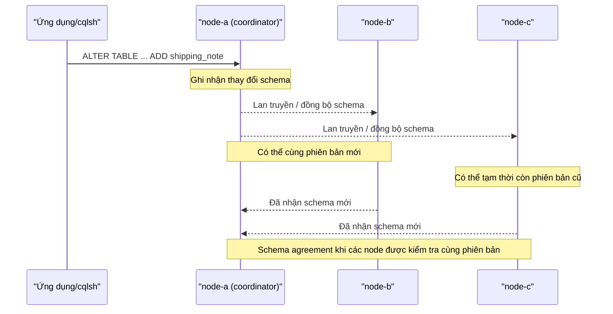
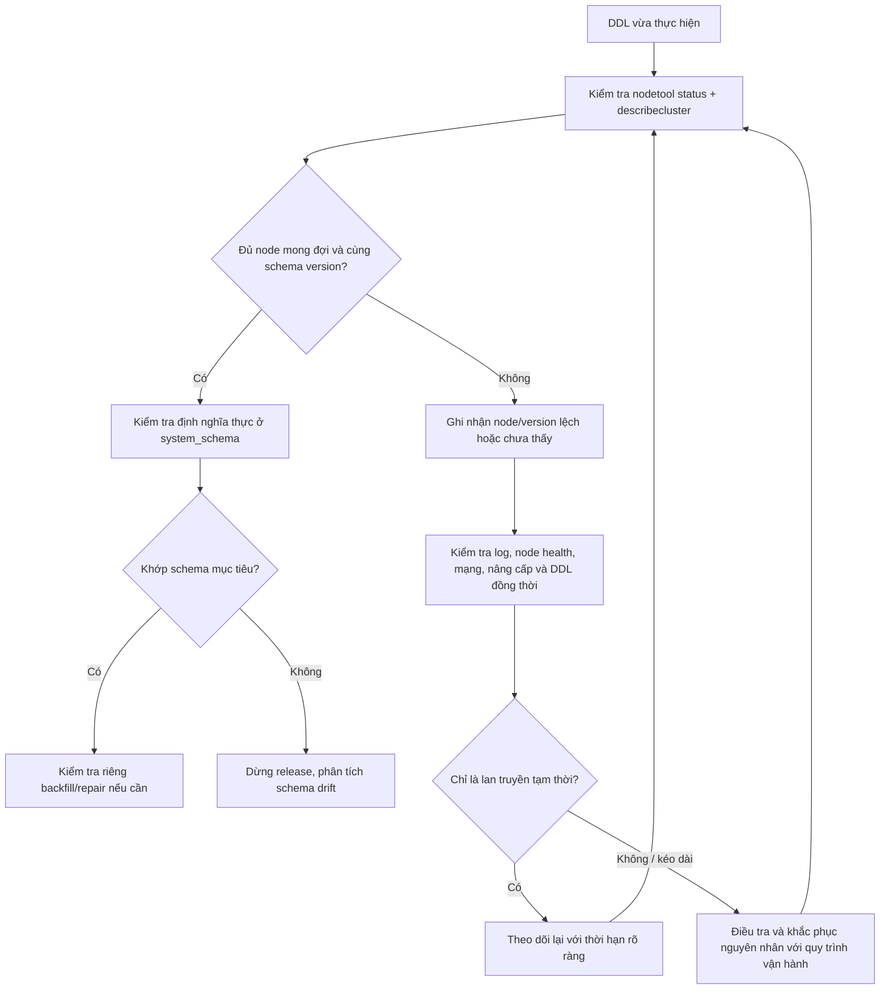

# Schema agreement và cách quan sát trạng thái chưa đồng bộ

## 1. Schema agreement là gì và tại sao cần quan tâm?

Trong Apache Cassandra, **schema** mô tả cấu trúc logic của dữ liệu: keyspace, bảng, cột, kiểu dữ liệu, khóa chính, index, view và các thuộc tính của chúng. Cluster có nhiều node, nên sau một lệnh thay đổi schema như `CREATE TABLE`, `ALTER TABLE` hoặc `DROP TABLE`, các node cần biết cùng một phiên bản định nghĩa.

**Schema agreement** là trạng thái các node thuộc phạm vi đang được kiểm tra đã thống nhất về phiên bản schema. Nó quan trọng vì một truy vấn được một coordinator nhận có thể thất bại hoặc được hiểu khác dự kiến nếu coordinator hoặc replica đang sử dụng định nghĩa schema cũ.

Trong chương **Keyspace và schema** của module `DATABASE_ENGINE_WIDE_COLUMN_CASSANDRA`, cần đặt schema agreement vào đúng vị trí của kiến trúc wide-column phân tán:

| Khái niệm | Câu hỏi nó trả lời | Ví dụ |
| --- | --- | --- |
| **Schema agreement** | Những node liên quan đã nhận cùng định nghĩa keyspace/table chưa? | Tất cả nhìn thấy cột `shipping_note text` |
| **Replication factor (RF)** | Mỗi partition cần có bao nhiêu replica và ở DC nào? | RF = 3 tại `dc_hcm` |
| **Consistency level (CL)** | Một lần đọc/ghi cần đủ bao nhiêu phản hồi replica? | Ghi `LOCAL_QUORUM` cần đa số replica ở DC cục bộ |
| **Dữ liệu đã đồng bộ** | Các replica cần thiết đã có dữ liệu phù hợp chưa? | Repair/streaming dữ liệu cũ sau khi tăng RF |
| **Schema phù hợp ứng dụng** | Định nghĩa cluster có đúng schema mục tiêu không? | `customer_id` đúng kiểu `uuid` và đúng partition key |

> **Schema agreement không đồng nghĩa dữ liệu đã được sao chép/repair xong, và cũng không chứng minh schema hiện tại đúng với mong muốn của ứng dụng.** Nó chỉ là một trong các điều kiện cần kiểm tra khi triển khai.

Sau bài học, bạn sẽ biết quan sát schema version theo node, nhận diện trạng thái chưa đồng bộ, chẩn đoán nguyên nhân thường gặp, tránh phát hành nhiều DDL xung đột và xây dựng bước kiểm tra phù hợp cho ứng dụng Java.

## 2. Vì sao schema có thể chưa thống nhất ngay sau DDL?

Ví dụ một cluster có ba node `node-a`, `node-b` và `node-c`. Ứng dụng gửi:

```sql
ALTER TABLE shop.orders_by_customer ADD shipping_note text;
```

Một coordinator tiếp nhận lệnh, xử lý thay đổi schema và lan truyền thông tin đến các node khác. Trong khoảng chuyển tiếp, một số node có thể đã áp dụng định nghĩa mới, trong khi node khác chưa nhận hoặc chưa áp dụng đầy đủ.



Sơ đồ thể hiện **ý tưởng lan truyền**; quy trình và cơ chế giao tiếp cụ thể thay đổi theo phiên bản Cassandra. Không suy ra rằng mọi node đồng bộ trong cùng một thời điểm chỉ vì câu lệnh đã được coordinator chấp nhận.

Các nguyên nhân làm trạng thái tạm thời kéo dài gồm:

- Độ trễ mạng hoặc liên kết giữa các data center không ổn định.
- Node đang khởi động, bận CPU/I/O, quá tải hoặc bị cách ly mạng.
- Một node bị down, không tham gia nhận schema đúng thời điểm.
- Nhiều client/instance đồng thời gửi các thay đổi schema có phụ thuộc hoặc xung đột.
- Lỗi tương thích/metadata trong giai đoạn nâng cấp phiên bản, hoặc schema bất nhất cần điều tra.

Trạng thái **chưa agreement trong một thời gian ngắn** sau DDL có thể là hiện tượng chuyển tiếp. Trạng thái kéo dài, kèm lỗi CQL hoặc nhiều schema version giữa các node đang hoạt động, đòi hỏi chẩn đoán.

## 3. Schema version được dùng thế nào?

Cassandra gắn **schema version** để nhận biết trạng thái định nghĩa schema của node. Khi schema thay đổi, phiên bản schema có thể đổi; thông tin phiên bản của các node được các công cụ quản trị sử dụng để đối chiếu.

Một cách nhìn đơn giản:

```text
Trước DDL:
    node-a: version V1
    node-b: version V1
    node-c: version V1
    => đang agreement

Ngay sau DDL:
    node-a: version V2
    node-b: version V2
    node-c: version V1
    => chưa agreement

Sau khi đồng bộ schema:
    node-a: version V2
    node-b: version V2
    node-c: version V2
    => agreement trong tập node đang được kiểm tra
```

`V1` và `V2` chỉ là nhãn minh họa; schema version thực tế thường hiển thị dưới dạng UUID. Một version khác **không tự cho biết cụ thể bảng/cột nào khác**: cần kiểm tra DDL, metadata, log hoặc các thay đổi schema gần đây để tìm nguyên nhân.

**Ba giới hạn khi diễn giải schema version:**

1. Hai node báo cùng version là bằng chứng tốt về schema đồng nhất **trong tập node mà công cụ nhìn thấy**, nhưng phải xác nhận có đủ node dự kiến và chúng không bị mất kết nối.
2. Việc metadata local có đúng cấu hình mong muốn phải được **kiểm tra nội dung**; cluster có thể đồng thuận về **một schema sai**.
3. Chỉ cùng schema version không cho biết các SSTable/replica của dữ liệu đã repair hoặc backfill xong.

## 4. Quan sát nhanh bằng `nodetool describecluster`

`nodetool` là công cụ quản trị Cassandra. Trên một node, chạy:

```bash
nodetool describecluster
```

Trong phần đầu ra, tìm nhóm **`Schema versions`**. Hình thức và các mục khác tùy phiên bản; đầu ra sau chỉ là ví dụ minh họa:

```text
Schema versions:
    11111111-1111-4111-8111-111111111111: [node-a, node-b]
    22222222-2222-4222-8222-222222222222: [node-c]
```

Ví dụ trên cho biết công cụ đang quan sát **hai nhóm schema version**. Đây là dấu hiệu các node được liệt kê chưa agreement. Khi một version có tất cả các node dự kiến đang tham gia, đó là tín hiệu tốt hơn:

```text
Schema versions:
    22222222-2222-4222-8222-222222222222: [node-a, node-b, node-c]
```

**Không dùng duy nhất số nhóm schema version để kết luận mọi thứ an toàn.** Nếu node `node-c` bị down và không xuất hiện trong báo cáo, phần output còn lại có thể trông thống nhất mặc dù cluster chưa sẵn sàng như yêu cầu. Vì vậy luôn kết hợp với `nodetool status`.

```bash
nodetool status
```

Trong đầu ra `status`, kiểm tra:

- DC nào tồn tại và những node nào nằm trong mỗi DC.
- Node nào ở trạng thái `UN` (*Up/Normal*), node nào down hoặc đang chuyển trạng thái.
- Có node đang bootstrap, decommission hoặc di chuyển topology không.
- Tổng số node thực tế có khớp topology kỳ vọng không.

`nodetool status` cho biết tình trạng node/topology ở mức quan sát được, **không phải** lệnh xác minh định nghĩa schema. Ngược lại, `describecluster` cho biết nhóm version nhưng không thay thế việc đánh giá sức khỏe toàn cluster.

### Cách đọc kết quả khi có nhiều data center

Với keyspace có RF ở nhiều DC, không nên chỉ kiểm tra các node trong DC mà ứng dụng đang kết nối. Schema là metadata của cluster; một DC chậm nhận schema có thể gây lỗi khi coordinator hoặc đường truy vấn chạm vào các node thuộc DC đó.

Ví dụ:

| DC | Node | Trạng thái | Schema version được quan sát |
| --- | --- | --- | --- |
| `dc_hcm` | `hcm-1`, `hcm-2` | `UN` | `V2` |
| `dc_hn` | `hn-1` | `UN` | `V1` |
| `dc_hn` | `hn-2` | `DN` | Chưa thể xác minh chắc chắn |

Trong tình huống minh họa, cluster **chưa đạt điều kiện sẵn sàng** để phát hành code dựa trên schema mới tới toàn bộ ứng dụng. Cần điều tra `hn-1` và `hn-2` trước, thay vì chỉ nhìn vào `dc_hcm` đã nhận thay đổi.

## 5. Đọc schema version bằng CQL

Ngoài `nodetool`, Cassandra có metadata hệ thống. Trong `cqlsh` kết nối vào **một node cụ thể**, kiểm tra phiên bản schema local:

```sql
SELECT key, schema_version, cluster_name
FROM system.local
WHERE key = 'local';
```

`system.local` mô tả trạng thái **local** trên node đang phục vụ truy vấn. Nếu muốn so sánh nhiều node, cần chủ động kết nối lần lượt vào từng node dự kiến rồi đọc giá trị local của node đó; đừng giả định driver tự bảo đảm truy vấn này đã gửi đến tất cả node.

Các bảng peer system có thể cung cấp thông tin phiên bản schema được node hiện tại **biết về các node khác**:

```sql
-- Thường thấy ở nhiều phiên bản Cassandra:
SELECT peer, schema_version
FROM system.peers;
```

Ở các phiên bản có bảng `system.peers_v2`, có thể xem thêm thông tin peer/port:

```sql
-- Chỉ dùng nếu phiên bản Cassandra của bạn có system.peers_v2:
SELECT peer, peer_port, schema_version
FROM system.peers_v2;
```

**Bản ghi peer là góc nhìn của node đang được hỏi.** Nó có thể chậm cập nhật hoặc thiếu peer đang down, vì vậy không thay thế được việc kết nối trực tiếp đến node liên quan và kiểm tra sức khỏe cluster.

### So sánh schema version với định nghĩa thực

Version cho biết mức độ thống nhất, còn metadata dưới `system_schema` giúp xem **nội dung định nghĩa**:

```sql
-- Thuộc tính keyspace và replication.
SELECT keyspace_name, replication, durable_writes
FROM system_schema.keyspaces
WHERE keyspace_name = 'schema_lab';

-- Các cột đang được biết tới trong bảng.
SELECT column_name, kind, position, type
FROM system_schema.columns
WHERE keyspace_name = 'schema_lab'
  AND table_name = 'events_by_device';
```

Nếu `schema_lab.events_by_device` vừa được thêm `source text`, hãy xác minh cột `source` xuất hiện **tại các node đang điều tra**. So sánh nội dung giữa node giúp tìm sai khác cụ thể, trong khi `schema_version` chỉ cho biết trạng thái version tổng thể.

Một trường hợp dễ gây nhầm: `system_schema.columns` trên một coordinator đã thấy `source`, nhưng node khác chưa thấy. Truy vấn đầu tiên **không chứng minh** toàn cluster đã agreement.

## 6. Thực hành có kiểm soát: theo dõi một lệnh ALTER TABLE

Phần này sử dụng môi trường thử nghiệm; **để thật sự quan sát độ trễ schema giữa node, cần cluster ít nhất hai node**. Lab chỉ có một node có thể kiểm tra lệnh và metadata, nhưng không thể tạo ra bằng chứng về sự khác biệt giữa các node.

### Bước 1 — Chuẩn bị keyspace lab

Giả sử lab có DC thực tế tên `datacenter1`. Nếu chạy trên một node, đặt RF = 1; nếu có đủ hai node cùng DC, có thể chọn RF = 2 cho bài thử tùy mục tiêu. Ví dụ dưới đây dùng RF = 1 để dễ chạy trên lab nhỏ:

```sql
CREATE KEYSPACE IF NOT EXISTS schema_lab
WITH replication = {
    'class': 'NetworkTopologyStrategy',
    'datacenter1': '1'
}
AND durable_writes = true;
```

**Điều kiện:** thay `datacenter1` theo tên DC đọc được từ `nodetool status`. Đây là cấu hình thử nghiệm, không phải gợi ý RF production. `IF NOT EXISTS` không kiểm tra lại replication khi keyspace đã tồn tại; cần xác minh schema lab hiện hữu trước khi đi tiếp.

### Bước 2 — Tạo bảng và ghi một hàng

```sql
CREATE TABLE IF NOT EXISTS schema_lab.events_by_device (
    device_id text,
    event_time timestamp,
    temperature double,
    PRIMARY KEY ((device_id), event_time)
) WITH CLUSTERING ORDER BY (event_time DESC);

INSERT INTO schema_lab.events_by_device (
    device_id, event_time, temperature
) VALUES (
    'sensor-01', '2026-11-21T00:00:00Z', 27.5
);
```

`device_id` là partition key, `event_time` là clustering column. Những thuộc tính này phục vụ thiết kế truy vấn và không tự thay đổi khi schema agreement được kiểm tra.

### Bước 3 — Ghi lại baseline schema version

Chạy trên cluster lab:

```bash
nodetool status
nodetool describecluster
```

Nếu có thể, mở `cqlsh` kết nối riêng đến từng node và ghi lại `schema_version` của `system.local`. Đừng giả định hai lần kết nối qua load balancer đều đi đến hai node khác nhau.

### Bước 4 — Thay đổi schema trên một phiên làm việc

```sql
ALTER TABLE schema_lab.events_by_device
ADD source text;
```

Ngay sau thay đổi, kiểm tra định nghĩa tại coordinator:

```sql
SELECT column_name, kind, type
FROM system_schema.columns
WHERE keyspace_name = 'schema_lab'
  AND table_name = 'events_by_device';
```

Trong lab nhiều node, quan sát lại `nodetool describecluster` và đọc `system.local.schema_version` trên từng node. Nếu các node đồng bộ rất nhanh, bạn **có thể không bắt gặp** cửa sổ chưa agreement; đây là kết quả bình thường. Không cố gây lỗi hoặc cách ly mạng trên môi trường dùng chung chỉ để nhìn thấy sự chậm trễ.

### Bước 5 — Chỉ sử dụng cột mới sau khi xác minh

Khi schema đã agreement và metadata cột mới tồn tại:

```sql
UPDATE schema_lab.events_by_device
SET source = 'edge-gateway'
WHERE device_id = 'sensor-01'
  AND event_time = '2026-11-21T00:00:00Z';

SELECT event_time, temperature, source
FROM schema_lab.events_by_device
WHERE device_id = 'sensor-01';
```

Lệnh `ALTER TABLE ADD` không tự backfill giá trị `source` cho các hàng cũ. Ngay cả khi mọi node đã thống nhất schema, những hàng chưa được ghi `source` vẫn có thể trả về `null`.

### Bước 6 — Dọn lab nếu thực sự không cần giữ dữ liệu

```sql
-- Chỉ chạy trên keyspace lab có thể xóa hoàn toàn.
DROP KEYSPACE IF EXISTS schema_lab;
```

`DROP KEYSPACE` xóa mọi bảng và dữ liệu trong keyspace, không chỉ một bảng. Không dùng lệnh dọn trên hệ thống có dữ liệu cần giữ.

## 7. Phân biệt các trạng thái thường bị hiểu nhầm

| Quan sát | Kết luận hợp lý | Điều **chưa thể kết luận** |
| --- | --- | --- |
| Câu `ALTER TABLE` trả về thành công | Coordinator đã xử lý yêu cầu theo giao thức | Tất cả node đã agreement |
| `DESCRIBE TABLE` thấy cột mới | Session `cqlsh` đang nhìn thấy định nghĩa mới | Tất cả node đều thấy cột mới |
| `system.local` trên một node có version `V2` | Node được hỏi báo version `V2` | Các node khác đã lên `V2` |
| `describecluster` hiển thị hai version | Có dấu hiệu chưa agreement trong tập node quan sát | Nguyên nhân chính xác là mạng, node hay DDL |
| `describecluster` hiển thị một version | Các node được thấy có chung version | Node đang down, schema mong muốn và dữ liệu replica đều đúng |
| `nodetool status` cho thấy toàn bộ `UN` | Các node được quan sát đang Up/Normal | Schema của chúng đã agreement |
| `system_schema` đúng ở mọi node và agreement | Schema đã phù hợp trong tập node kiểm tra | Dữ liệu cần backfill/repair đã hoàn tất |
| DDL đổi RF đã agreement | Các node nhìn thấy chính sách RF mới | Replica mới đã chứa đủ dữ liệu lịch sử |

Ví dụ cuối rất quan trọng: khi tăng RF từ 1 lên 3, schema agreement có thể đến **trước** khi dữ liệu cũ được nhân bản đủ lên các node mới. Cần thực hiện repair/streaming phù hợp topology, rồi kiểm tra kết quả. Không dùng schema version để đánh giá tiến độ truyền dữ liệu.

## 8. Khi chưa agreement: quy trình chẩn đoán

Giả sử bạn vừa triển khai DDL và `describecluster` vẫn có nhiều schema version. Hãy đi theo quy trình sau:



### 8.1. Xác định phạm vi ảnh hưởng

Đặt câu hỏi:

- Chỉ một node lệch version, cả DC lệch hay nhiều node nằm rải rác?
- Các node đó có ở trạng thái `UN` không? Có node down, đang join/leave hoặc bootstrap?
- Lần DDL gần nhất là gì? Có nhiều deploy chạy song song không?
- Ứng dụng Java đang thấy lỗi `Undefined column`, `Unknown table`, `InvalidRequest` hoặc lỗi chuẩn bị statement không?
- Cluster có vừa rolling upgrade, thay topology hoặc bị sự cố mạng không?

Ghi lại thời điểm DDL, keyspace/table liên quan, schema version từng node và phần log lỗi cần thiết. Một version khác biệt có thể do **DDL ở keyspace khác** vì schema version phản ánh trạng thái schema cluster, không gắn riêng một bảng.

### 8.2. Kiểm tra sức khỏe node và kết nối

Kết hợp `nodetool status`, `describecluster`, log Cassandra và kiểm tra kết nối giữa các node. Xác định node nào khó liên lạc, thường xuyên timeout hoặc có dấu hiệu quá tải.

Không dùng `nodetool status` như bằng chứng duy nhất. Node `UN` vẫn có thể chậm hoặc chưa đồng bộ schema, và node down có thể không hiện trong một số góc quan sát schema version.

### 8.3. Chờ lan truyền có giới hạn rồi kiểm tra lại

Với trạng thái chuyển tiếp bình thường, có thể theo dõi lại sau khoảng chờ hợp lý **theo timeout/chính sách của hệ thống**, thay vì gửi liên tục các `ALTER`/`CREATE` mới.

Nếu trạng thái không hội tụ:

1. Xác định chính xác node/version và nội dung schema bị lệch.
2. Điều tra node/network/log, các thay đổi schema đồng thời và tình trạng upgrade.
3. Khắc phục nguyên nhân trên cluster theo runbook phù hợp phiên bản Cassandra.
4. Xác minh lại **đủ node**, schema version, định nghĩa metadata và hành vi truy vấn.

Không tùy tiện sửa trực tiếp các bảng hệ thống, xóa metadata schema, khởi động lại hàng loạt node hoặc dùng lệnh đồng bộ schema phá hủy khi chưa xác định nguyên nhân và có quy trình quản trị phù hợp.

### 8.4. Khi nào phải dừng phát hành?

Dừng bước triển khai **phụ thuộc cột/bảng/UDT mới** nếu:

- Schema version vẫn lệch giữa các node dự kiến đang hoạt động.
- Có node mất kết nối mà quy trình phát hành yêu cầu nó phải tham gia.
- Metadata từ những node khác nhau cho thấy định nghĩa khác nhau.
- CQL mới thất bại vì thiếu bảng/cột/kiểu hoặc chuẩn bị statement không ổn định.
- DDL đã agreement nhưng schema thực tế không đúng định nghĩa ứng dụng mong đợi.

Trong các trường hợp này, triển khai ứng dụng trước khi giải quyết có thể tạo ra lỗi thất thường theo coordinator hoặc đường mạng.

## 9. Schema agreement, consistency level và repair liên hệ thế nào?

Giả sử keyspace `shop` có RF = 3 tại một DC và ứng dụng ghi ở `LOCAL_QUORUM`. Một thao tác ghi dữ liệu thường cần đủ phản hồi replica theo CL đã chọn, nhưng **CL không điều khiển tốc độ lan truyền schema change**.

| Công việc | Cơ chế/kiểm tra liên quan |
| --- | --- |
| Đồng nhất định nghĩa bảng giữa node | Schema propagation, schema version và schema agreement |
| Đặt replica partition trên node/DC | Replication strategy, RF của keyspace |
| Xác định thành công của một lần đọc/ghi | Consistency level, replica response |
| Đồng bộ dữ liệu đã lệch hoặc replica mới | Streaming/repair, quan sát tiến độ và kiểm tra dữ liệu |
| Thay đổi chính sách compaction | Table options và chu trình compaction/SSTable |

**Không nhầm**:

- “`LOCAL_QUORUM` thành công” với “mọi node đã nhận schema mới”.
- “Schema agreement” với “read repair/anti-entropy repair đã hoàn tất”.
- “Đổi RF có agreement” với “dữ liệu cũ đã có đủ replica theo RF mới”.
- “`DESCRIBE TABLE` đúng trên một node” với “ứng dụng Java có thể dùng bảng mới an toàn trên mọi coordinator”.

Khi một migration vừa thay schema vừa đòi hỏi backfill hoặc repair, cần **hai nhóm tiêu chí hoàn tất riêng**: schema agreement và xác minh dữ liệu.

## 10. Tích hợp kiểm tra trong ứng dụng Java

Ứng dụng Java có thể thực hiện DDL qua Cassandra Java Driver, nhưng việc phát hành chức năng dùng schema mới cần được phối hợp với quy trình migration. Driver có khả năng theo dõi metadata và schema agreement, song hành vi chờ, timeout, cảnh báo và API cụ thể còn phụ thuộc phiên bản/cấu hình driver.

### Ví dụ với Java Driver 4.x

Giả sử đã có `CqlSession session` kết nối cluster và keyspace `schema_lab`, cùng một quá trình migration được điều phối. Sau lệnh DDL:

```java
import com.datastax.oss.driver.api.core.CqlSession;
import com.datastax.oss.driver.api.core.cql.Row;

// session được khởi tạo và quản lý vòng đời ở bên ngoài.
session.execute("""
    ALTER TABLE schema_lab.events_by_device ADD source text
    """);

// Kiểm tra schema agreement bằng API của Driver 4.x.
boolean agreed = session.checkSchemaAgreement();
if (!agreed) {
    throw new IllegalStateException(
        "Cluster chưa đạt schema agreement; chưa bật chức năng dùng cột source");
}

// Đây chỉ là kiểm tra metadata từ request hiện tại.
Row col = session.execute("""
    SELECT column_name, type
    FROM system_schema.columns
    WHERE keyspace_name = 'schema_lab'
      AND table_name = 'events_by_device'
      AND column_name = 'source'
    """).one();

if (col == null || !"text".equals(col.getString("type"))) {
    throw new IllegalStateException(
        "Cột source chưa tồn tại hoặc chưa đúng kiểu trong schema được đọc");
}
```

**Điều kiện của ví dụ:** Java hỗ trợ text block (Java 15+), Cassandra Java Driver 4.x có API tương ứng và một migration chưa thêm cột `source` trước đó. Nếu chạy lại, `ALTER TABLE ... ADD source` có thể báo cột đã tồn tại; trong quy trình thật cần kiểm tra schema/migration version trước khi quyết định thực thi.

Đoạn mã dùng để giải thích thứ tự kiểm tra, **không** thay thế cơ chế migration đầy đủ. Khi driver báo chưa agreement, câu DDL **có thể đã được áp dụng tại cluster**: đừng tự động phát lại DDL mà không đọc metadata và điều tra trạng thái.

### Nếu nhiều instance ứng dụng chạy đồng thời

Không nên để mọi instance Java khi startup đều phát lệnh `ALTER TABLE` cùng lúc. Một quy trình tốt hơn:

1. Chọn một bên điều phối migration; chạy DDL **tuần tự**.
2. Chờ/kiểm tra schema agreement theo API driver và công cụ vận hành.
3. Xác minh keyspace/table/column/type/primary key với schema mục tiêu.
4. Nếu có backfill hoặc repair, đợi các tiêu chí dữ liệu riêng hoàn thành.
5. Mở chức năng cần schema mới và theo dõi lỗi CQL, timeout, metadata refresh.

Chuẩn bị/execute prepared statement phải dựa trên schema tương thích. Với rollout nhiều phiên bản ứng dụng, nên ưu tiên thay đổi **tương thích ngược** (thêm cột trước; bỏ cột cũ sau khi các phiên bản cũ đã ngừng sử dụng).

### Phân biệt kiểm tra local và cluster-wide

`SELECT ... FROM system_schema.columns` qua một session chứng minh rằng **coordinator phục vụ truy vấn đó** nhìn thấy cột; nó không phải phép quét toàn bộ node. Ngay cả khi driver `checkSchemaAgreement()` trả về true, cần hiểu giới hạn tập node mà driver biết/tiếp cận được, những node down và chính sách vận hành của cluster.

Nếu cần tiêu chí phát hành mạnh hơn, kết hợp driver với xác minh `nodetool status`, `nodetool describecluster` và metadata trên các node/DC quan trọng.

## 11. Câu chuyện lỗi thực tế: DDL thành công nhưng truy vấn mới thất bại

Giả sử triển khai dịch vụ Java phiên bản mới với câu CQL:

```sql
SELECT order_id, shipping_note
FROM shop.orders_by_customer
WHERE customer_id = 11111111-1111-4111-8111-111111111111;
```

Trước đó migration đã chạy:

```sql
ALTER TABLE shop.orders_by_customer ADD shipping_note text;
```

Sau phát hành, một số truy vấn thành công, một số báo thiếu cột. Một nguyên nhân **có thể** là schema chưa agreement, đặc biệt nếu các coordinator khác nhau đang dùng hai version; cũng có thể do ứng dụng kết nối sai cluster/keyspace hoặc DDL chưa chạy đúng nơi.

Một hướng điều tra có thứ tự:

1. Kiểm tra ứng dụng đang kết nối **cluster, DC và keyspace nào**, so với nơi DDL được chạy.
2. So sánh `nodetool status` và `describecluster` để xác định node down/phiên bản schema lệch.
3. Đọc `system_schema.columns` ở những node nghi vấn, xác nhận có `shipping_note text` hay chưa.
4. Đối chiếu log DDL/migration và log ứng dụng (coordinator, thời điểm lỗi, exception).
5. Khôi phục schema agreement hoặc sửa sai môi trường, sau đó kiểm tra lại prepared statement/metadata và truy vấn.

Nếu tất cả node đã agreement nhưng cột vẫn không có, vấn đề là **schema drift hoặc migration thiếu**, không nên kết luận “Cassandra chưa kịp đồng bộ”. Cần đối chiếu định nghĩa thực và triển khai migration đúng.

## 12. Bài tập tự kiểm tra và tiêu chí đạt

### Bài tập 1 — Đọc nhóm schema version

Giả sử `describecluster` hiển thị:

```text
Schema versions:
    V2: [n1, n2]
    V1: [n3]
```

Hãy trả lời:

1. Cluster đã agreement chưa? **Chưa**, trong tập node được hiển thị có hai version.
2. Có đủ cơ sở khẳng định `n3` lỗi mạng không? **Chưa**; chỉ biết schema version khác.
3. Sau khi `n3` đồng bộ lên `V2`, dữ liệu ở tất cả replica đã đủ chưa? **Chưa thể kết luận**.
4. Muốn tìm cột nào khác, nên làm gì? So sánh metadata `system_schema` trên các node hoặc điều tra lịch sử DDL.

### Bài tập 2 — Một schema version nhưng vẫn chưa an toàn

`nodetool describecluster` chỉ hiển thị một version, nhưng `nodetool status` cho thấy một node dự kiến đang down. Bạn có thể khẳng định toàn bộ cluster đã sẵn sàng phát hành code dùng bảng mới không? **Không**. Cần làm rõ phạm vi kiểm tra, quy tắc chịu lỗi và yêu cầu node đó quay lại/nhận schema trước khi phát hành.

### Bài tập 3 — Phân biệt schema và dữ liệu

Tăng RF của một keyspace từ 1 lên 3 rồi kiểm tra schema agreement đã đạt. Hãy giải thích vì sao vẫn phải có kế hoạch đồng bộ dữ liệu hiện hữu. Trả lời: cập nhật RF thay chính sách đặt replica, còn dữ liệu cũ phải được streaming/repair tới các replica cần thiết; cùng schema version không xác minh nội dung dữ liệu.

### Checklist triển khai

| Việc cần kiểm tra | Tiêu chí đạt |
| --- | --- |
| Đúng cluster và DC | Các node và môi trường nhận DDL đúng như dự kiến |
| Đủ node trong phạm vi quan sát | `status` và danh sách node phù hợp với topology kỳ vọng |
| Schema agreement | Các node liên quan có cùng schema version trong phạm vi được kiểm tra |
| Định nghĩa schema | Keyspace, bảng, cột, kiểu và khóa đúng với yêu cầu |
| Ứng dụng Java | Driver/statement truy vấn ổn định và schema mới tương thích |
| Đồng bộ dữ liệu | Backfill, streaming hoặc repair hoàn tất **nếu migration yêu cầu** |
| Theo dõi sau phát hành | Không xuất hiện lỗi CQL do schema, timeout bất thường hoặc sai mapping |

**Ghi nhớ:** trong Cassandra, schema agreement nói về việc các node nhìn thấy **cùng định nghĩa**, không nói thay cho dữ liệu đã đồng bộ hay định nghĩa đó đã đúng về nghiệp vụ. Quan sát `nodetool describecluster` cùng `nodetool status`, đọc `system.local`/`system_schema` khi cần, chờ agreement sau DDL và kiểm tra riêng backfill/repair là nền tảng triển khai CQL an toàn cho hệ thống Java trên cluster phân tán.
