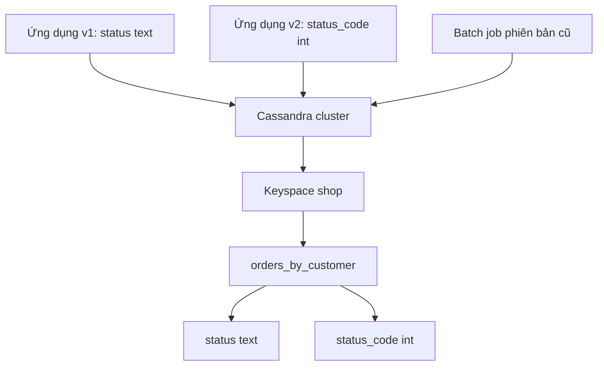
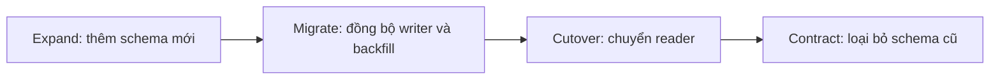

# DDL trong cụm đang có nhiều phiên bản ứng dụng

## 1. Bối cảnh: cùng một Cassandra cluster, nhiều ứng dụng đang chạy

Khi triển khai ứng dụng Java bằng *rolling deployment*, không phải mọi instance đều chuyển sang phiên bản mới trong cùng một thời điểm. Ứng dụng v1, v2, background worker, consumer và batch job có thể cùng đọc/ghi trên một bảng Apache Cassandra. Trong lúc đó, một nhóm kỹ thuật cần thay đổi schema qua CQL Data Definition Language (DDL), chẳng hạn `ALTER TABLE` để thêm cột mới hoặc `CREATE TABLE` cho một kiểu truy vấn mới.

Trong chương **Keyspace và schema** thuộc module `DATABASE_ENGINE_WIDE_COLUMN_CASSANDRA`, đây là bài toán kết nối thiết kế wide-column theo truy vấn với replication, mức nhất quán đọc/ghi, repair và quản lý Java Driver: **DDL phải tương thích với cả ứng dụng cũ lẫn ứng dụng mới trong giai đoạn hai phiên bản cùng tồn tại**.

Các mục tiêu của bài:

1. Phân biệt tính tương thích **schema**, **dữ liệu** và **ứng dụng** khi nhiều phiên bản cùng chạy.
2. Lập thứ tự triển khai theo các pha *expand → migrate → cutover → contract*.
3. Thực hành thêm cột mới, dual-write, backfill và chuyển truy vấn trong CQL.
4. Kiểm tra schema agreement, định nghĩa thật trong `system_schema` và ảnh hưởng tới Java Driver.
5. Biết khi nào cần tạo bảng mới, khi nào không được xóa cột cũ và khi nào rollback không còn an toàn.

### “Nhiều phiên bản ứng dụng” khác “nhiều phiên bản Cassandra”

| Tình huống | Thứ gì đang có nhiều phiên bản? | Bài toán |
| --- | --- | --- |
| Rolling deployment ứng dụng | Java service v1/v2, worker, job, API | Hai phiên bản có đọc/ghi được cùng schema và cùng ý nghĩa dữ liệu không? |
| Rolling upgrade Cassandra | Phần mềm Cassandra trên các node | Tương thích máy chủ, CQL/storage và quy trình nâng cấp riêng |

Bài học này tập trung vào trường hợp **ứng dụng v1/v2 đồng thời dùng một cluster**. Nếu cluster cũng đang nâng cấp Cassandra, còn phải kiểm tra giới hạn tương thích của các phiên bản máy chủ.

## 2. Vì sao một DDL “thành công” vẫn có thể làm ứng dụng lỗi?

Giả sử ứng dụng v1 truy vấn:

```sql
SELECT created_at, order_id, status
FROM shop.orders_by_customer
WHERE customer_id = 11111111-1111-4111-8111-111111111111;
```

Ứng dụng v2 muốn dùng mã trạng thái dạng số `status_code int` thay vì `status text`. Nếu quá sớm xóa `status`, các instance v1 còn chạy có thể bị lỗi `Undefined column`. Nếu chỉ thêm cột mới, instance v2 lại có thể đọc `null` vì dữ liệu cũ chưa được chuyển. Nếu v1 vẫn ghi `status` trong khi v2 chỉ đọc `status_code`, kết quả nghiệp vụ có thể không nhất quán dù schema đã đồng bộ hoàn toàn.



Phải phân biệt ba lớp đúng đắn:

| Lớp | Câu hỏi kiểm tra |
| --- | --- |
| **Schema compatibility** | Tên bảng/cột, khóa chính, kiểu dữ liệu có còn hợp lệ đối với v1 và v2 không? |
| **Data compatibility** | Hai biểu diễn trạng thái có cùng ý nghĩa, được cập nhật đúng khi có ghi mới không? |
| **Operational readiness** | Schema agreement đã đạt, replica có sẵn, backfill/repair đã đáp ứng yêu cầu chưa? |

**Schema agreement** nghĩa là các node được kiểm tra đã thống nhất định nghĩa schema, **không** có nghĩa dữ liệu hai cột đã đồng bộ hoặc định nghĩa hiện tại đúng yêu cầu nghiệp vụ.

## 3. Ma trận tương thích khi chuyển từ text sang mã số

Với ví dụ đơn hàng, xét bốn trạng thái:

| Trạng thái bảng | Ứng dụng v1 dùng `status` | Ứng dụng v2 dùng `status_code` | Nhận xét |
| --- | --- | --- | --- |
| Chỉ có `status text` | Hoạt động | Không hoạt động nếu yêu cầu `status_code` | Chưa thể bật truy vấn mới |
| Có cả hai cột, chưa backfill | Hoạt động | Có thể gặp `null` | Tương thích cú pháp nhưng chưa chắc đúng dữ liệu |
| Hai cột được writer duy trì, dữ liệu cũ đã backfill | Hoạt động | Hoạt động khi mapping đã kiểm chứng | Giai đoạn cùng tồn tại mong muốn |
| Đã xóa `status` | Không hoạt động nếu còn tham chiếu | Có thể hoạt động | Chỉ sau khi hết v1 và job phụ thuộc |

Không được tự động coi lệnh `ALTER TABLE ... ADD` là tương thích trong mọi ứng dụng. Mapper xử lý `SELECT *`, serializer phụ thuộc thứ tự cột hoặc code kiểm tra số cột có thể phản ứng với schema mới. Do đó cần kiểm thử **code thực tế** của cả v1 và v2, không chỉ cú pháp CQL.

## 4. Quy trình expand → migrate → cutover → contract



### Expand — mở rộng mà vẫn giữ đường cũ

Dùng `ALTER TABLE ... ADD` hoặc `CREATE TABLE`, giữ các cột/bảng v1 đang sử dụng. Sau DDL, xác minh định nghĩa thực tế và schema agreement **trước** khi cho v2 dùng cột/bảng mới.

### Migrate — duy trì dữ liệu trong thời gian cùng tồn tại

Nếu dữ liệu mới được lưu ở cột khác, mọi writer còn chạy phải bảo đảm hợp đồng dữ liệu chuyển tiếp. Phương án có thể gồm dual-write, nâng cấp các writer cũ, điều phối qua một dịch vụ duy nhất hoặc đồng bộ dữ liệu có kiểm soát. Thực hiện backfill cho dữ liệu lịch sử, xử lý cập nhật cạnh tranh và kiểm tra kết quả.

### Cutover — chuyển dần đường đọc

Trong thời gian chuyển đổi, v2 có thể fallback từ cột mới sang cột cũ cho các hàng chưa backfill. Chỉ chuyển sang đọc hoàn toàn cấu trúc mới khi đã chứng minh nó đầy đủ và không còn writer cũ gây sai lệch.

### Contract — dọn schema khi không còn phụ thuộc

Chỉ thực hiện `DROP COLUMN` hoặc `DROP TABLE` sau khi các bản ứng dụng, job, consumer, báo cáo và đường rollback không còn cần chúng. Nên để contract ở **đợt triển khai sau** để có thời gian quan sát và phục hồi.

| Pha | Thao tác điển hình | Điều kiện hoàn tất |
| --- | --- | --- |
| Expand | `ALTER TABLE ... ADD` | Schema agreement, v1 vẫn hoạt động |
| Migrate | Dual-write, backfill theo partition key | Không bỏ sót writer, dữ liệu cũ và mới khớp |
| Cutover | Đổi reader/mapper trong Java | Dữ liệu đầy đủ, lỗi ứng dụng trong giới hạn |
| Contract | `ALTER TABLE ... DROP` | Không còn phụ thuộc cũ, kế hoạch khôi phục rõ |

Các pha không phải một transaction nhiều bảng/toàn cluster; cần xử lý lỗi riêng và tránh giả định mọi bước đồng thời hoàn tất.

## 5. Lab CQL: mở rộng bảng đơn hàng

Thực hành trên **keyspace lab riêng**. Giả sử DC thật là `datacenter1`, cluster lab chỉ có một node; hãy kiểm tra `nodetool status` và thay tên DC cho đúng môi trường.

### Bước 1 — Tạo keyspace và bảng cho v1

```sql
CREATE KEYSPACE IF NOT EXISTS rolling_lab
WITH replication = {
    'class': 'NetworkTopologyStrategy',
    'datacenter1': '1'
}
AND durable_writes = true;

CREATE TABLE IF NOT EXISTS rolling_lab.orders_by_customer (
    customer_id uuid,
    created_at timestamp,
    order_id uuid,
    status text,
    total_amount decimal,
    PRIMARY KEY ((customer_id), created_at, order_id)
) WITH CLUSTERING ORDER BY (created_at DESC, order_id ASC);
```

RF = 1 chỉ dùng cho bài thử một node, **không** phải cấu hình có khả năng chịu lỗi production. Nếu keyspace/bảng đã có, `IF NOT EXISTS` không sửa định nghĩa khác mong muốn; phải đọc metadata trước khi thực hành.

```sql
INSERT INTO rolling_lab.orders_by_customer (
    customer_id, created_at, order_id, status, total_amount
) VALUES (
    11111111-1111-4111-8111-111111111111,
    '2026-11-20T08:00:00Z',
    aaaaaaaa-aaaa-4aaa-8aaa-aaaaaaaaaaaa,
    'PAID',
    250000.00
);

SELECT order_id, status
FROM rolling_lab.orders_by_customer
WHERE customer_id = 11111111-1111-4111-8111-111111111111;
```

Khóa phân vùng là `customer_id`; `created_at` và `order_id` là clustering columns. Đây là bảng thiết kế theo truy vấn lịch sử đơn hàng của một khách, không phải bảng tổng quát cho mọi cách tìm đơn hàng.

### Bước 2 — Expand: thêm cột mới

```sql
ALTER TABLE rolling_lab.orders_by_customer
ADD status_code int;
```

Sau khi schema agreement và metadata đúng, đọc lại:

```sql
SELECT created_at, order_id, status, status_code
FROM rolling_lab.orders_by_customer
WHERE customer_id = 11111111-1111-4111-8111-111111111111;
```

Hàng cũ vẫn có `status = 'PAID'`, còn `status_code` có thể `null`. **Thêm cột không tự backfill dữ liệu hiện hữu.**

### Bước 3 — Chọn ánh xạ trạng thái nghiệp vụ

| Giá trị v1 | Mã v2 |
| --- | ---: |
| `NEW` | 0 |
| `PROCESSING` | 1 |
| `PAID` | 2 |
| `CANCELLED` | 3 |

Ánh xạ này chỉ là ví dụ nghiệp vụ; Cassandra không tự định nghĩa hoặc chuyển enum. Mọi service phải hiểu cùng một ánh xạ, kể cả trường hợp dữ liệu cũ không hợp lệ.

### Bước 4 — Migrate: backfill theo khóa hàng

```sql
UPDATE rolling_lab.orders_by_customer
SET status_code = 2
WHERE customer_id = 11111111-1111-4111-8111-111111111111
  AND created_at = '2026-11-20T08:00:00Z'
  AND order_id = aaaaaaaa-aaaa-4aaa-8aaa-aaaaaaaaaaaa;
```

Ở ví dụ, `UPDATE` nhắm đến hàng bằng **đầy đủ primary key**. Cassandra không có cơ chế `UPDATE` quét toàn bảng và thực hiện biểu thức chuyển đổi cho mọi hàng giống nhiều RDBMS. Với tập dữ liệu lớn, xây dựng công cụ paging/scan phù hợp mô hình partition, checkpoint, giới hạn tốc độ, retry và đối chiếu.

### Bước 5 — Dual-write khi tạo đơn hàng mới

```sql
INSERT INTO rolling_lab.orders_by_customer (
    customer_id, created_at, order_id, status, status_code, total_amount
) VALUES (
    22222222-2222-4222-8222-222222222222,
    '2026-11-20T09:00:00Z',
    bbbbbbbb-bbbb-4bbb-8bbb-bbbbbbbbbbbb,
    'NEW',
    0,
    98000.00
);
```

Ghi hai cột của **cùng một hàng trong một statement** cập nhật chúng trong cùng mutation. Nhưng nếu vẫn còn ứng dụng v1 chỉ sửa `status`, cột `status_code` có thể cũ ngay sau đó. Triển khai dual-write tại một phần instance **không** giải quyết được toàn bộ đường ghi cũ.

### Bước 6 — Contract sau khi hết v1

```sql
-- Chỉ thực hiện khi mọi phiên bản ứng dụng/job đã hết dùng status.
ALTER TABLE rolling_lab.orders_by_customer
DROP status;
```

Không chạy lệnh này trong thời gian cùng tồn tại v1/v2. Khi bỏ cột, Cassandra cập nhật schema và xử lý dữ liệu lưu trữ qua cơ chế tương ứng; không nên giả định mọi SSTable đã được viết lại ngay hay `ADD` lại cột cùng tên sẽ phục hồi dữ liệu cũ.

## 6. Thứ tự rollout khi còn writer v1

Một lộ trình thực tế thường gồm:

| Thời điểm | Schema | Client/Writer | Mục tiêu |
| --- | --- | --- | --- |
| T0 | Chỉ `status` | Toàn bộ v1 | Xác minh baseline |
| T1 | Thêm `status_code` | v1 | Chờ schema agreement |
| T2 | Hai cột | v1 được nâng cấp tương thích + v2 chuyển tiếp | Mọi đường ghi có cơ chế đồng bộ |
| T3 | Hai cột | Writer đã đồng bộ, reader dùng fallback | Backfill, kiểm tra sai lệch |
| T4 | Hai cột | Reader v2 dùng dữ liệu mới | Đối chiếu và giám sát |
| T5 | Chỉ `status_code` nếu cần | Không còn v1/job cũ | Bỏ cột cũ sau thời hạn rollback |

Điểm quyết định ở **T2–T3**: nếu writer v1 vẫn chạy và chỉ ghi `status`, có thể xử lý bằng một trong các thiết kế:

- Nâng cấp mọi writer sang phiên bản chuyển tiếp ghi cả hai cột.
- Tập trung ghi trạng thái qua một dịch vụ chung có hợp đồng dữ liệu duy nhất.
- Duy trì pipeline cập nhật có checkpoint và độ trễ được giám sát, rồi đối chiếu cuối kỳ.
- Trì hoãn chuyển reader chỉ dùng `status_code` cho tới khi hết writer v1 và hoàn thành một lượt backfill cuối.

Phải chứng minh mọi đường ghi đã được bao phủ. Việc v2 có fallback khi `status_code` bằng `null` chỉ xử lý **thiếu dữ liệu**, không phát hiện chắc chắn một giá trị `status_code` khác `null` nhưng **đã lỗi thời**.

### Tranh chấp giữa backfill và cập nhật mới

Giả sử backfill đọc `status = 'NEW'` và chuẩn bị ghi mã `0`. Trước khi nó ghi, ứng dụng xử lý thanh toán đã chuyển trạng thái sang `PAID`, ghi mã `2`. Một backfill với timestamp mới hơn có thể ghi đè giá trị `2` bằng `0`. Cassandra hòa giải ghi cạnh tranh theo timestamp; phải thiết kế backfill tránh ghi stale, chẳng hạn bằng hợp đồng writer, version/điều kiện được kiểm soát, hoặc đối chiếu sau chuyển đổi.

LWT có thể hữu ích cho một số cập nhật có điều kiện, nhưng tăng chi phí và **không tự biến migration nhiều hàng/bảng thành một transaction toàn cục**.

## 7. DDL nào có thể ảnh hưởng phiên bản cũ?

| Thao tác | Ảnh hưởng với v1 | Điều phải kiểm tra |
| --- | --- | --- |
| `ALTER TABLE ... ADD new_col` | Thường phù hợp để mở rộng | Mapper, `SELECT *`, giá trị `null`, schema agreement |
| `CREATE TABLE new_table` | Thường không ảnh hưởng bảng cũ | Dữ liệu nguồn, backfill và truy vấn theo partition key mới |
| Đổi `comment` | Thường ít tác động | Metadata và công cụ quản trị |
| Đổi `default_time_to_live` | Có thể đổi vòng đời **ghi mới** | TTL không áp hồi tố cho mọi dữ liệu cũ |
| Đổi compaction/compression | Có thể tăng tải I/O, CPU | Tài nguyên, SSTable và compaction |
| `ALTER TABLE ... DROP old_col` | Làm hỏng client vẫn gọi cột cũ | Đủ chứng cứ không còn phụ thuộc |
| `DROP TABLE`/`DROP KEYSPACE` | Mất đối tượng và dữ liệu trong phạm vi xóa | Sao lưu, phục hồi, danh sách consumer |
| Đổi tên cột nơi được hỗ trợ | CQL cũ có thể không còn hợp lệ | Phiên bản máy chủ, index/view, mapper |
| Đổi kiểu/partition key | Không thể coi là sửa tại chỗ an toàn | Bảng mới, migration và thiết kế theo truy vấn |
| `ALTER KEYSPACE` đổi RF/DC | Đổi chính sách replica, ảnh hưởng khả năng chịu lỗi | Streaming/repair, CL, số node/DC thực |

Với `SELECT *`, ngay cả thêm cột cũng có thể làm hỏng mapper/serializer phụ thuộc số cột hoặc vị trí cột. Nên chọn cột tường minh trong truy vấn ứng dụng, và kiểm tra mapping theo tên/kiểu.

### Đổi partition key phải thiết kế bảng mới

Nếu v2 muốn tra cứu đơn hàng bằng `order_id`, bảng mới có thể là:

```sql
CREATE TABLE IF NOT EXISTS rolling_lab.orders_by_id (
    order_id uuid PRIMARY KEY,
    customer_id uuid,
    created_at timestamp,
    status_code int,
    total_amount decimal
);
```

Điều này tạo partition theo `order_id`, khác bảng `orders_by_customer`. Cần backfill/ghi dữ liệu vào cả hai bảng, xử lý sai lệch giữa các bản phi chuẩn hóa và chuyển truy vấn; không có `ALTER TABLE` đơn giản nào đổi partition key rồi tự dàn lại dữ liệu cũ.

## 8. Kiểm tra schema agreement trước khi bật v2

Sau DDL, coordinator có thể đã thấy cột mới nhưng một node khác còn dùng schema version cũ. Vì vậy phải đợi và xác minh thay đổi schema đã lan truyền.

```bash
nodetool status
nodetool describecluster
```

`nodetool status` cho thấy DC, node và trạng thái Up/Down. `nodetool describecluster` thường hiển thị các nhóm `Schema versions`. Nhiều version trong nhóm node quan sát là dấu hiệu chưa agreement. Một version duy nhất cũng không chứng minh node đang down đã được đồng bộ.

Trong `cqlsh`, kiểm tra:

```sql
SELECT key, schema_version
FROM system.local
WHERE key = 'local';

SELECT column_name, kind, type
FROM system_schema.columns
WHERE keyspace_name = 'rolling_lab'
  AND table_name = 'orders_by_customer'
  AND column_name = 'status_code';
```

Truy vấn `system.local` chỉ phản ánh node được kết nối; `system_schema.columns` cho biết định nghĩa mà coordinator phục vụ truy vấn đó nhìn thấy. Muốn có bằng chứng cho nhiều node, phải đối chiếu nhóm version, tình trạng node và khi cần metadata tại từng node.

Đánh giá ba trạng thái riêng biệt:

1. **Agreement:** các node liên quan biết cùng định nghĩa.
2. **Correctness:** schema đúng theo yêu cầu (kiểu `int`, khóa, RF, options).
3. **Data readiness:** hai biểu diễn dữ liệu nhất quán, backfill và repair/streaming nếu cần đã đạt tiêu chí.

Không bật tính năng chỉ dựa vào việc DDL trả về thành công hoặc một coordinator nhìn thấy cột mới.

## 9. Điều phối migration trong hệ thống nhiều instance

Để mọi Java instance chạy `CREATE` hoặc `ALTER` lúc khởi động có thể gây xung đột schema change và làm khó chẩn đoán khi deploy đồng thời. Quy trình quản lý migration nên có **một bên điều phối**:

1. Ghi nhận phiên bản schema mong muốn và các phụ thuộc giữa migration.
2. Đọc schema hiện hữu trước khi chạy DDL.
3. Thực hiện thay đổi từng bước, tránh DDL chồng nhau.
4. Chờ schema agreement có giới hạn thời gian và kiểm tra schema thật.
5. Khi cần, thực hiện backfill/repair/streaming và xác minh dữ liệu.
6. Cho phép ứng dụng v2 nhận lưu lượng khi các điều kiện của pha đã đáp ứng.

`IF NOT EXISTS` trong `CREATE TABLE` chỉ tránh lỗi tạo trùng tên; nó **không** xác minh cấu trúc bảng đã có phù hợp yêu cầu mới. Khi phát hiện schema drift, dừng migration phụ thuộc, phân tích và tạo migration có chủ đích.

Nếu driver báo chưa agreement sau một DDL, đừng tự động phát lặp `ALTER TABLE ADD`. Lệnh ban đầu có thể đã được chấp nhận và đang lan truyền. Hãy kiểm tra metadata, schema versions, tình trạng node và log trước khi quyết định thực hiện tiếp.

## 10. Java Driver: prepared statement và chuyển tiếp dữ liệu

Ví dụ dùng **Cassandra Java Driver 4.x**, với `CqlSession session` đã được khởi tạo và quản lý vòng đời ở bên ngoài, Java 15+ cho text block. Giả sử schema `rolling_lab.orders_by_customer` đã có `status_code int`.

### Ghi cả biểu diễn cũ và mới

```java
import com.datastax.oss.driver.api.core.CqlSession;
import com.datastax.oss.driver.api.core.cql.PreparedStatement;
import java.math.BigDecimal;
import java.time.Instant;
import java.util.UUID;

// session đã được tạo và kết nối ở nơi khác.
PreparedStatement upsert = session.prepare("""
    INSERT INTO rolling_lab.orders_by_customer (
        customer_id, created_at, order_id,
        status, status_code, total_amount
    ) VALUES (?, ?, ?, ?, ?, ?)
    """);

session.execute(upsert.bind(
    UUID.fromString("33333333-3333-4333-8333-333333333333"),
    Instant.parse("2026-11-20T10:00:00Z"),
    UUID.fromString("cccccccc-cccc-4ccc-8ccc-cccccccccccc"),
    "PAID",
    2,
    new BigDecimal("250000.00")
));
```

Một statement ghi hai cột trong cùng một hàng. Trong production, cần dùng hàm mapping thống nhất, xét retry và lỗi chưa rõ trạng thái ghi; không nên phát lại tùy ý các thao tác có tác dụng phụ.

### Đọc tương thích khi hàng cũ chưa backfill

```java
import com.datastax.oss.driver.api.core.cql.PreparedStatement;
import com.datastax.oss.driver.api.core.cql.Row;
import java.util.UUID;

PreparedStatement ps = session.prepare("""
    SELECT status, status_code
    FROM rolling_lab.orders_by_customer
    WHERE customer_id = ?
    """);

for (Row row : session.execute(ps.bind(
        UUID.fromString("11111111-1111-4111-8111-111111111111")))) {
    Integer code = row.isNull("status_code")
        ? null : row.getInt("status_code");
    String oldStatus = row.getString("status");

    int effectiveCode;
    if (code != null) {
        effectiveCode = code;
    } else if ("NEW".equals(oldStatus)) {
        effectiveCode = 0;
    } else if ("PROCESSING".equals(oldStatus)) {
        effectiveCode = 1;
    } else if ("PAID".equals(oldStatus)) {
        effectiveCode = 2;
    } else if ("CANCELLED".equals(oldStatus)) {
        effectiveCode = 3;
    } else {
        throw new IllegalStateException("Missing or unknown order status");
    }
    // Dùng effectiveCode theo nghiệp vụ đã kiểm thử.
}
```

Fallback trên `null` giúp xử lý hàng chưa backfill. Tuy nhiên, **nếu writer cũ có thể cập nhật `status` độc lập**, giá trị `status_code` khác `null` vẫn có thể là dữ liệu cũ; code trên không tự giải quyết sự không đồng bộ ấy.

### Kiểm tra agreement và metadata qua Java

```java
import com.datastax.oss.driver.api.core.cql.Row;

boolean agreed = session.checkSchemaAgreement();
if (!agreed) {
    throw new IllegalStateException("Schema chưa agreement");
}

Row col = session.execute("""
    SELECT column_name, type
    FROM system_schema.columns
    WHERE keyspace_name = 'rolling_lab'
      AND table_name = 'orders_by_customer'
      AND column_name = 'status_code'
    """).one();

if (col == null || !"int".equals(col.getString("type"))) {
    throw new IllegalStateException("Thiếu status_code int");
}
```

`checkSchemaAgreement()` dùng góc nhìn metadata/nodes mà driver biết. Cần kết hợp với công cụ vận hành để xác minh node down hoặc peer bị thiếu. Sau DDL, có thể đợi và thử kiểm tra lại có giới hạn; nếu chưa hội tụ, điều tra thay vì lặp DDL bừa bãi.

Driver có thể phải cập nhật metadata hoặc chuẩn bị lại prepared statements sau schema change. Đừng prepare câu truy vấn dùng cột mới khi chưa đạt điều kiện tương thích; tránh logic ánh xạ phụ thuộc thứ tự `SELECT *`.

## 11. Những rủi ro riêng của Cassandra

### Timestamp và cập nhật cạnh tranh

Cassandra giải quyết xung đột ghi thông thường bằng timestamp theo ngữ nghĩa lưu trữ. Backfill chạy muộn có thể ghi đè trạng thái mới khi không có cơ chế tránh dữ liệu stale. Cần đánh giá ordering, version, conditional update/LWT trong phạm vi thích hợp và đối chiếu sau chuyển đổi.

### TTL, tombstone và compaction

`default_time_to_live` ảnh hưởng các ghi mới không chỉ định TTL riêng, không áp dụng hồi tố theo cách tự chuyển mọi dữ liệu cũ. Backfill phải xem xét TTL mong muốn; dữ liệu `null` có thể do chưa ghi, đã hết hạn hoặc đã bị xóa. Bỏ cột tạo thay đổi schema nhưng không có nghĩa mọi SSTable xóa dữ liệu vật lý ngay; dọn dữ liệu còn liên quan compaction và cơ chế dropped column.

### Replication factor, consistency level và repair

Đổi RF/DC bằng `ALTER KEYSPACE` là thay đổi chính sách replica ở cấp keyspace, không đổi tên bảng/cột. Schema agreement sau đổi RF **không** bảo đảm bản sao mới đã nhận dữ liệu cũ: phải lên kế hoạch streaming/repair phù hợp. CL như `ONE` hay `LOCAL_QUORUM` được chọn cho đọc/ghi, không phải công cụ chờ schema đồng bộ. Trong migration, kiểm tra tính sẵn sàng và độ trễ ở các DC có replica.

### Ghi vào nhiều bảng phục vụ nhiều truy vấn

Nếu v2 cần tìm đơn hàng theo `order_id`, việc thêm cột này vào bảng `orders_by_customer` không làm nó trở thành partition key mới. Cần bảng `orders_by_id` và quy trình chuyển dữ liệu. Cassandra không tự cung cấp transaction nhiều hàng/bảng kiểu RDBMS để giữ toàn bộ các bản dữ liệu phi chuẩn hóa đồng bộ; ứng dụng phải thiết kế chiến lược ghi và phục hồi rõ ràng.

## 12. Rollback ứng dụng khác với rollback schema

Quay code về v1 chỉ an toàn nếu v1 vẫn đọc/ghi được schema hiện tại **và** dữ liệu cột cũ còn được duy trì. Những tình huống phổ biến:

| Tình huống | Khả năng quay lại v1 |
| --- | --- |
| Vừa `ADD status_code`, vẫn giữ `status` | Thường còn, sau khi xác minh mapper |
| Đang dual-write và backfill | Cần kiểm tra dữ liệu mới, ghi chưa đồng bộ và lỗi chuyển tiếp |
| Đã dừng ghi `status` nhưng chưa xóa cột | V1 có thể đọc trạng thái cũ, nên rollback **không tự an toàn** |
| Đã `DROP status` | V1 còn tham chiếu cột sẽ không chạy; khôi phục code không tự phục hồi dữ liệu |

**Giữ pha contract tách biệt khỏi pha phát hành v2.** Sau khi hết thời hạn rollback và mọi phụ thuộc cũ được xác minh, mới quyết định bỏ schema cũ. `ADD` lại một cột vừa `DROP` không có nghĩa nội dung cũ được khôi phục; cần kế hoạch phục hồi/migration riêng nếu muốn quay lại.

## 13. Runbook phát hành và kiểm tra hậu điều kiện

| Thời điểm | Việc phải làm | Bằng chứng cần thu thập |
| --- | --- | --- |
| Trước DDL | Liệt kê toàn bộ v1/v2, job, mapper, prepared statements | Ma trận tương thích, schema baseline |
| Sau expand | Xác minh schema, node/DC và agreement | `system_schema`, `nodetool status/describecluster` |
| Trước dual-write | Bao phủ toàn bộ đường ghi trạng thái | Kiểm thử writer cũ/mới, log đối chiếu |
| Trong backfill | Theo dõi tốc độ, checkpoint, dữ liệu lỗi, cập nhật cạnh tranh | Tiến độ, số sai lệch, số hàng cần xử lý |
| Trước cutover | Đảm bảo đủ dữ liệu và logic v2 đúng | Đối chiếu theo partition, metric và kiểm thử nghiệp vụ |
| Sau rollout v2 | Giám sát lỗi CQL, mapper, CL, timeout, tải node | Log/metric ở mọi phiên bản ứng dụng và DC |
| Trước contract | Xác minh không còn phụ thuộc cột cũ và đã qua thời hạn rollback | Danh sách consumer, kế hoạch phục hồi |
| Sau contract | Đọc metadata và kiểm tra truy vấn đang dùng | Schema thực tế, kết quả test v2 |

Dừng rollout phụ thuộc schema mới nếu node quan trọng down/chưa agreement, metadata không đúng, writer cũ còn gây sai lệch, backfill chưa hoàn tất hoặc chưa có phương án xử lý khi xóa cấu trúc mà v1 cần.

## 14. Bài tập vận dụng và câu hỏi tự kiểm tra

### Bài tập 1 — Sắp xếp thứ tự

Cho các bước: (A) phát hành v2 chỉ đọc `status_code`; (B) `ADD status_code`; (C) backfill dữ liệu; (D) `DROP status`; (E) mọi writer đã đồng bộ hai biểu diễn; (F) xác minh schema agreement.

**Thứ tự đúng về nguyên tắc:** B → F → E → C → A → D. Giữa các bước phải có đối chiếu dữ liệu và kiểm tra ảnh hưởng của v1; D chỉ thực hiện khi chắc chắn không còn phụ thuộc cột cũ. Nếu writer v1 chưa được nâng cấp, không được vội chuyển tới A.

### Bài tập 2 — Tìm lỗi dữ liệu

Backfill đã ghi `status_code = 2` tương ứng `PAID`. Sau đó một writer v1 chuyển `status` sang `CANCELLED` nhưng không sửa `status_code`. v2 vẫn đọc mã 2.

Đây **không nhất thiết là lỗi schema agreement**: cả cluster có thể đã đồng bộ schema. Phải sửa đường ghi hoặc cơ chế đồng bộ dữ liệu, rồi đối chiếu lại trước khi v2 chỉ đọc cột mới.

### Bài tập 3 — Schema agreement chưa đủ

Cluster đã agreement sau `ALTER TABLE ADD status_code` nhưng 30% hàng cũ chưa được backfill. Có thể xóa `status` chưa? **Không**, nếu ứng dụng cần trạng thái chính xác của những hàng đó hoặc vẫn còn v1. Schema agreement chỉ xác nhận định nghĩa, không tự lấp dữ liệu.

### Câu hỏi cuối bài

1. Vì sao `ADD COLUMN` thường là bước expand phù hợp nhưng vẫn có thể làm mapper lỗi?
2. Tại sao dual-write ở v2 chưa đủ nếu một job v1 vẫn ghi độc lập?
3. Làm sao phân biệt schema agreement, schema correctness và data readiness?
4. Khi nào bắt buộc tạo bảng mới thay vì đổi partition key của bảng hiện có?
5. Điều kiện nào phải đúng trước khi bỏ cột cũ và kết thúc khả năng rollback?

**Ghi nhớ:** DDL trong cluster Cassandra phục vụ nhiều phiên bản ứng dụng phải theo lộ trình **mở rộng schema → bảo đảm mọi writer tương thích và backfill → chuyển reader → thu hồi schema cũ**. Luôn xác minh schema agreement, định nghĩa thực tế, dữ liệu cũ/mới và các job còn chạy. Cùng với thiết kế partition key, replication, CL, repair và kiểm tra từ Java Driver, đây là cách thực hiện rolling deployment mà không phá vỡ các phiên bản ứng dụng đang phục vụ.
