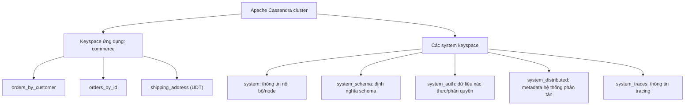

# System keyspace và ranh giới dữ liệu người dùng

## 1. Vì sao cần phân biệt system keyspace với keyspace ứng dụng?

Trong Apache Cassandra, **keyspace** là không gian tên chứa bảng và các đối tượng schema liên quan, đồng thời xác định chính sách replication cho dữ liệu của keyspace đó. Bên cạnh những keyspace do ứng dụng tạo, Cassandra có các **system keyspace** dùng để vận hành cluster, lưu metadata schema, trạng thái node và một số thông tin quản trị.

Trong chương **Keyspace và schema** của module `DATABASE_ENGINE_WIDE_COLUMN_CASSANDRA`, sự phân biệt này rất quan trọng. Cassandra vận hành theo mô hình wide-column phân tán: bảng ứng dụng được thiết kế theo truy vấn và partition key; dữ liệu có replica được đặt theo replication strategy; còn các bảng hệ thống tồn tại để Cassandra biết **nó đang quản lý những gì**.

Ví dụ một ứng dụng thương mại điện tử:

- `commerce.orders_by_customer` lưu đơn hàng theo khóa phân vùng `customer_id`: **dữ liệu nghiệp vụ của người dùng**.
- `system_schema.keyspaces` ghi lại định nghĩa các keyspace: **metadata của cluster**.
- `system.local` phản ánh thông tin về node đang được hỏi: **trạng thái hệ thống**.

Chúng đều có thể được tham chiếu bằng tên dạng `keyspace.table` trong CQL, nhưng **mục đích, cách vận hành, quyền truy cập và cách sao chép không giống nhau**.

Sau bài này, bạn cần:

1. Nhận diện các system keyspace phổ biến và loại thông tin chúng chứa.
2. Giải thích ranh giới giữa dữ liệu nghiệp vụ, schema metadata, trạng thái cục bộ và metadata quản trị.
3. Biết truy vấn hệ thống theo cách **chỉ đọc** để kiểm tra schema, topology và trạng thái đồng bộ.
4. Tránh thao tác trực tiếp làm hỏng các bảng hệ thống; dùng DDL, công cụ quản trị và quyền CQL đúng mục đích.
5. Kết nối việc kiểm tra system keyspace với thiết kế bảng, replication, repair và Java Driver.

## 2. Cấu trúc logic của cluster: hai nhóm keyspace cùng tồn tại



Đây là sơ đồ khái niệm; những keyspace/bảng hệ thống có mặt thực tế **phụ thuộc phiên bản Cassandra và cấu hình**. Một số bản Cassandra còn cung cấp keyspace/bảng **ảo (virtual tables)** để quan sát trạng thái hệ thống. Chúng không nhất thiết được lưu trữ hay sao chép như bảng dữ liệu thông thường.

| Tiêu chí | Keyspace ứng dụng | System keyspace |
| --- | --- | --- |
| Ai quản lý? | Nhóm phát triển/vận hành ứng dụng | Cassandra và công cụ quản trị tương ứng |
| Mục đích | Lưu dữ liệu nghiệp vụ, phục vụ truy vấn | Metadata schema, thông tin node, bảo mật, tracing, tác vụ hệ thống |
| Tạo bảng bằng DDL ứng dụng | Có, theo yêu cầu thiết kế | Không tự ý tạo/sửa bảng hệ thống |
| Partition key, TTL, compaction | Do nhóm ứng dụng thiết kế trong giới hạn CQL | Theo cơ chế và cấu hình hệ thống, không được tùy ý “tối ưu” |
| Replication | Được cấu hình tại keyspace ứng dụng | **Khác nhau theo từng system keyspace**, một số nội dung có tính cục bộ |
| Sao lưu/khôi phục | Theo chính sách dữ liệu nghiệp vụ | Theo runbook khôi phục cluster và cấu hình bảo mật tương ứng |
| Quyền truy cập | Áp dụng least privilege cho service | Giới hạn truy cập thông tin quản trị, metadata nhạy cảm |

**Không phải tất cả system keyspace đều được sao chép như một keyspace người dùng.** Ví dụ `system.local` đại diện trạng thái trên node cụ thể; không thể suy luận rằng nó có ba replica chỉ vì keyspace ứng dụng đang có RF = 3.

## 3. Nhận diện các system keyspace thường gặp

Các tên sau phổ biến trong các phiên bản Cassandra hiện đại. Đối tượng cụ thể có thể khác khi nâng cấp, thay cơ chế xác thực hoặc dùng virtual tables.

| Keyspace | Vai trò chính | Ví dụ thông tin và lưu ý |
| --- | --- | --- |
| `system` | Metadata và trạng thái nội bộ của node/cluster | `system.local`; metadata peer; một số bảng theo dõi hoạt động nội bộ |
| `system_schema` | Định nghĩa logic của keyspace, bảng, cột, kiểu, index/view | `keyspaces`, `tables`, `columns`, `types`; dùng để **kiểm tra schema** |
| `system_auth` | Metadata xác thực và phân quyền trong các cấu hình dùng cơ chế lưu quyền tương ứng | Vai trò, quyền; phải quản trị bằng CQL cấp quyền/role, không sửa trực tiếp bảng |
| `system_distributed` | Metadata phục vụ một số quy trình vận hành phân tán | Thông tin hỗ trợ repair và tác vụ hệ thống ở các phiên bản tương ứng |
| `system_traces` | Thông tin truy vết yêu cầu khi tracing được bật | Có thể hữu ích để phân tích đường truy vấn; có chi phí và vòng đời lưu trữ riêng |
| `system_views` hoặc keyspace ảo khác | Khung quan sát hệ thống ở phiên bản hỗ trợ | Virtual tables thường chỉ cho đọc; tên và bảng phụ thuộc phiên bản |

Đây **không phải danh mục bất biến**. Để biết chính xác cluster đang chạy có gì, hãy dùng `DESCRIBE KEYSPACES` trong `cqlsh` hoặc truy vấn metadata của phiên bản thực tế.

### 3.1. `system`: thông tin cục bộ và góc nhìn node

`system.local` mô tả node đang được hỏi. Các cột thường dùng cho quan sát gồm tên cluster, data center, rack và schema version. Ngoài ra, nhiều phiên bản có `system.peers` và/hoặc `system.peers_v2` để ghi thông tin các peer mà node hiện tại biết đến.

Lưu ý: peer metadata là **góc nhìn của node được hỏi**, có thể chậm cập nhật hoặc thiếu node đang down. Khi điều tra topology và schema agreement, cần đối chiếu cả `nodetool status`.

### 3.2. `system_schema`: nơi kiểm tra cấu trúc CQL

`system_schema` mô tả tên và định nghĩa của các keyspace/table/column/UDT do cluster ghi nhận. Đây là nguồn rất hữu ích khi:

- Xác minh `CREATE KEYSPACE` đã tạo đúng `NetworkTopologyStrategy` và RF.
- Kiểm tra `ALTER TABLE ADD` đã thêm cột có đúng kiểu.
- Phát hiện schema drift: định nghĩa thực tế khác DDL mà ứng dụng mong muốn.
- So sánh partition key và clustering columns trong một bảng thiết kế theo truy vấn.

**Không sửa `system_schema` trực tiếp để “đổi schema nhanh”.** Hãy dùng lệnh CQL DDL được hỗ trợ, như `CREATE KEYSPACE`, `ALTER KEYSPACE`, `CREATE TABLE`, `ALTER TABLE` và công cụ migration phù hợp.

### 3.3. `system_auth`: thông tin quản lý danh tính và quyền

Ở các cấu hình xác thực/phân quyền tương ứng, Cassandra lưu metadata role và quyền trong `system_auth`. Đây là **dữ liệu quản trị có tác động đến bảo mật**, khác bản ghi khách hàng hoặc đơn hàng.

Sử dụng các lệnh quản trị như `CREATE ROLE`, `ALTER ROLE`, `GRANT`, `REVOKE` và quyền truy cập phù hợp. **Không thao tác `INSERT/UPDATE/DELETE/TRUNCATE` trực tiếp** vào bảng nội bộ của `system_auth`. Việc thay replication của `system_auth` có thể là phần quan trọng của vận hành production, nhưng phải theo tài liệu/runbook đúng phiên bản, có kế hoạch đồng bộ dữ liệu và đánh giá ảnh hưởng đến đăng nhập/phân quyền.

### 3.4. `system_distributed` và `system_traces`

`system_distributed` hỗ trợ metadata liên quan tới một số hoạt động phân tán; không phải nơi lưu các bảng phi chuẩn hóa của ứng dụng. `system_traces` liên quan đến tracing một request để điều tra hành vi đọc/ghi. Tracing cần được bật có chủ đích, có thể sinh thêm ghi/tải hệ thống và thông tin không nên xem là dữ liệu nghiệp vụ lâu dài.

Những keyspace này có đặc điểm replication/retention và quy tắc vận hành riêng. **Không suy ra cách bảo trì chúng từ RF/TTL của keyspace ứng dụng.**

## 4. Cách xem các keyspace và biết đâu là dữ liệu người dùng

Trong `cqlsh`:

```sql
DESCRIBE KEYSPACES;
```

Đây là **lệnh của cqlsh**, không phải câu CQL phổ quát để gửi trực tiếp qua Java Driver.

Có thể truy vấn các keyspace được ghi trong metadata schema:

```sql
SELECT keyspace_name, replication, durable_writes
FROM system_schema.keyspaces;
```

Kết quả có thể chứa các keyspace dành cho Cassandra và keyspace ứng dụng. Hãy dùng **tên, mục đích được tài liệu phiên bản mô tả và cấu hình thực tế** để phân loại. Một số virtual keyspace có cơ chế hiển thị khác và không nên giả định chúng có đầy đủ thuộc tính giống keyspace lưu dữ liệu.

Ví dụ cách đặt tên:

| Tên | Chủ sở hữu hợp lý | Mục đích |
| --- | --- | --- |
| `commerce` | Ứng dụng | Đơn hàng và các bảng phục vụ truy vấn kinh doanh |
| `telemetry` | Ứng dụng | Dữ liệu thiết bị, sự kiện, số đo |
| `schema_lab` | Môi trường học/thử nghiệm | Kiểm thử CQL và migration |
| `system` | Cassandra | Thông tin nội bộ |
| `system_schema` | Cassandra | Định nghĩa schema |
| `system_auth` | Cassandra/cấu hình auth | Metadata xác thực và phân quyền |

Một prefix `system_` trông giống tên nội bộ là dấu hiệu nên thận trọng, **nhưng không thay thế** việc kiểm tra danh mục keyspace hệ thống thực tế của phiên bản Cassandra. Đừng tạo keyspace ứng dụng tên dễ nhầm với nhóm system.

## 5. Truy vấn system keyspace phục vụ quan sát, không sửa trực tiếp

### 5.1. Kiểm tra định nghĩa replication của keyspace ứng dụng

Giả sử có keyspace ứng dụng tên `commerce`:

```sql
SELECT keyspace_name, replication, durable_writes
FROM system_schema.keyspaces
WHERE keyspace_name = 'commerce';
```

Khi dùng `NetworkTopologyStrategy`, cột `replication` là map chứa chiến lược và RF theo tên DC. Ví dụ một kết quả **minh họa**:

```text
keyspace_name | replication
--------------+-------------------------------------------------------------
commerce      | {'class': 'org.apache.cassandra.locator.NetworkTopologyStrategy',
              |  'dc1': '3', 'dc2': '3'}
```

Điều này cho biết **chính sách replica trong schema**, không chứng minh mọi dữ liệu lịch sử đã được streaming/repair đầy đủ. Sau khi tăng RF hoặc thêm DC, cần xác minh riêng tiến độ đồng bộ và tính sẵn sàng của cluster.

### 5.2. Xem bảng và các thành phần khóa chính

```sql
SELECT keyspace_name, table_name
FROM system_schema.tables
WHERE keyspace_name = 'commerce';

SELECT column_name, kind, position, type
FROM system_schema.columns
WHERE keyspace_name = 'commerce'
  AND table_name = 'orders_by_customer';
```

Trong `system_schema.columns`:

- `kind = 'partition_key'` chỉ cột tham gia partition key.
- `kind = 'clustering'` chỉ cột tham gia clustering key.
- `kind = 'regular'` hoặc `'static'` mô tả cột dữ liệu.
- `position` giúp nhận biết thứ tự thành phần khóa.
- `type` cho biết kiểu CQL đã khai báo.

Cassandra chọn partition theo **partition key của bảng** và replication policy của **keyspace**, chứ không phải theo tên của system keyspace.

### 5.3. Xem trạng thái local của node

```sql
SELECT key, cluster_name, data_center, rack, schema_version
FROM system.local
WHERE key = 'local';
```

Kết quả này phản ánh node mà phiên kết nối đang truy vấn. Để so sánh schema version của các node, hãy kết nối đến từng node phù hợp và phối hợp với:

```bash
nodetool status
nodetool describecluster
```

Lệnh `describecluster` thường cho thấy các nhóm `Schema versions`; nhiều nhóm version ở các node đang quan sát là dấu hiệu chưa đạt **schema agreement**. Một nhóm version duy nhất không đảm bảo node đang down đã nhận schema, và cũng không có nghĩa dữ liệu replica đã repair xong.

### 5.4. Truy vấn peer metadata có điều kiện phiên bản

Một số phiên bản cho phép:

```sql
SELECT peer, schema_version
FROM system.peers;
```

Ở phiên bản hỗ trợ `system.peers_v2`, có thể quan sát thêm thông tin như peer và port. **Không** assume cả hai bảng đều tồn tại trên mọi cluster. Peer metadata cung cấp góc nhìn của node, có thể cũ hoặc thiếu node đang unreachable; cần đối chiếu với công cụ quản trị.

### 5.5. Tracing một truy vấn CQL khi cần

Trong `cqlsh`, có thể bật tracing cho một đợt kiểm tra ngắn:

```sql
TRACING ON;

SELECT order_id, total_amount
FROM commerce.orders_by_customer
WHERE customer_id = 11111111-1111-4111-8111-111111111111;

TRACING OFF;
```

`TRACING ON/OFF` là tiện ích của `cqlsh`; các truy vết tương ứng có thể được Cassandra lưu trong `system_traces` tùy cấu hình và phiên bản. Tracing làm tăng chi phí quan sát và có thể hiển thị chi tiết xử lý truy vấn, vì vậy chỉ sử dụng có mục đích, tránh bật thường trực trên workload production.

## 6. Vì sao không nên dùng system keyspace để chứa dữ liệu nghiệp vụ?

Nhìn từ CQL, cả hai ví dụ sau đều giống `keyspace.table`:

```text
commerce.orders_by_customer
system.local
```

Nhưng ý nghĩa khác nhau hoàn toàn. Tạo/sửa/xóa bảng hệ thống tùy ý có thể gây lỗi khởi động, metadata sai, lỗi phân quyền, khả năng không tham gia cluster hoặc sự cố vận hành. Dữ liệu ở `system.local` cũng không phải nơi để lưu bản ghi kinh doanh có partition key do ứng dụng quyết định.

| Cần lưu | Nơi phù hợp | Vì sao |
| --- | --- | --- |
| Đơn hàng theo khách hàng | `commerce.orders_by_customer` | Thiết kế partition key/clustering theo truy vấn |
| Sự kiện thiết bị theo thời gian | `telemetry.events_by_device` | Thiết kế bucket/TTL/compaction theo workload |
| Tên các bảng và kiểu cột | Đọc `system_schema` | Metadata do Cassandra quản lý, không phải dữ liệu tự ghi |
| Trạng thái/định danh node | Đọc `system.local`, công cụ quản trị | Phản ánh thông tin vận hành của node |
| Vai trò và quyền | Quản trị qua lệnh CQL cấp role/quyền | Cassandra kiểm soát metadata hệ thống |
| Kết quả truy vết truy vấn | Công cụ tracing khi cần | Dữ liệu chẩn đoán có vòng đời khác nghiệp vụ |

**Đừng lưu dữ liệu ứng dụng bằng cách thêm bảng vào `system` hay `system_schema`.** Hãy tạo keyspace ứng dụng riêng và dùng tên rõ mục đích như `commerce`, `telemetry`, `inventory_app`.

### Keyspace riêng chưa chắc là cô lập tài nguyên

Tách `commerce` và `telemetry` không tự cấp CPU, ổ đĩa hoặc mạng riêng cho từng keyspace: chúng thường vẫn dùng chung node và tài nguyên cluster. Keyspace xác định **namespace và replication policy**, còn cô lập hiệu năng, quyền và topology cần được thiết kế và kiểm soát riêng.

## 7. Lab an toàn: tạo keyspace ứng dụng và đối chiếu metadata hệ thống

Phần này chỉ thao tác DDL trên **keyspace thử nghiệm** `app_orders_lab`. Các truy vấn `system_schema` và `system.local` là **chỉ đọc**.

### Bước 1 — Xác nhận tên data center

Trước tiên chạy trên node lab:

```bash
nodetool status
```

Ví dụ dưới đây giả định node thuộc DC có tên chính xác `datacenter1`. Nếu cluster của bạn dùng tên khác, hãy thay đúng tên đó trong câu `CREATE KEYSPACE`. RF = 1 chỉ dành cho môi trường lab một node.

### Bước 2 — Tạo keyspace ứng dụng

```sql
CREATE KEYSPACE IF NOT EXISTS app_orders_lab
WITH replication = {
    'class': 'NetworkTopologyStrategy',
    'datacenter1': '1'
}
AND durable_writes = true;
```

`IF NOT EXISTS` chỉ tránh lỗi tạo trùng, **không** cập nhật RF nếu `app_orders_lab` đã tồn tại với cấu hình khác.

### Bước 3 — Tạo bảng và ghi dữ liệu nghiệp vụ

```sql
CREATE TABLE IF NOT EXISTS app_orders_lab.orders_by_id (
    order_id uuid PRIMARY KEY,
    customer_id uuid,
    created_at timestamp,
    total_amount decimal
);

INSERT INTO app_orders_lab.orders_by_id (
    order_id, customer_id, created_at, total_amount
) VALUES (
    aaaaaaaa-aaaa-4aaa-8aaa-aaaaaaaaaaaa,
    11111111-1111-4111-8111-111111111111,
    '2026-11-21T08:00:00Z',
    199000.00
);

SELECT order_id, customer_id, total_amount
FROM app_orders_lab.orders_by_id
WHERE order_id = aaaaaaaa-aaaa-4aaa-8aaa-aaaaaaaaaaaa;
```

`order_id` là partition key. Dữ liệu này thuộc **keyspace người dùng**; Cassandra tổ chức replica theo replication strategy của `app_orders_lab`.

### Bước 4 — Kiểm tra metadata của bảng từ system keyspace

```sql
SELECT keyspace_name, replication, durable_writes
FROM system_schema.keyspaces
WHERE keyspace_name = 'app_orders_lab';

SELECT table_name
FROM system_schema.tables
WHERE keyspace_name = 'app_orders_lab';

SELECT column_name, kind, position, type
FROM system_schema.columns
WHERE keyspace_name = 'app_orders_lab'
  AND table_name = 'orders_by_id';
```

Kết quả dự kiến: metadata khai báo keyspace `app_orders_lab` có RF = 1 tại DC được chỉ định; bảng `orders_by_id` có `order_id` giữ vai trò `partition_key`, các cột còn lại là dữ liệu. **Đọc `system_schema` không di chuyển bản ghi đơn hàng vào keyspace hệ thống.**

### Bước 5 — Kiểm tra node và schema agreement

```sql
SELECT key, cluster_name, data_center, rack, schema_version
FROM system.local
WHERE key = 'local';
```

Trong lab nhiều node, đối chiếu thêm `nodetool describecluster` và `nodetool status`. Schema agreement phản ánh các node đang nhìn thấy cùng định nghĩa schema; nó **không** xác minh dữ liệu của mọi replica đã được backfill hay repair.

### Bước 6 — Dọn riêng keyspace lab khi không cần dữ liệu

```sql
-- Chỉ thực hiện nếu chắc chắn app_orders_lab là lab có thể xóa hoàn toàn.
DROP KEYSPACE IF EXISTS app_orders_lab;
```

Đây là lệnh xóa **toàn bộ schema và dữ liệu của keyspace lab**, không chỉ một bảng. Tuyệt đối không đổi tên đích thành một system keyspace hay keyspace production để “thử” lệnh `DROP`.

## 8. Các system keyspace có cùng replication factor không?

**Không thể coi tất cả system keyspace là một nhóm có chung RF hoặc cơ chế lưu trữ.** Cassandra sử dụng các loại metadata khác nhau:

1. **Metadata local/node:** như `system.local`, phản ánh trạng thái cục bộ của node đang được hỏi. Không diễn giải nó bằng RF của một keyspace nghiệp vụ.
2. **Metadata schema cluster:** các định nghĩa `system_schema` được trao đổi để các node thống nhất schema. Trạng thái này được quan sát bằng schema agreement, không phải repair dữ liệu đơn hàng.
3. **Metadata quản trị có replication:** một số keyspace như `system_auth` và metadata vận hành phân tán có thể có cấu hình sao chép riêng và yêu cầu quản trị đặc biệt theo phiên bản.
4. **Tracing/virtual tables:** có vòng đời hoặc cơ chế quan sát riêng; không thể áp công thức lưu trữ/TTL của một bảng đơn hàng.

Ví dụ: tăng RF của keyspace ứng dụng từ 1 lên 3 bằng `ALTER KEYSPACE commerce` làm thay đổi chính sách đặt replica của dữ liệu `commerce`. Nó **không** tự thay replication của `system_auth` và cũng **không** chứng minh các bản sao `commerce` đã chứa đầy đủ dữ liệu lịch sử. Cần quy trình repair/streaming phù hợp khi đổi RF.

### Cẩn trọng với `system_auth` khi vận hành nhiều node

Quyền truy cập Cassandra có thể phụ thuộc dữ liệu xác thực ở `system_auth`. Ở các cấu hình tương ứng, để tránh một node lỗi làm mất khả năng kiểm tra role/quyền, quản trị viên cần xem lại chiến lược replication của metadata xác thực theo kiến trúc cluster và tài liệu đúng phiên bản.

Việc điều chỉnh chính sách replication của system keyspace **không phải thao tác ứng dụng mặc định**. Nó cần được lên kế hoạch, kiểm tra node/DC, đánh giá khả năng truy cập khi sự cố, áp dụng đúng lệnh hỗ trợ và đồng bộ dữ liệu theo runbook. Không sao chép RF của keyspace người dùng một cách máy móc.

## 9. Quyền truy cập: đọc được metadata không có nghĩa được sửa nội bộ

Vì system keyspace chứa dữ liệu phục vụ quản trị, cần phân quyền theo vai trò:

- **Tài khoản ứng dụng:** quyền tối thiểu trên các keyspace/bảng nghiệp vụ thực sự cần thiết. Hạn chế quyền tạo/sửa/xóa schema và thao tác quản trị.
- **Tài khoản migration:** quyền DDL có phạm vi kiểm soát, được điều phối để không có nhiều instance cùng chạy migration xung đột.
- **Tài khoản vận hành:** quyền quan sát cluster và thay đổi cấu hình hệ thống theo quy trình; có kiểm soát truy cập thông tin quản trị/bảo mật.

Tùy authenticator/authorizer, phiên bản và chính sách truy cập, một số bảng hệ thống có thể cần quyền riêng; các thao tác liên quan `system_auth` nhạy cảm hơn nhiều so với đọc định nghĩa cột. Không coi mọi bảng `system_*` là public data.

**Tránh thao tác nguy hiểm**:

```sql
-- KHÔNG chạy các lệnh dạng sau trên bảng hệ thống:
-- TRUNCATE system.local;
-- DROP KEYSPACE system_schema;
-- UPDATE system_auth.roles SET ...;
```

Các câu trong khối mã chỉ được ghi dưới dạng comment để minh họa **những việc không nên làm**. Việc truy cập hoặc sửa trực tiếp metadata nội bộ có thể bị Cassandra từ chối hoặc gây hậu quả khó khôi phục. Khi cần đổi quyền, dùng các câu lệnh role/permission được hỗ trợ; khi cần đổi schema, dùng CQL DDL trên đối tượng được phép quản lý.

## 10. Backup, repair và nâng cấp: không đánh đồng system data với user data

| Hoạt động | Với dữ liệu nghiệp vụ | Với dữ liệu hệ thống |
| --- | --- | --- |
| Backup | Snapshot/backup keyspace ứng dụng theo RPO/RTO | Cần runbook khôi phục cluster, schema, auth metadata và cấu hình phù hợp; không sao chép tùy ý mọi bảng system |
| Restore | Phục hồi bảng/keyspace và dữ liệu ứng dụng | Phụ thuộc vai trò node, phiên bản và cấu hình; có thể cần tái tạo/khôi phục thông tin hệ thống có chọn lọc |
| Repair | Đồng bộ replica dữ liệu theo replication strategy | Chỉ áp dụng khi runbook xác định system keyspace cụ thể cần/quy định repair; không repair tùy tiện `system.local` |
| Compaction | Theo table options và workload ứng dụng | Các bảng nội bộ có chính sách riêng, không tự đổi vì muốn tối ưu workload nghiệp vụ |
| Upgrade Cassandra | Kiểm tra khả năng tương thích query và schema của ứng dụng | Cấu trúc bảng hệ thống có thể thay đổi theo phiên bản; tuân thủ hướng dẫn nâng cấp |

Khi thiết kế sao lưu, **schema definition** và **dữ liệu thực tế** là hai lớp cần xem xét riêng. Có bản backup của bảng ứng dụng nhưng không có kế hoạch phục hồi keyspace/permissions/config có thể khiến quá trình khôi phục chưa hoàn chỉnh. Ngược lại, chép nguyên metadata local từ node này sang node khác không phải quy trình thay thế node hợp lệ.

## 11. Kết nối từ Java: đọc metadata, quản lý keyspace ứng dụng

Ứng dụng Java sử dụng Cassandra Java Driver 4.x có thể truy vấn metadata hệ thống để kiểm tra keyspace và bảng. `DESCRIBE KEYSPACE` là tiện ích của `cqlsh`; trong Java nên dùng CQL truy vấn `system_schema` hoặc API metadata của driver.

Ví dụ, giả sử `CqlSession session` đã được cấu hình kết nối và quản lý vòng đời bên ngoài:

```java
import com.datastax.oss.driver.api.core.CqlSession;
import com.datastax.oss.driver.api.core.cql.Row;

import java.util.Map;

// Kiểm tra keyspace nghiệp vụ, chỉ đọc system_schema.
Row row = session.execute("""
    SELECT replication, durable_writes
    FROM system_schema.keyspaces
    WHERE keyspace_name = 'app_orders_lab'
    """).one();

if (row == null) {
    throw new IllegalStateException("Missing keyspace app_orders_lab");
}

Map<String, String> replication =
    row.getMap("replication", String.class, String.class);
String strategy = replication == null ? null : replication.get("class");
String rf = replication == null ? null : replication.get("datacenter1");
boolean durable = row.getBoolean("durable_writes");

boolean expectedStrategy =
    "NetworkTopologyStrategy".equals(strategy)
    || "org.apache.cassandra.locator.NetworkTopologyStrategy".equals(strategy);

if (!expectedStrategy || !"1".equals(rf) || !durable) {
    throw new IllegalStateException("Unexpected replication policy");
}
```

Ví dụ dành cho lab có DC tên `datacenter1` và RF = 1; khi dùng production, cần kiểm tra **tất cả DC/RF kỳ vọng** và schema agreement trước khi chạy phần ứng dụng phụ thuộc schema. Java text block cần Java 15+.

Với Java Driver 4.x, có thể dùng API metadata và `CqlIdentifier` để truy xuất keyspace/table. Dù dùng API hay `system_schema`, **metadata chỉ nói schema được node/coordinator nhìn thấy**, không bảo đảm toàn cluster agreement hoặc dữ liệu đã repair xong.

### Tránh cho ứng dụng tự sửa system keyspace

Không triển khai logic “nếu thiếu bảng `system_schema` thì tự tạo lại” hoặc “trước khi chạy app thì drop/recreate `system_auth`”. Ứng dụng chỉ nên quản lý keyspace/tables thuộc phạm vi dự án và thông qua migration có điều phối. Với lỗi metadata hoặc auth system, cần xử lý theo runbook vận hành Cassandra.

## 12. Những nhầm lẫn thường gặp

| Nhầm lẫn | Cách hiểu đúng |
| --- | --- |
| “`system_schema.keyspaces` là bảng đơn hàng chứa trong keyspace `commerce`.” | Nó là **metadata của cluster** mô tả keyspace, không chứa bản ghi đơn hàng. |
| “Có thể lưu dữ liệu ứng dụng vào `system.local` vì nó là một bảng CQL.” | `system.local` là thông tin **cục bộ của node** do Cassandra quản lý. |
| “Tất cả system keyspace có RF giống keyspace ứng dụng.” | Mỗi nhóm metadata có tính chất lưu trữ/replication riêng; không suy luận RF chung. |
| “Chỉ cần `SELECT system_schema` thành công là đã schema agreement.” | Một coordinator có thể nhìn thấy metadata mới trong khi node khác chưa nhận; phải kiểm tra toàn cluster. |
| “Schema agreement nghĩa là repair đã chạy xong.” | Schema là định nghĩa; repair đồng bộ **dữ liệu replica**. |
| “`system_auth` là nơi tự ghi thông tin đăng nhập của khách hàng bằng INSERT.” | Đây là metadata quản trị xác thực/phân quyền Cassandra; dữ liệu tài khoản nghiệp vụ cần thiết kế riêng. |
| “Có thể xóa `system_traces` để dọn dung lượng bằng cách tùy ý sửa system tables.” | Tracing có cơ chế lưu/retention riêng; dùng quy trình vận hành đúng phiên bản. |
| “`DESCRIBE` có thể gửi nguyên qua Java Driver như mọi CQL SELECT.” | `DESCRIBE` là tiện ích `cqlsh`; driver dùng API metadata hoặc truy vấn `system_schema`. |
| “Một keyspace mới sẽ có CPU và ổ đĩa riêng.” | Các keyspace thường dùng chung tài nguyên của cùng cluster. |
| “Thay RF của ứng dụng sẽ tự điều chỉnh replication cho system_auth.” | Mỗi keyspace có chính sách/cơ chế tương ứng; cần quản trị riêng. |

## 13. Bài tập tự kiểm tra và checklist vận hành

### Bài tập A — Phân loại thông tin

Hãy xác định thành phần phù hợp cho từng nhu cầu:

1. Xem cột `order_id` của bảng `commerce.orders_by_customer` có phải partition key không → đọc `system_schema.columns`.
2. Lưu lịch sử đơn hàng theo khách hàng → bảng ứng dụng thiết kế theo truy vấn trong keyspace `commerce`.
3. Xem tên DC/rack của node đang kết nối → đọc `system.local`, đối chiếu `nodetool status`.
4. Quản lý quyền truy cập Cassandra → câu lệnh role/permission và cơ chế auth của Cassandra, không sửa trực tiếp `system_auth`.
5. Điều tra một truy vấn chậm → công cụ tracing/observability, dùng `system_traces` khi phù hợp và có quyền.
6. Xem RF của keyspace ứng dụng → `system_schema.keyspaces`.

### Bài tập B — Phân biệt schema và dữ liệu

Sau khi `ALTER KEYSPACE commerce` tăng RF từ 1 lên 3, `system_schema.keyspaces` cho thấy RF = 3. Có thể kết luận dữ liệu cũ hiện đã có ba replica không? **Không.** Cần xác minh topology có đủ node, triển khai quy trình repair/streaming phù hợp và kiểm tra dữ liệu/khả năng phục vụ theo CL cần thiết.

### Bài tập C — Đọc metadata mà không làm ảnh hưởng dữ liệu

Trên lab, thực hiện theo thứ tự:

1. `DESCRIBE KEYSPACES` và nhận diện đâu là keyspace ứng dụng, đâu là system keyspace.
2. Chạy `SELECT keyspace_name, replication FROM system_schema.keyspaces`.
3. Chọn một **keyspace ứng dụng** đã có và dùng `system_schema.tables`, `system_schema.columns` để đọc schema.
4. Chạy `SELECT ... FROM system.local` để xem trạng thái local của node.
5. So sánh `nodetool status` và `nodetool describecluster` nếu lab có nhiều node.
6. Giải thích vì sao các `SELECT` trên **không** chứng minh toàn bộ dữ liệu replica đã đồng bộ.

### Checklist cho code Java và script vận hành

| Câu hỏi | Bằng chứng mong đợi |
| --- | --- |
| Đối tượng định sửa/xóa có thật là của ứng dụng không? | Tên đầy đủ `keyspace.table`, owner/phạm vi nghiệp vụ được xác nhận |
| Có vô tình nhắm tới system keyspace không? | Danh sách keyspace và quy tắc quản trị trước DDL |
| Có quyền tối thiểu phù hợp không? | App chỉ có quyền đọc/ghi cần thiết; migration và vận hành được tách |
| Schema hiện tại có đúng kỳ vọng không? | `system_schema` và metadata driver |
| Cluster đã agreement chưa? | Nhóm schema version, trạng thái node và kiểm tra từ driver/công cụ quản trị |
| Đổi RF/DC có cần repair/streaming không? | Kế hoạch và kết quả kiểm tra dữ liệu riêng |
| Backup/restore đã bao gồm những gì? | Schema, dữ liệu ứng dụng, cấu hình/metadata quản trị cần thiết theo runbook |

**Ghi nhớ:** system keyspace phục vụ **Cassandra vận hành và mô tả chính nó**; keyspace người dùng phục vụ **dữ liệu nghiệp vụ và truy vấn của ứng dụng**. Hãy đọc metadata hệ thống khi cần chẩn đoán, nhưng thay đổi schema bằng CQL DDL trên đối tượng thuộc phạm vi quản lý; không tùy tiện thao tác bảng nội bộ. Phân biệt hai nhóm keyspace giúp bạn thiết kế partition key, lựa chọn replication, kiểm tra schema agreement, thực hiện repair và kết nối Java an toàn hơn.
