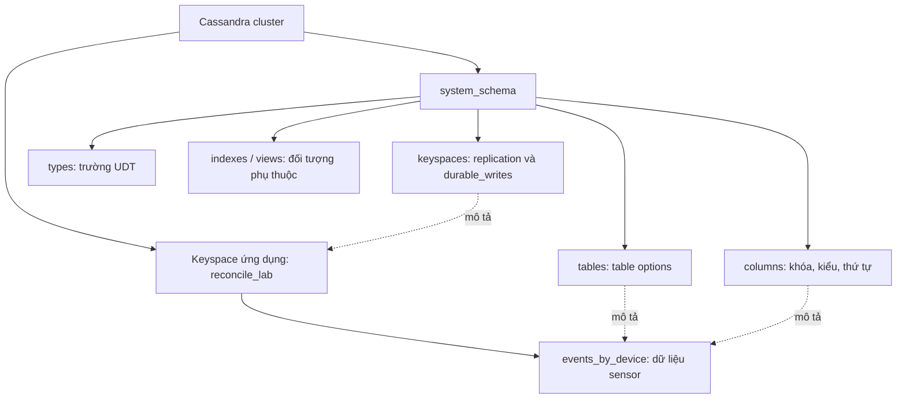
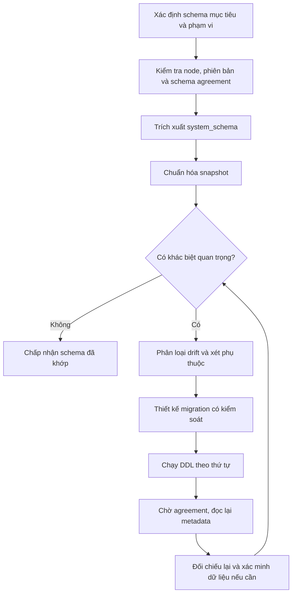

# system_schema và trích xuất định nghĩa phục vụ đối soát

## 1. Bài toán: biết schema *đang có*, không chỉ schema *đã định viết*

Khi vận hành Apache Cassandra, nhóm phát triển thường quản lý schema trong các script CQL hoặc migration của ứng dụng Java. Tuy nhiên, câu lệnh `CREATE TABLE IF NOT EXISTS` chạy không lỗi không có nghĩa định nghĩa của bảng hiện tại khớp với file migration. Tương tự, sau `ALTER KEYSPACE` hoặc `ALTER TABLE`, cần chứng minh cluster đã ghi nhận **đúng thay đổi** thay vì chỉ tin vào trạng thái trả về của câu lệnh.

**`system_schema`** là keyspace chứa metadata về các đối tượng schema Cassandra. Bằng những câu `SELECT` đọc metadata, chúng ta có thể:

- Liệt kê keyspace, table, column, user-defined type (UDT), index và materialized view.
- Kiểm tra replication strategy, replication factor (RF), `durable_writes`, các table options và định nghĩa khóa chính.
- Trích xuất bản chụp định nghĩa thực tế (*schema snapshot*) để so sánh với bản thiết kế hoặc trạng thái trước/sau triển khai.
- Phát hiện **schema drift**: schema đang tồn tại khác schema mà ứng dụng hoặc quy trình vận hành yêu cầu.

Đây là bài thuộc chương **Keyspace và schema** của module `DATABASE_ENGINE_WIDE_COLUMN_CASSANDRA`. Khi học mô hình wide-column phân tán, người học cần nhớ: **partition key** của bảng quyết định cách nhóm dữ liệu thành partition; **replication** thuộc keyspace quyết định replica ở những DC nào; **consistency level (CL)** thuộc từng thao tác đọc/ghi. `system_schema` cho phép kiểm tra các định nghĩa schema, nhưng **không** thay thế việc kiểm tra dữ liệu, repair hoặc kết quả truy vấn nghiệp vụ.

Mục tiêu của bài:

1. Biết mỗi bảng quan trọng trong `system_schema` chứa loại metadata nào.
2. Trích xuất keyspace, bảng, cột, khóa chính, UDT và index/view bằng CQL.
3. Chuẩn hóa dữ liệu snapshot để đối soát có ý nghĩa, tránh so sánh chuỗi DDL thiếu ổn định.
4. Phân loại khác biệt theo mức độ ảnh hưởng rồi xác minh hậu điều kiện của migration.
5. Sử dụng metadata trong `cqlsh` và Java Driver mà không sửa trực tiếp bảng hệ thống.

## 2. `system_schema` là gì? Ranh giới của nguồn metadata

`system_schema` là keyspace **do Cassandra quản lý**; nó không phải keyspace chứa bản ghi nghiệp vụ do ứng dụng tự thiết kế. Dữ liệu người dùng nên đặt ở các keyspace riêng như `commerce`, `telemetry` hoặc `inventory`. Bảng `system_schema.tables` là **bảng mô tả các bảng**, không chứa toàn bộ hàng của những bảng đó.



Các bảng phổ biến:

| Bảng trong `system_schema` | Dùng để kiểm tra | Những cột thường dùng |
| --- | --- | --- |
| `keyspaces` | Tên keyspace, replication và commit-log durability | `keyspace_name`, `replication`, `durable_writes` |
| `tables` | Danh sách bảng và các thuộc tính cấp bảng | `keyspace_name`, `table_name`, `default_time_to_live`, `gc_grace_seconds`, `compaction`, `compression`, `comment` |
| `columns` | Tên, kiểu, vai trò và thứ tự cột khóa | `keyspace_name`, `table_name`, `column_name`, `kind`, `position`, `type`, `clustering_order` |
| `types` | Định nghĩa UDT | `keyspace_name`, `type_name`, `field_names`, `field_types` |
| `indexes` | Index và các tùy chọn liên quan | `keyspace_name`, `table_name`, `index_name`, `kind`, `options` |
| `views` | Materialized view và liên hệ với bảng gốc | `keyspace_name`, `view_name`, `base_table_name` |
| `functions` / `aggregates` | User-defined functions/aggregates ở phiên bản hỗ trợ | Tên, kiểu tham số và định nghĩa liên quan |

Tên bảng và cột metadata cụ thể có thể khác giữa các **phiên bản Cassandra**. Chỉ trích xuất những trường mà cluster mục tiêu hỗ trợ, và xác định rõ phạm vi công cụ đối soát trước khi kết luận “không có khác biệt”.

### `system_schema` không cung cấp tất cả thông tin vận hành

| Cần biết | Nguồn kiểm tra phù hợp |
| --- | --- |
| RF của keyspace | `system_schema.keyspaces` |
| PRIMARY KEY, kiểu cột và clustering order | `system_schema.columns`, `DESCRIBE TABLE` trong cqlsh |
| Thuộc tính table như TTL/compaction | `system_schema.tables` |
| Node thuộc DC/rack nào, còn up không? | `nodetool status`, `system.local` và peer metadata |
| Các node đã thống nhất schema chưa? | Schema version, `nodetool describecluster` và cơ chế kiểm tra agreement của driver |
| Dữ liệu sau tăng RF đã tới replica mới chưa? | Streaming/repair và kiểm tra dữ liệu, **không** chỉ `system_schema` |
| Query đọc/ghi đạt CL yêu cầu không? | Kiểm tra client, trạng thái replica và kết quả đọc/ghi thực tế |

**Nguyên tắc an toàn:** Chỉ `SELECT` metadata phục vụ kiểm tra. Không dùng `INSERT`, `UPDATE`, `DELETE`, `TRUNCATE` hay sửa nội bộ `system_schema` để “sửa schema”. Mọi thay đổi định nghĩa phải qua CQL DDL và quy trình migration được hỗ trợ.

## 3. Chuẩn bị lab có một keyspace và bảng minh họa

Chỉ chạy DDL trong **môi trường thực hành** và dùng keyspace riêng `reconcile_lab`. Giả định `nodetool status` cho thấy DC tên `datacenter1` với một node. Nếu tên DC thực tế khác, thay đúng tên đó trong replication map. RF = 1 chỉ giúp lab một node hoạt động, không cung cấp khả năng chịu lỗi production.

```bash
nodetool status
```

### Bước 1 — Tạo keyspace và UDT

```sql
CREATE KEYSPACE IF NOT EXISTS reconcile_lab
WITH replication = {
    'class': 'NetworkTopologyStrategy',
    'datacenter1': '1'
}
AND durable_writes = true;

CREATE TYPE IF NOT EXISTS reconcile_lab.device_location (
    city text,
    zone text
);
```

`IF NOT EXISTS` chỉ tránh lỗi tạo trùng đối tượng theo tên, **không** xác nhận replication hoặc danh sách trường UDT đã tồn tại khớp định nghĩa trên.

### Bước 2 — Tạo bảng phục vụ truy vấn thiết bị theo ngày

```sql
CREATE TABLE IF NOT EXISTS reconcile_lab.events_by_device (
    device_id text,
    bucket_day date,
    event_time timestamp,
    event_id uuid,
    temperature double,
    tags set<text>,
    location frozen<device_location>,
    PRIMARY KEY ((device_id, bucket_day), event_time, event_id)
) WITH CLUSTERING ORDER BY (event_time DESC, event_id ASC)
 AND default_time_to_live = 0
 AND comment = 'Events for one device and day';
```

Bảng này có:

- **Partition key tổng hợp**: `(device_id, bucket_day)`, để tránh dồn toàn bộ lịch sử thiết bị vào một partition khổng lồ.
- **Clustering columns**: `event_time` trước rồi `event_id`, trong đó thời gian sắp xếp giảm dần.
- **Regular columns**: `temperature`, `tags`, `location`; `location` tham chiếu UDT `device_location`.
- **Table options**: TTL mặc định bằng 0; comment giải thích mục đích bảng.

Đây là schema được chọn để minh họa việc trích xuất metadata. Trong môi trường thật, kích thước partition, nhu cầu truy vấn, TTL, compaction và consistency level phải được quyết định theo workload.

### Bước 3 — Xem DDL mà cqlsh diễn giải

```sql
DESCRIBE KEYSPACE reconcile_lab;
DESCRIBE TABLE reconcile_lab.events_by_device;
DESCRIBE TYPE reconcile_lab.device_location;
```

`DESCRIBE` thuộc tiện ích **`cqlsh`**: nó giúp con người xem định nghĩa ở dạng gần CQL. Không coi `DESCRIBE` là một câu `SELECT` mà mọi Cassandra Java Driver đều thực thi trực tiếp. Để máy đối soát schema, nên dùng metadata API hoặc các truy vấn `system_schema`.

## 4. Trích xuất chính sách replication cấp keyspace

```sql
SELECT keyspace_name, replication, durable_writes
FROM system_schema.keyspaces
WHERE keyspace_name = 'reconcile_lab';
```

Kết quả **minh họa**:

```text
keyspace_name | replication
--------------+--------------------------------------------------------------
reconcile_lab | {'class': 'org.apache.cassandra.locator.NetworkTopologyStrategy',
              |  'datacenter1': '1'}
```

Thông thường `replication` là một map chứa tên strategy và các tùy chọn replication (ví dụ RF theo DC với `NetworkTopologyStrategy`). Cột `durable_writes` phản ánh cấu hình độ bền ghi của keyspace.

### Cần chuẩn hóa những gì để đối soát?

| Thành phần | Kỳ vọng của lab | Cách so sánh |
| --- | --- | --- |
| Tên keyspace | `reconcile_lab` | Khớp chính xác tên logic đã lưu |
| Strategy | `NetworkTopologyStrategy` | Có thể hiện dưới dạng class đầy đủ; chuẩn hóa về cùng loại strategy được chấp nhận |
| DC và RF | `datacenter1: 1` | So sánh đầy đủ **tập DC** cùng RF, không chỉ một phần tử |
| `durable_writes` | `true` | So sánh boolean |

Nếu production yêu cầu RF = 3 mà metadata còn RF = 1, đó là **schema drift nghiêm trọng**. Chạy lại `CREATE KEYSPACE IF NOT EXISTS` không đổi RF của đối tượng đã tồn tại. Cần một migration `ALTER KEYSPACE` có chủ đích và quy trình đồng bộ dữ liệu thích hợp sau khi thay replication.

**Không suy đoán tính sẵn sàng từ RF trong metadata:** RF = 3 không chứng minh ba node thích hợp đã up, cũng không chứng minh dữ liệu lịch sử đã có trên các replica mới. Dùng `nodetool status` và kiểm tra streaming/repair riêng.

## 5. Trích xuất bảng và các table options

Để liệt kê các bảng trong một keyspace:

```sql
SELECT keyspace_name, table_name
FROM system_schema.tables
WHERE keyspace_name = 'reconcile_lab';
```

Để đọc một số option cần đối soát:

```sql
SELECT table_name, comment, default_time_to_live,
       gc_grace_seconds, compaction, compression
FROM system_schema.tables
WHERE keyspace_name = 'reconcile_lab'
  AND table_name = 'events_by_device';
```

Ý nghĩa:

| Thuộc tính | Cần quan tâm vì sao? |
| --- | --- |
| `comment` | Mô tả bảng; có thể dùng cho governance, nhưng thường không ảnh hưởng bố trí dữ liệu |
| `default_time_to_live` | Quy định TTL mặc định cho dữ liệu ghi mới khi phù hợp; thay đổi có thể làm dữ liệu hết hạn khác thiết kế |
| `gc_grace_seconds` | Liên quan việc giữ tombstone để bảo đảm an toàn trước các replica chưa nhận delete; phải xét lịch repair |
| `compaction` | Chiến lược gộp SSTable, ảnh hưởng chi phí I/O và hiệu năng |
| `compression` | Tham số nén SSTable, ảnh hưởng CPU/dung lượng |

Metadata có thể hiện **giá trị mặc định** dù câu `CREATE TABLE` ban đầu không ghi rõ thuộc tính đó. Đừng coi việc file DDL thiếu một option là bằng chứng cấu hình sai; hãy đối chiếu với **giá trị hiệu lực mong muốn** trên đúng phiên bản Cassandra.

**Ví dụ drift cần chú ý:** kỳ vọng `default_time_to_live = 0`, nhưng metadata cho thấy `86400`. Điều này có thể làm dữ liệu ghi mới hết hạn sau một ngày, gây tác động nghiệp vụ lớn hơn một khác biệt về comment. Phân loại mức độ trước khi quyết định migration.

## 6. Trích xuất cột để dựng lại PRIMARY KEY

Đây là phần quan trọng nhất khi đối soát bảng wide-column. Cassandra không lưu định nghĩa `PRIMARY KEY (...)` trong một chuỗi duy nhất để ứng dụng tùy ý so sánh; có thể xây dựng lại từ metadata cột:

```sql
SELECT column_name, kind, position, type, clustering_order
FROM system_schema.columns
WHERE keyspace_name = 'reconcile_lab'
  AND table_name = 'events_by_device';
```

Các giá trị `kind` cần hiểu:

| `kind` | Ý nghĩa | Cách dùng khi dựng khóa |
| --- | --- | --- |
| `partition_key` | Thành phần partition key | Sắp theo `position` rồi đặt **trong nhóm partition key** |
| `clustering` | Thành phần clustering key | Sắp theo `position`, ghi lại `clustering_order` |
| `regular` | Cột dữ liệu thường | Đối soát tên và kiểu, **không** đưa vào PRIMARY KEY |
| `static` | Cột static dùng chung trong partition khi bảng hỗ trợ | Đối soát riêng tính chất static |

Trong bài thực hành, tập khóa cần dựng lại là:

```sql
PRIMARY KEY ((device_id, bucket_day), event_time, event_id)
```

Với clustering order:

```sql
WITH CLUSTERING ORDER BY (event_time DESC, event_id ASC)
```

Tại sao phải giữ thứ tự?

- `((device_id, bucket_day), event_time, event_id)` **khác** khóa phân vùng chỉ gồm `device_id`.
- Trong partition key tổng hợp, thứ tự và kiểu các thành phần liên quan tới biểu diễn khóa và cách tính token.
- Thứ tự các clustering columns ảnh hưởng thứ tự dữ liệu và các điều kiện truy vấn hợp lệ.
- `DESC` và `ASC` của clustering có ảnh hưởng tới lưu trữ/trình tự kết quả theo thiết kế.

### Không so sánh tên cột theo vị trí hàng trả về

Kết quả của một truy vấn metadata không nhất thiết đã theo thứ tự biểu diễn mong muốn của câu `CREATE TABLE`. Hãy **phân nhóm theo `kind`, sắp theo `position` trong mỗi nhóm khóa**, rồi so sánh cột thường và static như tập có thứ tự chuẩn hóa (ví dụ theo tên). Trường `position` của cột thường không có cùng ý nghĩa với `position` của khóa; không dùng nó để thay thế thứ tự `CREATE TABLE`.

Nếu thứ tự khóa, kiểu `uuid/text` hay vai trò `partition_key/clustering` khác mong đợi, đây không phải sai lệch trình bày. Nó có thể thay đổi mô hình phân vùng/truy vấn và thường đòi hỏi **bảng mới cùng chiến lược chuyển dữ liệu**, không thể sửa bằng cách chạy lại `CREATE TABLE IF NOT EXISTS`.

## 7. Trích xuất UDT, index và materialized view

Đối soát một bảng không chỉ dừng ở cột vì nó có thể phụ thuộc vào những đối tượng schema khác.

### 7.1. User-defined type (UDT)

```sql
SELECT type_name, field_names, field_types
FROM system_schema.types
WHERE keyspace_name = 'reconcile_lab';
```

Đối với `device_location` ví dụ, metadata cần thể hiện hai trường `city text` và `zone text`. Danh sách `field_names`, `field_types` **cần đối chiếu theo cùng vị trí** để bảo toàn ánh xạ tên–kiểu và thứ tự trường của UDT.

Một kiểu `frozen<device_location>` trong cột dữ liệu có ngữ nghĩa lưu trữ khác với một tập hợp trường regular được tách riêng. Không bỏ từ khóa `frozen` khi chuẩn hóa tên kiểu nếu nó có ý nghĩa đối với model dữ liệu.

### 7.2. Index

```sql
SELECT table_name, index_name, kind, options
FROM system_schema.indexes
WHERE keyspace_name = 'reconcile_lab';
```

Index có thể ảnh hưởng hiệu năng và đường truy vấn. Với Cassandra, lựa chọn loại index và nội dung `options` phụ thuộc **phiên bản/tính năng** (ví dụ các thế hệ index khác nhau). Không chỉ so sánh tên index; cần xem loại và các tùy chọn có liên quan.

### 7.3. Materialized view

```sql
SELECT view_name, base_table_name
FROM system_schema.views
WHERE keyspace_name = 'reconcile_lab';
```

Để đối soát view đầy đủ, còn phải xét điều kiện lọc, tập cột và khóa của view bằng metadata phù hợp hoặc DDL được `cqlsh` trình bày. Việc view cùng tên và cùng base table **chưa đủ** chứng minh định nghĩa view tương đương. Đồng thời cần tính tới hạn chế và khuyến nghị vận hành materialized view theo phiên bản Cassandra.

### 7.4. Những đối tượng có thể nằm ngoài phạm vi snapshot cơ bản

Tùy cluster, schema còn có các UDF/aggregate, trigger, virtual table hoặc những cấu trúc mới theo phiên bản. Một công cụ chỉ đọc `keyspaces`, `tables` và `columns` là **công cụ đối soát một phần**, không phải bộ kiểm định mọi đối tượng schema trong cluster.

Khi báo cáo, ghi rõ **phạm vi kiểm tra** và danh mục nào chưa hỗ trợ.

## 8. Tạo schema snapshot có thể so sánh

Một snapshot nên biểu diễn **ngữ nghĩa của schema**, không đơn thuần là bản sao thứ tự đầu ra `SELECT *`.

Ví dụ minh họa bản mô tả mục tiêu cho một phần schema:

```json
{
  "keyspace": "reconcile_lab",
  "durable_writes": true,
  "replication": {
    "class": "NetworkTopologyStrategy",
    "datacenter1": 1
  },
  "tables": {
    "events_by_device": {
      "partition_key": ["device_id", "bucket_day"],
      "clustering_key": [
        {"name": "event_time", "order": "DESC"},
        {"name": "event_id", "order": "ASC"}
      ],
      "regular_columns": {
        "temperature": "double",
        "tags": "set<text>",
        "location": "frozen<device_location>"
      },
      "default_time_to_live": 0
    }
  },
  "types": {
    "device_location": [
      {"name": "city", "type": "text"},
      {"name": "zone", "type": "text"}
    ]
  }
}
```

Đây là **định dạng snapshot do nhóm ứng dụng tự đề xuất**, không phải định dạng JSON mà Cassandra tự xuất ra. Công cụ đối soát có trách nhiệm chuyển dữ liệu từ `system_schema` về cấu trúc nhất quán.

### Quy tắc chuẩn hóa (canonicalization)

1. **Giữ nguyên tên logic đã lưu.** Unquoted identifier trong CQL thường được chuẩn hóa thành chữ thường; quoted identifier giữ nguyên hoa/thường. Đừng `toLowerCase()` mọi tên: `"OrderID"` và `orderid` có thể là hai tên khác nhau.
2. **Chuẩn hóa tên replication strategy** khi các biểu diễn `NetworkTopologyStrategy` và class đầy đủ cùng biểu thị một strategy. Không bỏ qua DC nào trong replication map.
3. **So sánh map theo khóa**, không so sánh thứ tự in của map; ví dụ `compaction`, `compression` và `replication`.
4. **Giữ thứ tự có ý nghĩa**: `position` của partition/clustering key và thứ tự trường trong UDT. Chuẩn hóa `clustering_order` đúng giá trị.
5. **So sánh giá trị hiệu lực** của table options cần kiểm soát, kể cả default được máy chủ bổ sung.
6. **Giữ những khác biệt ngữ nghĩa về kiểu dữ liệu** như `frozen<...>` và nested collections; chỉ hợp nhất alias thực sự tương đương theo phiên bản (ví dụ `text/varchar` khi thích hợp).
7. **Không coi UUID nội bộ hay thứ tự hiển thị tùy ý là drift nghiệp vụ** nếu đó chỉ là metadata được tạo hoặc biểu diễn bởi cluster. Nhưng đừng bỏ qua ID khi quy trình cụ thể cần nhận diện đối tượng vật lý.
8. **Gắn phiên bản Cassandra và phạm vi trích xuất** vào metadata của snapshot/báo cáo để không so sánh sai giữa các cấu trúc metadata khác nhau.

### Tại sao không chỉ dùng diff hai file `DESCRIBE`?

`DESCRIBE KEYSPACE` rất hữu ích để review và khôi phục định nghĩa, nhưng văn bản có thể khác do thứ tự object, cách in option mặc định, khoảng trắng hoặc thay đổi cách render của phiên bản `cqlsh`. Hai đoạn DDL khác văn bản có thể tương đương về ngữ nghĩa; hai đoạn có cùng tên bảng vẫn có thể khác **PRIMARY KEY, TTL, RF**.

Một phương án tốt là lưu **cả bản DDL để con người xem** và **snapshot đã chuẩn hóa để máy so sánh**; mỗi cách phục vụ một mục tiêu.

## 9. Quy trình đối soát trước và sau DDL



### Pha trước DDL

1. Xác nhận đúng cluster, phiên bản Cassandra, tên keyspace và các DC.
2. Xác định tập đối tượng cần kiểm tra: keyspace, table, UDT, index, view và những cấu trúc bổ sung.
3. Kiểm tra `nodetool status` và trạng thái schema agreement trước khi lấy baseline.
4. Tạm ngừng các migration schema chạy song song hoặc dùng một bên điều phối để giảm nguy cơ snapshot “nửa cũ nửa mới”.
5. Chụp metadata thực tế và lưu bản kỳ vọng cùng kết quả so sánh.

### Pha sau DDL

1. Không coi việc coordinator báo lệnh thành công là đã hoàn tất trên toàn cluster.
2. Chờ schema agreement theo cơ chế phù hợp và xác nhận những node cần thiết có mặt.
3. Đọc lại **chính những bảng metadata** đã lấy trước đó; đối chiếu semantic diff.
4. Nếu đổi kiểu/khóa chính, thực hiện backfill/chuyển dữ liệu theo kế hoạch; nếu tăng RF/DC, lập kế hoạch streaming/repair.
5. Kiểm thử câu CQL và Java Driver của cả phiên bản ứng dụng còn hoạt động trước khi chuyển lưu lượng.

### Tính nhất quán của snapshot

Các truy vấn `SELECT` trên nhiều bảng `system_schema` **không phải một transaction snapshot nguyên tử xuyên mọi đối tượng**. Nếu DDL vẫn đang chạy trong lúc trích xuất, có thể lấy replication từ thời điểm trước thay đổi và bảng/cột ở thời điểm sau thay đổi. Giải pháp là phối hợp cửa sổ migration, kiểm tra agreement, ghi timestamp quan sát và đọc lại nếu schema thay đổi trong lúc lấy snapshot.

## 10. Phân loại schema drift: thay đổi nào cần xử lý ngay?

| Drift phát hiện | Mức ảnh hưởng thường gặp | Hành động |
| --- | --- | --- |
| RF/DC không đúng | **Cao**: khả năng chịu lỗi và CL có thể không đạt | Kiểm tra topology, lập kế hoạch `ALTER KEYSPACE`, repair/streaming |
| Partition key khác yêu cầu | **Rất cao**: thiết kế phân phối/truy vấn sai | Thiết kế bảng mới và chuyển dữ liệu; không ép sửa khóa tại chỗ |
| Clustering order/columns khác | **Cao**: kết quả sắp xếp/truy vấn khác | Đánh giá tạo bảng mới, backfill, chuyển ứng dụng |
| Cột thiếu hoặc sai kiểu | **Cao** nếu ứng dụng phụ thuộc | Phân tích migration và tương thích v1/v2; không giả định đổi kiểu tùy ý |
| TTL mặc định khác yêu cầu | **Cao** nếu dữ liệu có quy định lưu giữ | Xác nhận nghiệp vụ; `ALTER TABLE` không tự sửa TTL của dữ liệu cũ |
| UDT thiếu trường hoặc khác kiểu/thứ tự | Từ trung bình đến cao | Xem phụ thuộc UDT, giới hạn sửa schema theo phiên bản |
| Index/view khác | Từ trung bình đến cao | Kiểm tra chức năng truy vấn, tốc độ đọc/ghi, tác động vận hành |
| Compaction/compression khác | Tác động hiệu năng/tài nguyên | So sánh workload, đánh giá I/O và chu kỳ SSTable |
| Comment hoặc khác biệt định dạng hiển thị | Thấp nếu không thuộc policy bắt buộc | Ghi nhận, không chặn release nếu không cần |

Đừng tự động “sửa cho khớp” mọi drift bằng DDL. Một thay đổi partition key/kiểu dữ liệu có thể đòi hỏi bảng mới, migration và kiểm tra dữ liệu. Việc xóa một index hoặc view cũng có thể làm ứng dụng mất cách truy vấn hoặc dữ liệu phụ thuộc cần thiết.

## 11. Java Driver 4.x: đọc metadata và kiểm tra một hậu điều kiện

Ứng dụng Java dùng Cassandra Driver 4.x có thể kiểm tra schema trước khi bật chức năng. Ví dụ dưới đây không sửa hệ thống; nó chỉ đọc một phần metadata sau khi đã kết nối cluster. Giả sử có `CqlSession session` được cấu hình và quản lý vòng đời bởi ứng dụng.

```java
import com.datastax.oss.driver.api.core.CqlSession;
import com.datastax.oss.driver.api.core.cql.PreparedStatement;
import com.datastax.oss.driver.api.core.cql.Row;
import java.util.Map;

// session đã kết nối; migration được điều phối riêng.
PreparedStatement keyspaceQuery = session.prepare("""
    SELECT replication, durable_writes
    FROM system_schema.keyspaces
    WHERE keyspace_name = ?
    """);

Row ks = session.execute(keyspaceQuery.bind("reconcile_lab")).one();
if (ks == null) {
    throw new IllegalStateException("Missing keyspace reconcile_lab");
}

Map<String, String> replication =
    ks.getMap("replication", String.class, String.class);
String strategy = replication == null ? null : replication.get("class");
String rf = replication == null ? null : replication.get("datacenter1");

boolean isNts =
    "NetworkTopologyStrategy".equals(strategy)
    || "org.apache.cassandra.locator.NetworkTopologyStrategy".equals(strategy);
if (!isNts || !"1".equals(rf) || !ks.getBoolean("durable_writes")) {
    throw new IllegalStateException("Unexpected keyspace configuration");
}

PreparedStatement columnQuery = session.prepare("""
    SELECT column_name, kind, type
    FROM system_schema.columns
    WHERE keyspace_name = ? AND table_name = ? AND column_name = ?
    """);

Row column = session.execute(columnQuery.bind(
    "reconcile_lab", "events_by_device", "device_id")).one();
if (column == null
        || !"partition_key".equals(column.getString("kind"))
        || !"text".equals(column.getString("type"))) {
    throw new IllegalStateException("device_id is missing or is not a text partition key");
}
```

Lưu ý:

- Ví dụ dùng **Java text block** (Java 15+); với Java cũ hơn cần chuỗi Java thông thường.
- Kết quả cho thấy một phần của schema, **chưa** xác minh toàn bộ keyspace/table. Trong production phải kiểm tra toàn bộ DC/RF, thứ tự các thành phần khóa, cột, UDT và options theo schema mục tiêu.
- Prepared statement bind `?` dùng cho **giá trị chuỗi**, không dùng để bind tên bảng hoặc cột CQL.
- Một truy vấn `system_schema` qua session chỉ cho biết metadata được coordinator phục vụ truy vấn nhìn thấy. Muốn đánh giá cluster, phải phối hợp **schema agreement** và node health.
- Có thể dùng API metadata của driver (ví dụ `CqlIdentifier` và metadata keyspace/table), nhưng cần chuẩn hóa giống nhau trước khi so sánh với CQL snapshot.

### Chờ schema agreement và xử lý trường hợp chưa hội tụ

Ở Driver 4.x, có API kiểm tra schema agreement của cluster:

```java
boolean agreed = session.checkSchemaAgreement();
if (!agreed) {
    throw new IllegalStateException(
        "Schema agreement chưa đạt; dừng bước ứng dụng phụ thuộc schema mới");
}
```

Đây là kiểm tra theo góc nhìn node/metadata mà driver biết và tiếp cận được. Nếu node bị down hoặc chưa được phát hiện, không được mặc định kết quả true chứng minh **mọi node dự kiến** đã sẵn sàng. Cần đối chiếu `nodetool status`, `nodetool describecluster` và phạm vi rollout. Sau DDL, sử dụng cơ chế đợi/retry kiểm tra có giới hạn; **không** phát lại nhiều lệnh `ALTER` ngay chỉ vì chưa agreement.

## 12. Một ví dụ đối soát thực tế: hai lỗi bị bỏ sót nếu chỉ xem tên bảng

Giả sử bản mong muốn là:

```sql
CREATE TABLE reconcile_lab.events_by_device (
    device_id text,
    bucket_day date,
    event_time timestamp,
    event_id uuid,
    temperature double,
    PRIMARY KEY ((device_id, bucket_day), event_time, event_id)
) WITH CLUSTERING ORDER BY (event_time DESC, event_id ASC)
 AND default_time_to_live = 0;
```

Nhưng bảng thực tế đã tồn tại với partition key chỉ có `device_id` và TTL = 86400:

```sql
-- Chỉ minh họa định nghĩa SAI với yêu cầu mới,
-- KHÔNG chạy để ghi đè bảng lab đang có.
CREATE TABLE reconcile_lab.events_by_device (
    device_id text,
    event_time timestamp,
    event_id uuid,
    temperature double,
    PRIMARY KEY ((device_id), event_time, event_id)
) WITH CLUSTERING ORDER BY (event_time DESC, event_id ASC)
 AND default_time_to_live = 86400;
```

Một lần `CREATE TABLE IF NOT EXISTS` theo định nghĩa mới sẽ không tự biến schema cũ thành schema mong muốn. Nếu chỉ tra `system_schema.tables` để thấy tên `events_by_device` tồn tại, bạn có thể bỏ sót hai lỗi lớn:

1. **Partition key sai:** dữ liệu của một thiết bị không được bucket theo ngày như mong muốn, dẫn tới partition có thể lớn bất thường và làm thay đổi truy vấn.
2. **TTL sai:** dữ liệu mới có thể hết hạn sau một ngày, trái với chính sách giữ dữ liệu.

Quy trình đúng:

- Đọc `system_schema.columns`, sắp khóa theo `kind`/`position` để phát hiện thiếu `bucket_day` trong partition key.
- Đọc `system_schema.tables.default_time_to_live` để thấy TTL = 86400.
- Lập kế hoạch tạo bảng mới với khóa đúng, backfill dữ liệu, chuyển đường ghi/đọc của Java service; đồng thời sửa TTL theo yêu cầu và kiểm tra tác động dữ liệu lịch sử.
- Đối chiếu metadata và dữ liệu sau migration; không tuyên bố hoàn tất chỉ vì bảng cùng tên đã tồn tại.

## 13. Các lỗi phổ biến khi trích xuất và đối soát

| Triệu chứng / cách làm sai | Vì sao sai | Cách cải thiện |
| --- | --- | --- |
| So sánh nguyên hai chuỗi `DESCRIBE TABLE` | Khác biệt hiển thị, default hoặc thứ tự output | Chuẩn hóa semantic snapshot |
| Chỉ so sánh tên bảng | Có thể sai khóa, kiểu, TTL, compaction | Đọc `tables` + `columns` và object phụ thuộc |
| Coi `system_schema.tables` chứa RF riêng của bảng | RF thuộc keyspace | Đọc `system_schema.keyspaces.replication` |
| So sánh list cột theo thứ tự truy vấn trả về | Không bảo toàn thứ tự khóa đúng | Dùng `kind` + `position`; cột thường sort theo tên |
| Tự lowercase tất cả identifier | Làm mất khác biệt quoted identifier | Giữ nguyên tên logic Cassandra lưu |
| So sánh thứ tự phần tử của map | Map không có ý nghĩa thứ tự tương ứng | So sánh tập khóa–giá trị sau chuẩn hóa |
| Xem hai UUID schema khác nhau là đủ để biết lỗi nằm ở bảng X | Version phản ánh toàn schema của node | Điều tra metadata và lịch sử DDL liên quan |
| Snapshot đọc giữa lúc nhiều DDL cùng chạy | Kết quả có thể trộn trạng thái cũ/mới | Điều phối migration, kiểm tra agreement, đọc lại |
| Trích xuất xong rồi cập nhật trực tiếp `system_schema` | Bỏ qua cơ chế DDL và đồng bộ schema | Chỉ sửa bằng CQL DDL đúng phạm vi |
| RF trong metadata đã tăng nên không cần repair | Schema mới không đồng nghĩa dữ liệu lịch sử đã có trên replica mới | Lập kế hoạch streaming/repair và xác minh dữ liệu |
| Bỏ qua UDT/index/view | Snapshot không đủ phụ thuộc của bảng | Công bố phạm vi và bổ sung truy vấn metadata phù hợp |
| Chạy metadata query từ một node rồi khẳng định cả cluster agreement | Một node có thể đã nhận schema, node khác chưa | So sánh schema version và trạng thái node |

## 14. Bài thực hành và checklist hoàn thành

### Bài tập A — Trích xuất snapshot từ lab

1. Kiểm tra tên DC thật bằng `nodetool status` rồi tạo `reconcile_lab`, UDT và bảng như mục 3.
2. Trích xuất replication từ `system_schema.keyspaces`, giải thích chính xác RF của từng DC.
3. Trích xuất bảng từ `system_schema.tables`; ghi lại TTL, compaction, compression, comment.
4. Trích xuất cột từ `system_schema.columns`; dựng lại `PRIMARY KEY ((device_id, bucket_day), event_time, event_id)`.
5. Trích xuất UDT từ `system_schema.types`; đối chiếu `city text` và `zone text` theo thứ tự.
6. Kiểm tra `system_schema.indexes`, `system_schema.views` để xem có đối tượng phụ thuộc nào không.
7. So sánh định nghĩa đã trích xuất với `DESCRIBE TABLE`, ghi nhận những option mặc định được Cassandra bổ sung.

### Bài tập B — Tạo khác biệt không phá dữ liệu

Trong keyspace lab, thay comment của bảng:

```sql
ALTER TABLE reconcile_lab.events_by_device
WITH comment = 'Device events reconciled by schema lab';
```

Sau khi kiểm tra schema agreement:

```sql
SELECT table_name, comment
FROM system_schema.tables
WHERE keyspace_name = 'reconcile_lab'
  AND table_name = 'events_by_device';
```

Hãy so sánh snapshot trước và sau. Khác biệt kỳ vọng chỉ ở `comment`; partition key, clustering key, kiểu cột, RF và TTL không bị thay đổi bởi lệnh này. Nếu phát hiện khác biệt bất ngờ, cần điều tra trước khi tiếp tục.

### Bài tập C — Thiết kế báo cáo schema drift

Giả sử production yêu cầu RF = 3, `bucket_day` phải là thành phần partition key, TTL = 0; thực tế là RF = 1, thiếu `bucket_day` và TTL = 86400. Hãy lập báo cáo:

| Đối tượng | Mong muốn | Thực tế | Mức ảnh hưởng | Hướng xử lý |
| --- | --- | --- | --- | --- |
| `reconcile_lab` replication | RF 3 ở DC mục tiêu | RF 1 | Cao | Đánh giá topology, `ALTER KEYSPACE` và repair/streaming |
| `events_by_device` partition key | `device_id, bucket_day` | Chỉ `device_id` | Rất cao | Bảng mới, chuyển dữ liệu và truy vấn |
| `events_by_device` TTL | 0 | 86400 | Cao | Phân tích dữ liệu đã hết hạn/ghi mới, migration chính sách TTL |

Đừng chạy những thay đổi có tính phá hủy chỉ để hoàn thành bài tập. Đây là bài mô phỏng quyết định triển khai.

### Dọn lab

```sql
-- Cảnh báo: chỉ chạy khi reconcile_lab là môi trường thử nghiệm không cần dữ liệu.
DROP KEYSPACE IF EXISTS reconcile_lab;
```

Lệnh `DROP KEYSPACE` xóa toàn bộ schema và dữ liệu ứng dụng trong keyspace đó; không thay tên thành system keyspace hoặc keyspace production.

### Checklist để đưa đối soát vào quy trình phát hành

| Câu hỏi | Cách chứng minh |
| --- | --- |
| Đúng cluster, DC và phiên bản Cassandra chưa? | Cấu hình kết nối, `nodetool status` và thông tin phiên bản |
| Schema agreement đã đạt trong phạm vi cần thiết chưa? | `nodetool describecluster`/driver, rà soát node down |
| Đã kiểm tra đủ các đối tượng phụ thuộc chưa? | Danh sách keyspace/table/column/UDT/index/view và phạm vi công cụ |
| Có giữ thứ tự partition/clustering key và UDT không? | Canonical snapshot có `kind`, `position`, `clustering_order` và danh sách field |
| Có chuẩn hóa default và map đúng không? | So sánh giá trị hiệu lực thay vì thứ tự in |
| Drift đã được phân loại theo tác động chưa? | Báo cáo RF, khóa, kiểu, TTL, index/view và vận hành |
| Có kế hoạch dữ liệu nếu đổi RF hoặc thiết kế khóa không? | Repair/streaming/backfill riêng với DDL |
| Java app còn tương thích trong rollout không? | Kiểm thử các phiên bản, prepared statements, mapper và CL |
| Đã đọc lại schema sau migration chưa? | Snapshot mới + báo cáo diff và thử truy vấn thực tế |

**Ghi nhớ:** `system_schema` giúp bạn biết **Cassandra đang khai báo schema nào**. Đối soát đáng tin cậy đòi hỏi trích xuất đủ đối tượng, giữ đúng thứ tự khóa và kiểu dữ liệu, chuẩn hóa cách biểu diễn, kiểm tra schema agreement và so sánh với định nghĩa mục tiêu. Nó **không** chứng minh replica đã đồng bộ dữ liệu hay migration backfill đã hoàn tất. Kết hợp metadata, CQL DDL có kiểm soát, repair và xác minh từ Java Driver để giữ schema Cassandra đúng với yêu cầu ứng dụng.
