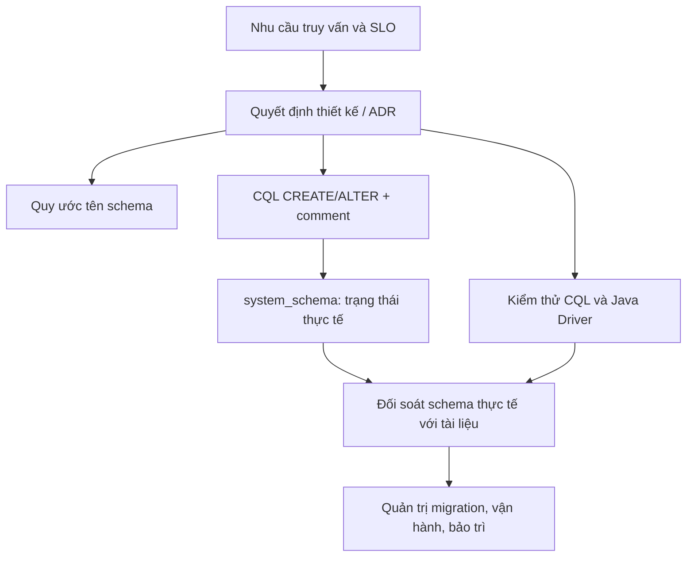

# Comment, quy ước đặt tên và tài liệu hóa lựa chọn thiết kế

## 1. Vì sao tài liệu hóa schema quan trọng trong Cassandra?

Trong Apache Cassandra, tên keyspace, table và column không chỉ phục vụ việc viết CQL. Chúng còn giúp nhóm phát triển hiểu **bảng này phục vụ truy vấn nào, dữ liệu được phân vùng ra sao và cần vận hành thế nào**. Một bảng thiết kế sai partition key có thể gây partition quá lớn hoặc truy vấn không hiệu quả; một table option sai có thể khiến dữ liệu hết hạn sớm, tạo nhiều tombstone hoặc làm tăng chi phí compaction.

Trong chương **Keyspace và schema** của module `DATABASE_ENGINE_WIDE_COLUMN_CASSANDRA`, bài học này kết nối ba hoạt động:

1. **Đặt tên dễ hiểu:** dùng quy ước nhất quán để nhận diện phạm vi dữ liệu và đường truy vấn.
2. **Ghi `comment` trong schema:** cung cấp mô tả ngắn, nằm gần bảng và có thể đọc qua CQL metadata.
3. **Tài liệu hóa quyết định thiết kế:** lưu lý do chọn partition key, clustering key, replication, mức nhất quán, TTL/compaction và kế hoạch migration bằng một hồ sơ có phiên bản.

Với hệ thống Java nhiều service, việc đặt tên và ghi lý do thiết kế còn giúp người khác tránh tạo truy vấn `ALLOW FILTERING` không cần thiết, tránh sửa khóa chính sai cách và không nhầm schema thật với file DDL mong muốn.

**Mục tiêu:** sau bài này, bạn có thể viết CQL chứa `WITH comment`, kiểm tra comment trong `system_schema.tables`, đề xuất quy ước đặt tên cho keyspace/bảng/cột, và lập một bản ghi quyết định đủ chi tiết để review hoặc bàn giao cho nhóm vận hành.

## 2. Ba lớp thông tin cần tách biệt

Không có một “nơi duy nhất” đủ sức biểu diễn mọi quyết định thiết kế Cassandra:

| Lớp | Câu hỏi trả lời | Ví dụ |
| --- | --- | --- |
| **Tên định danh** | Đối tượng là gì, thường dùng cho kiểu truy vấn nào? | `orders_by_customer_month`, `placed_at` |
| **Schema comment** | Bảng này dùng để làm gì, có lưu ý ngắn nào? | `'Orders for one customer and month, newest first'` |
| **Tài liệu thiết kế/ADR** | *Vì sao* chọn partition key, bucket, RF/CL, TTL và các phương án bị loại? | Ghi nhận workload, trade-off, ngưỡng partition và runbook |

Ngoài ra, `system_schema` chứa **định nghĩa thực tế được Cassandra ghi nhận**, còn kho quản lý migration chứa **định nghĩa mong muốn**. Nếu hai bên không khớp, tài liệu không thể thay thế việc kiểm tra schema drift.



**`comment` giúp người đọc định hướng; nó không phải ràng buộc dữ liệu, không phải chỉ mục và không tự buộc ứng dụng tuân thủ tài liệu.**

## 3. `WITH comment`: ghi mô tả vào định nghĩa bảng

Trong CQL của Cassandra, `comment` là một **table option** dùng để mô tả bảng. Khi tạo bảng:

```sql
CREATE TABLE example_ks.events_by_device (
    device_id text,
    event_time timestamp,
    event_id uuid,
    value double,
    PRIMARY KEY ((device_id), event_time, event_id)
) WITH CLUSTERING ORDER BY (event_time DESC, event_id ASC)
  AND comment = 'Device events ordered by time';
```

Đây là mẫu cú pháp; muốn chạy cần tạo `example_ks` trước. Khi sửa comment trên một bảng đã có:

```sql
ALTER TABLE example_ks.events_by_device
WITH comment = 'Device events for device-id lookups, latest first';
```

Hai câu trên minh họa rằng `comment` thuộc **schema metadata của bảng**, không phải một hàng dữ liệu do ứng dụng ghi vào bảng.

### 3.1. Comment là string literal, không phải quoted identifier

CQL dùng **dấu nháy đơn** cho string literal. Nếu comment chứa dấu nháy đơn, escape bằng cách nhân đôi dấu đó:

```sql
ALTER TABLE example_ks.events_by_device
WITH comment = 'Device''s events sorted newest first';
```

Metadata lưu nội dung chuỗi tương ứng với `Device's events sorted newest first`. Đừng dùng nháy kép của quoted identifier để thay thế nháy đơn trong `comment`.

| Cú pháp | Ý nghĩa |
| --- | --- |
| `events_by_device` | Identifier, không phân biệt hoa/thường khi không được quote |
| `"EventsByDevice"` | Identifier **khác** với `eventsbydevice`, phân biệt hoa/thường |
| `comment = 'Events by device'` | Gán **giá trị chuỗi** cho table option |
| `'Device''s events'` | Giá trị chuỗi có một dấu nháy đơn bên trong |

### 3.2. Comment nằm ở đâu và có thể làm được những gì?

`WITH comment = '...'` cho phép ghi một đoạn mô tả ngắn ngay trong `CREATE TABLE` hoặc cập nhật bằng `ALTER TABLE`. Comment thường xuất hiện khi xem DDL bằng `DESCRIBE TABLE` trong `cqlsh` và qua metadata bảng.

Nó **không**:

- Kiểm tra partition key hoặc điều kiện `WHERE` của truy vấn.
- Tạo index, chọn replica, đặt consistency level (CL) hay thực hiện repair.
- Thay đổi nội dung các hàng hiện hữu hoặc tự backfill dữ liệu.
- Thay thế tài liệu vận hành, biểu đồ truy vấn hay quyết định chọn RF.
- Tự động được Cassandra cập nhật nếu thiết kế thực tế thay đổi.

**Lưu ý khả năng hỗ trợ:** CQL Cassandra không cung cấp cùng một bộ lệnh `COMMENT ON COLUMN`, `COMMENT ON TABLE`, `COMMENT ON KEYSPACE` như một số RDBMS. Đừng giả định có thể gắn comment tùy ý vào từng cột/keyspace bằng cú pháp của PostgreSQL/MySQL. Với mô tả cấp cột, keyspace hoặc quyết định phức tạp, hãy dùng tài liệu bên ngoài có phiên bản và giữ liên kết rõ ràng tới tên schema.

### 3.3. Comment có ảnh hưởng hiệu năng hoặc replication không?

Thay đổi `comment` là thay đổi thuộc tính schema. Nó không yêu cầu viết lại hàng dữ liệu, không đổi partition token, không làm tăng RF. Tuy nhiên, schema change vẫn cần được lan truyền giữa các node: khi triển khai theo quy trình cần quan sát **schema agreement** giống các DDL khác.

Mặc dù tác động dữ liệu thường thấp, không nên chạy hàng loạt thay đổi comment vô ích vào giờ cao điểm hoặc để nhiều service cùng sửa DDL. Hãy gom chúng trong migration có thể review và kiểm tra hậu điều kiện.

## 4. Quy ước tên cho keyspace, table và column

**Khuyến nghị mặc định:** dùng tên ASCII chữ thường dạng `snake_case`, rõ nghiệp vụ, không dùng từ khóa CQL và không phụ thuộc quoted identifier:

| Loại đối tượng | Nên dùng | Hạn chế |
| --- | --- | --- |
| Keyspace | `commerce`, `inventory_app`, `telemetry` | `"CommerceApp"`, `data` quá chung |
| Table | `orders_by_customer_month`, `events_by_device_day` | `Table1`, `logs` khi không rõ truy vấn |
| Partition key | `customer_id`, `device_id`, `event_day` | `pk` hoặc `key` không thể hiện nghiệp vụ |
| Clustering column | `placed_at`, `event_time`, `order_id` | `sort1`, `date` khi không phân biệt rõ ngữ nghĩa |
| Cột dữ liệu | `total_amount`, `order_status`, `currency_code` | `value1`, tên mơ hồ hoặc trùng từ khóa |
| UDT | `shipping_address`, `geo_point` | Tên khó phân biệt với bảng hay dịch vụ |

### 4.1. Cassandra phân biệt tên có nháy kép và không nháy kép

Trong CQL:

- `Orders_By_Customer` không có nháy kép thường được chuẩn hóa thành `orders_by_customer`.
- `"Orders_By_Customer"` giữ nguyên chữ hoa và **khác** tên `orders_by_customer`.
- `order_id` và `orderid` là **hai tên khác nhau** vì dấu gạch dưới có ý nghĩa.

Sử dụng nhiều tên chỉ khác chữ hoa/thường gây khó cho script, Java mapping và kiểm tra metadata. Với thiết kế mới, nên tránh quoted identifier trừ khi có ràng buộc tích hợp không thể thay đổi.

**Đặt tên hợp lệ còn chịu giới hạn theo loại đối tượng và phiên bản Cassandra.** Không giả định thêm dấu nháy kép sẽ cho phép mọi dấu cách hoặc ký tự tùy ý trong keyspace/table.

### 4.2. Một bảng thường phục vụ một nhóm truy vấn cụ thể

Cassandra không khuyến khích thiết kế bảng chỉ theo cấu trúc entity rồi kỳ vọng truy vấn mọi chiều như RDBMS. Tên bảng nên gợi ý **đường truy cập chính**:

| Truy vấn nghiệp vụ | Bảng có thể thiết kế | Partition key dự kiến |
| --- | --- | --- |
| Lấy một đơn hàng theo ID | `orders_by_id` | `order_id` |
| Liệt kê đơn của khách trong tháng | `orders_by_customer_month` | `(customer_id, order_month)` |
| Xem sự kiện thiết bị trong ngày | `events_by_device_day` | `(device_id, event_day)` |
| Liệt kê sản phẩm theo danh mục và vùng | `products_by_category_region` | `(category_id, region_id)` |

Tên `orders_by_customer_month` chỉ là **gợi ý**. Nó không tự áp đặt khóa; phải xem `PRIMARY KEY` và metadata thực tế để biết dữ liệu thật được phân vùng và sắp xếp ra sao.

### 4.3. Tên phải rõ nhưng không nên thay thế thiết kế chi tiết

Một tên có vẻ hợp lý vẫn có thể tạo partition quá lớn nếu tất cả dữ liệu của một khách nằm trong cùng một partition. Nếu tách bucket theo tháng, cần ghi rõ:

- Cách tính `order_month`: ngày đầu tháng theo múi giờ nghiệp vụ đã quyết định.
- Khi nào một customer có thể tạo partition quá lớn dù đã bucket theo tháng.
- Truy vấn phải cung cấp đủ `customer_id` và `order_month`; truy vấn nhiều tháng cần chiến lược ở phía ứng dụng.
- Dữ liệu được sắp xếp theo `placed_at` và `order_id` ra sao, trường hợp timestamp bằng nhau xử lý thế nào.

Tên và comment là cửa vào thiết kế, **không chứa hết thiết kế**.

## 5. Lab: đặt tên theo truy vấn và ghi comment có ý nghĩa

Bài thực hành dùng keyspace `design_lab` trong môi trường riêng. Giả sử `nodetool status` cho biết node lab thuộc DC có tên chính xác `datacenter1`. Nếu khác, phải thay tên DC. RF = 1 được dùng **chỉ cho lab một node**, không phải cấu hình chịu lỗi production.

### Bước 1 — Kiểm tra DC rồi tạo keyspace

```bash
nodetool status
```

```sql
CREATE KEYSPACE IF NOT EXISTS design_lab
WITH replication = {
    'class': 'NetworkTopologyStrategy',
    'datacenter1': '1'
}
AND durable_writes = true;
```

`IF NOT EXISTS` chỉ xử lý tên đã tồn tại; **không** xác minh định nghĩa replication của `design_lab` nếu đã có từ trước. Hãy đọc metadata trước khi coi keyspace sẵn sàng.

### Bước 2 — Xác định câu truy vấn cần hỗ trợ

> “Liệt kê tối đa 20 đơn mới nhất của một khách trong một tháng, sắp theo thời điểm đặt hàng giảm dần.”

Từ yêu cầu này, lựa chọn minh họa:

- `customer_id` + `order_month` tạo **composite partition key**, tránh đặt mọi đơn của khách trong một partition không giới hạn thời gian.
- `placed_at DESC` đặt đơn mới trước; `order_id ASC` tạo thành phần clustering bổ sung để phân biệt những đơn trùng timestamp.
- Cột `total_amount` và `order_status` phục vụ màn hình danh sách mà không phải join.

### Bước 3 — Tạo bảng, comment và table options

```sql
CREATE TABLE IF NOT EXISTS design_lab.orders_by_customer_month (
    customer_id uuid,
    order_month date,
    placed_at timestamp,
    order_id uuid,
    total_amount decimal,
    order_status text,
    PRIMARY KEY ((customer_id, order_month), placed_at, order_id)
) WITH CLUSTERING ORDER BY (placed_at DESC, order_id ASC)
  AND comment = 'Orders for one customer and month; newest first. ADR: ORD-007.'
  AND default_time_to_live = 0;
```

Trong CQL trên:

- Tên bảng thể hiện hai bộ lọc chính: khách hàng và tháng.
- `comment` nói ngắn gọn mục đích, thứ tự, và gợi tham chiếu tới ADR.
- `default_time_to_live = 0` nghĩa là **không có TTL mặc định**; không có nghĩa dữ liệu không bao giờ bị xóa bởi lệnh khác.
- Comment không tự enforce việc ứng dụng tính `order_month` đúng hay sắp xếp theo truy vấn dự kiến.

**Giới hạn lab:** một tháng vẫn có thể tạo partition lớn đối với khách có lưu lượng bất thường; khi lên production phải đo số hàng, dung lượng partition và phân bố tải trước khi chọn độ dài bucket.

### Bước 4 — Ghi và đọc theo khóa phân vùng

```sql
INSERT INTO design_lab.orders_by_customer_month (
    customer_id, order_month, placed_at,
    order_id, total_amount, order_status
) VALUES (
    11111111-1111-4111-8111-111111111111,
    '2026-11-01',
    '2026-11-21T08:00:00Z',
    aaaaaaaa-aaaa-4aaa-8aaa-aaaaaaaaaaaa,
    250000.00,
    'PAID'
);

SELECT placed_at, order_id, total_amount, order_status
FROM design_lab.orders_by_customer_month
WHERE customer_id = 11111111-1111-4111-8111-111111111111
  AND order_month = '2026-11-01'
LIMIT 20;
```

Truy vấn chỉ nhắm tới partition xác định bởi `(customer_id, order_month)`, tránh `ALLOW FILTERING` để lọc khối dữ liệu khổng lồ. Trong hệ thống thật, application cần thống nhất múi giờ và cách tính ngày đầu tháng trước khi bind `order_month`.

### Bước 5 — Sửa comment khi tài liệu đã được làm rõ

```sql
ALTER TABLE design_lab.orders_by_customer_month
WITH comment = 'Customer-month order list, latest first; month is UTC first day; ADR ORD-007';
```

Lệnh trên chỉ sửa **table comment**, không chuyển dữ liệu hoặc đổi partition key. Nếu quyết định thay đổi bucket từ tháng sang tuần, việc sửa mỗi comment **không đủ**: đó là thay đổi thiết kế khóa và có thể yêu cầu bảng mới, backfill, kiểm thử Java.

### Bước 6 — Kiểm tra comment và khóa thực tế

```sql
DESCRIBE TABLE design_lab.orders_by_customer_month;

SELECT table_name, comment, default_time_to_live, compaction
FROM system_schema.tables
WHERE keyspace_name = 'design_lab'
  AND table_name = 'orders_by_customer_month';

SELECT column_name, kind, position, type, clustering_order
FROM system_schema.columns
WHERE keyspace_name = 'design_lab'
  AND table_name = 'orders_by_customer_month';
```

`DESCRIBE TABLE` là tiện ích của `cqlsh`, còn `system_schema.tables`/`system_schema.columns` là bảng metadata truy vấn được bằng CQL. Khi dựng lại khóa, **phân nhóm theo `kind` rồi sắp theo `position`**: hai partition-key component phải được nhận diện cùng nhau, rồi đến hai clustering column theo thứ tự.

### Bước 7 — Dọn lab khi không còn sử dụng

```sql
-- Cảnh báo: chỉ chạy khi design_lab là keyspace thử nghiệm của bạn.
DROP KEYSPACE IF EXISTS design_lab;
```

Lệnh này xóa **toàn bộ bảng và dữ liệu** trong keyspace `design_lab`. Không chạy trên keyspace production hoặc môi trường có dữ liệu cần giữ.

## 6. Viết comment tốt: ngắn, cụ thể và bảo trì được

Một comment hữu ích thường trả lời được ba câu: **bảng phục vụ gì, cần lọc theo khóa nào và có lưu ý nào quan trọng**.

| Comment | Đánh giá | Vì sao |
| --- | --- | --- |
| `'Table for data'` | Kém | Không có thông tin về truy vấn hoặc mô hình |
| `'Orders'` | Quá ngắn | Không nói vì sao bảng khác `orders_by_id` |
| `'Orders for one customer and month; newest first'` | Tốt | Diễn đạt rõ nhóm truy vấn và thứ tự |
| `'Monthly customer orders, UTC buckets; ADR ORD-007'` | Tốt | Bộc lộ giả thiết bucket và nơi xem lý do |
| Comment hàng nghìn chữ mô tả mọi quy trình | Không phù hợp | Khó đọc/duy trì; nên đặt phần dài trong tài liệu có phiên bản |

**Một mẫu comment ngắn:**

```text
<mục đích truy vấn>; <giả thiết quan trọng>; <mã ADR hoặc tài liệu liên quan>
```

Ví dụ: `'Device events by device/day; UTC day buckets; ADR TEL-012'`.

### Thông tin không nên đưa vào comment

Không ghi mật khẩu, token kết nối, thông tin nhận dạng khách hàng, số điện thoại cá nhân, đường dẫn bí mật hoặc dữ liệu nhạy cảm. Comment là **metadata có thể được đọc bởi các vai trò được cấp quyền**, xuất hiện trong công cụ quản trị, báo cáo schema và bản dump DDL.

Comment cũng không nên chứa câu khẳng định khó kiểm chứng như “bảng này luôn có dữ liệu chính xác” hoặc “không cần repair”. Nếu thật sự có yêu cầu SLO hoặc consistency, hãy ghi rõ quy trình đo và điều kiện đáp ứng trong tài liệu có thể review.

## 7. Tài liệu hóa lựa chọn thiết kế: một ADR nên có những gì?

**ADR (Architecture Decision Record)** là bản ghi ngắn có phiên bản về một quyết định kiến trúc: bối cảnh, lựa chọn, lý do, hệ quả và điều kiện đánh giá lại. ADR có thể nằm trong repository tài liệu hoặc hệ quản lý kiến thức của nhóm; `comment` trên bảng chỉ nên dẫn tới mã/tên ADR.

Một mẫu ADR thực hành cho bảng Cassandra:

| Trường | Câu hỏi cần trả lời | Ví dụ |
| --- | --- | --- |
| ID, trạng thái, ngày | Ai phê duyệt, khi nào quyết định có hiệu lực? | `ORD-007`, Accepted, ngày review |
| Nhu cầu truy vấn | `WHERE` nào là chủ đạo? Có truy vấn phân trang không? | Đơn mới nhất theo customer + month, tối đa 20 kết quả |
| Phạm vi dữ liệu | Volume, cardinality, retention, phân bố tải? | Ước tính số đơn/customer/tháng, khách cực lớn |
| Partition key | Vì sao chọn thành phần và thứ tự này? | `(customer_id, order_month)` để giới hạn partition |
| Clustering key | Thứ tự, khả năng trùng timestamp? | `placed_at DESC, order_id ASC` |
| Bảng phi chuẩn hóa | Dữ liệu có được nhân vào bảng khác không? | `orders_by_id` dùng để đọc theo ID |
| RF/topology | Bao nhiêu DC, RF và lý do? | Cấu hình theo hạ tầng production được duyệt |
| CL | Mục tiêu đọc/ghi và khả năng chịu lỗi? | Lựa chọn cụ thể theo use case, ví dụ `LOCAL_QUORUM` |
| TTL/retention | Bao lâu phải giữ bản ghi, policy nào? | Không TTL mặc định; xóa bằng quy trình lưu trữ được duyệt |
| Compaction/repair | Workload ghi/đọc và kế hoạch vận hành? | Đánh giá STCS/LCS/TWCS phù hợp; repair định kỳ |
| Java access | Driver, prepared statement, mapping và retry? | Bind đủ `customer_id` + `order_month`, paging |
| Alternatives | Phương án nào đã xem xét và vì sao loại? | Chỉ partition theo `customer_id` gây nguy cơ partition lớn |
| Rủi ro và tiêu chí đo | Khi nào phải xem xét lại thiết kế? | Partition tăng vượt ngưỡng vận hành, hot partition |
| Migration/rollback | Làm sao thay schema khi có v1/v2? | Expand → dual-write/backfill → cutover → contract |

Không cần nhồi toàn bộ dữ liệu này vào comment hoặc tên bảng. **Tên + comment + ADR + metadata thực tế** bổ trợ lẫn nhau.

### 7.1. Ví dụ ADR rút gọn cho bảng `orders_by_customer_month`

**Quyết định ORD-007 — Accepted**

**Bối cảnh:** ứng dụng Java cần liệt kê 20 đơn mới nhất của khách hàng trong một tháng. Lưu tất cả đơn của khách vào cùng partition có nguy cơ tạo partition rất lớn với khách hoạt động mạnh.

**Lựa chọn:** tạo bảng `orders_by_customer_month`, partition key `(customer_id, order_month)`; clustering `placed_at DESC, order_id ASC`. Ứng dụng chuẩn hóa `order_month` thành ngày đầu tháng UTC trước khi ghi và đọc. Các trường nghiệp vụ cần hiển thị nằm trực tiếp trên cùng hàng.

**Phương án đã cân nhắc:**

- `orders_by_customer` không bucket: truy vấn đơn giản hơn nhưng partition có thể tăng vô hạn.
- Bucket theo ngày: partition nhỏ hơn nhưng truy vấn “cả tháng” có thể cần đọc nhiều partition.
- Bucket theo tháng: cân bằng số partition cần đọc và giới hạn dữ liệu cho workload dự kiến; **phải đo lại** khi tải thay đổi.

**Hệ quả:** truy vấn cần đủ hai thành phần partition key; liệt kê nhiều tháng phải chạy nhiều truy vấn có kiểm soát ở application. Nếu cần truy cập đơn hàng theo ID, thêm `orders_by_id` và duy trì các bản dữ liệu phi chuẩn hóa đúng.

**Tiêu chí xem lại:** partition vượt ngưỡng size/hàng được nhóm vận hành chấp thuận, tốc độ truy vấn chậm, khách “nóng” tăng cao hoặc chính sách retention thay đổi.

**Phần không được “đóng đinh” trong ví dụ:** RF, CL, compaction và lịch repair production phải được quyết định dựa trên topology, mức chịu lỗi và workload thực tế; không sao chép RF = 1 của lab thành cấu hình môi trường thật.

### 7.2. Ghi tài liệu hóa cả điều *không* được hỗ trợ

Ví dụ cần ghi:

- Không hỗ trợ tìm đơn bất kỳ chỉ bằng `order_status` trên bảng `orders_by_customer_month`.
- Không khuyến khích truy vấn quét nhiều partition với `ALLOW FILTERING`.
- Không thay partition key bằng `ALTER TABLE ADD`; nếu đổi bucket phải tạo bảng mới và chuyển dữ liệu.
- Không coi `comment` là hợp đồng enforce logic ngày tháng hoặc hạn mức partition.

Những ranh giới này giúp một kỹ sư mới không vô tình thêm API có đường truy cập không phù hợp mô hình Cassandra.

## 8. RF, CL, TTL, compaction và repair phải được ghi riêng trong tài liệu

Comment thường không đủ chỗ để giải thích các quyết định vận hành phân tán.

### Replication và consistency level

RF được cấu hình ở **keyspace**. Một bảng `orders_by_customer_month` không có RF độc lập với keyspace `commerce`. Trong tài liệu thiết kế, cần ghi rõ:

- Tên các data center thực tế và RF tại từng DC theo `NetworkTopologyStrategy`.
- Mức nhất quán đọc và ghi (`LOCAL_ONE`, `LOCAL_QUORUM` hoặc lựa chọn khác) và lý do phù hợp với yêu cầu sản phẩm.
- Số node phù hợp, tình huống lỗi dự kiến và những trường hợp CL không thể được đáp ứng.
- Ảnh hưởng khi thay RF/DC: cập nhật schema **không** tự xác nhận dữ liệu cũ đã đến mọi replica mới; cần quy trình streaming/repair.

### TTL, compaction, tombstone

Chính sách TTL và loại workload quyết định hành vi tombstone, compaction và khả năng thu hồi dung lượng. Tài liệu cần ghi:

- TTL mặc định có được đặt không, dữ liệu nào có TTL riêng và có yêu cầu lưu giữ pháp lý không.
- Vì sao dùng compaction strategy cụ thể, dựa trên đọc ngẫu nhiên, chuỗi thời gian hay tỷ lệ ghi/xóa.
- Cách theo dõi độ trễ truy vấn, SSTable count, tombstone và dung lượng.
- Tác động khi thay `gc_grace_seconds` đối với repair và replica offline.

**Không đồng nhất “hết TTL” với “đã xóa vật lý khỏi SSTable ngay”.** Và không hạ `gc_grace_seconds` tùy tiện để dọn tombstone mà không xét khả năng replica đã bỏ lỡ delete.

### Schema agreement và migration

Thay đổi comment hoặc table option vẫn thuộc DDL; cluster cần lan truyền định nghĩa. Khi có nhiều phiên bản ứng dụng Java, cần ghi:

1. DDL nào có thể thực hiện tương thích ngược (ví dụ thêm cột).
2. Khi nào mọi node phải đạt schema agreement.
3. Có cần backfill, dual-write và kiểm thử reader v1/v2 không.
4. Điều kiện mới được bỏ cột/bảng cũ.
5. Cách kiểm tra schema drift sau migration, không chỉ dựa vào việc lệnh CQL không báo lỗi.

## 9. Kiểm chứng tên, comment và schema thực tế bằng CQL

Cassandra lưu comment của bảng trong metadata. Truy vấn điển hình:

```sql
SELECT table_name, comment, default_time_to_live,
       compaction, compression
FROM system_schema.tables
WHERE keyspace_name = 'design_lab'
  AND table_name = 'orders_by_customer_month';
```

Kiểm tra replication của keyspace:

```sql
SELECT keyspace_name, replication, durable_writes
FROM system_schema.keyspaces
WHERE keyspace_name = 'design_lab';
```

Kiểm tra khóa và kiểu cột:

```sql
SELECT column_name, kind, position, type, clustering_order
FROM system_schema.columns
WHERE keyspace_name = 'design_lab'
  AND table_name = 'orders_by_customer_month';
```

Một bản ghi ADR mô tả partition key nhưng metadata cho thấy cột đó là `regular` hoặc sai thứ tự `position` thì cần báo **schema drift**. Đừng tự động viết lại comment để che sai khác; phải đánh giá migration đúng cấu trúc.

### Phân biệt ba tình huống đối soát

| Tình huống | Cách xử lý |
| --- | --- |
| Metadata đúng, comment thiếu mô tả | Cập nhật comment qua `ALTER TABLE ... WITH comment` |
| Comment đúng, metadata khóa/TTL sai | Điều tra schema thực tế và migration; comment không sửa dữ liệu/schema khác |
| Metadata đúng nhưng ADR lỗi thời | Cập nhật tài liệu và code review; không cần DDL chỉ để sửa ADR |

Việc nhiều người chỉnh sửa song song có thể làm comment lệch với tài liệu hoặc ứng dụng. Tốt nhất quản lý comment như một phần của migration có review, không coi đó là ghi chú tự do được bất kỳ instance nào sửa lúc startup.

## 10. Tích hợp vào Java Driver và source code

Ví dụ với **Apache Cassandra Java Driver 4.x**, giả sử `CqlSession session` đã được tạo và quản lý vòng đời bên ngoài. Java 15+ hỗ trợ text block.

### 10.1. Đọc comment để xác minh metadata sau migration

```java
import com.datastax.oss.driver.api.core.CqlSession;
import com.datastax.oss.driver.api.core.cql.PreparedStatement;
import com.datastax.oss.driver.api.core.cql.Row;

// session đã kết nối cluster; code này chỉ đọc metadata.
PreparedStatement ps = session.prepare("""
    SELECT comment, default_time_to_live
    FROM system_schema.tables
    WHERE keyspace_name = ? AND table_name = ?
    """);

Row row = session.execute(
    ps.bind("design_lab", "orders_by_customer_month")).one();

if (row == null) {
    throw new IllegalStateException("Table orders_by_customer_month missing");
}

String tableComment = row.getString("comment");
int ttl = row.getInt("default_time_to_live");

if (ttl != 0) {
    throw new IllegalStateException("Unexpected default TTL");
}
// tableComment dùng cho metadata/report; không coi nó là ràng buộc nghiệp vụ.
```

Bind marker `?` trong truy vấn trên đại diện cho **giá trị chuỗi** `keyspace_name` và `table_name`; chúng không thay thế identifier của bảng `system_schema.tables`.

### 10.2. Viết đúng truy vấn mà tên bảng đã gợi ý

```java
import com.datastax.oss.driver.api.core.cql.PreparedStatement;
import com.datastax.oss.driver.api.core.cql.Row;
import java.time.LocalDate;
import java.util.UUID;

PreparedStatement query = session.prepare("""
    SELECT placed_at, order_id, total_amount, order_status
    FROM design_lab.orders_by_customer_month
    WHERE customer_id = ? AND order_month = ?
    LIMIT 20
    """);

UUID customerId =
    UUID.fromString("11111111-1111-4111-8111-111111111111");
LocalDate monthBucket = LocalDate.of(2026, 11, 1);

for (Row order : session.execute(query.bind(customerId, monthBucket))) {
    // Xử lý danh sách đơn trong một partition/tháng.
}
```

`order_month date` được bind theo kiểu ngày của driver 4.x. Ứng dụng phải tự chuẩn hóa month bucket theo quy ước nghiệp vụ, vì Cassandra **không tự chuyển mọi ngày thành ngày đầu tháng**. Việc dùng prepared statement giúp bind đúng kiểu giá trị, nhưng không chứng minh partition vẫn có kích thước phù hợp khi tải tăng.

### 10.3. API metadata không thay thế schema agreement

Driver có API metadata để kiểm tra keyspace/table và API kiểm tra schema agreement (tùy cấu hình/phiên bản), nhưng một câu `SELECT` metadata chỉ thể hiện góc nhìn của coordinator thực hiện truy vấn.

Để triển khai migration tin cậy:

- Dùng một bên điều phối thay vì mọi instance Java cùng chạy DDL.
- Chờ schema agreement, kiểm tra đủ node quan trọng và trạng thái định nghĩa.
- So sánh thực tế với thiết kế, bao gồm primary key, kiểu cột, RF/DC và TTL, không chỉ tên/comment.
- Kiểm thử cả truy vấn mới lẫn truy vấn của phiên bản ứng dụng cũ khi rolling deployment.

## 11. Khi nào cần cập nhật tên, comment và ADR?

| Thay đổi | Đổi tên schema? | Cập nhật comment? | Cập nhật ADR? |
| --- | --- | --- | --- |
| Sửa mô tả dễ hiểu hơn, không đổi logic | Không cần | Nên làm | Có thể nếu tài liệu liên quan |
| Thêm cột `shipping_note` không đổi khóa | Không nhất thiết | Nếu comment bị ảnh hưởng | Ghi migration và phụ thuộc nếu quan trọng |
| Đổi thời gian bucket từ tháng sang tuần | Cần đánh giá **bảng mới** theo truy vấn | Có, trên schema mới | **Bắt buộc** nêu lại partition, migration, trade-off |
| Chuyển sang truy vấn theo `order_id` | Thường tạo `orders_by_id` | Có, cho bảng mới | Ghi quyết định phi chuẩn hóa/đồng bộ |
| Thay RF hoặc thêm DC | Không cần đổi tên bảng | Không nhất thiết | Ghi topology, CL, streaming/repair |
| Thay TTL/compaction | Không nhất thiết | Nếu mô tả vòng đời thay đổi | Nên ghi lý do, ảnh hưởng và rollback |
| Đổi owner, SLO, quy trình repair | Không nhất thiết | Chỉ khi cần mô tả ngắn | Cập nhật tài liệu vận hành/ADR |

**Đừng cố đổi tên bảng bằng một thao tác “rename” chưa được hỗ trợ hoặc thiếu migration.** Khi thiết kế đường truy cập thay đổi, bảng mới và chuyển dữ liệu thường là lựa chọn rõ ràng hơn trong Cassandra. Khả năng `ALTER TABLE RENAME` nếu có cũng bị giới hạn theo loại cột và phiên bản; không phải lệnh đổi tên tùy ý cho mọi bảng/cột.

### Quy trình review đề nghị

1. Lập yêu cầu truy vấn và tập dữ liệu, phân tích cardinality/partition.
2. Đặt tên schema nhất quán; viết CQL và comment ngắn có ý nghĩa.
3. Ghi ADR: mục tiêu, trade-off, RF/CL, TTL/compaction/repair, backfill và rollback.
4. Review bởi chủ sở hữu ứng dụng và vận hành, kiểm thử trên cùng phiên bản Cassandra mục tiêu.
5. Áp migration có điều phối, chờ schema agreement.
6. Đối soát `system_schema` và chạy test truy vấn Java.
7. Đồng bộ tài liệu và code sau khi kết quả thực tế đã được xác nhận.

## 12. Chẩn đoán lỗi và các hiểu lầm phổ biến

| Hiện tượng/hiểu lầm | Nguyên nhân | Cách xử lý |
| --- | --- | --- |
| “Comment ghi `by_month` nên query theo tháng chắc hiệu quả” | Comment không áp đặt khóa | Kiểm tra `PRIMARY KEY`, query plan và dữ liệu thực |
| `CREATE TABLE IF NOT EXISTS` chạy thành công nhưng comment không đổi | Bảng cùng tên đã tồn tại, lệnh tạo bỏ qua | Dùng `ALTER TABLE ... WITH comment` khi chỉ sửa comment; đối soát schema trước |
| Query thiếu `order_month` hoặc trả lỗi khóa | Bảng thiết kế theo partition tổng hợp | Bind đủ partition key hoặc thiết kế đường truy cập khác |
| `order_month` bị tính sai theo múi giờ | Ứng dụng và ADR dùng quy ước khác | Quy định rõ UTC/múi giờ nghiệp vụ và kiểm thử ranh giới tháng |
| Comment bị lệch sau migration | Không có quy trình cập nhật metadata/doc | Review comment trong migration, kiểm tra `system_schema.tables` |
| Tên `"OrdersByCustomer"` lúc tạo nhưng query không quote | Quoted identifier phân biệt hoa/thường | Sử dụng tên chính xác, ưu tiên snake_case cho bảng mới |
| `ALTER TABLE ... WITH comment` bị parser từ chối | Sai cú pháp, dấu quote hoặc phiên bản chưa phù hợp | Kiểm tra đúng câu lệnh và escape nháy đơn |
| Dữ liệu hết hạn dù comment ghi “retain forever” | TTL thực tế khác comment | Xem `default_time_to_live` và TTL của ghi dữ liệu |
| Schema agreement đã đạt nhưng dữ liệu vẫn thiếu replica | Agreement chỉ nói về định nghĩa | Kiểm tra repair/streaming sau đổi RF |
| Cố dùng `COMMENT ON COLUMN` như PostgreSQL | Không phải cú pháp CQL thông dụng được hỗ trợ | Tài liệu hóa cột trong ADR/dictionary và kiểm tra metadata |
| Comment chứa thông tin mật | Metadata được hiển thị trong công cụ/DDL | Bỏ bí mật khỏi comment và thực hiện quy trình xử lý lộ lọt nếu có |

## 13. Bài tập thực hành và câu hỏi tự kiểm tra

### Bài tập A — Viết tên theo truy vấn

Cho ba yêu cầu:

1. Xem các sự kiện của một thiết bị trong ngày, mới nhất trước.
2. Xem một đơn hàng theo `order_id`.
3. Xem những đơn của một khách trong một tháng.

Đề xuất tên lần lượt là `events_by_device_day`, `orders_by_id` và `orders_by_customer_month`. Sau đó, **phải thiết kế** partition/clustering key thực tế và giải thích giới hạn truy vấn, không chỉ đặt tên.

### Bài tập B — Đối soát metadata với comment

Trong keyspace `design_lab`:

1. Dùng `DESCRIBE TABLE` để xem comment đã khai báo.
2. Đọc `system_schema.tables.comment`, `default_time_to_live` và `compaction`.
3. Đọc `system_schema.columns` để dựng lại `PRIMARY KEY ((customer_id, order_month), placed_at, order_id)`.
4. Sửa comment để bổ sung giả thiết UTC, rồi kiểm tra metadata sau khi schema agreement.
5. Giải thích tại sao sửa comment không tự chuyển `order_month` từ cách tính địa phương sang UTC đối với dữ liệu cũ.

### Bài tập C — Lập ADR ngắn

Hãy viết một ADR dựa trên mẫu mục 7 với các nội dung bắt buộc: query chính, vì sao chọn bucket, partition-key cardinality, cách xử lý hot partition, clustering order, RF/CL production theo topology giả định, TTL, compaction, repair, rủi ro, tiêu chí đo và kế hoạch migration.

**Câu hỏi ôn tập:**

1. Vì sao comment nên ngắn còn ADR phải ghi cả quyết định bị loại?
2. Vì sao tên bảng `orders_by_customer_month` chưa chứng minh partition key đúng?
3. `WITH comment` có thể thay thế `ALTER TABLE` đổi khóa hoặc backfill dữ liệu không?
4. Khi nào nên tạo bảng mới thay vì cố “đổi tên” bảng cũ?
5. Phải đối soát những trường nào trong `system_schema` để kiểm chứng một bảng thiết kế theo truy vấn?

## 14. Checklist chuẩn hóa schema trước khi triển khai

| Câu hỏi | Minh chứng cần có |
| --- | --- |
| Keyspace/table/column đặt tên nhất quán? | Tên `snake_case`, không xung đột/nhầm quoted identifier |
| Tên bảng bộc lộ cách truy vấn chủ đạo? | Query ví dụ với `WHERE` chứa đủ partition key |
| Partition có khả năng bị quá lớn/nóng không? | Phân tích phân bố khóa, ước lượng kích thước và kịch bản tải cao |
| Clustering columns và thứ tự có đúng không? | `PRIMARY KEY`, `CLUSTERING ORDER BY` và truy vấn mẫu |
| Comment có mô tả mục đích ngắn, không chứa dữ liệu nhạy cảm? | `system_schema.tables.comment` |
| ADR đã ghi lý do, phương án thay thế và người chịu trách nhiệm? | Hồ sơ có ID, trạng thái, ngày và owner |
| RF/DC và CL được chọn theo topology thật? | `system_schema.keyspaces`, cấu hình application và `nodetool status` |
| TTL/compaction/repair có runbook? | Table options, ngưỡng vận hành và lịch bảo trì |
| Thay đổi có tương thích ứng dụng Java cũ/mới? | Test CQL/prepared statement, migration và rollback |
| Cluster đã agreement, schema đúng thực tế? | `nodetool describecluster`/driver cùng metadata sau DDL |
| Có chiến lược nếu dữ liệu cần chuyển/bổ sung replica? | Backfill/dual-write hoặc streaming/repair với tiêu chí xác minh |

**Ghi nhớ:** với Cassandra, *tên tốt giúp tìm đúng bảng; comment tốt giúp hiểu nhanh bảng; ADR tốt giải thích vì sao cấu trúc đó đáng tin*. Cả ba phải khớp với **schema thực tế** và workload. Khi lựa chọn partition key, replication, TTL/compaction hay chiến lược kết nối Java thay đổi, hãy cập nhật tài liệu cùng migration và đối soát sau khi cluster đạt schema agreement.
