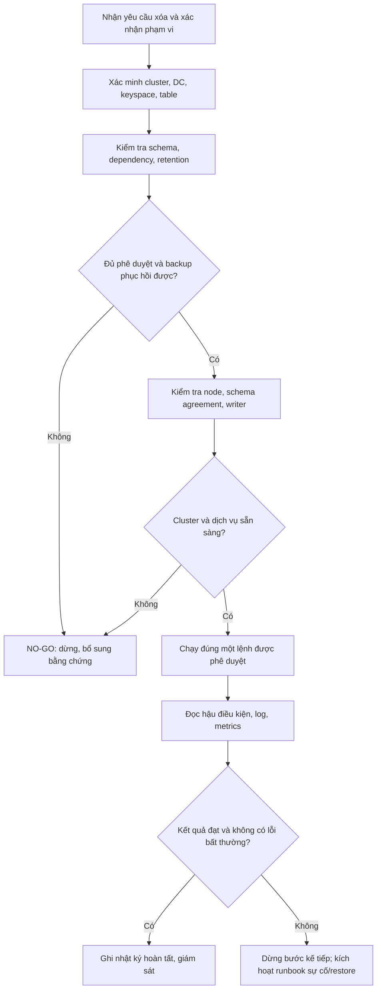

# TRUNCATE/DROP và các điều kiện an toàn trước thao tác

## 1. Tại sao TRUNCATE và DROP cần quy trình kiểm soát đặc biệt?

Trong Apache Cassandra, `TRUNCATE` và các câu lệnh `DROP` là những thao tác **có phạm vi phá hủy lớn**. Chúng không giống một truy vấn `SELECT` để quan sát dữ liệu, cũng không giống `DELETE` có điều kiện theo khóa chính nhằm xóa một số hàng. Một lệnh `TRUNCATE` có thể xóa toàn bộ dữ liệu của một bảng; `DROP TABLE` xóa cả định nghĩa bảng; `DROP KEYSPACE` còn mở rộng phạm vi đến tất cả đối tượng và dữ liệu bên trong keyspace.

Trong chương **Keyspace và schema** của module `DATABASE_ENGINE_WIDE_COLUMN_CASSANDRA`, người học cần đặt các thao tác này vào bối cảnh cơ sở dữ liệu wide-column **phân tán**: dữ liệu có thể nằm trên nhiều replica ở nhiều node/DC; ứng dụng Java có thể dùng prepared statement và mapper phụ thuộc schema; replication, consistency level (CL), compaction, repair và kế hoạch sao lưu đều ảnh hưởng khả năng khôi phục và chất lượng vận hành.

Mục tiêu bài học:

1. Phân biệt chính xác `TRUNCATE`, `DROP TABLE`, `DROP KEYSPACE` và `DELETE`.
2. Nhận diện những điều kiện phải được xác minh **trước khi** chạy lệnh phá hủy.
3. Kiểm tra tên cluster, keyspace, table, phụ thuộc, quyền, trạng thái node và schema agreement.
4. Hiểu vai trò của snapshot/backup, giới hạn khôi phục và vì sao `IF EXISTS` không phải cơ chế bảo vệ dữ liệu.
5. Viết runbook thao tác an toàn và biết cách ứng dụng Java phải phản ứng khi bảng bị truncate/drop.

> **Nguyên tắc:** Không có phép thử CQL nào đảm bảo một lệnh phá hủy là “an toàn” chỉ vì nó chạy thành công. Điều kiện an toàn phải được chứng minh **trước khi thực thi**, rồi kiểm tra hậu điều kiện sau đó.

## 2. So sánh TRUNCATE, DROP và DELETE

| Lệnh | Phạm vi | Định nghĩa bảng/keyspace còn không? | Dữ liệu chịu ảnh hưởng | Trường hợp điển hình |
| --- | --- | --- | --- | --- |
| `DELETE ... WHERE ...` | Hàng hoặc cột theo điều kiện khóa được hỗ trợ | Còn | Những hàng/cell được chỉ định; sử dụng tombstone | Xóa dữ liệu nghiệp vụ có chọn lọc |
| `TRUNCATE [TABLE] ks.tbl` | **Toàn bộ một bảng** | **Còn bảng** | Toàn bộ dữ liệu thuộc bảng, không cần `WHERE` | Làm rỗng bảng thử nghiệm hoặc bảng có thể tái tạo |
| `DROP TABLE [IF EXISTS] ks.tbl` | **Một bảng** | **Không còn bảng** | Schema và dữ liệu của bảng bị xóa | Thu hồi bảng cũ sau migration |
| `DROP KEYSPACE [IF EXISTS] ks` | **Cả keyspace** | **Không còn keyspace** | Mọi bảng và đối tượng bên trong phạm vi keyspace | Hủy môi trường lab hoặc keyspace đã ngừng dùng |

### TRUNCATE không phải DELETE không có WHERE

Trong Cassandra, `TRUNCATE` là thao tác làm rỗng **toàn bảng**, không có điều kiện `WHERE` để giới hạn một partition. Trái lại, `DELETE` thường phải được thiết kế theo khóa chính và các ràng buộc truy vấn CQL; xóa từng hàng/cell tạo tombstone và có vòng đời liên quan compaction, `gc_grace_seconds` và repair.

`TRUNCATE` không tương đương với việc phát ra hàng triệu `DELETE` theo partition key. Cơ chế dọn dữ liệu và tác động lưu trữ khác nhau; không dùng mô hình tombstone của một `DELETE` thông thường để suy luận rằng có thể “undo” lệnh truncate bằng cách bỏ tombstone.

### DROP TABLE không chỉ xóa dữ liệu

Sau `DROP TABLE`, các câu `SELECT`, `INSERT`, `UPDATE` hay prepared statement tham chiếu bảng sẽ không còn một định nghĩa hợp lệ. Nếu ứng dụng Java vẫn đang chạy, lỗi có thể xuất hiện trên nhiều service dù quá trình drop chỉ thực hiện một lần.

### DROP KEYSPACE có phạm vi rộng nhất

`DROP KEYSPACE` xóa namespace cùng các đối tượng thuộc nó, không phải chỉ một bảng do người vận hành đang nhìn thấy. Các bảng, kiểu dữ liệu do người dùng định nghĩa và những đối tượng schema khác thuộc keyspace đều bị ảnh hưởng theo ràng buộc phiên bản. Chỉ xem một bảng trước khi xóa keyspace là **không đủ**.

## 3. Các mẫu cú pháp CQL và điều kiện quan trọng

Các câu dưới đây là **mẫu để học cú pháp**; tuyệt đối không thay tên bằng keyspace production rồi chạy thử.

```sql
-- Làm rỗng dữ liệu của một bảng; bảng vẫn tồn tại.
TRUNCATE safety_lab.temp_events;

-- Tên TABLE là tùy chọn trong các phiên bản CQL hỗ trợ dạng này.
TRUNCATE TABLE safety_lab.temp_events;

-- Xóa định nghĩa và dữ liệu của một bảng.
DROP TABLE IF EXISTS safety_lab.temp_events;

-- Xóa toàn bộ keyspace, chỉ dùng khi được phép hủy toàn bộ.
DROP KEYSPACE IF EXISTS safety_lab;
```

`IF EXISTS` được hỗ trợ với các lệnh `DROP` tương ứng để tránh báo lỗi **nếu đối tượng không tồn tại**. Nó **không** kiểm tra bảng rỗng, không xác nhận môi trường lab, không xác nhận owner, không sao lưu và không yêu cầu thêm phê duyệt.

Nếu bảng hoặc keyspace **có tồn tại** và quyền thực thi cho phép, `DROP ... IF EXISTS` vẫn có thể xóa nó. Một typo khiến lệnh trỏ tới tên bảng có thật ở production có thể gây sự cố nghiêm trọng dù có `IF EXISTS`.

Cú pháp chính xác của một số tùy chọn điều kiện và hành vi khi đối tượng có phụ thuộc có thể khác theo phiên bản Cassandra. Không suy đoán có thể thêm `IF EXISTS` cho **mọi** biến thể `TRUNCATE`, hoặc rằng các câu DDL hỗ trợ transaction/rollback chung.

## 4. Mười điều kiện an toàn phải xác nhận trước khi thực thi

Đề xuất checklist theo mô hình **GO/NO-GO**:

| Cửa kiểm tra | Câu hỏi bắt buộc | Bằng chứng nên có |
| --- | --- | --- |
| 1. Mục tiêu | Có đúng cluster, DC, môi trường và endpoint cần thao tác không? | Cấu hình phiên kết nối, tên cluster, `nodetool status` |
| 2. Đối tượng | Tên đầy đủ `keyspace.table` đã xác minh chính xác chưa? | `system_schema`, `DESCRIBE`, thông tin owner |
| 3. Phạm vi | Cần xóa **dữ liệu**, **một bảng**, hay **cả keyspace**? | Mục tiêu nghiệp vụ và lệnh được phê duyệt |
| 4. Phụ thuộc | Có service Java, job, index, view, ETL/CDC, consumer nào còn dùng không? | Danh sách query, dependency map, log sử dụng |
| 5. Dữ liệu | Có dữ liệu phải giữ vì nghiệp vụ, pháp lý, kiểm toán hoặc điều tra sự cố không? | Chính sách retention, sự đồng ý của data owner |
| 6. Khôi phục | Có backup/snapshot đầy đủ, lưu ở nơi phù hợp và **đã thử restore** chưa? | Manifest, tag, checksum, hướng dẫn phục hồi |
| 7. Trạng thái cluster | Node/replica cần thiết có sẵn không, schema có agreement không? | `nodetool status`, `describecluster`, cảnh báo hệ thống |
| 8. Quyền và phê duyệt | Tài khoản nào thực thi, ai phê duyệt, cần hai người xác nhận không? | Change ticket, vai trò CQL, ghi nhận phê duyệt |
| 9. Cửa sổ thao tác | Đã ngừng writer/retry/cron và có kế hoạch thông báo gián đoạn chưa? | Maintenance window, feature flag, trạng thái các job |
| 10. Hậu điều kiện | Sau thao tác sẽ kiểm tra gì, ai quyết định thành công/dừng và phục hồi? | Runbook, câu CQL read-only, metrics/alert |

**Nếu một điều kiện quan trọng chưa có câu trả lời xác minh được, hãy chọn NO-GO.** “Bảng chắc không ai dùng” hoặc “script chạy nhiều lần rồi” không phải bằng chứng.

### Một mô hình thao tác hai người

Người đề xuất xác định **tên đầy đủ, phạm vi, lý do và bản backup**. Người phê duyệt độc lập kiểm tra cùng thông tin trên cluster thực tế. Chỉ sau khi xác nhận, người vận hành mới chạy đúng câu lệnh đã được chuẩn bị.

Điều này quan trọng hơn việc cố chèn một mệnh đề CQL “an toàn” vào lệnh, bởi CQL không có chế độ `DROP ... ONLY IF BACKUP VERIFIED`.

## 5. Preflight: kiểm tra đúng cluster và trạng thái hệ thống

Trước khi đụng tới dữ liệu, kiểm tra topology từ node Cassandra:

```bash
nodetool status
nodetool describecluster
```

`nodetool status` cho biết node và DC được quan sát ở trạng thái nào; một số trạng thái ví dụ như `UN` (*Up/Normal*) hoặc `DN` (*Down/Normal*). Cần nhận diện node down, đang bootstrap/decommission hoặc sự cố liên DC.

`nodetool describecluster` thường hiển thị các nhóm **Schema versions**. Nếu node đang hoạt động bị chia thành nhiều phiên bản schema, **không** tiếp tục DDL phá hủy trong khi chưa tìm hiểu nguyên nhân.

Trong `cqlsh`, kiểm tra node đang kết nối:

```sql
SELECT key, cluster_name, data_center, rack, schema_version
FROM system.local
WHERE key = 'local';
```

`system.local` là metadata **của node phục vụ truy vấn**, không chứng minh mọi node đều ở cùng trạng thái. Nếu phiên kết nối được cân bằng tải, không giả định hai lần chạy truy vấn đã hỏi hai node khác nhau.

### Vì sao node down là một dấu hiệu nguy hiểm?

Trong một cluster phân tán, `TRUNCATE` cần bảo đảm thao tác làm rỗng được xử lý theo cơ chế cluster. Các phiên bản Cassandra có thể từ chối truncate khi không thể liên lạc/hoàn thành với những node cần thiết; tuyệt đối không dựa vào giả định “còn quorum là truncate sẽ an toàn”.

Đối với `DROP`, schema change cũng cần lan truyền. Một node đang down có thể chưa biết metadata mới; khi node trở lại phải được đồng bộ schema đúng cách. Chính sách cho phép thao tác trong tình trạng node down phải dựa vào runbook và phiên bản Cassandra, **không** suy ra trực tiếp từ CL của một câu `SELECT`.

## 6. Preflight: xác định đúng keyspace, bảng và phụ thuộc

Các câu sau **chỉ đọc metadata**, hữu ích trước mọi thao tác phá hủy:

```sql
-- Xác minh keyspace mục tiêu và replication.
SELECT keyspace_name, replication, durable_writes
FROM system_schema.keyspaces
WHERE keyspace_name = 'safety_lab';

-- Liệt kê tất cả các bảng trong keyspace.
SELECT table_name, comment
FROM system_schema.tables
WHERE keyspace_name = 'safety_lab';

-- Xem định nghĩa cột/khóa của bảng đích.
SELECT column_name, kind, position, type
FROM system_schema.columns
WHERE keyspace_name = 'safety_lab'
  AND table_name = 'temp_events';

-- Phát hiện index được khai báo trong keyspace.
SELECT table_name, index_name, kind
FROM system_schema.indexes
WHERE keyspace_name = 'safety_lab';

-- Phát hiện materialized view, nếu có.
SELECT view_name, base_table_name
FROM system_schema.views
WHERE keyspace_name = 'safety_lab';

-- Kiểm tra các UDT của keyspace.
SELECT type_name
FROM system_schema.types
WHERE keyspace_name = 'safety_lab';
```

Các truy vấn này cho biết **schema mà coordinator hiện tại nhìn thấy**. Với hệ thống production, kết hợp cùng schema agreement và, khi cần, kiểm tra metadata ở nhiều node để tránh đọc trạng thái chưa đồng bộ.

Để xem DDL dễ đọc trong `cqlsh`:

```sql
DESCRIBE KEYSPACE safety_lab;
DESCRIBE TABLE safety_lab.temp_events;
```

`DESCRIBE` là tiện ích `cqlsh`; driver Java thường dùng `system_schema` hoặc metadata API thay vì gửi nguyên `DESCRIBE` như một truy vấn CQL.

### Phụ thuộc không nằm hết trong system_schema

`system_schema` giúp phát hiện index/view/type, nhưng không liệt kê đầy đủ những chương trình đang sử dụng bảng. Cần kiểm tra thêm:

- Repository mã nguồn, prepared statements, mapper và các câu CQL động.
- API Java, batch job, scheduler, consumer, CDC/ETL và truy vấn phân tích.
- Dữ liệu được phi chuẩn hóa sang các bảng khác, nơi logic nghiệp vụ dựa vào bản gốc.
- Kho báo cáo, dashboard, quy trình dữ liệu và dịch vụ còn chạy phiên bản cũ.
- Cơ chế retry hoặc hàng đợi có thể ghi trở lại bảng sau khi tưởng rằng đã dừng writer.

Đối với `DROP KEYSPACE`, kiểm tra **toàn bộ** danh sách bảng, type, index/view, không chỉ một bảng duy nhất.

## 7. Lab tạo dữ liệu nhỏ và xác minh trước khi xóa

Phần thực hành này chỉ dùng trong **cluster lab riêng**, với keyspace `safety_lab` và dữ liệu giả có thể xóa. Giả sử `nodetool status` cho biết DC thật tên `datacenter1`, chỉ có một node. Nếu DC khác tên, phải thay cho đúng; RF = 1 chỉ phù hợp lab một node.

### Bước 1 — Tạo keyspace lab

```sql
CREATE KEYSPACE IF NOT EXISTS safety_lab
WITH replication = {
    'class': 'NetworkTopologyStrategy',
    'datacenter1': '1'
}
AND durable_writes = true;
```

Nếu `safety_lab` đã tồn tại, `IF NOT EXISTS` không xác nhận RF hoặc cấu trúc đã đúng. Chỉ tiếp tục nếu đây là keyspace lab bạn sở hữu và dữ liệu có thể xóa hoàn toàn.

### Bước 2 — Tạo bảng thử nghiệm

```sql
CREATE TABLE IF NOT EXISTS safety_lab.temp_events (
    device_id text,
    event_time timestamp,
    event_id uuid,
    message text,
    PRIMARY KEY ((device_id), event_time, event_id)
) WITH CLUSTERING ORDER BY (event_time DESC, event_id ASC)
  AND comment = 'Disposable training data only';
```

`device_id` là partition key. Mặc dù bảng trong lab được đặt tên `temp_events`, **tên “temp” và comment không biến nó thành bảng tạm tự động xóa**; Cassandra không suy ra chính sách hủy dữ liệu từ chuỗi tên.

### Bước 3 — Chèn vài hàng và đọc kiểm chứng

```sql
INSERT INTO safety_lab.temp_events (
    device_id, event_time, event_id, message
) VALUES (
    'sensor-01', '2026-11-21T08:00:00Z',
    aaaaaaaa-aaaa-4aaa-8aaa-aaaaaaaaaaaa, 'one'
);

INSERT INTO safety_lab.temp_events (
    device_id, event_time, event_id, message
) VALUES (
    'sensor-01', '2026-11-21T08:01:00Z',
    bbbbbbbb-bbbb-4bbb-8bbb-bbbbbbbbbbbb, 'two'
);

SELECT event_time, event_id, message
FROM safety_lab.temp_events
WHERE device_id = 'sensor-01';
```

Việc truy vấn **theo partition key** giúp xác nhận dữ liệu thử của chính bạn. Nó không chứng minh một bảng production không có dữ liệu ngoài partition được thử.

### Bước 4 — Ghi lại trạng thái trước thao tác

```sql
SELECT table_name, comment
FROM system_schema.tables
WHERE keyspace_name = 'safety_lab'
  AND table_name = 'temp_events';
```

Lưu thông tin rằng bảng có schema, hàng thử và phạm vi cần làm rỗng. Nếu thực sự cần khả năng phục hồi lab, hãy tạo bản backup/snapshot và kiểm chứng trước.

## 8. TRUNCATE: làm rỗng toàn bảng nhưng giữ cấu trúc

**Chỉ trong lab được phép xóa**, sau khi hoàn tất preflight:

```sql
-- Phá hủy dữ liệu: chỉ thực hiện với dữ liệu lab không cần giữ.
TRUNCATE safety_lab.temp_events;
```

### Hậu điều kiện mong đợi

```sql
-- Dữ liệu thử theo partition key không còn.
SELECT event_time, event_id, message
FROM safety_lab.temp_events
WHERE device_id = 'sensor-01';

-- Định nghĩa bảng vẫn tồn tại.
SELECT table_name
FROM system_schema.tables
WHERE keyspace_name = 'safety_lab'
  AND table_name = 'temp_events';
```

Sau một truncate thành công trên lab:

- Dữ liệu của bảng bị loại bỏ theo cơ chế truncate; các hàng thử không còn được đọc như trước.
- **Tên bảng, các cột và PRIMARY KEY vẫn tồn tại**; có thể tiếp tục `INSERT` vào bảng đó.
- Những bảng khác trong cùng keyspace không bị truncate chỉ vì cùng namespace.
- Code Java đang ghi vào bảng **có thể tiếp tục ghi dữ liệu mới** ngay sau thao tác, trừ khi writer đã được dừng. Vì thế “bảng rỗng ngay sau truncate” không đảm bảo “bảng sẽ luôn rỗng”.

### Vì sao không dùng TRUNCATE như công cụ xóa theo điều kiện?

`TRUNCATE` không có `WHERE device_id = ...`. Nếu yêu cầu nghiệp vụ là xóa dữ liệu của **một** thiết bị hoặc một thời gian cụ thể, phải thiết kế phương án `DELETE` với khóa/điều kiện được Cassandra hỗ trợ, hoặc chiến lược retention/TTL thích hợp. Không thể biến truncate thành “xóa nhanh một partition” bằng cách thêm filter.

### Ảnh hưởng lưu trữ và tombstone

`TRUNCATE` có cơ chế loại bỏ dữ liệu khác với hàng loạt row-level `DELETE` và không tạo một tombstone riêng cho từng hàng theo cách xóa hàng thông thường. Tuy nhiên, **đừng mặc định** thao tác này cho phép phục hồi dữ liệu hoặc rằng mọi bản sao lưu/snapshot đã bị xóa. Việc lưu snapshot tự động, metadata truncation và dọn SSTable phụ thuộc phiên bản/cấu hình Cassandra.

Không dùng tính chất “nhanh hơn delete hàng loạt” làm lý do bỏ qua backup hay chạy truncate trên bảng production đang có dữ liệu bắt buộc phải giữ.

## 9. DROP TABLE: xóa định nghĩa và dữ liệu của bảng

Đối với bài học, chỉ sau khi đã truncate hoặc xác minh dữ liệu lab có thể xóa, mới cân nhắc:

```sql
-- Phá hủy cả dữ liệu lẫn định nghĩa bảng: chỉ chạy trên lab đã kiểm chứng.
DROP TABLE IF EXISTS safety_lab.temp_events;
```

Kiểm tra hậu điều kiện:

```sql
SELECT table_name
FROM system_schema.tables
WHERE keyspace_name = 'safety_lab'
  AND table_name = 'temp_events';

-- Keyspace vẫn tồn tại nếu chỉ DROP TABLE.
SELECT keyspace_name
FROM system_schema.keyspaces
WHERE keyspace_name = 'safety_lab';
```

Khi bảng đã được drop và schema đã đồng bộ:

- Metadata định nghĩa bảng không còn.
- Truy vấn `SELECT`/`INSERT` tới bảng cũ không còn hợp lệ.
- Keyspace còn tồn tại; các bảng khác không bị xóa chỉ vì thao tác drop một bảng.
- Index và view phụ thuộc có thể khiến lệnh bị từ chối hoặc phải được xử lý theo quy tắc phiên bản và loại đối tượng; **không** tự giả định có cascade an toàn.

### Vì sao DROP TABLE là rủi ro lớn với ứng dụng Java?

Prepared statement, mapper, repository, background job hoặc API vẫn dùng tên bảng cũ có thể thất bại trên coordinator đã nhận schema mới. Khi nhiều version ứng dụng chạy cùng lúc, không được drop bảng cũ chỉ vì v2 đã chuyển sang bảng mới; phải chứng minh **v1, job cũ và đường rollback** không còn cần nó.

### DROP không tự “undo” bằng CREATE

Chạy `CREATE TABLE` lại với cấu trúc giống trước **không** tự phục hồi các hàng đã mất. Việc tên bảng được dùng lại không bảo đảm ID nội bộ và metadata storage giống lần trước. Muốn khôi phục cần quy trình restore dữ liệu phù hợp với snapshot/backup, schema và phiên bản Cassandra, đã được thử nghiệm trước thao tác.

## 10. DROP KEYSPACE: xóa toàn bộ namespace

Đây là thao tác có phạm vi lớn nhất trong bài. Chỉ sử dụng khi **tất cả đối tượng** thuộc keyspace đều được xác nhận có thể xóa:

```sql
-- Chỉ xóa keyspace lab đã xác minh, không dùng trên production.
DROP KEYSPACE IF EXISTS safety_lab;
```

Sau khi schema agreement, đọc:

```sql
SELECT keyspace_name
FROM system_schema.keyspaces
WHERE keyspace_name = 'safety_lab';
```

Nếu không còn metadata keyspace, namespace đó không còn được khai báo trong schema được đọc. Điều này **không** phải bằng chứng rằng mọi tệp snapshot cũ đã bị xóa hoặc rằng tất cả ứng dụng đã ngừng tham chiếu tên keyspace đó.

### Điều kiện bổ sung trước DROP KEYSPACE

1. Liệt kê **mọi bảng**, UDT, index/view và đối tượng do ứng dụng quản lý.
2. Xác nhận không có dữ liệu hoặc dependency cần giữ trong **bất cứ bảng nào**.
3. Xác nhận cluster/endpoint/môi trường; không có nguy cơ trùng tên keyspace lab với production.
4. Lưu schema DDL và dữ liệu cần giữ theo kế hoạch phục hồi.
5. Dừng writer, job, stream và consumer dùng bất cứ bảng nào trong keyspace.
6. Có phê duyệt riêng cho phạm vi xóa rộng hơn một bảng.

**Đặc biệt:** không dùng lệnh `DROP KEYSPACE` trên `system`, `system_schema`, `system_auth` hay keyspace nội bộ khác để “dọn dẹp”. Chúng do Cassandra quản lý; sửa/xóa trực tiếp có thể làm hỏng cluster hoặc bảo mật.

## 11. Snapshot, backup và restore: chuẩn bị trước khi phá hủy

### Snapshot không tự đồng nghĩa backup an toàn

Snapshot của Cassandra thường dựa trên dữ liệu SSTable tại node và cơ chế file liên quan; lệnh tạo snapshot bằng `nodetool` giúp ghi lại trạng thái tại thời điểm kiểm tra. Ví dụ:

```bash
# Ví dụ minh họa cho keyspace lab; xác minh cú pháp nodetool theo phiên bản.
nodetool snapshot -t before_cleanup_lab safety_lab
```

Đây chỉ là **một phần quy trình**: trong cluster nhiều node, phải xác nhận các node liên quan được snapshot theo kế hoạch, có dữ liệu/schema cần thiết, bản snapshot được sao lưu ra nơi an toàn, có kiểm tra tính toàn vẹn và có quy trình restore thử nghiệm.

Không phụ thuộc vào khả năng *auto_snapshot* khi `TRUNCATE` hoặc `DROP`: tính năng, mặc định và nội dung snapshot có thể khác theo phiên bản/cấu hình; không bảo đảm rằng dữ liệu luôn còn sẵn cho phục hồi. Ngoài ra, snapshot **không tự lưu toàn bộ cấu hình ứng dụng, quyền, secret hay dependency hệ thống**.

### Bốn câu hỏi cần có bằng chứng

| Câu hỏi | Ví dụ bằng chứng |
| --- | --- |
| Backup này bao gồm những gì? | Keyspace/table, schema DDL, SSTable và node/DC liên quan |
| Dữ liệu có ra khỏi môi trường có nguy cơ mất không? | Bản copy ra kho backup ngoài node cùng chính sách retention |
| Có thể phục hồi trong giới hạn RPO/RTO không? | Kết quả diễn tập restore vào môi trường tách biệt |
| Làm sao đối chiếu bản phục hồi? | Metadata, số lượng/tập khóa mẫu, checksum ở lớp ứng dụng, kiểm thử truy vấn |

### Trình tự khôi phục phải được thiết kế trước

Khôi phục bảng đã drop không chỉ là chạy lại câu `CREATE TABLE`; có thể cần tái tạo schema tương thích, restore SSTable qua quy trình được hỗ trợ, thực hiện streaming/repair theo topology và kiểm tra dữ liệu. Phương án cụ thể tùy phiên bản Cassandra, cơ chế backup và số node/DC.

Không khẳng định “có snapshot là rollback được ngay”: snapshot không xóa bỏ rủi ro downtime, mất các ghi sau thời điểm chụp hoặc thiếu phụ thuộc schema.

## 12. TRUNCATE/DROP trong cluster nhiều node: những điều cần nhớ

### Schema agreement và dữ liệu là hai lớp khác nhau

`DROP TABLE` và `DROP KEYSPACE` là DDL thay đổi schema; cần đợi và xác minh **schema agreement** trên các node thuộc phạm vi vận hành. `TRUNCATE` làm rỗng dữ liệu của bảng nhưng **không xóa định nghĩa bảng**; vì vậy schema agreement không phải tiêu chí duy nhất để tuyên bố truncate hoàn tất. Phải xem kết quả thao tác, sức khỏe node và thực tế dữ liệu.

| Kiểm tra | TRUNCATE | DROP TABLE/KEYSPACE |
| --- | --- | --- |
| Đúng đối tượng và môi trường | Bắt buộc | Bắt buộc |
| Node/replica cần thiết sẵn sàng | Bắt buộc đánh giá | Bắt buộc đánh giá |
| Trạng thái dữ liệu sau thao tác | Phải xác minh theo tập dữ liệu và giám sát | Không còn truy vấn dữ liệu từ đối tượng đã drop |
| Schema agreement | Schema vẫn còn; kiểm tra khi có DDL liên quan hoặc nghi lệch | Phải xác minh sau DDL |
| Phụ thuộc Java/service/job | Dữ liệu có thể được ghi lại | Query/mapper có thể bị lỗi ngay |
| Backup/restore | Không được bỏ qua | Không được bỏ qua |

### Consistency level không phải công tắc an toàn

Một ghi ở `LOCAL_QUORUM` hoặc đọc ở `ONE` xác định số phản hồi replica theo CL của statement dữ liệu. Nó không biến `TRUNCATE` thành thao tác có điều kiện và không tự chứng minh rằng `DROP` đã được mọi node nhận.

### Repair và compaction không phải nút hoàn tác

Repair giúp đồng bộ dữ liệu giữa replica theo cơ chế Cassandra, không phải công cụ “khôi phục bảng đã drop”. Compaction quản lý SSTable/tombstone, không phải bản backup. Nếu một quy trình phá hủy đã hoàn tất, **không** chạy repair rồi kỳ vọng dữ liệu cũ tự trở lại.

## 13. Runbook thao tác an toàn có điểm dừng rõ ràng



### Trước cửa sổ thao tác

- Tạo change ticket chỉ rõ **câu CQL dự kiến** và tên đầy đủ của đối tượng.
- Đối chiếu môi trường với cấu hình kết nối và `nodetool`; xác nhận phiên bản Cassandra.
- Liệt kê bảng/UDT/index/view và các client đang hoạt động; bảo đảm owner phê duyệt.
- Kiểm tra retention và chính sách lưu giữ, chuẩn bị backup/snapshot, chạy diễn tập restore.
- Chuẩn bị kế hoạch ngừng writer và bảo đảm không có retry/job lập tức tái tạo dữ liệu.

### Trong cửa sổ thao tác

- Đặt dịch vụ vào trạng thái bảo trì phù hợp; xác nhận các luồng ghi liên quan đã dừng.
- Kiểm tra lại metadata và node health **ngay trước** khi thực thi.
- Người vận hành chạy **một lệnh đúng phạm vi**, không ghép nhiều `DROP` trong một script mơ hồ.
- Nếu câu lệnh timeout hoặc trạng thái không chắc chắn, **không** phát lại vô điều kiện. Trước hết đọc trạng thái thực tế và log để xác định đã áp dụng đến đâu.

### Sau cửa sổ thao tác

- Với `TRUNCATE`: xác minh bảng còn tồn tại và các hàng thử không còn theo tiêu chí, đồng thời quan sát writer có ghi lại dữ liệu hay không.
- Với `DROP TABLE`: xác minh bảng không còn trong `system_schema.tables`, keyspace vẫn còn, schema đã agreement.
- Với `DROP KEYSPACE`: xác minh keyspace không còn trong `system_schema.keyspaces`, trạng thái node/ứng dụng phù hợp.
- Ghi nhận thời điểm, người vận hành, backup tag, kết quả kiểm tra và theo dõi lỗi Java.

## 14. Tích hợp Java Driver: chặn thao tác nhầm bằng preflight

Ứng dụng Java bình thường **không nên tự `TRUNCATE` hoặc `DROP` khi startup**, càng không nên cho API bên ngoài tự ghép tên bảng vào câu DDL. Đó là nhiệm vụ migration/operation có quyền và phê duyệt riêng.

Ví dụ **chỉ đọc metadata** bằng Cassandra Java Driver 4.x, với `CqlSession session` đã được cấu hình/khởi tạo bên ngoài:

```java
import com.datastax.oss.driver.api.core.CqlSession;
import com.datastax.oss.driver.api.core.cql.PreparedStatement;
import com.datastax.oss.driver.api.core.cql.Row;

// Chỉ kiểm tra tên keyspace và bảng lab; KHÔNG thực hiện TRUNCATE/DROP.
final String expectedKeyspace = "safety_lab";
final String expectedTable = "temp_events";

PreparedStatement keyspaceStatement = session.prepare("""
    SELECT keyspace_name
    FROM system_schema.keyspaces
    WHERE keyspace_name = ?
    """);
Row keyspace = session.execute(
    keyspaceStatement.bind(expectedKeyspace)).one();

PreparedStatement tableStatement = session.prepare("""
    SELECT table_name, comment
    FROM system_schema.tables
    WHERE keyspace_name = ? AND table_name = ?
    """);
Row table = session.execute(
    tableStatement.bind(expectedKeyspace, expectedTable)).one();

if (keyspace == null || table == null) {
    throw new IllegalStateException(
        "Không tìm thấy đúng keyspace/bảng đã phê duyệt; dừng thao tác");
}

if (!"Disposable training data only".equals(table.getString("comment"))) {
    throw new IllegalStateException(
        "Không khớp comment nhận diện của lab; yêu cầu kiểm tra lại");
}

// Chỉ là một điều kiện nhận diện bổ sung, KHÔNG chứng minh dữ liệu xóa được.
// Việc thực thi DDL phải do runbook vận hành và phê duyệt bên ngoài kiểm soát.
```

Java text block cần Java 15 trở lên. `?` trong prepared statement dùng cho **giá trị** `keyspace_name`/`table_name`; không thể dùng bind marker để thay thế trực tiếp identifier trong `TRUNCATE ks.tbl` hoặc `DROP TABLE ks.tbl`. Không ghép identifier đến từ đầu vào HTTP tùy ý thành DDL: nếu buộc phải sinh lệnh, chỉ dùng danh sách tên tin cậy đã được phê duyệt, escape/quote đúng quy tắc CQL và cơ chế kiểm soát quyền riêng biệt.

### Comment không phải bằng chứng duy nhất

Trong ví dụ, kiểm tra comment giúp phát hiện nhầm mục tiêu nhưng **không phải hàng rào an toàn**: comment có thể bị đặt sai hoặc cố ý sửa. Production cần kiểm chứng cluster, account, quyền, backup, dependency, owner và phê duyệt từ nguồn độc lập.

### Nếu schema thay đổi trong khi Java còn chạy

`DROP TABLE` làm prepared statements và code cũ tham chiếu bảng không còn hợp lệ. Tùy driver và trạng thái schema, ứng dụng có thể gặp lỗi query/prepare hoặc cần refresh metadata; **không** nên khắc phục bằng cách tự tạo lại bảng rồi ghi tiếp khi chưa có quyết định vận hành. `TRUNCATE` giữ bảng nhưng có thể làm ứng dụng thấy dữ liệu rỗng; phải có hợp đồng nghiệp vụ rõ về việc này.

## 15. Lỗi thường gặp và cách xử lý

| Sai lầm/triệu chứng | Nguyên nhân hoặc rủi ro | Cách xử lý |
| --- | --- | --- |
| Dùng `TRUNCATE` để xóa một partition | `TRUNCATE` không có `WHERE` | Xây dựng `DELETE` theo khóa hợp lệ hoặc chiến lược retention |
| `DROP TABLE IF EXISTS` được coi là “an toàn” | Chỉ bỏ lỗi nếu **không tồn tại**, không kiểm tra dữ liệu | Áp checklist phê duyệt, backup, dependency |
| Xóa bảng ở sai cluster | Endpoint/môi trường nhầm | Xác minh tên cluster, DC, account, schema trước |
| Xóa keyspace vì tưởng chỉ có một bảng | Chưa liệt kê toàn bộ object | Truy vấn `system_schema.tables/types/indexes/views` |
| `TRUNCATE` xong dữ liệu xuất hiện lại | Writer/job vẫn ghi mới, hoặc kiểm tra chưa chính xác | Dừng writer và điều tra thời điểm ghi, không tự lặp truncate |
| `TRUNCATE` bị lỗi khi node không sẵn sàng | Không thỏa điều kiện cluster của thao tác | Kiểm tra node/network/log, không giả định CL quorum là đủ |
| `DROP TABLE` xong Java báo thiếu bảng | Service/statement vẫn phụ thuộc schema cũ | Rollout tương thích, dừng/đổi client trước khi drop |
| `CREATE TABLE` lại nhưng dữ liệu không trở lại | Tạo schema mới không phải restore dữ liệu | Phục hồi theo backup/snapshot có kiểm chứng |
| Tự tin vì auto-snapshot bật | Cấu hình/phiên bản/chính sách retention khác kỳ vọng | Tạo và xác minh backup riêng, thử restore |
| `SELECT COUNT(*)` trên bảng lớn để chứng minh rỗng | Quét dữ liệu lớn có thể rất tốn tài nguyên | Dùng kiểm tra theo partition, metrics/tablestats và nguồn kiểm kê phù hợp |
| `nodetool describecluster` có một schema version nên cho rằng dữ liệu đã xóa hết | Agreement chỉ phản ánh schema | Xác minh kết quả truncate/data path và trạng thái node |
| Chạy nhiều lệnh phá hủy cùng lúc rồi không rõ lệnh nào thất bại | Thiếu thứ tự và nhật ký | Thực thi theo runbook từng bước, đọc hậu điều kiện |

### Không dùng `COUNT(*)` toàn bảng làm preflight mặc định

Trong Cassandra, `SELECT COUNT(*) FROM large_table` có thể phải đọc rất nhiều dữ liệu và gây tải đáng kể, không phải metadata count tức thời. Với bảng lớn, dùng metrics, `nodetool tablestats` theo phiên bản, phạm vi partition được biết và quy trình kiểm kê dữ liệu thích hợp. Những số liệu này cũng có sai số/phạm vi quan sát riêng, nên phải kết hợp với yêu cầu nghiệp vụ và backup.

## 16. Bài tập tự kiểm tra và tổng kết

### Bài tập A — Chọn lệnh theo yêu cầu

| Yêu cầu | Lựa chọn cần xem xét |
| --- | --- |
| Làm rỗng toàn bộ bảng dữ liệu lab, giữ cột/khóa để nạp lại | `TRUNCATE` sau kiểm tra an toàn |
| Ngừng dùng một bảng cũ sau migration và không còn phụ thuộc | `DROP TABLE` sau backup/phê duyệt |
| Hủy toàn bộ keyspace lab với mọi bảng thử nghiệm | `DROP KEYSPACE` sau khi liệt kê toàn bộ đối tượng |
| Xóa bản ghi theo một partition key cụ thể | `DELETE` với điều kiện khóa hợp lệ, **không** `TRUNCATE` |
| Thay partition key hoặc chuyển bảng sang truy vấn mới | Thiết kế bảng mới, dual-write/backfill/cutover, không dùng `TRUNCATE` để “migrate” |

### Bài tập B — Nhận diện NO-GO

Giả sử có yêu cầu `DROP KEYSPACE inventory_prod`. Cluster còn một node down, tài khoản ứng dụng cũ vẫn chạy job ghi vào một bảng thuộc keyspace và backup mới nhất chưa thử restore. Bạn nên làm gì?

**Đáp án:** **NO-GO**. Cần khắc phục/đánh giá node down, dừng hoặc chuyển toàn bộ client phụ thuộc, xác nhận dữ liệu/retention, có backup phục hồi được và phê duyệt trước khi xem xét thao tác. `IF EXISTS` không khắc phục bất cứ thiếu sót nào.

### Bài tập C — Hiểu giới hạn khôi phục

Sau `TRUNCATE safety_lab.temp_events`, một người đề xuất chạy `nodetool repair` để lấy dữ liệu cũ trở lại. Vì sao không đúng?

**Đáp án:** repair là cơ chế đồng bộ replica theo dữ liệu hợp lệ của cluster; nó không phải “undo” cho truncate. Muốn khôi phục dữ liệu đã bị xóa cần bản backup/snapshot phù hợp và quy trình restore đã được thử nghiệm.

### Câu hỏi ôn tập

1. `TRUNCATE` khác `DROP TABLE` về schema và dữ liệu như thế nào?
2. Tại sao `DROP KEYSPACE IF EXISTS` vẫn có thể gây mất dữ liệu nghiêm trọng?
3. Vì sao phải kiểm tra `nodetool status` bên cạnh schema agreement?
4. Ngoài `system_schema`, cần tìm phụ thuộc ứng dụng ở đâu?
5. Vì sao snapshot tồn tại không chứng minh restore chắc chắn thành công?
6. Khi nào nên dùng `DELETE` theo khóa thay vì truncate toàn bảng?
7. Vì sao không nên cho mỗi instance Java tự chạy lệnh phá hủy khi khởi động?

### Checklist GO/NO-GO cuối cùng

| Tiêu chí | GO khi |
| --- | --- |
| Cluster và môi trường | Đã đối chiếu endpoint, tên cluster, DC, tài khoản |
| Đối tượng | Đúng tên đầy đủ keyspace/table, có owner xác nhận |
| Phạm vi | Đã xác định xóa dữ liệu hay xóa cả schema, không nhầm phạm vi |
| Phụ thuộc | Không còn service/job/reader cần dữ liệu hoặc schema sẽ xóa |
| Dữ liệu và retention | Không vi phạm yêu cầu lưu giữ, kiểm toán, nghiệp vụ |
| Backup | Có bản lưu đủ phạm vi, restore đã được kiểm chứng |
| Node và schema | Cluster đáp ứng điều kiện thao tác, không có bất nhất chưa xử lý |
| Quyền và phê duyệt | Có thay đổi được duyệt, tài khoản đủ quyền nhưng tối thiểu |
| Writer và lịch trình | Đã chặn ghi mới/retry không mong muốn và có cửa sổ thao tác |
| Hậu điều kiện | Đã chuẩn bị câu kiểm tra, metric, quy trình xử lý lỗi và restore |

**Ghi nhớ:** `TRUNCATE` xóa dữ liệu nhưng giữ định nghĩa bảng; `DROP TABLE` xóa cả bảng; `DROP KEYSPACE` xóa namespace cùng các đối tượng trong phạm vi đó. Không có `IF EXISTS`, schema agreement hay consistency level nào tự biến một lệnh phá hủy thành thao tác an toàn. Chỉ thực hiện sau khi xác minh chính xác đối tượng, phụ thuộc, trạng thái cluster, backup phục hồi được và phê duyệt; sau đó đọc lại metadata và kiểm tra kết quả theo runbook.
