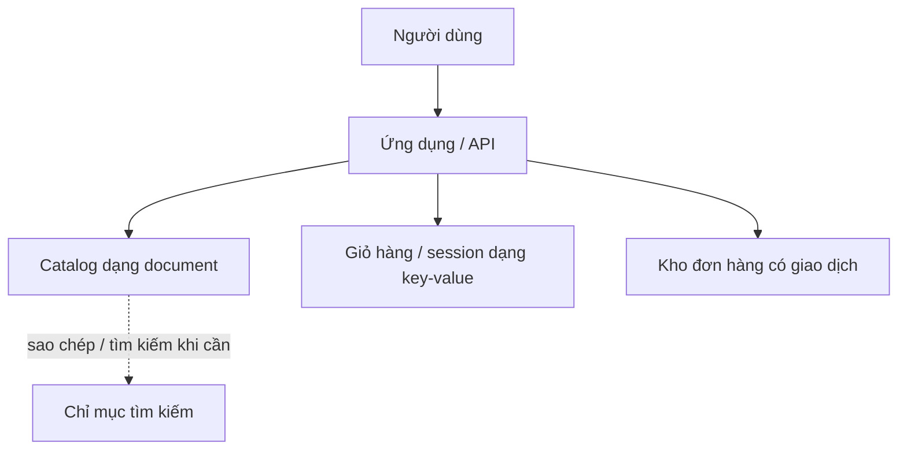

# Mục tiêu về khả năng mở rộng, tính sẵn sàng và sự linh hoạt của dữ liệu

Trong tư duy NoSQL, câu hỏi đầu tiên không phải là “nên dùng MongoDB, Redis hay Cassandra?”, mà là **hệ thống cần phục vụ khối lượng truy cập nào, phải tiếp tục hoạt động khi gặp sự cố ra sao và dữ liệu sẽ thay đổi như thế nào**. Ba mục tiêu thường dẫn đến việc cân nhắc NoSQL là **khả năng mở rộng (scalability)**, **tính sẵn sàng (availability)** và **sự linh hoạt của dữ liệu (data flexibility)**.

NoSQL là một nhóm phương pháp lưu trữ và truy vấn dữ liệu, không phải một mô hình duy nhất. Các hệ quản trị dạng document, key–value, wide-column và graph có cách phân phối dữ liệu, bảo đảm nhất quán và hỗ trợ truy vấn rất khác nhau. Vì vậy, ba mục tiêu trên là **những yêu cầu cần đánh giá**, không phải những thuộc tính mà mọi cơ sở dữ liệu NoSQL tự động đáp ứng.

## 1. Bắt đầu từ bài toán hệ thống

Giả sử một nền tảng thương mại điện tử có các yêu cầu sau:

- Danh mục sản phẩm từ vài nghìn tăng lên hàng chục triệu mục; lượng truy cập tăng mạnh trong các đợt khuyến mại.
- Người mua cần xem sản phẩm và giỏ hàng ngay cả khi một máy chủ cơ sở dữ liệu ngừng hoạt động.
- Mỗi nhóm sản phẩm có thông số khác nhau: điện thoại có dung lượng pin, giày có kích cỡ, sách có tác giả và ISBN.
- Đơn hàng và thanh toán phải giữ các ràng buộc nghiệp vụ chặt chẽ, chẳng hạn không ghi nhận cùng một khoản thanh toán hai lần.

Không nên gom toàn bộ yêu cầu vào một câu “dùng NoSQL để nhanh hơn”. Cần phân tách chúng:

| Yêu cầu thực tế | Mục tiêu kỹ thuật | Câu hỏi cần trả lời |
|---|---|---|
| Lưu thêm dữ liệu và phục vụ nhiều người dùng | Khả năng mở rộng | Có thể tăng năng lực bằng cách bổ sung tài nguyên hoặc nút mới không? |
| Dịch vụ vẫn phục vụ khi máy chủ hoặc vùng triển khai gặp sự cố | Tính sẵn sàng | Thành phần nào dự phòng, tự chuyển đổi khi lỗi và phục hồi trong bao lâu? |
| Thêm thuộc tính sản phẩm mà không phải thay đổi cấu trúc chung liên tục | Linh hoạt dữ liệu | Có thể biểu diễn nhiều cấu trúc, nhưng vẫn kiểm soát chất lượng và phiên bản dữ liệu không? |
| Giá tiền, tồn kho và thanh toán không bị sai | Tính đúng đắn và nhất quán | Những bất biến nào phải được bảo vệ bằng giao dịch hoặc quy tắc đồng bộ? |

Ba mục tiêu chính có thể hỗ trợ nhau nhưng cũng tạo ra đánh đổi. Tăng số bản sao có thể cải thiện khả năng chịu lỗi, song làm tăng chi phí đồng bộ. Phân mảnh dữ liệu giúp mở rộng dung lượng, song làm truy vấn xuyên phân mảnh khó hơn. Cho phép cấu trúc linh hoạt giúp phát triển sản phẩm nhanh, song đòi hỏi quản trị schema nghiêm túc.

## 2. Khả năng mở rộng: phục vụ tải tăng mà vẫn đạt chất lượng dịch vụ

**Khả năng mở rộng** là khả năng tăng năng lực của hệ thống khi lượng dữ liệu, số yêu cầu hoặc mức độ xử lý tăng lên. Một hệ thống được xem là mở rộng tốt khi bổ sung tài nguyên giúp duy trì các mục tiêu về độ trễ, thông lượng và độ ổn định trong điều kiện tải dự kiến.

### 2.1. Mở rộng dọc và mở rộng ngang

| Cách mở rộng | Cơ chế | Lợi ích | Giới hạn cần chú ý |
|---|---|---|---|
| **Dọc (vertical scaling / scale up)** | Tăng CPU, RAM, ổ đĩa hoặc I/O cho máy đang chạy | Đơn giản hơn về mặt phân phối dữ liệu; thường ít thay đổi ứng dụng | Bị giới hạn bởi phần cứng, chi phí máy lớn và điểm lỗi tập trung |
| **Ngang (horizontal scaling / scale out)** | Thêm nhiều nút để chia sẻ dữ liệu hoặc lưu lượng | Có thể tăng dần tài nguyên, phân phối tải và tăng khả năng chịu lỗi nếu thiết kế phù hợp | Phải giải quyết định tuyến, cân bằng dữ liệu, đồng bộ và lỗi mạng |

Nhiều hệ quản trị NoSQL được thiết kế hướng tới mở rộng ngang, nhưng **thêm ba nút không đồng nghĩa thông lượng tăng chính xác ba lần**. Còn có chi phí phối hợp, mạng, chỉ mục, ghi bản sao, nút nóng và giới hạn từ ứng dụng. Một hệ SQL cũng có thể mở rộng ngang; NoSQL không độc quyền khả năng này.

### 2.2. Phân mảnh dữ liệu (partitioning/sharding)

Khi một tập dữ liệu quá lớn hoặc quá bận để một nút xử lý, hệ thống có thể chia dữ liệu thành nhiều **partition** hoặc **shard**. Mỗi shard nắm một phần dữ liệu; bộ định tuyến hoặc lớp ứng dụng xác định yêu cầu phải đến đâu.

```text
                   Ứng dụng
                       |
               Bộ định tuyến dữ liệu
                /       |       \
               /        |        \
         Shard A     Shard B     Shard C
        khách 1..   khách ...    khách ...
```

Các chiến lược phổ biến:

- **Hash-based partitioning:** băm khóa phân vùng (ví dụ `customerId`) rồi ánh xạ sang shard. Thường phân phối dữ liệu tốt nếu khóa có độ đa dạng cao, nhưng truy vấn theo khoảng giá trị hoặc không chứa khóa có thể phải đi qua nhiều shard.
- **Range-based partitioning:** chia theo dải khóa (ví dụ khoảng thời gian hoặc mã định danh). Thuận tiện cho truy vấn theo khoảng, nhưng dữ liệu mới liên tục ghi vào cùng dải có thể tạo nút nóng.
- **Phân vùng theo địa lý hoặc tenant:** đặt dữ liệu theo khu vực hoặc khách hàng doanh nghiệp. Có lợi cho tính cục bộ và yêu cầu vị trí lưu trữ, nhưng cần xử lý phân bố tải không đều.

Ví dụ, nếu hầu hết thao tác đọc và ghi giỏ hàng đều đi theo `customerId`, đây có thể là khóa phân vùng hợp lý. Ngược lại, dùng một giá trị hầu như cố định như `country = "VN"` cho phần lớn dữ liệu sẽ dồn lưu lượng vào ít phân vùng. Lựa chọn khóa phân vùng cần dựa vào **mẫu truy cập**, độ phân tán của khóa và dự báo tăng trưởng.

> **Điểm cần phân biệt:** Sharding chia *dữ liệu và tải* giữa nhiều nút. Replication tạo *các bản sao* của dữ liệu, chủ yếu để tăng khả năng chịu lỗi hoặc phục vụ đọc. Hai kỹ thuật có thể kết hợp nhưng không thay thế cho nhau.

### 2.3. Mở rộng đọc, mở rộng ghi và dung lượng là ba bài toán khác nhau

- **Nhiều yêu cầu đọc:** Có thể cần chỉ mục phù hợp, cache, bản sao phục vụ đọc hoặc phân phối truy vấn. Cache hiệu quả khi chấp nhận một mức trễ cập nhật nhất định và có chiến lược hết hạn/xóa cache.
- **Nhiều yêu cầu ghi:** Cần xem đường ghi, phân mảnh, chi phí cập nhật chỉ mục, mức xác nhận ghi và sự tranh chấp tại khóa nóng. Thêm read replica không tự giải quyết nút thắt ghi.
- **Dữ liệu tăng nhanh:** Cần dự kiến dung lượng thực gồm dữ liệu gốc, chỉ mục, bản sao, log, dung lượng dự phòng và bản sao lưu; đồng thời quy định TTL/lưu trữ lịch sử nếu phù hợp.

Một mẫu truy vấn không có chỉ mục có thể khiến hệ thống quét rất nhiều tài liệu. Khi đó thêm máy thường chỉ che giấu vấn đề trong thời gian ngắn; cần tối ưu mô hình truy cập trước.

### 2.4. Đo khả năng mở rộng bằng số liệu

Không dùng riêng số lượng máy chủ làm thước đo. Một thử nghiệm có thể đặt mục tiêu: “khi tăng từ 2.000 lên 8.000 yêu cầu/giây, hệ thống vẫn giữ độ trễ đọc **p95 dưới 100 ms** và tỷ lệ lỗi dưới 0,1%”. Đây là mục tiêu minh họa, không phải bảo đảm của một sản phẩm NoSQL cụ thể.

Những chỉ số quan trọng gồm:

| Chỉ số | Ý nghĩa |
|---|---|
| Throughput (requests/s, reads/s, writes/s) | Lượng công việc hoàn thành trong một đơn vị thời gian |
| Latency p95/p99 | 95%/99% yêu cầu hoàn thành trong ngưỡng thời gian tương ứng; phản ánh trải nghiệm ở đuôi phân phối |
| Error rate và timeout | Phần yêu cầu thất bại hoặc mất quá nhiều thời gian |
| Mức sử dụng CPU, RAM, I/O, mạng | Vị trí có khả năng trở thành nút thắt |
| Dung lượng và tốc độ tăng dữ liệu | Khả năng chứa dữ liệu hôm nay và trong tương lai |
| Mức lệch tải giữa các partition | Khả năng xuất hiện *hot partition*, nút nóng hoặc phân phối không đều |

Quy trình đánh giá nên tăng tải từng bước, quan sát điểm nghẽn, bổ sung tài nguyên, sau đó kiểm tra xem chất lượng dịch vụ có thực sự được duy trì hay không. Ngoài tải trung bình, cần kiểm tra các đợt tăng đột biến, thao tác quét dữ liệu và thời gian cân bằng lại shard.

## 3. Tính sẵn sàng: duy trì dịch vụ khi thành phần gặp sự cố

**Tính sẵn sàng** nói về khả năng hệ thống phục vụ yêu cầu khi người dùng cần. Một cơ sở dữ liệu có thể rất nhanh lúc bình thường nhưng vẫn có tính sẵn sàng thấp nếu chỉ cần một máy hỏng là toàn bộ dịch vụ dừng.

### 3.1. Mục tiêu sẵn sàng phải đo được

Một cách diễn đạt phổ biến là tỷ lệ thời gian dịch vụ hoạt động trong kỳ quan sát:

\[
\text{Availability} = \frac{\text{Thời gian hoạt động}}{\text{Tổng thời gian quan sát}} \times 100\%
\]

Nếu lấy tháng 30 ngày làm ví dụ, mục tiêu **99,9%** tương ứng khoảng **43,2 phút không sẵn sàng tối đa** trong tháng. Cách đo thực tế phải định nghĩa rõ thế nào là “sẵn sàng”: chỉ cần cổng kết nối mở, hay phải xử lý thành công yêu cầu đọc/ghi đúng hạn?

Nên phân biệt:

- **SLI (Service Level Indicator):** chỉ số đo được, như tỷ lệ yêu cầu đọc giỏ hàng thành công trong 200 ms.
- **SLO (Service Level Objective):** mục tiêu nội bộ đặt lên SLI, ví dụ 99,9% yêu cầu đạt điều kiện đó trong một kỳ.
- **SLA (Service Level Agreement):** cam kết dịch vụ theo thỏa thuận, có thể gắn với biện pháp xử lý khi không đạt.
- **RTO (Recovery Time Objective):** khoảng thời gian phục hồi chấp nhận được sau sự cố.
- **RPO (Recovery Point Objective):** lượng dữ liệu có thể mất tối đa được tính theo độ lùi thời gian so với thời điểm sự cố.

RTO và RPO là mục tiêu cần thiết kế và kiểm chứng; việc có một bản sao dữ liệu không tự chứng minh chúng đạt yêu cầu.

### 3.2. Replication và failover

Một cụm có thể lưu cùng dữ liệu ở nhiều nút:

```text
                         Ứng dụng
                            |
                    Điểm truy cập cụm
                            |
                      Primary / Leader
                       /            \
              Replica 1          Replica 2

               (mô hình minh họa)
```

Trong một số hệ thống, leader tiếp nhận ghi và chuyển thay đổi tới replica; khi leader gặp lỗi, các nút còn lại có thể bầu hoặc chỉ định leader mới. Hệ khác sử dụng mô hình không leader, nhiều nút cùng nhận yêu cầu. Cơ chế, mức đồng bộ và bảo đảm nhất quán phụ thuộc từng sản phẩm và cấu hình.

Để failover hữu ích, cần kiểm tra toàn bộ chuỗi: phát hiện lỗi, quyết định chuyển vai trò, cập nhật định tuyến, ứng dụng kết nối lại và xử lý các yêu cầu đang dở. Nếu chỉ có một điểm truy cập hoặc một vùng triển khai và chính điểm đó hỏng, có nhiều replica phía sau vẫn chưa đủ.

### 3.3. Bản sao không thay thế bản sao lưu

Replication giúp chịu lỗi phần cứng và đôi khi nâng tốc độ đọc, nhưng thao tác xóa nhầm, dữ liệu bị hỏng do chương trình hoặc lệnh ghi sai vẫn có thể được nhân bản sang các replica. Vì vậy cần **backup, kiểm tra khôi phục, chính sách lưu giữ và phục hồi tại một thời điểm (point-in-time recovery) nếu hệ thống hỗ trợ**.

Các biện pháp nâng khả năng sẵn sàng thường kết hợp:

1. Phân bố replica qua các máy hoặc vùng lỗi độc lập.
2. Giám sát sức khỏe nút, độ trễ sao chép, timeout và dung lượng còn trống.
3. Tự chuyển đổi khi lỗi với cơ chế tránh hai nút cùng nhận vai trò ghi trái phép (*split brain*).
4. Retry có giới hạn, backoff, timeout và thao tác ghi có tính **idempotent** khi có nguy cơ gửi lặp.
5. Backup độc lập và diễn tập khôi phục định kỳ.
6. Cơ chế giảm cấp dịch vụ: tạm thời trả dữ liệu cache hoặc chỉ cho đọc đối với những tính năng có thể chấp nhận, đồng thời bảo vệ các thao tác bắt buộc đúng tuyệt đối.

**Lưu ý:** Tính sẵn sàng của cơ sở dữ liệu chỉ là một phần của tính sẵn sàng ứng dụng. DNS, mạng, xác thực, bộ cân bằng tải, hàng đợi và các dịch vụ phụ thuộc đều có thể khiến yêu cầu người dùng thất bại.

## 4. Tính sẵn sàng và tính nhất quán: hiểu đúng đánh đổi

Khi dữ liệu tồn tại trên nhiều nút, một bản cập nhật cần có thời gian truyền đi. Nếu mạng bị phân vùng (*network partition*), các nút trong hai nhóm có thể không trao đổi được với nhau. Từ đây xuất hiện một đánh đổi cốt lõi của hệ phân tán.

### 4.1. Đọc đúng định lý CAP

CAP gồm:

- **Consistency (C):** trong ngữ cảnh CAP, mỗi thao tác thành công quan sát một trạng thái nhất quán như một bản sao duy nhất, thường được diễn đạt bằng tính *linearizability*.
- **Availability (A):** mọi yêu cầu gửi tới nút còn hoạt động nhận được phản hồi hoàn tất, không phải chờ vô hạn.
- **Partition tolerance (P):** hệ thống tiếp tục có chiến lược xử lý khi một phần mạng không truyền được thông điệp tới phần còn lại.

**Khi xảy ra phân vùng mạng, không thể đồng thời bảo đảm đầy đủ C và A theo định nghĩa CAP.** Một hệ ưu tiên tính nhất quán có thể từ chối hoặc trì hoãn một số yêu cầu; một hệ ưu tiên tiếp nhận yêu cầu ở các phía có thể cho phép các bản sao tạm thời khác nhau rồi hòa giải sau.

```text
   Nhóm nút A        X  mạng gián đoạn  X        Nhóm nút B
  [Dữ liệu v1]                                  [Dữ liệu v1]
       |                                             |
   Yêu cầu ghi mới                             Yêu cầu đọc/ghi

   Lựa chọn khi không liên lạc được:
   - Chặn bớt thao tác để giữ nhất quán cần thiết
   - Hoặc tiếp tục phục vụ một số thao tác và chấp nhận lệch tạm thời
```

CAP **không** nói rằng hệ thống phải chọn cố định hai trong ba tính chất cho mọi lúc; nó nói đến tình huống có phân vùng mạng và các bảo đảm cụ thể của từng thao tác. Ngoài CAP, hệ thống còn đánh đổi độ trễ, khả năng mở rộng, chi phí và độ bền ghi. Không nên chỉ nhìn nhãn “CP” hay “AP” rồi kết luận một hệ quản trị phù hợp mọi nghiệp vụ.

### 4.2. Các mức nhất quán mà ứng dụng thực sự cảm nhận

| Mức hoặc đặc tính | Người dùng có thể quan sát gì? | Ví dụ phù hợp hoặc điểm cần chú ý |
|---|---|---|
| **Strong consistency** | Sau khi ghi thành công, các lần đọc được bảo đảm theo mô hình nhất quán mạnh đã định nghĩa | Số dư hoặc trạng thái cần quyết định ngay; thường cần cân nhắc độ trễ và khả năng phục vụ khi lỗi |
| **Eventual consistency** | Sau cập nhật, một vài bản sao có thể trả dữ liệu cũ; nếu ngừng cập nhật và hệ thống phục hồi, chúng tiến tới cùng trạng thái | Lượt xem, dữ liệu gợi ý hoặc thông tin có thể trễ trong ngưỡng chấp nhận |
| **Read-your-writes** | Người dùng đọc lại sẽ thấy chính cập nhật mà họ vừa ghi | Giỏ hàng và hồ sơ cá nhân thường cần trải nghiệm này dù bản sao khác có thể cập nhật chậm |
| **Causal consistency** | Các thao tác có quan hệ nhân quả được quan sát đúng thứ tự phụ thuộc | Chuỗi bình luận và phản hồi có quan hệ với nhau |

Trong thực tế, hệ quản trị có thể cho cấu hình mức nhất quán theo thao tác hoặc phiên làm việc. **Không thể suy ra mức nhất quán chỉ từ nhãn NoSQL**; cần đọc hợp đồng của cơ sở dữ liệu và kiểm tra cách client truy cập replica.

Các khái niệm **ACID** (thuộc tính giao dịch) và **BASE** (cách tiếp cận chú trọng sẵn sàng và tính nhất quán cuối cùng) cũng không tạo thành ranh giới tuyệt đối SQL/NoSQL. Một số NoSQL hỗ trợ giao dịch ACID; một số SQL hỗ trợ bản sao đọc bất đồng bộ và các kiểu lưu trữ linh hoạt. Phải xác định ràng buộc nào cần được bảo vệ tại cấp tài liệu, nhiều bản ghi hoặc nhiều dịch vụ.

### 4.3. Ví dụ: trạng thái hiển thị và giao dịch thanh toán

Người dùng cập nhật ảnh đại diện, một số người theo dõi thấy ảnh cũ thêm vài giây có thể vẫn chấp nhận được. Nhưng nếu hai yêu cầu cùng trừ một món hàng tồn kho hoặc cùng hoàn tiền, việc chấp nhận hai trạng thái chưa hòa giải có thể gây sai lệch kinh doanh.

Vì vậy, thay vì nói “hệ thống phải nhất quán tuyệt đối” cho mọi dữ liệu, hãy phân loại **bất biến nghiệp vụ**: thao tác nào bắt buộc xử lý đơn nhất, thao tác nào được phép hiển thị chậm, xung đột nào có thể hòa giải và dữ liệu nào cần đọc lại phiên bản vừa ghi.

## 5. Sự linh hoạt dữ liệu: mô hình phù hợp sự thay đổi của nghiệp vụ

Cơ sở dữ liệu dạng quan hệ thường tổ chức dữ liệu theo bảng, cột và ràng buộc được khai báo. Một số loại NoSQL cho phép các bản ghi cùng loại có tập thuộc tính khác nhau, hoặc cho phép lưu trữ theo cách phản ánh trực tiếp quan hệ truy cập của ứng dụng. Điều này giúp xử lý dữ liệu bán cấu trúc và yêu cầu phát triển nhanh.

Tuy nhiên, **schema linh hoạt không có nghĩa dữ liệu không cần schema**. Schema có thể được thể hiện trong mã ứng dụng, tài liệu API, quy tắc validation hoặc bộ kiểm tra của cơ sở dữ liệu. Không quản trị schema chỉ chuyển lỗi từ lúc ghi sang lúc đọc và xử lý.

### 5.1. Bốn kiểu mô hình NoSQL phổ biến

| Kiểu | Cách nhìn dữ liệu | Bài toán thường phù hợp | Đánh đổi cần nhớ |
|---|---|---|---|
| **Key–value** | Khóa ánh xạ đến giá trị | Session, cache, bộ đếm, tra cứu khóa đơn giản | Truy vấn theo thuộc tính bên trong giá trị có thể hạn chế |
| **Document** | Tài liệu JSON/BSON và cấu trúc lồng nhau | Catalog sản phẩm, hồ sơ có nhiều biến thể, nội dung ứng dụng | Cần quản lý phiên bản tài liệu, chỉ mục và kích thước tài liệu |
| **Wide-column** | Phân vùng cùng các cột/ô lưu trữ phục vụ mẫu truy cập | Sự kiện, đo đạc, khối lượng ghi phân tán lớn | Thiết kế bảng gắn chặt với truy vấn và khóa phân vùng |
| **Graph** | Đỉnh, cạnh và thuộc tính quan hệ | Mạng quan hệ, đề xuất dựa trên liên kết, phân tích đường đi | Không phải mọi bài toán đếm hoặc tìm kiếm đơn giản đều cần graph |

Đây là **các mô hình**, không phải quy tắc “mỗi sản phẩm chỉ thuộc một nhóm” hoặc lời hứa về hiệu năng. Ví dụ thường gặp gồm Redis (key–value), MongoDB (document), Apache Cassandra (wide-column) và Neo4j (graph); từng sản phẩm có thêm khả năng riêng cần kiểm chứng.

### 5.2. Ví dụ: danh mục sản phẩm có thuộc tính khác nhau

Một cách biểu diễn tài liệu trong cơ sở dữ liệu document:

```json
{
  "_id": "product-1042",
  "category": "laptop",
  "name": "Laptop A",
  "price": 21990000,
  "currency": "VND",
  "attributes": {
    "ramGb": 16,
    "storageGb": 512,
    "screenInches": 14
  },
  "schemaVersion": 2
}
```

```json
{
  "_id": "product-2050",
  "category": "book",
  "name": "Sách B",
  "price": 125000,
  "currency": "VND",
  "attributes": {
    "author": "Tác giả B",
    "isbn": "9780000000002",
    "pages": 320
  },
  "schemaVersion": 2
}
```

Hai tài liệu có những trường chung để tìm kiếm và hiển thị, nhưng phần `attributes` thay đổi theo `category`. Khi bổ sung loại sản phẩm mới, ứng dụng có thể khai báo bộ quy tắc cho loại mới mà không cần thêm cột rỗng vào mọi sản phẩm.

Ví dụ cú pháp MongoDB để tra cứu laptop RAM 16 GB:

```javascript
db.products.createIndex({ category: 1, "attributes.ramGb": 1 });

db.products.find(
  { category: "laptop", "attributes.ramGb": 16 },
  { name: 1, price: 1, attributes: 1 }
).limit(20);
```

Chỉ mục trên là minh họa cho một mẫu truy vấn. Cần kiểm tra dữ liệu thực tế, độ chọn lọc, kiểu truy vấn, chi phí ghi và kế hoạch thực thi trước khi quyết định chỉ mục chính thức. Một trường chỉ tồn tại ở vài loại sản phẩm cũng có thể ảnh hưởng cách tạo chỉ mục.

### 5.3. Thiết kế theo cách ứng dụng đọc và ghi

Trong mô hình quan hệ, chuẩn hóa thường giảm lặp và giúp quản lý quan hệ. Với document store, **nhúng (embedding)** dữ liệu thường được đọc cùng nhau có thể tiết kiệm các truy vấn ghép, nhưng không phải lúc nào cũng tốt.

Ví dụ, địa chỉ giao hàng tại thời điểm đặt hàng có thể được lưu như ảnh chụp (*snapshot*) bên trong đơn hàng để bảo toàn lịch sử. Ngược lại, thông tin tồn kho được cập nhật liên tục và dùng bởi nhiều đơn hàng nên cần điểm quản lý nhất quán riêng; nhân bản tùy tiện số lượng tồn kho trong nhiều tài liệu sẽ dễ tạo dữ liệu sai.

Câu hỏi thiết kế quan trọng:

- Dữ liệu nào luôn được đọc cùng nhau và có vòng đời tương tự?
- Dữ liệu nào cập nhật thường xuyên hoặc được nhiều đối tượng cùng tham chiếu?
- Giới hạn kích thước tài liệu, thao tác nguyên tử và giao dịch của hệ quản trị là gì?
- Truy vấn chính lọc, sắp xếp, phân trang hoặc tổng hợp theo khóa nào?
- Khi mô hình thay đổi, phiên bản cũ và mới sẽ cùng tồn tại bao lâu?

### 5.4. Linh hoạt phải đi cùng quản trị dữ liệu

Một thiết kế linh hoạt nhưng có kiểm soát nên:

1. **Xác định trường bắt buộc và kiểu dữ liệu:** `price` phải là số hợp lệ, `currency` phải được định nghĩa rõ, `category` thuộc tập giá trị đã hỗ trợ.
2. **Đặt phiên bản schema:** ví dụ `schemaVersion: 2` để mã đọc biết cách xử lý tài liệu cũ.
3. **Triển khai tương thích ngược:** mã mới có thể đọc cả phiên bản cũ và mới trong thời gian chuyển đổi; viết công cụ backfill khi cần.
4. **Tạo chỉ mục theo truy vấn thực tế:** cấu trúc dễ thay đổi không làm mất chi phí truy vấn; quá nhiều chỉ mục còn làm chậm ghi.
5. **Quy định vòng đời dữ liệu:** lưu trữ, TTL, xóa theo chính sách và quyền truy cập; tránh chứa dữ liệu nhạy cảm không cần thiết.
6. **Theo dõi chất lượng dữ liệu:** phát hiện tài liệu thiếu trường, sai kiểu, bất thường sau khi thay đổi phiên bản và lỗi khi giải mã.

Khả năng linh hoạt có giá trị nhất khi giảm chi phí thay đổi sản phẩm **mà không mất kiểm soát tính đúng đắn**.

## 6. Ba mục tiêu tác động đến nhau như thế nào?

| Quyết định thiết kế | Mở rộng | Sẵn sàng | Linh hoạt dữ liệu | Đánh đổi đi kèm |
|---|---|---|---|---|
| Phân mảnh theo `customerId` | Giúp chia tải khách hàng giữa nhiều nút | Một shard lỗi vẫn có thể ảnh hưởng tập khách hàng của shard đó | Không trực tiếp thay đổi schema | Truy vấn toàn hệ thống hoặc nhiều khách hàng phức tạp hơn |
| Tạo nhiều replica ở các vùng lỗi khác nhau | Có thể chia bớt tải đọc | Cải thiện khả năng chịu lỗi nếu failover đúng | Không trực tiếp thay đổi schema | Tăng chi phí, độ trễ và bài toán nhất quán |
| Dùng tài liệu lồng nhau cho catalog | Giảm số lần truy vấn để lấy một thực thể | Có thể giảm phụ thuộc vào truy vấn ghép | Hỗ trợ các nhóm thuộc tính khác nhau | Tài liệu có thể lớn và khó cập nhật khi dữ liệu dùng chung |
| Dùng cache cho dữ liệu đọc nhiều | Giảm tải đọc ở kho chính | Có thể giúp phục vụ một phần khi kho chính gặp sự cố | Giá trị cache thường đơn giản hơn | Dữ liệu cũ, invalidation, cache stampede và độ phức tạp vận hành |
| Yêu cầu xác nhận ghi từ nhiều bản sao | Có thể tăng chi phí cho mỗi lần ghi | Giúp giảm nguy cơ mất ghi đã xác nhận trong một số cấu hình | Không trực tiếp thay đổi schema | Độ trễ cao hơn hoặc ghi bị chặn khi không đủ nút |

Không có một cấu hình luôn đạt cực đại cả ba mục tiêu. Chọn phương án dựa trên ưu tiên và mức chấp nhận rủi ro của từng luồng nghiệp vụ.

## 7. Áp dụng vào một kiến trúc cụ thể

Xét hệ thống bán hàng có ba nhóm dữ liệu:

| Thành phần | Đặc điểm nghiệp vụ | Lựa chọn có thể cân nhắc | Điều phải xác nhận |
|---|---|---|---|
| **Catalog sản phẩm** | Nhiều loại thuộc tính, đọc nhiều, thay đổi schema thường xuyên | Document database; có thể kết hợp search engine nếu cần tìm kiếm toàn văn | Chỉ mục, lọc/sắp xếp, độ tươi dữ liệu, kích thước tài liệu |
| **Session/giỏ hàng tạm** | Truy cập theo khóa, độ trễ thấp, có thể đặt thời hạn | Key–value store; tùy yêu cầu có thể làm cache hoặc nguồn dữ liệu chính | Giới hạn mất dữ liệu, TTL, bảo đảm ghi, hành vi khi cache mất và nhu cầu read-your-writes |
| **Đơn hàng/thanh toán** | Trạng thái có ràng buộc mạnh, cần giao dịch và kiểm toán | Cơ sở dữ liệu có giao dịch phù hợp, thường là SQL hoặc NoSQL đã kiểm chứng giao dịch cần thiết | Nguyên tử, chống xử lý trùng, nhất quán, phục hồi và dấu vết kiểm toán |



Sơ đồ chỉ mô tả một **phương án thiết kế**, không phải kiến trúc bắt buộc. Với hệ thống nhỏ, một cơ sở dữ liệu quan hệ có cột JSON và cache có thể đáp ứng toàn bộ yêu cầu với chi phí vận hành thấp hơn. Khi quy mô và mẫu truy cập đã rõ, mới có cơ sở đánh giá lợi ích thực của việc tách kho dữ liệu.

Giả sử lưu đơn hàng và giỏ hàng ở hai kho riêng: không thể mặc nhiên xem việc cập nhật cả hai là một giao dịch nguyên tử. Ứng dụng cần thiết kế trạng thái, cơ chế retry/idempotency, phát sự kiện hoặc quy trình bù trừ phù hợp. Việc tăng tính linh hoạt kiến trúc đồng thời làm bài toán nhất quán giữa các thành phần phức tạp hơn.

## 8. Biến mục tiêu thành tiêu chí lựa chọn và thử nghiệm

Trước khi chọn giải pháp, nên trả lời các câu hỏi có thể kiểm chứng thay vì chỉ nói “cần nhanh, luôn hoạt động và dễ đổi schema”:

| Nhóm | Câu hỏi cần lượng hóa | Ví dụ tiêu chí minh họa |
|---|---|---|
| Quy mô dữ liệu | Hiện có bao nhiêu bản ghi, mỗi năm tăng bao nhiêu, dung lượng chỉ mục và bản sao ra sao? | Dung lượng tăng 5 lần trong 24 tháng |
| Tải | Tỷ lệ đọc/ghi, mức tải cao điểm, khóa nóng, truy vấn quan trọng? | Cao điểm 8.000 đọc/s và 1.000 ghi/s |
| Hiệu năng | p95/p99 cho từng thao tác trọng yếu là bao nhiêu? | Đọc chi tiết sản phẩm p95 dưới 100 ms |
| Sẵn sàng | SLO, phạm vi chịu lỗi và thời gian khôi phục? | Mất một nút không làm gián đoạn đọc catalog quá RTO đã định |
| Mất dữ liệu | RPO nào chấp nhận được? | Đơn hàng đã xác nhận yêu cầu mức RPO được nghiệp vụ phê duyệt |
| Nhất quán | Tính năng nào được đọc dữ liệu cũ? Tính năng nào phải đọc đúng cập nhật mới? | Catalog được trễ ngắn; thanh toán cần kiểm soát chặt |
| Thay đổi dữ liệu | Thuộc tính mới xuất hiện ra sao và cần di trú dữ liệu cũ không? | Thêm loại sản phẩm mà phiên bản ứng dụng cũ vẫn đọc được trường chung |
| Vận hành | Ai quản lý backup, failover, nâng cấp, bảo mật và giám sát? | Có diễn tập khôi phục và cảnh báo độ trễ sao chép |

Sau khi có tiêu chí, thử nghiệm bằng **dữ liệu và mẫu truy cập gần với thực tế**: nạp dữ liệu ở quy mô dự kiến, chạy tải đọc/ghi, tạo một số khóa nóng, ngắt kết nối hoặc dừng một nút trong môi trường thử nghiệm, đo độ trễ khi chuyển vai trò, thử khôi phục backup và kiểm tra khả năng đọc dữ liệu phiên bản cũ.

Các con số ở bảng chỉ là ví dụ cách đặt mục tiêu. Việc lựa chọn sản phẩm và cấu hình chỉ có cơ sở khi được đối chiếu với yêu cầu thật của hệ thống.

## 9. Những ngộ nhận thường gặp

| Ngộ nhận | Cách hiểu đúng |
|---|---|
| “NoSQL luôn nhanh hơn SQL.” | Hiệu năng phụ thuộc dữ liệu, truy vấn, chỉ mục, tải, phần cứng và cấu hình; cả hai đều có thể nhanh hoặc chậm. |
| “NoSQL tự động mở rộng ngang.” | Khả năng và thao tác sharding khác nhau giữa các hệ; cần chọn khóa phân vùng và xử lý nút nóng. |
| “Có ba replica là không mất dữ liệu.” | Cần xem cơ chế xác nhận ghi, độ trễ sao chép, lỗi đồng thời, sự cố con người và backup. |
| “NoSQL luôn eventual consistency.” | Mức nhất quán khác nhau theo loại cơ sở dữ liệu, cấu hình và thao tác. |
| “Document database không cần schema.” | Schema và validation vẫn cần, dù được thực thi ở ứng dụng hoặc cơ sở dữ liệu. |
| “Linh hoạt nghĩa là mọi thứ nên nằm trong một document.” | Còn có giới hạn kích thước, cập nhật đồng thời, tái sử dụng, quan hệ và yêu cầu nguyên tử. |
| “CAP nghĩa là chọn hai trong ba trong mọi hoàn cảnh.” | Đánh đổi C/A theo CAP trở nên bắt buộc khi có phân vùng mạng; còn nhiều tiêu chí khác ngoài CAP. |

## 10. Kết luận: chọn mục tiêu trước, chọn công nghệ sau

Tư duy NoSQL bắt đầu từ việc xem **dữ liệu được truy cập và thay đổi ra sao** trong một hệ thống phân tán:

- **Mở rộng:** phân phối dữ liệu và tải để hệ thống tiếp tục đáp ứng các chỉ số throughput, latency và dung lượng khi quy mô tăng.
- **Sẵn sàng:** thiết kế dự phòng, failover và khôi phục để dịch vụ vẫn đáp ứng mục tiêu khi gặp lỗi thực tế.
- **Linh hoạt:** cho phép dữ liệu thể hiện sự đa dạng và tiến hóa của nghiệp vụ, đồng thời giữ validation, phiên bản và khả năng truy vấn có kiểm soát.

Ba mục tiêu này chỉ có ý nghĩa khi gắn với **bất biến nghiệp vụ, mức nhất quán, chi phí và khả năng vận hành**. Cơ sở dữ liệu phù hợp là cơ sở dữ liệu đáp ứng đúng các điều kiện đã đo lường và kiểm chứng; việc nó mang nhãn SQL hay NoSQL không thay thế cho quá trình thiết kế đó.
