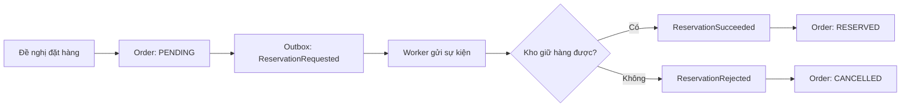
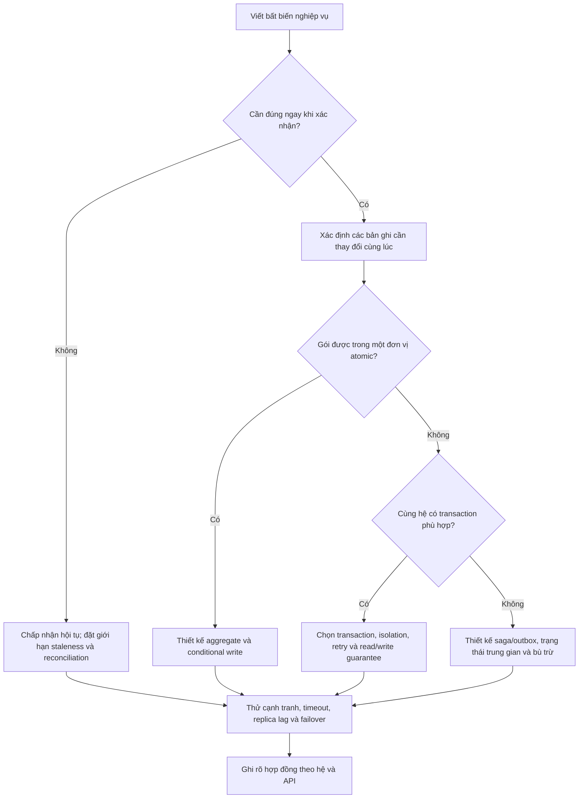

# Phạm vi giao dịch và tính nhất quán phải được xác định theo từng hệ

Trong cơ sở dữ liệu NoSQL, câu hỏi quan trọng không phải là “NoSQL có hỗ trợ transaction hay không?” mà là **hệ nào, thao tác nào, trên phạm vi dữ liệu nào và dưới cấu hình nào cung cấp bảo đảm gì?** MongoDB, DynamoDB, Cassandra, Redis và Elasticsearch có mô hình dữ liệu, cơ chế sao chép và giao diện giao dịch khác nhau. Ngay trong cùng một sản phẩm, bảo đảm còn thay đổi theo cách triển khai, mức nhất quán đọc/ghi, vùng địa lý và loại API.

Một thiết kế đúng phải xuất phát từ **bất biến nghiệp vụ** (*business invariant*), rồi nối bất biến ấy với ranh giới giao dịch và mô hình nhất quán thực tế của từng hệ. Không thể suy ra các bảo đảm này chỉ từ nhãn “NoSQL”, “document”, “key-value” hay “distributed”.

## 1. Tách các câu hỏi thường bị gộp làm một

Giả sử hệ thống bán hàng cần đặt một sản phẩm. Bốn yêu cầu sau có liên quan nhưng không đồng nghĩa:

1. **Atomicity (tính nguyên tử):** nếu cần vừa trừ tồn kho vừa tạo đơn, hai thay đổi có được cam kết cùng nhau hoặc cùng bị hủy không?
2. **Isolation (tính cô lập):** khi hai khách đồng thời đặt món cuối cùng, các thao tác có ngăn việc cả hai cùng thấy còn hàng và cùng đặt thành công không?
3. **Read consistency (tính nhất quán của kết quả đọc):** sau khi đơn được xác nhận, một lần đọc qua replica khác có thấy ngay trạng thái mới không?
4. **Durability (tính bền vững):** khi hệ thống báo ghi thành công rồi một nút hỏng, dữ liệu có còn tồn tại sau phục hồi không?

Một hệ có thể ghi nguyên tử trên **một tài liệu** nhưng không mặc nhiên có transaction trên **nhiều tài liệu**. Một hệ có thể cung cấp transaction đa bản ghi nhưng một truy vấn đọc từ replica vẫn thấy dữ liệu cũ nếu mức nhất quán đọc cho phép. Một lệnh được thực thi nguyên tử cũng chưa chắc đã được sao chép và lưu bền vững trước khi máy chủ trả lời.

| Khái niệm | Câu hỏi cần trả lời | Ngộ nhận cần tránh |
| --- | --- | --- |
| Atomicity | Những thay đổi nào cùng thành công hoặc cùng thất bại? | “Một lệnh atomic” đồng nghĩa “toàn bộ quy trình atomic”. |
| Isolation | Các giao dịch chạy đồng thời được quan sát và sắp xếp ra sao? | “Có transaction” đồng nghĩa “mọi lịch thực thi đều tương đương chạy tuần tự”. |
| Consistency khi đọc | Đọc phiên bản nào, từ replica nào, với bảo đảm thứ tự gì? | “Ghi thành công” đồng nghĩa “mọi điểm đọc thấy dữ liệu mới tức thì”. |
| Durability | Điều kiện xác nhận ghi và khả năng phục hồi sau lỗi là gì? | “Đã nằm trong RAM” đồng nghĩa “không thể mất sau sự cố”. |
| Bất biến nghiệp vụ | Điều kiện nào luôn phải đúng bất kể xung đột/lỗi? | “Cơ sở dữ liệu có ACID” tự động bảo vệ mọi quy tắc của ứng dụng. |

Trong chữ **C** của ACID, *consistency* chủ yếu nói về việc giao dịch giữ đúng các ràng buộc và bất biến đã được biểu diễn/thi hành. Chữ **C** trong định lý CAP nói về **linearizability**, một loại bảo đảm nhất quán của hoạt động đọc/ghi phân tán. Hai chữ “consistency” này không phải một định nghĩa.

## 2. Xác định ranh giới giao dịch trước khi chọn kỹ thuật

Hãy vẽ ranh giới dữ liệu mà một hành động nghiệp vụ phải thay đổi:

```text
Một thuộc tính trong một bản ghi
    └─ Ví dụ: đổi tên hiển thị của tài khoản

Nhiều thuộc tính trong cùng document/item/key
    └─ Ví dụ: cập nhật giá và phiên bản giá của một sản phẩm

Nhiều document/item trong cùng database/partition
    └─ Ví dụ: tạo đơn hàng và giữ chỗ tồn kho

Nhiều partition/shard hoặc nhiều vùng địa lý
    └─ Ví dụ: cập nhật số dư ở các tài khoản nằm trên shard khác nhau

Nhiều database/dịch vụ độc lập
    └─ Ví dụ: chốt đơn, thanh toán, kho và giao vận
```

Mỗi lần mở rộng ranh giới có thể phát sinh chi phí phối hợp, tranh chấp, độ trễ hoặc trường hợp lỗi mới. Việc gom dữ liệu thường được đọc/ghi cùng nhau vào một **aggregate** giúp một số bất biến nằm gọn trong một đơn vị atomic; nhưng cũng có thể tạo document quá lớn, điểm ghi nóng hoặc khó mở rộng. Ngược lại, tách dữ liệu thành nhiều aggregate giúp mở rộng độc lập nhưng buộc ứng dụng xử lý giao dịch qua nhiều đơn vị.

Ví dụ giỏ hàng chứa các dòng sản phẩm có thể được lưu trong một document để cập nhật giỏ nhất quán trong một thao tác. Tuy nhiên, tồn kho tổng của một SKU dùng chung cho hàng nghìn giỏ không thể an toàn chỉ bằng việc mỗi giỏ tự cập nhật document của nó: **bất biến “không bán vượt tồn kho” nằm ở dữ liệu tồn kho dùng chung**.

Trước khi quyết định dùng transaction nhiều bản ghi, hãy trả lời:

- Điều kiện nào **phải đúng ngay khi trả lời thành công** và điều kiện nào có thể hội tụ sau vài giây?
- Các bản ghi tham gia thuộc cùng một partition, shard, cụm, Region hay nhiều dịch vụ?
- Hai tác vụ đồng thời có thể làm sai bất biến dù mỗi tác vụ tự thành công không?
- Khi ghi thất bại giữa chừng, hệ thống có cơ chế rollback thật sự, thử lại an toàn, hay cần hành động bù trừ?
- Ai sẽ đọc ngay sau ghi: chính người ghi, một người khác, một tiến trình nền hay một hệ tìm kiếm?

## 3. Phân biệt các bảo đảm nhất quán

**Strong consistency** là cách gọi rộng; khi thiết kế cần chỉ rõ ý nghĩa mạnh tới đâu:

- **Linearizability:** một thao tác đã hoàn tất được quan sát như xảy ra tại một thời điểm giữa lúc bắt đầu và kết thúc. Một lần đọc bắt đầu sau khi ghi hoàn tất phải tôn trọng thứ tự thời gian thực trên đối tượng tương ứng.
- **Serializability:** kết quả của nhiều giao dịch đồng thời tương đương một thứ tự thực thi tuần tự hợp lệ. Nó tập trung vào tính đúng đắn giữa các giao dịch; bản thân serializability không nhất thiết áp đặt thứ tự thời gian thực của các giao dịch không chồng lấn. *Strict serializability* kết hợp hai yêu cầu.
- **Snapshot isolation:** giao dịch đọc một ảnh chụp nhất quán và thường phát hiện xung đột ghi cùng đối tượng, nhưng **có thể vẫn gặp write skew** khi hai giao dịch cùng đọc một điều kiện rồi ghi vào các bản ghi khác nhau.
- **Causal consistency:** các quan hệ nhân quả được quan sát theo đúng thứ tự; những thay đổi độc lập có thể được thấy theo thứ tự khác nhau.
- **Read-your-writes:** trong phạm vi phiên hoặc cơ chế được hỗ trợ, người vừa ghi sẽ thấy kết quả ghi của mình khi đọc lại. Đây là một bảo đảm theo phiên, không đồng nghĩa mọi người dùng đều đọc được bản mới.
- **Eventual consistency:** nếu các cập nhật dừng lại và hệ thống hoạt động bình thường đủ lâu, các bản sao cuối cùng hội tụ. Nó không hứa một giới hạn thời gian cố định hoặc mặc nhiên giữ thứ tự đọc.

### Một chuỗi sự kiện gây bất ngờ

```text
T0  Client A ghi trạng thái đơn: PENDING -> PAID lên nút ghi.
T1  Nút ghi báo thành công theo chính sách xác nhận đang dùng.
T2  Client B đọc từ replica chưa nhận cập nhật -> vẫn thấy PENDING.
T3  Replica nhận bản cập nhật -> các lần đọc sau có thể thấy PAID.
```

Kịch bản trên **có thể** xảy ra nếu hệ thống cho phép đọc dữ liệu chưa bắt kịp replica; nó không có nghĩa giao dịch ghi bị thực thi một nửa. Để chặn tình huống này phải chọn chính xác cơ chế đọc, đường định tuyến và điều kiện xác nhận ghi mà hệ hỗ trợ. Việc trả về cùng một session hoặc dùng một read concern thích hợp có thể thay đổi bảo đảm; cấu hình mặc định của từng sản phẩm không thể thay thế việc xác minh.

### Trường hợp transaction vẫn chưa đủ: write skew

Giả sử hai bác sĩ A và B trực, quy tắc là “luôn có ít nhất một bác sĩ trực”:

```text
Ban đầu: A.onCall = true, B.onCall = true

Transaction T1: đọc A, B -> thấy cả hai đang trực -> đặt A = false
Transaction T2: đọc A, B -> thấy cả hai đang trực -> đặt B = false

Nếu hai transaction được phép commit ở mức snapshot isolation
và không có xung đột ghi trực tiếp, kết quả có thể là:
A.onCall = false, B.onCall = false  // vi phạm bất biến
```

Giải pháp tùy hệ: dùng isolation đủ mạnh, khóa/điều kiện trên **cùng một bản ghi điều phối**, hoặc thiết kế lại aggregate sao cho bất biến được kiểm tra và thay đổi nguyên tử. Chỉ đặt hai thao tác trong “transaction” chưa chứng minh được bất biến được bảo vệ.

## 4. Đọc đúng bảo đảm theo từng hệ

Các mô tả dưới đây là **khả năng và điểm cần kiểm tra**, không phải một cấu hình chung áp dụng cho mọi phiên bản, mọi loại cụm hay mọi API.

| Hệ | Phạm vi atomic/transaction tiêu biểu | Vấn đề nhất quán cần xác định | Điểm dễ hiểu sai |
| --- | --- | --- | --- |
| **MongoDB** | Ghi trên một document là atomic; hỗ trợ transaction đa document, kể cả môi trường phù hợp có sharding. | `readConcern`, `writeConcern`, session, replica set/sharded deployment; snapshot, majority và nhu cầu đọc tuyến tính là các bảo đảm khác nhau. | Có transaction đa document không có nghĩa mọi truy vấn đọc từ replica đều thấy dữ liệu mới ngay, hay isolation mặc nhiên là serializable. |
| **Amazon DynamoDB** | Ghi đơn item và conditional write; có API giao dịch nhiều item trong phạm vi được hỗ trợ. | Đọc eventually consistent/strongly consistent tùy API và nơi đọc; GSI có cập nhật bất đồng bộ; sao chép xuyên Region tùy chế độ global table. | Strong read của bảng chính không biến truy vấn GSI thành strong read; transaction nội Region không tự trở thành một transaction xuyên mọi Region. |
| **Apache Cassandra** | Các ghi theo mô hình partition; conditional update với lightweight transaction (LWT); batch có cơ chế bảo đảm ghi riêng nhưng không thay cho transaction cô lập tổng quát. | Consistency level của từng request, replication factor, locality, LWT/serial consistency, mô hình partition. | Batch nhiều partition không tương đương transaction ACID nhiều bảng; `QUORUM` không tự động chứng minh linearizability cho mọi cách đọc/ghi. |
| **Redis** | Một lệnh được xử lý nguyên tử theo mô hình thực thi của máy chủ; `MULTI`/`EXEC` nhóm lệnh và `WATCH` hỗ trợ kiểm tra xung đột. | Replica thông thường đồng bộ bất đồng bộ; cấu hình AOF/RDB, failover và trong Redis Cluster là vị trí key/hash slot. | `MULTI`/`EXEC` không rollback mọi lệnh đã chạy khi một lệnh gặp lỗi runtime; atomicity trên primary không tự cho tính bền vững sau failover. |
| **Elasticsearch/OpenSearch** | Thao tác cập nhật theo document, có kiểm soát phiên bản và xung đột; bulk có thể thành công một phần. | Index refresh, độ trễ giữa ghi và tìm kiếm, bản sao, optimistic concurrency (`_seq_no`/`_primary_term` tùy API). | Ghi API thành công không đồng nghĩa kết quả search thấy ngay; bulk không phải transaction atomic nhiều document. |

### 4.1. MongoDB: document là ranh giới tự nhiên; transaction có điều kiện

Trong MongoDB, thao tác thay đổi một document là atomic ngay cả khi cập nhật nhiều field trong document đó. Vì thế mô hình dữ liệu nên cân nhắc gom những field thường phải đổi cùng nhau vào một aggregate vừa phải. Khi cần sửa nhiều document, transaction là công cụ có sẵn trên deployment phù hợp, nhưng phải tính đến thời gian giữ tài nguyên, xung đột và retry.

Ví dụ cập nhật số lượng tồn kho **trên một document** có thể dùng điều kiện ngay trong phép ghi:

```javascript
const result = await db.collection('inventory').updateOne(
  { _id: sku, available: { $gte: quantity } },
  { $inc: { available: -quantity } }
);

if (result.modifiedCount !== 1) {
  throw new Error('Không đủ tồn kho hoặc SKU không tồn tại');
}
```

Điều kiện `available >= quantity` và phép trừ thuộc cùng một cập nhật atomic, giúp tránh việc hai luồng đều đọc số tồn cũ rồi trừ riêng rẽ. **Nhưng** đoạn mã này chỉ giữ đúng tồn kho: nó chưa tạo đơn hàng cùng transaction, chưa xử lý idempotency và chưa bảo đảm durability theo yêu cầu kinh doanh.

Nếu cần `inventory` và `orders` cùng commit, cân nhắc transaction đa document. Hãy chọn `writeConcern`, `readConcern` và chính sách retry có chủ đích. `readConcern: "snapshot"` giúp đọc ảnh chụp nhất quán trong transaction khi dùng đúng điều kiện; nó không là lời hứa về serializability. `writeConcern: "majority"` liên quan tới mức xác nhận ghi được sao chép đủ số thành viên; nó không tự thiết lập cách mọi client đọc qua replica. Các retry phải an toàn nếu callback transaction được chạy lại, và không đặt gọi API thanh toán bên ngoài trong callback có thể retry.

### 4.2. DynamoDB: phân biệt item, transaction, chỉ mục và Region

Một `UpdateItem` với điều kiện (`ConditionExpression`) có thể bảo vệ một bất biến nằm trong **một item**. Khi một thao tác cần thay đổi nhiều item, có thể sử dụng `TransactWriteItems` hoặc `TransactGetItems` trong giới hạn và phạm vi mà API hỗ trợ, thay vì giả định các `PutItem` rời rạc sẽ cùng commit.

Đọc mạnh (*strongly consistent read*) không có mặt trên mọi cách truy cập: đọc bảng và local secondary index có thể chọn mức phù hợp, trong khi đọc qua global secondary index là eventually consistent. Nếu dữ liệu được sao chép giữa các Region bằng global table, phải xác nhận **chế độ sao chép cụ thể** và xung đột liên vùng; không lấy transaction một Region để suy diễn nguyên tử ở mọi Region. Đừng dùng kết quả truy vấn GSI vừa cập nhật làm bằng chứng duy nhất cho một bất biến cần đúng tức thời.

### 4.3. Cassandra: partition, quorum và LWT giải quyết các bài toán khác nhau

Cassandra được tối ưu cho mô hình truy vấn và phân phối dữ liệu theo partition key. Mức nhất quán `ONE`, `LOCAL_QUORUM`, `QUORUM`, v.v. điều khiển số replica cần phản hồi, trong quan hệ với replication factor và topology. Chúng tác động tới tính sẵn sàng/độ trễ và xác suất hoặc khả năng thấy phiên bản mới, nhưng không thể thay thế việc phân tích thứ tự thao tác, timestamp, lỗi mạng và cạnh tranh đồng thời.

Ví dụ hai client đều đọc `stock = 1` rồi cùng ghi `stock = 0` theo kiểu read-modify-write không được bảo vệ chỉ bằng cách tăng số replica xác nhận. Khi cần điều kiện kiểu “chỉ cập nhật nếu giá trị đang là X”, cân nhắc LWT (`IF`), vốn có cơ chế đồng thuận và chi phí khác với ghi thông thường. Phạm vi, hiệu năng và ngữ nghĩa serial consistency của LWT phải được thiết kế theo partition và phiên bản đang dùng.

`BATCH` của Cassandra phục vụ nhóm mutation với bảo đảm ghi của nó; batch nhiều partition có thể được các truy vấn quan sát ở những thời điểm khác nhau và **không cung cấp isolation/rollback tổng quát như transaction của RDBMS**. Không dùng batch để biến một luồng nghiệp vụ nhiều bước thành ACID một cách mặc định.

### 4.4. Redis: atomic trên lệnh không đồng nghĩa ACID cho cả quy trình

Trên một Redis primary, một lệnh như `INCR` thực hiện nguyên tử theo mô hình xử lý lệnh, tránh lost update so với cách ứng dụng tự `GET` rồi `SET`. `MULTI`/`EXEC` cho phép thực thi một nhóm lệnh theo thứ tự không bị lệnh khác chen vào trên primary; `WATCH` cung cấp cơ chế hủy thực thi nếu key được theo dõi đã bị thay đổi trước `EXEC`.

Tuy nhiên, nếu một lệnh gặp lỗi **trong lúc thực thi** nhóm lệnh, Redis không tự rollback tất cả lệnh đã thành công trước đó. Trong Redis Cluster, các lệnh đa key/transaction còn bị ràng buộc bởi khả năng định tuyến key vào cùng hash slot. Sao chép tới replica thường bất đồng bộ; xác nhận ở primary hay thậm chí chờ replica qua `WAIT` không tương đương một giao thức commit đồng thuận có bảo đảm durability tuyệt đối. Phải phân biệt Redis được dùng làm **cache** có thể tái dựng hay làm kho dữ liệu gốc cần chính sách persistence và phục hồi chặt chẽ.

### 4.5. Elasticsearch/OpenSearch: dữ liệu được ghi và dữ liệu có thể search là hai thời điểm

Chỉ mục tìm kiếm thường sử dụng cơ chế **near real-time**: một document đã được ghi thành công có thể chưa xuất hiện ngay trong truy vấn `search` cho đến khi refresh liên quan xảy ra. Một số API đọc theo ID có đường quan sát khác với search; cần kiểm tra ngữ nghĩa cụ thể của API. `bulk` trả trạng thái theo từng mục và có thể thành công một phần, vì vậy ứng dụng phải kiểm tra từng kết quả và retry những mục phù hợp.

Nếu đơn hàng cần xác nhận thanh toán chính xác thì search index không nên là nơi duy nhất thực thi bất biến đó. Hệ lưu giao dịch gốc phát sự kiện cập nhật sang search; giao diện có thể chịu độ trễ index, đồng thời luồng nghiệp vụ quan trọng vẫn kiểm tra hệ dữ liệu có bảo đảm phù hợp.

## 5. Từ bất biến đến thiết kế: ví dụ đặt hàng

Giả sử tồn kho của SKU `P-01` còn 1 và hai khách cùng đặt. Bất biến là:

```text
available >= 0
Mỗi orderId chỉ được giữ hàng đúng một lần.
Nếu trả lời "đặt thành công", phải có bằng chứng giữ hàng tương ứng.
```

Một cách làm dễ sai:

```text
Client A: READ available = 1
Client B: READ available = 1
Client A: WRITE available = 0; tạo Order A
Client B: WRITE available = 0; tạo Order B

Kết quả: hai đơn được xác nhận nhưng chỉ có một sản phẩm.
```

Một cách thiết kế tốt hơn phải xét **toàn bộ vòng đời**:

1. Dùng phép ghi có điều kiện/compare-and-set ở bản ghi tồn kho để dành hàng, thay vì đọc rồi ghi vô điều kiện.
2. Dùng `orderId` hoặc `reservationId` duy nhất để request lặp lại không giữ hàng thêm lần nữa; định nghĩa rõ trạng thái `PENDING`, `RESERVED`, `CONFIRMED`, `CANCELLED`.
3. Nếu tồn kho và đơn nằm trong cùng hệ có transaction đa bản ghi phù hợp, đặt các thay đổi cùng transaction và xác định isolation, điều kiện ghi, read/write concern.
4. Nếu nằm trong **hai dịch vụ hoặc hai database khác nhau**, thiết kế luồng trạng thái, sự kiện đáng tin cậy, idempotent consumer và bù trừ/hoàn tồn khi thanh toán thất bại; transaction của một database không tự bao trùm cả hai.
5. Xác nhận ý nghĩa câu trả lời: `RESERVED` nghĩa là đã giữ hàng thành công; `CONFIRMED` chỉ được trả về sau các bước bắt buộc tương ứng, không chỉ vì đã gửi một message lên queue.

### Nếu dùng một database hỗ trợ transaction nhiều bản ghi

Mã giả sau thể hiện **ý định nghiệp vụ**, không mặc định có cú pháp áp dụng cho mọi NoSQL:

```text
TRANSACTION:
    IF orderId đã tồn tại:
        RETURN trạng thái hiện có (không giữ hàng lần hai)

    UPDATE inventory
      SET available = available - quantity
      WHERE sku = :sku AND available >= :quantity
    ASSERT số bản ghi cập nhật = 1

    INSERT order(orderId, sku, quantity, status = RESERVED)
COMMIT
```

Điều này chỉ an toàn nếu hệ thực sự bảo đảm atomic commit cho hai thay đổi, điều kiện update được kiểm tra nguyên tử, định danh `orderId` có tính duy nhất và retry được xử lý đúng. Nếu transaction bị hủy do xung đột, ứng dụng có thể thử lại có giới hạn; tuyệt đối không gọi cổng thanh toán bên ngoài trong khối có thể chạy lại mà không có cơ chế idempotency phù hợp.

### Nếu ranh giới vượt quá một database



Mô hình **transactional outbox** giúp ghi thay đổi nghiệp vụ và thông điệp sắp phát trong cùng giao dịch cục bộ ở nơi có hỗ trợ. Worker chuyển outbox sang broker, có thể gửi lại nếu lỗi; consumer phải idempotent. Luồng này cho **nhất quán cuối cùng ở cấp hệ thống**, không cam kết mọi dịch vụ cùng cập nhật trong một khoảnh khắc. Nếu bước sau thất bại, saga thực hiện hành động bù trừ (ví dụ trả lại lượng giữ hàng); hành động bù trừ cũng phải có thể retry và được giám sát.

Không nên nhầm **exactly-once business effect** với “broker không bao giờ gửi trùng”: trong hệ phân tán, phát/nhận lại là tình huống cần thiết kế. Khóa idempotency, ràng buộc duy nhất, trạng thái xử lý và reconciliation là các công cụ thực tế để tránh tác dụng phụ lặp.

## 6. CAP giải thích được gì và không giải thích được gì?

CAP đặt ra sự đánh đổi **trong lúc có phân hoạch mạng** giữa consistency theo nghĩa linearizability và availability theo nghĩa mỗi yêu cầu đến nút không lỗi đều có phản hồi thành công trong thời gian hữu hạn. Một thiết kế có thể ưu tiên bảo toàn thứ tự cập nhật rồi từ chối/chờ một số yêu cầu khi mất liên lạc; hoặc tiếp tục nhận yêu cầu tại nhiều phía và cần giải quyết xung đột khi mạng hồi phục.

CAP **không** nói rằng “NoSQL = AP, SQL = CP”, cũng không trực tiếp quyết định liệu một database có ACID transaction hay không. Trong thời gian mạng bình thường, độ trễ và chi phí phối hợp vẫn là vấn đề đáng kể; cấu hình replica, leader election, mức ghi và tuyến đọc mới cho biết hành vi thực tế. Đặc biệt, một database có thể cho phép lựa chọn khác nhau **theo từng request**.

Ví dụ phân biệt yêu cầu:

| Tình huống | Có thể chấp nhận | Cần ưu tiên |
| --- | --- | --- |
| Số lượt xem bài viết | Chậm cập nhật, đếm xấp xỉ trong khoảng ngắn | Khả năng ghi cao, hội tụ sau |
| Danh mục tìm kiếm sản phẩm | Kết quả index trễ ngắn; hiển thị “đang cập nhật” khi cần | Search nhanh, pipeline cập nhật đáng tin cậy |
| Đặt SKU cuối cùng | Không được xác nhận hai đơn cùng giữ một đơn vị tồn | Conditional write, kiểm soát cạnh tranh, transaction/bù trừ |
| Chuyển tiền giữa ví | Không mất/nhân đôi tiền; có lịch sử đối soát | Bất biến số dư, commit/ledger, idempotency và khôi phục |
| Hồ sơ người dùng vừa chỉnh sửa | Người sửa nên thấy giá trị mới khi đọc lại | Read-your-writes/session semantics hoặc đường đọc đủ mạnh |

Các lựa chọn trong bảng là **yêu cầu thiết kế gợi ý**, không phải lời hứa độ trễ của bất kỳ sản phẩm nào.

## 7. Cấu hình và topology là một phần của hợp đồng nhất quán

Cùng tên sản phẩm nhưng khác triển khai có thể cho hành vi khác nhau:

- **Single node so với replica set/cluster:** ghi trả lời ở nút chính khác với ghi được xác nhận bởi đủ replica; failover có thể đổi tuyến đọc/ghi.
- **Một partition so với nhiều partition/shard:** transaction có thể cần phối hợp phân tán hoặc chỉ được hỗ trợ trên một tập key cụ thể.
- **Một Region so với nhiều Region:** replication xuyên vùng có độ trễ và chính sách xung đột riêng; “multi-region” không mặc định nghĩa là một transaction toàn cầu.
- **Đọc từ primary, follower hay index:** đọc cùng một đối tượng qua các đường khác nhau có thể có mức mới của dữ liệu khác nhau.
- **Mặc định của driver và request:** API, read preference, read concern, consistency level, retry policy và timeout đều có thể ảnh hưởng kết quả.
- **Thời điểm client nhận timeout:** timeout không chứng minh ghi đã thất bại; thao tác có thể đã commit nhưng phản hồi bị mất. Retry phải dùng định danh idempotent hoặc kiểm tra trạng thái chính xác.

Tương tự, `acknowledged`, `replicated`, `durable`, `visible to search` và `visible to all readers` là **các mốc khác nhau**. Khi viết API, cần chọn mốc nào đủ để trả `200/201` hoặc trạng thái xử lý bất đồng bộ; đừng gom tất cả thành “save OK”.

## 8. Cách lập hợp đồng dữ liệu cho từng hệ

Mỗi thành phần lưu trữ nên có một bản mô tả ngắn nhưng kiểm chứng được. Có thể sử dụng mẫu sau trong tài liệu thiết kế:

```yaml
storage: "<tên hệ và phiên bản/loại triển khai>"
purpose: "<source of truth, cache, search index, event store...>"
businessInvariant: "<điều phải luôn đúng>"
atomicBoundary: "<item/document/partition/multi-document/...>"
transactionApi: "<API cụ thể hoặc không có>"
isolation: "<mức cô lập và giới hạn>"
writeAcknowledgement: "<điều kiện trả thành công>"
readGuarantee: "<mức đọc, nguồn replica, bảo đảm theo session>"
replicationTopology: "<node, shard, Region, replication mode>"
durabilityAndRecovery: "<persistence, failover, backup/restore>"
conflictHandling: "<conditional write, LWT, optimistic lock, retry>"
crossSystemWorkflow: "<transaction, saga/outbox, reconciliation>"
failureCases: "<timeout, partition, leader failover, duplicate event>"
```

Ví dụ về **hai hợp đồng khác nhau trong cùng một sản phẩm**:

| Đặc điểm | MongoDB: cập nhật hồ sơ | MongoDB: tạo đơn và giữ hàng |
| --- | --- | --- |
| Bất biến | Các field của một hồ sơ được đổi cùng nhau | Không có đơn giữ hàng nếu tồn kho không được trừ tương ứng |
| Ranh giới | Một document | Ít nhất hai document/collection |
| Công cụ | Atomic document update | Transaction đa document và conditional update |
| Cạnh tranh | Filter theo version nếu cần chống ghi đè | Conditional decrement, unique orderId, xử lý write conflict/retry |
| Đọc sau ghi | Xác định session/read preference theo trải nghiệm | Đường đọc trạng thái đơn phải phù hợp điều kiện xác nhận |
| Đánh đổi | Thao tác đơn giản, ít phối hợp | Chi phí transaction, khả năng xung đột, xử lý lỗi phức tạp hơn |

Không thể chỉ ghi trong tài liệu kiến trúc rằng “chúng tôi dùng MongoDB nên có transaction” mà bỏ qua **bảo đảm cho thao tác cụ thể**.

## 9. Các tình huống lỗi phải được thử trước khi chốt thiết kế

Khi chưa có tài liệu hoặc thử nghiệm xác nhận, một mô hình “trên giấy” rất dễ bỏ sót lỗi phân tán. Những kịch bản sau giúp xác định liệu bảo đảm chọn có thật sự phù hợp:

1. **Hai lệnh đồng thời trên cùng điều kiện:** cho nhiều request cùng mua đơn vị hàng cuối; không chấp nhận oversell.
2. **Timeout ngay sau khi gửi lệnh ghi:** thử lại với cùng `orderId`; không tạo thêm reservation hoặc thanh toán kép.
3. **Lỗi giữa hai bước:** với giải pháp transaction, kiểm tra rollback; với saga, kiểm tra trạng thái trung gian và bù trừ.
4. **Đọc ngay sau ghi qua nhiều tuyến:** so sánh primary, replica, GSI hoặc search tùy hệ; ghi nhận mức bảo đảm thực tế.
5. **Replica lỗi hoặc leader failover:** đánh giá ghi đã được xác nhận có bị mất, bị đọc cũ hoặc cần khôi phục hay không.
6. **Sự kiện đến trễ, lặp hoặc đảo thứ tự:** consumer phải idempotent và có quy tắc version/order hợp lệ.
7. **Mất liên lạc liên vùng hoặc mạng phân hoạch:** yêu cầu nào được trả lời, yêu cầu nào chờ/thất bại, xung đột được giải quyết ra sao.
8. **Restore từ backup/replay log:** dữ liệu nghiệp vụ và outbox/consumer state có tái lập trạng thái thống nhất không.

Đây là các tình huống **để xác minh trong bước thiết kế/kiểm thử hệ thống**, không phải lời khẳng định sản phẩm nào sẽ luôn cho một kết quả cụ thể.

## 10. Quy trình ra quyết định thực tế



Trình tự áp dụng:

1. **Nêu bất biến bằng một phát biểu có thể bác bỏ được:** “không bán quá tồn”, “mỗi yêu cầu thanh toán chỉ ghi nhận một lần”, “không mất giao dịch đã xác nhận”.
2. **Tìm ranh giới nhỏ nhất** chứa toàn bộ dữ liệu quyết định bất biến đó; cân nhắc đơn vị atomic trước khi mở rộng transaction.
3. **Kiểm tra tài liệu theo phiên bản, API và topology** của hệ đang triển khai: transaction scope, isolation, read/write concern, conflict resolution và durability.
4. **Thiết kế đường lỗi cùng đường thành công:** timeout không rõ kết quả, retry, ghi trùng, đồng thời, mất mạng, failover và sự kiện lệch thứ tự.
5. **Chọn cách xác nhận thành công** mà client có thể tin: hoàn tất ngay theo bảo đảm mạnh hoặc trả trạng thái đang xử lý với khả năng tra cứu/đối soát.
6. **Lưu hợp đồng và kiểm chứng bằng thử nghiệm có chủ đích**, rồi giám sát các độ lệch (chậm replica, đơn treo, saga quá hạn, sai lệch tồn kho).

## Kết luận

**NoSQL không có một mức transaction hay consistency chung.** Atomicity có thể chỉ nằm trong một document, một item hoặc một partition; transaction đa bản ghi có thể tồn tại nhưng bị giới hạn bởi deployment và isolation; replica, index và Region có thể mang các bảo đảm quan sát khác nhau. Một hệ lưu trữ chỉ “đủ mạnh” cho yêu cầu khi **bất biến nghiệp vụ, ranh giới atomic, cơ chế đồng thời, đường đọc, điều kiện xác nhận ghi và xử lý sự cố** cùng phù hợp với nhau.

Quy tắc thực hành: **đừng hỏi “NoSQL có nhất quán không?”; hãy hỏi “hệ cụ thể bảo đảm điều gì cho thao tác cụ thể, trong phạm vi nào, với cấu hình và chế độ lỗi nào?”**
