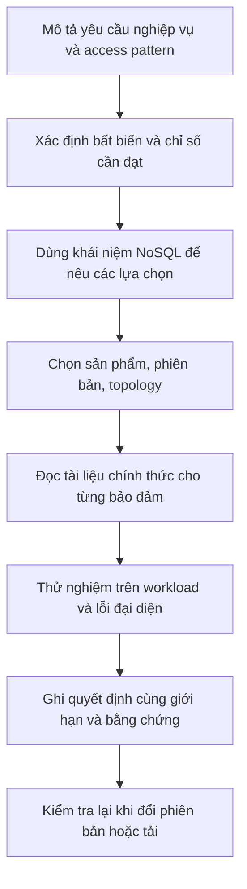

# Ranh giới giữa kiến thức NoSQL chung và tài liệu của từng sản phẩm

## 1. Vì sao cần phân biệt hai loại kiến thức?

Khi học NoSQL, chúng ta thường gặp các phát biểu như “NoSQL không có schema”, “NoSQL luôn nhanh hơn SQL”, “NoSQL đánh đổi tính nhất quán để lấy khả năng mở rộng” hoặc “đã dùng database dạng document thì truy vấn nào cũng có thể làm giống MongoDB”. Các phát biểu này dễ nhớ nhưng không đủ chính xác để thiết kế hệ thống.

**NoSQL là một nhóm cách tiếp cận lưu trữ và truy xuất dữ liệu, không phải một đặc tả duy nhất mà mọi sản phẩm đều phải tuân theo.** MongoDB, Redis, Apache Cassandra, Amazon DynamoDB và Neo4j cùng có thể xuất hiện trong một cuộc thảo luận về NoSQL, nhưng chúng khác nhau về mô hình dữ liệu, ngôn ngữ truy vấn, cơ chế phân vùng, mức nhất quán, giao dịch và vận hành.

Vì vậy, trong một quyết định kỹ thuật cần phân biệt:

- **Kiến thức NoSQL chung:** khái niệm, vấn đề cần giải quyết, mô hình tư duy và các đánh đổi có thể dùng để phân tích nhiều hệ thống.
- **Kiến thức của một họ mô hình dữ liệu:** đặc điểm thường gặp ở key–value, document, wide-column hoặc graph; hữu ích để định hướng nhưng chưa phải lời bảo đảm cho một sản phẩm.
- **Tài liệu của sản phẩm cụ thể:** API, cú pháp, giới hạn, hành vi được hỗ trợ, cấu hình, điều kiện áp dụng và các cam kết chính thức của một phiên bản hay dịch vụ.
- **Thực tế triển khai:** hành vi đo được ở phiên bản, cấu hình, hạ tầng, khối lượng dữ liệu và kiểu tải của chính hệ thống đang xây dựng.

Ranh giới quan trọng nhất là: **một ý tưởng đúng ở mức khái niệm không tự động trở thành một cam kết về hành vi của sản phẩm**. Ngược lại, một API đang hoạt động trên một sản phẩm cũng không chứng minh rằng API đó là tính năng chung của NoSQL.

### Mục tiêu học tập

Sau bài này, bạn có thể:

1. Nhận diện phát biểu thuộc kiến thức nền, đặc điểm của một họ NoSQL hay đặc tả sản phẩm.
2. Biết khi nào phải mở tài liệu chính thức thay vì dựa vào kiến thức tổng quát.
3. Đặt câu hỏi chính xác về dữ liệu, truy vấn, tính nhất quán, giao dịch, phân vùng và vận hành.
4. Kiểm chứng một quyết định thiết kế mà không biến kinh nghiệm với một database thành “quy luật NoSQL”.

## 2. Những gì có thể học ở mức NoSQL chung

### 2.1. NoSQL là cách gọi rộng, không phải một chuẩn giao diện

Trong thực tế, “NoSQL” thường chỉ các hệ quản trị dữ liệu không lấy mô hình bảng quan hệ và SQL truyền thống làm giao diện tổ chức dữ liệu chủ đạo. Tên gọi này không đồng nghĩa với “không bao giờ dùng SQL”: một số sản phẩm có ngôn ngữ truy vấn giống SQL, hỗ trợ SQL hoặc cung cấp nhiều mô hình dữ liệu.

Những câu hỏi có giá trị dùng chung gồm:

- Dữ liệu được biểu diễn theo **key, document, cột/phân vùng hay đỉnh–cạnh**?
- Ứng dụng thường đọc/ghi theo mẫu truy cập (access pattern) nào?
- Khi tăng dữ liệu hoặc lưu lượng, dữ liệu được phân phối và yêu cầu truy cập được xử lý ra sao?
- Những bất biến nghiệp vụ nào bắt buộc phải đúng khi cập nhật dữ liệu?
- Hệ thống phản ứng như thế nào trước trễ mạng, lỗi nút, chia cắt mạng và khôi phục?
- Độ trễ, thông lượng, chi phí, khả năng truy vấn linh hoạt và độ phức tạp vận hành đánh đổi với nhau thế nào?

Các câu hỏi trên là **khung phân tích**, không chứa sẵn kết luận “nên chọn database X”.

### 2.2. Phân loại mô hình dữ liệu chỉ là bản đồ khởi đầu

| Họ mô hình | Cách hình dung khái quát | Ví dụ sản phẩm thường được nhắc đến | Điều không được suy ra chỉ từ tên họ |
|---|---|---|---|
| Key–value | Truy cập giá trị qua khóa; phù hợp khi biết khóa từ trước | Redis, một số cách dùng DynamoDB | Mọi sản phẩm đều có cùng TTL, kiểu dữ liệu, giao dịch hoặc cơ chế duyệt khóa |
| Document | Lưu bản ghi dạng tài liệu có cấu trúc, thường chứa trường lồng nhau | MongoDB, Couchbase | Mọi sản phẩm hỗ trợ cùng cú pháp filter, join, aggregation hay index |
| Wide-column / partitioned-row | Tổ chức dữ liệu theo khóa phân vùng và cấu trúc hàng/cột phục vụ truy cập phân tán | Apache Cassandra, ScyllaDB | Mọi sản phẩm có cùng quy tắc partition key, clustering key hay consistency level |
| Graph | Biểu diễn quan hệ trực tiếp qua đỉnh, cạnh và thuộc tính | Neo4j | Mọi hệ graph hỗ trợ cùng ngôn ngữ, thuật toán đường đi hoặc bảo đảm giao dịch |

Đây là phân loại phục vụ học tập, không phải ranh giới độc quyền. Một sản phẩm có thể hỗ trợ nhiều kiểu dữ liệu hoặc nhiều cách truy vấn; một dịch vụ được quản lý có thể kết hợp đặc điểm của nhiều họ.

### 2.3. Các nguyên lý và đánh đổi có thể tái sử dụng

**Thiết kế theo mẫu truy cập.** Trước khi chọn cấu trúc lưu trữ, hãy liệt kê thao tác đọc/ghi chủ đạo, tỷ lệ đọc–ghi, số bản ghi dự kiến, độ trễ mục tiêu và kiểu truy vấn phát sinh. Trong nhiều hệ NoSQL, truy vấn quan trọng ảnh hưởng mạnh đến cách thiết kế khóa, phân vùng, tài liệu nhúng hoặc các bảng phục vụ truy vấn. Tuy nhiên, mức độ bắt buộc của cách tiếp cận này khác nhau theo sản phẩm.

**Denormalization có chi phí.** Sao chép hoặc gom dữ liệu có thể giảm số lần truy xuất nhưng khiến cập nhật, đồng bộ và kiểm soát dữ liệu trùng lặp phức tạp hơn. Đây là một đánh đổi thiết kế chung, không phải yêu cầu rằng mọi hệ NoSQL phải phi chuẩn hóa.

**Mở rộng ngang kéo theo bài toán phân phối.** Phân vùng dữ liệu giúp chia tải, nhưng cần xét phân bố khóa, điểm nóng (hot partition), thao tác qua nhiều phân vùng, việc thay đổi topology và khôi phục lỗi. Việc “có cluster” không chứng minh rằng hệ thống tự động phân tải tốt trong mọi tình huống.

**Tính nhất quán là yêu cầu phải định nghĩa.** “Một bản ghi vừa ghi xong phải đọc thấy ngay” khác với “hai đối tượng liên quan phải được cập nhật nguyên tử” và cũng khác với “mọi người dùng đều thấy cùng thứ tự thao tác”. Cần đặt tên bảo đảm cần thiết rồi đối chiếu với tài liệu sản phẩm.

**Benchmark phụ thuộc workload.** Không có phép đo duy nhất chứng minh “NoSQL nhanh hơn SQL” hoặc “document database nhanh hơn wide-column database”. Chỉ số cần đo bao gồm latency percentile, throughput, mức đồng thời, phân bố khóa, kích thước dữ liệu, chỉ mục, chiến lược cache, khả năng phục hồi và chi phí.

## 3. Điểm chuyển từ khái niệm sang tài liệu sản phẩm

Một nguyên tắc đơn giản: **hễ câu hỏi chứa “có hỗ trợ không?”, “giới hạn bao nhiêu?”, “mặc định là gì?”, “cú pháp nào?”, “khi lỗi thì chuyện gì xảy ra?” thì phải kiểm tra tài liệu của hệ thống đang dùng.**

| Chủ đề | Kiến thức chung giúp đặt câu hỏi | Phần cần kiểm tra ở tài liệu sản phẩm |
|---|---|---|
| Mô hình dữ liệu | Chọn key, document, quan hệ, partition theo access pattern | Kiểu dữ liệu được hỗ trợ; kích thước item/document; giới hạn và quy tắc đặt khóa |
| Truy vấn | Filter, range, sort, aggregate hay traversal có chi phí khác nhau | Ngôn ngữ truy vấn, toán tử, join, giới hạn kết quả, phân trang, hành vi query planner |
| Chỉ mục | Index đổi chi phí lưu trữ/ghi lấy khả năng tìm nhanh | Các loại index, index được phép kết hợp, độ trễ cập nhật index, giới hạn và chi phí |
| Tính nhất quán | Phải định nghĩa một thao tác đọc được phép thấy trạng thái nào | Bảo đảm cho từng loại read/write, cấu hình consistency, các ngoại lệ theo vùng/phân vùng |
| Giao dịch | Atomicity, isolation, durability và phạm vi bất biến nghiệp vụ | Phạm vi giao dịch, mức cô lập, giới hạn thao tác, timeout, retry và xử lý conflict |
| Phân phối | Shard/partition, replication, failover, hotspot là các bài toán chung | Thuật toán/phương thức partition, số replica, rebalancing, topology, quorum, failover |
| TTL và xóa dữ liệu | Dữ liệu có vòng đời, hết hạn và chính sách retention | TTL ở cấp khóa/bản ghi/trường, cách thực thi xóa, thời điểm dữ liệu thực sự biến mất |
| Bảo mật | Authentication, authorization, encryption, audit là các yêu cầu chung | Cơ chế IAM/RBAC, TLS, mã hóa at rest, phạm vi quyền, audit log, chính sách mạng |
| Sao lưu/khôi phục | Đặt mục tiêu RPO/RTO và kiểm tra quy trình restore | Loại backup, point-in-time recovery, consistency của snapshot, thời gian giữ bản sao |
| Vận hành và chi phí | Quan sát tải, latency, capacity, lỗi và bill | Metrics cụ thể, cơ chế scale, giới hạn dịch vụ, giá theo request/dung lượng/throughput |

Một bảng so sánh sản phẩm chỉ có ý nghĩa nếu mỗi ô nêu được **sản phẩm, phiên bản hoặc loại dịch vụ, cấu hình và nguồn kiểm chứng**. Ví dụ, “hỗ trợ transaction” là câu trả lời chưa đủ; cần hỏi transaction trên một item, nhiều document, nhiều partition hay nhiều vùng, và hành vi khi xung đột là gì.

## 4. Phân biệt tính nhất quán, CAP và giao dịch

Đây là nơi việc trộn kiến thức chung với tài liệu sản phẩm gây nhầm lẫn nhiều nhất.

### 4.1. Không có định luật “mọi NoSQL đều eventual consistency”

Tính nhất quán có nhiều cấp độ và nhiều phạm vi quan sát. Một hệ thống có thể cung cấp nhiều lựa chọn đọc/ghi, hoặc các bảo đảm khác nhau cho thao tác trên một khóa, nhiều khóa và giữa các vùng địa lý.

- **Strong consistency / linearizability** là một khái niệm về thứ tự quan sát thao tác; đừng suy ra nó từ câu quảng bá “đọc dữ liệu mới nhất”.
- **Eventual consistency** mô tả khả năng các bản sao hội tụ khi không có cập nhật mới và các điều kiện thích hợp được đáp ứng; nó không tự nói độ trễ hội tụ là bao nhiêu.
- **Read-your-writes, monotonic reads, causal consistency** nói về các bảo đảm khác nhau đối với thứ tự các thao tác được quan sát.

Khi đọc tài liệu, hãy tìm rõ: bảo đảm áp dụng cho **một thao tác hay một chuỗi thao tác**, **một item hay nhiều item**, **một replica/region hay nhiều region**, và có yêu cầu cấu hình nào không.

### 4.2. CAP là khung suy nghĩ về sự cố phân vùng mạng

CAP đề cập đến sự đánh đổi giữa một dạng consistency và availability **khi có network partition** trong mô hình phân tán đang xét. Nó không nói rằng hệ thống phải chọn cố định đúng hai thuộc tính từ ba thuộc tính trong mọi thời điểm, và cũng không phải cách chấm điểm “database A = CP, database B = AP” cho mọi API/cấu hình.

Hai tình huống cần tách biệt:

1. **Khi xảy ra phân vùng mạng:** một yêu cầu phải được xử lý theo những bảo đảm nào; liệu hệ thống có thể từ chối hoặc trì hoãn thao tác để giữ consistency không?
2. **Khi mạng hoạt động bình thường:** latency, khoảng cách giữa bản sao, ghi đồng bộ/bất đồng bộ và chi phí điều phối vẫn tạo ra đánh đổi. Có thể dùng PACELC như một khung thảo luận bổ sung, nhưng không thay thế tài liệu bảo đảm của sản phẩm.

Không quyết định kiến trúc chỉ vì một sơ đồ CAP trên blog. Cần đọc tài liệu cho topology và chế độ nhất quán thực sự triển khai, rồi thử kịch bản mất kết nối phù hợp.

### 4.3. “Có transaction” chưa đồng nghĩa cùng ACID hoặc cùng isolation

Các khái niệm **atomicity**, **consistency (bất biến nghiệp vụ trong ACID)**, **isolation** và **durability** dùng chung cho nhiều hệ dữ liệu. Nhưng một sản phẩm có thể bảo đảm atomicity trong phạm vi một document, một key hoặc một nhóm thao tác nhất định mà không cung cấp cùng tính chất cho toàn bộ cluster.

Đặc biệt, chữ **consistency trong ACID** không đồng nghĩa với chữ **consistency trong CAP**. ACID nói đến việc duy trì các ràng buộc trạng thái của giao dịch; CAP nói đến tính nhất quán quan sát được trong một mô hình phân tán khi mạng bị phân vùng.

Ví dụ, nghiệp vụ chuyển tiền cần ít nhất xác định:

> Số dư không âm; tổng tiền được bảo toàn; một yêu cầu chuyển tiền không được thực hiện hai lần; người dùng nhận được kết quả rõ ràng dù xảy ra timeout.

Từ các bất biến đó mới tra cứu cơ chế transaction, điều kiện ghi (conditional write), idempotency, retry và xử lý trạng thái không chắc chắn của từng sản phẩm. Không thể kết luận chỉ bằng nhãn “NoSQL có/không có ACID”.

## 5. Ví dụ: một nhu cầu, nhiều cách hiện thực

Giả sử ứng dụng thương mại điện tử có dữ liệu đơn hàng:

```json
{
  "orderId": "O-1007",
  "customerId": "C-42",
  "createdAt": "2026-01-20T09:30:00Z",
  "status": "PAID",
  "items": [
    { "sku": "BOOK-1", "quantity": 2, "unitPrice": 120000 }
  ]
}
```

Yêu cầu truy cập:

- **Q1:** lấy đơn hàng theo `orderId`.
- **Q2:** hiển thị 20 đơn hàng mới nhất của một `customerId`.
- **Q3:** chuyển trạng thái đơn hàng từ `PENDING` sang `PAID`, tránh xử lý trùng khi client retry.
- **Q4:** thống kê doanh thu theo ngày cho toàn bộ đơn hàng.

Các yêu cầu Q1–Q4 là **kiến thức nghiệp vụ và access pattern**, chưa gắn với công nghệ. Từ đó có thể suy luận chung rằng Q1 cần tra cứu theo khóa, Q2 cần đường truy cập theo khách hàng và thời gian, Q3 cần một cơ chế giữ bất biến khi cập nhật, Q4 có thể cần tổng hợp dữ liệu hoặc một luồng phân tích riêng.

Chỉ khi chọn sản phẩm mới có thể chuyển sang câu hỏi như: “Dùng index nào?”, “Query có quét nhiều partition không?”, “Có update có điều kiện không?”, “Transaction có bao phủ nhiều bản ghi không?”, “Có hỗ trợ aggregation phù hợp với tải Q4 không?”.

### 5.1. Minh họa cú pháp riêng của MongoDB

Đoạn sau là một ví dụ **theo ngôn ngữ MongoDB**, không phải “ngôn ngữ NoSQL chung”:

```javascript
// MongoDB: minh họa một index để hỗ trợ mẫu lọc và sắp xếp Q2.
db.orders.createIndex({ customerId: 1, createdAt: -1 });

db.orders
  .find({ customerId: "C-42" })
  .sort({ createdAt: -1 })
  .limit(20);
```

Suy luận có thể mang sang sản phẩm khác là “Q2 cần truy cập hiệu quả theo khách hàng và thứ tự thời gian”. Không được mang nguyên `createIndex`, `find` hay giả định về query planner của MongoDB sang Cassandra hoặc DynamoDB. Trên MongoDB cũng phải kiểm tra execution plan, cardinality, kích thước dữ liệu, index được chọn và phiên bản đang dùng trước khi kết luận truy vấn đạt yêu cầu.

### 5.2. Minh họa cách truy cập key–value của Redis

Một bài toán khác là lưu phiên đăng nhập tạm thời theo khóa:

```text
# Redis: ví dụ dùng SET với thời hạn 1.800 giây.
SET session:abc123 "{\"userId\":\"U-42\"}" EX 1800
GET session:abc123
```

Khái niệm có thể tái sử dụng: tra cứu session theo khóa và giới hạn vòng đời dữ liệu. Nhưng `SET ... EX ...` là **cú pháp Redis**; khả năng TTL, độ chính xác thời điểm hết hạn, hành vi lưu bền, replication, evict khi thiếu bộ nhớ và tính nhất quán khi failover phải được xác minh theo sản phẩm và cấu hình. Đừng suy từ ví dụ này rằng mọi database key–value đều tự động là session store phù hợp.

### 5.3. Thiết kế theo phân vùng không đồng nghĩa với index tùy ý

Trong các hệ coi partition key là trọng tâm, chọn khóa phân vùng ảnh hưởng mạnh đến nơi lưu dữ liệu và chi phí truy cập. Một đường đọc tốt cho Q1 có thể không tự phục vụ được Q2. Có thể cần cấu trúc thứ hai, vật hóa dữ liệu theo câu hỏi truy vấn hoặc dùng một cơ chế index phù hợp.

Ở mức khái niệm, đây là bài toán **đa dạng hóa đường truy cập và chi phí cập nhật dữ liệu dư thừa**. Còn việc tạo bảng phụ, secondary index, global index hay query theo partition nào là quyết định **theo đặc tả của từng sản phẩm**. Ví dụ, các khái niệm partition key và clustering key trong Apache Cassandra không được coi là tương đương tuyệt đối với partition key và sort key trong DynamoDB.

### 5.4. Bảng phân ranh cho tình huống đơn hàng

| Nhận định | Phạm vi đúng | Việc cần làm tiếp |
|---|---|---|
| “Q2 lọc theo khách hàng và thứ tự thời gian” | Access pattern, độc lập database | Xác định sản lượng, phân trang, chiều sắp xếp |
| “Cần đánh giá index hoặc cấu trúc dữ liệu phục vụ Q2” | Nguyên lý thiết kế chung | Kiểm tra cơ chế truy vấn của sản phẩm đã chọn |
| “`db.orders.createIndex(...)` giải quyết Q2” | Cú pháp/khả năng cụ thể của MongoDB, cần kiểm chứng hiệu năng | Xem tài liệu và execution plan của phiên bản đang chạy |
| “Ghi trạng thái `PAID` phải chống retry trùng” | Bất biến nghiệp vụ | Xác định điều kiện ghi và idempotency trong triển khai |
| “Hệ NoSQL nào cũng có transaction đa bản ghi cho Q3” | Không phải kết luận hợp lệ | Tra cứu phạm vi transaction của từng sản phẩm |
| “Q4 chắc chắn chạy nhanh trên document DB” | Không có cơ sở chung | Đo trên workload thực, cân nhắc kiến trúc phân tích |

## 6. Tài liệu sản phẩm phải được đọc theo ngữ cảnh nào?

Ngay cả khi đã chọn một sản phẩm, “database X hỗ trợ Y” vẫn là câu thiếu điều kiện. Cùng tên sản phẩm có thể có khác biệt theo bản phát hành, chế độ triển khai, gói dịch vụ hoặc tính năng được bật.

### 6.1. Năm chiều cần gắn vào một khẳng định kỹ thuật

1. **Sản phẩm và thành phần:** đang nói đến server, client SDK/driver, dịch vụ managed, connector, extension hay công cụ hỗ trợ?
2. **Phiên bản và thời điểm:** tài liệu áp dụng cho bản phát hành nào; tính năng có thay đổi, bị ngừng hỗ trợ hoặc chuyển trạng thái preview không?
3. **Mô hình triển khai:** single-node, replica set, cluster, multi-region, managed service hay self-hosted? Có điểm khác biệt giữa các topology không?
4. **Cấu hình và phạm vi thao tác:** điều kiện bật tính năng, loại request, cấp độ nhất quán, giới hạn tài nguyên, quyền truy cập và hành vi khi có lỗi?
5. **Đường kiểm chứng:** chương tài liệu chính thức nào nói rõ bảo đảm; có thử nghiệm tái lập hoặc kết quả đo nào chứng thực trong môi trường đang dùng?

Ví dụ, “hệ thống hỗ trợ phân vùng dữ liệu” không tự nói **ai** chịu trách nhiệm chia khóa, **khi nào** rebalancing xảy ra, **có** hỗ trợ query xuyên partition hay **chi phí** của thao tác ấy là bao nhiêu.

### 6.2. Đọc đúng loại tài liệu

| Loại tài liệu | Dùng để trả lời | Lưu ý |
|---|---|---|
| Concept / architecture | Sản phẩm hình dung dữ liệu, replication, partition như thế nào? | Ví dụ minh họa không luôn là cam kết cho mọi cấu hình |
| Query/API reference | Cú pháp, tham số, response, lỗi và giới hạn API là gì? | Chọn đúng phiên bản server và driver |
| Consistency / transactions | Những thao tác nào có bảo đảm gì, dưới điều kiện nào? | Đọc ngoại lệ, phạm vi và các chế độ cấu hình |
| Limits / quotas | Kích thước, thông lượng, rate limit, timeout, quota bao nhiêu? | Dịch vụ managed có thể áp đặt giới hạn riêng |
| Operations / security | Backup, restore, nâng cấp, monitoring, quyền và an toàn ra sao? | Quy trình khác nhau giữa self-hosted và cloud |
| Release notes / migration | Hành vi hoặc mặc định thay đổi giữa các phiên bản thế nào? | Không trộn tài liệu `latest` với hệ thống đang chạy bản cũ |

### 6.3. Một số cổng tài liệu chính thức để bắt đầu

- [MongoDB Manual](https://www.mongodb.com/docs/manual/) — mô hình document, truy vấn, index, replica set, sharding và transactions.
- [Redis Documentation](https://redis.io/docs/latest/) — lệnh, kiểu dữ liệu, persistence, expiration, replication và vận hành.
- [Apache Cassandra Documentation](https://cassandra.apache.org/doc/latest/) — data modeling, CQL, partitioning, replication và consistency.
- [Amazon DynamoDB Developer Guide](https://docs.aws.amazon.com/amazondynamodb/latest/developerguide/Introduction.html) — key design, read/write, index, transactions, consistency, quotas và pricing liên quan.
- [Neo4j Documentation](https://neo4j.com/docs/) — property graph, Cypher, transactions và vận hành.

Các đường dẫn là **điểm bắt đầu để tự tìm mục tương ứng**; trang mặc định có thể trỏ đến bản mới nhất. Hãy chọn đúng tài liệu của phiên bản/dịch vụ đang dùng. Bài học này không thay thế nội dung của các tài liệu đó.

## 7. Quy trình chuyển từ hiểu biết chung thành quyết định có bằng chứng

Hãy thực hiện theo chuỗi sau cho từng yêu cầu quan trọng:



**Bước 1 — Ghi yêu cầu không gắn công nghệ.** Ví dụ: “99% lượt lấy giỏ hàng theo `cartId` phải hoàn tất trong 40 ms tại tải dự kiến”, “một coupon chỉ được sử dụng một lần”, hoặc “người dùng xem lại đơn hàng sau khi ghi thành công”. Tránh bắt đầu bằng “phải dùng document database vì nó linh hoạt”.

**Bước 2 — Định nghĩa phạm vi đúng/sai.** Phân biệt yêu cầu hiệu năng, độ bền, tính nhất quán, phát hiện thao tác trùng, truy vấn và chi phí. Một hệ thống có thể thỏa tốc độ nhưng không thỏa phạm vi transaction cần thiết.

**Bước 3 — Lập danh sách giả thuyết.** Ví dụ: “key–value có thể phù hợp với đường đọc chính theo ID”; “có thể cần index cho Q2”; “dữ liệu phụ trợ có thể cập nhật bất đồng bộ”. Đây là **giả thuyết cần kiểm tra**, chưa phải kết quả thiết kế.

**Bước 4 — Tra tài liệu của sản phẩm mục tiêu.** Tìm trang reference giải thích API, consistency, giới hạn và yêu cầu triển khai. Nếu quyết định phụ thuộc vào hành vi “mặc định”, cần ghi lại giá trị mặc định và điều kiện thay đổi nó.

**Bước 5 — Thử nghiệm nhỏ có tính đại diện.** Dùng dữ liệu và phân bố khóa gần với thực tế; đo p95/p99, throughput và tài nguyên. Thử retry, conflict, mất kết nối, failover hoặc dữ liệu lớn nếu những tình huống này có thể làm sai bất biến nghiệp vụ. Một thử nghiệm nhỏ minh họa hành vi, nhưng không tự biến thành bảo đảm cho mọi quy mô.

**Bước 6 — Viết quyết định có thể truy vết.** Ghi rõ vì sao chọn cấu trúc, API hay consistency mode; đã xem trang tài liệu nào; đã đo gì; còn giả định nào cần theo dõi. Kiểm tra lại khi đổi phiên bản, nhà cung cấp hoặc phân bố tải.

Ví dụ một ghi chú quyết định có thể dùng trong nhóm:

```yaml
decision: "Truy xuất 20 đơn hàng mới nhất theo customerId"
requirement:
  access_pattern: "customerId + createdAt DESC, trang đầu 20 bản ghi"
  workload: "ước lượng và đo bằng dữ liệu đại diện"
generic_principle: "cần đường truy cập phù hợp với bộ lọc và thứ tự"
product_context:
  name: "<tên database>"
  version: "<phiên bản hoặc loại dịch vụ>"
  deployment: "<single-node / cluster / region / cấu hình>"
product_claim_to_verify: "<index, query pattern, giới hạn cụ thể>"
official_reference: "<URL tài liệu đúng phiên bản>"
validation: "<EXPLAIN/metrics/load test/failure scenario và kết quả>"
trade_off: "<chi phí ghi, lưu trữ, bảo trì hoặc độ trễ>"
review_trigger: "thay phiên bản, thay access pattern hoặc tăng tải"
```

Mẫu này buộc nhóm phân biệt **điều hiểu theo nguyên lý** với **điều đã được xác minh ở sản phẩm**. Không cần điền mẫu cho mọi lệnh đơn giản; nên dùng cho quyết định ảnh hưởng đến tính đúng đắn, khả năng mở rộng và chi phí.

## 8. Các nhầm lẫn thường gặp và cách sửa

| Phát biểu dễ nhầm | Cách diễn đạt có thể bảo vệ bằng lập luận |
|---|---|
| “NoSQL không có schema.” | Một số hệ cho phép tài liệu linh hoạt, nhưng ứng dụng vẫn có cấu trúc dữ liệu và các ràng buộc; khả năng kiểm tra schema tùy sản phẩm. |
| “NoSQL không hỗ trợ transaction.” | Phạm vi và mức bảo đảm transaction khác nhau; phải tra tài liệu cho từng loại thao tác. |
| “NoSQL luôn eventual consistency.” | Consistency phụ thuộc sản phẩm, operation, cấu hình và topology. |
| “CAP cho biết database nào tốt nhất.” | CAP là công cụ phân tích hành vi dưới network partition; nó không chấm hiệu năng hoặc mức phù hợp nghiệp vụ. |
| “Có replication nghĩa là không mất dữ liệu.” | Độ bền phụ thuộc cơ chế ghi/xác nhận, replication, persistence, tình huống lỗi, backup và quy trình phục hồi. |
| “Có sharding thì query tự mở rộng vô hạn.” | Phải xét phân bố khóa, query xuyên partition, bottleneck, rebalancing và giới hạn hạ tầng. |
| “Không có JOIN nên không biểu diễn được quan hệ.” | Các mô hình dữ liệu có cách biểu diễn và truy cập quan hệ khác nhau; loại query/chi phí cụ thể tùy hệ. |
| “Redis, MongoDB, Cassandra đều là NoSQL nên API có thể chuyển đổi trực tiếp.” | Cần thiết kế lại mô hình dữ liệu, truy vấn và bảo đảm; sự tương đồng ở nhãn không tạo tính tương thích API. |
| “Benchmarks trên website nhà cung cấp chứng minh hệ nhanh nhất.” | Benchmark phải được diễn giải theo dataset, workload, cấu hình, ngân sách và phương pháp đo. |
| “Tài liệu `latest` luôn đúng cho production.” | Phải đối chiếu phiên bản, loại dịch vụ, region và release notes. |

## 9. Bài tập phân loại và áp dụng

### Bài tập A — Phát biểu thuộc tầng nào?

Hãy phân loại mỗi câu vào một trong bốn nhóm: **khái niệm chung**, **đặc điểm một họ mô hình**, **phát biểu sản phẩm**, **yêu cầu nghiệp vụ/triển khai**.

1. “Nếu khóa phân vùng nhận quá nhiều request, có thể tạo điểm nóng.”
2. “Hệ thống phải chặn việc sử dụng cùng mã giảm giá hai lần.”
3. “Lệnh `SET` của Redis cho phép chỉ định thời gian hết hạn bằng `EX`.”
4. “Tài liệu lồng nhau có thể giúp lấy dữ liệu liên quan cùng một lần đọc.”
5. “MongoDB có cú pháp `createIndex` như ví dụ trong phần 5.1.”

**Gợi ý đáp án:** (1) nguyên lý phân vùng chung; (2) bất biến nghiệp vụ; (3) đặc tả cú pháp Redis; (4) đặc điểm/đánh đổi thường gặp khi thiết kế document, cần kiểm tra kích thước và cập nhật; (5) cú pháp riêng MongoDB. Một phát biểu có thể cần thêm điều kiện trước khi trở thành quyết định kỹ thuật.

### Bài tập B — Tìm câu hỏi còn thiếu

Một nhóm nói: “Chọn database X vì có replication và transaction, nên sau khi API trả thành công dữ liệu chắc chắn không bao giờ mất, kể cả khi cả vùng triển khai gặp sự cố.”

Hãy yêu cầu nhóm trả lời ít nhất các câu hỏi sau:

- “Thành công” nghĩa là nhận ACK sau thao tác nào? Có yêu cầu flush bền vững không?
- Có bao nhiêu bản sao, ở đâu, và replication đồng bộ hay bất đồng bộ?
- Transaction bảo vệ phạm vi nào; liệu nó có bao gồm sao chép qua vùng không?
- RPO/RTO mục tiêu là gì; đã thử restore và failover chưa?
- Tài liệu phiên bản và gói dịch vụ nào bảo đảm các đặc tính đã nêu?

Không thể suy ra lời hứa “không bao giờ mất dữ liệu” chỉ từ hai nhãn replication và transaction.

### Bài tập C — Đổi sản phẩm nhưng giữ yêu cầu

Hãy lấy Q2 trong phần 5 và viết lại thành một **yêu cầu độc lập công nghệ**. Sau đó giả sử chuyển từ MongoDB sang một sản phẩm NoSQL khác. Liệt kê ba nhóm thông tin bạn phải kiểm tra trước khi kết luận có thể di chuyển:

1. **Mô hình dữ liệu:** khóa, cấu trúc bản ghi, partition và giới hạn kích thước.
2. **Truy vấn:** lọc, sắp xếp, index, pagination, hiệu năng và chi phí cập nhật.
3. **Tính đúng đắn/vận hành:** consistency khi vừa tạo đơn, khả năng retry, cách mở rộng, backup và giới hạn dịch vụ.

Đáp án không cần chứng minh sản phẩm nào “tốt hơn”; mục đích là tách điều **yêu cầu phải giữ nguyên** khỏi điều **cần thiết kế và kiểm chứng lại**.

## 10. Nguyên tắc mang sang các bài học NoSQL khác

Khi bắt gặp một kiến thức mới, hãy tự hỏi ba câu:

1. **Đây là nguyên lý hay cam kết?** “Phân vùng có thể tạo hotspot” là nguyên lý; “dịch vụ X tự động chia lại partition khi vượt ngưỡng Y” là cam kết cần tài liệu.
2. **Cam kết có phạm vi gì?** Một khóa, một document, một partition, một cluster, một region hay nhiều region? Một thao tác hay một transaction?
3. **Bằng chứng còn đúng với hệ thống mình không?** Sản phẩm, phiên bản, cấu hình, SDK, topology và workload có trùng với tài liệu và thử nghiệm không?

Nắm được NoSQL chung giúp bạn **đặt câu hỏi đúng và nhìn thấy các đánh đổi**. Nắm được tài liệu từng sản phẩm giúp bạn **trả lời chính xác điều hệ thống có thể làm**. Kết hợp hai tầng kiến thức với kiểm chứng trên môi trường thực mới đủ cơ sở để xây dựng một thiết kế đáng tin cậy.
