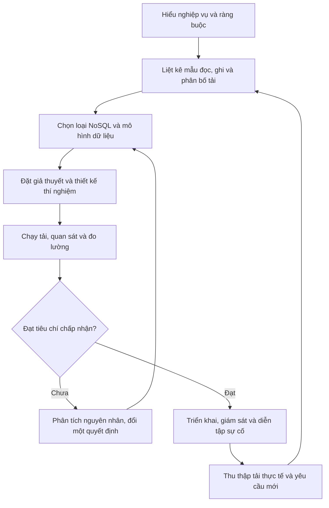

# Trình tự học NoSQL: từ yêu cầu, mô hình dữ liệu đến thực nghiệm, đo lường và vận hành

Một hệ thống NoSQL không trở nên phù hợp chỉ vì đã chọn MongoDB, Redis, Cassandra hay một cơ sở dữ liệu đồ thị. Giá trị của thiết kế xuất hiện khi **cách lưu dữ liệu phục vụ đúng cách ứng dụng đọc, ghi và thay đổi dữ liệu**, đồng thời đáp ứng yêu cầu về độ trễ, tính nhất quán, chi phí và khả năng vận hành. Vì vậy, học NoSQL hiệu quả cần đi theo một chu trình có thể kiểm chứng: **hiểu yêu cầu → nhận diện mẫu truy cập → thiết kế mô hình → nêu giả thuyết → thực nghiệm → đo lường → vận hành → điều chỉnh**.

Bài học này trình bày trình tự đó như một phương pháp tư duy và thực hành. Một tình huống quản lý đơn hàng được dùng xuyên suốt để liên kết các quyết định; các con số, SLO và kết quả đo trong ví dụ đều là **giả định minh họa**, không phải số liệu mặc định của một công nghệ.

## 1. Đích đến của quá trình học

Sau khi hoàn thành một vòng học, người học cần trả lời được các câu hỏi sau bằng bằng chứng cụ thể:

1. Ứng dụng đang giải quyết nghiệp vụ gì và dữ liệu có những ràng buộc nào?
2. Những truy vấn và thao tác ghi nào chiếm phần lớn tải thực tế?
3. Vì sao một kiểu mô hình NoSQL đáp ứng các mẫu truy cập đó, và phải đánh đổi điều gì?
4. Giả thuyết nào về hiệu năng, nhất quán hoặc khả năng mở rộng cần được thử nghiệm?
5. Dữ liệu đo có xác nhận giả thuyết không, và có thể tái hiện phép đo không?
6. Khi đưa vào vận hành, hệ thống sẽ được theo dõi, sao lưu, khôi phục và tiến hóa dữ liệu như thế nào?

Kết quả của một vòng học không chỉ là chương trình chạy được. Bộ bằng chứng tối thiểu nên gồm một bản mô tả yêu cầu, ma trận mẫu truy cập, sơ đồ dữ liệu, danh sách quyết định cùng đánh đổi, kịch bản thử nghiệm và báo cáo đo, cộng với phương án vận hành.



Đường quay lại trong sơ đồ là một phần thiết yếu của việc học. Thông số đo và sự cố vận hành có thể làm thay đổi cả cách đặt câu hỏi ban đầu.

## 2. Bắt đầu từ vấn đề nghiệp vụ, không bắt đầu từ tên database

Giả sử một dịch vụ thương mại điện tử cần lưu đơn hàng. Người dùng muốn xem lịch sử mua hàng, mở chi tiết đơn, thanh toán và theo dõi trạng thái giao hàng. Bộ phận vận hành cần lọc các đơn đang chờ xử lý. Các yêu cầu ban đầu có thể được ghi thành bảng:

| Câu hỏi cần làm rõ | Ví dụ câu trả lời trong bài thực hành | Hệ quả thiết kế |
|---|---|---|
| Ai sử dụng dữ liệu? | Khách hàng, nhân viên xử lý đơn, dịch vụ thanh toán | Các nhóm có quyền truy cập và truy vấn khác nhau |
| Đọc thường gặp nhất? | Danh sách 20 đơn gần nhất của một khách hàng | Cần tối ưu lọc theo khách hàng và sắp xếp theo thời gian |
| Ghi phát sinh khi nào? | Tạo đơn, xác nhận thanh toán, cập nhật trạng thái giao hàng | Phải quy định cách chuyển trạng thái và xử lý sự kiện lặp |
| Tính đúng đắn nào không được vi phạm? | Đơn không được ghi nhận thanh toán hai lần chỉ vì nhận sự kiện trùng | Cần cơ chế idempotency và kiểm soát cạnh tranh |
| Chấp nhận dữ liệu chậm ở đâu? | Thống kê tổng đơn có thể chậm vài giây | Có thể dùng projection/bất đồng bộ ở phần thống kê |
| Khả năng phục hồi yêu cầu ra sao? | Không chấp nhận mất đơn đã xác nhận với khách | Phải làm rõ độ bền ghi, backup, failover và kiểm chứng phục hồi |

Ví dụ giả định cho một phiên thực nghiệm: dữ liệu chứa 1 triệu đơn, tải đọc lịch sử 300 yêu cầu/giây vào giờ cao điểm, tốc độ tạo đơn 50 yêu cầu/giây, 95% yêu cầu đọc lịch sử phải hoàn tất dưới 200 ms. Những thông số này chỉ giúp hình thành phép thử; trong dự án thật cần lấy từ dự báo lưu lượng, telemetry hoặc thỏa thuận với bên nghiệp vụ.

### Phân biệt bốn nhóm yêu cầu

- **Chức năng:** tạo đơn, lấy chi tiết, liệt kê theo khách hàng, cập nhật thanh toán, tra cứu đơn cần giao.
- **Dữ liệu và quy tắc:** quan hệ giữa đơn–khách–sản phẩm, vòng đời trạng thái, trường nào bất biến, thời hạn lưu trữ, dữ liệu nhạy cảm.
- **Phi chức năng:** độ trễ mục tiêu, thông lượng, độ sẵn sàng, mức mất dữ liệu có thể chấp nhận, yêu cầu truy vết, bảo mật và chi phí.
- **Phát triển trong tương lai:** tổng số bản ghi, tốc độ tăng trưởng, mẫu truy vấn mới, yêu cầu báo cáo và khả năng thay đổi cấu trúc dữ liệu.

Một câu như “NoSQL phải nhanh” không tạo được tiêu chí kỹ thuật. Câu “ở tải hỗn hợp xác định, p95 của truy vấn danh sách đơn dưới 200 ms và tỷ lệ lỗi dưới 0,5%” có thể được đo. Tương tự, “dữ liệu phải nhất quán” cần được chuyển thành “sau khi API xác nhận thanh toán thành công, lần đọc nào phải thấy trạng thái mới, và trong bao lâu?”.

**Đầu ra chặng này:** một trang yêu cầu với các kịch bản chính, dữ liệu liên quan, mức ưu tiên và tiêu chí chấp nhận có thể đo được. Nếu chưa xác định được mức nhất quán và hậu quả khi ghi sai, chưa nên kết luận về kiến trúc lưu trữ.

## 3. Chuyển yêu cầu thành mẫu truy cập dữ liệu

Khác với thói quen thiết kế bảng chuẩn hóa trước rồi tìm cách truy vấn, nhiều hệ NoSQL khuyến khích **thiết kế theo mẫu truy cập**. Cần mô tả mọi thao tác bằng câu hỏi: “Dùng khóa nào để tìm, lấy bao nhiêu bản ghi, sắp xếp ra sao, tần suất bao nhiêu và yêu cầu dữ liệu mới đến mức nào?”.

| Mã | Thao tác | Điều kiện truy cập chính | Kết quả mong muốn | Đặc điểm cần quan sát |
|---|---|---|---|---|
| Q1 | Xem danh sách đơn | `customerId` | 20 đơn mới nhất, phân trang | Đọc nhiều, có sắp xếp, cần độ trễ thấp |
| Q2 | Xem chi tiết đơn | `orderId` | Một đơn kèm các dòng hàng tại thời điểm mua | Đọc một thực thể tổng hợp, cần dữ liệu chính xác |
| Q3 | Tạo đơn | Đơn và các dòng hàng | Sinh đơn duy nhất, trả kết quả ghi | Ghi nhiều trường liên quan, cần bền vững |
| Q4 | Xác nhận thanh toán | `orderId`, mã sự kiện | Chuyển trạng thái hợp lệ một lần | Có retry, sự kiện trùng và ghi cạnh tranh |
| Q5 | Danh sách chờ giao | `status`, thời gian tạo | Các đơn cần xử lý theo thứ tự | Lọc trên nhiều khách, có thể cần chỉ mục riêng |
| Q6 | Thống kê theo ngày | Khoảng thời gian, trạng thái | Số lượng và doanh thu tổng hợp | Có thể là luồng xử lý riêng, không cần tức thời |

Với mỗi mẫu, bổ sung thông tin về tỷ lệ đọc/ghi, phân bố khóa, bản ghi lớn nhất, nhu cầu phân trang và đường đi dữ liệu. Chỉ nhìn tải trung bình rất dễ bỏ qua *hot key*: một khách hàng hoặc tenant có số đơn vượt trội có thể gây nghẽn một phân vùng dù toàn hệ thống còn dư tài nguyên.

### Vẽ vòng đời của một dữ liệu

```text
Khách đặt hàng
  -> tạo đơn CREATED
  -> nhận kết quả thanh toán
  -> chuyển PAID hoặc PAYMENT_FAILED
  -> xử lý giao hàng
  -> SHIPPED -> DELIVERED
  -> lưu trữ / ẩn dữ liệu theo chính sách
```

Vòng đời đặt ra các câu hỏi độc lập với database: ai được phép chuyển trạng thái, xử lý hai sự kiện đến ngược thứ tự ra sao, thông tin nào phải được giữ nguyên để kiểm toán, việc xóa có ảnh hưởng đến dữ liệu tài chính không. Trả lời những câu hỏi này trước giúp tránh việc giao trách nhiệm nghiệp vụ cho một cấu hình nhất quán hoặc một chỉ mục.

**Đầu ra chặng này:** ma trận truy vấn–ghi, sơ đồ vòng đời và danh sách trường được truy cập cùng nhau. Đây là căn cứ để đánh giá mô hình, lựa chọn chỉ mục và thiết kế bài benchmark.

## 4. Chọn họ NoSQL từ cách sử dụng dữ liệu

“NoSQL” là tên của một nhóm cách tổ chức dữ liệu, không phải một mô hình thống nhất. Các hệ có thể hỗ trợ tính năng chồng lấn nhau, vì vậy bảng dưới đây là định hướng ban đầu chứ không phải quy tắc bắt buộc.

| Họ cơ sở dữ liệu | Cách nhìn dữ liệu | Phù hợp để bắt đầu nghiên cứu khi | Câu hỏi đánh đổi |
|---|---|---|---|
| Key–value | Tra cứu giá trị theo khóa | Session, cache, trạng thái đơn giản, ánh xạ khóa trực tiếp | Có cần lọc và kết hợp dữ liệu ngoài khóa không? |
| Document | Một tài liệu chứa thực thể/tổng hợp với trường lồng nhau | Đơn hàng, hồ sơ, nội dung có cấu trúc linh hoạt, đọc theo aggregate | Tài liệu có tăng không giới hạn; cập nhật cùng dữ liệu lặp thế nào? |
| Wide-column | Tổ chức dữ liệu theo khóa phân vùng và cách truy vấn định trước | Sự kiện, log, time series và tải ghi phân tán lớn | Khóa phân vùng, thứ tự và phân bố tải có phù hợp không? |
| Graph | Nút–cạnh và duyệt quan hệ | Quan hệ nhiều bước, gợi ý kết nối, phát hiện phụ thuộc/gian lận | Độ sâu duyệt, số cạnh và mức phân tán ảnh hưởng ra sao? |

Một ứng dụng có thể cần nhiều kiểu lưu trữ: document làm dữ liệu giao dịch, key–value làm cache, search index cho tìm kiếm toàn văn, hệ phân tích cho báo cáo. Điều quan trọng là xác định **nguồn dữ liệu có thẩm quyền** và đường đồng bộ; thêm công nghệ cũng thêm rủi ro dữ liệu lệch, thứ tự sự kiện và chi phí vận hành.

Không nên chọn NoSQL bằng lập luận “không cần quan hệ”. Nếu nghiệp vụ đòi hỏi nhiều phép JOIN động, ràng buộc tham chiếu chặt và giao dịch đa thực thể thường xuyên, một RDBMS có thể đơn giản hơn. Quyết định nên dựa trên các truy vấn, yêu cầu đúng đắn và phép đo so sánh.

## 5. Thiết kế mô hình dữ liệu có giải thích được

Với ví dụ đơn hàng, thử một mô hình document để tối ưu Q1 và Q2. Một đơn có dữ liệu hàng hóa **tại thời điểm đặt mua**; đây là snapshot để giá/tên sản phẩm về sau không làm thay đổi chứng từ đơn cũ.

```json
{
  "_id": "O1001",
  "customerId": "C42",
  "createdAt": "2026-11-01T08:00:00Z",
  "status": "CREATED",
  "items": [
    { "productId": "P7", "nameAtPurchase": "Bình giữ nhiệt", "quantity": 2, "unitPrice": 150000 }
  ],
  "totalAmount": 300000,
  "currency": "VND",
  "shippingAddressAtPurchase": {
    "city": "Hà Nội",
    "district": "Ba Đình"
  },
  "version": 1
}
```

Trong mô hình này, `items` được nhúng vì Q2 gần như luôn cần toàn bộ dòng hàng cùng đơn; một đơn thông thường có số dòng hàng hữu hạn theo quy tắc nghiệp vụ. `customerId` là tham chiếu vì hồ sơ khách hàng là thực thể dùng chung và thay đổi độc lập. Chỉ lưu địa chỉ giao hàng đủ mức cần thiết, theo chính sách bảo vệ dữ liệu, và không đặt bí mật thanh toán như số thẻ đầy đủ trong đơn.

### Nhúng (embed) hay tham chiếu (reference)?

| Tiêu chí | Ưu tiên xem xét nhúng | Ưu tiên xem xét tham chiếu |
|---|---|---|
| Mẫu đọc | Dữ liệu thường được trả về cùng nhau | Thực thể thường được đọc độc lập |
| Quan hệ kích thước | Số phần tử có giới hạn rõ | Tập con có thể tăng vô hạn |
| Thay đổi | Cập nhật cùng vòng đời hoặc cần snapshot | Nhiều chủ sở hữu cập nhật độc lập |
| Tính nhất quán | Muốn cập nhật nguyên tử trong một document | Chấp nhận phối hợp đa thực thể hoặc cần mô hình riêng |
| Dữ liệu lặp | Lặp ít, chủ động quản trị được | Lặp nhiều, cập nhật đồng loạt tốn kém |

Đừng nhúng mọi sự kiện giao hàng vào một mảng tăng mãi trong đơn. Một luồng sự kiện dài có thể cần collection riêng, có giới hạn lưu giữ hoặc mô hình time series. Ngược lại, chia mọi dòng hàng thành document độc lập có thể buộc Q2 thực hiện nhiều lần đọc và điều phối thêm.

### Thiết kế chỉ mục theo truy vấn

Ví dụ dùng cú pháp MongoDB shell để minh họa cách nối mô hình với Q1:

```javascript
// Q1: Liệt kê 20 đơn mới nhất của một khách hàng.
db.orders.createIndex({ customerId: 1, createdAt: -1, _id: -1 });

db.orders.find({ customerId: "C42" })
  .sort({ createdAt: -1, _id: -1 })
  .limit(20);
```

Chỉ mục ghép dùng `customerId` làm tiền tố lọc, tiếp theo là trường sắp xếp. `_id` giúp có thứ tự xác định khi hai đơn trùng thời điểm. Với phân trang sâu, nên cân nhắc phân trang bằng con trỏ dựa trên cặp `(createdAt, _id)` thay cho `skip` lớn; phải định nghĩa điều kiện tiếp trang tương ứng với chiều sắp xếp và xử lý dữ liệu mới được chèn.

Đối với Q5, có thể cần một chỉ mục khác theo `status` và `createdAt`, nhưng **chỉ thêm sau khi xác nhận tần suất truy vấn và hiệu quả bằng kế hoạch thực thi**. Mỗi chỉ mục bổ sung tiêu thụ dung lượng, bộ nhớ và làm tăng chi phí ghi. Không có cấu hình chỉ mục tối ưu chung cho mọi workload.

Khi quy mô cần phân vùng/sharding, phải thiết kế khóa phân vùng dựa trên **phân bố thực tế** và yêu cầu định tuyến. Chẳng hạn `customerId` giúp truy vấn lịch sử của một khách hàng có điểm định tuyến rõ, nhưng truy vấn chỉ biết `orderId` hoặc một khách hàng cực lớn có thể tạo đánh đổi khác. Dữ liệu có phân bố lệch, thời gian tăng đơn điệu hoặc tenant rất lớn đều là trường hợp cần thí nghiệm riêng; không suy ra khóa shard tốt chỉ từ một query phổ biến.

**Đầu ra chặng này:** vài document mẫu có kích thước thực tế, sơ đồ thực thể/aggregate, danh sách chỉ mục dự kiến, đường đọc/ghi cho từng Q và một bản ghi quyết định “chọn vì…; chấp nhận đánh đổi…”.

## 6. Đặt tính nhất quán và tính đúng đắn vào mô hình

NoSQL không đồng nghĩa với “luôn eventual consistency”, cũng không bảo đảm “mọi thao tác là transaction”. Phạm vi atomicity, consistency và durability phụ thuộc từng database, cấu hình ghi/đọc, cách phân vùng và cơ chế replication. Cần nghiên cứu đúng hợp đồng của công nghệ đã chọn.

Với đơn hàng, có thể chia yêu cầu thành ba mức:

1. **Bất biến bắt buộc:** không chuyển `DELIVERED` trở về `CREATED`, không cộng tiền hai lần do cùng một sự kiện thanh toán được gửi lặp, không ghi số lượng âm.
2. **Cần đọc mới đúng thời điểm:** sau khi hệ thống thông báo tạo đơn thành công, người dùng mở ngay đơn đó phải thấy dữ liệu theo cam kết API. Phải xác định nơi đọc và mức nhất quán phù hợp.
3. **Có thể trễ có giới hạn:** báo cáo tổng đơn theo ngày hay dashboard phân tích có thể được cập nhật bất đồng bộ khi nghiệp vụ cho phép.

Một lệnh cập nhật có điều kiện là bước đầu chống chuyển trạng thái không hợp lệ trên một document:

```javascript
// Ví dụ minh họa: chỉ đơn đang CREATED mới được xác nhận PAID.
const result = db.orders.updateOne(
  { _id: "O1001", status: "CREATED" },
  { $set: { status: "PAID" }, $inc: { version: 1 } }
);

// matchedCount = 0: đơn không tồn tại hoặc trạng thái đã đổi.
// Cần xử lý nhánh này theo quy tắc nghiệp vụ; không mặc nhiên retry vô hạn.
```

Tuy nhiên, cập nhật trạng thái đơn **không tự bảo đảm** một sự kiện thanh toán chỉ ảnh hưởng một lần đến toàn bộ hệ thống. Khi nhận event trùng, cần một định danh sự kiện ổn định và cơ chế khử trùng phù hợp; nếu việc ghi event đã xử lý và cập nhật đơn nằm ở hai document, phải giải quyết vấn đề atomicity đa document bằng transaction được hỗ trợ hoặc thiết kế tương đương có cơ chế phục hồi. Trường hợp gửi sự kiện ra dịch vụ khác còn phải tính đến outbox/inbox, retry và idempotency ở consumer. Những quyết định này là thuộc tính của toàn luồng, không chỉ của câu lệnh database.

Hãy chủ động đặt câu hỏi về các tình huống cạnh tranh: hai lần xác nhận thanh toán cùng đến, cập nhật giao hàng đến trước thanh toán, node primary bị lỗi sau khi đã phản hồi, client timeout khi server có thể đã ghi thành công. Với mỗi tình huống, ghi rõ **điều gì được phép xảy ra, ai phát hiện và cách phục hồi**.

**Đầu ra chặng này:** danh sách bất biến, sơ đồ chuyển trạng thái, mức nhất quán cho từng đường đọc và ghi, cách kiểm soát phiên bản/cạnh tranh và cách xử lý retry cùng sự kiện lặp.

## 7. Từ mô hình sang giả thuyết có thể bác bỏ

Một bài thử có ý nghĩa khi nêu trước thay đổi và dấu hiệu đo được. Chẳng hạn:

> H1: Với tập 1 triệu đơn phân bố theo khách hàng như dữ liệu mô phỏng, chỉ mục ghép `(customerId, createdAt, _id)` sẽ làm giảm p95 truy vấn Q1 so với mô hình chưa có chỉ mục đó, ở cùng mức 300 request/giây. Chi phí đánh đổi dự kiến là dung lượng chỉ mục và thời gian ghi tăng.

Giả thuyết này có điều kiện, có mốc so sánh và có chỉ số cả lợi lẫn hại. Nếu dữ liệu rất nhỏ và nằm trọn trong cache, chênh lệch có thể không rõ; như vậy không chứng minh hay phủ định trực tiếp giá trị ở quy mô lớn hơn.

Những giả thuyết khác đáng thử:

- Nhúng `items` giúp Q2 cần ít round trip hơn, nhưng đơn có số dòng hàng quá lớn sẽ làm tăng kích thước đọc/ghi.
- Một khóa phân vùng phân bố đều có thể tăng thông lượng ghi, nhưng có thể làm truy vấn theo khách hàng phải đi qua nhiều phân vùng hơn.
- Một projection phục vụ dashboard làm giảm tải query tổng hợp trên đường giao dịch, đổi lại dữ liệu trễ và cần phát hiện đồng bộ lỗi.
- Chuyển từ phân trang offset sang con trỏ làm giảm chi phí trang sâu nhưng cần định nghĩa chặt quy tắc sắp xếp và dữ liệu mới chen vào.

Không thay đổi đồng thời mô hình, chỉ mục, số node, phần cứng và công cụ tải rồi quy toàn bộ kết quả cho “NoSQL nhanh hơn”. Mỗi vòng thí nghiệm nên đổi một nhóm biến có chủ đích và lưu lại cấu hình.

## 8. Thiết kế thực nghiệm tái hiện được

### 8.1. Chuẩn bị dữ liệu đại diện

Một bộ dữ liệu 1 triệu đơn chia đều cho 100.000 khách hàng rất khác một bộ trong đó 1% khách hàng chiếm 40% số đơn. Hãy mô phỏng hoặc lấy mẫu các đặc điểm có thể ảnh hưởng kết quả:

- Số lượng đơn, phân bố đơn theo khách và tuổi dữ liệu.
- Số `items` mỗi đơn, kích thước document, số trường và các giá trị hiếm.
- Tỷ lệ đọc/ghi, các truy vấn Q1–Q6, request đồng thời và tỷ lệ khóa nóng.
- Tốc độ tăng dữ liệu, thao tác cập nhật, retry hoặc sự kiện trùng.
- Điều kiện đọc ngay sau khi ghi, đọc từ replica và môi trường có độ trễ mạng.

Nêu rõ cách sinh và seed dữ liệu, phiên bản hệ quản trị, cấu hình chỉ mục, số node/replica, tài nguyên CPU–RAM–disk và driver. Dữ liệu vô danh/sinh giả ưu tiên cho thử nghiệm; không đưa dữ liệu khách hàng thật vào môi trường thử thiếu bảo vệ.

### 8.2. Định nghĩa tải và điểm đo

Một kịch bản mẫu có thể viết thành cấu hình độc lập với công cụ:

```yaml
experiment: order-history-index
dataset:
  orders: 1000000
  shape: realistic-customer-skew
workload:
  durationMinutes: 15
  warmupMinutes: 5
  targetReadRps: 300
  targetCreateRps: 50
  queryMix:
    Q1_history: 0.70
    Q2_detail: 0.20
    Q5_pending: 0.10
compare:
  baseline: without_q1_compound_index
  candidate: with_q1_compound_index
measure:
  - throughput
  - p50_p95_p99_latency
  - request_error_rate
  - cpu_memory_disk_io
  - examined_documents_and_index_usage
  - database_storage_and_index_size
```

Đây là mô tả ý tưởng, không phải cấu hình được bảo đảm chạy trực tiếp trong một công cụ benchmark. `targetReadRps` là tốc độ đề nghị, cần ghi cả tốc độ *thực sự đạt được*: khi load generator quá tải, điểm đo không còn đại diện cho mục tiêu.

### 8.3. Quy trình chạy có kiểm soát

1. Lưu baseline schema, dữ liệu, các chỉ mục và cấu hình node; cố định điều kiện mạng/phần cứng khi so sánh.
2. Nạp dữ liệu đại diện, chờ hệ thống ổn định và xác định rõ có dùng warm cache hay cold cache.
3. Chạy warm-up riêng, sau đó chạy tải trong khoảng đủ dài để quan sát tail latency và xu hướng tài nguyên.
4. Thu số liệu cùng thời điểm từ **client** (độ trễ end-to-end, timeout, lỗi), **database** (query plan, đọc đĩa, hàng đợi, replication lag) và **hạ tầng** (CPU, memory, I/O, network).
5. Lặp phép chạy đủ để nhận ra dao động tự nhiên; lưu số liệu thô, cấu hình và dấu thời gian.
6. Chỉ thay một biến thiết kế được thử nghiệm, chạy lại cùng tải, so sánh cả lợi ích lẫn chi phí.
7. Thử tải tăng dần, tình huống đỉnh và một lỗi có kiểm soát (ví dụ mất một node) khi môi trường cho phép.

Đo `p95` nghĩa là khoảng 95% yêu cầu có độ trễ không vượt giá trị đó; `p99` giúp phát hiện phần đuôi chậm mà trung bình che khuất. **Throughput** là số yêu cầu hoàn thành trên đơn vị thời gian; **error rate** phải tính cả timeout và phản hồi lỗi. Không thể kết luận chỉ dựa vào p95 nếu hệ thống chỉ hoàn thành một phần tải đã gửi. Cũng không được lấy một lần chạy của tập 100 dòng để dự đoán chắc chắn khả năng mở rộng tới hàng tỷ dòng.

Trong MongoDB có thể quan sát cách truy vấn sử dụng chỉ mục bằng:

```javascript
db.orders.find({ customerId: "C42" })
  .sort({ createdAt: -1, _id: -1 })
  .limit(20)
  .explain("executionStats");
```

Đọc các thông tin như `nReturned`, `totalKeysExamined`, `totalDocsExamined`, các stage trong `winningPlan` và thời gian ghi nhận. Kế hoạch thực thi cho biết đường đi bên trong database; nó **không thay thế** thời gian end-to-end hoặc phép đo dưới tải đồng thời. Tùy phiên bản và cấu hình, chỉ số `executionTimeMillis` của một lần `explain` cũng không đại diện chính xác cho độ trễ người dùng.

### 8.4. Ghi kết quả và kết luận có giới hạn

Giả sử kết quả sau cùng của hai lượt chạy trong **môi trường giả định giống nhau** như sau:

| Chỉ số tại tải mục tiêu | A: chưa có chỉ mục Q1 | B: có chỉ mục ghép Q1 | Điều rút ra |
|---|---:|---:|---|
| Q1 p95 | 420 ms | 85 ms | B cải thiện truy vấn mục tiêu trong phép thử này |
| Q1 p99 | 950 ms | 190 ms | Phần đuôi cũng cải thiện |
| Tốc độ ghi hoàn thành | 50/s | 50/s | Cả hai vẫn đạt tải ghi thử nghiệm |
| Q3 p95 | 42 ms | 49 ms | Ghi có chi phí thêm cần theo dõi |
| Dung lượng chỉ mục | 0,6 GB | 0,9 GB | B dùng thêm không gian |
| Tỷ lệ lỗi | 0% | 0% | Không phát hiện lỗi trong khoảng chạy; chưa chứng minh không có lỗi |

Những số liệu này chỉ minh họa **cách diễn giải**; không phải phép benchmark đã được thực hiện. Kết luận hợp lệ là “với bộ dữ liệu, workload và môi trường nêu trên, B giúp Q1 đạt tiêu chí p95 và tăng chi phí chỉ mục”. Chưa thể kết luận B luôn tối ưu hoặc hoàn toàn chịu được tải gấp mười.

Một bảng kết quả tốt nên có cả điều kiện thử nghiệm, khoảng thời gian, số lần lặp, độ biến thiên, các truy vấn thua đi và lý do chấp nhận hoặc bác bỏ giả thuyết.

## 9. Đánh giá toàn hệ thống thay vì một truy vấn đơn lẻ

NoSQL thường bộc lộ rõ đánh đổi khi tải và lỗi tăng. Sau khi tối ưu một truy vấn, cần thực hành ba lớp thử bổ sung.

### Tăng quy mô và phân bố tải

Thử các mức dữ liệu, concurrent clients và số node khác nhau; quan sát throughput có tăng tương xứng không, phân vùng có lệch không, scatter/gather query có đắt hơn không và lúc nào chi phí rebalance bắt đầu ảnh hưởng đến độ trễ. Phân biệt **scale up** (tăng tài nguyên một node) và **scale out** (thêm node); thêm node không tự đảm bảo nhanh hơn nếu khóa phân vùng, giao tiếp hoặc điểm nghẽn ghi chưa phù hợp.

### Đúng đắn dưới cạnh tranh và sự cố

Chạy các ca: gửi lặp một event, hai cập nhật đồng thời, mất kết nối giữa lúc ghi, restart tiến trình, failover primary và lag của replica. Kiểm tra trạng thái cuối và bất biến nghiệp vụ, không chỉ mã HTTP. Cần biết client timeout có nghĩa “ghi thất bại” hay “không biết kết quả”; lệnh retry có thể tạo ghi trùng nếu API thiếu idempotency.

### Khả năng duy trì theo thời gian

Thử tăng dữ liệu nhiều ngày, thay đổi tỷ lệ đọc/ghi, tái tạo chỉ mục, khôi phục backup và triển khai một phiên bản schema mới. Một thiết kế đạt p95 ở ngày đầu nhưng làm tài liệu phình không giới hạn, tăng write amplification hoặc không thể phục hồi trong thời gian yêu cầu vẫn chưa đạt mục tiêu.

## 10. Chuyển kết quả thử nghiệm thành kế hoạch vận hành

Vận hành không phải chặng phụ sau khi “học xong NoSQL”. Nó là phép kiểm cuối cùng cho các giả định ở các bước trước.

| Hạng mục vận hành | Cần quyết định | Bằng chứng nên thu thập |
|---|---|---|
| Quan sát | Theo dõi p95/p99, thông lượng, lỗi, queue, CPU, memory, disk, cache, replication lag | Dashboard theo dịch vụ và thao tác Q1–Q6; cảnh báo có ngưỡng rõ |
| Dữ liệu bền vững | Mức xác nhận ghi, cấu hình replication, backup định kỳ | Thử khôi phục và đối chiếu dữ liệu quan trọng |
| Phục hồi sự cố | RPO: chấp nhận mất tối đa bao nhiêu dữ liệu; RTO: cần phục hồi trong bao lâu | Biên bản diễn tập mất node, khôi phục dữ liệu và thời gian thực tế |
| Tính nhất quán | Đọc từ primary/replica lúc nào; giải quyết event trùng và ghi cạnh tranh thế nào | Ca thử read-after-write, idempotency và failover |
| Bảo mật | Ai đọc/ghi trường nhạy cảm; mã hóa, định danh, phân quyền và audit | Cấu hình quyền tối thiểu, log kiểm toán, kiểm tra quyền |
| Vòng đời dữ liệu | Retention, lưu trữ lịch sử, chính sách xóa hoặc ẩn, migration | Kế hoạch phiên bản schema và quy trình rollback/reprocess |
| Chi phí | Dung lượng dữ liệu, chỉ mục, băng thông, số node, backup | Dự báo theo tăng trưởng và số liệu sử dụng thực |

### Một vòng thay đổi schema an toàn

Giả sử cần bổ sung `deliveryStatus` vào document đơn. Một cách triển khai có thể là:

1. Định nghĩa giá trị mặc định khi trường chưa tồn tại và thay đổi API để đọc được cả document cũ và mới.
2. Cho phiên bản ứng dụng mới ghi trường mới, có kế hoạch quay lui và giám sát lỗi.
3. Backfill dữ liệu cũ theo lô có giới hạn tốc độ nếu cần; ghi nhận tiến độ và xử lý lô thất bại.
4. Chỉ thêm chỉ mục hoặc bỏ nhánh tương thích cũ sau khi xác nhận lượng truy vấn, tỷ lệ document đã chuyển đổi và ảnh hưởng vận hành.

Không nên dựa vào tính “schema linh hoạt” để bỏ qua quản lý phiên bản. Schema vẫn tồn tại dưới dạng hợp đồng giữa dữ liệu, mã ứng dụng, báo cáo và các consumer sự kiện.

### Cảnh báo phải dẫn tới hành động

Ví dụ, nếu p95 Q1 tăng vượt ngưỡng, người trực cần có đường kiểm tra: tải đến có tăng không, kế hoạch query có đổi không, tập dữ liệu nóng có vượt memory không, node có lag hoặc mất kết nối không, có khách hàng gây hot partition không. Cảnh báo không có người nhận, cách xác minh và hành động khôi phục thì chưa tạo ra khả năng vận hành.

Với backup, điều có giá trị là **khôi phục thử và kiểm tra tính sử dụng được của dữ liệu**, không chỉ thấy tác vụ sao lưu báo thành công. Với TTL, cần hiểu đặc điểm xóa theo cơ chế nền của sản phẩm và không xem thời điểm xóa là chính xác tuyệt đối; dữ liệu đơn hàng chịu nghĩa vụ lưu trữ phải được xử lý theo chính sách nghiệp vụ/pháp lý đã xác định.

## 11. Lộ trình thực hành theo vòng tăng độ khó

Để không học rời rạc theo từng lệnh CRUD, có thể triển khai một chuỗi bài tập tăng dần:

| Vòng | Việc làm | Sản phẩm cần nộp | Điều kiện chuyển vòng |
|---|---|---|---|
| 1. Khảo sát | Viết yêu cầu và vẽ vòng đời đơn hàng; lập Q1–Q6 | Requirements và access-pattern matrix | Biết truy vấn nào là trọng tâm và dữ liệu nào phải đúng tuyệt đối |
| 2. Mô hình | So sánh ít nhất hai phương án nhúng/tham chiếu, thử vài document mẫu | Sơ đồ aggregate, schema ví dụ, bảng đánh đổi | Giải thích được mỗi mẫu đọc/ghi đi qua dữ liệu ra sao |
| 3. Hiện thực nhỏ | Nạp dữ liệu, tạo CRUD và index tối thiểu; thử cập nhật có điều kiện | Script tạo dữ liệu, thao tác và kết quả kiểm tra bất biến | Truy vấn cho kết quả đúng, event lặp không phá quy tắc đã nêu |
| 4. Thực nghiệm | Đặt H1, tạo workload, chạy baseline và candidate, đọc query plan | Cấu hình chạy, số liệu thô, bảng so sánh | Kết luận gắn với số liệu, có giới hạn và đánh đổi |
| 5. Khả năng chịu tải | Tăng dữ liệu/tải, thử hot key, retry, failover và khôi phục | Báo cáo độ trễ, lỗi, consistency và điểm nghẽn | Biết lúc nào và vì sao thiết kế suy giảm |
| 6. Vận hành | Tạo dashboard, alert, backup, runbook và quy trình thay schema | Bộ tài liệu vận hành kèm kết quả diễn tập | Có thể phát hiện, chẩn đoán và phục hồi lỗi điển hình |

Không cần chờ nhiều công cụ mới bắt đầu: một bộ dữ liệu nhỏ và hai phương án mô hình có thể dạy cách lập luận về truy vấn. Nhưng một phép đo nhỏ chỉ được dùng để kết luận trong phạm vi nhỏ đó. Khi muốn khái quát về khả năng mở rộng, phải tăng dần quy mô và kiểm soát điều kiện thử nghiệm.

### Nhật ký quyết định kỹ thuật

Với mỗi thay đổi, lưu một mục ngắn để người khác có thể tái hiện:

```text
Quyết định: Dùng chỉ mục (customerId, createdAt DESC, _id DESC) cho Q1.
Yêu cầu: 95% lần đọc 20 đơn mới nhất hoàn tất dưới 200 ms ở tải mục tiêu.
Giả thuyết: Chỉ mục tránh quét và sắp xếp quá nhiều document.
Baseline: Mô hình/chỉ mục hiện tại, phiên bản và môi trường ghi rõ.
Candidate: Chỉ thêm một chỉ mục ghép cho Q1.
Đo: p50/p95/p99, throughput, lỗi, keys/docs examined, chi phí ghi/disk.
Kết quả: Đính kèm log thô và số lần lặp, không chỉ một ảnh chụp.
Kết luận: Chấp nhận/bác bỏ trong điều kiện nào; khi nào cần đo lại.
```

Nhật ký làm rõ ranh giới giữa **giả định**, **bằng chứng** và **quyết định**. Nó cũng bảo vệ đội ngũ trước việc sao chép một mẹo tối ưu từ ứng dụng này sang ứng dụng khác mà không xét tải thực tế.

## 12. Sai lầm học tập thường gặp và cách sửa

| Cách học dễ dẫn đến sai lầm | Hệ quả | Cách sửa |
|---|---|---|
| Học tên sản phẩm và API trước khi có nhu cầu | Khó giải thích vì sao chọn mô hình | Bắt đầu từ 3–6 kịch bản đọc/ghi và bất biến nghiệp vụ |
| Định nghĩa “NoSQL nhanh” bằng một lệnh query | Bỏ qua độ trễ mạng, concurrency và tỷ lệ lỗi | Đo end-to-end cùng DB metrics dưới tải có cấu trúc |
| Nhúng toàn bộ dữ liệu liên quan vào một document | Document lớn, mảng tăng vô hạn và cập nhật đắt | Xác định aggregate boundary, giới hạn kích thước và vòng đời |
| Thêm chỉ mục cho mọi trường | Tăng dung lượng và chi phí ghi | Dùng query frequency, explain và thử nghiệm so sánh |
| Dùng nhất quán cuối cùng cho mọi đường dữ liệu | Dễ vi phạm nghiệp vụ thanh toán hoặc thứ tự trạng thái | Phân loại invariants và cam kết đọc/ghi cho từng thao tác |
| Benchmark chỉ với dữ liệu đều, ít và nằm trong RAM | Không thấy hot partition, I/O hay chi phí mở rộng | Dùng dữ liệu lệch, quy mô tăng và các trường hợp đỉnh |
| Chỉ thử lúc bình thường | Không biết ứng xử khi retry, timeout hoặc failover | Thử lỗi có chủ đích và đối chiếu trạng thái cuối |
| Coi deploy là xong | Không có dấu hiệu phát hiện hỏng hoặc chứng cứ phục hồi | Đặt SLI/SLO, dashboard, runbook và restore drill |

## 13. Bài thực hành tổng hợp

**Đề bài:** thiết kế lưu trữ cho dịch vụ quản lý đơn hàng có Q1–Q6 như trên. Sử dụng một hệ document để làm phương án ban đầu, sau đó phản biện xem phần nào có thể phù hợp hơn với key–value, wide-column, graph hoặc SQL. Không cần triển khai nhiều database chỉ để hoàn thành phần phản biện.

**Các nhiệm vụ cần hoàn thành:**

1. Viết ít nhất năm yêu cầu nghiệp vụ; xác định hai bất biến không được vi phạm và hai trường hợp được chấp nhận đọc trễ.
2. Ước lượng phân bố dữ liệu và lưu lượng; lập ma trận Q1–Q6 với khóa, tần suất, dữ liệu trả về và độ mới cần thiết.
3. Trình bày hai mô hình cho `orders` và `items`, giải thích cách mỗi mô hình xử lý Q1, Q2, Q3; chọn một mô hình và ghi lý do.
4. Đặt hai giả thuyết có thể bác bỏ, ít nhất một giả thuyết về chỉ mục và một về trade-off nhúng/tham chiếu hoặc phân vùng.
5. Đề xuất bộ dữ liệu thử, phép đo, baseline/candidate và tiêu chí chấp nhận. Nếu chạy được môi trường, lưu số liệu thật, đánh dấu riêng mọi kết quả mô phỏng.
6. Diễn giải một tình huống event thanh toán đến hai lần và một tình huống client timeout sau ghi: hệ thống sẽ phát hiện, kiểm tra, retry và bảo vệ bất biến bằng cách nào?
7. Viết một runbook ngắn cho sự cố “p95 Q1 tăng đột ngột” và một quy trình diễn tập restore; chỉ rõ chỉ số, thao tác chẩn đoán và tiêu chí kết thúc sự cố.

**Câu hỏi tự kiểm tra:**

- Nếu Q1 rất nhanh nhưng Q4 có thể ghi nhận thanh toán trùng, mô hình đã đạt yêu cầu chưa? Vì sao?
- Nếu kết quả chỉ nhanh trên 10.000 document và một người dùng, kết luận có thể áp dụng đến mức nào?
- Vì sao chỉ thêm một index có thể cải thiện đọc nhưng làm tăng thời gian ghi và dung lượng?
- Khi Q1 lọc theo `customerId` còn Q5 lọc theo `status`, một shard key có phục vụ tốt cả hai không? Cần đo thêm điều gì?
- Việc dữ liệu dashboard chậm 5 giây có chấp nhận được khi dữ liệu thanh toán phải chính xác ngay không? Hai luồng cần các cam kết khác nhau như thế nào?
- Làm sao chứng minh một bản backup thực sự đáp ứng RPO/RTO nếu chưa từng khôi phục thử?

## 14. Nguyên tắc kết nối mọi chặng học

Học NoSQL có hệ thống là học cách đặt một **chuỗi câu hỏi nối tiếp nhau**. Yêu cầu nghiệp vụ xác định mẫu truy cập; mẫu truy cập dẫn đến aggregate, khóa và chỉ mục; quyết định thiết kế tạo giả thuyết; phép đo cho biết giả thuyết đúng trong phạm vi nào; vận hành kiểm tra các giả thuyết đó trước tăng trưởng và sự cố thật. Khi kết quả không đạt, quay lại chặng gây ra vấn đề, thay đổi có kiểm soát rồi đo lại.

Điều cần giữ sau mỗi vòng không phải một kết luận như “database X luôn tốt nhất”, mà là khả năng chỉ ra **đã chọn gì, dựa trên yêu cầu nào, đã kiểm chứng bằng phép đo nào, nhận đánh đổi gì và sẽ nhận biết khi nào phải đổi thiết kế**. Đó là nền tảng để đi từ thực hành NoSQL trên máy cá nhân đến một hệ thống dữ liệu có thể vận hành được.
