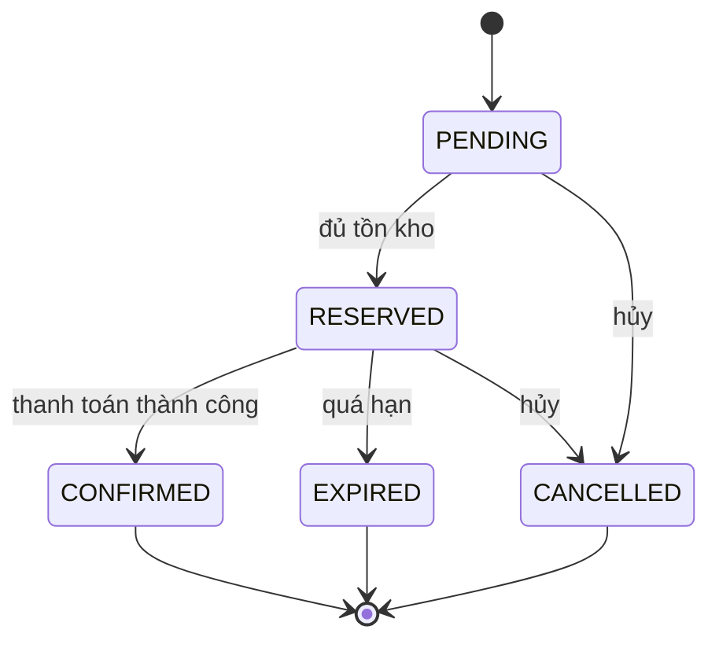
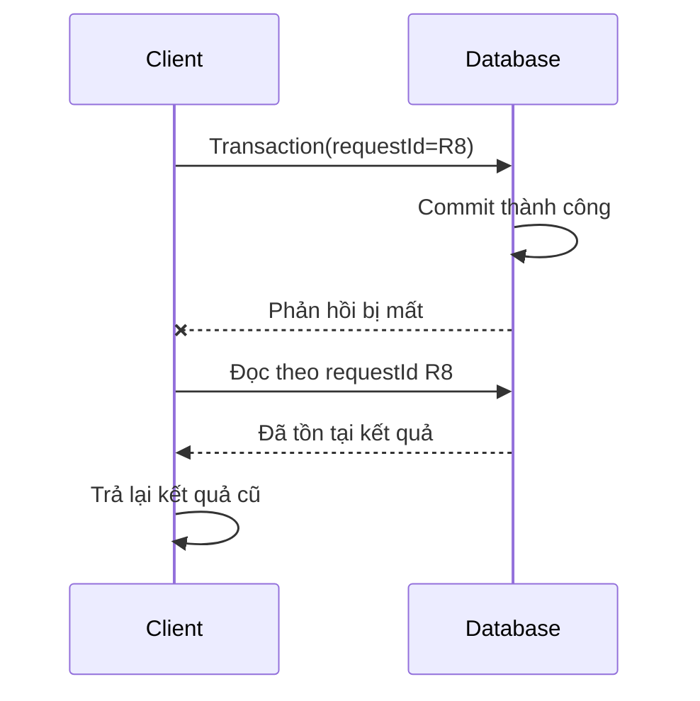
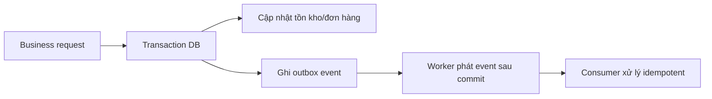
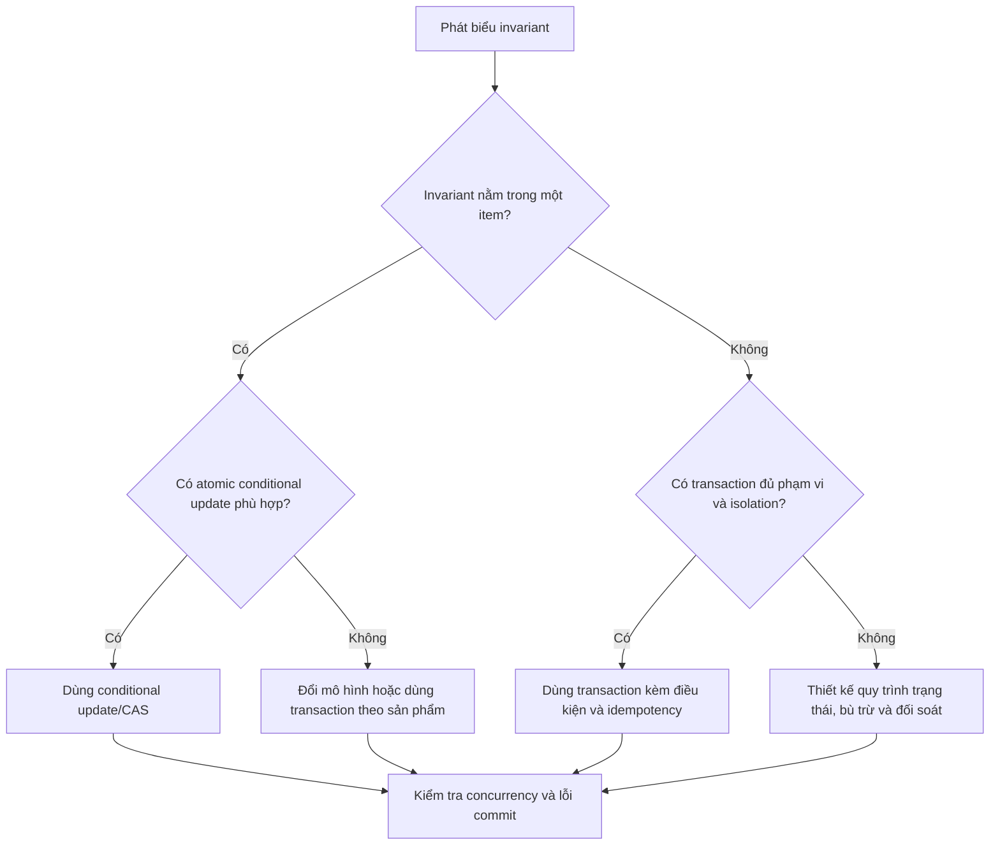

# Dùng cập nhật có điều kiện hoặc giao dịch để bảo vệ bất biến

## 1. Bất biến cần được bảo vệ ngay lúc ghi

Trong thiết kế NoSQL, chúng ta thường gom dữ liệu theo **nhóm nghiệp vụ (aggregate)** và những mẫu truy cập chính. Quyết định nhóm một vài trường vào cùng document hay tách thành nhiều item, partition hoặc bảng phụ không chỉ ảnh hưởng hiệu năng; nó còn quyết định **phạm vi có thể cập nhật một cách nguyên tử**.

**Bất biến (invariant)** là điều kiện phải luôn đúng đối với trạng thái hợp lệ của hệ thống, kể cả khi nhiều request thực thi đồng thời hoặc xảy ra lỗi.

Ví dụ:

| Bài toán | Bất biến nghiệp vụ |
|---|---|
| Quản lý tồn kho | `available >= 0`; không nhận hai đơn cho cùng một đơn vị tồn |
| Đặt chỗ sự kiện | `reserved <= capacity` |
| Mã giảm giá một lần | Một mã chỉ có tối đa một lượt sử dụng hợp lệ |
| Số dư ví | Không được giảm xuống dưới ngưỡng cho phép |
| Đơn hàng | Không chuyển từ `CANCELLED` trở lại `PAID` ngoài quy trình hợp lệ |
| Thành viên nhóm | Một cặp `userId`–`groupId` chỉ có một membership đang hoạt động |
| Chuyển tiền | Ghi nợ và ghi có phải giữ bất biến tổng tiền theo phạm vi yêu cầu |
| Giới hạn tài nguyên | Số tác vụ đồng thời của một tenant không vượt hạn mức |

Để bảo vệ bất biến, không đủ chỉ “kiểm tra dữ liệu trước khi ghi”. Cần đảm bảo **điều kiện vẫn đúng tại thời điểm hệ thống chấp nhận thay đổi**.

Bài này tập trung vào hai nhóm cơ chế:

1. **Cập nhật có điều kiện (conditional write / compare-and-set / optimistic concurrency):** chỉ ghi nếu trạng thái hiện tại đáp ứng điều kiện được đánh giá và thực thi nguyên tử trong phạm vi hỗ trợ.
2. **Giao dịch (transaction):** nhóm nhiều thao tác đọc/ghi có những bảo đảm atomicity và isolation theo phạm vi của hệ quản trị.

Hai cơ chế này có thể kết hợp. Một transaction không tự giải quyết mọi bất biến nếu isolation hoặc cách đặt điều kiện chưa đủ; một conditional write có thể bảo vệ một item nhưng không đủ cho quy tắc bao gồm nhiều item.

### Mục tiêu học tập

Sau bài học, bạn có thể:

- Viết bất biến dưới dạng điều kiện có thể kiểm tra và cưỡng chế.
- Phân tích vì sao quy trình đọc–kiểm tra–ghi thông thường gặp race condition.
- Dùng thao tác cập nhật nguyên tử, version/CAS và conditional insert phù hợp với từng loại bất biến.
- Xác định khi nào cần transaction nhiều bản ghi và cần mức isolation nào.
- Thiết kế cách xử lý xung đột, retry, idempotency và kết quả commit không chắc chắn.
- Nhận biết sự khác nhau giữa MongoDB, DynamoDB, Redis, Cassandra và các sản phẩm khác.
- Xác định ranh giới nhóm dữ liệu để tránh giao dịch phân tán không cần thiết nhưng vẫn giữ đúng nghiệp vụ.

## 2. Vì sao kiểm tra rồi ghi ở ứng dụng có thể sai?

Giả sử một sản phẩm có đúng một đơn vị tồn kho:

```json
{
  "sku": "BK-01",
  "available": 1
}
```

Hai khách hàng cùng đặt một đơn vị. Code ngây thơ:

```text
stock = GET("inventory:BK-01")

if stock.available >= 1:
    stock.available = stock.available - 1
    PUT("inventory:BK-01", stock)
    return "Đặt hàng thành công"
else:
    return "Hết hàng"
```

Kịch bản cạnh tranh:

| Thời điểm | Request A | Request B |
|---|---|---|
| T1 | Đọc `available = 1` | |
| T2 | | Đọc `available = 1` |
| T3 | Kiểm tra `1 >= 1`, hợp lệ | |
| T4 | | Kiểm tra `1 >= 1`, hợp lệ |
| T5 | Ghi `available = 0` | |
| T6 | | Ghi `available = 0` |
| Kết quả | A báo thành công | B cũng báo thành công |

Trên database có thể vẫn lưu `available = 0`, nhưng **hai đơn đã được chấp nhận dù chỉ có một sản phẩm**. Việc số dư không âm trong một document chưa đủ chứng minh bất biến “số đơn được xác nhận không vượt quá tồn kho”.

Đây là **time-of-check to time-of-use (TOCTOU)**: giá trị đã kiểm tra không còn là trạng thái đáng tin cậy lúc ghi.

### 2.1. Thêm một phép đọc sau khi ghi có giải quyết được không?

Không. Nếu cả hai cùng ghi `0` rồi cùng đọc `0`, mỗi request vẫn có thể nghĩ mình đã thành công. Cần một phép thay đổi trạng thái có kết quả rõ ràng: **chỉ một request được quyền tiêu thụ đơn vị còn lại**.

### 2.2. Khóa trong một tiến trình ứng dụng có đủ không?

Một `synchronized` block hay mutex trong một instance chỉ điều phối các luồng trong instance đó. Với nhiều instance/worker, hoặc khi dữ liệu được cập nhật qua job khác, các request vẫn có thể chạy song song.

Nếu chọn locking, phải biết **phạm vi khóa**, cách phục hồi khi tiến trình chết và cách tránh client giữ khóa cũ sau khi lease hết hạn. Cơ chế ghi nguyên tử do database cung cấp thường là nền tảng đáng tin cậy hơn cho bất biến gắn trực tiếp với dữ liệu.

## 3. Mức đơn giản nhất: cập nhật nguyên tử một mục dữ liệu

Nếu tất cả dữ liệu cần bảo vệ nằm trong **một mục có phạm vi atomic update phù hợp**, có thể kết hợp điều kiện và thay đổi ngay ở database.

### 3.1. Pseudocode

```text
result = CONDITIONAL_UPDATE(
    key = "inventory:BK-01",
    condition = current.available >= 1,
    mutation = current.available := current.available - 1
)

if result.applied:
    return "Đã giữ một đơn vị tồn kho"
else:
    return "Không đủ tồn kho"
```

Điểm quyết định là **kiểm tra điều kiện và trừ tồn kho được thực hiện như một thao tác nguyên tử theo contract của store**.

Nếu hai request cạnh tranh trên một mục tồn kho `available = 1`, chỉ một request có thể thành công khi cơ chế bảo đảm điều kiện được kiểm tra trên trạng thái phù hợp tại thời điểm thực thi. Request còn lại nhận kết quả điều kiện không đạt hoặc xung đột theo API.

**Lưu ý:** có những hệ không hỗ trợ conditional update trực tiếp hoặc chỉ cho điều kiện trên những trường/kiểu dữ liệu nhất định. Cần kiểm tra tài liệu trước khi dùng.

### 3.2. Atomic increment/decrement khác read–modify–write

Một lệnh tăng bộ đếm nguyên tử có thể tránh **lost update** của bộ đếm, nhưng không tự áp dụng điều kiện `available >= quantity` hoặc xử lý idempotency khi request bị gửi lặp.

Ví dụ:

```text
INCREMENT("views:post-7", 1)
```

Nếu lệnh nguyên tử, hai request tăng từ 5 có thể cho kết quả 7. Nhưng nếu một request timeout sau khi server đã tăng và client retry, bộ đếm có thể tăng **hai lần cho cùng một sự kiện nghiệp vụ**.

Do đó cần phân biệt:

- **Atomicity của lệnh:** thay đổi được áp dụng theo một đơn vị không bị xen kẽ theo cách phá contract.
- **Điều kiện nghiệp vụ:** thao tác chỉ hợp lệ khi tồn kho đủ hoặc trạng thái được phép chuyển.
- **Idempotency:** cùng một yêu cầu được nhận lại không gây tác dụng nghiệp vụ lặp không mong muốn.

Ba mục tiêu này liên quan nhưng không thay thế nhau.

## 4. Conditional write qua version: compare-and-set (CAS)

Nhiều hệ cung cấp cách cập nhật nếu giá trị hoặc phiên bản hiện tại vẫn đúng. Đây là hình thức **optimistic concurrency control**.

### 4.1. Version trên một document

Ví dụ:

```json
{
  "_id": "cart:U42",
  "version": 7,
  "items": [
    { "sku": "BK-01", "quantity": 1 }
  ]
}
```

Hai client đều đọc version 7:

- A tăng số lượng `BK-01`.
- B thêm `PN-02`.

Nếu cả hai ghi đè toàn bộ document mà không có điều kiện, thay đổi của một client có thể bị mất. CAS yêu cầu:

```text
UPDATE cart:U42
SET value = newValue, version = 8
ONLY IF version = 7
```

Client A ghi thành công sẽ tăng version lên 8. Khi B thử ghi với điều kiện version = 7, store từ chối do dữ liệu đã thay đổi.

### 4.2. Thuật toán optimistic retry

```text
function updateCart(cartId, command):
    for attempt from 1 to MAX_ATTEMPTS:
        current = GET(cartId)

        if current == NOT_FOUND:
            return NOT_FOUND

        next = applyBusinessCommand(current, command)
        validateLocalInvariant(next)
        next.version = current.version + 1

        applied = CAS(
            key = cartId,
            expectedVersion = current.version,
            replacement = next
        )

        if applied:
            return SUCCESS(next)

        // Trạng thái đã thay đổi: phải đọc lại và tính toán lại.
        delayWithBackoffAndJitter(attempt)

    return CONFLICT_RETRY_LATER
```

Đây là **mã giả**, không phải API chung cho mọi hệ NoSQL.

Điều quan trọng:

1. **Không lặp lại PUT cũ** khi CAS thất bại; cần đọc trạng thái mới rồi áp dụng lại ý định nghiệp vụ.
2. Lệnh `command` phải được định nghĩa đủ rõ để chạy lại đúng. “Thêm 1 sản phẩm” khác “đặt số lượng bằng 1”.
3. Nếu thao tác có side effect ngoài database thì không được thực hiện lặp tùy tiện trong callback retry.
4. Số lần retry phải có giới hạn; cạnh tranh cao có thể khiến CAS liên tục thất bại.
5. Nếu version được reset/tái sử dụng, cần xét vấn đề **ABA**: một trạng thái đổi A → B → A khiến so sánh giá trị đơn giản không nhận ra dữ liệu đã bị thay đổi. Version tăng đơn điệu hoặc token có ý nghĩa phiên bản giúp giảm rủi ro đó theo contract sản phẩm.

### 4.3. Cập nhật có điều kiện trên trạng thái thay vì version

Không phải mọi trường hợp cần trường `version`. Với trạng thái đơn hàng:

```text
status = "PENDING"
```

quy tắc có thể là:

```text
UPDATE order
SET status = "PAID"
ONLY IF status = "PENDING"
```

Một request chuyển `PENDING → PAID` hợp lệ; request khác cố chuyển từ trạng thái đã khác sẽ bị từ chối. Tuy nhiên, **state transition** cần xem thêm idempotency: nếu request trước đã chuyển thành `PAID`, request lặp với cùng request ID nên có cách phân biệt với một lệnh mới xung đột.

### 4.4. Conditional insert và uniqueness

Ví dụ một mã giảm giá chỉ được sử dụng một lần. Có thể đặt một item theo business key:

```text
coupon-claim:CODE123 -> { userId: "U42", requestId: "R8" }
```

Chỉ cho tạo item nếu key chưa tồn tại:

```text
PUT_IF_ABSENT("coupon-claim:CODE123", claim)
```

Nếu API thực sự bảo đảm tính nguyên tử của create-if-absent, chỉ một claimant chiếm được key. Nhưng **cấp quyền giảm giá và tạo đơn hàng** có thể liên quan tới các mục khác. Để đảm bảo không “claim thành công nhưng không tạo order” hay ngược lại, cần xét transaction hoặc workflow bù trừ.

## 5. Ví dụ sản phẩm: MongoDB cập nhật document có điều kiện

Trong MongoDB, nhiều thao tác ghi trên **một document** là nguyên tử ở phạm vi document đó. Ví dụ giảm tồn kho khi còn đủ:

```javascript
// MongoDB: cập nhật nguyên tử trên một document.
const quantity = 2;

const updated = db.inventory.findOneAndUpdate(
  {
    _id: "BK-01",
    available: { $gte: quantity }
  },
  {
    $inc: { available: -quantity }
  },
  {
    returnDocument: "after"
  }
);

if (updated === null) {
  // Không tìm thấy item đủ điều kiện hoặc item không tồn tại.
  // Phân biệt lý do nếu nghiệp vụ cần.
}
```

Ở đây filter kiểm tra `available >= quantity` và `$inc` thay đổi số tồn của **cùng document** trong một thao tác. Hai request cạnh tranh không được dựa vào một kết quả đọc cũ để tự ý ghi đè.

Điểm cần hiểu:

- Không tách `find` và `update` thành hai bước ứng dụng không bảo vệ.
- Atomic update ở một document không tự bảo đảm một `orders` document khác được tạo cùng lúc.
- Nếu request bị gửi lại sau timeout, thao tác `$inc` có thể trừ thêm lần nữa nếu không có idempotency.
- Cần index/định danh phù hợp cho truy vấn và kiểm chứng code theo version MongoDB/driver đang dùng.
- Một cập nhật nhiều document thông thường không mặc nhiên cho bạn transaction nghiệp vụ đa document; hãy dùng cơ chế transaction khi cần.

### 5.1. CAS trên MongoDB bằng version

```javascript
const result = db.carts.updateOne(
  {
    _id: "cart:U42",
    version: 7
  },
  {
    $set: { items: updatedItems },
    $inc: { version: 1 }
  }
);

if (result.matchedCount === 0) {
  // Version cũ: đọc lại và xử lý xung đột.
}
```

Câu lệnh minh họa trường hợp document đã tồn tại. `matchedCount = 0` có thể do document không tồn tại hoặc version không đúng; business layer cần phân biệt nếu cách phản hồi phụ thuộc nguyên nhân.

## 6. Ví dụ sản phẩm: DynamoDB ConditionExpression

DynamoDB hỗ trợ conditional writes trên item. Một yêu cầu `UpdateItem` có thể kết hợp điều kiện tồn kho và phép trừ:

```json
{
  "TableName": "Inventory",
  "Key": {
    "sku": { "S": "BK-01" }
  },
  "UpdateExpression": "SET available = available - :qty",
  "ConditionExpression": "attribute_exists(sku) AND available >= :qty",
  "ExpressionAttributeValues": {
    ":qty": { "N": "2" }
  },
  "ReturnValues": "UPDATED_NEW"
}
```

Đây là **mẫu request minh họa**. Trong ứng dụng thực tế, tên khóa, SDK, phân quyền, kiểu số và response phải theo table schema và API. Nếu điều kiện thất bại, DynamoDB có thể trả lỗi `ConditionalCheckFailedException` thay vì sửa item.

Ý nghĩa:

- Điều kiện và thay đổi của item được gắn trong cùng thao tác.
- Client có thể phân biệt **điều kiện không đạt** với lỗi hạ tầng.
- Không cần đọc tồn kho trước rồi dùng giá trị đọc cũ để PUT ghi đè.
- Mỗi request trừ hai đơn vị vẫn cần idempotency khi có retry.

### 6.1. Conditional put cho mã chỉ dùng một lần

```json
{
  "TableName": "CouponClaims",
  "Item": {
    "couponCode": { "S": "CODE123" },
    "userId": { "S": "U42" },
    "requestId": { "S": "R8" }
  },
  "ConditionExpression": "attribute_not_exists(couponCode)"
}
```

Nếu `couponCode` là partition key của bảng ví dụ, điều kiện tạo-if-absent có thể bảo vệ một claim item duy nhất theo key. Cần kiểm tra composite key và scope uniqueness của schema thực tế, không suy rằng điều kiện này tự cấm trùng trên một trường bất kỳ không thuộc key.

### 6.2. Transaction nhiều item trong DynamoDB

Khi thao tác đặt hàng cần **cùng lúc**:

1. Trừ tồn kho ở `Inventory`.
2. Tạo order item mới ở `Orders`.
3. Ghi dấu request ID chưa từng xử lý ở `RequestLedger`.

Có thể cân nhắc `TransactWriteItems` với các hành động ghi có điều kiện phù hợp. Mỗi item trong transaction phải có định danh rõ, và API có giới hạn về phạm vi, số hành động, kích thước, tương tranh và khu vực triển khai.

**Một transaction write phải biểu diễn trực tiếp cả invariant**: nếu tồn kho không đủ, việc tạo order không được commit. Đồng thời không được chỉ dựa vào transaction để giải quyết request lặp; cần business key/request token/idempotency theo contract của dịch vụ.

Với kiến trúc multi-region/global replication, bảo đảm giao dịch và thời điểm quan sát giữa các vùng phải xem riêng. Không suy từ “ACID transaction” ở một phạm vi thành “mọi vùng toàn cầu cập nhật tức thời”.

## 7. Ví dụ sản phẩm: Redis WATCH và thao tác nguyên tử

Redis có nhiều cơ chế hỗ trợ cập nhật cạnh tranh nhưng cách vận dụng khác các document store.

### 7.1. WATCH/MULTI/EXEC

Nếu cần dựa trên giá trị đã đọc:

```text
WATCH stock:BK-01
GET stock:BK-01
# Client kiểm tra tồn kho và tính số mới.
MULTI
SET stock:BK-01 0
EXEC
```

Đây là **minh họa ý tưởng**, giả sử client vừa đọc tồn kho là 1 và muốn trừ 1. Nếu key bị thay đổi bởi một client khác trước `EXEC`, transaction được WATCH có thể không thực thi như dự định; client phải nhận biết kết quả và thử lại sau khi đọc mới.

Cần lưu ý:

- `MULTI/EXEC` và `WATCH` có semantics riêng của Redis; không đồng nhất với transaction có isolation kiểu SQL.
- Redis `EXEC` không cung cấp rollback theo nghĩa của mọi hệ giao dịch; ví dụ một lỗi runtime của một lệnh sau khi transaction đã bắt đầu thực thi không đồng nghĩa tất cả lệnh trước tự động được hoàn tác.
- Với Redis Cluster, thao tác nhiều key phải tuân theo ràng buộc hash slot/API.
- Replication, persistence và failover cần được đánh giá riêng nếu trạng thái quan trọng không được mất.

### 7.2. Script thực thi nguyên tử

Một phép “đọc – kiểm tra – trừ” có thể được thực hiện bằng Lua script trên Redis:

```lua
-- Redis Lua: kiểm tra tồn kho và giảm nguyên tử một key.
local key = KEYS[1]
local qty = tonumber(ARGV[1])
local available = tonumber(redis.call("GET", key))

if not available then
  return {err = "STOCK_NOT_FOUND"}
end

if not qty or qty <= 0 then
  return {err = "INVALID_QUANTITY"}
end

if available < qty then
  return 0
end

redis.call("DECRBY", key, qty)
return 1
```

Giả sử một instance Redis xử lý lệnh/script theo semantics của nó, script giúp kết hợp kiểm tra và trừ thành đơn vị thao tác không bị xen bởi lệnh khác trên cùng server. Nhưng:

- Logic cần được thiết kế để không có lệnh gây lỗi sau khi đã thực hiện thay đổi một phần.
- Kịch bản retry sau timeout vẫn có thể trừ thêm nếu không bảo vệ request ID.
- Trong cluster, key/script phải tuân thủ quy tắc phân vùng.
- Tính bền vững dưới crash/failover không thể suy chỉ từ tính nguyên tử khi thực thi script.

## 8. Ví dụ sản phẩm: Cassandra conditional update và LWT

Apache Cassandra hỗ trợ các thao tác có điều kiện thông qua **lightweight transactions (LWT)** dựa trên cơ chế đồng thuận trong phạm vi được hỗ trợ. Ví dụ cập nhật bằng version:

```sql
-- Cassandra CQL, ví dụ mô hình hóa version.
UPDATE inventory_by_sku
SET available = 8,
    version = 12
WHERE sku = 'BK-01'
IF version = 11;
```

Giả sử ứng dụng đã đọc `available = 10`, `version = 11`, muốn trừ 2 và tính ra giá trị mới bằng 8. Điều kiện `IF version = 11` giúp tránh ghi đè nếu một thao tác khác đã đổi version.

Các điểm cần nhớ:

- Giá trị `available = 8` phải được tính từ trạng thái vừa đọc, rồi chỉ được ghi khi version vẫn phù hợp.
- Khi điều kiện không thỏa, kết quả LWT cung cấp trạng thái `[applied] = false` theo API; client phải xử lý xung đột.
- LWT có chi phí điều phối khác một update thông thường, cần đo latency và throughput.
- Cách Cassandra phân vùng theo partition key rất quan trọng đối với phạm vi và hiệu năng thao tác.
- LWT trên một điều kiện không tự tạo transaction ACID đa partition với semantics giống RDBMS.
- CQL `BATCH` không phải giải pháp mặc định cho mọi bất biến nhiều partition; semantics batch, logged/unlogged và khả năng atomicity phải đọc tài liệu theo trường hợp.

Không nên chuyển y nguyên cách dùng condition của MongoDB/DynamoDB sang Cassandra: API, khả năng điều kiện, consistency level và giới hạn không giống nhau.

## 9. Khi nào cần một transaction nhiều bản ghi?

Nếu invariant liên quan **nhiều thực thể được lưu riêng**, một conditional write chỉ bảo vệ một record có thể không đủ.

Ví dụ đơn hàng:

```text
Inventory("BK-01").available = 1
Orders không có O-1007
```

Người dùng đặt một sản phẩm. Workflow:

1. Trừ inventory.
2. Tạo order.
3. Ghi ledger/idempotency.

Nếu mỗi bước commit độc lập:

- Trừ tồn kho thành công, tạo order thất bại → tồn kho đã giảm nhưng không có đơn.
- Tạo order trước rồi trừ tồn kho thất bại → đơn được chấp nhận dù không có hàng.
- Client timeout rồi gửi lại → có thể tạo hai đơn hoặc trừ hai lần.

Nếu yêu cầu nghiệp vụ **cả ba cùng thành công hoặc cùng thất bại**, cần cơ chế **transaction nhiều item** đủ phạm vi, hoặc một thiết kế nghiệp vụ khác có bù trừ và trạng thái trung gian rõ ràng.

### 9.1. Xác định ranh giới nghiệp vụ trước ranh giới database

Với thao tác giữ hàng, hãy xác định:

> Một yêu cầu giữ hàng có request ID duy nhất. Khi được báo thành công, tồn kho đã được giảm đúng số lượng yêu cầu và có một bản ghi reservation/order tương ứng. Khi không thành công, không có thay đổi nghiệp vụ được công nhận.

Sau đó mới xét:

- Các item có nằm trong cùng document/aggregate không?
- Hệ thống hỗ trợ transaction qua các item/collection/table/partition liên quan không?
- Có giới hạn quy mô, timeout hoặc cross-region không?
- Isolation có bảo vệ các lần kiểm tra điều kiện không?
- Phản hồi commit và retry được driver/dịch vụ mô tả thế nào?

### 9.2. Ví dụ transaction MongoDB nhiều document

MongoDB hỗ trợ multi-document transactions với điều kiện triển khai và driver phù hợp. Pseudocode ý tưởng:

```javascript
await session.withTransaction(async () => {
  const inventoryResult = await inventory.updateOne(
    {
      _id: "BK-01",
      available: { $gte: 1 }
    },
    {
      $inc: { available: -1 }
    },
    { session }
  );

  if (inventoryResult.modifiedCount !== 1) {
    throw new Error("OUT_OF_STOCK");
  }

  await orders.insertOne(
    {
      _id: "O-1007",        // ID ổn định qua retry
      sku: "BK-01",
      quantity: 1,
      status: "RESERVED"
    },
    { session }
  );
});
```

Đây là đoạn minh họa, chưa phải toàn bộ endpoint production. Trong môi trường thật cần xử lý:

- Order ID/idempotency key ổn định và unique index.
- Transaction retry và lỗi kết quả commit không chắc chắn.
- Có thể callback của `withTransaction` được thực thi lại khi driver xử lý lỗi tạm thời.
- Không thực hiện side effect ngoài database trong callback.
- Điều kiện hỗ trợ transactions theo MongoDB deployment, cấu hình và phiên bản.
- Các invariant khác như “một user được tối đa 3 đơn đang giữ” có thể cần cơ chế đồng thời riêng.

### 9.3. Cần biết transaction có thể tạo conflict

Giao dịch bao nhiều item có thể tăng contention, round trip, thời gian giữ tài nguyên và xác suất conflict. Cần tránh transaction kéo dài vì gọi API mạng, xử lý file lớn hoặc duyệt dữ liệu phân tích.

Nếu không cần atomicity giữa hai thành phần, chia thành hai nhóm độc lập có thể tốt hơn. Nếu bắt buộc phải giữ một invariant mạnh, việc chia chỉ để giảm latency phải đi kèm một giao thức khác bảo vệ đúng đắn.

## 10. Có transaction vẫn có thể bị write skew

Một hiểu nhầm thường gặp:

> “Chỉ cần đặt cả kiểm tra và ghi trong transaction là mọi bất biến đều được bảo vệ.”

Điều đó phụ thuộc **isolation** và loại thao tác. Ví dụ có hai bác sĩ `A` và `B` đang trực. Quy tắc: **ít nhất một bác sĩ phải trực**.

Trạng thái ban đầu:

```text
A.onCall = true
B.onCall = true
```

Hai transaction:

| Thời điểm | T1: A xin nghỉ trực | T2: B xin nghỉ trực |
|---|---|---|
| T1 | Đọc A+B, thấy 2 người trực | |
| T2 | | Đọc A+B, thấy 2 người trực |
| T3 | Cập nhật A.onCall = false | |
| T4 | | Cập nhật B.onCall = false |
| T5 | Commit | Commit |
| Kết quả | Không còn ai trực | Bất biến bị phá |

Hai transaction ghi **hai mục khác nhau**, không nhất thiết xảy ra write-write conflict. Một số mô hình snapshot isolation cho phép trạng thái như vậy nếu không có cơ chế bảo vệ điều kiện đọc chung.

Các hướng giải quyết:

- **Serializable isolation** thực sự, nếu sản phẩm cung cấp và phù hợp, cùng logic retry khi transaction bị hủy.
- Khóa hoặc cập nhật có điều kiện trên **một record đại diện chung** (ví dụ `onCallCount` hoặc `shiftVersion`) để hai giao dịch phải cạnh tranh cùng một mục.
- Thiết kế mô hình sao cho quy tắc có thể được cưỡng chế bằng một update nguyên tử.
- Serialize mọi thay đổi liên quan đến cùng ca trực qua cơ chế được bảo đảm (và có xử lý lỗi phục hồi).
- Dùng constraint/transaction phù hợp với đặc tả của database.

**Atomicity khác serializability.** Transaction commit thành công không tự có nghĩa mọi điều kiện được kiểm tra lúc đầu vẫn đúng lúc commit.

## 11. Thiết kế nhóm dữ liệu để giữ bất biến trong phạm vi nhỏ nhất

Quy tắc hữu ích là **nhóm các trường phải thay đổi cùng nhau**, trong giới hạn kích thước, truy vấn và concurrency của sản phẩm.

### 11.1. Một document giữ số liệu và version

Ví dụ:

```json
{
  "_id": "quota:tenant17",
  "limit": 10,
  "used": 7,
  "version": 21
}
```

Nếu bất biến `0 <= used <= limit` liên quan chỉ document này, một conditional update nguyên tử trên document có thể đủ:

```text
IF used < limit:
    used := used + 1
```

Nếu tách `limit` và `used` vào hai nơi khác nhau, cần tính cách đảm bảo khi admin đồng thời hạ limit và worker tăng used.

### 11.2. Nhúng không phải luôn tốt hơn

Giả sử muốn chứa mọi order và inventory trong một document để có atomicity. Khi dữ liệu tăng, document có thể:

- Chạm giới hạn kích thước.
- Trở thành điểm nóng khi nhiều request cập nhật.
- Phải truyền/ghi quá nhiều dữ liệu mỗi thao tác.
- Khó phục vụ truy vấn riêng từng order.

Giải pháp “mọi thứ trong một document” có thể bảo vệ một số bất biến nhưng phá mục tiêu hiệu năng hoặc khả năng mở rộng.

### 11.3. Tách nhóm theo quyền sở hữu nhất quán

Có thể mô tả aggregate như sau:

```text
Aggregate: InventoryItem(sku)
  - available
  - reserved
  - version
  Invariant: available >= 0, reserved >= 0

Aggregate: Order(orderId)
  - status
  - items
  - requestId
  Invariant: state transition hợp lệ
```

Nếu đặt hàng buộc cập nhật cả hai aggregate, đó là **invariant xuyên aggregate**. Có hai hướng:

1. Dùng transaction với phạm vi phù hợp.
2. Định nghĩa quy trình reservation/confirmation nhiều bước, có trạng thái `PENDING/RESERVED/CONFIRMED/EXPIRED`, deadline, compensation và idempotency.

Hướng thứ hai là sự lựa chọn **nghiệp vụ**, không phải cách lách kỹ thuật để tự động giữ nguyên ngữ nghĩa của một transaction mạnh. Cần xác định người dùng được báo thành công vào thời điểm nào.

## 12. State machine giúp điều kiện ghi có ý nghĩa

Các bất biến thường có dạng **chuyển trạng thái hợp lệ**:



Ở đây **không có** chuyển trực tiếp `CANCELLED → CONFIRMED`. Trong một item, conditional update có thể phát biểu:

```text
SET status = "CONFIRMED"
ONLY IF status = "RESERVED" AND requestId = expectedRequestId
```

Nếu thay trạng thái bằng một `PUT` không điều kiện, request cũ đến trễ có thể ghi đè trạng thái mới và tạo một đơn hàng “hồi sinh”.

### 12.1. So sánh mục tiêu, không chỉ so sánh giá trị

Nếu yêu cầu gọi API `confirmReservation(R8)` đến lại:

- Nếu reservation đang `RESERVED` và gắn với `R8`, chuyển sang `CONFIRMED`.
- Nếu đã `CONFIRMED` bởi **chính `R8`**, trả lại kết quả thành công đã ghi nhận.
- Nếu đã `CANCELLED` hoặc `EXPIRED`, từ chối theo quy tắc nghiệp vụ.
- Nếu đã `CONFIRMED` bởi request khác, phải phân biệt xung đột thay vì coi mọi `CONFIRMED` là thành công của request này.

Đó là lý do business key/request ID cần đi cùng trạng thái và transaction logic.

## 13. Xử lý lỗi điều kiện, xung đột và retry đúng cách

### 13.1. Ba loại kết quả phải tách biệt

| Kết quả | Ý nghĩa | Hướng xử lý |
|---|---|---|
| **Applied / committed** | Thay đổi được xác nhận theo contract | Trả thành công, lưu kết quả idempotency |
| **Condition failed / conflict** | Trạng thái hiện tại không đáp ứng điều kiện hoặc đã bị đổi | Đọc lại và quyết định xung đột, hết hàng, hết hạn hoặc retry tính toán |
| **Unknown / timeout / transient failure** | Client chưa biết giao dịch đã commit chưa | Không retry mù; đối chiếu request ID hoặc dùng cơ chế retry idempotent |

Điều kiện không đạt không phải lỗi hạ tầng. Ví dụ hết hàng nên trở thành một kết quả nghiệp vụ rõ ràng, không phải vô hạn retry cho đến khi thành công.

### 13.2. Retry an toàn

Một chính sách retry hợp lý có thể gồm:

1. Chỉ retry những lỗi được tài liệu sản phẩm xác định là có thể retry.
2. Dùng **exponential backoff** và jitter để tránh đồng thời đập vào cùng item nóng.
3. Giới hạn số lần thử và tổng thời gian.
4. Đọc lại trạng thái rồi đánh giá invariant sau xung đột CAS.
5. Dùng request ID ổn định để xử lý timeout sau commit.
6. Không tái sử dụng payload cũ sau khi điều kiện nghiệp vụ thay đổi.
7. Trả trạng thái rõ ràng khi không thể khẳng định kết quả trong thời gian request.

### 13.3. Vấn đề commit không rõ

Kịch bản:



Nếu việc đọc theo request ID có bảo đảm nhìn thấy kết quả vừa commit phù hợp, client có thể tránh thực hiện lại side effect. Nếu đọc từ replica có trễ, cần chọn consistency/read path và phương án đối chiếu phù hợp. Không giả định mọi database đọc lập tức thấy write mới ở mọi region.

### 13.4. Atomicity không bằng exactly-once

“Exactly-once” ở mức nghiệp vụ thường đòi hỏi idempotency key, deduplication, transaction hoặc ledger cùng quy tắc phục hồi. Database có thể thực thi một lệnh nguyên tử nhưng mạng vẫn có thể làm client gửi lại. Cần thiết kế từ điểm nhìn của **một yêu cầu nghiệp vụ duy nhất**, không chỉ một lời gọi API.

## 14. Khi thay đổi dữ liệu ở nhiều hệ: transaction không trải dài tùy ý

Một đặt hàng có thể cần:

- Giảm tồn kho trong NoSQL database.
- Tạo order.
- Thanh toán qua payment gateway.
- Phát event `OrderPlaced` đến broker.
- Gửi email.

Ngay cả khi database có transaction nhiều item, nó không tự bao trùm gateway, broker hay email.

### 14.1. Dual write có thể lệch trạng thái

```text
Database commit thành công -> publish event thất bại
hoặc
Publish event thành công -> database commit thất bại
```

Cần cơ chế giải quyết sai khác; retry đơn thuần có thể phát event hai lần.

### 14.2. Transactional outbox (khi có thể dùng)

Nếu thay đổi dữ liệu và một bản ghi outbox được ghi **trong cùng transaction**:



Worker đọc outbox rồi gửi event. Vì event có thể được gửi lại sau lỗi ACK, consumer vẫn cần deduplication và business event ID. Nếu hệ dữ liệu không cho phép cập nhật nguồn và outbox trong cùng phạm vi nguyên tử, phải lựa chọn cách khác như event sourcing, CDC với bảo đảm phù hợp, hoặc saga và reconciliation.

### 14.3. Saga và compensation

Một quy trình nhiều bước có thể xác định các trạng thái:

```text
PENDING_ORDER
 -> INVENTORY_RESERVED
 -> PAYMENT_AUTHORIZED
 -> ORDER_CONFIRMED
```

Nếu thanh toán thất bại, hệ có thể giải phóng reservation. Nhưng **compensation không phải rollback nguyên tử**: có một khoảng thời gian trạng thái tạm tồn tại, và hành động bù có thể thất bại hoặc bị retry. Phải định nghĩa deadline, TTL, idempotency và khôi phục sau sự cố.

## 15. Cách lựa chọn conditional update hay transaction

| Tình huống | Cơ chế nên xem xét | Vì sao |
|---|---|---|
| Trừ một bộ đếm/tồn kho trên một item với điều kiện | Conditional atomic update | Điều kiện và mutation cùng phạm vi một item |
| Sửa document đọc trước, tránh ghi đè thay đổi đồng thời | Version/CAS | Phát hiện xung đột optimistic |
| Tạo một claim ID duy nhất | Conditional put hoặc unique constraint | Cưỡng chế uniqueness ở thời điểm ghi |
| Tạo order và trừ inventory ở hai item, phải all-or-nothing | Multi-item transaction | Giữ atomicity trên cả hai thay đổi |
| Hai transaction sửa hai bản ghi nhưng cùng đọc điều kiện tổng thể | Serializable hoặc serialization/guard record | Transaction snapshot có thể có write skew |
| Cập nhật dữ liệu và gửi email | Transaction dữ liệu + outbox/workflow | Email nằm ngoài transaction DB |
| Nhập hàng triệu item, có thể tiếp tục sau lỗi | Batch có checkpoint/idempotency | Transaction lớn có thể vượt giới hạn; phải thiết kế recovery |
| Tăng truy cập vào một record nóng | Giảm contention, phân tán state nếu invariant cho phép | CAS retry liên tục có thể nghẽn |
| Cần đồng bộ giữa nhiều vùng địa lý | Xác định consistency và conflict policy của sản phẩm | Transaction một vùng không chứng minh trạng thái toàn cầu tức thời |

Đây là hướng lựa chọn. Không được mặc định một sản phẩm hỗ trợ các cơ chế trên cùng phạm vi, cùng isolation hay cùng chi phí.

### 15.1. Câu hỏi quyết định



## 16. Rủi ro về hiệu năng và vận hành

### 16.1. CAS không tránh được hot item

Khi hàng nghìn client cùng cập nhật một key, CAS có thể gây nhiều lần đọc lại, thất bại điều kiện và retry. Độ trễ p99 tăng lên ngay cả khi invariant vẫn đúng.

Các hướng cần cân nhắc:

- Hàng đợi cập nhật tuần tự theo key nếu phù hợp nghiệp vụ.
- Gom thao tác hoặc giảm tần suất thay đổi.
- Chia state thành nhiều shard **chỉ khi** bất biến có thể được bảo vệ sau khi chia.
- Sử dụng một bộ đếm/ledger đại diện có điều kiện trong một transaction.
- Giới hạn lưu lượng và backoff từ ứng dụng.

Không phân mảnh mù quáng một số dư cần chính xác tức thời: nhiều shard có thể làm mất khả năng bảo vệ `sum(shards) <= limit` bằng một update đơn.

### 16.2. Transaction nhiều item có chi phí

Chi phí có thể xuất hiện ở:

- Thời gian phối hợp đọc/ghi và xác nhận commit.
- Lock/contention hoặc conflict.
- Giới hạn số item, dung lượng, timeout và vùng dữ liệu.
- Mức sử dụng CPU, I/O, network hoặc đơn vị capacity.
- Khả năng phải retry cả transaction.
- Hạn chế thao tác trong transaction hoặc transaction kéo dài.

Khi thiết kế, không “gộp mọi thứ vào một transaction lớn” chỉ để cảm thấy an toàn. Phải chọn **phạm vi nhỏ nhất vẫn bảo vệ invariant đã định nghĩa**.

### 16.3. Index và bản sao dữ liệu cũng có yêu cầu nhất quán

Nếu một order có nhiều biểu diễn:

```text
orders_by_id
orders_by_customer
orders_by_status
```

việc thay đổi `status` có thể cần cập nhật nhiều đường truy cập. Đặt query thường dùng vào bảng phụ có thể giúp đọc nhanh, nhưng phát sinh **write amplification** và nguy cơ bản sao không đồng bộ.

Nếu tất cả bản sao phải thay đổi nguyên tử, phải xem transaction hỗ trợ. Nếu chấp nhận eventual consistency, cần thiết kế cách tiêu thụ sự kiện, idempotency, rebuild projection và mức trễ chấp nhận được. Không được âm thầm xem bảng phụ như nguồn sự thật độc lập.

## 17. Đo lường và kiểm chứng bất biến

### 17.1. Thử nghiệm đồng thời mới phát hiện nhiều lỗi

Một test chỉ chạy tuần tự:

```text
reserve(1)
reserve(1)
```

không đủ chứng minh an toàn. Cần thử **nhiều request cùng lúc** khi tồn kho chỉ còn 1, cùng request ID và khác request ID, để xác định hệ chấp nhận đúng số lượng.

Các kịch bản kiểm chứng có giá trị:

| Kịch bản | Điều cần quan sát |
|---|---|
| 100 request tranh 1 đơn vị tồn kho | Tối đa một reservation hợp lệ |
| Hai client sửa cùng cart version | Một CAS thắng; client còn lại nhận conflict/retry đúng |
| Hai transaction cùng làm thay đổi bất biến tổng thể | Không có write skew gây trạng thái sai |
| Timeout sau commit | Retry theo request ID không tạo side effect trùng |
| Crash giữa các bước cập nhật nhiều item | Không để trạng thái trái invariant nếu transaction yêu cầu all-or-nothing |
| Publish event lỗi sau DB commit | Event được phát lại hoặc đối soát |
| Replica lag/read khác vùng | Ứng dụng xử lý đúng bảo đảm đọc được chọn |
| Hot item dưới peak traffic | Conflict, retry và latency vẫn trong mục tiêu |

### 17.2. Theo dõi cả tính đúng đắn và hiệu năng

Các metrics cần quan tâm:

- Tỷ lệ conditional write **applied / condition failed**.
- Số retry do conflict và số request hết retry budget.
- Transaction commit/abort, deadlock, throttling và timeout.
- p95/p99 latency theo thao tác, key hoặc tenant.
- Số request cùng một business key và tỷ lệ duplicate.
- Số record sai invariant phát hiện bởi job đối soát.
- Độ trễ giữa nguồn dữ liệu và projection/event ngoài hệ.
- Mức sử dụng capacity và điểm nóng.

Đừng chỉ nhìn tỷ lệ transaction thành công. Nếu thao tác “đúng” nhưng có 95% request phải retry, thiết kế có thể không đáp ứng hiệu năng.

## 18. Bài tập tình huống

### Bài 1 — Chọn atomic update

Store có:

```json
{
  "sku": "P-7",
  "available": 3
}
```

Hai request cùng đặt 2 đơn vị.

**Câu hỏi:** vì sao đọc–kiểm tra–PUT có thể tạo overselling? Viết pseudocode conditional update đúng invariant.

**Gợi ý:**

```text
CONDITIONAL_UPDATE(
  key = "P-7",
  condition = available >= 2,
  mutation = available := available - 2
)
```

Kết quả mong muốn: một request thành công, request còn lại điều kiện không đạt. Vẫn phải phân biệt retry cùng request ID.

### Bài 2 — Lost update với cart

Client A và B cùng đọc document cart version 10. A tăng `quantity` của `BK-01`; B thêm `PN-02`. Cả hai định ghi lại toàn document.

**Yêu cầu:** mô tả CAS theo version và luồng xử lý của client thua.

**Gợi ý:** một client update với condition version=10 và tăng version lên 11. Client kia nhận conflict, đọc cart version 11 rồi **áp dụng lại ý định nghiệp vụ** trước khi thử version=11; không ghi đè lại bản cart cũ.

### Bài 3 — Có transaction nhưng vẫn sai

Hai tài khoản nhân viên A và B cùng đang trực. Mỗi người được phép nghỉ khi còn ít nhất một người trực. Hai transaction đồng thời đọc số người đang trực rồi cập nhật bản ghi của mình.

**Câu hỏi:** điều kiện nào khiến cả hai có thể commit? Cách nào bảo vệ invariant?

**Gợi ý:** snapshot isolation có thể không phát hiện write skew khi hai transaction ghi hai bản ghi khác nhau. Cần serializable/serialization hoặc một guard record/constraint có khả năng ép hai transaction cạnh tranh đúng phạm vi.

### Bài 4 — Claim coupon và tạo order

Một coupon chỉ được dùng một lần. Hệ lưu `CouponClaims` và `Orders` ở hai item.

**Yêu cầu:** thiết kế cách đảm bảo nếu order được tạo thì coupon claim cũng được ghi, và khi request lặp thì không tạo order thứ hai.

**Gợi ý:** dùng transaction nhiều item đủ phạm vi với create-if-absent theo business key, order ID ổn định, idempotency record và xử lý kết quả commit không rõ. Nếu hệ không hỗ trợ transaction tương ứng, cần workflow trạng thái/compensation, không giả vờ hai ghi rời là nguyên tử.

### Bài 5 — Kiểm thử retry

Request `R8` trừ tồn kho 1 đơn vị và commit thành công, nhưng server mất kết nối trước khi gửi phản hồi.

**Câu hỏi:** nếu client retry cùng phép `$inc: -1`, chuyện gì xảy ra? Thiết kế nào tránh trừ hai lần?

**Gợi ý:** atomic decrement chỉ bảo vệ một lần thực thi, không bảo vệ nghiệp vụ trước lệnh lặp. Cần ledger/idempotency key được ghi trong cùng transaction hoặc cơ chế atomically check-and-apply phù hợp với sản phẩm.

## 19. Tài liệu chính thức và câu hỏi cần đối chiếu

Những API cụ thể có thể thay đổi theo phiên bản, SDK, topology và loại dịch vụ. Khi quyết định bảo vệ invariant, cần đọc tài liệu đúng sản phẩm về **atomicity, condition, transaction, isolation, retries, idempotency, replication và failure handling**.

- [MongoDB Manual](https://www.mongodb.com/docs/manual/) — single-document atomicity, `findOneAndUpdate`, multi-document transactions, retryable writes.
- [Amazon DynamoDB Developer Guide](https://docs.aws.amazon.com/amazondynamodb/latest/developerguide/Introduction.html) — conditional writes, `UpdateItem`, `TransactWriteItems`, capacity và consistency.
- [Redis Documentation](https://redis.io/docs/latest/) — `WATCH`/`MULTI`/`EXEC`, scripting, atomic commands, persistence và cluster.
- [Apache Cassandra Documentation](https://cassandra.apache.org/doc/latest/) — CQL conditional updates, lightweight transactions, consistency và batch semantics.
- [Neo4j Cypher Manual](https://neo4j.com/docs/cypher-manual/current/) — transaction, constraints và concurrency khi invariant liên quan nhiều node/relationship.

Khi xem tài liệu, luôn hỏi: bảo đảm đó áp dụng cho **một item, một document, một partition, nhiều item, nhiều vùng hay nhiều dịch vụ**? Có giới hạn và chế độ cấu hình nào thay đổi câu trả lời không?

## 20. Kết luận

**Bất biến được bảo vệ bằng cơ chế ghi, không phải bằng một câu kiểm tra đã chạy trước đó.** Khi điều kiện và thay đổi nằm trong phạm vi nguyên tử, conditional update hoặc CAS có thể tránh lost update, overselling và ghi đè trạng thái cũ. Khi invariant vượt qua nhiều bản ghi, cần transaction đủ phạm vi và isolation phù hợp, hoặc một workflow có trạng thái, idempotency, bù trừ và đối soát được thiết kế rõ.

Thực hiện transaction vẫn chưa đủ nếu ứng dụng bỏ qua write skew, xử lý lỗi commit không rõ, hoặc đặt side effect ngoài database trong callback có thể retry. Điều quyết định là **sau các thao tác đồng thời, lỗi mạng và các lần gửi lặp, trạng thái nghiệp vụ vẫn thỏa những điều kiện đã cam kết**.

Vì vậy, hãy đi theo thứ tự **phát biểu invariant → xác định nhóm dữ liệu chịu trách nhiệm → chọn conditional write hay transaction → định nghĩa retry/idempotency → kiểm chứng cạnh tranh và sự cố**. Đó là cách biến thiết kế dữ liệu NoSQL thành một hệ thống giữ được tính đúng đắn khi hoạt động thực tế.

