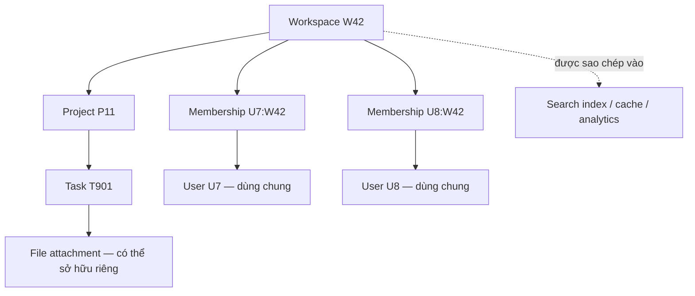
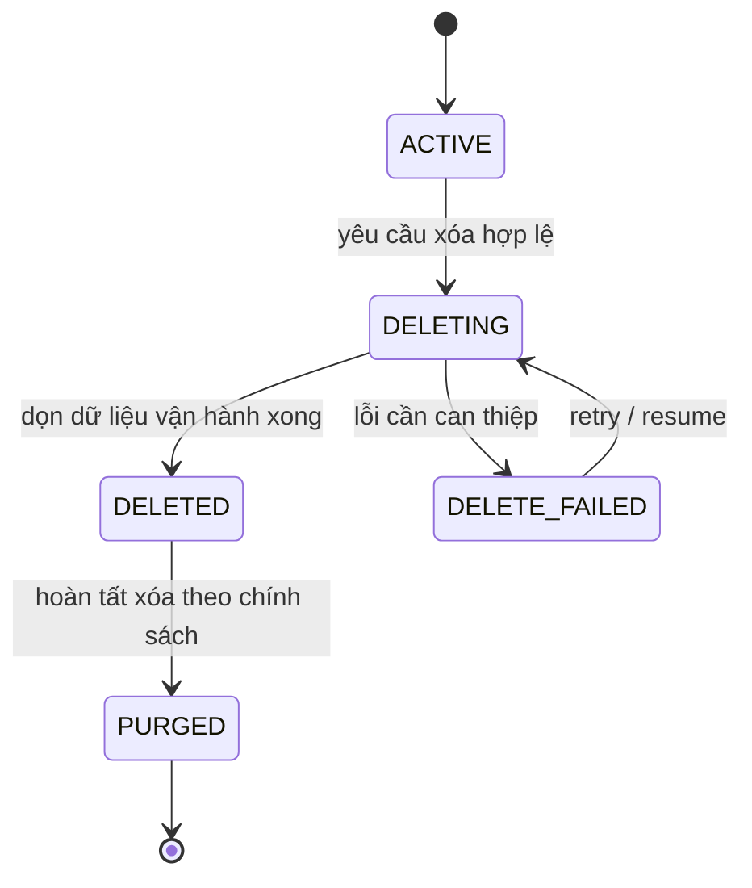
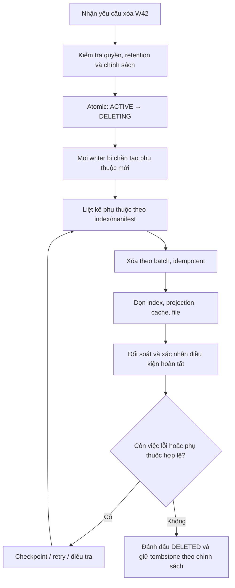
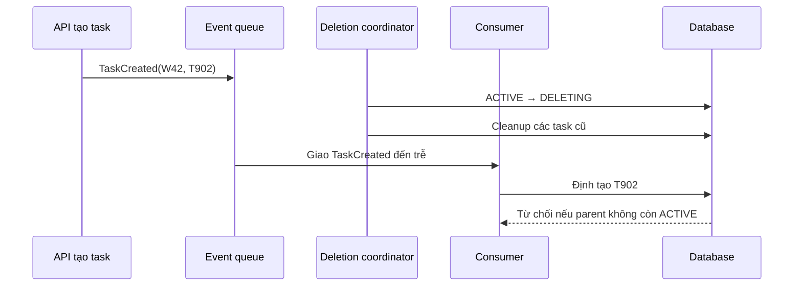

# Xóa thực thể có nhiều dữ liệu phụ thuộc và phòng tránh bản ghi mồ côi

## 1. Xóa một thực thể không chỉ là xóa một bản ghi

Trong hệ NoSQL, dữ liệu thường được tổ chức theo **mẫu truy vấn** thay vì luôn liên kết qua khóa ngoại như trong một cơ sở dữ liệu quan hệ. Một thực thể nghiệp vụ có thể xuất hiện ở nhiều document, key, partition, cạnh đồ thị, bảng tra cứu phụ và dịch vụ bên ngoài. Vì vậy, thao tác “xóa thực thể” thường có phạm vi lớn hơn rất nhiều so với một lệnh `DELETE`.

Ví dụ ứng dụng quản lý nhóm làm việc lưu:

```text
workspace:W42                           -> thông tin nhóm làm việc
workspace-members:W42                   -> danh sách ID thành viên
project:P11                             -> dự án thuộc W42
task:T901                               -> công việc thuộc P11
activity:W42:2026-11                    -> các sự kiện hoạt động
user-workspaces:U7                      -> danh sách workspace của người dùng
search-index:workspace:W42              -> bản sao dùng cho tìm kiếm
object-storage/W42/attachments/...      -> tệp đính kèm
cache:workspace:W42                     -> cache
```

Nếu chỉ xóa `workspace:W42`, phần còn lại có thể giữ các tham chiếu đến workspace không còn tồn tại. Những bản ghi đó trở thành **mồ côi** theo một hoặc nhiều nghĩa, gây lỗi hiển thị, sai quyền truy cập, tăng chi phí lưu trữ và khiến việc khôi phục dữ liệu khó kiểm soát.

Tình huống còn nguy hiểm hơn khi:

1. Worker xóa các task cũ của workspace W42.
2. Một request khác vừa kiểm tra workspace còn tồn tại.
3. Worker xóa workspace W42.
4. Request kia tạo một task mới thuộc W42.

Kết quả: **task mới mồ côi xuất hiện ngay sau khi việc dọn dữ liệu được báo hoàn tất**.

Vì thế, để xóa đúng, ta phải giải quyết đồng thời **phạm vi phụ thuộc**, **cơ chế ghi cạnh tranh**, **tính nguyên tử**, **khả năng phục hồi**, và **chính sách dữ liệu**.

### Mục tiêu học tập

Sau bài này, bạn có thể:

- Phân loại dữ liệu con được sở hữu, dữ liệu liên kết dùng chung và dữ liệu sao chép/chiếu.
- Chọn chính sách `RESTRICT`, `CASCADE`, `DETACH`, `SET NULL`, soft delete hay archive theo nghiệp vụ.
- Nhận ra các loại orphan: tham chiếu treo, document con không có cha, bản sao chỉ mục cũ, file không còn liên kết.
- Thiết kế trạng thái xóa để không tạo thêm dữ liệu con trong lúc cleanup.
- Biết khi nào một transaction nhiều bản ghi là đủ và khi nào cần workflow theo lô.
- Thiết kế retry, idempotency, checkpoint, outbox và reconciliation.
- Phân biệt đặc điểm của document, key–value, wide-column và graph database khi xóa.
- Hiểu việc xóa logic, xóa vật lý, TTL và xóa khỏi backup là những mục tiêu khác nhau.

## 2. Khảo sát quan hệ sở hữu trước khi quyết định xóa

Không phải mọi quan hệ đến thực thể cha đều có nghĩa “xóa cha thì xóa tất cả thứ được nối vào”.

### 2.1. Sở hữu dữ liệu và tham chiếu không giống nhau

Giả sử workspace W42 có hai người dùng U7 và U8. Cả hai cũng tham gia workspace khác.



Các quyết định đúng có thể là:

- **Xóa theo sở hữu:** project, task và membership thuộc riêng W42 có thể cần bị xóa hoặc archive cùng workspace.
- **Chỉ gỡ liên kết:** U7 và U8 là tài khoản dùng chung, không được xóa theo W42.
- **Xem quyền sở hữu file:** tệp upload riêng cho W42 có thể xóa; tệp dùng chung hoặc được tham chiếu ở nhiều nơi cần một chính sách khác.
- **Xóa projection/cache:** bản sao tìm kiếm hay cache không còn được phép hiển thị W42.
- **Giữ audit theo chính sách:** một số sự kiện cần được lưu giữ có kiểm soát, có thể được ẩn danh hoặc loại bỏ thông tin nhạy cảm.

Không thể quyết định bằng cách “quét mọi record có chứa `workspaceId = W42` rồi xóa”, bởi có dữ liệu chỉ tham chiếu W42 và vẫn cần tồn tại.

### 2.2. Bảng kiểm kê phụ thuộc

| Dữ liệu | Khóa truy cập | Quan hệ với W42 | Chính sách gợi ý |
|---|---|---|---|
| Workspace metadata | `workspaceId` | Thực thể gốc | Đánh dấu rồi xóa/giữ tombstone |
| Project | `workspaceId + projectId` | Thuộc sở hữu | Xóa hoặc archive theo chính sách |
| Task | `projectId + taskId` | Thuộc project | Xóa theo project; cần đường truy cập tới task |
| Membership | `workspaceId + userId` | Quan hệ liên kết | Xóa membership, giữ User |
| User account | `userId` | Dùng chung | Giữ nguyên |
| User workspace listing | `userId` | Chỉ mục/phép chiếu | Gỡ W42 khỏi danh sách |
| Activity history | `workspaceId + bucket` | Lịch sử/audit | Retention, ẩn danh hoặc xóa tùy yêu cầu |
| Search document | `workspaceId` | Bản sao phục vụ đọc | Xóa projection |
| Redis cache | `cache:workspace:W42` | Bản sao có thể tạo lại | Invalidate, TTL hoặc namespace version |
| File trong object storage | `objectKey` | Phụ thuộc hoặc dùng chung | Xác định ownership và xử lý lifecycle |
| Billing record | `invoiceId` | Bằng chứng tài chính | Không xóa mù; áp dụng retention/quy tắc riêng |

**Điều cần lưu lại trong thiết kế:** mỗi loại bản ghi có chủ sở hữu nào, ai được tạo/xóa, có thể tìm bằng khóa nào, có phải giữ lịch sử không và thuộc phạm vi transaction nào.

### 2.3. Phân biệt bốn loại bản ghi mồ côi

1. **Child orphan:** record con còn `workspaceId = W42` nhưng record cha W42 không tồn tại.
2. **Dangling reference:** một record còn trỏ tới ID đã bị xóa, ví dụ `user-workspaces:U7` vẫn chứa W42.
3. **Stale projection:** search index, cache hoặc bảng denormalized vẫn hiển thị thông tin từ thực thể đã xóa.
4. **Detached external resource:** file, object, event subscription hoặc tài nguyên ngoài DB không còn được tham chiếu hợp lệ.

Có những record “mồ côi” theo ngữ nghĩa nghiệp vụ nhưng không sai về cấu trúc database. Ví dụ một log không còn workspace vẫn được giữ vì yêu cầu audit. Do đó detector phải dựa trên **chính sách retention và ownership**, không chỉ kiểm tra khóa cha có tồn tại.

## 3. Sáu chính sách xử lý phụ thuộc

Một thiết kế cần định nghĩa rõ “xóa” có nghĩa gì đối với từng quan hệ.

| Chính sách | Hành vi | Khi phù hợp | Rủi ro |
|---|---|---|---|
| **RESTRICT** | Không xóa cha khi còn phụ thuộc quan trọng | Hợp đồng còn hiệu lực, dữ liệu phải giải quyết trước | Xóa bị chặn, cần workflow xử lý |
| **CASCADE** | Xóa dữ liệu thuộc sở hữu theo cha | Dữ liệu con chỉ có ý nghĩa với cha | Xóa quá phạm vi nếu ownership sai |
| **DETACH / unlink** | Gỡ liên kết, giữ thực thể liên quan | User, tag, tài nguyên dùng chung | Còn chỉ mục/ngược chiều cần cập nhật |
| **SET NULL / reassign** | Bỏ hoặc đổi tham chiếu sang thực thể khác | Công việc được chuyển dự án | Cần định nghĩa chủ mới, không làm mất dữ liệu |
| **SOFT DELETE** | Đánh dấu đã xóa/ẩn khỏi truy vấn | Cần khôi phục, audit, cleanup nhiều bước | Dữ liệu vẫn tồn tại, mọi query phải lọc trạng thái |
| **ARCHIVE / RETAIN** | Chuyển sang lưu trữ khác hoặc giữ theo chính sách | Lịch sử, yêu cầu lưu trữ dài hạn | Chi phí và bảo mật dữ liệu tiếp tục tồn tại |

Một workspace có thể sử dụng nhiều chính sách cùng lúc: `CASCADE` với task, `DETACH` với user, `RETAIN` với hóa đơn, `INVALIDATE` với cache và `DELETE OBJECT` với file riêng. Không có một lệnh NoSQL chung tương đương với “xóa chính xác toàn bộ những gì nghiệp vụ muốn”.

### 3.1. Soft delete không phải xóa vật lý

Ví dụ:

```json
{
  "workspaceId": "W42",
  "lifecycle": "DELETING",
  "deletedAt": "2026-11-14T08:00:00Z",
  "deletionOperationId": "DEL-W42-20261114"
}
```

Record này vẫn nằm trong storage. Nếu query không lọc `lifecycle`, workspace có thể vẫn hiện trong giao diện. Nếu dữ liệu chứa thông tin cá nhân cần loại bỏ vĩnh viễn, chỉ đặt `deletedAt` chưa đáp ứng mục tiêu đó.

Cần tách:

- **Ẩn khỏi sản phẩm:** API không phục vụ thực thể và từ chối thao tác mới.
- **Xóa phụ thuộc khỏi kho vận hành:** dọn các record, chỉ mục, cache, file trong phạm vi.
- **Xóa theo chính sách dữ liệu:** backup, snapshot, retention pháp lý, log và các bản sao khác được xử lý theo quy định.

Các mốc này có thể khác nhau về thời điểm và khả năng xác minh.

## 4. Vì sao xóa cha trước có thể tạo orphan?

Giả sử bảng `tasks` có trường `workspaceId` và không có foreign key cưỡng chế tới `workspaces`.

Mã ngây thơ:

```text
DELETE workspace WHERE workspaceId = W42
DELETE tasks WHERE workspaceId = W42
```

Nếu lệnh thứ hai lỗi, cha đã mất nhưng task còn lại. Đảo thứ tự cũng chưa đủ:

```text
DELETE tasks WHERE workspaceId = W42
DELETE workspace WHERE workspaceId = W42
```

Nếu trong khoảng giữa có request khác tạo task mới, record mới có thể tồn tại sau khi cha đã bị xóa. Đây là **write race**; việc chọn thứ tự hợp lý chưa thay thế cơ chế ngăn ghi đồng thời.

### 4.1. Race đọc–kiểm tra–tạo con

Giả sử API tạo task làm như sau:

```text
parent = GET workspace:W42
if parent exists:
    PUT task:T902 {workspaceId: "W42"}
```

Hai actor:

| Thời điểm | Request tạo task | Worker xóa |
|---|---|---|
| T1 | Đọc W42, thấy ACTIVE | |
| T2 | | Đặt W42 thành DELETING |
| T3 | | Quét và xóa task cũ |
| T4 | Ghi task T902 | |
| T5 | | Kết thúc xóa |
| Kết quả | T902 tồn tại | W42 không còn |

**Chỉ kiểm tra cha bằng một GET trước khi ghi không chặn được race.** Cần buộc thao tác tạo con và thao tác chuyển cha sang trạng thái không nhận ghi **cạnh tranh trên cùng một điều kiện nguyên tử hoặc một cơ chế đồng bộ tương đương**.

### 4.2. Không chỉ request API mới có thể tạo con

Nguồn ghi còn có thể là:

- Background worker xử lý job đã xếp hàng từ trước.
- Consumer xử lý event đến trễ hoặc bị phát lại.
- Batch import/backfill.
- Scheduled task tạo snapshot hoặc báo cáo.
- Service khác giữ bản cache trạng thái `ACTIVE`.
- Retry sau timeout của yêu cầu được gửi trước khi bắt đầu xóa.

Một thiết kế xóa đúng phải chặn/kiểm soát **mọi đường ghi có quyền tạo phụ thuộc**, không chỉ endpoint UI.

## 5. Trạng thái vòng đời và “hàng rào” ngăn ghi mới

Với thực thể có nhiều phụ thuộc, một **deletion workflow có trạng thái rõ ràng** thường dễ phục hồi hơn một lệnh xóa duy nhất.

### 5.1. State machine gợi ý



Diễn giải:

- `ACTIVE`: cho phép truy vấn và tạo dữ liệu con khi đáp ứng quyền/điều kiện.
- `DELETING`: từ chối tạo phụ thuộc mới và ẩn khỏi đường đọc thông thường; worker xử lý cleanup.
- `DELETE_FAILED`: đã bắt đầu xóa nhưng một bước chưa hoàn tất; không được tự mở lại quyền ghi.
- `DELETED`: hoàn tất điều kiện dọn dữ liệu vận hành đã định nghĩa; vẫn có thể còn tombstone/audit theo chính sách.
- `PURGED`: đã hoàn tất những bước xóa vật lý trong phạm vi có thể cam kết; không tuyên bố đã xóa backup nếu chưa có bằng chứng và chính sách tương ứng.

Tên trạng thái là **mô hình ứng dụng**, không phải từ khóa bắt buộc của database. Có hệ thống dùng `DELETE_REQUESTED`, `DRAINING`, `TOMBSTONED` hoặc `ARCHIVED`. Điều quan trọng là mỗi trạng thái có hợp đồng đọc/ghi rõ.

### 5.2. Đặt trạng thái xóa bằng cập nhật có điều kiện

Ví dụ mã giả:

```text
UPDATE workspace:W42
SET lifecycle = "DELETING",
    deletionOperationId = "DEL-20261114-W42",
    deletionStartedAt = now
ONLY IF lifecycle = "ACTIVE"
```

Một request xóa lặp với cùng operation ID có thể được coi là đang tiếp diễn; một operation ID khác phải được xử lý theo chính sách xung đột. Nếu người dùng gửi “xóa” hai lần, không nên tạo hai cleanup job cạnh tranh vô hạn.

**Điểm bảo vệ:** chuyển từ `ACTIVE` sang `DELETING` phải được cưỡng chế nguyên tử theo API của store. Sau khi trạng thái đã đổi, tất cả đường tạo con phải không còn khả năng commit một record phụ thuộc mới.

### 5.3. Cập nhật cha và tạo con phải có cùng điểm cạnh tranh

Có hai hướng thường được cân nhắc:

1. **Transaction chứa cả kiểm tra/cập nhật trạng thái cha và tạo con.** Ví dụ ghi con kèm tăng version/counter trên cha trong cùng transaction; thao tác xóa cũng cập nhật chính cha đó. Như vậy hai luồng cạnh tranh trên một mục và không chỉ dựa vào đọc snapshot.
2. **Cơ chế điều phối/ghi tuần tự theo parent ID.** Mọi mutation cho workspace đi qua cùng điểm kiểm soát có bảo đảm, cùng xử lý yêu cầu đang bay và retry.

Phương án (1) cần transaction thực sự hỗ trợ phạm vi item và isolation cần thiết. Phương án (2) cần cơ chế khóa/queue có xử lý failover, lease và worker cũ; một mutex chỉ tồn tại trong một process không đủ khi triển khai nhiều instance.

**Không coi việc “transaction đọc trạng thái cha rồi tạo con” là đủ dưới mọi isolation level.** Với một số mô hình snapshot, transaction đọc cha và tạo con khác mà không ghi/khóa cha vẫn có thể có race với transaction xóa.

### 5.4. Tránh mở lại ID sau khi xóa

Nếu `W42` bị xóa hoàn toàn rồi sau đó có ai tạo workspace mới với **cùng ID**, một job xóa cũ chạy lại có thể xóa nhầm dữ liệu mới. Đây là vấn đề **ABA/reuse of identity**.

Cách hạn chế:

- Dùng ID không tái sử dụng, hoặc ghi `generation`/`deletionEpoch`.
- Worker cleanup gắn với `(workspaceId, generation)` thay vì ID trần.
- Giữ tombstone/ledger trong khoảng đủ để chặn request và sự kiện cũ.
- Khi xóa dữ liệu con, xác minh owner generation/version trước khi thao tác nếu mô hình cho phép.
- Đặt hạn sử dụng cho event/job cũ hoặc yêu cầu đối chiếu generation.

Nếu xóa theo prefix không phân biệt generation, công việc dọn cũ có thể phá dữ liệu của thực thể vừa được tạo lại.

## 6. Ba chiến lược xóa theo quy mô và ranh giới giao dịch

### 6.1. Một transaction nhỏ cho tập phụ thuộc đã biết

Phù hợp khi:

- Số item liên quan ít và được xác định sẵn.
- Database hỗ trợ transaction qua đúng những item/collection/partition cần thay đổi.
- Thời gian và kích thước transaction nằm trong giới hạn sản phẩm.
- Mọi writer khác cũng tuân thủ ràng buộc tương tranh.

Một transaction có thể xóa membership và record nhóm cùng lúc. Nhưng nếu nhóm có hàng triệu task và hàng trăm nghìn file, đưa tất cả vào một transaction thường không thực tế.

### 6.2. Xóa nhiều giai đoạn, có trạng thái và retry

Dùng khi số phụ thuộc lớn hoặc trải nhiều hệ:



Điều quan trọng là **hàng rào ghi** được thiết lập trước khi cleanup. Nếu không, bất kỳ lệnh quét nào cũng có thể bỏ sót dữ liệu xuất hiện sau khi quét.

### 6.3. Soft delete và retention có kiểm soát

Nếu yêu cầu là ngừng hiển thị thực thể ngay nhưng cho phép phục hồi trong 30 ngày:

1. Chuyển sang `DELETING` hoặc `DELETED_SOFT`.
2. Ẩn khỏi các query thông thường và chặn tạo phụ thuộc mới.
3. Gỡ/ẩn projection chứa thông tin không còn được phục vụ.
4. Giữ dữ liệu gốc trong phạm vi retention và quyền truy cập hạn chế.
5. Khi hết thời gian phục hồi, khởi động purge có kiểm soát.
6. Xử lý backup/audit theo chính sách dữ liệu riêng.

Không nên trộn “đã xóa khỏi giao diện” với “đã xóa vĩnh viễn khỏi mọi bản sao”.

## 7. Transaction và các giới hạn cần đọc theo sản phẩm

### 7.1. MongoDB: nhúng, tham chiếu và transaction nhiều document

Trong MongoDB, nếu dữ liệu con được **nhúng** trong một document cha, xóa document cha sẽ loại bỏ phần nhúng cùng document đó. Nhưng nhúng có giới hạn kích thước và cập nhật; không phù hợp với danh sách tăng vô hạn như hàng triệu task.

Nếu phụ thuộc nằm trong các collection riêng, MongoDB không mặc nhiên tạo foreign key và cascade delete cho `workspaceId`. Ứng dụng phải thiết kế transaction hoặc workflow.

Ví dụ Node.js sử dụng transaction cho **một tập dữ liệu nhỏ, giới hạn**:

```javascript
async function deleteSmallWorkspace(client, workspaceId) {
  const db = client.db("collaboration");
  const session = client.startSession();

  try {
    await session.withTransaction(async () => {
      // Ví dụ minh họa: số phụ thuộc ít và đã bị chặn ghi mới.
      await db.collection("memberships").deleteMany(
        { workspaceId },
        { session }
      );

      await db.collection("projects").deleteMany(
        { workspaceId },
        { session }
      );

      const result = await db.collection("workspaces").deleteOne(
        { _id: workspaceId },
        { session }
      );

      if (result.deletedCount !== 1) {
        throw new Error("WORKSPACE_NOT_FOUND_OR_CHANGED");
      }
    });
  } finally {
    await session.endSession();
  }
}
```

Đoạn này **chỉ minh họa transaction boundary**. Nếu task ở collection khác, phải xử lý chúng trước hoặc bổ sung bước tương ứng; nếu phụ thuộc rất lớn, xóa trong transaction dài có thể vượt giới hạn. Việc `deleteMany` nằm trong transaction **không tự chứng minh** không có writer khác tạo record con sau query xóa trong mọi kịch bản đồng thời; cần có protocol ngăn ghi/đồng bộ trên parent.

Những điều cần tra tài liệu MongoDB:

- Triển khai và phiên bản có hỗ trợ multi-document transaction phù hợp không?
- Điều kiện write conflict, snapshot và retry của driver?
- Giới hạn thời gian và tác động của transaction lớn?
- Index trên `workspaceId` có phục vụ `deleteMany` theo phạm vi mong muốn không?
- Change streams/TTL có thể giúp cleanup hay chỉ phát hiện dữ liệu phát sinh?

### 7.2. DynamoDB: transaction hữu hạn và cleanup theo key

DynamoDB có các thao tác điều kiện và `TransactWriteItems`, nhưng transaction có giới hạn về số hành động, dung lượng, phạm vi và các điều kiện cụ thể. Không thiết kế xóa hàng triệu record con như một transaction duy nhất.

Một phương án bảo vệ ghi đồng thời:

- Parent item chứa `lifecycle` và `revision`.
- Mọi lệnh tạo child **cùng transaction** cập nhật `revision` của parent với điều kiện parent vẫn `ACTIVE`, đồng thời `Put` child với khóa/điều kiện phù hợp.
- Lệnh bắt đầu xóa cập nhật **chính parent item** sang `DELETING` theo điều kiện thích hợp.
- Vì các luồng cùng ghi vào parent, chúng phải chịu xung đột/serialization theo bảo đảm của DynamoDB transaction.

Mã giả:

```text
TRANSACTION createChild:
  UPDATE parent W42
    IF lifecycle == ACTIVE AND revision == expectedRevision
    SET revision = revision + 1

  PUT child (W42, T902)
    IF child key chưa tồn tại

TRANSACTION startDelete:
  UPDATE parent W42
    IF lifecycle == ACTIVE
    SET lifecycle = DELETING, deletionId = DEL-42
```

Không nên chỉ đặt một `ConditionCheck` trên parent rồi cho rằng đã giải quyết mọi race mà không xem transaction conflict semantics; sơ đồ trên cố ý khiến hai thao tác **ghi cùng parent**. Dữ liệu con có thể đặt theo khóa bắt đầu bằng parent ID, và worker có thể dùng `Query`/index phù hợp để liệt kê các con theo các trang.

Lưu ý:

- GSI và bản sao có thể có ngữ nghĩa nhất quán khác đường đọc chính; cần đối chiếu trước khi dùng làm bằng chứng “đã xóa hết”.
- Xóa nhiều item là nhiều thao tác riêng, phải idempotent và có checkpoint.
- Global tables/cross-region replication có những quy tắc riêng; không mặc định transaction một vùng bảo vệ mọi thay đổi đồng thời trên nhiều vùng.
- Số request, capacity, throttling và backoff phải được tính vào kế hoạch cleanup.

### 7.3. Cassandra: partition key và dữ liệu phụ thuộc nằm trên nhiều đường truy cập

Trong Cassandra, dữ liệu thường được mô hình hóa theo query. Một thực thể có thể được sao chép vào:

```text
projects_by_workspace
tasks_by_project
activity_by_workspace_day
user_workspaces_by_user
```

Xóa workspace không tự động xóa mọi bản sao ở các bảng trên. Một lệnh `DELETE` trên row hoặc partition cụ thể chỉ tác động phạm vi được chỉ định; `BATCH` cũng không phải giao dịch ACID đa bảng/đa partition với mọi semantics của RDBMS.

Các yếu tố cần thiết kế:

- Một đường tìm **toàn bộ khóa phụ thuộc**; nếu task chỉ tìm theo project, phải duyệt project rồi từng nhóm task.
- Phạm vi atomic update hoặc lightweight transaction (LWT) nếu dùng để chuyển state parent.
- Writer protocol để không thêm bản sao vào các bảng khi parent đã `DELETING`.
- Tác động của **tombstone**, compaction và retention đến scan/cleanup.
- Cách xác minh các bảng denormalized đã được dọn hoặc ẩn đúng theo consistency requirements.

Một worker đọc parent `ACTIVE` trước khi ghi vào partition khác **không tự có bảo đảm nguyên tử xuyên partition**. Nếu không có primitive phù hợp, phải xây cơ chế điều phối và eventual cleanup rõ ràng.

### 7.4. Redis: xóa key theo namespace không thay thế inventory phụ thuộc

Một ứng dụng Redis có thể đặt khóa:

```text
workspace:W42
workspace-members:W42
cache:workspace:W42
cache:task:T902
session:U7:abc
```

Xóa `workspace:W42` không làm mất các key khác. Một lệnh `SCAN MATCH workspace:*` có thể giúp tìm key theo pattern nhưng:

- Pattern chỉ là cách lọc tên key, không tự tạo một index nghiệp vụ đầy đủ.
- `SCAN` có thể trả key trùng, trang rỗng và kết quả thay đổi khi dữ liệu đang biến động.
- Quét trên cluster cần hiểu phạm vi mỗi node/hash slot và client.
- `KEYS` trên không gian key lớn có thể gây ảnh hưởng đến server.
- Lệnh `DEL`/`UNLINK` không tự xử lý file ngoài Redis hoặc bản sao ở database khác.

Một cách hợp lý cho cache có thể là namespace version hoặc TTL, nhưng **không dùng TTL/cache invalidation làm bằng chứng đã xóa xong dữ liệu nghiệp vụ nguồn**.

### 7.5. Graph database: xóa cạnh kề khác xóa toàn bộ phụ thuộc nghiệp vụ

Trong Neo4j Cypher, có thể dùng:

```cypher
MATCH (w:Workspace {workspaceId: $workspaceId})
DETACH DELETE w;
```

`DETACH DELETE` xóa node W và các relationship gắn trực tiếp với W. Nó **không có nghĩa** tự động xóa mọi node `Project`, `Task`, `User` hay file ngoài hệ, kể cả khi các node đó từng được nối bằng cạnh tới W. Với graph có đối tượng dùng chung, xóa cả node được liên kết còn có thể gây mất dữ liệu nghiêm trọng.

Một workflow có thể cần:

1. Xác định subgraph thực sự được sở hữu bởi workspace.
2. Phân biệt các node chỉ được liên kết và các node cần giữ nguyên.
3. Duyệt các quan hệ sở hữu theo hướng đã quy ước.
4. Xóa theo thứ tự hoặc transaction phù hợp, có giới hạn nếu tập quá lớn.
5. Gỡ quan hệ tới node dùng chung và dọn projection ngoài graph.
6. Xác minh không còn cấu trúc nghiệp vụ mồ côi.

Những gì Neo4j/JanusGraph/Neptune/ArangoDB bảo đảm khi xóa node, edge, index hoặc transaction phải được xem theo sản phẩm.

## 8. Dữ liệu phi chuẩn hóa: xóa ở nhiều đường đọc

Một hệ NoSQL thường nhân bản dữ liệu để giảm số lần JOIN và phục vụ các màn hình khác nhau.

Ví dụ task T901 có ba biểu diễn:

```text
task-by-id:T901              -> chi tiết task
tasks-by-project:P11         -> list để xem dự án
tasks-by-assignee:U7         -> list để xem việc của người dùng
```

Nếu chỉ xóa `task-by-id:T901`, hai danh sách vẫn tham chiếu T901. Nếu chỉ xóa khỏi danh sách dự án, task vẫn xuất hiện ở màn hình assignee. Đây là **stale projection/dangling reference**.

### 8.1. Nêu rõ nguồn sự thật và các projection

Bảng thiết kế:

| Cấu trúc | Vai trò | Có cần xóa cùng lúc? | Nếu xóa trễ thì sao? |
|---|---|---|---|
| `task-by-id` | Nguồn sự thật hoặc bản ghi chính | Theo transaction/workflow chính | Task tiếp tục tồn tại |
| `tasks-by-project` | Bảng đọc theo project | Có, hoặc ẩn sau tombstone | Project list có ID không tồn tại |
| `tasks-by-assignee` | Bảng đọc theo assignee | Có, hoặc eventual cleanup | Người dùng còn thấy task đã xóa |
| Search index | Projection tìm kiếm | Cần invalidate/reindex | Kết quả tìm kiếm lộ task cũ |
| Cache | Projection tăng tốc đọc | Cần invalidate/TTL | API có thể trả nội dung đã xóa |

Nếu không thể cập nhật tất cả trong một transaction, các đường đọc cần xác định **source-of-truth check**, tombstone filter, idempotent event handling hoặc cam kết độ trễ nhất quán. Trạng thái xóa không nên để thông tin nhạy cảm xuất hiện qua đường đọc phụ.

### 8.2. Chỉ mục ngược giúp tìm phụ thuộc

Nếu nhiệm vụ là xóa tất cả task của một project, nhưng task chỉ có khóa `task:{taskId}` mà không có index theo project, cleanup có thể phải quét toàn bộ keyspace hoặc table.

Thiết kế hữu ích là có khả năng liệt kê theo owner:

```text
project-tasks:P11 -> [T901, T902, T903]
```

hoặc một bảng/partition theo (`projectId`, `taskId`).

Tuy nhiên **index ngược cũng là dữ liệu phải duy trì**. Khi tạo task thành công nhưng cập nhật index phụ thất bại, worker xóa có thể bỏ sót task. Một quy trình đáng tin cậy cần transaction/outbox, reconciliation hoặc một cách liệt kê nguồn có thể bảo đảm completeness ở mức cần thiết.

### 8.3. Không biến index không nhất quán thành nguồn duy nhất

Nếu index chỉ được cập nhật bất đồng bộ, sau khi worker quét index và thấy “0 task”, vẫn có thể có task chưa xuất hiện trong index. Khi tuyên bố cleanup hoàn tất, phải dựa trên nguồn dữ liệu và mức consistency thích hợp, hoặc chờ watermark/đối soát được thiết kế rõ.

Việc `Query` một GSI, `SCAN` một cluster hoặc đọc một replica có thể không có cùng ngữ nghĩa với việc đọc nguồn dữ liệu gốc. Đây là lý do xác minh kết thúc xóa phải được mô tả, không chỉ đếm kết quả của một API.

## 9. Thiết kế một deletion workflow có khả năng phục hồi

### 9.1. Deletion manifest và operation ID

Khi quá trình xóa gồm nhiều bước, có thể lưu một bản ghi điều phối:

```json
{
  "operationId": "DEL-W42-20261114",
  "workspaceId": "W42",
  "workspaceGeneration": 3,
  "state": "RUNNING",
  "startedAt": "2026-11-14T08:00:00Z",
  "steps": {
    "projects": "DONE",
    "tasks": "RUNNING",
    "memberships": "PENDING",
    "search": "PENDING",
    "files": "PENDING"
  },
  "lastCheckpoint": {
    "taskBucket": "2026-11",
    "continuationToken": null
  }
}
```

Manifest có thể được lưu ở một kho điều phối riêng, nhưng bản thân nó cũng cần durable storage, version/conditional update và cơ chế chống hai worker cùng giành quyền không an toàn.

**Operation ID phải ổn định qua retry.** Nếu phát sinh ID mới cho mỗi lần retry, cùng một yêu cầu có thể chạy nhiều cleanup job không đồng bộ.

### 9.2. Pseudocode coordinator

```text
function requestDeleteWorkspace(workspaceId, requestId):
    checkPermissionAndRetentionPolicy(workspaceId)

    result = conditionalTransition(
        parent = workspaceId,
        expectedState = ACTIVE,
        nextState = DELETING,
        operationId = stableOperationId(requestId)
    )

    if result == ALREADY_DELETING_WITH_SAME_OPERATION:
        return CURRENT_PROGRESS

    if result != APPLIED:
        return CONFLICT_OR_NOT_FOUND

    enqueueDeletionJob(operationId)
    return ACCEPTED


function executeDeletionJob(operationId):
    manifest = loadManifest(operationId)
    assertParentIsNotWritable(manifest.workspaceId)

    for category in deletionPlan:
        while hasMoreOwnedRecords(category, manifest):
            page = enumerateNextPage(category, manifest)

            for record in page:
                deleteIdempotently(record, operationId)

            saveCheckpointIfValid(category, page, operationId)

        markStepDone(category, operationId)

    cleanupExternalProjectionsAndFiles(operationId)
    verifyDeletionPostconditions(operationId)
    markParentDeletedAndOperationComplete(operationId)
```

Đây là mã giả. Một hệ thống production cần xác định:

- Tiếp tục từ cursor/token có được API hỗ trợ sau thời gian dài không?
- Có writer đã bắt đầu trước khi trạng thái đổi nhưng chưa commit không?
- Có nhiều worker xử lý trùng không, và thao tác idempotent thế nào?
- Lỗi xóa file ngoài DB có dẫn tới retry an toàn không?
- Khi cleanup một category mới phát hiện thêm child hoặc projection cũ thì phải xử lý ra sao?
- Điều kiện nào chứng minh đã hoàn tất theo yêu cầu nghiệp vụ?

### 9.3. Đừng dùng cursor như một cam kết snapshot nếu API không hứa

Trong một số hệ, scan có thể trả phần tử trùng, bỏ sót phần tử thay đổi giữa vòng quét hoặc không ổn định khi có xóa dữ liệu. Khi vừa quét vừa xóa, thứ tự và trạng thái dữ liệu liên tục thay đổi.

Có thể thiết kế:

- Lấy danh sách ID ổn định trước khi xóa nếu tập dữ liệu nhỏ và có snapshot/manifest đáng tin.
- Chia theo bucket/partition xác định và xử lý các nhóm với mốc rõ.
- Lặp truy vấn tìm phần còn lại cho đến khi không còn mục hợp lệ, **kết hợp hàng rào ghi** và nguồn đọc có ngữ nghĩa đủ mạnh.
- Dùng event log/watermark để nhận biết các write đã được chấp nhận trước lúc đóng cổng ghi.
- Tạo cleanup job đối soát lại sau một khoảng thời gian.

Nếu không chặn được write mới, việc lặp “đến lúc đếm bằng 0” vẫn có thể thua một write xảy ra ngay sau đó.

### 9.4. Xóa idempotent

Một thao tác xóa idempotent cần an toàn khi chạy lại:

```text
deleteTask("T901", operationId="DEL-W42-20261114")
deleteTask("T901", operationId="DEL-W42-20261114")
```

Lần thứ hai không được xóa nhầm dữ liệu mới do ID tái sử dụng, không gửi side effect trùng và không biến “không tìm thấy” thành lỗi vô hạn nếu record đã được xóa hợp lệ.

Có thể kết hợp:

- Định danh child ổn định và generation/owner ID.
- Conditional delete kiểm tra owner/generation nếu hỗ trợ.
- Bản ghi deletion ledger để nhận biết operation đã xử lý.
- External object version/ETag nếu cần tránh xóa bản mới.
- Retry có giới hạn, backoff và dead-letter queue để điều tra.

**Idempotency của delete trên một key** không tự bảo đảm toàn bộ workflow idempotent khi nó còn gửi email, phát event hoặc xóa file.

## 10. Phòng tránh race với job/event đến trễ

Giả sử hệ thống có hàng đợi sự kiện `TaskCreated`. Một message được tạo trước khi workspace W42 bị đánh dấu `DELETING` nhưng consumer xử lý sau.



Consumer phải kiểm tra **trạng thái hiện hành theo protocol ghi đáng tin**, không chỉ tin rằng “message phát ra trước lúc xóa nên chắc chắn hợp lệ”. Nếu yêu cầu sự kiện cũ được xử lý để hoàn tất lịch sử, consumer có thể ghi audit hoặc loại bỏ có chủ đích, nhưng không được âm thầm tái tạo child sau xóa.

### 10.1. Tài nguyên dùng chung và event lặp

Một file `F17` có thể được dùng bởi task của W42 và W99. Nếu cleanup W42 xóa file F17 dựa trên một tham chiếu duy nhất, W99 mất dữ liệu.

Cần biết **ownership** và số tham chiếu hoặc bảng association. Reference count là một lựa chọn nhưng bản thân counter cần cập nhật nguyên tử và xử lý lỗi. Với object storage, có thể quản lý file như tài nguyên độc lập và chỉ xóa khi đã chứng minh không còn chủ sở hữu hợp lệ.

### 10.2. Xóa theo thời gian và mốc sự kiện

Nếu dữ liệu được phân bucket thời gian:

```text
activities:W42:2026-09
activities:W42:2026-10
activities:W42:2026-11
```

worker có thể liệt kê các bucket đã biết rồi dọn. Nhưng event đến muộn có `eventTime` tháng trước có thể ghi vào bucket cũ sau khi worker đã xử lý bucket đó. Do đó protocol tạo event cũng phải từ chối khi W42 không còn ACTIVE, hoặc có một quy tắc xử lý late arrivals rõ ràng.

Phân chia bucket giúp hoạch định dọn dữ liệu, **không tự giải quyết concurrency**.

## 11. Xóa file, search index, cache và dữ liệu phân tích

### 11.1. File trong object storage

Document database có thể chỉ lưu:

```json
{
  "attachmentId": "A77",
  "workspaceId": "W42",
  "objectKey": "workspaces/W42/files/A77.bin"
}
```

Xóa document `A77` không xóa object vật lý `A77.bin`. Nếu xóa object trước rồi transaction DB rollback, metadata vẫn trỏ tới file đã mất.

Một workflow có thể:

1. Đánh dấu attachment `DELETING`.
2. Ngăn tạo phiên bản mới dưới cùng identity hoặc dùng object version/generation.
3. Xóa object với API idempotent hoặc theo object version cần xóa.
4. Ghi nhận kết quả và xóa metadata theo protocol.
5. Retry/đối soát những trường hợp object hoặc metadata còn sót.

Với bucket versioning, lifecycle và replication, một lệnh delete có thể chỉ tạo delete marker hoặc không xóa tất cả phiên bản; phải kiểm tra đặc tả object storage đang dùng. Không được khẳng định “xóa object thành công” đồng nghĩa đã xóa tuyệt đối khỏi mọi version, replica, backup và log.

### 11.2. Search index

Search index có thể lag so với database nguồn. Nếu workspace đã chuyển `DELETING` nhưng kết quả tìm kiếm vẫn hiển thị, người dùng có thể truy cập nội dung không còn được phép phục vụ.

Các biện pháp:

- Phát event `WorkspaceDeleting` để xóa/ẩn tài liệu tìm kiếm.
- Chặn trả dữ liệu nhạy cảm bằng kiểm tra parent/source-of-truth ở lớp API.
- Dùng version/generation để tránh event `Indexed` đến trễ khôi phục document đã xóa.
- Theo dõi consumer lag, retry và đối soát search index.

Không coi chỉ mục tìm kiếm là nguồn chứng minh một workspace đã được dọn hoàn toàn.

### 11.3. Cache

Cache có thể chứa:

```text
cache:workspace:W42
cache:workspace-list:U7
cache:project:P11
```

Xóa cache theo từng key, TTL hoặc namespace version có thể giảm dữ liệu cũ, nhưng một request đã bắt đầu trước lúc xóa có thể **ghi lại cache stale** sau khi cache vừa bị xóa.

Giải pháp có thể là kiểm tra generation/version, không cache trạng thái đã bị xóa, hoặc chuyển namespace hiện hành để các writer cũ không còn tạo kết quả có thể đọc được. Cache invalidation phải được thiết kế cùng concurrency, không chỉ phát một `DEL`.

### 11.4. Analytics và backup

Dữ liệu phân tích thường được đồng bộ bất đồng bộ và có chính sách retention riêng. Một workspace đã bị xóa khỏi database nguồn có thể vẫn xuất hiện trong warehouse, lake, log hoặc backup.

Phải xác định:

- Dữ liệu phân tích nào là aggregate không còn nhận diện thực thể, dữ liệu nào vẫn là bản sao chứa thông tin cá nhân?
- Có cơ chế tombstone/delete event để pipeline xóa hoặc ẩn theo yêu cầu không?
- Backup/snapshot có thời gian giữ bao lâu và cách xử lý yêu cầu xóa là gì?
- Đã có bằng chứng hoàn tất theo đúng phạm vi chính sách hay chưa?

Những vấn đề pháp lý và chính sách lưu trữ phải theo quy định của tổ chức và khu vực áp dụng. Không thể dùng mỗi TTL của bảng vận hành làm cam kết xóa dữ liệu tuyệt đối.

## 12. Tính đúng đắn khi có transaction: đừng nhầm phạm vi

Một số hệ cung cấp transaction nhiều bản ghi. Tuy vậy, “dùng transaction” chỉ đủ nếu ba điều kiện đồng thời thỏa:

1. **Tất cả thay đổi bắt buộc nguyên tử** nằm trong phạm vi transaction được hỗ trợ.
2. **Isolation/locking** bảo vệ điều kiện không được tạo thêm child trong lúc xóa.
3. **Các writer cùng tuân thủ protocol** và không có đường ghi bỏ qua trạng thái parent.

Giả sử transaction T1 chỉ đọc workspace ACTIVE rồi xóa các task hiện có. Transaction T2 chỉ đọc workspace ACTIVE rồi tạo task mới ở document khác. Dưới một số mô hình isolation, nếu hai transaction không ghi chung một item hoặc không có predicate locking phù hợp, cả hai có thể commit dù về nghiệp vụ kết quả không đúng.

Một cách buộc cạnh tranh là mọi lệnh tạo child và lệnh chuyển parent sang `DELETING` cùng **ghi có điều kiện** lên parent hoặc guard record. Nhưng cách thực thi phải được thiết kế theo transaction/isolation của sản phẩm, không chỉ bằng một chuỗi GET và PUT.

### 12.1. Khi nào nên dùng transaction nhỏ?

Transaction có ý nghĩa khi số phụ thuộc ít và ranh giới bất biến vừa phạm vi transaction:

```text
Delete membership M7
Remove W42 from U7 membership list
Update W42 memberCount
Commit as one unit
```

Nếu tất cả item được lưu trong cùng phạm vi transaction hỗ trợ, thao tác không để lại số đếm hoặc danh sách sai khi một lệnh lỗi.

### 12.2. Khi nào phải dùng saga/workflow?

Nếu xóa workspace phải xóa hàng triệu task, hàng trăm nghìn file và các bản sao ở ba dịch vụ, một transaction DB không thể bao trùm toàn bộ. Khi đó dùng workflow nhiều bước với:

- Hàng rào ghi trước cleanup.
- Operation ID, trạng thái và checkpoint.
- Mỗi bước idempotent.
- Retry và backoff có giới hạn.
- Công việc bù trừ hoặc khôi phục nếu nghiệp vụ cho phép.
- Đối soát và xác minh trước khi báo hoàn tất.

Đây là **eventual cleanup** có thể được thiết kế đúng theo một hợp đồng rõ ràng, chứ không đồng nghĩa rằng mọi dữ liệu được xóa nguyên tử vào cùng một thời điểm.

## 13. Ước lượng chi phí và giới hạn tải khi xóa hàng loạt

Giả sử workspace W42 có:

| Loại phụ thuộc | Số lượng minh họa |
|---|---:|
| Projects | 500 |
| Tasks | 3.000.000 |
| Memberships | 20.000 |
| Attachments | 200.000 |
| Search documents | 3.500.000 |
| Activity buckets | 60 |

Nếu mỗi batch xóa 500 task thì riêng 3 triệu task cần ít nhất:

\[
3{,}000{,}000 / 500 = 6{,}000\ \text{batch}
\]

Con số đó chưa bao gồm việc tìm ID, index update, replica, kiểm tra trạng thái, network retry hay dọn file ngoài hệ. Nếu có nhiều workspace cùng bị xóa, cleanup có thể cạnh tranh với người dùng đang làm việc.

### 13.1. Điều tiết tải

Nên xác định giới hạn:

- Số batch đang chạy đồng thời trên mỗi workspace/tenant.
- Số item hoặc byte xóa mỗi giây.
- Retry/backoff khi nhận throttling hoặc timeout.
- Tỷ lệ CPU/I/O hoặc read/write capacity cho cleanup.
- Thời điểm chạy ưu tiên và cách tạm dừng.
- Dead-letter queue hoặc trạng thái `DELETE_FAILED` khi quá số lần retry.
- Thời gian tối đa cho từng bước và tổng workflow theo SLA thực tế.

Một job xóa “chạy nhanh nhất có thể” có thể làm chậm request thông thường, đặc biệt khi xóa tạo tombstone/compaction hoặc nhiều request search/index.

### 13.2. Đừng đánh đồng “đã gửi DELETE” với “đã giải phóng dung lượng”

Một số hệ lưu trữ dùng tombstone, LSM compaction, snapshot/versioning, replication hoặc garbage collection. Dung lượng vật lý có thể chỉ giảm sau một khoảng thời gian hoặc sự kiện dọn rác.

Các metrics về tiến độ nên tách:

1. Số record/item đã được đánh dấu hoặc xóa logic.
2. Số thao tác xóa được database xác nhận.
3. Số projection/file đã được xử lý.
4. Số orphan còn được phát hiện.
5. Dung lượng vật lý còn lại và trạng thái retention/backup.

Không dùng một metric duy nhất thay thế tất cả các mục tiêu.

## 14. Phòng ngừa orphan từ lúc thiết kế model

Xóa an toàn bắt đầu **trước khi có yêu cầu xóa**.

### 14.1. Mỗi record con nên có owner rõ ràng

Ví dụ task:

```json
{
  "taskId": "T901",
  "workspaceId": "W42",
  "workspaceGeneration": 3,
  "projectId": "P11",
  "assigneeId": "U7",
  "status": "OPEN"
}
```

`workspaceId` và `projectId` thể hiện dữ liệu con thuộc phạm vi nào. `assigneeId` chỉ là tham chiếu đến người dùng dùng chung, không có nghĩa xóa user khi xóa task.

Nếu mô hình không có owner/generation rõ, cleanup sẽ phải suy đoán từ tên khóa hoặc các đường nối, dễ bỏ sót hoặc xóa quá tay.

### 14.2. Có đường liệt kê đầy đủ theo owner

Nếu chỉ lưu task theo `taskId` và không có cách tìm tất cả task thuộc W42, xóa workspace có thể đòi full scan rất đắt.

Hãy cân nhắc từ đầu:

- Collection index theo `workspaceId`.
- Partition key hoặc composite key chứa `workspaceId`.
- Danh sách/index ngược các task ID.
- Manifest theo bucket thời gian hoặc project.
- Event log giúp rebuild inventory phụ thuộc.

Tuy nhiên, đường liệt kê này cũng phải có **bảo đảm completeness** phù hợp. Một chỉ mục phụ bất đồng bộ có thể không phản ánh child vừa được tạo, đặc biệt khi có event lag.

### 14.3. Giữ ranh giới sở hữu không bị lẫn với chia sẻ

Trong graph hoặc document references, hai workspace có thể liên kết tới cùng user, cùng template hay cùng media object. Khi xóa W42, chỉ xóa **association** hoặc quyền thuộc W42; tài nguyên dùng chung vẫn tồn tại.

Đừng dùng thuật toán đi theo tất cả cạnh liên quan rồi xóa mọi node đến được: nó có thể đi sang các thực thể không thuộc quyền sở hữu của workspace.

### 14.4. Dùng ID ổn định, generation và sự kiện có version

Định danh duy nhất giảm nguy cơ retry xóa nhầm bản mới. Generation/epoch đặc biệt có giá trị nếu có khả năng khôi phục hoặc tái sử dụng tên thực thể.

Các sự kiện có thể chứa:

```json
{
  "eventId": "EV-992",
  "eventType": "TaskCreated",
  "workspaceId": "W42",
  "workspaceGeneration": 3,
  "taskId": "T902"
}
```

Consumer nhận event với generation cũ khi workspace đã bước sang generation khác phải có quy tắc bỏ qua, đưa vào audit hoặc xử lý theo chính sách, thay vì ghi lại dữ liệu cũ.

## 15. Reconciliation: tìm và sửa dữ liệu mồ côi

Không nên tin rằng chỉ có những lần xóa đúng quy trình mới tạo dữ liệu sai. Import lỗi, bug của phiên bản cũ, job đứt giữa chừng hoặc dịch vụ ngoài đồng bộ chậm đều có thể tạo orphan.

### 15.1. Định nghĩa orphan detector theo nguồn sự thật

Ví dụ:

```text
for each task in boundedBatch:
    parent = readWorkspace(task.workspaceId)

    if parent == NOT_FOUND:
        classifyOrphan(task)

    else if parent.lifecycle in [DELETING, DELETED]:
        classifyPendingCleanup(task)

    else if task.workspaceGeneration != parent.generation:
        classifyStaleGeneration(task)
```

Truy vấn chỉ minh họa logic. Detector cần phân biệt:

- **Parent thật sự bị xóa** với parent tạm thời không thể đọc vì lỗi mạng/quyền.
- **Dữ liệu phải xóa** với dữ liệu audit được phép lưu.
- **Projection chậm** với bản ghi nghiệp vụ nguồn sai.
- **Dữ liệu đang trong workflow xóa** với orphan tồn tại ngoài dự kiến.

Một lỗi truy cập không được tự động biến thành lý do xóa child.

### 15.2. Quy trình sửa orphan

1. Phát hiện và ghi loại vi phạm, ID, owner và nguồn kiểm chứng.
2. Kiểm tra retention, quyền và trạng thái operation.
3. Nếu đang có deletion workflow hợp lệ, giao cho workflow đó xử lý.
4. Nếu là record không có cha thật sự, chọn xóa, reattach, quarantine hoặc archive theo chính sách.
5. Ghi audit của quyết định sửa và operation ID.
6. Retry idempotent và xác minh kết quả.
7. Nếu cùng kiểu orphan lặp lại, sửa đường ghi tạo ra nó thay vì chỉ liên tục dọn rác.

### 15.3. Đo mức độ orphan

Các metric gợi ý:

| Chỉ số | Ý nghĩa |
|---|---|
| `orphan_records_detected` | Số record không có owner hợp lệ trong mẫu/quét |
| `stale_projection_count` | Số index/cache/list còn tham chiếu dữ liệu đã xóa |
| `deletion_jobs_running` | Số job đang cleanup |
| `deletion_jobs_failed` | Số job bị kẹt cần xử lý |
| `deletion_oldest_age` | Thời gian chờ lâu nhất của job xóa |
| `deletion_steps_retried` | Mức lỗi hoặc throttling của workflow |
| `external_objects_pending` | Số file/tài nguyên ngoài chưa xóa |
| `late_write_rejected` | Số request/event cũ bị chặn nhờ trạng thái parent |
| `reconciliation_repairs` | Số sửa chữa đã áp dụng |

Không báo “0 orphan” nếu detector chỉ quét một mẫu nhỏ hoặc một index có eventual consistency; phải mô tả phạm vi và độ bao phủ phép đo.

## 16. Kiểm thử concurrency, lỗi và khôi phục

Một unit test xóa cha rồi xóa con theo thứ tự tuần tự chưa đủ. Các lỗi nghiêm trọng xảy ra ở những điểm xen kẽ và ranh giới hệ thống.

### 16.1. Những kịch bản cần có

| Tình huống | Kết quả mong muốn |
|---|---|
| Hai request cùng xóa W42 | Một operation hiệu lực hoặc hai request cùng theo dõi một operation, không chạy chồng sai |
| Create task và startDelete đồng thời | Không có task mới được commit sau khi hàng rào ghi có hiệu lực |
| Event `TaskCreated` đến trễ | Không tái tạo task thuộc parent đã DELETING |
| Worker crash sau khi xóa 70% task | Resume tiếp được; không xóa nhầm và không mất checkpoint quan trọng |
| API xóa task thành công nhưng mất ACK | Retry không tạo side effect sai |
| Search index chậm vài phút | API không để lộ workspace đã bị xóa qua kết quả stale |
| File dùng chung với workspace khác | Xóa W42 không làm mất file mà W99 còn cần |
| Một batch scan trả kết quả trùng/rỗng | Worker không kết thúc sớm hoặc xử lý sai |
| Child tạo trước xóa nhưng index cập nhật muộn | Reconciliation vẫn phát hiện và dọn đúng |
| Workspace ID được tái sử dụng | Job xóa cũ không được xóa generation mới |
| Xóa cha thành công, cleanup file thất bại | Job giữ trạng thái lỗi và tiếp tục retry theo chính sách |
| Request khôi phục trong lúc cleanup | Có chính sách rõ: từ chối, hoàn tác có kiểm soát hoặc tạo generation mới |

### 16.2. Test sự cố theo từng điểm commit

Hãy thử dừng worker sau từng bước:

```text
[1] Chuyển ACTIVE → DELETING
[2] Lưu operation manifest
[3] Xóa một batch task
[4] Cập nhật checkpoint
[5] Xóa membership
[6] Gửi sự kiện gỡ search index
[7] Xóa file ngoài hệ
[8] Đánh dấu DELETED
```

Sau mỗi lần dừng, chạy lại và kiểm tra:

- Không tạo dữ liệu con mới.
- Không xóa tài nguyên dùng chung.
- Các bước đã hoàn tất không gây side effect xấu nếu thực hiện lại.
- Có thể phát hiện bước còn thiếu.
- Không báo hoàn tất trước khi các hậu điều kiện được chứng minh.

**Lưu ý:** đây là các tình huống thực hành, không phải kết quả kiểm thử của một hệ thống cụ thể.

## 17. Ví dụ tổng hợp: xóa một workspace có hàng triệu task

### 17.1. Yêu cầu nghiệp vụ

- W42 có 3 triệu task, 500 project và 20.000 membership.
- Xóa workspace phải **ẩn khỏi người dùng ngay** sau khi chấp nhận yêu cầu.
- Trong lúc xóa, không được tạo thêm project/task/membership cho W42.
- User account liên kết đến W42 phải được giữ.
- Tệp riêng của W42 được dọn theo chính sách, tệp dùng chung phải được giữ.
- Search index và cache không được tiếp tục lộ thông tin.
- Nếu cleanup mất nhiều giờ, API vẫn phải thể hiện trạng thái đang xử lý.
- Lỗi tạm thời phải retry an toàn, và phải có bằng chứng hậu điều kiện.

### 17.2. Thiết kế đề xuất

**Bước A — Đóng cổng ghi:** chuyển W42 từ `ACTIVE` sang `DELETING` bằng cập nhật có điều kiện. Mọi luồng tạo/sửa phụ thuộc phải dùng protocol ghi kiểm tra state với bảo đảm đồng thời phù hợp.

**Bước B — Chấp nhận yêu cầu:** trả `202 Accepted` và operation ID nếu API hỗ trợ xử lý bất đồng bộ. Việc trả thành công lúc này có nghĩa **đã chấp nhận quá trình xóa**, không có nghĩa đã purge xong.

**Bước C — Cleanup theo sở hữu:** xử lý project/task/membership theo index hoặc partition; mỗi batch idempotent, có checkpoint và backoff.

**Bước D — Xử lý projection và tài nguyên ngoài:** gỡ khỏi `user-workspaces`, search index, cache, file thuộc sở hữu. Dùng outbox/event hoặc workflow có bằng chứng và retry.

**Bước E — Đối soát:** xác minh không còn child bắt buộc xóa trong nguồn dữ liệu được hỗ trợ, không còn projection hiển thị không hợp lệ và các external resources được xử lý theo chính sách.

**Bước F — Hoàn tất:** đặt trạng thái `DELETED`, lưu tombstone/ledger đủ để ngăn late writes và job cũ, tiếp tục quy trình retention/purge nếu có.

### 17.3. Hợp đồng API có thể là

```json
{
  "operationId": "DEL-W42-20261114",
  "workspaceId": "W42",
  "status": "DELETING",
  "acceptedAt": "2026-11-14T08:00:00Z",
  "message": "Yêu cầu xóa đã được chấp nhận; dữ liệu phụ thuộc đang được xử lý."
}
```

Sau đó:

```json
{
  "operationId": "DEL-W42-20261114",
  "workspaceId": "W42",
  "status": "DELETED",
  "completedAt": "2026-11-14T09:45:00Z",
  "scope": "operational-data-cleanup"
}
```

Đây là **ví dụ response**, không phải cam kết rằng mọi loại backup, audit hoặc snapshot đã được xóa vĩnh viễn. Nếu hệ thống cần báo trạng thái “purge hoàn tất”, phải định nghĩa và chứng minh phạm vi purge đó riêng.

## 18. Bài tập vận dụng

### Bài tập 1 — Nhận diện ownership

Một ứng dụng e-learning có:

```text
Course C1
  - Lesson L1, L2
  - Enrollment của Student S1, S2
  - Student S1, S2
  - Video V7 được dùng bởi Course C1 và C2
  - CourseSearchDocument C1
```

**Câu hỏi:** khi xóa C1, đối tượng nào nên xóa, gỡ liên kết, giữ lại hoặc xử lý theo retention?

**Gợi ý:** lesson/enrollment thuộc C1 thường cần xóa hoặc archive; student là thực thể dùng chung phải giữ; video V7 không được xóa nếu C2 còn dùng; search document phải bị loại bỏ; dữ liệu lịch sử/chứng chỉ cần chính sách riêng.

### Bài tập 2 — Chỉ ra race

Code:

```text
if GET(workspace:W42).status == "ACTIVE":
    INSERT task:T902 {workspaceId:"W42"}
```

Cùng lúc worker xóa chuyển W42 sang `DELETING` và xóa các task cũ.

**Câu hỏi:** điều gì có thể xảy ra? Sửa bằng cách nào?

**Gợi ý:** request tạo task có thể đọc ACTIVE trước khi worker đổi state nhưng commit INSERT sau. Cần transaction/conditional update đủ phạm vi khiến create-child và start-delete cạnh tranh trên guard record, hoặc serialization có bảo đảm.

### Bài tập 3 — Cursor và index chậm

Một worker dùng GSI theo `workspaceId` để duyệt task. GSI đồng bộ bất đồng bộ. Worker quét thấy hết dữ liệu và báo hoàn thành.

**Câu hỏi:** vì sao kết quả đó chưa đủ chứng minh không còn task mồ côi?

**Gợi ý:** task mới đã được chấp nhận trước lúc đóng cổng ghi có thể chưa xuất hiện trên GSI. Cần protocol chặn ghi, cơ chế đọc/xác minh phù hợp, watermark/manifest/reconciliation theo bảo đảm của sản phẩm.

### Bài tập 4 — Xóa file dùng chung

Object `media/F17` được ba task tham chiếu, trong đó hai task thuộc W42 và một task thuộc W99.

**Câu hỏi:** có thể xóa vật lý F17 khi cleanup W42 không? Thiết kế nào để tránh mất file của W99?

**Gợi ý:** không, nếu W99 còn tham chiếu hợp lệ. Cần ownership/reference registry hoặc quy tắc lifecycle; cập nhật tham chiếu có concurrency protection và chỉ xóa object sau khi xác minh không còn owner hợp lệ.

### Bài tập 5 — Khi nào dùng transaction?

Trường hợp A: một nhóm nhỏ có ba membership và một metadata record, tất cả thuộc phạm vi transaction mà database hỗ trợ.

Trường hợp B: một tenant có 10 triệu event, 500.000 file object storage, projection search và bản sao analytics.

**Câu hỏi:** chiến lược xóa nào phù hợp hơn cho từng trường hợp?

**Gợi ý:** A có thể dùng transaction nhỏ nếu invariant và phạm vi hỗ trợ phù hợp. B cần state machine, hàng rào ghi, cleanup theo batch, checkpoint, idempotency, đối soát và chính sách dữ liệu ngoài hệ.

### Bài tập 6 — Xóa và khôi phục

Workspace W42 đã đặt `DELETING` rồi xóa 40% task; người dùng muốn khôi phục ngay.

**Câu hỏi:** có an toàn khi chỉ đổi state thành `ACTIVE` không?

**Gợi ý:** không, vì dữ liệu phụ thuộc đã bị xóa một phần. Cần chính sách khôi phục từ snapshot/backup, quy trình tái tạo được kiểm chứng, hoặc từ chối khôi phục sau một mốc nhất định. Có thể tạo generation mới sau khi xử lý job cũ, nhưng phải tránh job xóa tiếp tục tác động dữ liệu mới.

## 19. Các câu hỏi thiết kế cần trả lời trước khi triển khai

1. **Phạm vi ownership:** dữ liệu nào thuộc riêng thực thể, dữ liệu nào chỉ tham chiếu hoặc dùng chung?
2. **Bất biến:** sau khi xóa, điều kiện nào phải đúng, và khi nào được báo thành công?
3. **Đường truy cập:** có cách liệt kê đầy đủ các child theo owner không?
4. **Đường ghi:** những service/job/consumer nào có thể tạo child?
5. **Hàng rào ghi:** state `DELETING` có chặn concurrent writes bằng cơ chế được DB bảo đảm không?
6. **Transaction:** phần nào xóa được nguyên tử, phần nào phải workflow bất đồng bộ?
7. **ID và generation:** job cũ có thể xóa nhầm dữ liệu mới không?
8. **Retry:** thao tác có idempotent và có bản ghi operation duy nhất không?
9. **Cursor/snapshot:** có thể resume, scan và chứng minh completeness bằng API nào?
10. **External systems:** search, cache, object storage, analytics và broker được xử lý ra sao?
11. **Retention:** dữ liệu audit, backup và snapshot giữ/xóa theo chính sách nào?
12. **Giám sát:** có biết job nào kẹt, còn bao nhiêu orphan và tác động lên production không?
13. **Khôi phục:** nếu cleanup lỗi giữa chừng hoặc người dùng yêu cầu restore, hệ thống có chính sách rõ không?
14. **Tài liệu sản phẩm:** bảo đảm transaction, consistency, TTL, cascade, scan và delete được mô tả ở phiên bản nào?

Không có một lựa chọn “xóa cha trước” hay “xóa con trước” đủ để thay thế toàn bộ các câu hỏi này.

## 20. Tài liệu tham khảo theo sản phẩm

Khi áp dụng vào hệ thống thực, cần tra tài liệu chính thức theo **đúng phiên bản, driver và topology**:

- [MongoDB Manual](https://www.mongodb.com/docs/manual/) — schema design, embedding/references, transaction, delete operations, indexes và TTL.
- [Amazon DynamoDB Developer Guide](https://docs.aws.amazon.com/amazondynamodb/latest/developerguide/Introduction.html) — transactions, conditional writes, Query, GSI, batch operations, TTL và consistency.
- [Apache Cassandra Documentation](https://cassandra.apache.org/doc/latest/) — partitioned data modeling, DELETE, tombstones, batches, LWT và compaction.
- [Redis Documentation](https://redis.io/docs/latest/) — key deletion, SCAN, expiration và cluster key distribution.
- [Neo4j Cypher Manual](https://neo4j.com/docs/cypher-manual/current/) — DELETE/DETACH DELETE, transactions và graph constraints.
- [Amazon S3 User Guide](https://docs.aws.amazon.com/AmazonS3/latest/userguide/Welcome.html) — object deletion, versioning và lifecycle policies.
- [Apache Kafka Documentation](https://kafka.apache.org/documentation/) — event delivery/consumer behavior khi cần đồng bộ cleanup ngoài database.

Một document store, key–value store, wide-column store hay graph database có thể hỗ trợ nhiều cơ chế trong danh sách trên nhưng không nhất thiết hỗ trợ cùng **phạm vi nguyên tử, isolation hoặc khả năng xóa cascade**. Không suy diễn từ tên họ NoSQL sang bảo đảm cụ thể.

## 21. Kết luận

**Xóa thực thể có nhiều dữ liệu phụ thuộc là một bài toán bảo toàn bất biến xuyên nhiều đường đọc và nhiều đường ghi.** Dữ liệu mồ côi không chỉ là một record con thiếu cha: còn có tham chiếu treo, projection stale, file không được dọn, hoặc nguồn sự kiện đến trễ tái tạo dữ liệu đã xóa.

Thiết kế đúng bắt đầu từ **sở hữu dữ liệu**, chọn chính sách xóa cho từng loại phụ thuộc, thiết lập **hàng rào ghi** trước cleanup và chọn transaction hay workflow nhiều bước theo phạm vi thực tế. Mỗi bước cần có định danh ổn định, idempotency, checkpoint, retry, giới hạn tải và đối soát.

Câu hỏi quyết định không chỉ là “đã gọi DELETE cho bản ghi cha chưa?”, mà là **“sau các request đồng thời, lỗi mạng, job chạy lại và dữ liệu đến trễ, còn record phụ thuộc nào không hợp lệ hoặc bản sao nào vẫn được phục vụ trái chính sách hay không?”** Khi trả lời được câu hỏi đó bằng cơ chế và bằng chứng phù hợp, hệ thống mới thực sự phòng tránh được bản ghi mồ côi.

