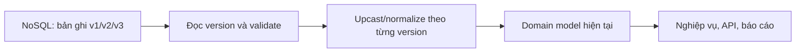
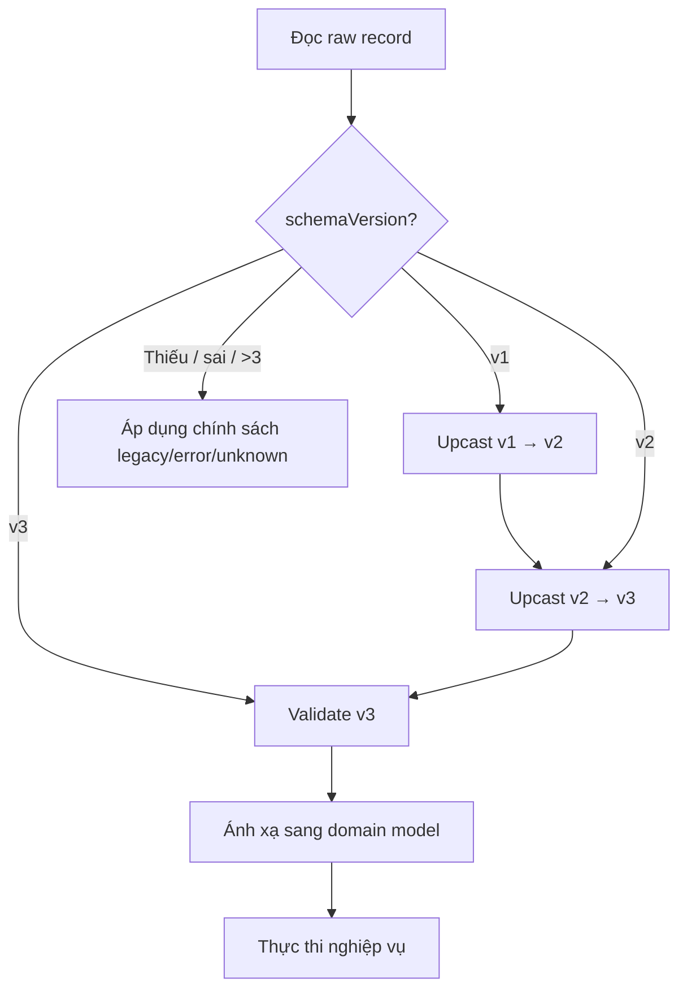
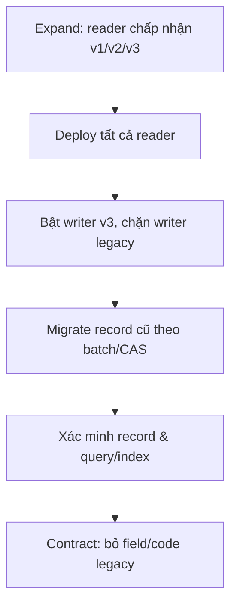

# Đặt phiên bản schema trong bản ghi và tương thích khi đọc

## 1. Vì sao một database NoSQL có thể chứa nhiều schema cùng lúc?

Trong nhiều hệ NoSQL, hai document nằm trong cùng collection, hai item trong cùng bảng, hoặc hai value thuộc cùng nhóm khóa có thể **không có tập trường và kiểu dữ liệu giống hệt nhau**. Điều này hữu ích khi ứng dụng phát triển từng bước, nhưng cũng tạo một câu hỏi quan trọng:

> Khi đọc bản ghi được ghi từ ba năm trước, code hiện tại làm sao biết trường nào tồn tại, trường nào đã đổi tên và cách diễn giải giá trị cũ?

Giả sử hệ thống quản lý hồ sơ người dùng ban đầu lưu:

```json
{
  "_id": "U42",
  "name": "An Nguyen",
  "city": "Hà Nội",
  "schemaVersion": 1
}
```

Sau đó nhóm phát triển đổi mô hình dữ liệu:

```json
{
  "_id": "U42",
  "displayName": "An Nguyen",
  "address": {
    "city": "Hà Nội"
  },
  "notificationPreferences": {
    "emailEnabled": false
  },
  "schemaVersion": 3
}
```

Cùng lúc, database còn có thể chứa hàng triệu bản ghi cũ do chưa chạy migration. Một consumer hoặc service đời cũ vẫn có thể sử dụng trường `name`. Một batch import từ file lưu trữ cũng có thể đưa bản ghi version 1 trở lại hệ thống.

Nếu code chỉ đọc `displayName` và giả định mọi bản ghi đã theo version 3, user U42 sẽ không hiển thị tên, dù dữ liệu gốc vẫn hợp lệ theo định dạng lúc được tạo.

**Gắn phiên bản schema vào bản ghi** là một cách giúp reader chọn đúng logic giải mã, kiểm tra tính hợp lệ, chuyển đổi sang mô hình hiện hành và báo lỗi khi gặp định dạng không hỗ trợ.

Bài học thuộc chủ đề *Database NoSQL — Kiểu dữ liệu và schema*, tập trung vào **thiết kế dữ liệu**, **tương thích khi đọc**, **chuyển đổi an toàn** và **triển khai giữa nhiều phiên bản ứng dụng**. Không có một quy tắc bắt buộc cho mọi NoSQL database: cách quản lý schema của MongoDB, DynamoDB, Cassandra, Redis, document store và các hệ dùng Avro/Protobuf không giống hệt nhau.

### Mục tiêu học tập

Sau bài này, bạn có thể:

1. Phân biệt `schemaVersion` của định dạng dữ liệu với version dùng cho optimistic locking và version của ứng dụng.
2. Xây dựng reader đọc được nhiều đời bản ghi, trả về **một mô hình nội bộ thống nhất**.
3. Giải thích *backward*, *forward* và *full compatibility* đối với reader/writer.
4. Phân loại thay đổi schema an toàn, có điều kiện và phá tương thích.
5. Thiết kế upcaster, migration tại lúc đọc, migration nền hoặc migration hàng loạt.
6. Bảo vệ dữ liệu khi có nhiều service đời khác nhau ghi/đọc đồng thời.
7. Xử lý missing/null/unknown fields, kiểu dữ liệu cũ, dữ liệu lỗi và version tương lai.
8. Chuẩn bị ma trận kiểm thử, telemetry và quy trình triển khai an toàn.

## 2. “Schema-less” không có nghĩa là không cần schema

Một số NoSQL database cho phép ghi document/value không bắt buộc tuân theo lược đồ cứng tại storage. Nhưng ứng dụng vẫn có **hợp đồng dữ liệu (data contract)**:

- `userId` dùng để nhận diện người dùng và phải có dạng hợp lệ.
- `createdAt` là thời điểm theo múi giờ và đơn vị xác định.
- `balanceMinor` là số nguyên ở đơn vị tiền nhỏ nhất.
- `status` chỉ nhận các trạng thái được phép.
- `address.city` có nghĩa và kiểu dữ liệu cụ thể.
- Trường đã bị xóa/đổi tên phải được hiểu đúng khi đọc bản ghi cũ.

Schema có thể được cưỡng chế tại database, serializer, API gateway, JSON Schema validator, schema registry hoặc tầng domain. Nếu không ghi rõ hợp đồng, hai service có thể tự hiểu cùng một trường theo cách khác nhau.

### 2.1. Ba cấp độ cần phân biệt

| Cấp độ | Ví dụ | Vai trò |
|---|---|---|
| **Schema vật lý/DB** | Collection validator, CQL table columns, index, định dạng item | Quyết định những gì storage nhận và cách dữ liệu được truy cập |
| **Schema thông điệp/bản ghi** | `schemaVersion: 3`, JSON Schema, Avro writer schema | Quyết định tên trường, kiểu và ngữ nghĩa payload |
| **Domain model của ứng dụng** | `UserProfile` với `displayName`, `address` | Cấu trúc mà nghiệp vụ muốn làm việc trong code hiện tại |

Có thể **nhiều schema bản ghi** được chuyển về **một domain model**. Ngược lại, cùng một schema bản ghi có thể được nhiều domain service diễn giải theo các projection khác nhau.

### 2.2. Hình dung pipeline



Nhờ một tầng chuyển đổi ở ranh giới đọc, code nghiệp vụ không cần chứa những nhánh `if version == 1` ở mọi nơi. Tuy nhiên, tầng này cần được kiểm thử nghiêm túc vì một lỗi diễn giải có thể ảnh hưởng nhiều bản ghi.

## 3. Đặt `schemaVersion` ở đâu và chọn phạm vi nào?

### 3.1. Đặt phiên bản trực tiếp trong document/item

Ví dụ:

```json
{
  "_id": "U42",
  "schemaVersion": 3,
  "displayName": "An Nguyen",
  "address": {
    "city": "Hà Nội"
  }
}
```

Ưu điểm:

- Một bản ghi tự mô tả được định dạng cần dùng để giải mã.
- Hai bản ghi khác version có thể cùng tồn tại trong một collection.
- Batch export/import mang theo metadata để reader biết cách diễn giải.
- Reader có thể thống kê version phổ biến và phát hiện bản ghi chưa được migration.

Nhược điểm:

- Metadata chiếm byte ở mỗi bản ghi.
- Writer phải đặt/đổi version đúng lúc thay cấu trúc.
- Có thể xảy ra dữ liệu ghi nhãn `schemaVersion = 3` nhưng nội dung vẫn theo v2.
- Migration và consumer vẫn phải xử lý các trường hợp version thiếu/sai hoặc chưa hỗ trợ.

### 3.2. Dùng một envelope thay vì trộn metadata vào payload

Một số hệ chuộng cấu trúc:

```json
{
  "recordType": "UserProfile",
  "schemaVersion": 3,
  "recordId": "U42",
  "payload": {
    "displayName": "An Nguyen",
    "address": {
      "city": "Hà Nội"
    }
  }
}
```

Ưu điểm là có vùng metadata chung, dễ gắn `recordType`, `schemaId` và dấu vết nguồn. Nhưng envelope làm sâu cấu trúc và thay đổi đường truy vấn/index nếu database cần lọc theo trường trong `payload`.

Không có lựa chọn luôn đúng. Nếu ứng dụng thường truy vấn theo `displayName` hoặc `address.city` ngay tại DB, phải xem field path, index và query của sản phẩm.

### 3.3. Mỗi loại record có hệ version riêng

Đừng dùng một biến toàn cục `schemaVersion = 7` cho mọi bảng/collection nếu các loại record tiến hóa độc lập.

Ví dụ:

```text
UserProfile      v3
Order            v5
InventoryItem    v2
PaymentEvent     v4
```

Version 3 của `UserProfile` không liên quan version 3 của `Order`. Nếu lưu chung keyspace hoặc event log, có thể dùng cặp (`recordType`, `schemaVersion`) hay một `schemaId` duy nhất có contract rõ ràng.

### 3.4. Schema version khác revision của bản ghi

Một record có thể chứa:

```json
{
  "_id": "U42",
  "schemaVersion": 3,
  "revision": 27,
  "displayName": "An Nguyen"
}
```

Hai trường có mục đích khác:

| Trường | Thay đổi khi nào? | Dùng để |
|---|---|---|
| `schemaVersion` | Cấu trúc hoặc ngữ nghĩa định dạng bản ghi thay đổi | Chọn decoder/upcaster |
| `revision` / `rowVersion` / `etag` | Mỗi lần mutation nghiệp vụ được chấp nhận, theo contract | Phát hiện ghi cạnh tranh bằng CAS |
| `appVersion` | Phiên bản ứng dụng/triển khai | Thông tin vận hành, không phải format record |
| `eventVersion` | Hợp đồng của một loại event | Giải mã event trong log hoặc bus |
| `schemaId` | ID trong schema registry | Tra định nghĩa schema cụ thể, không nhất thiết là số tăng cục bộ |

**Không dùng `schemaVersion` để thực hiện optimistic locking.** Hai request có thể sửa cùng một record ở schema v3 mà `schemaVersion` vẫn là 3. Nếu update chỉ kiểm tra `schemaVersion = 3`, cả hai có thể ghi đè nhau.

### 3.5. Nên chọn kiểu và quy tắc version rõ

Phương án thường dễ hiểu:

- Số nguyên dương `1, 2, 3, ...`.
- Mỗi phiên bản là **một định dạng bất biến** đã được mô tả.
- Một version không được âm thầm đổi ý nghĩa sau khi phát hành.
- Writer mới ghi định dạng mới và đặt đúng số version.
- Reader mới biết version nào được hỗ trợ và cách chuyển lên bản hiện hành.

Một số hệ dùng chuỗi định danh schema hoặc schema fingerprint thay số nguyên; quan trọng là tính **duy nhất, ổn định và khả năng tìm đúng schema**.

## 4. Ví dụ một loại record tiến hóa qua ba phiên bản

Ta chọn `UserProfile` để minh họa.

### 4.1. Version 1: dữ liệu phẳng

```json
{
  "_id": "U42",
  "schemaVersion": 1,
  "name": "An Nguyen",
  "city": "Hà Nội"
}
```

Định nghĩa:

- `name`: tên hiển thị, bắt buộc, kiểu chuỗi.
- `city`: thành phố, bắt buộc, kiểu chuỗi.
- `schemaVersion`: 1.

### 4.2. Version 2: đổi tên và tổ chức lại

```json
{
  "_id": "U42",
  "schemaVersion": 2,
  "displayName": "An Nguyen",
  "address": {
    "city": "Hà Nội"
  }
}
```

Các thay đổi:

1. `name` được đổi thành `displayName`.
2. `city` được chuyển vào `address.city`.

Thay đổi này **không tự tương thích với reader v1**. Code v1 đọc `name` có thể nhận missing field. Code v2 cũng cần upcaster nếu muốn đọc record v1.

### 4.3. Version 3: thêm tùy chọn thông báo

```json
{
  "_id": "U42",
  "schemaVersion": 3,
  "displayName": "An Nguyen",
  "address": {
    "city": "Hà Nội"
  },
  "notificationPreferences": {
    "emailEnabled": false
  }
}
```

Version 3 thêm `notificationPreferences`. Trong ví dụ này, **quy ước nghiệp vụ** là khi chuyển từ dữ liệu trước v3, không tự bật email: đặt `emailEnabled = false`. Đây là lựa chọn của sản phẩm minh họa, không phải default phổ quát cho mọi trường mới.

Nếu v3 có thêm một trường chứa sự đồng ý nhận quảng cáo hoặc quyền truy cập, default phải tuân thủ chính sách kinh doanh và pháp lý áp dụng; không được chọn giá trị thuận tiện chỉ để code chạy.

### 4.4. Bảng tiến hóa

| Đặc điểm | v1 | v2 | v3 |
|---|---|---|---|
| Tên hiển thị | `name` | `displayName` | `displayName` |
| Thành phố | `city` | `address.city` | `address.city` |
| Tùy chọn thông báo | Không có | Không có | `notificationPreferences` |
| Reader hiện tại | Cần chuyển đổi | Cần chuyển đổi | Đọc trực tiếp sau validate |
| Writer hiện tại | Không tạo mới | Không tạo mới | Luôn ghi v3 |

Mục tiêu reader là trả về một dạng **Canonical UserProfile** có `displayName`, `address.city` và `notificationPreferences.emailEnabled` bất kể bản ghi ban đầu thuộc phiên bản nào.

## 5. Backward và forward compatibility: phải nói rõ chiều

“Backward-compatible” có thể bị dùng không nhất quán trong trao đổi giữa các nhóm. Để tránh nhầm, bài này định nghĩa theo **reader và writer**:

- **Backward compatibility:** **reader mới** có thể đọc dữ liệu do **writer cũ** ghi.
- **Forward compatibility:** **reader cũ** có thể đọc dữ liệu do **writer mới** ghi, ít nhất trong phần hành vi được cam kết.
- **Full compatibility:** hai chiều trên đều được hỗ trợ theo phạm vi đã định.

Các hệ registry như Avro/Confluent có thuật ngữ compatibility mode riêng, bao gồm dạng transitive hoặc non-transitive. Khi dùng công cụ, phải đối chiếu định nghĩa chính thức của công cụ đó.

### 5.1. Ma trận reader–writer

Giả sử mọi writer chỉ tạo bản ghi theo version của nó:

| Reader \ Writer | Writer v1 | Writer v2 | Writer v3 |
|---|---|---|---|
| Reader v1 | Hỗ trợ tự nhiên | Cần bảo vệ tương thích | Cần bảo vệ tương thích |
| Reader v2 | Cần upcast v1 | Hỗ trợ tự nhiên | Cần xử lý v3/unknown fields |
| Reader v3 | Upcast v1→v2→v3 | Upcast v2→v3 | Hỗ trợ tự nhiên |

Mục tiêu của reader v3 thường là đọc được **mọi version còn tồn tại trong retention**. Nhưng nếu triển khai writer v3 trong khi reader v1 vẫn chạy, reader v1 cũng phải xử lý được định dạng mới hoặc hệ thống phải ngăn writer mới ghi định dạng phá tương thích cho đến khi reader cũ đã nâng cấp.

### 5.2. “Thêm trường tùy chọn” có luôn an toàn không?

Chưa chắc. Ví dụ writer mới thêm:

```json
{
  "schemaVersion": 3,
  "displayName": "An Nguyen",
  "preferredLocale": "vi-VN"
}
```

Reader cũ chỉ dùng `displayName` có thể vẫn hoạt động nếu deserializer **bỏ qua unknown field**. Nhưng nếu reader cũ cấu hình strict validation và từ chối mọi trường không biết, nó sẽ lỗi.

Nguy hiểm hơn: reader cũ đọc document, thay `displayName` rồi **ghi đè toàn bộ document** theo schema cũ. Nó có thể làm mất `preferredLocale` mà writer mới đã lưu, dù bước đọc không lỗi.

Vì vậy, tương thích phải bao gồm cả **read path** và **read-modify-write path**.

### 5.3. Đổi tên trường có tính phá tương thích cao

Khi thay `name` bằng `displayName`, reader cũ có thể không nhận ra tên mới. Có thể triển khai hai giai đoạn:

1. Writer tạm thời ghi cả `name` và `displayName` nếu hai trường có cùng ngữ nghĩa và chính sách dữ liệu cho phép.
2. Reader mới hiểu cả hai nhưng ưu tiên một nguồn theo quy tắc.
3. Nâng cấp toàn bộ reader và chạy migration.
4. Ngừng ghi `name` sau khi chắc chắn không còn consumer phụ thuộc.
5. Về sau mới xóa field legacy.

**Dual field** không miễn phí: nếu cập nhật chỉ một field, hai trường có thể lệch nhau. Phải xác định trường canonical và cách đồng bộ trong giai đoạn chuyển tiếp.

## 6. Phân loại thay đổi schema và các rủi ro

| Thay đổi | Ví dụ | Mức độ rủi ro | Cách tiếp cận |
|---|---|---|---|
| Thêm trường có default an toàn | `preferredLocale` | Thường thấp nếu reader bỏ qua unknown | Default có nghĩa; kiểm thử reader cũ |
| Thêm trường bắt buộc | `countryCode` | Cao với dữ liệu cũ | Backfill hoặc quy tắc suy ra có chứng cứ |
| Đổi tên field | `name` → `displayName` | Cao | Upcaster, dual field có thời hạn |
| Đổi vị trí field | `city` → `address.city` | Cao | Chuyển đổi cấu trúc |
| Xóa field | Loại `legacyCode` | Cao nếu consumer còn dùng | Deprecation và inventory consumer |
| Đổi kiểu | `age` chuỗi → số | Cao | Parse có validation và xử lý dữ liệu lỗi |
| Đổi đơn vị | `amount` VND → xu hoặc cents | Rất cao nếu không rõ currency | Gắn đơn vị/currency và version |
| Đổi ý nghĩa enum | `ACTIVE` mang nghĩa mới | Cao dù kiểu vẫn là chuỗi | Tạo giá trị mới hoặc version |
| Tách một field | `fullName` → `givenName`/`familyName` | Có thể không đảo ngược | Không suy đoán tên; lưu bản gốc nếu cần |
| Gộp nhiều field | `line1` + `line2` → `addressText` | Có thể mất cấu trúc | Định nghĩa thứ tự, escaping, migration |
| Đổi định danh | `username` → `userId` | Rất cao với references/index | Migration có bảng ánh xạ và đồng bộ |
| Tách collection | Một document → nhiều document | Cao với transaction/consistency | Chọn source of truth và workflow |
| Thêm event type mới | `UserMerged` | Phụ thuộc consumer | Unknown-event handling |
| Đổi timestamp | local time → UTC | Rất cao nếu thiếu timezone gốc | Xác định nguồn thời gian, báo lỗi khi không thể chuyển |

**Cùng kiểu dữ liệu không đảm bảo cùng ngữ nghĩa.** Một trường `price: 100` có thể được đọc sai nếu version cũ lưu đơn vị đồng còn version mới lưu đơn vị nhỏ hơn hoặc currency khác. Việc dùng số nguyên hay number không tự truyền đạt ý nghĩa tài chính.

### 6.1. Missing, null và giá trị rỗng khác nhau

Trong JSON/document model:

```json
{ "name": "An" }
```

khác với:

```json
{ "name": "An", "phone": null }
```

và khác với:

```json
{ "name": "An", "phone": "" }
```

Một ngữ nghĩa có thể là:

- **Missing:** định dạng cũ chưa từng có field này.
- **Null:** field đã được biết nhưng người dùng chủ động chưa cung cấp hoặc đã xóa.
- **Empty string:** người dùng nhập chuỗi trống, có thể hợp lệ hoặc không.

Khi upcast phải quyết định từng trường. **Không áp dụng default tự động cho mọi null**, vì null có thể là một lựa chọn nghiệp vụ có ý nghĩa.

### 6.2. Không thay đổi đơn vị một cách âm thầm

Ví dụ hai record:

```json
{ "schemaVersion": 1, "amount": 125000 }
```

```json
{ "schemaVersion": 2, "amountMinor": 125000, "currency": "VND" }
```

Nếu version 1 lưu đồng VND và version 2 quy định `amountMinor` là đơn vị nhỏ nhất của đồng tiền, phép chuyển đổi không thể đoán bằng cách nhân 100 cho mọi currency. Phải có quy tắc currency, scale và rounding được thống nhất theo domain.

Với bất kỳ chuyển đổi không xác định, an toàn hơn là **giữ bản ghi gốc và đánh dấu cần xử lý**, thay vì lặng lẽ đưa ra số mới có vẻ hợp lệ.

## 7. Reader theo version: một cổng giải mã thống nhất

Một thiết kế phổ biến là **upcaster chain**: lần lượt chuyển bản ghi từ v1 lên v2 rồi v3. Tầng nghiệp vụ chỉ nhận v3.



### 7.1. Các bước chi tiết

1. **Đọc raw** bằng API phù hợp, không vội deserialize vào model chỉ chấp nhận v3.
2. **Kiểm tra record type** nếu keyspace/collection có nhiều loại record.
3. **Đọc version**: đúng kiểu, nằm trong dải được hỗ trợ, không tự sửa version lạ.
4. **Validate theo version gốc** trước hoặc trong upcaster, ít nhất những trường bắt buộc cho chuyển đổi.
5. **Chuyển từng bước** theo thứ tự đã định, ví dụ v1→v2→v3.
6. **Validate v3** để tránh đưa dữ liệu sai vào domain.
7. **Tạo domain object bất biến** hoặc model nội bộ được bảo vệ khỏi thay đổi ngoài ý muốn.
8. **Trả kèm metadata chẩn đoán** nếu cần, ví dụ source version và lỗi migration đã được phân loại, nhưng không làm nhiễu API nghiệp vụ.

### 7.2. Vì sao dùng nhiều bước nhỏ thay vì một bộ chuyển đổi khổng lồ?

Một upcaster cho từng bước:

```text
v1 --upcast1to2--> v2 --upcast2to3--> v3
```

giúp mỗi thay đổi schema có hợp đồng và bộ test riêng. Khi có v4, thêm `v3to4` thay vì sửa lại toàn bộ cách hiểu v1. Nhưng chuỗi có thể dài và tốn CPU nếu phải đọc quá nhiều version cũ; khi đó có thể migrate nền hoặc dùng một bước tối ưu đã được kiểm chứng, đồng thời giữ đặc tả chuyển đổi nguồn.

### 7.3. Upcaster không nên tạo side effect

Một upcaster tốt là hàm gần như thuần:

```text
upcast(rawRecord) -> normalizedRecord
```

Nó không nên tự:

- Ghi lại record vào DB khi chưa có cơ chế concurrency.
- Gọi API thanh toán hoặc gửi event.
- Đặt thời gian hiện tại vào trường vốn cần thời gian nguồn mà không có quy tắc.
- Tạo ID ngẫu nhiên khác nhau mỗi lần đọc cùng một record nếu ID đó mang ý nghĩa bền vững.
- Âm thầm bỏ qua trường không hiểu rồi ghi đè record.

Nhờ đó, cùng một input sẽ cho cùng output, tiện cho kiểm thử, debug và chạy migration lặp.

## 8. Ví dụ Java/Jackson: đọc v1, v2 và v3 về một dạng v3

Mẫu này minh họa **cách tổ chức bộ chuyển đổi**, không gắn với một NoSQL database cụ thể. Giả sử ứng dụng chạy Java 17, đã thêm dependency Jackson Databind.

### 8.1. Dữ liệu đầu vào

Version 1:

```json
{
  "_id": "U42",
  "schemaVersion": 1,
  "name": "An Nguyen",
  "city": "Hà Nội"
}
```

Version 2:

```json
{
  "_id": "U42",
  "schemaVersion": 2,
  "displayName": "An Nguyen",
  "address": {
    "city": "Hà Nội"
  }
}
```

Version 3:

```json
{
  "_id": "U42",
  "schemaVersion": 3,
  "displayName": "An Nguyen",
  "address": {
    "city": "Hà Nội"
  },
  "notificationPreferences": {
    "emailEnabled": false
  }
}
```

### 8.2. Bộ normalize có kiểm tra version

```java
import com.fasterxml.jackson.databind.JsonNode;
import com.fasterxml.jackson.databind.ObjectMapper;
import com.fasterxml.jackson.databind.node.ObjectNode;

public final class UserProfileSchemaReader {
    private static final int CURRENT_SCHEMA = 3;

    private final ObjectMapper mapper = new ObjectMapper();

    public ObjectNode normalize(String json) throws Exception {
        JsonNode root = mapper.readTree(json);

        if (!(root instanceof ObjectNode)) {
            throw new IllegalArgumentException(
                "UserProfile phải là JSON object"
            );
        }

        // Không thay đổi raw tree do parser trả về.
        ObjectNode record = ((ObjectNode) root).deepCopy();
        int version = readVersion(record);

        while (version < CURRENT_SCHEMA) {
            switch (version) {
                case 1:
                    record = fromV1ToV2(record);
                    version = 2;
                    break;
                case 2:
                    record = fromV2ToV3(record);
                    version = 3;
                    break;
                default:
                    throw new IllegalArgumentException(
                        "Version cũ không được hỗ trợ: " + version
                    );
            }
        }

        validateV3(record);
        return record;
    }

    private int readVersion(ObjectNode record) {
        JsonNode version = record.get("schemaVersion");
        if (version == null || !version.isIntegralNumber()) {
            throw new IllegalArgumentException(
                "Thiếu hoặc sai kiểu schemaVersion"
            );
        }

        if (!version.canConvertToInt()) {
            throw new IllegalArgumentException(
                "schemaVersion ngoài phạm vi integer"
            );
        }

        int number = version.intValue();
        if (number < 1 || number > CURRENT_SCHEMA) {
            throw new IllegalArgumentException(
                "schemaVersion không được hỗ trợ: " + number
            );
        }

        return number;
    }

    private String requiredText(ObjectNode obj, String field) {
        JsonNode value = obj.get(field);
        if (value == null || !value.isTextual()) {
            throw new IllegalArgumentException(
                "Trường bắt buộc không hợp lệ: " + field
            );
        }
        return value.textValue();
    }

    private ObjectNode fromV1ToV2(ObjectNode old) {
        String name = requiredText(old, "name");
        String city = requiredText(old, "city");

        ObjectNode next = old.deepCopy();
        next.put("displayName", name);

        ObjectNode address = mapper.createObjectNode();
        address.put("city", city);
        next.set("address", address);

        next.remove("name");
        next.remove("city");
        next.put("schemaVersion", 2);
        return next;
    }

    private ObjectNode fromV2ToV3(ObjectNode old) {
        String name = requiredText(old, "displayName");
        JsonNode address = old.get("address");

        if (address == null || !address.isObject()
                || !address.hasNonNull("city")
                || !address.get("city").isTextual()) {
            throw new IllegalArgumentException(
                "address.city không hợp lệ"
            );
        }

        ObjectNode next = old.deepCopy();
        ObjectNode preferences = mapper.createObjectNode();

        // Quy ước nghiệp vụ của ví dụ: dữ liệu cũ chưa bật email.
        preferences.put("emailEnabled", false);

        next.set("notificationPreferences", preferences);
        next.put("schemaVersion", 3);
        return next;
    }

    private void validateV3(ObjectNode record) {
        requiredText(record, "_id");
        requiredText(record, "displayName");

        JsonNode address = record.get("address");
        if (address == null || !address.isObject()
                || !address.get("city").isTextual()) {
            throw new IllegalArgumentException("address.city không hợp lệ");
        }

        JsonNode pref = record.get("notificationPreferences");
        if (pref == null || !pref.isObject()
                || !pref.has("emailEnabled")
                || !pref.get("emailEnabled").isBoolean()) {
            throw new IllegalArgumentException(
                "notificationPreferences.emailEnabled không hợp lệ"
            );
        }

        if (record.path("schemaVersion").asInt() != CURRENT_SCHEMA) {
            throw new IllegalArgumentException("Sai version đích");
        }
    }
}
```

Ý nghĩa chính của code:

- `readVersion` phân biệt rõ kiểu/version hợp lệ; không mặc định một chuỗi `"3"` cũng tương đương số `3`.
- `deepCopy` giúp upcaster không trực tiếp sửa raw document.
- v1→v2 chỉ đổi tên và tái cấu trúc hai field có ngữ nghĩa rõ.
- v2→v3 thêm `emailEnabled = false` theo chính sách đã nêu.
- `validateV3` đảm bảo object trả về đạt các điều kiện tối thiểu cho domain.

Đoạn code minh họa **chưa bao gồm** schema validator đầy đủ, phân quyền, giới hạn kích thước input, phân loại lỗi domain, logging, metrics, tối ưu hiệu năng hay việc xử lý toàn bộ unknown field. Cách diễn giải của các trường string rỗng, Unicode normalization và format ID cũng cần hợp đồng riêng.

### 8.3. Unknown field được giữ lại nhưng chưa chắc được phép ghi trả

Ở ví dụ, `deepCopy` giữ các field không bị xóa tường minh. Điều này giúp tránh mất dữ liệu khi **normalize để đọc**, nhưng không có nghĩa mọi field lạ đều hợp lệ hoặc an toàn khi ghi.

Nên có hai tầng:

1. **Read normalization:** chuyển đổi những trường cần cho domain, có thể giữ metadata/phần chưa biết trong raw.
2. **Write serialization:** chỉ ghi dữ liệu theo writer schema hiện hành, có chính sách bảo toàn unknown fields khi yêu cầu round-trip.

Nếu reader cũ nhận document có field mới rồi ghi đè toàn bộ bằng domain object cũ, field mới có thể bị mất. Cần dùng field-level patch, version/CAS hoặc chỉ cho writer mới ghi trong giai đoạn chuyển đổi.

## 9. Khi `schemaVersion` bị thiếu, sai hoặc lớn hơn reader hỗ trợ

### 9.1. Bản ghi không có version

Có thể đây là dữ liệu **legacy** được tạo trước khi hệ thống bổ sung metadata. Không nên mặc định mọi bản ghi thiếu `schemaVersion` đều là v1, vì nó có thể là:

- Record thật sự thuộc schema legacy v1.
- Record bị hỏng do serializer/write path sai.
- Một loại record khác được lưu nhầm collection.
- Một phần payload bị cắt hoặc import không đầy đủ.
- Bản ghi mới bị thiếu metadata do lỗi triển khai.

Nếu cần hỗ trợ legacy, hãy viết **quy tắc nhận diện hữu hạn**, ví dụ:

> Trong collection `user_profiles`, chỉ với dữ liệu được tạo trước mốc migration xác định và có `name`, `city` theo kiểu yêu cầu, bản ghi thiếu version có thể được coi là legacy v1.

Quy tắc này nên có test, metric và ngày loại bỏ. Sau khi migration xong, có thể chuyển sang chính sách từ chối record thiếu version.

### 9.2. Version tương lai

Reader v3 gặp:

```json
{
  "_id": "U42",
  "schemaVersion": 4,
  "displayName": "An Nguyen",
  "profileFlags": {
    "verified": true
  }
}
```

Không thể tự coi v4 là v3 chỉ vì các trường quen thuộc vẫn có mặt. Version 4 có thể đã thay đổi ngữ nghĩa của một field mà reader v3 không biết.

Các lựa chọn:

| Chính sách | Khi phù hợp | Rủi ro |
|---|---|---|
| **Reject/raise unsupported version** | Dữ liệu có giá trị nghiệp vụ cao hoặc định dạng có thể phá tương thích | Request lỗi, cần upgrade reader |
| **Read-only projection giới hạn** | Đã công bố hợp đồng trường ổn định qua các version | Có thể không hiểu ngữ nghĩa mới |
| **Pass-through raw** | Gateway hoặc archival service không cần giải mã domain | Không được tự ý sửa payload |
| **Quarantine và báo động** | Dữ liệu không hợp lệ hoặc version không dự kiến | Cần hệ vận hành xử lý |
| **Rollback writer** | Một deployment mới vô tình ghi format chưa được hỗ trợ | Bản ghi v4 đã ghi vẫn còn; rollback code không tự biến chúng về v3 |

**Unknown future version không nên bị hạ version bằng cách sửa mỗi số `schemaVersion`.** Làm vậy thay đổi nhãn mà không thay đổi dữ liệu, dễ tạo lỗi âm thầm.

### 9.3. Dữ liệu hỏng không được “chuyển đại” thành dữ liệu hợp lệ

Ví dụ v1 có `city` là một object thay vì string, hoặc v2 không có `displayName`. Upcaster nên phân loại lỗi, ghi ID/type/version và nguyên nhân phù hợp, không tự biến thành chuỗi `"unknown"` nếu nghiệp vụ không cho phép.

Có thể chọn:

- Trả lỗi có mã rõ cho API.
- Đưa record vào hàng đợi sửa dữ liệu.
- Tạm thời hiển thị một phần thông tin không nhạy cảm với cảnh báo.
- Dùng công cụ migration có review để sửa bản ghi.
- Giữ raw value để đối soát, tránh làm mất chứng cứ.

Không log nguyên payload có thông tin cá nhân hoặc bí mật chỉ để debug. Metrics nên đếm theo loại lỗi, không gắn ID cá nhân vào label gây cardinality cao.

## 10. Ba chiến lược migration chính

### 10.1. Lazy migration khi đọc — không ghi lại ngay

Reader luôn upcast bản ghi cũ trong bộ nhớ, writer chỉ ghi v3 cho bản ghi được cập nhật.

```text
Read v1 -> Upcast in memory -> Business uses v3
                                         |
                                         +-- Không update -> v1 còn trong DB
                                         |
                                         +-- Update hợp lệ -> Ghi v3 bằng CAS
```

Ưu điểm:

- Không cần một cuộc migration toàn database ngay lập tức.
- Có thể triển khai reader mới trước rồi nâng dần writer.
- Các bản ghi được truy cập thường xuyên tự chuyển khi có mutation hợp lệ.
- Giảm rủi ro của một job ghi đè hàng loạt.

Hạn chế:

- Bản ghi ít đọc có thể còn v1 rất lâu.
- Reader phải tiếp tục mang logic cũ.
- Query/index tại database vẫn phải phục vụ cả dữ liệu v1 và v3 trong giai đoạn chuyển tiếp.
- Việc ghi lại trong read path có thể ảnh hưởng latency và race nếu không dùng CAS.

**Tên “lazy migration” không bắt buộc có side effect ghi.** Upcast thuần để đọc và “migrate-on-read writeback” là hai biến thể khác nhau.

### 10.2. Migrate-on-read có writeback

Khi đọc v1 và chuyển sang v3, ứng dụng thử ghi bản ghi v3 trở lại database. Điều này có thể rút ngắn thời gian tồn tại version cũ.

Nhưng nếu reader đọc v1 lúc T1, một writer khác sửa dữ liệu lúc T2 rồi reader writeback tại T3, writeback có thể **ghi đè thay đổi mới**.

Phải có một điều kiện concurrency như `revision`, ETag hoặc token phù hợp. `schemaVersion` đơn lẻ không đủ nếu cùng một version có thể nhận nhiều update.

Mã giả:

```text
raw = GET(recordId)   // raw: schemaVersion=1, revision=19
normalized = upcastToV3(raw)

CAS_REPLACE(
    key = recordId,
    expectedRevision = 19,
    expectedSchemaVersion = 1,
    newDocument = normalized with revision=20
)

if conflict:
    // Bản ghi đã bị sửa: bỏ kết quả writeback, đọc lại khi cần.
    // Không ghi đè snapshot cũ.
```

Tùy DB, có thể thích field-level update để giảm nguy cơ làm mất unknown fields. Cần xác định ai là source of truth, cơ chế sửa concurrent và thời điểm writer mới được phép ghi v3.

### 10.3. Migration hàng loạt (eager/batch migration)

Một job quét các record cũ:

```text
for page in records where schemaVersion < 3:
    for record in page:
        normalized = upcastToV3(record)
        conditionalWrite(record.id, expectedRevision, normalized)
    checkpoint(page)
```

Phù hợp khi:

- Muốn loại bỏ định dạng cũ trong thời gian xác định.
- Cần xây index/khả năng query chỉ có ở schema mới.
- Có yêu cầu chuẩn hóa dữ liệu trước khi phát hành một tính năng.
- Dataset có thể được migrate theo batch và có ngân sách vận hành.

Rủi ro:

- Scan lớn cạnh tranh I/O/CPU với request production.
- Bản ghi thay đổi trong lúc migrate.
- Worker có thể xử lý trùng, timeout hoặc mất checkpoint.
- Các record lỗi không thể chuyển phải được phân loại riêng.
- Nếu batch chạy một lần mà không chặn writer cũ, writer cũ có thể **ghi lại dữ liệu v1** sau khi migration.
- Backup/snapshot/recovery có thể mang dữ liệu cũ trở lại.

Cần metric tiến độ, checkpoint, idempotency, xử lý conflict, backoff, giới hạn tốc độ và chiến lược quay lui.

### 10.4. Dual read, dual write và cutover

Trong giai đoạn chuyển, có thể:

- **Dual read:** reader hỗ trợ cả `name` và `displayName`.
- **Dual write:** writer tạm thời ghi cả hai field hoặc ghi hai representation.
- **Cutover:** sau khi mọi consumer đã hiểu format mới, dừng legacy write, migrate phần còn lại và bỏ code cũ.

Cần tránh biến dual write thành nguồn lệch dữ liệu. Nếu cả `name` và `displayName` cùng tồn tại, khi hai field khác nhau phải có quy tắc ưu tiên, báo lỗi hoặc đối soát. Không chọn ngẫu nhiên theo thứ tự parser gặp trường.

## 11. Ví dụ MongoDB: tìm và chuyển record theo version

Các lệnh trong mục này là **MongoDB shell syntax** để minh họa cấu trúc truy vấn, không dùng trực tiếp cho mọi document store.

### 11.1. Thống kê version đang có

```javascript
db.user_profiles.aggregate([
  {
    $group: {
      _id: "$schemaVersion",
      total: { $sum: 1 }
    }
  },
  { $sort: { _id: 1 } }
]);
```

Kết quả `_id: null` ở phép nhóm có thể gồm bản ghi thiếu hoặc `null`, tùy biểu thức/data; nếu cần phân biệt chính xác nên bổ sung logic kiểm tra existence và type.

Đối với dataset lớn, aggregation toàn collection có thể tốn tài nguyên. Có thể dùng thống kê trong pipeline ghi hoặc background sampling, nhưng phải ghi rõ độ bao phủ của phép đo.

### 11.2. Đọc các bản ghi cần migration

```javascript
db.user_profiles.find(
  { schemaVersion: { $in: [1, 2] } },
  { _id: 1, schemaVersion: 1, revision: 1 }
).limit(100);
```

Đây là ví dụ tìm một tập ứng viên. `limit(100)` không tạo một cơ chế phân trang đáng tin cho job dài; phải thiết kế sort/keyset pagination hoặc cursor đúng contract của MongoDB. Cần index/plan phù hợp để không gây full scan quá tốn kém.

### 11.3. CAS khi ghi bản v3

Giả sử record nguồn có `schemaVersion = 2` và `revision = 19`, bộ upcaster đã tạo `normalizedV3` với `revision = 20`:

```javascript
const result = db.user_profiles.replaceOne(
  {
    _id: "U42",
    schemaVersion: 2,
    revision: 19
  },
  {
    _id: "U42",
    schemaVersion: 3,
    revision: 20,
    displayName: "An Nguyen",
    address: { city: "Hà Nội" },
    notificationPreferences: {
      emailEnabled: false
    }
  }
);

if (result.matchedCount === 0) {
  // Record đã đổi hoặc không còn tồn tại.
  // Đọc lại và xét lại, không ghi đè bản vừa thay đổi.
}
```

Đây là ví dụ **khi source record có sẵn trường revision**. Nếu dữ liệu legacy chưa có `revision`, migration cần thêm chiến lược bootstrap version, predicate phân biệt missing/null và bảo vệ concurrent writers. Không được gán `revision = 0` cho toàn bộ rồi coi đã tránh được race.

`replaceOne` còn có rủi ro bỏ mất field không có trong document thay thế. Muốn bảo toàn extension fields, cần thiết kế migration dựa trên raw record, policy field và validation; cân nhắc sử dụng update có chọn lọc khi phù hợp.

### 11.4. Schema validation khác reader migration

Một MongoDB collection có thể dùng validation rules để giới hạn dữ liệu mới. Tuy nhiên validator **không tự sửa** mọi bản ghi cũ. Có thể triển khai chính sách chuyển tiếp cho phép nhiều schema version, hoặc migration trước khi siết validator.

Khi chuyển sang chỉ cho writer ghi v3, cần kiểm tra:

- Tất cả writer có ghi đúng `schemaVersion = 3`?
- Bulk import/backfill có còn ghi v1/v2 không?
- Validator có chặn dữ liệu lỗi mà vẫn cho phép legacy read?
- Các record cũ đã được migrate hoặc có kế hoạch xử lý?
- Các index/truy vấn đã chuyển sang field path mới chưa?

## 12. Ghi dữ liệu trong giai đoạn nhiều version cùng tồn tại

### 12.1. Reader mới chưa đủ nếu writer cũ vẫn chạy

Kịch bản triển khai:

1. Service A v3 biết `displayName`.
2. Service B v1 vẫn ghi `name`.
3. Job migration nâng nhiều record lên v3.
4. Service B ghi đè lại record dưới dạng v1.

Nếu muốn hệ thống chỉ còn v3, phải kiểm soát **toàn bộ producer/writer**, gồm API, worker, event consumer, batch import và công cụ quản trị.

Một kế hoạch vận hành có thể:

- Triển khai reader mới ở tất cả service trước.
- Bổ sung khả năng ghi v3, nhưng chưa bật đồng loạt nếu còn reader v1 không hỗ trợ.
- Nâng cấp hoặc chặn writer cũ.
- Chạy migration và theo dõi tỷ lệ v1/v2 giảm.
- Bật validator/guard chống ghi schema cũ.
- Gỡ upcaster cũ sau khi không còn dữ liệu và consumer cần đến nó.

### 12.2. Upcast khi đọc không tự động sửa query tại database

Ví dụ reader v3 có thể hiểu `city` của v1 thành `address.city`. Nhưng truy vấn:

```javascript
db.user_profiles.find({
  "address.city": "Hà Nội"
});
```

không tự tìm được bản ghi v1 chỉ có `city: "Hà Nội"`. Upcaster chạy **sau khi database đã chọn record**; nó không biến query cũ thành query mới.

Giải pháp chuyển tiếp có thể là:

- Query cả hai field path trong một thời gian, với index phù hợp.
- Backfill field mới trước khi chuyển query sang field mới.
- Dùng projection/read model riêng phục vụ truy vấn.
- Từ chối dùng một field chưa được chuẩn hóa làm điều kiện quan trọng cho đến khi migration đạt điều kiện.

Tương thích khi giải mã một record và **tương thích của truy vấn/index** là hai vấn đề khác nhau.

### 12.3. Mở rộng rồi thu hẹp (expand–migrate–contract)

Một trình tự phổ biến:



Ở môi trường nhiều service, trước khi contract cần biết **service nào đang đọc/ghi**. Không bỏ field cũ chỉ vì API chính đã được nâng cấp, trong khi cron job hoặc consumer ít chạy vẫn dùng format legacy.

### 12.4. Rollback sau khi writer mới đã ghi dữ liệu

Rollback ứng dụng v3 về v2 có thể khiến v2 không giải mã được record v3 đã tạo. Vì vậy trước khi phát hành writer mới cần dự tính:

- Reader cũ có forward compatibility đủ dùng không?
- Nếu không, có thể rollback reader mới mà vẫn giữ một lớp compatibility không?
- Có thể tạm ngừng ghi v3 để xử lý lỗi không?
- Có script downcast với dữ liệu không mất mát không?
- Nếu downcast mất dữ liệu, có backup/restore có phạm vi và quy trình phù hợp không?

**Rollback code không đồng nghĩa rollback schema dữ liệu.** Những record đã được ghi có vòng đời riêng sau deployment.

## 13. Schema trong JSON khác Avro và Protobuf thế nào?

Một field `schemaVersion` trực tiếp trong JSON là một cách tự quản lý format. Nhưng nhiều hệ event/message sử dụng schema registry hoặc binary schema format.

### 13.1. JSON document

JSON không tự buộc trường, kiểu hay version. Ứng dụng có thể lưu:

```json
{
  "recordType": "Order",
  "schemaVersion": 2,
  "orderId": "O100",
  "totalMinor": 150000
}
```

Reader phải biết `Order v2` nghĩa là gì, kiểm tra presence/type, và chuyển version theo hợp đồng nội bộ. JSON Schema có thể dùng để validate nhưng **schema validation không tự sinh ra migration ngữ nghĩa**.

### 13.2. Avro

Avro dùng writer schema và reader schema trong quá trình giải mã; schema resolution hỗ trợ một số dạng tiến hóa như field được thêm có default theo quy định của Avro. Trong hệ thống dùng registry, message có thể mang **schema ID** để tìm writer schema.

Điều quan trọng:

- Reader cần xác định đúng writer schema, không đoán định dạng chỉ bằng nội dung bytes.
- Một thay đổi chỉ hợp lệ nếu đáp ứng quy tắc compatibility và ngữ nghĩa nghiệp vụ.
- Default trong schema là một phần của contract; không phải license để bịa dữ liệu khi không có nguồn.
- Compatibility mode trong registry có thể kiểm tra phiên bản liền trước hoặc mọi phiên bản trước đó, tùy cấu hình (transitive).

Schema ID trong envelope và `schemaVersion` của JSON document có cùng mục tiêu định hướng giải mã, nhưng không phải một khái niệm thực thi giống hệt nhau.

### 13.3. Protocol Buffers

Protobuf định danh field bằng **số field** và wire type, không chỉ bằng tên text. Một số thay đổi tên field có thể không thay wire format nếu giữ đúng số field và ngữ nghĩa, trong khi thay số field hoặc tái sử dụng số đã xóa là rất nguy hiểm.

Nguyên tắc quan trọng:

- Không tái sử dụng số field đã bị loại bỏ; khai báo `reserved` khi thích hợp.
- Cẩn thận khi đổi kiểu dữ liệu, oneof và ý nghĩa field.
- Unknown fields có thể được các runtime/serialization path xử lý khác nhau; phải kiểm tra thư viện và dạng chuyển qua JSON nếu có.
- Không dựa vào “binary parser đọc được” để khẳng định ứng dụng hiểu đúng ngữ nghĩa mới.

Protobuf không làm nhu cầu versioning nghiệp vụ biến mất. Có thay đổi semantic vẫn cần explicit version hoặc loại message mới dù wire format tương thích.

### 13.4. Event log cần thêm chính sách thời gian lưu

Với Kafka/event stream, một consumer mới có thể replay event cũ từ nhiều năm trước. Nếu event contract thay đổi, schema registry và upcaster phải giữ được khả năng giải mã dữ liệu còn trong log/backup.

Một số thay đổi phù hợp hơn với việc tạo **event type mới** thay vì âm thầm nâng version cùng một event, nhất là khi ý nghĩa sự kiện thay đổi căn bản. Cần xác định event identity, ordering, idempotency và cách consumer chọn handler theo version.

## 14. Tương thích khi đọc không chỉ là deserialize thành công

Một reader có thể parse JSON mà vẫn làm sai nghiệp vụ.

### 14.1. Mức tương thích cần đánh giá

| Lớp | Câu hỏi |
|---|---|
| **Syntactic compatibility** | JSON/binary có parse được không? |
| **Structural compatibility** | Field cần thiết có đúng kiểu và vị trí không? |
| **Semantic compatibility** | Giá trị có còn cùng đơn vị, miền hợp lệ và ý nghĩa không? |
| **Behavioral compatibility** | Nghiệp vụ có xử lý các trạng thái mới đúng không? |
| **Read/write compatibility** | Reader cũ sửa rồi ghi có bảo toàn dữ liệu mới không? |
| **Query compatibility** | Index, filter, sort, aggregate có tìm đúng các record ở mọi version không? |
| **Operational compatibility** | Migration, backup, replay, rollback, deploy song song có an toàn không? |

Một bộ test chỉ kiểm tra “deserialize không throw exception” mới giải quyết phần đầu tiên.

### 14.2. Enum mở rộng

Version 1 có:

```text
status = ACTIVE | INACTIVE
```

Version 2 có thêm:

```text
status = SUSPENDED
```

Reader cũ có thể parse `"SUSPENDED"` thành chuỗi nhưng nếu code sử dụng:

```text
if status == ACTIVE:
    grantAccess()
else:
    deleteAccount()
```

thì người dùng bị tạm khóa có thể bị xóa tài khoản. Đây là **lỗi tương thích hành vi**, không phải lỗi parser.

Thiết kế enum nên có chính sách rõ khi gặp giá trị mới: fail closed với quyền, quarantine cho trạng thái không biết, hoặc biểu diễn `UNKNOWN` mà vẫn giữ raw value để đối soát. Không ép mọi trạng thái lạ thành một trạng thái nghiệp vụ tùy tiện.

### 14.3. Timestamp và timezone

Ví dụ v1 lưu `"2026-11-14 08:00"` không kèm timezone, còn v2 lưu `"2026-11-14T08:00:00Z"`. Nếu dữ liệu v1 được tạo từ nhiều múi giờ, không thể chuyển chính xác chỉ bằng cách thêm `Z`.

Upcaster cần biết nguồn timezone từ metadata khác, hoặc phân loại dữ liệu không thể xác định. Với dữ liệu quan trọng như giao dịch tài chính, việc đoán timezone có thể làm sai thứ tự sự kiện và hiệu lực nghiệp vụ.

### 14.4. Số và độ chính xác

Chuyển `amount` từ chuỗi decimal sang floating point có thể gây mất độ chính xác. Chuyển `long` 64-bit sang JavaScript Number có thể làm tròn với số nguyên lớn. Cần dùng kiểu số phù hợp, nêu rõ đơn vị và rounding, và kiểm tra các giá trị biên.

## 15. Schema version trong cấu trúc lồng nhau

Một document lớn có thể chứa những đối tượng được tiến hóa độc lập:

```json
{
  "recordType": "Order",
  "schemaVersion": 4,
  "orderId": "O100",
  "shippingAddress": {
    "city": "Hà Nội",
    "countryCode": "VN"
  },
  "payment": {
    "provider": "X",
    "paymentSchemaVersion": 2,
    "method": "CARD"
  }
}
```

Có nên đặt version cho cả `payment`?

**Có thể**, nếu payment là một phần dữ liệu độc lập được nhiều hệ sinh ra/giải mã và có contract riêng. Nhưng quá nhiều số version lồng nhau sẽ làm tăng độ phức tạp.

Các nguyên tắc:

- Nếu các phần luôn thay đổi và được deploy cùng nhau, một version cho toàn document có thể đủ.
- Nếu một phần là payload của dịch vụ khác, có vòng đời riêng, nó có thể cần `recordType/schemaId` của chính nó.
- Không đặt version cho mỗi field chỉ để né thiết kế compatibility.
- Nếu document chứa nhiều định dạng được serialize khác nhau, xác định rõ boundary trước khi normalize.

Một field `schemaVersion = 4` không nhất thiết mô tả tất cả binary blob hay event được nhúng bên trong nếu chúng có contract độc lập.

## 16. Khi migration phải đụng đến dữ liệu ở nhiều nơi

Ví dụ hồ sơ user từng lưu `city` trong record chính, nay cần chuyển đến `addresses` collection để hỗ trợ nhiều địa chỉ. Upcaster một record đơn giản có thể không đủ vì schema mới yêu cầu tạo thêm item và thay đổi tham chiếu.

### 16.1. Chọn nguồn sự thật trong giai đoạn chuyển

Một kế hoạch:

1. Quy định `user_profiles` hay `addresses` là nguồn sự thật trong từng giai đoạn.
2. Bổ sung writer hỗ trợ format mới nhưng giữ compatibility contract.
3. Backfill địa chỉ vào collection mới, có ID ổn định và idempotency.
4. Chuyển reader sang nguồn mới sau khi xác minh dữ liệu/consistency.
5. Chặn writer cũ tạo lại trường legacy.
6. Xóa trường legacy sau khi đã hết nhu cầu và xác minh rollback plan.

Đây là migration **mô hình dữ liệu và đường truy cập**, không chỉ đổi `schemaVersion`.

### 16.2. Index và projection phải tiến hóa theo

Nếu dữ liệu cũ nằm ở `city` và mới nằm ở `address.city`, các index, query, cache và analytics projection cần được xử lý tương ứng.

Ví dụ lỗi thường gặp:

- Reader ứng dụng đã hiểu v1/v3, nhưng report query chỉ filter `address.city`.
- Search index vẫn dùng tên field `city`.
- Event consumer nhận version mới nhưng viết lại bản ghi theo schema cũ.
- API list trả schema v3, nhưng API export lấy raw document v1 rồi bỏ qua normalize.
- Batch job chỉ chạy một lần và không xử lý record cũ được restore từ backup.

Tương thích cần được rà soát **theo mọi đường đọc và ghi**, không chỉ endpoint được dùng nhiều nhất.

## 17. Khả năng phục hồi và tính nhất quán của dữ liệu khi migration

### 17.1. Một job migration cần idempotent

Nếu job đã chuyển v1→v3 thành công nhưng mất ACK, chạy lại không được làm mất dữ liệu. Có thể dùng:

- Điều kiện `schemaVersion = 1` hoặc `2` kết hợp `revision` hoặc ETag của bản nguồn.
- Dấu migration operation ID nếu một bước có side effect ngoài một record.
- Không tự đặt lại default hay timestamp sau mỗi lần lặp.
- Upcaster deterministic.
- Checkpoint có quy tắc khi token/cursor hết hạn.
- Quarantine với record không thể chuyển, không nuốt lỗi.

Chỉ kiểm tra version có thể chưa đủ nếu có concurrent write trong cùng version; cần điều kiện về revision/etag hoặc một protocol đảm bảo không có writer cũ cạnh tranh.

### 17.2. Read-repair và migration lúc đọc có thể tác động latency

Nếu mỗi request đọc v1 đều ghi lại v3, bạn đã biến một luồng **read-heavy** thành **read+write-heavy**. Với hot key, nhiều reader cùng muốn migrate một lúc có thể tạo write conflict hoặc giới hạn capacity.

Giải pháp có thể:

- Chỉ upcast trong bộ nhớ; migrate nền riêng.
- Thử CAS writeback theo sampling hoặc có giới hạn tốc độ.
- Dùng job/hàng đợi ghi nền có idempotency.
- Chấp nhận CAS conflict như kết quả bình thường, không retry vô hạn.
- Không đặt mutation trong logic deserialization mà các service gọi với kỳ vọng chỉ đọc.

### 17.3. Một bản ghi đã đổi version nhưng metadata/replica vẫn cũ

Với hệ phân tán, một reader từ replica có thể đọc version cũ trong một khoảng thời gian tùy consistency contract. Reader cần tiếp tục hỗ trợ format cũ cho đến khi ngữ nghĩa đọc/replication và migration cho phép bỏ.

Nếu nghiệp vụ cần read-your-writes hoặc phản hồi migration ngay, phải chọn đường đọc phù hợp. Không kết luận “toàn bộ DB đã là v3” chỉ vì một job đã quét xong một lần.

### 17.4. Snapshot, backup và restore

Sau khi ứng dụng đã loại bỏ upcaster v1, việc phục hồi backup chứa v1 có thể khiến ứng dụng không đọc được dữ liệu. Trước khi gỡ support v1 cần xem:

- Retention của backup/snapshot và event log.
- Các môi trường dùng bản sao dữ liệu cũ.
- Quy trình khôi phục và script migration cho dữ liệu restored.
- Chính sách version compatibility của tool import/export.

Schema reader support có thể cần kéo dài hơn thời gian dữ liệu cũ tồn tại trong cluster chính.

## 18. Kiểm thử tương thích bằng ma trận dữ liệu

### 18.1. Golden fixtures cho mỗi phiên bản

Lưu test fixture theo version và trường hợp biên:

```text
fixtures/user-profile/
    v1-minimal.json
    v1-with-legacy-field.json
    v2-minimal.json
    v2-with-unknown-extension.json
    v3-minimal.json
    v3-null-optional.json
    invalid-version-type.json
    unknown-v4.json
    malformed-v2.json
```

Test reader:

```text
for each supported fixture:
    actual = normalize(fixture)
    assert schemaVersion(actual) == 3
    assert required domain properties giữ đúng ngữ nghĩa
    assert raw fixture không bị mutate

for each invalid/unsupported fixture:
    assert lỗi được phân loại đúng
    assert không có writeback hoặc side effect
```

Không chỉ test happy path. Một bản ghi cũ lỗi có thể nằm rất lâu trong database và chỉ được đọc khi người dùng hiếm quay lại.

### 18.2. Ma trận reader–writer

| Test | Mong đợi |
|---|---|
| Reader v3 đọc fixture v1 | Normalize thành domain v3 đúng |
| Reader v3 đọc fixture v2 | Normalize đúng |
| Reader v3 đọc fixture v3 | Validate và dùng trực tiếp |
| Reader v2 đọc record do writer v3 tạo | Theo forward compatibility contract, hoặc phải bị chặn rollout |
| Reader v3 đọc `schemaVersion = 4` | Fail-safe hoặc projection giới hạn theo chính sách |
| Record thiếu version | Chỉ nhận nếu khớp rule legacy đã khai báo |
| Record có version kiểu string | Từ chối hoặc xử lý theo contract đã định |
| Value null thay vì missing | Không tự biến thành default sai nghĩa |
| Upcaster chạy hai lần trên cùng input | Kết quả ổn định |
| CAS writeback gặp conflict | Không ghi đè update mới |
| Writer cũ chạy sau migration | Có cơ chế chặn/đối soát |
| Export/import và restore backup v1 | Có reader/migration hỗ trợ |
| Query bằng field mới | Vẫn tìm đúng tập record trong giai đoạn hỗn hợp |

### 18.3. Test thuộc tính và kiểm thử trên dữ liệu thực

Nếu có thể, bổ sung:

- **Property-based test:** sinh dữ liệu hợp lệ theo schema cũ, kiểm tra invariant khi normalize.
- **Round-trip test:** deserialize → update field được phép → serialize không mất field không liên quan.
- **Differential test:** so kết quả API trên các bản ghi v1/v2/v3 cùng ngữ nghĩa.
- **Sample production audit:** lấy mẫu dữ liệu đã ẩn danh hoặc bảo vệ để tìm trường hợp legacy chưa biết.
- **Canary:** một tỷ lệ nhỏ reader mới đọc dữ liệu thật, theo dõi lỗi/latency trước rollout toàn bộ.
- **Migration dry-run:** thống kê số record có thể chuyển, record lỗi và field có nguy cơ mất.

Tuy nhiên, dry-run/validation chỉ có giá trị trong phạm vi dữ liệu và điều kiện đã kiểm tra. Nó không đảm bảo writer khác không tạo thêm dữ liệu cũ sau đó.

## 19. Telemetry cho schema evolution

Một số chỉ số có ích:

| Metric | Giúp trả lời |
|---|---|
| `records_by_schema_version` | DB còn bao nhiêu v1/v2/v3? |
| `reader_upcast_count` | Reader đang thực hiện bao nhiêu chuyển đổi legacy? |
| `reader_unsupported_version_count` | Có writer mới chạy trước reader hoặc dữ liệu lạ? |
| `schema_validation_error_count` | Có những trường hợp thiếu/sai kiểu nào? |
| `migration_attempted/succeeded/failed` | Job chuyển đổi tiến triển đến đâu? |
| `migration_cas_conflict_count` | Có concurrent writes hoặc worker đụng nhau? |
| `legacy_writer_detected_count` | Có service còn tạo record version cũ? |
| `migration_oldest_record_age` | Bản ghi cũ tồn tại bao lâu? |
| `reader_p95/p99_latency` | Upcast gây ảnh hưởng độ trễ thế nào? |
| `quarantine_record_count` | Có bao nhiêu bản ghi cần xử lý thủ công? |

Không gắn ID từng user hoặc document vào metric label có cardinality lớn và nguy cơ lộ dữ liệu. Thay vào đó, log có kiểm soát hoặc sự kiện chẩn đoán riêng có thể ghi ID tham chiếu khi cần điều tra.

### 19.1. Định nghĩa “migrate xong” phải đo được

Có thể yêu cầu đồng thời:

1. Không còn writer phát sinh record legacy.
2. Mọi record trong phạm vi dữ liệu nguồn đã ở version đích hoặc được ghi vào danh sách ngoại lệ có xử lý.
3. Các query/index/projection liên quan dùng field mới đúng.
4. Đã đối chiếu dữ liệu hoặc bất biến quan trọng.
5. Restore/import từ dữ liệu cũ có quy trình tương thích.
6. Không còn consumer cần trường legacy trước khi xóa field/code.

Nếu chỉ đo “job đã kết thúc” thì chưa đủ để xóa logic compatibility.

## 20. Sai lầm thường gặp

| Sai lầm | Tại sao sai? | Cách phòng tránh |
|---|---|---|
| Không lưu version vì database “schema-less” | Reader không phân biệt định dạng khi dữ liệu thay đổi | Đặt schema contract và metadata phù hợp |
| Dùng `schemaVersion` làm optimistic-lock counter | Nhiều update cùng schema không tăng version | Dùng `revision`/ETag riêng |
| Mặc định record thiếu version là v1 | Có thể che lỗi dữ liệu mới | Chỉ chấp nhận legacy có điều kiện rõ |
| Bump version mà không đổi payload | Gắn nhãn sai, reader hiểu nhầm | Writer và validator phải đồng bộ |
| Đổi tên trường rồi deploy writer trước | Reader cũ đọc sai | Expand reader trước, deploy writer sau |
| Cho rằng thêm field luôn backward/forward-compatible | Strict parser hoặc ghi đè document có thể lỗi/mất field | Test cả read và write round-trip |
| Tự chọn default `true` cho consent/permission | Có thể vi phạm chính sách nghiệp vụ | Default phải được phê duyệt và có nghĩa |
| Mọi lỗi parse đều chuyển thành chuỗi rỗng | Dữ liệu sai bị che giấu | Validate, phân loại lỗi, quarantine |
| Upcast và ghi ngược bằng PUT không điều kiện | Có thể ghi đè thay đổi mới | CAS/revision và retry phù hợp |
| Chỉ test reader chứ không test DB query | Query trên field mới bỏ sót record cũ | Migration/index/query tương thích |
| Nghĩ migration xong nghĩa rollback an toàn | Record version mới đã nằm trong storage | Thiết kế rollback có tương thích dữ liệu |
| Xóa upcaster ngay khi code ngừng ghi v1 | Backup/event log có thể còn v1 | Kiểm tra retention và restore |
| Quên writer ở batch/consumer | Writer cũ tái tạo data legacy | Inventory mọi producer và guard |
| Upcast có side effect | Retry/read lặp tạo tác dụng ngoài ý muốn | Bộ chuyển đổi thuần và deterministic |
| Hạ unknown v4 thành v3 bằng cách sửa số | Mất ngữ nghĩa tương lai | Fail-safe hoặc explicit compatibility contract |

## 21. Bài tập thực hành

### Bài 1 — Thiết kế version cho đơn hàng

Một record v1:

```json
{
  "orderId": "O-101",
  "schemaVersion": 1,
  "amount": 250000,
  "status": "PENDING"
}
```

V2 dự kiến thêm `currency` và đổi `amount` thành `amountMinor`.

**Yêu cầu:**

1. Những thông tin gì cần biết trước khi chuyển từ `amount` sang `amountMinor`?
2. Vì sao không được tự động nhân hoặc chia 100 nếu không có contract currency?
3. Writer/reader nào phải được deploy trước?
4. Nếu còn record v1 trong DB, query tổng doanh thu theo v2 cần xử lý thế nào?

**Gợi ý:** cần biết đơn vị và currency của `amount` ở v1, quy tắc rounding/precision và dữ liệu lỗi. Reader mới phải hiểu v1 trước khi writer v2 tạo dữ liệu phá tương thích; truy vấn tại DB không được mặc định mọi record đã có `amountMinor`.

### Bài 2 — Phân biệt schemaVersion và revision

Hai client đọc:

```json
{
  "_id": "U42",
  "schemaVersion": 3,
  "revision": 10,
  "displayName": "An"
}
```

Client A sửa tên thành “An Nguyễn”; client B sửa địa chỉ, cả hai định ghi toàn bộ document.

**Câu hỏi:** trường nào dùng để chọn parser và trường nào để chặn lost update? Cách xử lý khi client B thua CAS?

**Gợi ý:** parser dùng `schemaVersion = 3`; CAS dùng `revision = 10`. Sau khi A ghi revision 11, B phải đọc lại và áp dụng lại thay đổi địa chỉ lên bản mới, không ghi snapshot cũ.

### Bài 3 — Reader mới nhưng query cũ

Bảng v1 dùng `city`, v2 dùng `address.city`. Reader đã có upcaster v1→v2.

**Câu hỏi:** truy vấn DB chỉ filter `address.city = "Hà Nội"` có lấy đủ bản ghi v1 không? Đề xuất cách chuyển giai đoạn query.

**Gợi ý:** không tự động. Có thể query hai path với index phù hợp hoặc backfill field mới rồi cutover. Upcaster chỉ chạy sau bước database tìm record.

### Bài 4 — Version tương lai

Một service v3 gặp record `schemaVersion = 4`, trong đó một trường `status` có thêm trạng thái `LOCKED`.

**Yêu cầu:** giải thích vì sao không nên coi v4 là v3; đưa ra hai chính sách xử lý tùy nghiệp vụ và tác động tới độ sẵn sàng.

**Gợi ý:** từ chối an toàn và yêu cầu nâng reader; hoặc chỉ trả projection các trường đã có contract ổn định, không thực thi quyết định quyền/tiền dựa vào trạng thái không hiểu. Không hạ version bằng cách sửa số.

### Bài 5 — Lập ma trận tương thích

Một tổ chức đang dùng reader v1 và v2, chuẩn bị thêm writer v3.

**Yêu cầu:** lập bảng reader v1/v2/v3 × writer v1/v2/v3 cho tất cả service còn hoạt động. Đánh dấu hỗ trợ, lỗi và trường hợp cần dual field. Xác định thứ tự deploy mà không làm hỏng rollback.

**Gợi ý:** bắt đầu từ inventory reader/writer. Chỉ bật writer v3 khi mọi reader có thể hiểu record v3 theo cam kết, hoặc loại bỏ được reader cũ. Nếu rollback app nhưng DB đã có v3, cần giữ lớp đọc tương thích.

### Bài 6 — Migration đồng thời

Một job đọc record `schemaVersion=2`, `revision=19` rồi chuyển sang v3. Đồng thời một service cập nhật `displayName` và tăng revision lên 20.

**Câu hỏi:** vì sao `replaceOne({_id, schemaVersion: 2}, normalizedV3)` chưa đủ? Viết filter CAS tốt hơn và cách xử lý khi matchedCount bằng 0.

**Gợi ý:** filter phải bảo vệ cả revision hoặc token đồng thời được DB hỗ trợ. Khi conflict, job đọc lại; nếu record đã v3 thì bỏ qua hoặc kiểm tra kết quả, nếu vẫn v2 nhưng revision mới thì tính upcast lại từ phiên bản mới nhất.

### Bài 7 — Viết golden fixtures

Cho v1/v2/v3 của `UserProfile` ở mục 4, hãy liệt kê ít nhất tám fixture/test cases cần thiết.

**Gợi ý:** v1 hợp lệ, v2 hợp lệ, v3 hợp lệ, missing version legacy được/không được nhận, version kiểu string, v4 tương lai, missing field bắt buộc, null khác missing, unknown extension field, Unicode, input quá lớn và CAS conflict khi writeback.

## 22. Quy trình thiết kế schema evolution có thể sử dụng lại

Một chu kỳ đổi schema nên diễn ra như sau:

1. **Định nghĩa định dạng hiện tại:** liệt kê trường, kiểu, ngữ nghĩa, default và bất biến.
2. **Mô tả thay đổi:** field nào thêm/xóa/đổi tên/đổi đơn vị; có mất mát thông tin không?
3. **Gán version hoặc schema ID mới:** giữ ánh xạ định dạng bất biến.
4. **Viết upcaster/validator:** có xử lý thiếu/sai/unknown và dữ liệu legacy.
5. **Thêm golden fixtures và ma trận reader–writer:** kiểm tra cả read và read-modify-write.
6. **Kiểm kê toàn bộ consumer/producer:** API, worker, batch, stream, export/import, admin tool.
7. **Triển khai reader tương thích trước:** quan sát lỗi và độ trễ.
8. **Triển khai writer mới có guard:** không phát sinh format sai hoặc writer legacy sau cutover.
9. **Chạy migration nếu cần:** có CAS, idempotency, checkpoint và throttling.
10. **Chuyển query/index/projection:** xác nhận không bỏ sót record cũ và consumer.
11. **Kiểm tra điều kiện hoàn tất:** số liệu, đối soát, backup/restore và rollback.
12. **Loại bỏ legacy có kiểm soát:** chỉ sau khi retention và các đường đọc cũ không còn phụ thuộc.

Quy trình này không đồng nghĩa mọi thay đổi cần migration vật lý ngay. Một field tùy chọn nhỏ có thể chỉ cần reader phù hợp và validator; một thay đổi định danh/đơn vị tiền có thể đòi backfill, audit và cutover nhiều bước.

## 23. Tài liệu chính thức để tham khảo

Để triển khai cụ thể, hãy tra tài liệu của đúng database, serializer, schema registry, SDK và phiên bản:

- [MongoDB Documentation](https://www.mongodb.com/docs/manual/) — document model, validation, update/replace, transaction, indexing và migration patterns.
- [Amazon DynamoDB Developer Guide](https://docs.aws.amazon.com/amazondynamodb/latest/developerguide/Introduction.html) — item attributes, conditional writes, transaction, consistency và SDK mapping.
- [Apache Cassandra Documentation](https://cassandra.apache.org/doc/latest/) — schema management, CQL columns, data modeling và migration limitations.
- [Redis Documentation](https://redis.io/docs/latest/) — key/value formats, serialization do ứng dụng quản lý, atomic updates và TTL.
- [Apache Avro Specification](https://avro.apache.org/docs/current/specification/) — writer/reader schema resolution, defaults và schema evolution.
- [Protocol Buffers Language Guide](https://protobuf.dev/programming-guides/proto3/) — field numbers, reserved fields, presence và compatibility.
- [JSON Schema Documentation](https://json-schema.org/learn) — validation và cách diễn tả hợp đồng JSON.

Hướng dẫn của sản phẩm có thể thay đổi theo version. Một schema registry mode tên `BACKWARD` hoặc `FULL_TRANSITIVE` phải được hiểu theo contract chính thức của công cụ đó thay vì suy từ nghĩa tiếng Anh thông thường.

## 24. Kết luận

**Phiên bản schema của bản ghi là một hợp đồng diễn giải dữ liệu**, không phải một con số chỉ để theo dõi việc deploy. Nó cho reader biết cách hiểu tên trường, kiểu và ngữ nghĩa đã từng tồn tại, từ đó chuẩn hóa các record cũ về mô hình hiện tại hoặc từ chối an toàn khi gặp dữ liệu ngoài phạm vi hỗ trợ.

Thiết kế tốt tách `schemaVersion` khỏi `revision`, giữ upcaster có thể kiểm thử và hạn chế side effect, phân biệt dữ liệu missing/null/unknown, đồng thời bảo vệ writeback bằng conditional update hoặc CAS. Khi nhiều ứng dụng cùng vận hành, phải triển khai reader trước writer phá tương thích, giám sát writer legacy và xử lý query/index/backup cùng với payload.

**Câu hỏi quyết định không chỉ là “reader có parse được JSON không?”, mà là “mọi bản ghi còn trong database, log và backup có được diễn giải đúng ngữ nghĩa khi các phiên bản ứng dụng cùng tồn tại hay không?”** Khi câu trả lời được chứng minh bằng hợp đồng, migration và kiểm thử, hệ NoSQL mới có thể phát triển schema mà không đánh đổi tính đúng đắn của dữ liệu.

