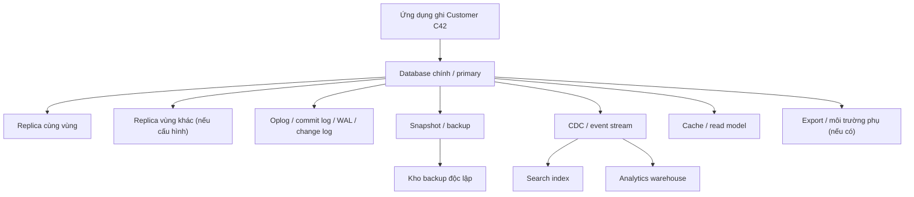
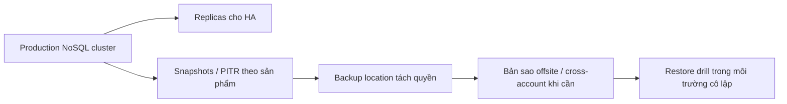
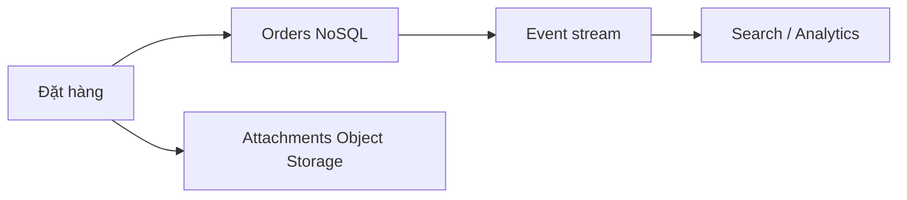
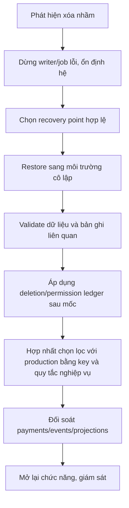
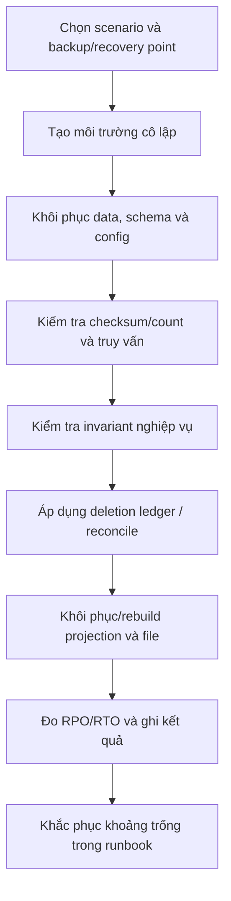

# Sao lưu, bản sao dự phòng và phạm vi còn tồn tại của dữ liệu

## 1. Một thao tác xóa không đồng nghĩa dữ liệu biến mất ở mọi nơi

Một hệ thống NoSQL đang vận hành thường không chỉ giữ một bản của mỗi thực thể. Để đáp ứng độ sẵn sàng cao, truy vấn nhanh, phân tích, khôi phục thảm họa và kiểm toán, dữ liệu có thể được **nhân bản, sao lưu, chụp snapshot, ghi vào log và xuất sang nhiều dịch vụ**.

Giả sử ứng dụng thương mại điện tử có một document khách hàng:

```json
{
  "_id": "C42",
  "name": "Nguyễn An",
  "email": "an@example.test",
  "address": {
    "city": "Đà Nẵng"
  }
}
```

Lúc 09:00, ứng dụng xóa document `C42` trong database chính. Câu hỏi không dừng ở “lệnh DELETE có thành công không?”:

- Replicas có nhận và áp dụng thao tác xóa chưa?
- Một snapshot lúc 08:00 có còn document đó không?
- Backup hằng ngày hoặc bản sao ở vùng khác có lưu thông tin cũ không?
- Write-ahead log, oplog, commit log hoặc change stream còn lưu giá trị liên quan không?
- Cache, search index và kho phân tích còn hiển thị khách hàng không?
- Tệp export dùng cho đối soát hoặc môi trường kiểm thử có chứa bản ghi không?
- Nếu khôi phục database về thời điểm 08:30, document đã xóa có **xuất hiện trở lại** không?
- Đến ngày nào bản sao cũ được loại bỏ theo chính sách lưu trữ, và chứng cứ gì xác nhận phạm vi đã xử lý?

Đó là lý do trong chương **Vòng đời dữ liệu**, backup và replication phải được xem cùng với **retention, deletion, restore và quản trị các bản sao**.

**Nguyên tắc xuyên suốt:** *dữ liệu không còn xuất hiện qua API chính* khác với *dữ liệu đã bị xóa khỏi bản ghi sống*, và cả hai khác với *dữ liệu không còn nằm trong bất kỳ bản sao lưu trữ nào thuộc phạm vi kiểm soát*.

### Mục tiêu học tập

Sau bài này, bạn có thể:

1. Phân biệt **bản sao phục vụ (replica)**, **snapshot**, **backup**, **log/PITR**, **cache**, **projection** và **export**.
2. Giải thích tại sao replication không thay thế backup, và backup không tự đảm bảo ứng dụng khôi phục đúng.
3. Hiểu RPO, RTO, fault domain và các điều kiện cần để đánh giá một phương án dự phòng.
4. Xây dựng bản đồ những nơi dữ liệu có thể còn tồn tại sau khi xóa, hết TTL hoặc thay đổi schema.
5. Phân biệt xóa logic, xóa vật lý, compaction, hết hạn backup, snapshot và bản sao ở vùng khác.
6. Thiết kế backup/restore theo workload NoSQL, gồm dữ liệu, index, metadata, cấu hình và tài nguyên ngoài DB.
7. Xử lý rủi ro **data resurrection** khi restore và replay sự kiện.
8. Lập chính sách lưu giữ, kiểm soát truy cập và kiểm chứng khả năng khôi phục bằng diễn tập thực tế.

## 2. Bản đồ những bản sao của một dữ liệu

Hãy xem đường đi của một thay đổi dữ liệu:



Sơ đồ là một **bản đồ khái niệm**, không nói rằng mọi sản phẩm đều hỗ trợ hoặc tự tạo đủ các nhánh. Có dịch vụ không cho truy cập log nội bộ; có hệ không có replica đa vùng; cache/search có thể được cập nhật qua API thay vì CDC.

### 2.1. Phân loại theo mục đích

| Loại bản sao/cấu trúc | Mục đích chính | Có thể còn dữ liệu đã xóa? | Có thay thế backup không? |
|---|---|---|---|
| **Primary / leader / bản phục vụ ghi** | Nhận các thao tác dữ liệu theo topology | Có thể còn byte vật lý sau xóa logic | Không |
| **Read replica / follower** | Tăng khả dụng hoặc phục vụ đọc | Có, trong thời gian lag; còn có thể giữ dữ liệu vật lý | Không |
| **Multi-region replica** | Khả dụng vùng khác, giảm độ trễ địa lý | Có, theo replication và retention | Không mặc nhiên |
| **Snapshot** | Ghi lại trạng thái dữ liệu tại một mốc theo contract | Có, nếu snapshot được chụp trước lúc xóa | Có thể là thành phần backup |
| **Full/incremental backup** | Khôi phục dữ liệu bị mất/hỏng | Có, trong vòng đời lưu giữ | Có, nếu khôi phục được và đủ phạm vi |
| **PITR logs** | Khôi phục đến một mốc thời gian được hỗ trợ | Có thể chứa các trạng thái/sự kiện cũ | Là thành phần của cơ chế recovery |
| **Cache** | Giảm latency truy vấn | Có, nếu invalidate/TTL chưa kịp | Không |
| **Search index / materialized view** | Truy vấn theo đường đọc khác | Có, khi đồng bộ trễ hoặc lỗi | Không |
| **Data lake/warehouse** | Phân tích, báo cáo, lưu lịch sử | Có, theo pipeline/retention riêng | Không mặc nhiên |
| **Export CSV/JSON** | Đối soát, tích hợp, chia sẻ dữ liệu | Có thể giữ rất lâu | Chỉ dùng làm backup nếu có contract restore rõ |
| **Object storage attachment** | Lưu ảnh, tài liệu và file liên kết | Có, độc lập với record metadata | Không được bảo vệ chỉ bằng backup DB |
| **Audit/observability** | Truy vết và vận hành | Có thể còn ID hoặc payload nhạy cảm | Không |

Điểm cần nhớ: **một thực thể nghiệp vụ có thể tạo nhiều dấu vết ở những hệ thống có chính sách hết hạn độc lập**.

## 3. Replication: tăng khả dụng, không phải chiếc máy quay thời gian

### 3.1. Replication là gì?

Replication là việc duy trì nhiều bản sao của dữ liệu giữa các node hoặc vùng theo cơ chế của hệ quản trị. Mục đích thường gặp:

- Duy trì hoạt động khi một node lỗi.
- Giảm mất dữ liệu do lỗi thiết bị.
- Phục vụ đọc hoặc giảm latency.
- Tăng khả năng chịu lỗi trong một hoặc nhiều failure domain.
- Hỗ trợ failover và tái cân bằng dữ liệu.

Tùy hệ, replication có thể sử dụng primary–secondary, leaderless/quorum, đồng bộ hoặc bất đồng bộ. Thuật ngữ và bảo đảm cụ thể khác nhau giữa MongoDB, Cassandra, DynamoDB, Redis, Bigtable và những dịch vụ managed NoSQL khác.

### 3.2. Vì sao replica không bảo vệ khỏi xóa nhầm?

Giả sử một ứng dụng phát lệnh xóa nhầm mọi đơn hàng:

```text
09:00  Primary nhận DELETE nhầm
09:00+ Replica 1 nhận thay đổi
09:00+ Replica 2 nhận thay đổi
09:01  Cả ba bản phục vụ đều không còn đơn hàng
```

Replication thường **sao chép cả thay đổi đúng lẫn thay đổi sai**, gồm xóa nhầm, cập nhật hỏng hoặc payload bị ghi đè. Nếu thay đổi được nhân bản thành công, mọi replica có thể cùng chứa trạng thái sai.

Backup/snapshot độc lập được giữ từ **trước sự cố** mới tạo cơ hội khôi phục trạng thái cũ.

### 3.3. Replication lag không phải chính sách khôi phục

Một replica bất đồng bộ có thể chậm hơn primary. Điều này tạo ra khoảng thời gian mà bản sao còn chứa bản ghi đã xóa, nhưng không được dựa vào lag đó như một cơ chế backup:

- Lag không cố định hay được bảo đảm đủ dài.
- Replica có thể bắt kịp trước khi phát hiện lỗi.
- Việc failover hoặc resync có thể khiến trạng thái cũ không còn.
- Truy cập replica có thể bị giới hạn bởi topology/dịch vụ.
- Tách replica để “cứu dữ liệu” có thể ảnh hưởng toàn vẹn và vận hành.

Nếu muốn phục hồi về mốc thời gian, hãy xây dựng **backup/PITR được hỗ trợ**, không mong rằng một replica chậm sẽ còn dữ liệu cần thiết.

### 3.4. Đồng bộ, bất đồng bộ và quorum

| Cách thức | Đặc trưng chung | Đánh đổi |
|---|---|---|
| **Synchronous replication** | Ghi thường chờ một phạm vi xác nhận từ bản sao trước khi thành công | Có thể tăng latency và ảnh hưởng availability khi không đủ node |
| **Asynchronous replication** | Ghi có thể được xác nhận trước khi một số bản sao nhận đủ | Có nguy cơ replication lag và mất các ghi mới nhất trong vài kịch bản lỗi |
| **Quorum/consistency levels** | Một số hệ cho chọn số bản sao tham gia xác nhận hoặc đọc | Phụ thuộc topology, replication factor, consistency mode và failure handling |

**Không có công thức “N replica thì không thể mất dữ liệu”.** Phải xem write acknowledgment, failover, durability, vùng lưu trữ, sự cố đồng thời và mức nhất quán được chọn.

## 4. Backup là gì? Snapshot, full, incremental và PITR

### 4.1. Backup là một khả năng khôi phục, không chỉ một file

Một backup hữu ích cần có:

1. **Phạm vi dữ liệu xác định:** collection/table/keyspace nào, file ngoài DB nào, metadata/index/config nào.
2. **Mốc thời gian hoặc recovery point rõ ràng.**
3. **Bản sao được giữ và bảo vệ độc lập tương xứng với sự cố cần chống.**
4. **Công cụ cùng quy trình restore có thể vận hành thực tế.**
5. **Kiểm tra tính đầy đủ và khả năng đọc sau khôi phục.**
6. **Chính sách retention, mã hóa, phân quyền và xóa bản sao.**

Một tệp dump không kiểm tra được, hoặc một snapshot cần hạ tầng đã mất mà không thể tái tạo, chưa chứng minh hệ thống có thể khôi phục.

### 4.2. Full backup

**Full backup** ghi một tập dữ liệu tại một mốc theo cơ chế của sản phẩm. Nó có thể là logical dump hoặc bản sao vật lý/cấu trúc lưu trữ.

Ưu điểm: dễ hình dung một điểm bắt đầu recovery.

Đánh đổi: kích thước lớn, thời gian tạo và chuyển bản sao, ảnh hưởng I/O và chi phí retention. Một số công cụ chụp snapshot theo cơ chế copy-on-write khiến chi phí tạo ban đầu nhỏ, nhưng điều đó không có nghĩa dữ liệu không chiếm dung lượng khi giữ lâu.

### 4.3. Incremental/differential backup

**Incremental** thường chỉ sao lưu những phần thay đổi kể từ một mốc sao lưu được xác định theo công cụ. **Differential** thường giữ thay đổi kể từ full backup gần nhất. Không phải sản phẩm nào cũng dùng hai thuật ngữ giống nhau.

Ưu điểm: giảm dữ liệu phải sao lưu trong mỗi lần so với full backup.

Đánh đổi:

- Recovery có thể phụ thuộc chuỗi full + incremental.
- Mất một mắt xích có thể làm một số recovery point không sử dụng được.
- Việc thay đổi/chuyển/xóa dữ liệu ảnh hưởng lượng block thay đổi.
- Retention cần hiểu dependencies thay vì xóa file theo ngày một cách máy móc.

### 4.4. Snapshot

Snapshot biểu diễn trạng thái dữ liệu tại một mốc thời gian theo ngữ nghĩa của storage/product. Có loại:

- Snapshot ở tầng database.
- Snapshot của filesystem/volume.
- Snapshot do managed cloud service cung cấp.
- Snapshot chỉ của một node/collection/table hoặc của một cluster nhiều thành phần.

**Một snapshot của volume không tự đảm bảo transaction consistency của nhiều volume/node.** Cần biết công cụ có tạo consistent cut hay không, có cần flush/quiesce, log/metadata đi kèm và phạm vi được phép restore.

### 4.5. Point-in-time recovery (PITR)

PITR cho phép khôi phục về một thời điểm trong cửa sổ được hỗ trợ, thường dựa trên một baseline và các thông tin thay đổi/log theo cách của dịch vụ.

Ví dụ:

```text
08:00  Recovery base
08:30  Thay đổi hợp lệ
08:58  Thay đổi hợp lệ
09:00  DELETE nhầm
09:05  Phát hiện sự cố
```

Nếu hệ thống có PITR bao phủ mốc trước 09:00 và dữ liệu/chuỗi phục hồi hợp lệ, có thể khôi phục trạng thái tại một mốc phù hợp trước lỗi. Nhưng:

- Độ phân giải thời điểm restore tùy sản phẩm.
- Một số cơ chế restore tạo **resource mới**, không tự đảo ngược resource cũ.
- Các ghi hợp lệ sau mốc restore có thể không nằm trong bản được khôi phục.
- Muốn hòa giải các ghi hợp lệ xảy ra sau sự cố cần kế hoạch riêng.
- Khôi phục một table không tự đồng bộ file, search index hoặc các service liên quan.

PITR **không phải một nút Undo cho toàn bộ hệ thống phân tán**.

### 4.6. CDC và event log không tự là backup

Change Data Capture, oplog, commit log và event stream có thể hỗ trợ recovery hoặc rebuild projection. Tuy nhiên, để có thể dựng lại trạng thái, cần:

- Một **baseline/snapshot** hoặc các sự kiện từ đầu lịch sử có tính đầy đủ.
- Thứ tự và ngữ nghĩa áp dụng sự kiện được xác định.
- Không thiếu đoạn log cần thiết trong retention.
- Khả năng giải mã schema/event version cũ.
- Cách xử lý duplicate, retry, event đến muộn và sửa/xóa.
- Quy trình restore đã được kiểm chứng.

Một stream chỉ giữ bảy ngày không đủ khôi phục lại trạng thái cách đây một năm nếu không có baseline phù hợp. Log của database cũng không mặc nhiên là backup ứng dụng với toàn bộ metadata và file ngoài hệ.

## 5. RPO và RTO: hai câu hỏi trước khi chọn công nghệ

### 5.1. Recovery Point Objective (RPO)

**RPO** là mức mất dữ liệu theo thời gian tối đa mà nghiệp vụ chấp nhận được trong một kịch bản khôi phục cụ thể.

Ví dụ:

> “Sau sự cố mất cả vùng, chấp nhận mất tối đa 15 phút ghi mới.”

Điều đó đặt mục tiêu RPO 15 phút cho loại sự cố đã định. Nó không chứng minh hệ đang đạt mục tiêu nếu chưa có đo lường hoặc diễn tập phù hợp.

### 5.2. Recovery Time Objective (RTO)

**RTO** là thời gian khôi phục dịch vụ hoặc chức năng về mức phục vụ được chấp nhận sau sự cố.

Ví dụ:

> “Sau khi phát hiện và kích hoạt quy trình DR, dịch vụ đặt hàng cần hoạt động trở lại trong vòng hai giờ.”

Thời gian để đưa dữ liệu trở lại storage chỉ là một phần của RTO. Còn có:

- Cấp hạ tầng và cấu hình bảo mật.
- Restore dữ liệu và index.
- Xác minh consistency.
- Đổi connection string, DNS, secrets và quyền.
- Khôi phục cache/consumer, kiểm tra ứng dụng.
- Chuyển lưu lượng và quan sát hệ thống.

### 5.3. Ví dụ so sánh yêu cầu

| Loại dữ liệu | RPO minh họa | RTO minh họa | Hướng thiết kế cần xem xét |
|---|---|---|---|
| Đơn hàng đã thanh toán | Rất thấp, theo yêu cầu nghiệp vụ | Ngắn | Replication/durability mạnh, PITR, diễn tập phục hồi |
| Danh mục sản phẩm | Vài chục phút có thể chấp nhận trong ví dụ | Vài giờ | Backup định kỳ, rebuild index |
| Cache gợi ý | Không nhất thiết có RPO về byte cache | Đủ để rebuild | Tái tạo từ nguồn dữ liệu |
| Lịch sử analytics tái tính được | Theo khả năng replay nguồn | Có thể lâu hơn | Data lake/event log có retention phù hợp |
| Tệp khách hàng upload | Theo yêu cầu lưu giữ | Theo SLA của sản phẩm | Object storage versioning/backup + metadata |

Giá trị trong bảng chỉ để minh họa cách phân tầng; **RPO/RTO thật phải xuất phát từ yêu cầu nghiệp vụ và kịch bản lỗi**, không suy ra tự động từ loại database.

### 5.4. Công thức ước lượng dung lượng sao lưu

Nếu tập dữ liệu logic có dung lượng \(D\), số bản sao đầy đủ giữ lại \(F\), có thể bắt đầu bằng:

\[
S_{\text{full copies}} \approx D \times F
\]

Sau đó cộng riêng:

\[
S_{\text{backup total}}
\approx
S_{\text{full copies}}
+
S_{\text{incremental chain}}
+
S_{\text{log retention}}
+
S_{\text{metadata}}
+
S_{\text{temporary}}
\]

Đây là ước lượng thô. Compression, deduplication, copy-on-write, snapshot sharing, retention, replication của kho backup, versioning và cách nhà cung cấp tính phí có thể làm khác xa số này.

**Không nhân một hệ số replication với mọi loại backup một cách vô điều kiện.** Có hệ backup một bản sao logic của toàn dataset; có hệ snapshot dữ liệu từng node. Cần xem cấu trúc thực tế.

## 6. Failure domain: backup phải sống sót sau lỗi nào?

### 6.1. Không chỉ đếm số bản sao

Giả sử ba replica nằm trên ba máy nhưng cùng một rack hoặc cùng tài khoản cloud với quyền admin có thể xóa mọi thứ. Chúng có thể cùng bị ảnh hưởng bởi:

- Sự cố điện/mạng của rack hoặc availability zone.
- Lỗi triển khai làm hỏng dữ liệu trên mọi node.
- Lệnh xóa nhầm được replication truyền đi.
- Tài khoản bị xâm nhập có quyền xóa cả data lẫn snapshot.
- Sự cố hệ thống quản lý, cấu hình hoặc khóa mã hóa dùng chung.

Thiết kế resilience cần **đa dạng failure domain** theo rủi ro: node, ổ đĩa, zone, region, account, storage service, key management, credential và vận hành con người.

### 6.2. Mô hình nhiều lớp



- **Replication** chủ yếu xử lý sự cố bản phục vụ.
- **Backup/PITR** chủ yếu xử lý mất/hỏng dữ liệu và phục hồi mốc thời gian.
- **Offsite/cross-account/immutable copies** tăng khả năng chống lỗi miền và xóa độc hại nếu được cấu hình đúng.
- **Restore drill** xác minh những dữ liệu ấy thực sự có thể sử dụng.

Một hệ thống có “3 replicas + 10 snapshots” nhưng tất cả nằm dưới cùng credential có quyền xóa có thể không đạt mục tiêu chống ransomware hay sai thao tác quản trị.

### 6.3. Quy tắc 3-2-1 và giới hạn áp dụng

Quy tắc kinh nghiệm **3-2-1** thường được dùng để gợi ý giữ nhiều bản sao trên những phương tiện/địa điểm độc lập, với ít nhất một bản nằm ngoài miền sự cố chính. Đây là một khung suy nghĩ, **không phải chứng chỉ an toàn**.

Trong môi trường cloud/managed service, cần xác minh thế nào là “bản sao độc lập”: một snapshot do cùng account giữ, một bản backup cross-account với quyền tách biệt, hay một export có thể khôi phục. Chất lượng khôi phục và phân quyền quan trọng hơn việc chỉ đếm bản sao.

## 7. Dữ liệu tồn tại ở đâu sau khi xóa?

### 7.1. Các mức độ “đã xóa”

| Mức | Điều có thể đã đạt | Điều chưa chắc đạt |
|---|---|---|
| **Ứng dụng ẩn** | API/list không còn hiển thị đối tượng | Dữ liệu chính chưa xóa |
| **Xóa logic trên DB** | Thao tác delete được xác nhận theo contract | Byte vật lý có thể còn ở SSTable/page/log |
| **Replicas áp dụng xóa** | Các bản phục vụ không còn trả record trên đường đọc thích hợp | Snapshot/backup có thể còn record cũ |
| **Compaction/GC hoàn tất** | Một số byte cũ được dọn theo cơ chế storage | Backup, log, export và hệ ngoài có thể còn |
| **Retention backup hết hạn** | Bản backup thuộc chính sách được loại bỏ | Bản export thủ công, môi trường phụ, giữ pháp lý có thể khác |
| **Purge theo phạm vi đã định** | Các nơi lưu nằm trong danh mục kiểm soát đã được xử lý và xác minh | Không nên tuyên bố “mọi nơi trên thế giới” nếu không có bằng chứng |

### 7.2. TTL là mốc logic, không phải lời hứa xóa byte tức thì

Time-To-Live (TTL) thường quy định khi một record/item/key không còn được coi là có hiệu lực. Nhưng đường xóa vật lý có thể diễn ra sau theo cơ chế của sản phẩm:

- Một hệ lưu **tombstone** để ghi nhận việc xóa trước khi compaction.
- Một dịch vụ quét expiration bất đồng bộ, có độ trễ.
- Snapshot trước khi hết hạn vẫn chứa dữ liệu.
- Log hoặc backup được giữ theo retention độc lập.
- Index/projection có thể nhận sự kiện xóa trễ.
- Trong một số hệ, backup được khôi phục sẽ mang trở lại những record có thể đã hết hạn theo quy tắc của thời điểm snapshot hoặc sẽ được xử lý theo cơ chế TTL khi phục hồi.

Không suy rằng “TTL 30 ngày” đồng nghĩa toàn bộ byte, replica, snapshot, export và backup đều biến mất sau đúng 30 ngày.

### 7.3. Tombstone và compaction trong hệ LSM

Các hệ kiểu LSM thường xử lý xóa bằng dấu xóa/tombstone rồi dọn vật lý trong các bước compaction/garbage collection phù hợp.

Trong Cassandra chẳng hạn, việc xóa và TTL có quan hệ đến tombstone và quá trình dọn theo các quy tắc bảo vệ dữ liệu phân tán. Cần tính đến replication, repair và điều kiện xử lý xóa để tránh các tình huống dữ liệu cũ xuất hiện lại theo failure mode của hệ.

**Không tự giảm thông số giữ tombstone chỉ để giải phóng đĩa nhanh hơn** nếu chưa hiểu các điều kiện repair/replication và hướng dẫn sản phẩm. Rủi ro không chỉ là tăng latency khi đọc, mà còn là tính nhất quán và sự hồi sinh dữ liệu bị xóa trong những kịch bản lỗi cụ thể.

### 7.4. Một bản sao có thể chứa dữ liệu dù source đã đổi

Ví dụ:

```text
Ngày 01: backup có email an@example.test
Ngày 02: người dùng đổi email
Ngày 03: người dùng yêu cầu xóa tài khoản
Ngày 04: API và primary không trả tài khoản
Ngày 10: backup ngày 01 vẫn còn trong retention
```

Việc document trên primary không còn không có nghĩa email cũ cũng bị xóa khỏi backup ngày 01. Chính sách cần xác định **backup nào chứa dữ liệu, bao lâu và điều gì xảy ra nếu restore backup ấy**.

## 8. Dữ liệu sao lưu và yêu cầu xóa theo vòng đời

### 8.1. Xóa trong hệ sống và xóa trong bản sao lịch sử là hai bài toán

Một yêu cầu xóa dữ liệu cá nhân hoặc dữ liệu nhạy cảm có thể cần xử lý trên các hệ vận hành lẫn hệ lưu giữ. Nhưng nhiều hệ backup được thiết kế **bất biến** và khó sửa từng record vì thay đổi backup có thể phá tính nhất quán/khả năng khôi phục.

Tùy chính sách và quy định áp dụng, phương án có thể bao gồm:

- Xóa hoặc ẩn dữ liệu khỏi các hệ đang phục vụ.
- Loại bỏ khỏi projection, cache và môi trường phụ.
- Giới hạn quyền truy cập vào backup.
- Có retention tối đa và quy trình hết hạn backup đã định.
- Lưu **deletion ledger** để áp dụng lại yêu cầu xóa sau khi restore bản sao cũ.
- Với bản sao có thể xử lý trực tiếp và có contract phù hợp, thực hiện xóa có kiểm soát.
- Ghi nhận ngoại lệ lưu giữ bắt buộc (nếu có) cùng căn cứ và phạm vi, thay vì tự tuyên bố xóa hoàn toàn.

Không có một cách xóa backup áp dụng cho mọi nhà cung cấp. Đây là vấn đề phối hợp giữa kiến trúc, vận hành, an ninh thông tin và chính sách dữ liệu, cần tham chiếu các quy định thực tế nếu áp dụng.

### 8.2. Deletion ledger và nguy cơ “hồi sinh” sau restore

Giả sử:

```text
Ngày 01: snapshot có User U42
Ngày 05: U42 được xóa theo yêu cầu
Ngày 08: sự cố, restore snapshot ngày 01
```

Nếu hệ chỉ khôi phục snapshot rồi đưa API lên phục vụ, U42 có thể xuất hiện trở lại. Đây là **data resurrection**.

Một giải pháp khái niệm là duy trì một ledger có phạm vi, độ bền và quyền truy cập phù hợp:

```json
{
  "subjectId": "U42",
  "deletionRequestId": "DEL-U42-20261105",
  "requestedAt": "2026-11-05T10:00:00Z",
  "effectiveAt": "2026-11-05T10:02:00Z",
  "scope": ["primary", "search", "cache", "analytics"],
  "policyVersion": 4
}
```

Khi khôi phục snapshot cũ, hệ phải biết những yêu cầu xóa đã hoàn tất **sau recovery point** và thực hiện một bước hòa giải trước khi phục vụ người dùng.

Tuy nhiên:

- Ledger cũng cần được backup, bảo vệ và khôi phục độc lập sao cho không mất các lệnh xóa mới hơn snapshot.
- Ledger có thể chứa định danh nhạy cảm, phải hạn chế truy cập và retention phù hợp.
- Một ID có thể tái sử dụng cần thế hệ/epoch để tránh xóa nhầm người dùng mới.
- Nếu event xóa được publish sau snapshot, cần đảm bảo replay không thiếu và idempotent.
- Khi xóa thuộc nhiều hệ, từng hệ cần báo trạng thái và bằng chứng riêng.

### 8.3. Không khôi phục dữ liệu thẳng vào production khi chưa hòa giải

Trình tự an toàn thường là:

1. Chọn recovery point và tạo **môi trường khôi phục cô lập**.
2. Ngăn ứng dụng/consumer truy cập và ghi ngoài dự kiến.
3. Khôi phục dữ liệu, schema/index/config/secrets theo quy trình.
4. Xác nhận phiên bản backup và phạm vi dữ liệu.
5. Xử lý các lệnh xóa, thu hồi quyền và thay đổi quan trọng sau recovery point theo nguồn đáng tin.
6. Đối soát dữ liệu với hệ liên quan.
7. Chỉ khi đạt hậu điều kiện nghiệp vụ mới chuyển lưu lượng hoặc nhập dữ liệu chọn lọc.

Nếu dữ liệu bị xóa thuộc phạm vi compliance, việc làm sống lại rồi công khai dù trong thời gian ngắn có thể gây sự cố nghiêm trọng. Vì vậy **phòng chống resurrection là một phần của quy trình restore**, không chỉ là công việc dọn dữ liệu định kỳ.

### 8.4. Mã hóa và “crypto-erasure” cần thận trọng

Trong một số thiết kế, dữ liệu được mã hóa bằng khóa độc lập theo tenant hoặc phạm vi dữ liệu; việc hủy đúng khóa có thể khiến ciphertext không còn giải mã được. Cách này đôi khi được gọi là **cryptographic erasure**.

Nhưng không thể mặc định nó giải quyết mọi yêu cầu xóa:

- Có còn bản sao plaintext trong cache, log, export hay analytics không?
- Có bản sao khóa, envelope key hoặc key material ở môi trường khác không?
- KMS có chính sách chờ hủy/khôi phục khóa không?
- Cùng khóa có đang bảo vệ dữ liệu hợp lệ khác không?
- Chứng cứ gì cho thấy khóa thật sự không còn truy cập được?
- Bản backup có độc lập với khóa bị hủy hay không?

Không hủy khóa trước khi xác định tác động đến các bản ghi cần giữ, quy trình khôi phục và nghĩa vụ quản trị dữ liệu.

## 9. Khôi phục dữ liệu phân tán: cần một điểm nhất quán

### 9.1. Backup một node chưa chắc là backup cả cluster

Trong một cluster phân tán, dữ liệu có thể nằm ở nhiều shard/partition/replica. Chụp đĩa node A lúc 10:00 và node B lúc 10:05 có thể tạo một tập dữ liệu mà quan hệ giữa các bản ghi không tương ứng với một trạng thái nhất quán của ứng dụng.

Phải hiểu công cụ backup của sản phẩm có cung cấp:

- **Consistent snapshot** ở mức node/table/cluster.
- **Causal/transactionally consistent recovery point** trong phạm vi nào.
- Khả năng phối hợp metadata, schema, partition map, index.
- Log cần để hoàn tất recovery.
- Cách chọn read/write consistency và quiesce khi cần.

Không suy từ việc tất cả file backup có timestamp gần nhau rằng chúng tạo thành một consistent cut của hệ thống.

### 9.2. Nhất quán theo database khác nhất quán toàn ứng dụng

Giả sử đơn hàng được lưu trong NoSQL DB, ảnh sản phẩm trong object storage, event `OrderPlaced` trong broker và search index ở dịch vụ khác.



Snapshot NoSQL lúc 12:00 và snapshot object storage lúc 11:55 có thể tạo order tham chiếu file đã upload sau 11:55, nhưng file đó không có trong bản khôi phục. Event log cũng có thể chứa thay đổi sau recovery point mà order DB chưa phản ánh.

Cần xác định:

- Thành phần nào là **source of truth**?
- Có thể replay/rebuild index và projection từ đâu?
- Có mốc event offset/watermark phù hợp không?
- Có cơ chế chặn ghi hoặc đánh dấu consistent cut cho workflow liên hệ nhiều hệ không?
- Khi snapshot hai hệ lệch nhau, có bước reconciliation nào?
- Những invariant nào bắt buộc đúng trước khi mở hệ phục vụ?

Một database transaction cục bộ cũng không tự bao trùm các dịch vụ ngoài phạm vi transaction của nó.

### 9.3. Metadata và cấu hình cũng nằm trong định nghĩa “khôi phục được”

Backup bản ghi mà thiếu các thành phần sau có thể khiến ứng dụng không chạy được:

- Schema, index, collection/table definitions.
- Cấu hình cluster/topology hoặc thông tin mapping shard/partition cần thiết.
- Quyền đọc/ghi, IAM policy và secret management.
- Khóa mã hóa và khả năng khôi phục truy cập khóa.
- Ứng dụng/driver version và format serializer.
- TTL, retention, change stream configuration và các policy liên quan.
- Định nghĩa pipeline, consumer offset hoặc job checkpoint.
- Index/search projection hoặc khả năng rebuild chúng.
- Tệp liên kết trong object storage và thông tin tham chiếu.
- Danh sách thao tác xóa/thu hồi sau recovery point.

Không nhất thiết mọi thứ đều nằm **trong cùng backup file**; nhưng runbook phải biết cách tái tạo hoặc lấy chúng từ nguồn an toàn.

## 10. Phân biệt backup, snapshot và replication trên từng họ NoSQL

Những ví dụ dưới đây mang tính định hướng. **Khả năng và giới hạn thay đổi theo phiên bản, chế độ triển khai và managed service**; không áp đặt cú pháp hay độ bảo đảm từ hệ này sang hệ khác.

### 10.1. MongoDB

MongoDB thường triển khai replica set hoặc sharded cluster. Tác dụng của replica set là duy trì nhiều bản phục vụ và failover theo cấu hình. **Replica set không tự là backup lịch sử**: thao tác xóa/ghi hỏng có thể được nhân bản.

Các hướng backup có thể gồm:

- Công cụ snapshot/backup được hỗ trợ cho deployment tương ứng.
- Logical dump/restore trong những trường hợp thích hợp.
- Giải pháp backup quản lý, với PITR nếu dịch vụ/giải pháp hỗ trợ và được cấu hình.
- Quản lý oplog hoặc metadata cần thiết theo công cụ backup.

Ví dụ cú pháp **định hướng** cho một logical export nhỏ:

```bash
mongodump --uri="<connection-string>" \
  --db=sample_app \
  --archive=sample_app.archive

mongorestore --uri="<restore-connection-string>" \
  --archive=sample_app.archive
```

**Không coi đoạn lệnh này là runbook backup production.** Credential, quyền, cluster topology, khả năng consistency, op log, dữ liệu thay đổi trong lúc dump, index, phiên bản công cụ và thời điểm restore phải được xử lý riêng. Một dump logical không tự đảm bảo cùng phục hồi đúng mốc cho tất cả shard và các hệ phụ thuộc.

Khi xóa document, các collection liên quan, blob và dữ liệu duplicate có thể cần xử lý khác nhau. TTL index là cơ chế expiration theo chính sách cụ thể, không chứng minh snapshot hay backup trước đó đã bị xóa.

### 10.2. Apache Cassandra

Cassandra lưu dữ liệu theo partition và có replication/consistency level; việc xóa hoặc TTL thường liên quan đến tombstone và compaction. **Bản sao phục vụ và snapshot của một node là hai loại bảo vệ khác nhau**.

Cassandra có cơ chế snapshot và backup tùy cấu hình. Một thao tác `nodetool snapshot` chỉ là **một phần** của kế hoạch backup cluster: cần xác định phạm vi keyspace/table, các node tham gia, schema, replication topology, commit logs/incremental backups (nếu dùng) và quy trình khôi phục.

Ví dụ tên thao tác để nhận diện trong tài liệu:

```text
nodetool snapshot
nodetool listsnapshots
nodetool clearsnapshot
```

Không chạy những lệnh này như một script xóa/khôi phục không xem tài liệu phiên bản: mỗi thao tác có tùy chọn và hệ quả vận hành riêng.

Rủi ro cần hiểu:

- Một snapshot cũ có thể chứa dữ liệu về mặt logic đã bị xóa sau thời điểm chụp.
- Khi restore, cần phân biệt dữ liệu từ snapshot với các tombstone/mutation sau đó.
- Replication lag, repair và thời gian giữ tombstone ảnh hưởng an toàn xóa.
- Cần điều phối backup toàn dataset chứ không chỉ một node được chọn ngẫu nhiên.
- Khôi phục sang cluster khác cần thiết kế topology, tokens/schema và consistency phù hợp.

### 10.3. Amazon DynamoDB

DynamoDB là dịch vụ managed NoSQL có các cơ chế backup và **point-in-time recovery** theo những phạm vi dịch vụ hỗ trợ. Với một bảng được bật tính năng phù hợp, có thể chọn recovery point trong cửa sổ dịch vụ cho phép.

Cần phân biệt:

- Bản sao/phân phối dữ liệu do dịch vụ quản lý để phục vụ khả dụng.
- On-demand backup và PITR nếu bật/cấu hình.
- DynamoDB global tables cho replication đa vùng với ngữ nghĩa riêng.
- TTL là xử lý hết hạn theo cơ chế bất đồng bộ của dịch vụ.
- Export dữ liệu và pipeline sang hệ khác là một vòng đời riêng.

Một bản PITR cũ có thể chứa item đã bị xóa sau recovery point. Restore cần hòa giải những lệnh xóa/thu hồi xảy ra sau mốc đó.

Ngoài ra:

- Chế độ restore có thể tạo table mới và yêu cầu cấu hình lại ứng dụng, permissions hoặc các thành phần liên quan.
- Bảo đảm của transaction và replication giữa region không được suy từ PITR.
- TTL, backup window, chi phí và phạm vi dữ liệu được restore phải đối chiếu tài liệu dịch vụ đang dùng.

### 10.4. Redis

Redis thường dùng cho cache, session và dữ liệu tốc độ cao. Redis có cơ chế persistence như **RDB snapshots** và **AOF** tùy phiên bản/cấu hình.

Cần phân biệt:

- RDB/AOF hỗ trợ persistence/recovery theo cơ chế của Redis.
- Replication sang replica giúp availability và chia tải theo cấu hình, không tự giữ trạng thái trước xóa nhầm.
- Một bản backup độc lập, offsite, có retention và restore drill là lớp bảo vệ bổ sung nếu dữ liệu Redis phải được khôi phục.
- Với cache thuần túy có thể rebuild an toàn từ nguồn sự thật, mục tiêu khôi phục có thể là tái tạo cache, không nhất thiết khôi phục mọi key cũ.

Nếu Redis chứa session/token, restore một bản cũ có thể làm **sống lại session đã thu hồi**. Việc khôi phục cần xem xét thu hồi credential, epoch/version của session và chính sách bảo mật. Không chuyển thẳng snapshot cache cũ vào production khi những quyết định quyền đã thay đổi.

### 10.5. Google Cloud Bigtable và các kho cột rộng khác

Các hệ cột rộng dựa trên row key, column family và phân vùng theo range có cơ chế replication/backup khác nhau theo sản phẩm.

Với Bigtable, cần xem tài liệu dịch vụ về backup/restore, replication và phạm vi cluster/table. Với HBase, cần xem snapshot, export, WAL và backup theo phiên bản.

Câu hỏi tương tự:

- Backup có chụp toàn bộ table và metadata cần thiết không?
- Backup có nhất quán với các thay đổi đồng thời không?
- Thời gian giữ và vị trí backup là gì?
- Restore ảnh hưởng row key, TTL/cell versions và policy nào?
- Replication giữa cluster bảo vệ được loại sự cố nào, và không bảo vệ khỏi xóa nhầm nào?

Không đồng nhất tính năng Cassandra, Bigtable và HBase chỉ vì chúng đều thường được xếp vào nhóm wide-column.

### 10.6. Graph database và vector/search store

Nếu dữ liệu chính là graph, backup cần giữ node, edge, property, schema/index và metadata nhất quán. Một graph snapshot cũ có thể mang trở lại mối quan hệ đã bị thu hồi, gây lỗi quyền truy cập hay trạng thái nghiệp vụ.

Nếu hệ thống có vector/search index là **projection tái tạo được**, có thể chọn rebuild từ nguồn chính thay vì khôi phục một index cũ. Nhưng cần đo RTO rebuild và các dữ liệu phụ trợ (embedding, model/version, search analyzers) để tái tạo đúng kết quả.

## 11. Một sự cố xóa nhầm: chọn restore thế nào?

Giả sử lúc 14:05, một job xóa nhầm toàn bộ document `orders` của tenant T17. Hệ thống phát hiện lúc 14:09.

Trước khi restore, phải trả lời:

1. Có thể **dừng job lỗi** và chặn nó chạy lại không?
2. Chỉ một tenant bị ảnh hưởng hay toàn collection?
3. Có backup/PITR trước 14:05 không?
4. Từ 14:05 đến lúc phát hiện, có các đơn hàng hợp lệ mới nào?
5. Các hệ thanh toán, event, warehouse và search index có bị ảnh hưởng không?
6. Có thể **khôi phục chọn lọc** dữ liệu tenant T17 hay bắt buộc dựng lại resource?
7. Nếu khôi phục cả bảng về trước 14:05, làm sao giữ dữ liệu của tenant khác tạo sau mốc ấy?
8. Có lệnh xóa/thu hồi hợp lệ nào xảy ra sau recovery point cần áp dụng lại không?
9. Cần ai phê duyệt chuyển dữ liệu đã khôi phục vào production?
10. Bằng chứng nào xác nhận không có bản ghi trùng hoặc trạng thái thanh toán sai?

### 11.1. Chiến lược khôi phục cô lập và hợp nhất chọn lọc

Một hướng giảm ảnh hưởng:



Đây là một **mẫu quyết định**, không phải quy trình được sản phẩm nào đó bảo đảm sẵn. Nếu không hỗ trợ selective restore, có thể cần export/transform từ bản khôi phục cô lập và áp dụng lại bằng các ghi có điều kiện.

### 11.2. Rủi ro của ghi đè toàn bộ production

Nếu restore về 14:04 trên chính database đang phục vụ, những đơn hợp lệ ghi sau 14:04 có thể bị mất. Nếu chỉ copy dữ liệu cũ đè lên, một số trạng thái hợp lệ mới có thể bị thay thế.

Hợp nhất cần business key, revision/version, transaction hoặc ledger theo invariant. Với order/payment, không được để trạng thái thanh toán ở hệ ngoài mâu thuẫn với order được phục hồi. Có thể cần hướng dẫn nghiệp vụ riêng cho những giao dịch trong khoảng sự cố.

### 11.3. Recovery thành công không có nghĩa incident kết thúc

Sau khi dữ liệu được phục hồi, còn phải:

- Ngăn job xóa sai tái diễn.
- Phát hiện projection/cache/index chưa đồng bộ.
- Đối soát số lượng và giá trị giao dịch.
- Đánh giá thao tác retry trong lúc hệ bị lỗi.
- Xử lý dữ liệu cá nhân đã bị xóa hợp lệ sau mốc backup.
- Cập nhật runbook và phép kiểm tra phòng ngừa.

Đừng dùng số record được copy làm thước đo duy nhất; tính đúng đắn của **bất biến nghiệp vụ** quan trọng hơn số lượng.

## 12. Sao lưu và phục hồi hệ đa kho dữ liệu

Một kiến trúc có thể gồm:

```text
Orders DB       -> nguồn sự thật của đơn hàng
Inventory DB    -> nguồn tồn kho
Redis           -> cache/session
Object storage  -> hóa đơn/tệp đính kèm
Kafka           -> event stream
Search index    -> truy vấn tìm kiếm
Analytics       -> báo cáo và lịch sử
```

Nếu backup chỉ chụp `Orders DB`, chưa đủ để phục hồi toàn bộ ứng dụng.

### 12.1. Source of truth và derived data

Hãy phân loại:

- **Nguồn sự thật:** không thể tái tạo chính xác chỉ từ nơi khác nếu mất.
- **Derived data:** có thể rebuild từ nguồn và pipeline có dữ liệu đầu vào đầy đủ.
- **External state:** hệ ngoài như payment provider hoặc object storage, cần reconciliation/backup riêng.
- **Ephemeral state:** cache có thể bỏ và warm lại nếu không ảnh hưởng invariant.

Không nên tin mọi thứ gọi là cache đều có thể bỏ. Ví dụ session hoặc idempotency key có thể là cơ sở để ngăn giao dịch lặp; mất chúng có thể ảnh hưởng tính đúng đắn.

### 12.2. Phục hồi projection

Nếu search index có thể dựng lại từ DB, quy trình có thể:

1. Khôi phục nguồn dữ liệu.
2. Xác định recovery point và các event cần replay.
3. Rebuild index vào một namespace/version mới.
4. Chạy kiểm tra dữ liệu và quyền truy cập.
5. Chuyển alias/traffic sang index đã kiểm chứng.
6. Dọn index cũ theo chính sách.

Không dùng một index được restore từ thời điểm khác làm nguồn duy nhất để quyết định những record nào “đáng ra phải tồn tại”.

### 12.3. Event replay cần xử lý idempotency và side effect

Khi replay event để rebuild một projection, consumer thường nên ở **chế độ projection rebuild**, không được gửi lại email, tạo lại payment hoặc phát side effect cho mỗi event cũ.

Ví dụ:

```text
OrderPlaced(O100) -> rebuild search entry
                    KHÔNG -> charge payment lần nữa
                    KHÔNG -> gửi email đặt hàng lần nữa
```

Cần định danh event, thứ tự và schema version tương thích. Một event đã được xử lý trước sự cố và được replay lại phải không tạo tác dụng nghiệp vụ lặp ngoài phạm vi cho phép.

## 13. Thiết kế chính sách backup và retention rõ ràng

Một chính sách có thể được mô tả bằng YAML:

```yaml
dataset: orders-primary
owner_team: commerce-platform

business_requirements:
  recovery_scenarios:
    - accidental_delete
    - zone_outage
    - region_failure
    - data_corruption
  rpo_target: "15 minutes"       # Ví dụ; cần kiểm chứng
  rto_target: "2 hours"          # Ví dụ; cần kiểm chứng

data_classification:
  contains_personal_data: true
  contains_payment_metadata: true
  application_retention: "per policy"

protection:
  replication: "as configured by database"
  backup_mode: "PITR plus periodic independent backup"
  restore_location: "isolated account/environment"
  storage_encryption: required
  access_control: restricted
  deletion_protection: required
  immutability: "where supported and configured"
  offsite_copy: "based on failure-domain policy"

retention:
  operational_data: "per dataset policy"
  backup_copies: "explicit schedule"
  log_history: "explicit schedule"
  legal_hold_exception: "requires approved process"

restore_validation:
  - restore_fresh_environment
  - verify_record_count_and_checksums
  - verify_business_invariants
  - reconcile_post_point_deletions
  - rebuild_derived_indexes
  - measure_rpo_and_rto

inventory:
  - primary_database
  - read_replicas
  - snapshots
  - offsite_backups
  - object_attachments
  - event_log
  - search_projection
  - analytics_copies
  - exports_and_test_environments
```

Đây là **mẫu chính sách minh họa**, không phải file cấu hình có thể áp dụng trực tiếp cho cloud provider. Các giá trị để ở dạng mô tả khi chưa có quyết định cụ thể; không giả vờ có RPO/RTO được đảm bảo chỉ nhờ ghi chúng vào YAML.

### 13.1. Phân loại theo yêu cầu bảo vệ

| Nhóm dữ liệu | Đặc tính | Ví dụ cách tiếp cận |
|---|---|---|
| Dữ liệu nghiệp vụ không thể tái tạo | Mất là ảnh hưởng trực tiếp | Backup/PITR nghiêm ngặt, DR drill, nguồn và replica có kiểm soát |
| Dữ liệu có thể tái tính từ event/source | Có input đầy đủ và versioned | Backup nguồn, bảo vệ log/replay, kiểm tra rebuild |
| Cache thuần có thể warm lại | Không giữ invariant độc lập | Có thể không cần backup từng key, tập trung nguồn |
| Dữ liệu chứa thông tin nhạy cảm | Có nghĩa vụ xóa và hạn chế truy cập | Retention, encryption, access audit, deletion ledger |
| Log sự kiện dài hạn | Phục vụ audit/replay | Retention, schema compatibility, bảo vệ tamper |
| Tệp liên kết | Lưu ngoài database | Object backup/versioning và consistency với metadata |

### 13.2. Retention của backup không phải retention ứng dụng

Ví dụ:

- Ứng dụng giữ số đo nóng 30 ngày.
- Warehouse giữ tổng hợp 12 tháng.
- Backup của database nóng giữ 14 ngày.
- Snapshot thủ công phục vụ sự cố có lịch hết hạn riêng.

Đây là **bốn chính sách khác nhau**. Nếu một bản snapshot thủ công không có owner/expiry, nó có thể tồn tại ngoài dự kiến. Ngược lại, nếu backup hết hạn trước khi phát hiện dữ liệu sai, việc phục hồi có thể không còn khả thi.

Phải cân đối thời gian **phát hiện lỗi** với backup window: dữ liệu bị hỏng âm thầm suốt 20 ngày không thể phục hồi từ backup chỉ giữ 7 ngày nếu không có nguồn khác.

### 13.3. Những câu hỏi cho backup bất biến

- Ai có quyền tạo, xóa hoặc giảm retention?
- Có chính sách **immutable/WORM/object lock** không, và phạm vi nào được bảo vệ?
- Có quyền break-glass được ghi log và kiểm soát không?
- Các khóa mã hóa có khả năng được truy cập khi khôi phục sau nhiều năm không?
- Backup có được giữ ở tài khoản, vùng hoặc failure domain đủ độc lập không?
- Nếu backup bị ransomware/credential compromise, bản nào còn dùng được?
- Nếu dữ liệu cần xóa theo chính sách, retention và ngoại lệ backup xử lý thế nào?

Bản sao immutable giúp chống sửa/xóa trái phép trong một số kịch bản nhưng cũng đặt ra yêu cầu quản trị retention và dữ liệu nhạy cảm chặt hơn.

## 14. Thử restore: chứng minh khả năng khôi phục bằng thực hành

Một lịch backup báo “SUCCESS” chỉ chứng minh một giai đoạn tạo backup theo cách công cụ định nghĩa. Nó chưa chứng minh:

- Có đủ tất cả phần dữ liệu.
- Có thể giải mã bằng đúng khóa.
- Có thể dựng lại cluster với phiên bản hiện có.
- Có thể chạy query nghiệp vụ.
- Có thể phục hồi trong RTO.
- Có thể tránh hồi sinh dữ liệu đã được xóa hợp lệ sau recovery point.

### 14.1. Một restore drill cần những bước nào?



Một số tiêu chí kiểm chứng:

- Các bảng/collection/keyspace tồn tại đúng mong đợi.
- Record count theo tenant hoặc bucket nằm trong khoảng giải thích được.
- Một số record mẫu được đọc và deserialize đúng schema.
- Quan hệ cha–con, số dư, trạng thái order và quyền còn đúng.
- Dữ liệu deleted sau recovery point không bị phục vụ trở lại.
- Search index và cache không lộ tài liệu đã bị thu hồi.
- File ngoài DB tồn tại cho các tham chiếu hợp lệ.
- Consumer/event replay không phát side effect sai.
- Ứng dụng có thể nhận traffic theo kịch bản thử.

### 14.2. RPO đo được và RTO đo được

Nếu sự cố mô phỏng xảy ra lúc 10:00, recovery point gần nhất là 09:47, thì **khoảng chênh 13 phút** là thành phần mất dữ liệu theo thời gian trong kịch bản ấy (giả sử không có bổ sung dữ liệu từ nguồn khác). Đánh giá theo mục tiêu RPO đã cam kết.

Đối với RTO, cần thống nhất **mốc bắt đầu** (thời điểm sự cố hay thời điểm phát hiện/kích hoạt DR theo định nghĩa) và **mốc kết thúc** (dịch vụ trở lại mức chấp nhận). Không chỉ đo “công cụ restore chạy 20 phút” rồi gọi đó là RTO toàn ứng dụng.

### 14.3. Không chỉ thử restore bản mới nhất

Cần thử những tình huống dễ bị bỏ sót:

- Full backup và các incremental phụ thuộc đã gần hết retention.
- Recovery point trước một thay đổi schema quan trọng.
- Backup trên vùng/tài khoản khác.
- Restore sau khi credential/key rotation.
- Dataset lớn với nhiều shard.
- Dữ liệu có TTL/tombstone.
- Restore sau khi có deletion request được thực hiện.
- Một chuỗi backup bị thiếu hoặc metadata sai.

Kết quả diễn tập phải ghi **nguồn backup, phiên bản công cụ, dataset, thời điểm, phạm vi, lỗi và hành động sửa**.

## 15. Security: backup thường chứa phiên bản đầy đủ nhất của dữ liệu nhạy cảm

Đối với người tấn công, một bản backup có thể hấp dẫn hơn primary vì nó giữ nhiều dữ liệu lịch sử và thường ít được giám sát hơn.

Các cơ chế bảo vệ thường cần:

1. **Encryption at rest/in transit** theo khả năng sản phẩm.
2. **Key management** với quyền tối thiểu và khả năng restore đã được kiểm thử.
3. **Phân tách quyền tạo/đọc/xóa backup:** người vận hành ứng dụng không mặc nhiên được xóa mọi bản sao.
4. **Access audit:** ghi nhận ai truy cập/export/restore.
5. **Immutable hoặc protected copies** khi đáp ứng yêu cầu threat model.
6. **Isolation** giữa production, backup và môi trường thử restore.
7. **Không dùng dữ liệu thật tùy tiện trong môi trường development** nếu chưa có chính sách bảo vệ hoặc khử định danh.
8. **Retention enforcement** tránh backup giữ vô hạn vì quên dọn.
9. **Secrets hygiene:** không lưu mật khẩu/token hoặc connection string bí mật trong tài liệu backup không được bảo vệ.
10. **Response plan:** có phương án nếu backup key bị mất, bị xâm nhập hoặc bản backup bị phát hiện không sử dụng được.

Mã hóa không giải quyết tự động việc xóa dữ liệu, và immutable backup không chứng minh dữ liệu được quản trị đúng nếu mọi người vẫn có thể đọc/restore bản chứa thông tin nhạy cảm.

## 16. Theo dõi tình trạng backup và bản sao

Một nhóm metrics hữu ích:

| Metric/thuộc tính | Câu hỏi cần trả lời |
|---|---|
| `last_successful_backup_at` | Backup thành công gần nhất là lúc nào? |
| `oldest_restorable_point` | Mốc cũ nhất còn khôi phục được? |
| `latest_restorable_point` | Mốc mới nhất có thể khôi phục? |
| `backup_job_failures` | Có job nào bị lỗi hoặc mất lịch? |
| `backup_size_bytes` | Dung lượng backup tăng bất thường không? |
| `backup_retention_violations` | Có backup quá hạn hoặc mất bản bắt buộc không? |
| `replication_lag_seconds` | Bản phục vụ có bị trễ theo contract không? |
| `replica_health` | Có đủ bản sao khả dụng? |
| `restore_drill_rpo_minutes` | Diễn tập đạt RPO không? |
| `restore_drill_rto_minutes` | Diễn tập đạt RTO không? |
| `restore_validation_failures` | Dữ liệu khôi phục có lỗi hay thiếu không? |
| `orphaned_export_count` | Có bản export/backup thủ công không có owner? |
| `pending_deletion_reconciliations` | Restore/migration còn yêu cầu xóa nào chưa xử lý? |
| `expired_ttl_pending_physical_cleanup` | Có thể quan sát dữ liệu hết hạn chưa được GC không? |

Các metrics chỉ dùng được nếu hệ thống cung cấp thông tin hoặc có cách đo đáng tin. Không phải dịch vụ nào cũng phơi bày tombstone/physical cleanup hoặc recovery window theo cùng tên.

### 16.1. Alert không chỉ dựa vào backup job thất bại

Backup tạo thành công nhưng không restore được cũng là sự cố. Nên có các alert khác:

- Backup “thành công” nhưng dung lượng giảm bất thường.
- Backup thiếu tài nguyên/index/collection mới.
- Backup không còn trong đúng retention window.
- Không có restore drill đạt yêu cầu trong kỳ.
- Khóa mã hóa/credential restore không còn quyền truy cập.
- Recovery point mới nhất vượt ngưỡng RPO dự kiến.
- Snapshot thủ công không được gắn owner/expiry.
- Cross-region copy lỗi hoặc chưa hoàn tất.
- Deletion ledger chưa được bảo vệ ở failure domain độc lập.

## 17. Những sai lầm thiết kế phổ biến

| Sai lầm | Vì sao nguy hiểm | Hướng xử lý |
|---|---|---|
| “Có 3 replica là đã backup” | DELETE/corruption có thể sao chép sang cả ba | Backup/PITR độc lập với replication |
| “Snapshot tạo thành công = restore thành công” | Có thể thiếu metadata/key/tool hoặc dữ liệu không nhất quán | Restore drill và business validation |
| “TTL 30 ngày là dữ liệu biến mất mọi nơi ở ngày 30” | Backup/log/export/GC có vòng đời khác | Inventory và retention riêng |
| Xóa record gốc nhưng quên search/cache | Dữ liệu cũ còn được phục vụ | Invalidate, tombstone/filter, reconciliation |
| Chỉ backup document, quên file ngoài DB | Metadata trỏ tới file không tồn tại sau restore | Backup/restore theo toàn ứng dụng |
| Chỉ backup một node của cluster | Có thể không đủ shard hoặc consistent cut | Công cụ và kế hoạch backup đúng topology |
| Restore snapshot cũ trực tiếp vào production | Làm mất ghi mới, hồi sinh dữ liệu đã xóa | Restore cô lập và reconcile |
| Không lưu lịch sử yêu cầu xóa | Restore có thể tái tạo dữ liệu bị thu hồi | Deletion ledger và policy replay |
| Backup cùng credential với production | Cùng bị xóa bởi lỗi/thao tác độc hại | Tách quyền, immutability, offsite |
| Backup mã hóa nhưng mất khóa giải mã | Bản sao không sử dụng được | Quản trị khóa và thử restore |
| Chỉ kiểm tra số record | Business invariants có thể sai | Kiểm tra toàn vẹn nghiệp vụ |
| Đánh giá RTO bằng thời gian copy file | Bỏ qua dựng cluster, app, index, validation | Diễn tập end-to-end |
| Giữ backup thủ công vô thời hạn | Tăng chi phí và rủi ro dữ liệu nhạy cảm | Owner, expiry và retention |
| Replay mọi event sau restore | Có thể gửi email/thu tiền lại | Chế độ rebuild và idempotency |
| Cho rằng multi-region replication là PITR | Replication không tự giữ mốc cũ | Định nghĩa recovery point riêng |
| Lấy snapshot ngay trước migration mà không thử đọc | Reader mới có thể không đọc được schema cũ | Test schema/backward compatibility |

## 18. Tình huống vận dụng theo bốn sự cố

### 18.1. Sự cố A — Một node hỏng ổ đĩa

**Câu hỏi:** hệ có replica khỏe và replication policy phù hợp; có cần restore backup không?

Thông thường, hệ có thể dùng replica/failover và rebuild node để tiếp tục phục vụ theo contract. Backup vẫn cần tồn tại cho các failure mode khác. Việc một node hỏng không tự chứng minh backup cần được dùng.

### 18.2. Sự cố B — Lệnh DELETE sai được áp dụng lên mọi replica

**Câu hỏi:** dùng replica còn lại hay khôi phục từ backup?

Nếu replication đã lan truyền thao tác xóa, replica không giúp phục hồi trạng thái trước khi xóa. Cần chọn backup/PITR trước sự cố, restore cô lập và hòa giải những ghi hợp lệ sau mốc.

### 18.3. Sự cố C — Cả vùng cloud không thể truy cập

**Câu hỏi:** một bản backup nằm cùng vùng có đủ không?

Không thể kết luận đủ nếu region outage là failure domain cần bảo vệ. Cần xem bản sao/data/backup ngoài vùng, quyền, khóa mã hóa, khả năng cấp hạ tầng và network routing. RPO/RTO phải được đo theo toàn bộ quy trình chuyển vùng.

### 18.4. Sự cố D — Khôi phục bản cũ làm xuất hiện lại người dùng đã bị xóa

**Câu hỏi:** xóa lại người dùng sau khi mở API có an toàn không?

Rủi ro là dữ liệu từng bị xóa hợp lệ có thể bị phục vụ trở lại trước khi cleanup. Cần giữ môi trường restore cô lập, áp dụng deletion ledger và xác minh hậu điều kiện trước khi cho traffic thật.

## 19. Bài tập thực hành

### Bài 1 — Phân loại bản sao

Một hệ có MongoDB replica set, Redis cache, snapshot mỗi ngày, export CSV mỗi tuần và data warehouse.

**Yêu cầu:** phân loại từng thành phần thành replica, backup/snapshot, cache, export hoặc projection. Đối với một document đã bị xóa hôm nay, thành phần nào có thể còn dữ liệu?

**Gợi ý:** replica có thể chứa trạng thái cũ tạm thời theo lag nhưng thường sẽ nhận xóa; snapshot/export trước xóa có thể còn; cache/search/warehouse phụ thuộc đồng bộ và retention riêng.

### Bài 2 — RPO/RTO

Ứng dụng yêu cầu **RPO tối đa 10 phút** cho dữ liệu order và **RTO tối đa 90 phút** khi mất cả cluster. Nhóm chỉ chạy full backup hằng đêm và chưa thử restore.

**Câu hỏi:**

1. Full backup hằng ngày có đủ chứng minh RPO 10 phút không?
2. Vì sao chưa thể kết luận RTO đạt 90 phút?
3. Cần bổ sung cơ chế hoặc phép đo nào?

**Gợi ý:** riêng backup mỗi ngày có thể mất nhiều giờ ghi hợp lệ; cần PITR/log/replication với failure-domain và giới hạn được hỗ trợ. RTO phải được đo từ restore drill đầy đủ chứ không dựa vào giả định tốc độ copy.

### Bài 3 — Xóa theo TTL

Một hệ NoSQL giữ event 30 ngày qua TTL và backup 60 ngày.

**Câu hỏi:** một event 45 ngày tuổi còn có thể nằm ở đâu? Có thể khẳng định đã xóa vật lý khỏi mọi nơi không?

**Gợi ý:** event có thể hết hiệu lực ở primary nhưng backup/snapshot trước expiration vẫn có; compaction/GC và index/warehouse có thể có vòng đời khác. Kiểm tra chính sách của từng nơi.

### Bài 4 — Dữ liệu bị hồi sinh

Ngày 01 có customer U42; ngày 05 U42 được xóa; ngày 08 đội vận hành restore snapshot ngày 01.

**Yêu cầu:** lập một quy trình trước khi mở API để U42 không xuất hiện trở lại.

**Gợi ý:** restore cô lập, nạp deletion ledger được bảo vệ độc lập, áp dụng lại các lệnh xóa/thu hồi sau recovery point, xử lý projection/cache, đối soát và xác minh không còn dữ liệu bị xóa hợp lệ trong đường đọc sản phẩm.

### Bài 5 — Ranh giới backup của ứng dụng

Một đơn hàng trong DynamoDB tham chiếu hóa đơn PDF trong object storage và một bản tìm kiếm trong search service.

**Câu hỏi:** nếu chỉ restore table DynamoDB, những vấn đề gì có thể xảy ra?

**Gợi ý:** hóa đơn có thể thiếu/khác version, search index không nhất quán, các trạng thái giao hàng/thanh toán ở dịch vụ ngoài có thể thay đổi. Cần inventory, recovery point và reconciliation theo từng hệ.

### Bài 6 — Backup bị tấn công

Một tài khoản quản trị cloud có quyền xóa production và mọi backup trong cùng tài khoản.

**Yêu cầu:** giải thích vì sao “có nhiều snapshot” không đủ, và đề xuất cách tách failure domain.

**Gợi ý:** phân quyền khác nhau cho backup, immutability/retention lock khi phù hợp, cross-account/offsite copies, giới hạn quyền truy cập, audit và thử restore với credential được quản lý độc lập.

### Bài 7 — Khôi phục sau migration

Một phiên bản ứng dụng mới chỉ đọc schema v3; backup gần nhất có nhiều record v1/v2.

**Câu hỏi:** hệ sẽ gặp vấn đề gì? Cần lưu lại những thành phần nào cùng backup hoặc restore tool?

**Gợi ý:** reader/upcaster cũ, schema definitions, migration scripts, compatibility tests và kế hoạch nâng cấp dữ liệu sau restore phải được giữ trong vòng đời backup. Rollback code không tự chuyển dữ liệu mới về schema cũ, và restore backup cũ có thể cần migrate trước khi phục vụ.

### Bài 8 — Tính backup footprint

Một dataset logic có 500 GB. Tổ chức giữ bốn bản full backup, chưa tính incremental/log/metadata/compression.

**Câu hỏi:** dung lượng cơ sở để hoạch định là bao nhiêu? Những yếu tố nào khiến dung lượng thật khác?

**Gợi ý:** \(500 \times 4 = 2.000\) GB logic trước các điều chỉnh; vật lý phụ thuộc compression, deduplication, snapshot sharing, copy-on-write, retention, metadata, backup replication và phí nhà cung cấp. Không mặc định mỗi bản dùng đúng 500 GB trên đĩa.

## 20. Checklist triển khai và vận hành

Đối với **mỗi dataset NoSQL quan trọng**, một kế hoạch có thể trả lời:

### Dữ liệu và phạm vi

- [ ] Có danh sách collection/table/keyspace, index, file, cache, projection và export không?
- [ ] Có xác định source of truth và dữ liệu nào tái tạo được không?
- [ ] Có phân loại dữ liệu nhạy cảm và chính sách retention không?
- [ ] Mỗi bản sao có owner, vị trí, quyền và thời hạn giữ rõ không?

### Khả dụng và recovery

- [ ] Replication bảo vệ lỗi node/zone/region nào?
- [ ] Backup/PITR bảo vệ lỗi xóa nhầm hoặc corruption nào?
- [ ] RPO/RTO có định nghĩa theo kịch bản sự cố và được kiểm chứng không?
- [ ] Có bản backup độc lập theo threat model không?
- [ ] Có giữ đủ schema, index, config và keys để restore không?
- [ ] Có diễn tập restore dữ liệu thật trong môi trường cô lập không?

### Xóa và quyền

- [ ] TTL và delete logic có được phân biệt với physical cleanup không?
- [ ] Có inventory của backup, snapshots và exports còn chứa dữ liệu cũ không?
- [ ] Có cơ chế đảm bảo dữ liệu đã bị xóa không xuất hiện lại sau restore không?
- [ ] Có chính sách đối với legal hold/ngoại lệ retention được phê duyệt không?
- [ ] Search, cache, analytics và object storage được xử lý đúng không?
- [ ] Backup và encryption keys có quyền truy cập tối thiểu và audit không?

### Khôi phục và đối soát

- [ ] Runbook nêu rõ recovery point và phạm vi restore chưa?
- [ ] Có bước chặn writer/consumer gây side effect ngoài ý muốn không?
- [ ] Có xác minh record, business invariant và trạng thái giữa các hệ không?
- [ ] Có thống kê dữ liệu hợp lệ bị mất sau recovery point và phương án hòa giải không?
- [ ] Có đo actual RPO/RTO, lưu kết quả diễn tập và xử lý khoảng trống không?

## 21. Nguồn tham khảo theo hệ quản trị

Cần dùng tài liệu chính thức theo **phiên bản, topology và dịch vụ đang chạy**, vì retention window, backup scope, consistency và restore behavior có thể thay đổi:

- [MongoDB Documentation](https://www.mongodb.com/docs/manual/) — replica sets, backup/restore, oplog, transactions, TTL và sharding.
- [MongoDB Atlas Backup Documentation](https://www.mongodb.com/docs/atlas/backup/) — backup/snapshot/PITR trong dịch vụ managed, phạm vi và thao tác restore.
- [Apache Cassandra Documentation](https://cassandra.apache.org/doc/latest/) — replication, consistency, snapshots, incremental backup, tombstones, compaction và repair.
- [Amazon DynamoDB Developer Guide](https://docs.aws.amazon.com/amazondynamodb/latest/developerguide/Introduction.html) — backup, PITR, TTL, global tables, restore và consistency.
- [Redis Documentation](https://redis.io/docs/latest/) — RDB/AOF persistence, replication, cluster, expiration và backup practices.
- [Google Cloud Bigtable Documentation](https://cloud.google.com/bigtable/docs) — backups, replication, restore và row-key/storage semantics.
- [Apache HBase Reference Guide](https://hbase.apache.org/book.html) — snapshot, WAL, backup và cluster operations.
- [Neo4j Operations Manual](https://neo4j.com/docs/operations-manual/current/) — backup/restore, clustering và vận hành.
- [AWS Backup Documentation](https://docs.aws.amazon.com/aws-backup/latest/devguide/whatisbackup.html) — backup plan, retention, vault/access controls và restore theo resource được hỗ trợ.
- [Amazon S3 User Guide](https://docs.aws.amazon.com/AmazonS3/latest/userguide/Welcome.html) — versioning, object deletion, lifecycle và recovery của file ngoài database.

Các đường dẫn chỉ là điểm bắt đầu tra cứu, không chứng minh tính năng có sẵn trong mọi edition/region. Khi một quyết định dựa trên mốc thời gian hoặc phạm vi bảo đảm, phải đọc phần tài liệu đúng phiên bản và cấu hình.

## 22. Kết luận

**Replication bảo vệ khả năng phục vụ trước một số lỗi hạ tầng; backup/PITR bảo vệ cơ hội phục hồi trạng thái trước mất mát hoặc sai thao tác; retention và deletion policy xác định dữ liệu được phép còn tồn tại ở đâu, đến khi nào.** Ba vấn đề này bổ sung cho nhau nhưng không thay thế nhau.

Một ứng dụng NoSQL có thể đã xóa document trên primary nhưng bản cũ vẫn nằm trong snapshot, backup, log, export, warehouse, search index hoặc file. Khi restore, dữ liệu có thể trở lại dù đã bị xóa hợp lệ trước đó. Muốn tránh tình trạng này phải biết đầy đủ các bản sao, bảo vệ deletion ledger, khôi phục trong môi trường cô lập, hòa giải sau recovery point và kiểm tra bất biến trước khi mở dịch vụ.

Một kế hoạch trưởng thành không dừng ở câu “chúng ta có bao nhiêu bản sao?”. Nó phải trả lời bằng bằng chứng: **“Trong từng kịch bản lỗi, chúng ta khôi phục được dữ liệu nào, sau bao lâu, mất tối đa bao nhiêu thay đổi, và những dữ liệu đã được xóa hợp lệ còn tồn tại trong những phạm vi nào?”**

