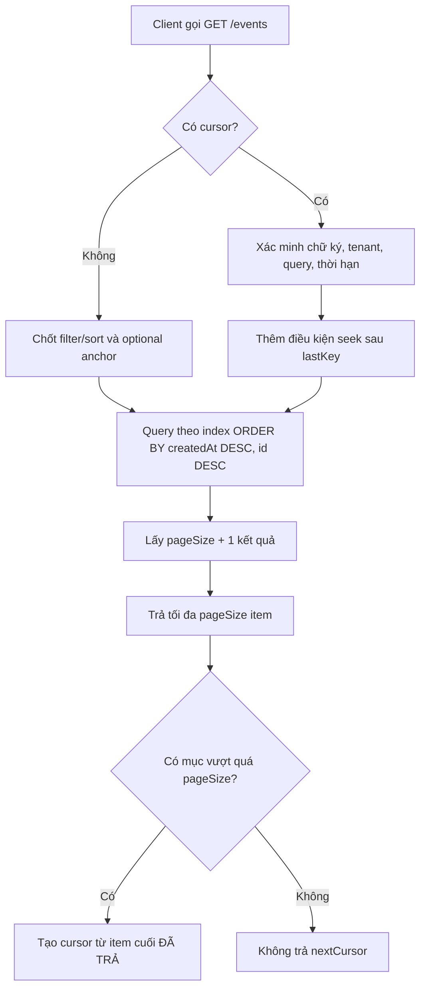

# Phân trang ổn định khi dữ liệu đang được thêm hoặc sửa

## 1. Phân trang không chỉ là chia danh sách thành nhiều trang

Trong ứng dụng dùng NoSQL, các API danh sách thường không trả toàn bộ kết quả cùng lúc. Một bảng sự kiện có thể có hàng triệu bản ghi, một feed có thể liên tục nhận bài viết mới, và một màn hình quản trị có thể có nhiều người cập nhật trạng thái trong lúc người khác đang cuộn danh sách.

Phân trang (pagination) giúp giới hạn số mục và lượng dữ liệu mỗi lần đọc. Tuy nhiên, khi dữ liệu thay đổi giữa các request, người dùng có thể gặp các vấn đề khó nhận ra:

- **Lặp bản ghi:** cùng một mục xuất hiện ở hai trang khác nhau.
- **Bỏ sót bản ghi:** một mục đủ điều kiện nhưng không xuất hiện ở trang nào.
- **Đảo thứ tự:** một mục vừa sửa nhảy từ trang sau lên trang trước.
- **Trang rỗng bất thường:** backend vẫn có continuation token nhưng kết quả sau lọc rỗng.
- **Số lượng không khớp:** tổng hiển thị ban đầu khác số mục thực đọc được.
- **Mất ngữ cảnh:** đổi bộ lọc hoặc sort nhưng dùng cursor cũ, gây kết quả khó giải thích.

**Phân trang ổn định** không phải một chế độ duy nhất của mọi NoSQL database. Đó là một **hợp đồng quan sát dữ liệu** do ứng dụng lựa chọn: ổn định về thứ tự, không lặp, không bỏ sót các mục đủ điều kiện, hay toàn bộ kết quả phải phản ánh cùng một thời điểm?

Ví dụ, ba nhu cầu sau có yêu cầu khác nhau:

| Tình huống | Hợp đồng thường mong muốn |
|---|---|
| Feed bài viết mới | Cuộn tiếp không lặp các bài cũ; có thể làm mới để xem bài mới hơn |
| Trang quản trị đơn hàng | Phân trang có bộ lọc, thứ tự rõ và không bỏ sót vì offset dịch chuyển |
| Export dữ liệu phục vụ kiểm toán | Một tập kết quả xác định, có thời điểm chốt và khả năng kiểm chứng tính đầy đủ |

Bài này thuộc chương **CRUD và truy vấn** của Database No SQL. Mục tiêu là thiết kế API và đường đọc có thể giải thích được khi có **insert, update, delete, thay đổi bộ lọc, thay đổi sort và dữ liệu phân tán**.

### Mục tiêu học tập

Sau bài học, bạn có thể:

1. Chỉ ra lỗi của phân trang dựa trên offset khi danh sách đang thay đổi.
2. Tạo **thứ tự toàn phần, xác định** bằng cặp khóa sort và khóa phân biệt duy nhất.
3. Dùng **keyset/seek pagination** với cursor để đọc tiếp từ bản ghi cuối trang trước.
4. Phân biệt **cursor vị trí**, **high-water mark**, **snapshot/PIT** và **backend paging state**.
5. Giải thích vì sao keyset đơn thuần chưa đảm bảo snapshot khi trường sort/filter bị sửa.
6. Thiết kế token cursor an toàn, gắn với tenant, quyền, filter, sort và thời hạn.
7. Áp dụng tư duy này cho MongoDB, DynamoDB, Cassandra, Redis và search engine.
8. Kiểm thử pagination dưới những lịch thao tác thêm/sửa/xóa xen kẽ.

## 2. Một ví dụ: danh sách thay đổi giữa trang một và trang hai

Giả sử hệ thống lưu một feed sự kiện, sắp **mới nhất trước** theo thời gian tạo. Mỗi trang có hai sự kiện.

Trạng thái ban đầu:

```text
Thứ tự giảm dần theo createdAt:

E5 (10:05)
E4 (10:04)
E3 (10:03)
E2 (10:02)
E1 (10:01)
```

Trang đầu lấy hai mục:

```text
Page 1 = [E5, E4]
```

Sau khi client nhận trang 1, một người khác tạo sự kiện E6 lúc 10:06:

```text
E6 (10:06)   <- mới được thêm
E5 (10:05)
E4 (10:04)
E3 (10:03)
E2 (10:02)
E1 (10:01)
```

Bây giờ người dùng yêu cầu trang 2.

### 2.1. Nếu dùng offset

Truy vấn trang 2 theo cách truyền thống:

```text
LIMIT 2 OFFSET 2
```

Trên danh sách mới, bỏ qua E6 và E5, backend trả:

```text
Page 2 = [E4, E3]
```

E4 đã xuất hiện ở trang 1. Người dùng thấy **một mục lặp**.

### 2.2. Nếu một mục phía trước bị xóa

Quay về danh sách ban đầu và trang 1 = [E5, E4]. Trước khi lấy trang 2, E5 bị xóa:

```text
E4 (10:04)
E3 (10:03)
E2 (10:02)
E1 (10:01)
```

`OFFSET 2 LIMIT 2` giờ bỏ qua E4 và E3, trả [E2, E1]. **E3 bị bỏ sót**, dù thuộc danh sách ban đầu và chưa được thấy ở trang 1.

Như vậy, offset biểu thị **vị trí đếm trong kết quả hiện tại**, không biểu thị “đã đọc đến bản ghi nào”.

### 2.3. Nếu một mục đổi vị trí vì update

Nếu sắp theo `updatedAt` và E2 được sửa sau trang 1, E2 có thể nhảy lên đầu danh sách trước khi trang 2 được đọc.

Chuyển động này gây vấn đề ngay cả khi **không có record mới được tạo**. Do đó phải phân biệt:

- **Insert mới:** thêm một mục vào tập kết quả.
- **Delete:** loại một mục khỏi tập kết quả.
- **Update payload:** sửa trường không tham gia sort/filter.
- **Update sort key:** thay đổi vị trí của mục.
- **Update filter field:** làm một mục đi vào hoặc ra khỏi tập kết quả.

Những trường hợp cuối có thể phá cảm giác ổn định của cả nhiều kiểu cursor nếu không xác định hợp đồng ngay từ đầu.

## 3. Offset pagination: dễ dùng, nhưng ổn định yếu dưới thay đổi

Offset thường được biểu diễn bằng:

```text
GET /events?limit=20&offset=40
```

Ý nghĩa: bỏ qua 40 kết quả trong **trạng thái truy vấn hiện tại**, rồi lấy tối đa 20 mục.

### 3.1. Ưu điểm

- API đơn giản, dễ hiểu cho người dùng muốn đến “trang 5”.
- Thích hợp với danh sách nhỏ hoặc dữ liệu gần như không thay đổi.
- Hữu ích cho một số màn hình quản trị có dữ liệu được khóa/chốt tại thời điểm truy vấn.
- Có thể chấp nhận khi ứng dụng không cam kết không lặp/bỏ sót.

### 3.2. Hạn chế

- Insert/delete phía trước ranh giới trang làm offset dịch chuyển.
- Khi sort key thay đổi, một record có thể di chuyển giữa các trang.
- Offset lớn có thể buộc backend đọc/bỏ qua nhiều kết quả trước khi trả một trang.
- Trong hệ phân tán, backend có thể phải truy vấn và hợp nhất dữ liệu qua nhiều shard.
- Một `COUNT(*)` hay tổng số mục tính ở thời điểm khác có thể không khớp trang thực tế.

Về trực giác, truy vấn “bỏ qua \(k\) dòng” có thể cần xử lý lượng dữ liệu tăng cùng \(k\), tùy index và query planner. Không nên tuyên bố mọi NoSQL backend đều có đúng độ phức tạp như nhau, nhưng **deep offset thường là tín hiệu cần xem lại thiết kế**.

### 3.3. Không phải lúc nào offset cũng sai

Nếu truy vấn trên **một snapshot được giữ cố định** hoặc một dataset bất biến, offset có thể cho trang xác định. Vấn đề nằm ở chỗ mỗi request phân trang đang được thực thi trên **tập dữ liệu có thể đã thay đổi** và offset không nhớ ranh giới record đã đọc.

Một ứng dụng có thể chấp nhận bất ổn đó nếu nó được diễn đạt trong contract. Nhưng không nên ghi “pagination ổn định” chỉ vì query có `ORDER BY` và `OFFSET`.

## 4. Điều kiện đầu tiên: thứ tự phải xác định và duy nhất

Giả sử có ba bài viết cùng `createdAt`:

```text
P17  createdAt = 10:00:00
P18  createdAt = 10:00:00
P19  createdAt = 10:00:00
```

Nếu chỉ sắp:

```text
ORDER BY createdAt DESC
```

thì thứ tự tương đối giữa P17, P18 và P19 có thể không được xác định. Một query có thể trả P18 trước P17, query sau có thể trả ngược lại do index, shard, cache hoặc kế hoạch thực thi.

Nếu dùng cursor chỉ chứa `createdAt = 10:00:00` và trang tiếp theo lọc `createdAt < 10:00:00`, các mục cùng timestamp chưa được đọc sẽ bị bỏ sót.

### 4.1. Thêm khóa phân biệt duy nhất (tie-breaker)

Thiết kế thứ tự giảm dần:

```text
ORDER BY createdAt DESC, id DESC
```

Cặp `(createdAt, id)` phải xác định duy nhất từng mục trong tập kết quả. Nếu `id` là duy nhất, hai record có cùng thời gian vẫn có vị trí khác nhau.

Ví dụ:

```text
(10:05, E5)
(10:04, E4)
(10:04, E3)
(10:04, E2)
(10:01, E1)
```

Giả sử trang 1 trả E5, E4. Cursor phải lưu cả `createdAt = 10:04` và `id = E4`. Trang sau lấy những mục đứng **sau cặp đó** theo cùng thứ tự.

### 4.2. “ID duy nhất” chưa đủ nếu thứ tự so sánh không cố định

Cần xác định:

- So sánh ID theo số, chuỗi byte, collation hay kiểu ObjectId?
- Timestamp có precision đến giây, millisecond hay microsecond?
- Cách xử lý `null`, missing hoặc timezone?
- Nếu sort theo chuỗi, collation có được giữ đồng nhất giữa các trang?
- Nếu sort kết hợp ASC và DESC, điều kiện “sau cursor” phải tính đúng từng chiều.
- Nếu nhiều shard, tie-breaker có duy nhất **toàn cục** trong tập kết quả không?

Ví dụ chuỗi `"9"` và `"10"` có thứ tự từ điển khác thứ tự số. Không thay đổi kiểu dữ liệu hoặc collation giữa các request mang cùng một cursor.

### 4.3. Sort key nên không thay đổi khi có thể

Đối với feed hoạt động, `createdAt` hoặc `eventSequence` do hệ thống cấp lúc tạo thường thích hợp hơn `updatedAt` nếu mục tiêu là một dòng thời gian ổn định.

Nếu API buộc sort theo điểm xếp hạng, mức độ ưu tiên hoặc `updatedAt` có thể sửa, phải xem đó là **danh sách sống**, hoặc cần snapshot/materialization để đạt bảo đảm mạnh hơn.

## 5. Keyset/seek pagination: đọc sau một khóa, không sau một vị trí

Keyset pagination không yêu cầu “bỏ qua 40 record”, mà yêu cầu:

> “Lấy các record có vị trí sắp xếp nằm sau record cuối tôi đã thấy.”

Với thứ tự giảm dần theo cặp `(createdAt, id)`, điều kiện logic là:

\[
(createdAt,\ id) < (lastCreatedAt,\ lastId)
\]

Trong đó dấu `<` dùng theo thứ tự tuple: so sánh `createdAt` trước; nếu bằng nhau thì so sánh `id`. Cú pháp tuple trực tiếp có thể khác theo từng database.

### 5.1. Chuyển thành điều kiện rõ ràng

```text
WHERE
    createdAt < lastCreatedAt
    OR (
        createdAt = lastCreatedAt
        AND id < lastId
    )
ORDER BY createdAt DESC, id DESC
LIMIT pageSize
```

Với thứ tự tăng dần, thông thường đổi điều kiện thành “lớn hơn” sau cursor. Với sort nhiều trường khác hướng, cần diễn đạt predicate lexicographic phù hợp chứ không đảo tất cả dấu một cách tùy tiện.

### 5.2. Xem lại ví dụ insert E6

Ban đầu:

```text
E5 (10:05)
E4 (10:04)  <- cursor sau trang 1
E3 (10:03)
E2 (10:02)
E1 (10:01)
```

Sau khi thêm E6 (10:06):

```text
E6 (10:06)
E5 (10:05)
E4 (10:04)
E3 (10:03)
E2 (10:02)
E1 (10:01)
```

Trang 2 dùng điều kiện `(createdAt, id) < (10:04, E4)` nên lấy **E3, E2**. E6 nằm phía trên ranh giới đã đọc và không làm E4 xuất hiện lại. Người dùng có thể nhấn **Làm mới** để xem E6.

### 5.3. Xóa E5 cũng không làm ranh giới xê dịch

Sau khi trang 1 đã trả E5 và E4, nếu E5 bị xóa, cursor vẫn là cặp khóa của **E4**, không phụ thuộc E5 còn tồn tại hay không. Trang 2 tiếp tục từ các khóa nhỏ hơn E4 và vẫn có thể trả E3, E2.

Đây là lợi ích lớn của keyset: **không phụ thuộc số lượng mục ở trước ranh giới**.

### 5.4. Điều kiện để tính chất này có ý nghĩa

Lợi ích trên đúng khi:

1. Query dùng cùng tập filter và cùng quy tắc sort.
2. Khóa cursor được lưu và giải mã đúng.
3. Thứ tự có tie-breaker xác định.
4. Sort key của record liên quan không đổi theo cách gây chuyển vị trí, hoặc ứng dụng chấp nhận hệ quả đó.
5. Database có đường index/query phù hợp để tìm vùng sau cursor.
6. Các giới hạn về consistency và thời điểm quan sát được nêu rõ.

**Keyset giúp chống dịch chuyển vị trí do insert/delete ở phía trước ranh giới; nó không tự tạo snapshot bất biến của toàn tập kết quả.**

## 6. High-water mark: chặn phần đầu của tập kết quả

Một số ứng dụng không muốn các bài mới xuất hiện lẫn trong phiên cuộn hiện tại. Có thể lấy một **mốc trên (high-water mark/anchor)** ở trang đầu và mang theo trong cursor.

Ví dụ trang đầu được mở lúc 10:05. Chọn:

```text
anchorCreatedAt = 10:05
```

Trong mọi trang tiếp theo, thêm:

```text
createdAt <= anchorCreatedAt
```

và điều kiện seek sau record cuối của trang trước.

Một cursor có thể chứa:

```json
{
  "v": 1,
  "sort": "createdAt_desc_id_desc",
  "anchor": "2026-11-14T10:05:00.000Z",
  "last": {
    "createdAt": "2026-11-14T10:03:00.000Z",
    "id": "E3"
  }
}
```

Khi E6 được tạo lúc 10:06, nó không thuộc phạm vi phiên cuộn vì nằm sau anchor.

### 6.1. Anchor bằng thời gian chưa chắc chặn mọi insert sau đó

Giả sử ứng dụng cho phép **backfill** dữ liệu cũ. Sau khi chốt anchor 10:05, một record được insert lúc 10:06 nhưng mang `createdAt = 09:30` vẫn thỏa `createdAt <= anchor`. Nó có thể xuất hiện ở trang sau dù không tồn tại lúc người dùng bắt đầu.

Nếu muốn chặn mọi record được tạo sau mốc, cần:

- Một `ingestedAt`/`committedAt` hoặc sequence được cấp theo contract phù hợp, **không thay đổi** khi sửa bản ghi.
- Hoặc một snapshot/PIT/database read timestamp có bảo đảm.
- Hoặc một manifest của tập ID tại thời điểm chốt.

Ngay cả `ingestedAt <= cutoff` cũng cần xác định timestamp được cấp lúc nào, độ phân giải, clock skew, transaction commit và consistency. Một mốc thời gian ứng dụng tự tạo không mặc nhiên là snapshot của cluster.

### 6.2. Anchor dùng cặp khóa có thể hữu ích

Thay vì chỉ lưu timestamp, có thể lưu khóa tối đa `(maxCreatedAt, maxId)` của tập khi mở trang đầu. Nó giúp chặn các mục mới có khóa **cao hơn** khóa trên đó.

Nhưng một insert về sau với khóa nằm **giữa** hai khóa cũ vẫn có thể tham gia kết quả. Do đó high-water key không đảm bảo tập kết quả cố định nếu có late insert với khóa thấp hơn.

### 6.3. High-water giúp gì và không giúp gì?

| Điều cần đạt | High-water + keyset |
|---|---|
| Không để mục mới có sort key lớn hơn anchor chen vào feed cũ | Thường đạt nếu anchor/key đúng và bất biến |
| Không lặp vì insert/delete ở đầu danh sách | Thường đạt với keyset và thứ tự ổn định |
| Không nhận record backfill sau anchor với sort key thấp hơn | **Không đảm bảo** |
| Không bị ảnh hưởng khi status/filter đổi | **Không đảm bảo** |
| Giữ nguyên payload lúc trang 1 | **Không đảm bảo** |
| Chứng minh export đúng một snapshot toàn dataset | **Không đủ** |

Mốc trên là một công cụ để định nghĩa **biên thời gian/khóa**, không phải cơ chế snapshot tổng quát.

## 7. Update trường sort: nguyên nhân gây lặp và bỏ sót ngay cả với cursor

Đây là điểm dễ bị đánh giá thấp nhất trong pagination của dữ liệu đang sửa.

Giả sử sắp theo `updatedAt DESC, id DESC`:

```text
E5 updatedAt=10:05
E4 updatedAt=10:04   <- Trang 1 đã đọc đến đây
E3 updatedAt=10:03
E2 updatedAt=10:02
E1 updatedAt=10:01
```

Cursor ở `(10:04, E4)`. Chưa đọc E3.

### 7.1. Mục chưa đọc được sửa và nhảy lên trước cursor

E3 được sửa lúc 10:06:

```text
E3 updatedAt=10:06   <- mới nhảy lên đầu
E5 updatedAt=10:05
E4 updatedAt=10:04   <- cursor
E2 updatedAt=10:02
E1 updatedAt=10:01
```

Trang sau lấy `updatedAt < 10:04`, vì vậy **E3 không xuất hiện** trong các trang sau. Nó đã vượt qua ranh giới trước khi client đọc tới.

### 7.2. Mục đã đọc được sửa và nhảy ra sau cursor

Nếu E5 đã xuất hiện ở trang 1 nhưng được sửa để có sort key nhỏ hơn `10:04` (ví dụ một job chỉnh thời điểm xếp hạng hoặc thay giá trị priority), nó có thể xuất hiện lại trong các trang sau. Kết quả là **bị lặp**.

Với `updatedAt` thông thường chỉ tăng theo thời gian, kịch bản một mục đã đọc nhảy ra sau cursor ít xảy ra hơn, nhưng một mục chưa đọc tăng `updatedAt` vẫn có thể bị bỏ sót. Với score/priority có thể tăng giảm, cả hai hướng đều đáng lo.

### 7.3. Giải pháp theo nhu cầu

- **Feed thời gian:** dùng khóa sort bất biến, ví dụ thời điểm tạo được cố định, thay vì `updatedAt`.
- **Danh sách thao tác:** chấp nhận cập nhật thời gian thực nhưng UI không cam kết exactly-once; cung cấp nút làm mới.
- **Màn hình cần kết quả cố định:** dùng snapshot/PIT hoặc materialize danh sách ID tại một thời điểm.
- **Export/audit:** cần cơ chế tạo kết quả nhất quán, checkpoint và phát hiện thay đổi theo contract.
- **Bộ lọc theo trạng thái cập nhật liên tục:** cân nhắc chốt tập ID hoặc kết hợp cơ chế thay đổi/sync thay vì tin keyset thuần.

**Không thể vá vấn đề bằng cách thêm `id` vào cursor nếu trường sort chính vẫn được phép thay đổi.** Tie-breaker giải quyết trùng khóa sort, không làm khóa sort chính bất biến.

## 8. Update trường filter: thay đổi tư cách tham gia danh sách

Giả sử query lấy đơn hàng:

```text
status = "PENDING"
ORDER BY createdAt DESC, id DESC
```

Trang 1 trả O5, O4. Trước khi lấy trang 2:

- O3 từ `PENDING` chuyển thành `PAID`.
- O2 từ `PAID` chuyển thành `PENDING`.
- O1 giữ nguyên.

Trang sau có thể không còn O3 và có thể xuất hiện O2, tùy vị trí khóa của O2 so với cursor. Keyset vẫn dùng đúng thứ tự nhưng **tập mục đủ điều kiện đã thay đổi**.

Một số lựa chọn:

1. **Danh sách sống (live list):** định nghĩa rằng mỗi trang đọc trạng thái hiện tại và có thể thiếu/thêm mục do status đổi.
2. **Membership snapshot:** chốt ID những đơn hàng `PENDING` tại thời điểm mở danh sách.
3. **Versioned state/time-travel:** truy vấn trạng thái tại một thời điểm nếu database có khả năng phù hợp.
4. **Event log:** nếu mục tiêu là liệt kê mọi lần chuyển trạng thái, chuyển từ query các order hiện tại sang sự kiện bất biến `OrderStatusChanged`.

Khả năng “phân trang không lặp” của keyset không đồng nghĩa “phân trang giữ nguyên tập membership và giá trị của từng record”.

## 9. Bốn mức cam kết của một API phân trang

Để tránh nói mơ hồ “ổn định”, hãy chọn một trong các hợp đồng hoặc định nghĩa chính sách tương đương.

| Mức | Mục tiêu | Công cụ thường dùng | Giới hạn |
|---|---|---|---|
| **A — Best effort live** | Mỗi trang phản ánh dữ liệu hiện tại gần thời điểm query | Offset hoặc cursor đơn giản | Có thể lặp/bỏ sót khi dữ liệu thay đổi |
| **B — Stable ordering** | Không phụ thuộc dịch chuyển vị trí của những mục ở đầu danh sách | Keyset + unique tie-breaker + sort bất biến | Filter/payload/backfill vẫn có thể thay đổi |
| **C — Bounded session** | Không đưa dữ liệu sau mốc cao vào phiên cuộn | Keyset + high-water mark | Không đảm bảo snapshot với late insert/update |
| **D — Snapshot-consistent** | Các trang đại diện một trạng thái dữ liệu tại cùng một mốc | Snapshot/PIT, read timestamp, materialized ID set có contract | Tốn tài nguyên; có TTL/giới hạn; auth vẫn cần kiểm tra |

Không phải database nào cũng hỗ trợ mức D cho một query dài nhiều phút. Nếu không có khả năng, cần diễn đạt mức đảm bảo yếu hơn hoặc chuyển kiến trúc sang job tạo kết quả bất biến.

### 9.1. Snapshot còn cần xác định phạm vi

Snapshot-consistent của **một collection/table/index** chưa chắc là snapshot nhất quán của **nhiều service**. Nếu một trang hiển thị order kèm trạng thái thanh toán ở service khác, đọc order từ snapshot không tự đóng băng trạng thái thanh toán.

Một “snapshot” cũng có thể chỉ bảo vệ tập ID mà không lưu payload. Nếu payload được fetch ở thời điểm sau, giá trị có thể đã đổi hoặc record đã bị xóa. Hãy nói rõ snapshot giữ **membership, thứ tự, nội dung hay tất cả**.

### 9.2. Snapshot về dữ liệu không thay thế kiểm tra quyền

Nếu user bị thu hồi quyền sau khi bắt đầu phiên phân trang, API không nên tiếp tục trả dữ liệu nhạy cảm chỉ vì snapshot cũ còn chứa bản ghi và cursor vẫn hợp lệ. **Authorization phải được đánh giá theo chính sách hiện hành**, hoặc hệ thống phải có quy tắc rõ và an toàn cho phiên truy vấn đang chạy.

## 10. Thiết kế cursor token cho API

Một API nên giữ token continuation **opaque** đối với client: client gửi lại nguyên token, không cần hiểu timestamp, ID hay paging state của database.

### 10.1. Ví dụ giao diện API

Trang đầu:

```http
GET /v1/events?tenantId=t17&limit=3&sort=createdAt_desc
```

Phản hồi:

```json
{
  "items": [
    { "id": "E9", "createdAt": "2026-11-14T10:09:00Z" },
    { "id": "E8", "createdAt": "2026-11-14T10:08:00Z" },
    { "id": "E7", "createdAt": "2026-11-14T10:07:00Z" }
  ],
  "nextCursor": "<opaque-token>",
  "hasMore": true
}
```

Trang tiếp:

```http
GET /v1/events?tenantId=t17&limit=3&sort=createdAt_desc&cursor=<opaque-token>
```

Không yêu cầu client tăng một `offset` hoặc tự chọn `createdAt`. Token chứa thông tin đã được server xác minh.

### 10.2. Cursor payload phía server

Có thể bao gồm:

```json
{
  "cursorVersion": 1,
  "resource": "events",
  "tenantId": "t17",
  "sort": "createdAt_desc_id_desc",
  "filterHash": "hash-of-canonical-filters",
  "pageSize": 3,
  "anchor": {
    "createdAt": "2026-11-14T10:09:00Z",
    "id": "E9"
  },
  "last": {
    "createdAt": "2026-11-14T10:07:00Z",
    "id": "E7"
  },
  "issuedAt": "2026-11-14T10:10:00Z",
  "expiresAt": "2026-11-14T10:25:00Z"
}
```

Đây là **mẫu nội dung logic**, không phải token gửi thẳng cho client. Trong hệ thống thật, server nên mã hóa/đóng gói và **ký hoặc xác thực tính toàn vẹn** token, hoặc lưu state ở server và chỉ trao một ID không thể đoán.

### 10.3. Tại sao Base64 không phải bảo vệ token?

Base64 chỉ **mã hóa biểu diễn**, không đảm bảo tính toàn vẹn hoặc bí mật. Nếu server tin một chuỗi JSON Base64 do client tự sửa, client có thể:

- Thay `tenantId` để truy vấn dữ liệu người khác.
- Thay `limit` để gửi query quá lớn.
- Thay `last` thành khóa tùy ý gây deep scan.
- Thay filter/sort mà server không kiểm soát.
- Dùng token đã hết hạn hoặc thuộc một user khác.

Một thiết kế phổ biến:

```text
canonical_payload = serialize_canonical(cursorState)
mac = HMAC_SHA256(secret, canonical_payload)
token = BASE64URL(canonical_payload) + "." + BASE64URL(mac)
```

Server kiểm tra MAC bằng so sánh phù hợp, kiểm tra `expiresAt`, resource, tenant, sort, filter, quyền, input size và version token trước khi tạo query. Nếu cursor chứa thông tin nhạy cảm cần **bí mật**, không chỉ chống sửa, phải mã hóa hoặc dùng state server-side thay vì để payload có thể giải mã bởi client.

**Cấm dùng giá trị tenant từ cursor để vượt qua tenant đã xác thực trong session.** Server phải đối chiếu với principal/authorization hiện hành.

### 10.4. Ràng buộc cursor với query và user

Một cursor trang 2 của `status=PENDING` không nên được dùng với `status=PAID`. Có thể:

- Lưu toàn bộ filter/sort đã canonicalize trong token.
- Hoặc lưu hash và so với query hiện tại.
- Hoặc không cho client gửi lại filter/sort khi có cursor; server dùng state đã chốt.

Cần tính cả filter ngầm như tenant, quyền truy cập, điều kiện dữ liệu bị xóa và cấu hình sort. Với query phụ thuộc phạm vi quyền, token nên có chính sách invalidation khi role/quyền thay đổi.

### 10.5. Tuổi thọ token

Cursor có thể hết hiệu lực do:

- Snapshot/PIT bị đóng hoặc hết hạn.
- Schema/index hoặc format sort thay đổi.
- Token version đã ngừng được hỗ trợ.
- Tập dữ liệu retention đã xóa các mục cần đọc.
- Principal mất quyền truy cập.
- Người dùng để danh sách mở quá lâu.

API nên trả lỗi có ý nghĩa như `INVALID_CURSOR`, `CURSOR_EXPIRED` hoặc `QUERY_CHANGED` và hướng dẫn **bắt đầu lại từ trang đầu**, thay vì âm thầm đổi sang offset hoặc cố đoán vị trí mới.

## 11. Thiết kế trang đầu và trang tiếp với keyset

Với danh sách mới nhất trước, sơ đồ logic:



### 11.1. Vì sao lấy `pageSize + 1`?

Nếu request muốn 20 mục, server có thể lấy tối đa 21 mục để biết **có ứng viên tiếp theo** hay không.

- Nếu nhận 21 mục: trả 20, `hasMore=true`.
- Nếu nhận ít hơn hoặc bằng 20: không có mục sau trong **kết quả truy vấn của request đó**, nên không cần cursor tiếp.
- Cursor mới phải lấy từ **mục thứ 20 đã trả**, không lấy từ mục thứ 21 được đọc trước.

Nếu tạo cursor từ mục thứ 21 chưa trả, client sẽ **bỏ sót mục đó** ở trang sau.

### 11.2. Khi backend tự lọc và trả trang rỗng

Một số API thực hiện giới hạn theo số item đã đánh giá trước khi áp dụng filter. Nó có thể trả:

```json
{
  "items": [],
  "backendContinuationToken": "still-present"
}
```

Điều này không có nghĩa hết dữ liệu. Phải tiếp tục theo token cho đến khi đủ số item theo policy hoặc backend báo hết. Tuy nhiên, cần **giới hạn tổng số request/bytes/thời gian** mỗi API call để tránh scan vô hạn và báo trạng thái có thể tiếp tục.

Không áp quy tắc `pageSize+1` máy móc lên backend có semantics phân trang trước filter mà không xét API thực tế.

### 11.3. Trang cuối có thể thay đổi theo thời gian

`hasMore=false` chỉ có nghĩa **không còn kết quả theo ranh giới và trạng thái đọc tại thời điểm đó**. Với một live feed, dữ liệu mới có thể xuất hiện sau khi client đã xem hết. Nếu muốn nhận thay đổi mới, thiết kế thêm refresh/new-items endpoint hoặc subscription/event stream.

## 12. Ví dụ MongoDB: seek pagination theo `createdAt` và `_id`

Giả sử collection `events` chứa:

```json
{
  "_id": "<ObjectId>",
  "tenantId": "t17",
  "createdAt": "2026-11-14T10:05:00Z",
  "type": "ORDER_CREATED",
  "payload": {
    "orderId": "O-101"
  }
}
```

Giả định:

- `createdAt` là giá trị BSON Date do writer có kiểm soát gán lúc tạo và **không thay đổi**.
- `_id` duy nhất và có thứ tự so sánh xác định trong query.
- Client muốn dữ liệu theo `tenantId`, mới nhất trước.
- `type` và `payload` có thể được sửa theo yêu cầu ứng dụng, nhưng **không ảnh hưởng sort/filter** trong ví dụ này.

### 12.1. Index phục vụ thứ tự

```javascript
db.events.createIndex({
  tenantId: 1,
  createdAt: -1,
  _id: -1
});
```

Index này phù hợp với một kiểu query đã định. Cần đo `explain()`, kích thước collection, phân bố tenant và read workload trên dữ liệu thật; index không đảm bảo mọi query khác đều nhanh.

### 12.2. Trang đầu

```javascript
const pageSize = 3;
const cutoff = new Date();

const firstPage = await db.collection("events")
  .find({
    tenantId: "t17",
    createdAt: { $lte: cutoff }
  })
  .sort({ createdAt: -1, _id: -1 })
  .limit(pageSize + 1)
  .toArray();
```

`cutoff` ở đây là **high-water thời gian ứng dụng**, không phải transaction snapshot của MongoDB. Nó không ngăn backfill với `createdAt` cũ hơn cutoff hoặc thay đổi các field khác. Trong ứng dụng thật cần thống nhất nguồn thời gian và validation.

### 12.3. Trang kế tiếp

Giả sử item cuối **đã trả** có:

```text
lastCreatedAt = 2026-11-14T10:03:00Z
lastId = ObjectId("...")
```

Điều kiện:

```javascript
const nextPage = await db.collection("events")
  .find({
    tenantId: "t17",
    $and: [
      { createdAt: { $lte: cutoff } },
      {
        $or: [
          { createdAt: { $lt: lastCreatedAt } },
          {
            createdAt: lastCreatedAt,
            _id: { $lt: lastId }
          }
        ]
      }
    ]
  })
  .sort({ createdAt: -1, _id: -1 })
  .limit(pageSize + 1)
  .toArray();
```

Một record khác có cùng timestamp nhưng `_id` nhỏ hơn vẫn được đọc. Không dùng mỗi `createdAt < lastCreatedAt` vì có thể bỏ sót các mục cùng thời gian.

### 12.4. Hàm Node.js minh họa

Ví dụ mã bên dưới tập trung vào **truy vấn và nội dung cursor trước khi ký**:

```javascript
import { ObjectId } from "mongodb";

export async function fetchEventPage(
  collection,
  tenantId,
  requestedLimit,
  cursorState = null
) {
  const pageSize = Math.min(
    100,
    Math.max(1, Number(requestedLimit) || 20)
  );

  // Giá trị cursorState chỉ được truyền vào sau khi server
  // đã xác minh HMAC/chữ ký, quyền, query và thời hạn.
  const cutoff = cursorState
    ? new Date(cursorState.cutoff)
    : new Date();

  const filters = [
    { tenantId },
    { createdAt: { $lte: cutoff } }
  ];

  if (cursorState) {
    const lastCreatedAt = new Date(cursorState.last.createdAt);
    const lastId = new ObjectId(cursorState.last.id);

    filters.push({
      $or: [
        { createdAt: { $lt: lastCreatedAt } },
        {
          createdAt: lastCreatedAt,
          _id: { $lt: lastId }
        }
      ]
    });
  }

  const fetched = await collection
    .find({ $and: filters })
    .sort({ createdAt: -1, _id: -1 })
    .limit(pageSize + 1)
    .toArray();

  const hasMore = fetched.length > pageSize;
  const items = fetched.slice(0, pageSize);
  const last = items[items.length - 1];

  const nextCursorState = hasMore && last
    ? {
        cursorVersion: 1,
        tenantId,
        cutoff: cutoff.toISOString(),
        sort: "createdAt_desc_id_desc",
        pageSize,
        last: {
          createdAt: last.createdAt.toISOString(),
          id: last._id.toHexString()
        }
      }
    : null;

  return {
    items,
    hasMore,
    nextCursorState
  };
}
```

**Cần bổ sung trước khi dùng production:**

- Giải mã và xác minh cursor token có integrity, gắn với tenant/principal và filter/sort.
- Kiểm tra `requestedLimit` là số nguyên hữu hạn, nằm trong giới hạn và phù hợp với token; không chỉ dựa vào ép kiểu `Number(...)`.
- Kiểm tra ngày trong token hợp lệ và ObjectId đúng format.
- Xử lý timeout, rate limit, index và read concern theo yêu cầu.
- Không trả raw document chứa trường nhạy cảm; ánh xạ sang response DTO đã được phân quyền.
- Nếu cần snapshot tuyệt đối, mô hình này **chưa đủ**, phải sử dụng cơ chế snapshot/materialization riêng.
- Nếu dữ liệu có thể bị backfill hoặc chỉnh `createdAt`, tính chất “ổn định” bị suy yếu.

### 12.5. Đừng nhầm ObjectId với đồng hồ toàn cục

MongoDB ObjectId có thành phần liên quan đến thời điểm tạo, nhưng không nên coi `_id` là timestamp commit hoặc thứ tự tuyệt đối của mọi insert xuyên process/shard. Trong ví dụ, `_id` chỉ đóng vai trò **tie-breaker duy nhất** và giá trị có phép so sánh xác định.

Nếu ứng dụng cần một thứ tự sự kiện toàn cục chính xác, phải có một nguồn sequence/ordering được thiết kế với các bảo đảm tương ứng, không suy ra từ việc các ObjectId nhìn có vẻ tăng dần.

## 13. DynamoDB: `LastEvaluatedKey` và continuation theo khóa

Amazon DynamoDB dùng mô hình item với partition key/sort key. Query trong một partition có thể đi theo sort key; API cung cấp `LastEvaluatedKey` để tiếp tục đọc bằng `ExclusiveStartKey`.

### 13.1. Thiết kế key cho feed của một tenant

Ví dụ:

```text
PK = TENANT#t17
SK = 2026-11-14T10:05:00.000Z#E5

PK = TENANT#t17
SK = 2026-11-14T10:04:00.000Z#E4

PK = TENANT#t17
SK = 2026-11-14T10:03:00.000Z#E3
```

Nếu phần thời gian của sort key được chuẩn hóa theo UTC và độ dài/precision thống nhất, so sánh chuỗi theo định dạng cố định có thể tương ứng với thứ tự thời gian cho trường hợp đã thiết kế. Hậu tố event ID dùng phân biệt các sự kiện cùng timestamp.

Phải xác định giá trị SK là **bất biến** nếu dùng để điều hướng phân trang. Nếu sửa SK, về mặt mô hình khóa item có thể phải tạo một item khác rồi xóa item cũ.

### 13.2. Query và đọc trang tiếp

Ví dụ request ở dạng JSON mô tả API:

```json
{
  "TableName": "TenantEvents",
  "KeyConditionExpression": "PK = :pk",
  "ExpressionAttributeValues": {
    ":pk": {
      "S": "TENANT#t17"
    }
  },
  "ScanIndexForward": false,
  "Limit": 50
}
```

Nếu response có `LastEvaluatedKey`, request tiếp sử dụng **chính key đó** làm `ExclusiveStartKey` và giữ nguyên ý nghĩa của query:

```json
{
  "TableName": "TenantEvents",
  "KeyConditionExpression": "PK = :pk",
  "ExpressionAttributeValues": {
    ":pk": {
      "S": "TENANT#t17"
    }
  },
  "ScanIndexForward": false,
  "Limit": 50,
  "ExclusiveStartKey": {
    "PK": { "S": "TENANT#t17" },
    "SK": { "S": "2026-11-14T10:03:00.000Z#E3" }
  }
}
```

Đây là ví dụ **khóa giả định** chứ không phải một kết quả thật được DynamoDB trả về. Client phải bảo toàn hình dạng key thực tế do API cung cấp, nhất là khi query chạy trên index.

### 13.3. Những điều `LastEvaluatedKey` không đảm bảo

- **Không phải snapshot:** các item có thể được thêm/sửa/xóa giữa các lần Query.
- `LastEvaluatedKey` cho biết có vị trí tiếp tục; nó **không cam kết** trang tiếp sẽ có item phù hợp với filter.
- DynamoDB có giới hạn dữ liệu được xử lý theo mỗi Query page (ví dụ ranh giới 1 MB theo đặc tả API), nên số mục có thể ít hơn `Limit`.
- `FilterExpression` được áp dụng sau khi đọc/đánh giá các item theo key condition. Vì thế response có thể trả **`Items=[]` nhưng vẫn có `LastEvaluatedKey`**.
- Một query qua GSI có các semantics nhất quán đọc khác query trên base table; không tự mặc định đọc mạnh cho GSI.
- `ConsistentRead` nếu được hỗ trợ ở đường đọc tương ứng **không tự tạo một snapshot nhiều request**.

Vì vậy loop đúng phải dựa vào **continuation key**, không dựa vào “số item trang này ít hơn pageSize” để kết luận đã hết.

### 13.4. Khi filter nằm ngoài key

Ví dụ các item trong partition được sắp theo SK, nhưng API chỉ muốn `status = PENDING`. Nếu status thay đổi trong lúc phân trang, membership biến động giống mục 8. Nếu filter loại phần lớn item, query có thể phải đọc nhiều page nội bộ trước khi gom đủ N kết quả.

Cần cân nhắc:

- Đưa access pattern quan trọng vào thiết kế key hoặc index phù hợp.
- Giới hạn số request/đơn vị capacity khi scan theo filter.
- Định nghĩa rõ có chấp nhận thay đổi membership không.
- Chốt snapshot/manifest nếu nghiệp vụ cần export một tập cố định.

## 14. Cassandra: paging state không đồng nghĩa snapshot

Cassandra và driver CQL hỗ trợ paging thông qua **paging state**. Driver có thể tự fetch các trang của một kết quả hoặc trả token cho client tiếp tục, tùy API.

Ví dụ một bảng thiết kế cho thứ tự trong partition:

```sql
CREATE TABLE events_by_tenant_day (
    tenant_id  text,
    bucket_day date,
    created_at timestamp,
    event_id   uuid,
    event_type text,
    payload    text,
    PRIMARY KEY (
        (tenant_id, bucket_day),
        created_at,
        event_id
    )
) WITH CLUSTERING ORDER BY (
    created_at DESC,
    event_id DESC
);
```

Query minh họa:

```sql
SELECT created_at, event_id, event_type
FROM events_by_tenant_day
WHERE tenant_id = 't17'
  AND bucket_day = '2026-11-14';
```

Driver có thể lấy trang đầu theo kích thước fetch được đặt, rồi dùng paging state để tiếp tục. Nhưng:

- Paging state là **token opaque**; không nên tự sửa hoặc đoán nội dung của nó.
- Token liên hệ với query, tham số và ngữ cảnh phân trang; phải bảo vệ nếu cho client lưu/gửi lại.
- Phân trang qua nhiều request có thể thấy dữ liệu đã thay đổi; **paging state không có nghĩa Cassandra đã cố định snapshot ban đầu**.
- Consistency level của mỗi query không thay thế transaction snapshot nhiều trang.
- Partition key và clustering quyết định thứ tự và phạm vi đọc. Muốn đọc qua nhiều ngày/bucket, client còn phải quản lý vị trí ở **nhiều partition**.
- Khi có TTL, tombstone hoặc compaction, khả năng quan sát dữ liệu thay đổi trong quá trình duyệt phải được xem theo model của Cassandra.

Không giả định một paging state có thể dùng vô thời hạn hoặc chuyển sang câu query/filter khác. Hãy đọc tài liệu driver và phiên bản Cassandra đang dùng để biết cách lưu/khôi phục token và các giới hạn.

### 14.1. Truy vấn qua nhiều bucket thời gian

Nếu bảng chia theo ngày, user muốn “50 sự kiện mới nhất trong 30 ngày”:

1. Bắt đầu từ bucket ngày mới nhất.
2. Đọc từng partition theo clustering order.
3. Khi bucket không đủ 50, tiếp tục bucket trước.
4. Cursor ứng dụng cần nhớ bucket hiện tại, vị trí trong bucket và các điều kiện phạm vi thời gian.
5. Nếu có nhiều shard/partition đọc song song, cần một bước merge theo **thứ tự toàn cục xác định**.

Cursor của một partition không tự giải quyết được bài toán hợp nhất nhiều partition.

## 15. Redis SCAN và sorted set: hai nhu cầu khác nhau

### 15.1. `SCAN` dùng để duyệt keyspace, không phải feed snapshot

Redis `SCAN` trả cursor để duyệt dần không gian key. Nhưng mục tiêu chính của nó là **incremental iteration** với semantics riêng; không phải API “mỗi record một lần theo thứ tự duy nhất”.

Những đặc điểm cần lưu ý:

- Một vòng scan có thể trả cùng key **nhiều lần**; client phải xử lý trùng nếu yêu cầu.
- Một lệnh có thể trả **0 kết quả** nhưng cursor vẫn chưa về kết thúc.
- Số phần tử trả về trên từng lần không luôn bằng `COUNT` mong muốn.
- Khi key được thêm/xóa trong lúc scan, tập được nhìn thấy có giới hạn bảo đảm theo tài liệu, **không phải snapshot**.
- Trong Redis Cluster, việc duyệt toàn keyspace cần hiểu phạm vi node/slot và client.

Vì vậy, không nên dùng `SCAN` như cơ chế phân trang UI ổn định của danh sách bài viết hoặc đơn hàng. Nó thích hợp hơn cho công việc duyệt/maintenance khi chấp nhận semantics của scan và có xử lý retry/duplicate.

### 15.2. Sorted set cho một danh sách có thứ tự

Redis sorted set có thể tổ chức một tập phần tử theo score. Ví dụ:

```text
ZADD feed:t17 1731578700 E5
ZADD feed:t17 1731578640 E4
ZADD feed:t17 1731578580 E3
```

Đọc theo khoảng score thay vì theo offset có thể giúp không bị trượt vị trí khi phần tử mới được chèn với score cao hơn cursor.

Nhưng cần thiết kế:

- Score có thể **trùng**; khi đó cần quy tắc phân biệt/member ordering được API hỗ trợ.
- Score dạng số có giới hạn precision; đừng coi mọi timestamp lớn hoặc số sequence tùy ý đều biểu diễn chính xác bằng floating point.
- Nếu score của member bị cập nhật, vị trí thay đổi.
- Nếu member bị xóa, snapshot membership biến động.
- Nếu dữ liệu payload nằm ở key khác, một phép đọc sorted set không tự đóng băng payload.
- Redis Cluster và multi-key reads có ràng buộc hash slot/transaction riêng.

Một sorted set **có sắp thứ tự** không mặc nhiên tạo snapshot nhiều request. Cần lựa chọn cấu trúc key/score/member và quy tắc đọc phù hợp.

## 16. Search engine: `search_after` và Point in Time

Các search engine như Elasticsearch/OpenSearch thường hỗ trợ cursor theo sort key, ví dụ cơ chế `search_after`. Trong trường hợp index tiếp tục nhận tài liệu mới hoặc được refresh/merge, cùng một query qua nhiều request có thể quan sát các trạng thái index khác nhau.

Một cơ chế **Point in Time (PIT)**, khi được engine/version hỗ trợ, giúp gắn các request phân trang với **một khung nhìn index được giữ trong một thời hạn**.

Ý tưởng:

```text
Open PIT for query scope
Query page 1 with sort fields + unique tie-breaker
Use last hit's sort values as search_after
Query page 2 with same PIT and search_after
...
Close PIT / let it expire
```

Điều cần hiểu:

- `search_after` dựa trên **giá trị sort của hit cuối**, không phải offset.
- Sort cần xác định, có tie-breaker đúng.
- PIT có thời hạn/keep-alive và có thể tốn tài nguyên duy trì khung nhìn.
- Cursor và PIT ID/token cần được bảo vệ, gắn với query và quyền.
- Không giữ PIT vô hạn chỉ vì user mở tab trong nhiều giờ.
- PIT chỉ đóng băng khung nhìn **index trong phạm vi nó hỗ trợ**, không tự đóng băng trạng thái ở DB nguồn hoặc dịch vụ phân quyền.

Với export lớn, search/index engine có thể cung cấp API riêng để quét dữ liệu hiệu quả. Chọn API theo công việc và đọc tài liệu version; không dùng deep offset chỉ vì dễ triển khai ban đầu.

## 17. Khi cần phân trang thật sự nhất quán theo snapshot

Với mục tiêu như “xuất tất cả đơn hàng ở trạng thái PENDING tại đúng 10:00”, high-water + keyset không đủ nếu status có thể thay đổi hoặc event được backfill.

Có các hướng thiết kế:

### 17.1. Snapshot/read timestamp của database

Nếu database hỗ trợ một snapshot view nhất quán trong phạm vi và thời gian cần thiết, các trang có thể đọc cùng view. Cần kiểm tra:

- Snapshot áp dụng cho một query, transaction, collection hay toàn cluster?
- Có thể giữ view qua nhiều request HTTP hay không?
- Thời hạn và chi phí lưu version/snapshot?
- Điều kiện hết hạn hoặc restart?
- Isolation và consistency của mỗi lần đọc?
- Có bảo vệ được filter membership và payload theo yêu cầu không?

Không giả định mọi transaction nhiều câu lệnh đều cho snapshot kéo dài qua nhiều HTTP requests. Giữ transaction mở trong thời gian người dùng cuộn có thể rất tốn tài nguyên hoặc không được hỗ trợ.

### 17.2. Materialize tập ID tại một thời điểm

Một service tạo danh sách ID cố định:

```json
{
  "resultSetId": "RSET-991",
  "createdAt": "2026-11-14T10:00:00Z",
  "filter": {
    "tenantId": "t17",
    "status": "PENDING"
  },
  "orderedIds": ["O5", "O4", "O3", "O2", "O1"]
}
```

Các request lấy trang bằng cách đi tiếp trong danh sách ID đã chốt.

Ưu điểm:

- Membership và thứ tự ID có thể được cố định nếu job tạo danh sách dưới nguồn đọc nhất quán phù hợp.
- Không cần giữ transaction đọc dài trong suốt phiên UI.
- Có thể resume, chia nhỏ export và lưu kết quả tạm theo TTL.

Đánh đổi:

- Phải lưu một danh sách có thể rất lớn.
- Tốn thời gian tạo trước khi trả trang đầu.
- Nếu chỉ chốt ID mà fetch payload “live”, nội dung có thể đổi/xóa giữa các trang.
- Phải bảo vệ `resultSetId`, tenant, auth, retention và xóa kết quả tạm.
- Nếu **lúc tạo ID set** không có snapshot nhất quán, danh sách ấy chỉ bất biến sau khi tạo, chưa chắc đại diện một thời điểm đúng.

### 17.3. Kết quả export bất biến

Đối với báo cáo/kiểm toán, có thể tạo một export artifact được đánh dấu:

```text
exportJobId = EXP-20261114-01
filterSnapshot = {...}
sourceRecoveryPoint = ...
schemaVersion = ...
recordCount = ...
checksum = ...
objectUri = ...
expiration = ...
```

Client tải/chia phần từ artifact đã hoàn tất, thay vì phân trang live trực tiếp trên DB. Cần xác định cách tạo consistent read và cách xử lý lệnh xóa/thu hồi dữ liệu sau khi export nếu file còn được lưu.

### 17.4. Khi dữ liệu phân tán qua nhiều shard

Một cursor đơn `lastCreatedAt, lastId` có thể áp dụng cho query toàn cục nếu backend cho phép sort và seek thống nhất. Nhưng nếu ứng dụng tự query từng shard, cursor có thể phải chứa:

- Vị trí đã đọc của từng shard.
- Một mốc snapshot/watermark đủ nhất quán nếu cần.
- Sort key toàn cục và quy tắc merge.
- Phiên bản shard routing/topology khi cần.
- Cơ chế deduplication và xử lý failure/retry.

Không thể đơn giản ghép trang đầu từ mỗi shard rồi tăng offset chung mà không kiểm chứng thứ tự và trạng thái. Đối với yêu cầu exactly-once/full coverage, có thể cân nhắc stream CDC với checkpoint hoặc snapshot export thay vì UI paging.

## 18. Phân trang UI khác duyệt dữ liệu để xử lý nền

Một API feed cho người dùng và một job quét để tính tiền/đồng bộ thường cần hợp đồng khác nhau.

### 18.1. UI feed

Mục tiêu:

- Mỗi request nhanh, có giới hạn.
- Thứ tự dễ giải thích.
- Không lặp do record mới chèn ở đầu.
- Có thể refresh để xem nội dung mới.
- Cursor hết hạn sau một thời gian ngắn.

Keyset + immutable sort key thường là lựa chọn tốt nếu không yêu cầu snapshot membership.

### 18.2. Batch export

Mục tiêu:

- Có **toàn bộ** tập record theo điều kiện đã định.
- Có thể resume sau lỗi.
- Có checksum/count và chứng cứ.
- Không bỏ sót do update filter/sort.
- Đáp ứng chính sách quyền và retention.

Thường cần snapshot/materialization hoặc chiến lược scan và change capture có mốc rõ. Một cursor keyset trên dữ liệu live chưa chứng minh completeness.

### 18.3. CDC/event consumption

Nếu mục tiêu là “xử lý mọi thay đổi sau lần trước”, không nên chỉ quét bảng hiện tại theo `updatedAt` vì:

- Record có thể bị xóa trước khi worker đến.
- Timestamp có thể trùng hoặc không theo thứ tự commit toàn cục.
- Một record bị sửa nhiều lần giữa hai lượt quét chỉ còn trạng thái cuối.
- Lỗi mạng có thể xảy ra sau khi side effect đã chạy.

CDC/change stream/event log với resume token/checkpoint và consumer idempotency thường phù hợp hơn, nếu nguồn hỗ trợ và retention đủ. **Resume token của CDC** không đồng nghĩa cursor phân trang UI; nó tham chiếu luồng thay đổi chứ không phải vị trí trong danh sách hiện tại.

## 19. Tổng số kết quả, số trang và `hasMore`

### 19.1. Tổng có thể không khớp

Khi trang 1 trả:

```json
{
  "total": 501,
  "items": ["..."]
}
```

đến trang 5, có thể 20 record mới được thêm và 13 record bị xóa. `total=501` là số liệu ở một mốc trước đó, không phải cam kết tuyệt đối còn 501 mục.

Nếu product cần hiển thị tổng:

- Có thể ghi `totalAtQueryTime` và mốc đo.
- Có thể hiển thị **ước lượng** và nhãn tương ứng.
- Có thể bỏ tổng chính xác, chỉ dùng `hasMore`.
- Có thể dùng snapshot/materialized result nếu cần tổng nhất quán với các trang.

### 19.2. `hasMore` không đảm bảo mọi trang tương lai có dữ liệu

Với live data, ngay cả khi trang này có thêm ứng viên, trước khi client gọi trang sau các ứng viên ấy có thể bị xóa hoặc lọc ra. Có thể nhận trang rỗng sau cursor; API cần xử lý bình thường và không để UI lặp vô hạn.

### 19.3. Page size và rate limit

Một cursor có thể bị lạm dụng để yêu cầu size rất lớn. Cần:

- Giới hạn `pageSize` tối thiểu/tối đa.
- Giới hạn bytes kết quả và timeout query.
- Giới hạn số lần quét backend nếu cần gom kết quả qua filter.
- Rate limit theo tenant/user.
- Điều chỉnh index/query nếu page quá lớn.
- Token hết hạn và cơ chế hủy snapshot/PIT.

## 20. Truy vấn ngược và nút “Trang trước”

Keyset đọc tiến rất tự nhiên, nhưng “quay lại trang trước” có hai cách triển khai khác nhau:

1. **Client giữ cache/history:** giữ các trang đã xem và cursor trước đó, quay lại không cần query mới.
2. **Bidirectional seek:** server tạo cursor định hướng ngược bằng khóa đầu trang hiện tại; query đảo điều kiện và hướng sort phù hợp, rồi đảo thứ tự kết quả trả về.

Ví dụ danh sách được hiển thị giảm dần. Để lấy các mục đứng **trước** một khóa, cần điều kiện khóa lớn hơn và có thể query theo ASC để lấy các mục gần nhất, sau đó đảo về DESC trước khi trả.

Không chỉ thay `<` thành `>` rồi vẫn giữ mọi tham số không đổi mà không kiểm tra ranh giới. Nếu dữ liệu thay đổi, nút “trang trước” thực hiện query live có thể không trả đúng chính xác trang cũ mà người dùng đã xem. UI history cache thường tạo trải nghiệm dễ dự đoán hơn.

## 21. Kiểm thử phân trang khi dữ liệu thay đổi

Một test tuần tự qua dataset bất biến chỉ kiểm tra phép chia trang cơ bản. Để chứng minh contract, phải chủ động xen insert/update/delete.

### 21.1. Ma trận tình huống

| Tình huống | Với offset | Với keyset + sort bất biến | Với snapshot đúng phạm vi |
|---|---|---|---|
| Insert mới ở đầu sau trang 1 | Có thể lặp mục | Thường không làm lặp vì ranh giới khóa | Không xuất hiện trong snapshot |
| Delete mục ở đầu sau trang 1 | Có thể bỏ sót | Thường không dịch ranh giới | Mục vẫn theo snapshot nếu view giữ nội dung |
| Nhiều mục cùng timestamp | Có thể đảo thứ tự nếu thiếu tie-breaker | Ổn hơn với ID tie-breaker | Vẫn cần order xác định |
| Update payload không đổi filter/sort | Có thể đọc giá trị mới | Có thể đọc giá trị mới | Theo snapshot đọc value |
| Update sort key | Có thể lặp/bỏ sót | Vẫn có thể lặp/bỏ sót | Sort theo snapshot không đổi |
| Update filter membership | Có thể vào/ra tập | Vẫn có thể vào/ra tập | Membership cố định theo snapshot |
| Late backfill với timestamp cũ | Có thể chen vào vị trí giữa | Có thể xuất hiện ở trang sau | Không xuất hiện nếu insert sau snapshot |
| Xóa/thu hồi quyền | Có nguy cơ hiển thị stale | Phải kiểm tra auth | Phải kiểm tra auth hiện hành |
| Cursor token bị sửa | Không áp dụng | Phải từ chối | Phải từ chối |
| Cursor hết hạn | Không áp dụng | Phải có chính sách | Phải đóng/hết hạn view |

“Thường” trong bảng không phải bảo đảm nếu các điều kiện thiết kế khác không được thỏa.

### 21.2. Một test case cụ thể

Tạo tập:

```text
A(10:05, id=5)
B(10:04, id=4)
C(10:03, id=3)
D(10:02, id=2)
E(10:01, id=1)
```

Thực hiện:

1. Lấy trang 1 với pageSize = 2, nhận A và B.
2. Thêm X(10:06, id=6).
3. Lấy trang 2.
4. Xóa A.
5. Lấy trang 3.
6. So sánh chuỗi ID đã trả và ranh giới cursor.

Với keyset theo `createdAt DESC, id DESC` bất biến, trang 2 dự kiến C, D, trang 3 dự kiến E nếu các mục còn lại không đổi filter hoặc sort. X không xen vào phiên cuộn cũ khi query dùng khóa nhỏ hơn B. Kịch bản này minh họa tính chất ổn định khi insert/delete **phía trước** ranh giới.

### 21.3. Test update sort và filter riêng

Tiếp tục thử:

- Sau trang 1, sửa `updatedAt` của C thành lớn hơn A.
- Sau trang 1, sửa sort score của A xuống dưới B.
- Sau trang 1, đổi status của D từ không hợp lệ sang hợp lệ.
- Dùng cursor tạo với filter `status=PENDING` cho request `status=PAID`.
- Tạo 100 record có cùng timestamp và tie-breaker khác nhau.

Mục tiêu không phải ép keyset đạt snapshot, mà là kiểm chứng **kết quả đúng theo hợp đồng đã công bố**.

### 21.4. Test lỗi và tính bảo mật

- Cursor bị sửa một byte phải bị từ chối.
- Cursor tenant T17 không dùng được cho tenant T21.
- Cursor quá hạn phải có lỗi rõ ràng.
- Cursor đã dùng sau khi thay sort/index/schema phải được xử lý theo version policy.
- Client không thể tăng limit vượt quota bằng cách sửa token.
- Nếu user bị thu hồi quyền, cursor cũ không cho truy cập dữ liệu cấm.
- Có thể resume khi một request mạng bị timeout mà không phải đoán offset.
- Với backend paging state opaque, token phải gắn với query và được bảo vệ khỏi lộ/sửa.
- Nếu page rỗng nhưng backend có continuation, server không trả nhầm “đã hết” ngay.

### 21.5. Đo hiệu năng với dữ liệu lớn

Các chỉ số hữu ích:

- p50/p95/p99 latency theo trang đầu, trang giữa, deep cursor.
- Số item backend phải đánh giá để trả N item.
- Read I/O, consumed capacity, số shard được truy cập.
- Số request nội bộ khi filter thưa.
- Kích thước và thời gian sống của cursor/snapshot.
- Số cursor bị hết hạn hoặc bị từ chối do query mismatch.
- Tỷ lệ duplicate/skipped nếu có thể kiểm chứng bằng test snapshot/manifest.
- Số lần user phải refresh vì dữ liệu live thay đổi.
- CPU/IO và bộ nhớ do PIT/snapshot hoặc result materialization.

Không tuyên bố “cursor nhanh hơn offset” cho mọi query mà chưa xem index, phân bố khóa và độ sâu truy vấn thực tế.

## 22. Các sai lầm thường gặp

| Sai lầm | Hậu quả | Cách sửa |
|---|---|---|
| Sắp theo timestamp nhưng không có unique tie-breaker | Bỏ sót mục cùng timestamp, thứ tự không xác định | Sắp theo `(timestamp, uniqueId)` |
| Dùng offset cho feed nhận insert liên tục | Lặp hoặc bỏ sót khi vị trí dịch | Keyset cho đường cuộn tiếp |
| Dùng cursor chỉ chứa timestamp | Mất mục cùng timestamp | Cursor gồm đủ khóa sort |
| Cho rằng keyset tương đương snapshot | Bỏ sót khi sort/filter update, backfill | Chọn contract hoặc dùng snapshot/PIT |
| Dùng `updatedAt` cho feed yêu cầu ổn định | Item nhảy qua ranh giới | Khóa bất biến hoặc snapshot |
| Chỉ giữ `createdAt <= now` và gọi là snapshot | Late insert với timestamp cũ vẫn vào | Dùng mốc commit/snapshot nếu cần |
| Đổi filter nhưng tái sử dụng cursor | Trang không còn nghĩa | Gắn token với canonical query |
| Dùng Base64 JSON không ký | Client sửa tenant/limit/position | HMAC/chữ ký hoặc state server-side |
| Cursor từ item thứ `pageSize+1` | Bỏ qua một item chưa trả | Cursor từ item cuối **đã trả** |
| Coi trang rỗng là hết dù còn continuation | Bỏ sót dữ liệu sau filter | Tôn trọng token backend |
| Tin `LastEvaluatedKey` là snapshot | Đọc kết quả thay đổi theo thời gian | Hiểu semantics và chọn snapshot khi cần |
| Dùng Redis `SCAN` cho pagination UI ổn định | Trùng/mất key, không có order | Dùng cấu trúc có index/sort phù hợp |
| Giữ transaction mở suốt phiên người dùng cuộn | Tốn tài nguyên, timeout/lock | Materialize hoặc snapshot TTL ngắn |
| Đếm tổng ở thời điểm khác rồi cam kết đúng số trang | Tổng và nội dung lệch nhau | Gắn timestamp hoặc không cam kết total chính xác |
| Không kiểm soát auth khi resume | Lộ dữ liệu khi quyền thay đổi | Kiểm tra quyền hiện hành |
| Dùng ObjectId làm đồng hồ commit toàn cục | Sắp thứ tự nghiệp vụ sai | Có trường thời gian/sequence với contract rõ |
| Dùng cùng cursor sau khi đổi index/schema | Sai thứ tự hoặc token không hợp lệ | Cursor version và invalidation policy |
| Batch job duyệt dữ liệu live mà đòi exactly-once | Bỏ sót khi record bị xóa/sửa | Snapshot/CDC và idempotent processing |

## 23. Bài tập vận dụng

### Bài tập 1 — Lỗi offset khi insert

Danh sách ban đầu:

```text
E5, E4, E3, E2, E1
```

Page size = 2, trang 1 = [E5, E4]. Sau đó E6 được thêm đầu danh sách.

**Yêu cầu:** xác định trang 2 của `OFFSET 2 LIMIT 2` và giải thích lỗi. Sau đó viết điều kiện keyset cho sort `createdAt DESC, id DESC`.

**Gợi ý:** offset trả [E4, E3], gây lặp E4. Keyset dùng cặp khóa của E4 và lấy các cặp nhỏ hơn nó.

### Bài tập 2 — Timestamp trùng

Một collection có:

```text
P3: createdAt=10:00, id=3
P2: createdAt=10:00, id=2
P1: createdAt=10:00, id=1
```

Trang 1 trả P3, page size = 1.

**Câu hỏi:** nếu cursor chỉ có `createdAt=10:00` thì trang 2 gặp vấn đề gì? Viết điều kiện để trả P2.

**Gợi ý:** phải giữ (`10:00`, `3`); trang 2 lọc timestamp thấp hơn **hoặc cùng timestamp nhưng ID nhỏ hơn 3**.

### Bài tập 3 — Sort key bị thay đổi

Feed sort theo `updatedAt DESC`, trang 1 trả A và B. C chưa đọc bị cập nhật và có `updatedAt` mới hơn A.

**Yêu cầu:** mô tả điều gì xảy ra với C khi trang 2 dùng cursor sau B. Hãy đưa ra hai giải pháp với hai mức bảo đảm khác nhau.

**Gợi ý:** C có thể bị bỏ qua vì nhảy lên trước cursor. Nếu UX chỉ cần feed theo thời điểm tạo, chuyển sang `createdAt` bất biến; nếu cần tập dữ liệu chốt, dùng snapshot/materialized result.

### Bài tập 4 — High-water và backfill

Client mở feed lúc 10:05, token có `createdAt <= 10:05`. Lúc 10:06, worker import một record mới nhưng `createdAt = 09:30`.

**Câu hỏi:** record mới có thể xuất hiện trong trang sau không? Vì sao chỉ giữ cutoff không tạo snapshot?

**Gợi ý:** có, vì nó thỏa cutoff và có thể nằm sau cursor. Nếu cần membership chốt, dùng read snapshot/commit watermark có contract hoặc danh sách ID được materialize từ nguồn nhất quán.

### Bài tập 5 — DynamoDB có trang rỗng

Một Query DynamoDB có `Limit = 50` và filter `status = PENDING`. Backend trả `Items = []` nhưng `LastEvaluatedKey` không rỗng.

**Yêu cầu:** giải thích vì sao không được coi đó là kết thúc. Thiết kế cách API gom đủ tối đa 20 mục hợp lệ nhưng giới hạn chi phí.

**Gợi ý:** `Limit`/ranh giới dữ liệu được đánh giá trước filter; cần tiếp tục bằng `ExclusiveStartKey`, dừng khi có đủ kết quả, không còn token hoặc chạm ngân sách request/bytes/thời gian. Nếu dừng sớm vì ngân sách, trả continuation để client tiếp tục.

### Bài tập 6 — An toàn của cursor

Cursor chứa `tenantId`, `status`, `lastId` và `pageSize`, được mã hóa Base64 nhưng không ký.

**Câu hỏi:** attacker có thể làm gì? Cần bảo vệ token và request thế nào?

**Gợi ý:** không tin client-controlled payload. Dùng HMAC/chữ ký hoặc state server-side, binding với principal/tenant/filter/sort, kiểm tra expiry, size và quyền hiện hành. Mã hóa payload nếu cần bí mật; Base64 không phải encryption.

### Bài tập 7 — Thiết kế export nhất quán

Hệ thống cần xuất mọi đơn hàng `status=PAID` tại thời điểm 12:00. Trong khi xuất, người dùng có thể tạo, sửa và hủy đơn.

**Yêu cầu:** vì sao keyset theo `createdAt` chưa đủ? Đề xuất cơ chế snapshot/PIT hoặc materialization và các bước kiểm chứng.

**Gợi ý:** status/payload có thể đổi; keyset chỉ giữ ranh giới theo thứ tự. Cần nguồn snapshot đúng phạm vi, cố định query membership/nội dung theo contract, kiểm chứng count/checksum và quản lý quyền/retention của artifact.

### Bài tập 8 — UI và background job

Cùng một collection cần hỗ trợ:

- Trang feed cuộn vô hạn cho người dùng.
- Job tính lại thống kê của **mọi record đã từng thay đổi**.
- Export 10 triệu record với tập kết quả chốt.

**Yêu cầu:** chọn giữa keyset live, change stream/CDC và snapshot/materialized export cho từng mục đích. Giải thích trade-off latency, tính đầy đủ, retry và chi phí.

**Gợi ý:** feed ưu tiên trải nghiệm và request nhỏ; thay đổi cần event log có checkpoint/idempotency; export cần tập kết quả được chốt hoặc cơ chế snapshot có thể kiểm chứng.

## 24. Quy trình thiết kế pagination có thể dùng lại

Khi tạo một endpoint phân trang NoSQL, hãy quyết định theo thứ tự:

1. **Viết hợp đồng:** “live feed”, “không lặp vì insert đầu danh sách”, hay “snapshot tại thời điểm X”?
2. **Liệt kê thao tác thay đổi:** insert mới, delete, update sort key, update filter, backfill, TTL.
3. **Chọn khóa sort:** ưu tiên bất biến nếu không cần ranking động.
4. **Bổ sung unique tie-breaker:** xác định thứ tự cho mọi mục, kể cả timestamp trùng.
5. **Chọn phân trang:** keyset/seek cho cuộn theo thứ tự, offset chỉ khi chấp nhận trade-off.
6. **Xác định phạm vi chốt:** có cần high-water, snapshot/PIT, read timestamp hoặc result materialization?
7. **Thiết kế access path:** partition/shard/index/compound key hỗ trợ filter, sort và seek.
8. **Thiết kế token:** ký hoặc lưu state, version, expiry, query binding, tenant và authorization.
9. **Viết điều kiện sau cursor:** đúng thứ tự và xử lý ties; không bỏ qua item chưa trả.
10. **Hiểu backend continuation:** ranh giới dữ liệu, filter, trang rỗng, token opaque, 1 MB/page hoặc giới hạn sản phẩm.
11. **Chọn page size và ngân sách đọc:** limit, timeout, rate limit, scan fan-out.
12. **Kiểm thử tương tranh:** thêm, sửa, xóa và thay đổi quyền giữa các trang.
13. **Thiết kế UX làm mới:** xử lý new-items, cursor expired và danh sách đã thay đổi.
14. **Đo và quan sát:** latency, item evaluated, cursor lỗi, tỷ lệ trang rỗng, snapshot resource.
15. **Cập nhật contract khi thay schema/index:** không ngầm dùng cursor cũ với quy tắc sort mới.

## 25. Tài liệu tham khảo theo sản phẩm

Khi triển khai, cần đối chiếu với **phiên bản database, driver và mode đọc** đang dùng:

- [MongoDB Manual](https://www.mongodb.com/docs/manual/) — sort, compound index, `find`, `skip`, `limit`, read concern và query semantics.
- [MongoDB Node.js Driver](https://www.mongodb.com/docs/drivers/node/current/) — cursor, `ObjectId`, query và serialization.
- [Amazon DynamoDB Developer Guide](https://docs.aws.amazon.com/amazondynamodb/latest/developerguide/Query.Pagination.html) — `LastEvaluatedKey`, `ExclusiveStartKey`, `Limit`, `FilterExpression` và Query pagination.
- [Apache Cassandra Documentation](https://cassandra.apache.org/doc/latest/) — CQL clustering, partition keys, pagination và consistency.
- [DataStax Java Driver Manual](https://docs.datastax.com/en/developer/java-driver/latest/) — CQL paging state, fetch size và driver semantics theo phiên bản.
- [Redis Documentation](https://redis.io/docs/latest/) — `SCAN`, sorted sets, keyspace iteration và cluster.
- [Elasticsearch Reference](https://www.elastic.co/guide/en/elasticsearch/reference/current/paginate-search-results.html) — `search_after`, Point in Time và phân trang kết quả tìm kiếm.
- [OpenSearch Documentation](https://docs.opensearch.org/latest/search-plugins/searching-data/paginate/) — pagination, `search_after`, PIT và các giới hạn tương ứng.

Các nguồn này giải thích khả năng và giới hạn của từng hệ. Không nên suy rằng một “cursor” trong DynamoDB, Cassandra, Redis và search engine mang cùng lời hứa về snapshot, thứ tự hoặc khả năng tiếp tục sau khi dữ liệu thay đổi.

## 26. Kết luận

**Phân trang ổn định bắt đầu từ việc xác định “ổn định” nghĩa là gì đối với người dùng và nghiệp vụ.** Offset chỉ nhớ vị trí trong danh sách hiện tại nên dễ gây lặp hoặc bỏ sót khi mục mới được thêm hay mục cũ bị xóa. Keyset/seek pagination nhớ **khóa sắp xếp của bản ghi cuối đã trả**, đặc biệt hiệu quả khi thứ tự có tie-breaker duy nhất và sort key bất biến.

Tuy vậy, keyset không tự cố định snapshot. Khi sort/filter thay đổi, khi bản ghi được backfill hoặc khi dữ liệu phân phối trên nhiều shard, một cursor thuần có thể vẫn thấy tập kết quả biến động. High-water giúp giới hạn vùng khóa; snapshot/PIT hoặc tập ID được materialize mới đáp ứng những cam kết mạnh hơn nếu được tạo từ nguồn nhất quán đúng phạm vi.

Với mỗi API, hãy đặt câu hỏi: **“Sau khi trang đầu được trả, nếu người khác thêm, sửa hoặc xóa dữ liệu, những mục nào vẫn phải xuất hiện đúng một lần, những mục nào được phép thay đổi, và cơ chế nào thực sự bảo đảm điều đó?”** Trả lời rõ câu hỏi ấy sẽ giúp thiết kế pagination dễ hiểu, hiệu quả và đáng tin cậy trong hệ NoSQL đang hoạt động liên tục.

