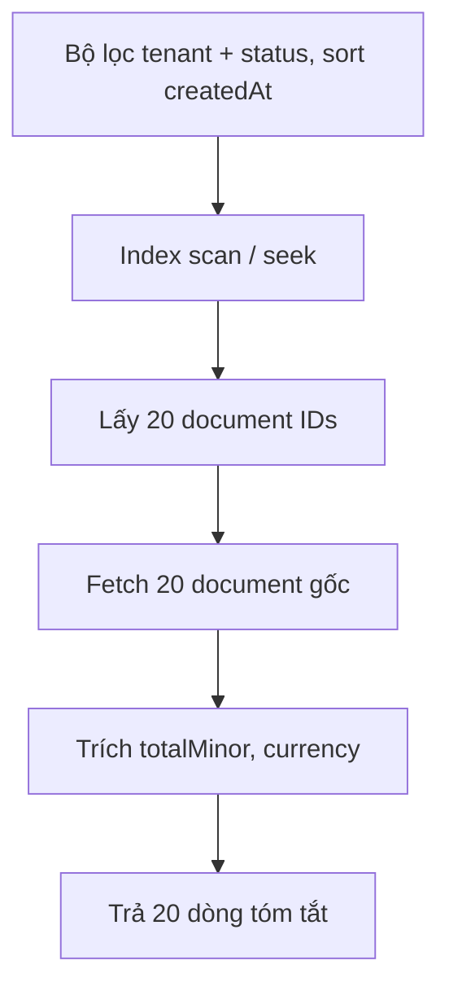
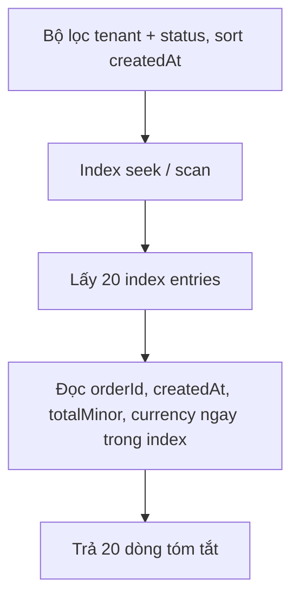
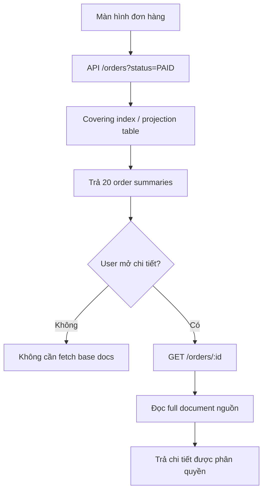
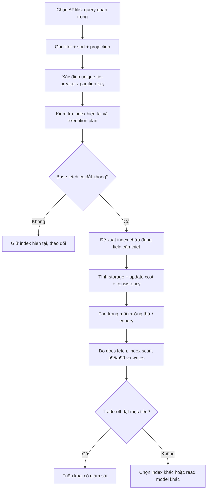

# Covering/projection index và giảm truy cập dữ liệu gốc

## 1. Vì sao một truy vấn có index vẫn có thể chậm?

Trong một ứng dụng NoSQL, không ít truy vấn danh sách chỉ cần vài trường rất nhỏ nhưng database lại phải truy cập từng document hoặc item đầy đủ để lấy kết quả.

Giả sử collection `orders` có các document chứa 40–60 trường: thông tin khách hàng, địa chỉ, dòng hàng, lịch sử trạng thái, ưu đãi, thông tin vận chuyển và metadata. Màn hình **đơn hàng gần đây** chỉ cần:

- `orderId`;
- `createdAt`;
- `totalMinor`;
- `currency`.

Truy vấn lọc đơn theo tenant và trạng thái `PAID`, sắp thời gian mới nhất trước, trả 20 mục.

Nếu index chỉ chứa `tenantId`, `status` và `createdAt`, database có thể tìm nhanh **ID của 20 đơn hàng**, nhưng vẫn phải mở 20 document gốc để lấy tổng tiền và đơn vị tiền. Khi tập dữ liệu lớn hoặc các document nằm rải rác trên nhiều page/ổ đĩa, bước đọc bổ sung này có thể chiếm đáng kể độ trễ.

**Covering index** giải quyết đúng một phần của vấn đề: thiết kế nội dung index sao cho **mọi trường cần cho một truy vấn cụ thể đều có thể được cung cấp từ index**, nhờ đó tránh bước lấy bản ghi gốc (*base-record fetch*, *document fetch* hay *table lookup*) trong kế hoạch thực thi phù hợp.

Điểm quan trọng là **“covering” mô tả mối quan hệ giữa một index và một truy vấn**, không phải nhãn vĩnh viễn của một index. Index có thể covering đối với màn hình danh sách nhưng không covering đối với màn hình chi tiết.

### Mục tiêu học tập

Sau bài học, bạn có thể:

1. Phân biệt **truy vấn dùng index** với **truy vấn được index bao phủ**.
2. Phân biệt **query projection**, **index projection** và **read model/denormalized projection**.
3. Xác định các trường cần có trong index cho filter, sort, cursor và kết quả.
4. Nhận diện hai bước **index scan → base fetch** và cách giảm đọc dữ liệu gốc.
5. Hiểu ví dụ thực tế trên MongoDB, DynamoDB và Couchbase, đồng thời biết giới hạn so sánh với Cassandra và các kho khác.
6. Ước lượng trade-off giữa giảm read amplification và tăng storage/write amplification.
7. Kiểm tra execution plan và benchmark bằng dữ liệu đại diện.
8. Thiết kế index phù hợp khi có nhiều tenant, phân trang, quyền truy cập, TTL và dữ liệu cập nhật liên tục.

## 2. Ba khái niệm “projection” rất dễ bị nhầm

### 2.1. Query projection: các trường trả về cho client

Ví dụ MongoDB:

```javascript
db.orders.find(
  { tenantId: "t17", status: "PAID" },
  {
    _id: 1,
    createdAt: 1,
    totalMinor: 1,
    currency: 1
  }
);
```

Projection ở đây quy định **response chứa những trường nào**.

Nó **không tự chứng minh** database chỉ đọc bấy nhiêu trường từ storage. Nếu các trường đó không nằm trong index đang dùng, query có thể vẫn cần lấy document gốc rồi mới bỏ những trường không trả về.

**Giảm payload gửi qua mạng** và **tránh fetch document gốc** là hai lợi ích khác nhau.

### 2.2. Index projection: các thuộc tính được lưu trong index

Một số sản phẩm cho khai báo rõ những thuộc tính nào được đưa vào một index, bên cạnh index key. Ví dụ DynamoDB dùng các chế độ projection cho secondary index:

- `KEYS_ONLY`;
- `INCLUDE`;
- `ALL`.

Một index `INCLUDE` có thể chứa thêm `totalMinor`, `currency` để query trả các giá trị ấy mà không cần dựa vào bản ghi chính.

Ở sản phẩm khác, không có cú pháp `INCLUDE` tương đương nhưng ta có thể đưa thêm trường vào **compound index key**; khi đó index cũng chứa đủ giá trị để phục vụ một query nhất định.

### 2.3. Projection/read model: một bản biểu diễn dữ liệu phục vụ truy vấn

Trong hệ NoSQL theo query, có thể duy trì:

```text
orders_by_id
  -> Document đầy đủ của đơn hàng

paid_orders_by_tenant_day
  -> Các trường tóm tắt được tổ chức để đọc danh sách
```

Bảng/collection `paid_orders_by_tenant_day` là **bản sao dữ liệu ứng dụng phục vụ đường truy vấn** (*read model*), có thể được cập nhật bằng transaction, đồng bộ sự kiện hoặc một quy trình riêng. Nó không nhất thiết là “secondary index” do database tự quản lý.

### 2.4. So sánh ngắn

| Khái niệm | Đơn vị được cấu hình | Lợi ích | Câu hỏi cần lưu ý |
|---|---|---|---|
| **Query projection** | Câu truy vấn | Response ít trường hơn | Database có phải đọc document gốc không? |
| **Index projection / included fields** | Định nghĩa index | Index mang thêm thuộc tính trả kết quả | Tốn thêm dung lượng và chi phí cập nhật bao nhiêu? |
| **Covering query** | Quan hệ giữa query và index/plan | Không cần fetch base record theo kế hoạch phù hợp | Tất cả filter, sort, return có thật sự được đáp ứng từ index? |
| **Read model/denormalized table** | Thiết kế lưu trữ ứng dụng | Một đường đọc chuyên dụng, có thể tránh join/read gốc | Đồng bộ và consistency giữa các bản sao thế nào? |

Không nên chỉ nhìn chữ “projection” trong API rồi kết luận hệ đã thực hiện index-only read.

## 3. Mô hình hai giai đoạn: tìm vị trí rồi lấy document

Giả sử index nhỏ:

```text
Index ix_orders_status_time

(tenantId, status, createdAt, orderId)
             |
             v
       document identifier
             |
             v
     Document đầy đủ
     { totalMinor, currency, lines, address, ... }
```

Query:

```text
WHERE tenantId = t17
  AND status = PAID
ORDER BY createdAt DESC
LIMIT 20

RETURN orderId, createdAt, totalMinor, currency
```

### 3.1. Index scan + base fetch

Kế hoạch khái niệm:



Index giúp giảm phạm vi tìm kiếm nhưng các thuộc tính cần trả không có trong index. Database có thể phải thực hiện thêm các truy xuất ngẫu nhiên hoặc xử lý dữ liệu tại base table/document store.

Tùy sản phẩm và mức cache nóng, chi phí này có thể là I/O đĩa, đọc page cache, truy vấn đến node khác hoặc các bước truy cập storage nội bộ. Không nên giả định “20 fetch = đúng 20 lần đọc đĩa vật lý”; cơ chế cache và layout có thể gộp/giảm số I/O.

### 3.2. Covering index

Index rộng hơn:

```text
Index ix_orders_list_cover

(tenantId, status, createdAt, orderId, totalMinor, currency)
```

Kế hoạch khái niệm:



Nếu index chứa đủ các trường và query planner chọn kế hoạch thực sự được bao phủ, bước **fetch base document** có thể bị loại bỏ.

Không phải mọi giá trị thêm vào index đều hữu ích như nhau. Một trường JSON lớn, dễ thay đổi, hoặc ít khi được trả về có thể khiến index phình to trong khi lợi ích đọc không tương xứng.

## 4. Công thức trực giác về chi phí đọc

Một mô hình đơn giản:

\[
L_{\text{query with fetch}}
\approx
L_{\text{index seek}}
+
L_{\text{scan}}
+
L_{\text{base fetch}}
+
L_{\text{compute}}
\]

Khi query được bao phủ:

\[
L_{\text{covered query}}
\approx
L_{\text{index seek}}
+
L_{\text{scan}}
+
L_{\text{compute}}
\]

Trong đó:

- \(L_{\text{index seek}}\): chi phí tìm vùng index ban đầu;
- \(L_{\text{scan}}\): chi phí đọc các index entries và lọc theo điều kiện có thể đánh giá tại index;
- \(L_{\text{base fetch}}\): chi phí lấy bản ghi gốc;
- \(L_{\text{compute}}\): xử lý kết quả, sort còn lại, serialize và networking.

Đây chỉ là **mô hình suy nghĩ**, không phải đẳng thức latency chung. Các bước có thể chạy song song, cache có thể làm fetch rất rẻ, hoặc index lớn hơn khiến scan/index cache kém hiệu quả.

### 4.1. Ví dụ số liệu giả định

Giả sử một document đơn hàng trung bình khoảng **4 KB** ở dạng lưu logic, trong khi entry của index covering khoảng **200 byte**. Một trang có 20 đơn.

Một ước lượng byte để hình dung:

| Thành phần | Phép tính | Kết quả lý thuyết |
|---|---|---:|
| Payload của 20 document đầy đủ | \(20 \times 4.096\) B | 81.920 B |
| Payload của 20 index entries | \(20 \times 200\) B | 4.000 B |
| Tỷ lệ kích thước minh họa | \(81.920 / 4.000\) | ~20,5 lần |

**Không được đọc bảng này thành “index covering nhanh hơn 20,5 lần”.** Kích thước entry, page layout, compression, caching, I/O, query planner, selectivity và response size đều khác nhau. Một index-only query có thể vẫn cần đọc nhiều entry để loại ứng viên, và các bản ghi gốc có thể đã nằm trong RAM.

Bảng chỉ cho thấy vì sao tránh truy cập những document lớn **có thể** mang lại lợi ích rõ khi đường đọc chỉ cần vài trường.

### 4.2. Điểm đo đúng là execution plan và latency thực

Cần đo:

- Số index keys/entries được duyệt.
- Số document hoặc base rows được fetch.
- Số record trả về.
- Bytes đọc ở các lớp storage nếu có metric.
- CPU, memory, network và độ trễ p50/p95/p99.
- Độ sâu pagination.
- Cache nóng/lạnh và tải ghi đồng thời.

Chỉ có “query có dùng index” không đủ chứng minh cải thiện như mong muốn.

## 5. Điều kiện để một index bao phủ một truy vấn

Một query có thể cần nhiều loại trường:

1. **Định vị:** filter equality/range, ví dụ `tenantId`, `status`, khoảng thời gian.
2. **Thứ tự:** sort và tie-breaker, ví dụ `createdAt DESC, orderId DESC`.
3. **Ranh giới phân trang:** last key/continuation, thường trùng các trường sort.
4. **Kết quả trả về:** `orderId`, `createdAt`, `totalMinor`, `currency`.
5. **Filter bổ sung:** các biểu thức khác mà query planner có thể cần đánh giá.
6. **Trường bắt buộc ngầm:** document ID, shard/partition key hoặc metadata theo sản phẩm.
7. **Biểu thức tính toán:** có thể thực hiện từ các giá trị trong index hay phải đọc document gốc?

Để **thật sự không fetch base record**, planner phải có đủ thông tin cần thiết tại nguồn index, trong giới hạn tính năng hỗ trợ.

### 5.1. “Có đủ trường” là điều kiện cần, chưa luôn là điều kiện đủ

Một số trường hợp có thể ngăn index-only plan:

- Query dùng phép biến đổi hoặc biểu thức không hỗ trợ đánh giá từ index.
- Collation, type comparison hoặc null/missing semantics không phù hợp.
- Index multikey/array gặp giới hạn coverage.
- Filter dùng thuộc tính không được lưu trong index.
- Query yêu cầu cả document gốc, dù response sau đó lại rút gọn.
- Planner chọn đường khác vì thống kê hoặc độ chọn lọc.
- Kiến trúc sharded cần thêm shard key hoặc metadata đặc biệt.
- Một tính năng truy vấn/transaction/read concern có ngữ nghĩa riêng.

Phải quan sát kế hoạch thực thi thực tế, không suy chỉ từ tên field.

### 5.2. Covering luôn tương đối với query

Ví dụ cùng index:

```text
(tenantId, status, createdAt, orderId, totalMinor, currency)
```

Có thể cover query:

```text
WHERE tenantId = t17 AND status = PAID
ORDER BY createdAt DESC, orderId DESC
RETURN orderId, createdAt, totalMinor, currency
```

Nhưng không cover query:

```text
WHERE tenantId = t17 AND status = PAID
RETURN orderId, shippingAddress
```

vì `shippingAddress` không có trong index. Việc index cover màn hình danh sách không buộc phải cover trang chi tiết; trang chi tiết thường chấp nhận đọc document gốc theo ID.

## 6. Chọn thứ tự của compound index

Một index ghép không phải chỉ là tập hợp field vô thứ tự. **Thứ tự field ảnh hưởng khả năng seek, lọc theo prefix và cung cấp sort**.

Ví dụ workload:

```text
GET /orders?tenant=t17&status=PAID&sort=createdAt_desc
```

Index ứng viên:

```text
(tenantId ASC, status ASC, createdAt DESC, orderId DESC,
 totalMinor ASC, currency ASC)
```

Đặc điểm:

- `tenantId` và `status` là điều kiện bằng.
- `createdAt DESC`, `orderId DESC` phù hợp với thứ tự kết quả mong muốn.
- `orderId` là tie-breaker để phân trang khi nhiều đơn có cùng thời gian.
- `totalMinor`, `currency` được lưu thêm để phục vụ projection.
- Các field cuối có thể làm index lớn hơn dù không giúp giới hạn vùng scan.

### 6.1. Nguyên tắc equality, sort, range là điểm khởi đầu

Một gợi ý thường dùng là xem các trường equality trước, sau đó sắp xếp, sau đó điều kiện range tùy query và index access pattern. Nhưng **không áp một quy tắc cứng cho mọi database**:

- Sort theo trường cũng đang có điều kiện range có thể được index hỗ trợ.
- Một range trên field đứng trước có thể ảnh hưởng dùng các field sau để thu hẹp query.
- Query planner và index implementation của từng engine khác nhau.
- Một số hệ chỉ cho sắp xếp theo sort/clustering key bên trong một partition.
- Filter rất chọn lọc có thể làm phương án index khác hiệu quả hơn.

Hãy xuất phát từ **truy vấn cụ thể**, xem explain/plan và benchmark.

### 6.2. Index có field thừa chưa chắc tốt hơn

Nếu page danh sách chỉ trả 20 record, document gốc rất nhỏ và luôn cache nóng, index covering lớn có thể không giúp nhiều. Trong khi đó, mọi lần thay đổi `totalMinor` phải cập nhật index rộng hơn.

Vì vậy lựa chọn không phải “thêm mọi field cho chắc”, mà là **thêm đúng những field thường xuyên cần để tránh fetch đắt**.

## 7. MongoDB: xây một covered query có thể kiểm chứng

MongoDB là ví dụ rõ về việc một query được coi là covered khi toàn bộ trường cần thiết có thể được thỏa từ index và planner không phải kiểm tra document gốc theo các điều kiện áp dụng.

### 7.1. Dữ liệu mẫu

```javascript
db.orders.insertMany([
  {
    _id: "O101",
    tenantId: "t17",
    status: "PAID",
    createdAt: ISODate("2026-11-14T09:30:00Z"),
    totalMinor: 250000,
    currency: "VND",
    shippingAddress: { city: "Hà Nội" },
    items: [
      { sku: "BK-01", quantity: 2 }
    ]
  },
  {
    _id: "O102",
    tenantId: "t17",
    status: "PAID",
    createdAt: ISODate("2026-11-14T09:20:00Z"),
    totalMinor: 160000,
    currency: "VND",
    shippingAddress: { city: "Đà Nẵng" },
    items: [
      { sku: "PN-03", quantity: 1 }
    ]
  }
]);
```

Một trang danh sách chỉ cần ID, thời gian, tổng tiền và currency. Các trường `items` và `shippingAddress` không cần thiết trong response này.

### 7.2. Index chỉ cho filter/sort

```javascript
db.orders.createIndex(
  {
    tenantId: 1,
    status: 1,
    createdAt: -1,
    _id: -1
  },
  { name: "ix_orders_filter_sort" }
);
```

Query:

```javascript
db.orders.find(
  { tenantId: "t17", status: "PAID" },
  { _id: 1, createdAt: 1, totalMinor: 1, currency: 1 }
)
.sort({ createdAt: -1, _id: -1 })
.limit(20);
```

Index giúp tìm và sắp xếp theo yêu cầu, nhưng **không chứa `totalMinor` và `currency`** nên nếu dùng index này, database vẫn cần lấy dữ liệu từ document gốc để trả đầy đủ.

### 7.3. Index covering cho cùng query

Tạo index chứa cả các trường trả kết quả:

```javascript
db.orders.createIndex(
  {
    tenantId: 1,
    status: 1,
    createdAt: -1,
    _id: -1,
    totalMinor: 1,
    currency: 1
  },
  { name: "ix_orders_list_cover_v1" }
);
```

Query:

```javascript
db.orders.find(
  {
    tenantId: "t17",
    status: "PAID"
  },
  {
    _id: 1,
    createdAt: 1,
    totalMinor: 1,
    currency: 1
  }
)
.sort({ createdAt: -1, _id: -1 })
.limit(20);
```

Với những giới hạn query/index phù hợp, planner có thể lấy đủ dữ liệu từ index mà không fetch document.

**Lưu ý MongoDB:** Đây không phải một cú pháp `INCLUDE` của một secondary index như một số RDBMS. Ta đang **thêm field vào compound index key**; điều đó ảnh hưởng kích thước và thứ tự của index.

### 7.4. Kiểm tra bằng `explain("executionStats")`

```javascript
db.orders.find(
  { tenantId: "t17", status: "PAID" },
  { _id: 1, createdAt: 1, totalMinor: 1, currency: 1 }
)
.sort({ createdAt: -1, _id: -1 })
.limit(20)
.explain("executionStats");
```

Những trường nên đọc:

- `executionStats.nReturned`: số document trả về.
- `executionStats.totalKeysExamined`: số entry khóa index được duyệt.
- `executionStats.totalDocsExamined`: số document gốc được đọc/kiểm tra theo execution stats.
- `winningPlan` và các stage: đường plan được chọn; các tên stage thay đổi theo engine/version.

Trong một query thực sự covered theo MongoDB, `totalDocsExamined` thường bằng **0**. Đừng chỉ thấy `IXSCAN` rồi kết luận đã cover: plan vẫn có thể chứa `FETCH` hoặc một bước cần document gốc.

Một số phiên bản/engine có thể biểu diễn projection hoặc index scan theo stage khác nhau. Hãy dùng **các chỉ số và cấu trúc explain của phiên bản MongoDB đang chạy**, không dựa duy nhất vào một tên stage.

### 7.5. Vì sao trường `_id` quan trọng?

MongoDB mặc định thường trả `_id` nếu projection không loại bỏ nó. Nếu secondary index không chứa `_id` và query vẫn yêu cầu `_id`, điều đó có thể ngăn covered query.

Hai cách tùy use case:

- Đưa `_id` vào index khi API cần ID.
- Loại `_id` bằng projection `{ _id: 0, ... }` khi thực sự không cần.

Trong ví dụ, `_id` có trong index để trả `orderId` một cách rõ ràng. Không suy rằng mọi secondary index MongoDB đều tự chứa giá trị `_id` để trả về theo cách giúp coverage.

### 7.6. Điều kiện phức tạp có thể làm mất coverage

Các tình huống đáng chú ý:

- Index là **multikey** vì có array; khả năng cover array field và một số query operator có giới hạn riêng.
- Query `$elemMatch` hoặc yêu cầu trả array có thể không đủ điều kiện coverage trong tình huống tương ứng.
- Điều kiện so sánh `null`/missing field có giới hạn về index-only semantics.
- Một computed field hoặc projection expression có thể đòi thao tác không hỗ trợ trực tiếp từ index.
- Trong môi trường sharded, điều kiện covered query có thể liên quan **shard key** và đường truy vấn cụ thể.

Không có nghĩa “cứ có array trong collection là không thể có covered query”. Cần xét **field trong index, field được trả và operator** theo tài liệu MongoDB đúng phiên bản.

### 7.7. Index hint có phải giải pháp không?

Có thể dùng `hint` trong thử nghiệm để so sánh index:

```javascript
db.orders.find(
  { tenantId: "t17", status: "PAID" },
  { _id: 1, createdAt: 1, totalMinor: 1, currency: 1 }
)
.sort({ createdAt: -1, _id: -1 })
.hint("ix_orders_list_cover_v1")
.explain("executionStats");
```

Nhưng đừng ép `hint` trong production chỉ vì một benchmark nhỏ. Thống kê, dữ liệu, query shape hoặc version có thể thay đổi; planner có thể chọn phương án khác tốt hơn. Chỉ dùng hint khi đã chứng minh lợi ích, hiểu rủi ro và có giám sát.

## 8. DynamoDB: projection của secondary index có ý nghĩa trực tiếp

DynamoDB là một ví dụ khác: **index projection** là một phần rõ ràng của định nghĩa secondary index. Cách truy cập thuộc tính ngoài projection khác giữa **Global Secondary Index (GSI)** và **Local Secondary Index (LSI)**.

### 8.1. Bảng đơn hàng và đường truy vấn

Giả sử bảng `Orders`:

```text
Partition key: PK
Sort key:      SK

PK = TENANT#t17
SK = ORDER#O101

Attributes:
  status = PAID
  createdAt = 2026-11-14T09:30:00Z
  totalMinor = 250000
  currency = VND
  shippingAddress = ...
  items = ...
```

Màn hình cần danh sách đơn đã thanh toán mới nhất của tenant:

```text
tenantId = t17
status = PAID
ORDER BY createdAt DESC
RETURN order ID, createdAt, totalMinor, currency
```

Một GSI có thể dùng:

```text
GSI1PK = TENANT#t17#STATUS#PAID
GSI1SK = 2026-11-14T09:30:00.000Z#O101
```

**GSI key là một phần của mô hình đọc.** Nó đặt các đơn cùng tenant/trạng thái vào cùng phạm vi truy vấn, và sort key hỗ trợ thứ tự khi được mã hóa nhất quán.

### 8.2. `KEYS_ONLY`, `INCLUDE` và `ALL`

| Chế độ projection | Nội dung ở index về mặt khái niệm | Hệ quả |
|---|---|---|
| `KEYS_ONLY` | Các key bắt buộc của base table và index | Entry nhỏ; phù hợp khi chỉ cần khóa/định danh |
| `INCLUDE` | Các key bắt buộc + các non-key attributes được chỉ định | Có thể trả các trường tóm tắt từ index |
| `ALL` | Tất cả thuộc tính của item theo contract | Query index có nhiều dữ liệu; index lớn và chi phí duy trì cao hơn |

Với GSI, **không thể query GSI để yêu cầu các thuộc tính base-table không được project vào GSI**. Nếu cần thuộc tính ngoài projection, ứng dụng thường phải thực hiện `GetItem`/`BatchGetItem` bổ sung ở base table bằng các khóa thích hợp, hoặc đổi thiết kế index.

Với LSI, DynamoDB có thể fetch thuộc tính không được project từ parent table khi query yêu cầu chúng; điều này làm phát sinh chi phí đọc bổ sung. Phải xem API và capacity semantics cho đường truy vấn cụ thể.

**Đừng đồng nhất hai trường hợp GSI và LSI**: đây là khác biệt quan trọng khi bàn về “giảm truy cập dữ liệu gốc”.

### 8.3. INCLUDE cho trang danh sách

Định nghĩa GSI ở dạng mô hình:

```yaml
IndexName: OrdersByTenantStatusTime
KeySchema:
  - AttributeName: GSI1PK
    KeyType: HASH
  - AttributeName: GSI1SK
    KeyType: RANGE
Projection:
  ProjectionType: INCLUDE
  NonKeyAttributes:
    - totalMinor
    - currency
```

Đây là **trích đoạn cấu trúc mô tả**, không phải toàn bộ CloudFormation template hoặc lệnh CLI chạy độc lập. Những key cần thiết được project theo contract của DynamoDB; các non-key attribute thêm vào là `totalMinor` và `currency`.

Nếu sort key mã hóa timestamp và order ID, query trả đủ nội dung trang danh sách mà không cần đọc thêm item chính cho bốn trường đã thiết kế.

### 8.4. Query GSI minh họa

```json
{
  "TableName": "Orders",
  "IndexName": "OrdersByTenantStatusTime",
  "KeyConditionExpression": "GSI1PK = :pk",
  "ExpressionAttributeValues": {
    ":pk": {
      "S": "TENANT#t17#STATUS#PAID"
    }
  },
  "ScanIndexForward": false,
  "Limit": 20,
  "ProjectionExpression": "PK, SK, GSI1SK, totalMinor, currency"
}
```

Các trường được yêu cầu cần thực sự nằm trong index projection. Các khóa đã có trong projection theo đặc tả của index; các trường ngoài key được chỉ định trong `INCLUDE`.

Cần nhớ:

- `ProjectionExpression` chỉ chọn thuộc tính response **từ dữ liệu mà index có**; nó không phải chỉ dẫn “hãy tự đi lấy mọi field ở table gốc” khi query GSI.
- `FilterExpression` không thay thế cách chọn index key; filter được áp dụng sau khi đọc/evaluate item theo query và có thể không làm giảm read capacity tiêu thụ.
- `LastEvaluatedKey` cho phép phân trang; một page ít item do filtering không tự có nghĩa đã hết.
- DynamoDB Query/Scan có giới hạn page và cách tính capacity riêng; phải dựa vào số liệu sản phẩm.

### 8.5. Index projection ảnh hưởng consistency

GSI trong DynamoDB được duy trì theo cơ chế **eventual consistency**. Query GSI có thể chưa phản ánh một thay đổi ở base item ngay lập tức.

Ví dụ:

1. Order O101 đổi từ `PENDING` sang `PAID`.
2. Base table nhận trạng thái mới.
3. Trong một khoảng trễ, GSI theo status có thể chưa cho kết quả tương ứng.
4. Query trang danh sách qua GSI có thể không thấy ngay đơn vừa thanh toán.

**Covering GSI giảm đọc base item nhưng không tự cung cấp strong consistency.** Nếu màn hình yêu cầu thấy trạng thái vừa ghi ngay, cần cân nhắc đường đọc khác, UX xác nhận tạm thời, hoặc thiết kế consistency theo yêu cầu.

### 8.6. Sparse index và giá trị thiếu

GSI chỉ lập entry cho các item đáp ứng yêu cầu có key attributes của index. Nếu một item không có `GSI1PK` hoặc `GSI1SK` phù hợp, nó có thể không xuất hiện trong query GSI.

Đây có thể là chủ ý để tạo sparse index, nhưng cũng có thể gây **bỏ sót dữ liệu** nếu writer quên set thuộc tính index key.

Trường non-key như `currency` không được set thì projection không thể tự tạo giá trị hợp lệ. Phải xét missing/null semantics, chuẩn hóa dữ liệu và migration.

### 8.7. Tính dung lượng và write cost của index

Với mỗi GSI, cần tính:

- Số item được index.
- Độ lớn của index keys và các thuộc tính project.
- Số lần item được thêm/sửa/xóa làm GSI thay đổi.
- Dung lượng index riêng và capacity/cost.
- Mức phân bố partition keys và nguy cơ hot key.
- Replication, retention và backup của dịch vụ theo cấu hình.

Không chọn `ALL` chỉ để khỏi phân tích yêu cầu trả về: nó có thể biến index thành một bản sao lớn của phần dữ liệu nguồn.

## 9. Couchbase: covered query trong SQL++ và Global Secondary Index

Couchbase là ví dụ NoSQL khác có khái niệm **covering index** rõ trong query planner.

Giả sử các document ở collection `orders` có `tenantId`, `status`, `createdAt`, `totalMinor` và `currency`.

Index SQL++ minh họa:

```sql
CREATE INDEX ix_orders_list_cover
ON shop.sales.orders(
    tenantId,
    status,
    createdAt DESC,
    totalMinor,
    currency
);
```

Query tương ứng:

```sql
SELECT META(o).id AS orderId,
       o.createdAt,
       o.totalMinor,
       o.currency
FROM shop.sales.orders AS o
WHERE o.tenantId = "t17"
  AND o.status = "PAID"
ORDER BY o.createdAt DESC
LIMIT 20;
```

Mã minh họa dành cho môi trường Couchbase SQL++ với bucket/scope/collection thích hợp. Tên collection, tính năng, cú pháp và hành vi index planner phải kiểm tra theo phiên bản.

### 9.1. Kiểm tra `EXPLAIN`

```sql
EXPLAIN
SELECT META(o).id AS orderId,
       o.createdAt,
       o.totalMinor,
       o.currency
FROM shop.sales.orders AS o
WHERE o.tenantId = "t17"
  AND o.status = "PAID"
ORDER BY o.createdAt DESC
LIMIT 20;
```

Trong kế hoạch, cần tìm biểu hiện planner có thể lấy các field từ **index covers** và tránh thao tác **Fetch** document theo đường truy vấn đó.

Không phải cứ `IndexScan` là index-only. Query có thể scan index để tìm ID rồi vẫn fetch document, đặc biệt khi field cần trả không có trong index hoặc điều kiện/filter không được cover.

### 9.2. Phân biệt coverage và scan consistency

Một GSI covering giúp tránh base document fetch nhưng mức độ mới của kết quả còn phụ thuộc consistency của index và lựa chọn trong query/SDK. Cần kiểm tra chế độ scan consistency phù hợp như `not_bounded` hay `request_plus` theo phiên bản và API.

Không được suy “đã cover query nên kết quả giống một transaction snapshot của document store”. **Cơ chế truy cập và consistency là hai khía cạnh riêng.**

### 9.3. Index field thêm vào làm tăng chi phí cập nhật

Nếu `totalMinor` thay đổi thường xuyên và là một index key, index phải được duy trì theo các thay đổi đó. Nếu field lớn hoặc biến động, chi phí tăng đáng kể.

Khi cần thêm projection mới, hãy đo xem việc đưa field vào index có cải thiện đúng màn hình nào và làm chậm đường ghi nào.

## 10. Cassandra và hệ cột rộng: không có một “covering index” chung

Không nên lấy thuật ngữ index-only scan trong MongoDB/Couchbase rồi áp trực tiếp cho mọi sản phẩm thuộc họ wide-column.

### 10.1. Thiết kế bảng theo truy vấn

Với Apache Cassandra, người ta thường xây bảng theo access pattern:

```sql
CREATE TABLE paid_orders_by_tenant_day (
    tenant_id    text,
    bucket_day   date,
    created_at   timestamp,
    order_id     text,
    total_minor  bigint,
    currency     text,
    PRIMARY KEY (
        (tenant_id, bucket_day),
        created_at,
        order_id
    )
) WITH CLUSTERING ORDER BY (
    created_at DESC,
    order_id DESC
);
```

Bảng này **tự chứa dữ liệu tóm tắt cần đọc** theo tenant/ngày, nên query phục vụ màn hình không cần truy vấn một bảng `orders_by_id` để lấy `total_minor` hay `currency`.

Điểm quan trọng: đây là **query table/denormalized read model**, không nhất thiết là secondary covering index do database tự động đồng bộ giống MongoDB. Ứng dụng có trách nhiệm cập nhật dữ liệu tương ứng theo mô hình consistency đã chọn.

Ví dụ query:

```sql
SELECT created_at, order_id, total_minor, currency
FROM paid_orders_by_tenant_day
WHERE tenant_id = 't17'
  AND bucket_day = '2026-11-14'
LIMIT 20;
```

CQL query theo partition/clustering có thể phục vụ hiệu quả một đường đọc. Nhưng nếu đọc nhiều ngày, client phải hợp nhất nhiều partition; nếu status thay đổi sang `REFUNDED`, các bản sao query-based phải được cập nhật/xóa theo policy.

### 10.2. Materialized view và secondary index có giới hạn riêng

Cassandra có cơ chế secondary indexing và materialized views tùy phiên bản/cấu hình. Không nên suy rằng:

- Chỉ cần thêm secondary index là query được index-only.
- Mọi select có projection nhỏ đều tránh đọc base row.
- Materialized view có cùng consistency/atomicity với một transaction nhiều bảng RDBMS.
- Một bảng nhân bản theo query được hệ tự giữ nhất quán nếu nó do ứng dụng ghi tay.

Nếu dùng Storage-Attached Index (SAI) hoặc MV, cần đối chiếu tài liệu về **đường thực thi đọc, consistency, schema constraints và chi phí ghi** của phiên bản/cấu hình. Một index giúp tìm row khác với một bản đọc tóm tắt chứa toàn bộ dữ liệu.

### 10.3. Dữ liệu trùng lặp là một trade-off có chủ đích

Nếu một order xuất hiện ở:

```text
orders_by_id
orders_by_customer
paid_orders_by_tenant_day
orders_by_status
```

lệnh cập nhật order có thể phải sửa nhiều representation. Đổi lấy việc đọc nhanh, hệ thống nhận thêm:

- Write amplification.
- Dung lượng lưu.
- Độ trễ đồng bộ.
- Retry và idempotency.
- Nguy cơ bản sao stale.
- Quy trình xóa và TTL nhất quán.

Đó là một lựa chọn kiến trúc, không phải tối ưu miễn phí.

## 11. Bigtable/HBase, search engine và những nghĩa khác của projection

### 11.1. Bigtable/HBase

Trong các kho dữ liệu cột rộng theo row key/column family, query có thể yêu cầu một số column family/qualifier thay vì cả dữ liệu của row.

Điều đó giúp **giảm phần dữ liệu được trả hoặc cần xử lý** theo storage layout và API. Tuy nhiên, không thể tự gọi đó là một secondary covering index: đường truy cập chính vẫn phụ thuộc **row key/range scan** và cách lưu các cell.

Nếu query muốn tìm row theo thuộc tính không nằm trong row key, một số thiết kế phải tạo **bảng chỉ mục ngược hoặc một bảng phụ** do ứng dụng duy trì. Cần tính consistency và chi phí cập nhật như với read model.

### 11.2. Elasticsearch/OpenSearch

Search index thường đã chứa những cấu trúc tối ưu cho filter, sort, aggregation và tìm kiếm. Các API như source filtering, stored fields, doc values hay PIT có ý nghĩa khác nhau.

Ví dụ:

```json
{
  "_source": [
    "createdAt",
    "totalMinor",
    "currency"
  ],
  "query": {
    "term": {
      "tenantId": "t17"
    }
  }
}
```

`_source` filtering giúp giới hạn **trường trả về** từ _source, nhưng **không tự đảm bảo** không phải đọc/giải nén _source nội bộ. Muốn tránh những bước fetch khác, phải xem đường lấy dữ liệu qua doc values/stored fields và execution profile theo version.

Tương tự, kết quả “covering” trong search index không chứng minh dữ liệu đã cập nhật đồng bộ với source NoSQL. Search projection thường có vòng đời đồng bộ riêng.

### 11.3. Redis và key–value

Một KV store có thể giữ:

```text
order:O101           -> document đầy đủ
order-summary:O101   -> {createdAt,totalMinor,currency}
paid-orders:t17      -> cấu trúc chỉ mục ID theo thứ tự
```

Màn hình list có thể lấy summary thay vì document đầy đủ. Nhưng đây là **application-managed projection/cache**, không tự động là covering secondary index. Cần xác định TTL, update path, cache invalidation và xử lý request lặp.

## 12. Chọn projection từ yêu cầu thật của API

Một API thường có nhiều loại màn hình:

| API | Trường cần trả | Đường đọc phù hợp |
|---|---|---|
| `GET /orders/:id` | Gần như toàn bộ document | Base record theo ID |
| `GET /orders?tenant=t17&status=PAID` | ID, ngày, tổng, currency | Covering index hoặc query table |
| `GET /orders?customer=C42` | ID, trạng thái, ngày | Index khác theo customer |
| `GET /orders/summary?month=...` | Doanh thu theo tháng | Pre-aggregate/analytics model |
| `GET /orders/search?q=...` | Kết quả tìm kiếm | Search index, kiểm tra quyền và độ trễ đồng bộ |

Tạo một index khổng lồ để cover tất cả năm đường đọc thường không phải lựa chọn tốt. Mỗi đường có filter, sort, độ lớn response và yêu cầu consistency khác nhau.

### 12.1. Rút gọn response schema trước khi chọn index

Nếu UI chỉ hiển thị:

```json
{
  "orderId": "O101",
  "createdAt": "2026-11-14T09:30:00Z",
  "totalMinor": 250000,
  "currency": "VND"
}
```

thì đừng mặc định trả `shippingAddress`, `items` hoặc `paymentDetails`. Thu hẹp response giúp:

1. Giảm băng thông và thời gian serialize.
2. Giảm dữ liệu nhạy cảm lọt vào response.
3. Tạo cơ hội thiết kế index covering nhỏ.
4. Giúp ổn định API contract và giới hạn trường có thể truy cập.

Tuy nhiên, cắt response không đồng nghĩa bản ghi gốc được bỏ qua ở execution plan. Cần kiểm chứng coverage.

### 12.2. Có cần chi tiết cho tất cả hàng?

Nếu trang list chỉ hiển thị 20 mục và người dùng thường chỉ mở chi tiết 1–2 mục, một thiết kế hợp lý là:

- Query list từ covering index.
- Khi người dùng chọn một order, `GetById` đọc document đầy đủ.

Như vậy ta tối ưu đường truy cập có tần suất cao mà không tăng kích thước index để chứa tất cả field.

## 13. Chọn included fields: nhỏ, ổn định và có tần suất đọc cao

Một field đáng đưa vào projection index khi:

- API danh sách cần nó ở hầu hết request.
- Giá trị nhỏ và có kích thước ổn định.
- Nó không thay đổi quá thường xuyên.
- Nó giúp loại bỏ nhiều base fetch đáng kể.
- Index không bị phình vượt mục tiêu capacity.
- Đọc dữ liệu từ index có consistency phù hợp với nghiệp vụ.
- Rủi ro bảo mật và lưu giữ thêm bản sao được kiểm soát.

### 13.1. Field nào thường không nên đưa vào?

Cần cân nhắc kỹ nếu field là:

- Mảng `items` dài, document JSON lớn hoặc blob nhị phân.
- Địa chỉ/thông tin nhạy cảm không cần trên list.
- Giá trị thay đổi nhiều lần mỗi giây.
- Metadata debug ít sử dụng.
- Field mới chỉ phục vụ một màn hình hiếm.
- Dữ liệu có chính sách retention khác index.
- Giá trị có nhiều biến thể lớn làm kích thước index khó dự đoán.

Nếu thêm 20 field chỉ để cover một query hiếm, index có thể trở thành gánh nặng khi hàng triệu bản ghi được cập nhật.

### 13.2. Không gộp mọi query thành một index dài

Giả sử:

```text
Query A: tenant + status, sort createdAt DESC
Query B: customerId, sort createdAt DESC
Query C: sku, sort salesCount DESC
```

Một index bắt đầu bằng `tenantId` không tự động hiệu quả cho query B nếu B không biết tenant trong filter phù hợp. Với NoSQL, quyền truy cập, partition key và index prefix còn quyết định có đọc được một phạm vi nhỏ hay không.

Thường nên chọn **một số index chuyên biệt** cho những access pattern quan trọng, thay vì một index có hàng chục field với kỳ vọng tự cover tất cả.

## 14. Đo lợi ích và chi phí: read amplification vs write amplification

### 14.1. Read amplification

Khi một query trả 20 mục nhưng phải đọc cả 20 document lớn, số byte hoặc thao tác storage cần phục vụ có thể vượt xa dữ liệu trả về.

Index covering có thể giảm:

- Truy cập document gốc.
- Random I/O hoặc lookup nội bộ.
- Lượng dữ liệu phải đọc/giải mã.
- CPU deserialize hoặc xử lý document.
- Latency cho request danh sách phổ biến.

Nhưng index covering **không giải quyết mọi loại read amplification**. Nếu query phải scan 500.000 index entries để trả 20 mục vì filter không chọn lọc, vẫn có rất nhiều công việc.

### 14.2. Write amplification

Thêm field vào index khiến các thay đổi liên quan phải duy trì entry index. Chi phí có thể gồm:

- Insert entry khi tạo record.
- Update entry khi field được index thay đổi.
- Delete hoặc đánh dấu xóa entry khi record bị xóa.
- Thêm lưu trữ và replication.
- Compaction/merge hoặc vận hành index.
- Backfill và index build khi triển khai lần đầu.

Trong LSM-based systems, thay đổi index có thể dẫn đến thêm I/O qua quá trình ghi và compaction. Trong các managed service, chi phí có thể thể hiện qua capacity/billing/index size thay vì số disk I/O trực tiếp.

### 14.3. Một bài toán số học minh họa

Giả sử bảng có **5 triệu** đơn hàng. Thêm hai included fields, tổng tăng **48 byte logic mỗi index entry** theo phép đo mẫu giả định.

Dung lượng tăng lý thuyết trước overhead:

\[
5{,}000{,}000 \times 48
=
240{,}000{,}000\ \text{byte}
\]

Tức khoảng **240 MB** theo hệ thập phân, chưa tính:

- Key metadata/index structure.
- Compression và block padding.
- Replication.
- Bản index ở nhiều region.
- Log/backup/snapshot.
- Các phiên bản tạm trong compaction/index build.

Nếu mỗi giờ có 500.000 thay đổi liên quan đến hai field đó, cần tính thêm **500.000 tác vụ duy trì index ở mức logic mỗi giờ** theo cơ chế của hệ (không đồng nghĩa chính xác 500.000 disk writes).

Câu hỏi quyết định: phần chi phí tăng này có đáng đổi để tiết kiệm hàng triệu base fetch hằng ngày không?

### 14.4. Một công thức đánh giá thô

Có thể dùng một mô hình gợi ý:

\[
Benefit_{\text{read/day}}
\approx
Q_{\text{list/day}}
\times
C_{\text{base fetch saved/query}}
\]

\[
Cost_{\text{write/day}}
\approx
W_{\text{index-affecting/day}}
\times
C_{\text{index maintenance/write}}
\]

Cộng thêm storage và độ phức tạp vận hành, rồi **đo** bằng workload thật.

Không quy mọi thứ về một công thức tiền tệ nếu chưa có đơn giá/metric từ hệ đang dùng. Giá trị quan trọng có thể là p99 latency, throughput, footprint hoặc độ ổn định khi đỉnh tải.

## 15. Độ chọn lọc của index và thứ tự lọc

Giả sử có 10 triệu order:

- 9,5 triệu có `status = PAID`.
- 500.000 có `status = PENDING`.
- Một tenant lớn chiếm 50% data.
- Hàng nghìn tenant khác chia số còn lại.

Nếu index chỉ theo `status`, điều kiện `status = PAID` có độ chọn lọc thấp. Để lấy 20 order của tenant T17 mới nhất, hệ có thể phải đọc/loại nhiều ứng viên nếu index không hỗ trợ tenant và sort phù hợp.

Một compound index bắt đầu bằng `tenantId`, `status`, `createdAt` có thể định vị tốt hơn cho query biết tenant.

Tuy nhiên:

- Nếu một tenant quá lớn, phạm vi scan vẫn rất lớn khi query cần lịch sử dài.
- Nếu sort khác index order, planner có thể cần sort in-memory.
- Nếu field filter không có trong index, coverage có thể bị phá.
- Nếu query yêu cầu phân trang sâu, cần thiết kế seek/cursor.
- Nếu nhiều tenant có phân bố quá lệch, cần đo hot partition/hot shard.

**Coverage giải quyết “đọc thêm base record”**, còn **selectivity** và **index ordering** giải quyết “phải duyệt bao nhiêu entry”. Cần tối ưu cả hai.

## 16. Covering index và phân trang ổn định

Màn hình list thường phân trang theo thứ tự thời gian:

```text
ORDER BY createdAt DESC, orderId DESC
LIMIT 20
```

Để tránh bỏ sót record có timestamp trùng, nên có tie-breaker duy nhất `orderId`. Nếu dùng keyset pagination, cursor chứa:

```json
{
  "createdAt": "2026-11-14T09:30:00.000Z",
  "orderId": "O101"
}
```

Trang tiếp logic:

```text
WHERE tenantId = t17
  AND status = PAID
  AND (
       createdAt < cursor.createdAt
       OR (
            createdAt = cursor.createdAt
            AND orderId < cursor.orderId
          )
      )
ORDER BY createdAt DESC, orderId DESC
LIMIT 20
```

Covering index nên hỗ trợ **cả điều kiện seek, thứ tự và projection**. Nếu chỉ cover các trường trả về nhưng thiếu cursor key hoặc filter quan trọng, query có thể cần thêm công việc.

### 16.1. Covering không tự làm pagination nhất quán

Nếu order đổi `status` từ PAID sang REFUNDED giữa hai trang, tập kết quả thay đổi. Nếu sort theo `updatedAt`, item có thể nhảy qua cursor.

Một index covering **không cố định snapshot** và không tự đảm bảo mọi mục được trả đúng một lần khi filter/sort mutable. Cần chọn hợp đồng pagination thích hợp: live, keyset theo sort bất biến, high-water hoặc snapshot/materialized result.

### 16.2. Index có thể lớn khi thêm tie-breaker và included fields

Nếu một list chỉ dùng:

```text
tenantId, createdAt, orderId
```

còn một list khác còn dùng `status`, `currency`, `sellerId`, `shippingCity`, việc gộp toàn bộ vào một index chưa chắc tối ưu. Cần đánh giá query frequency, storage và số lượng index phù hợp.

## 17. Consistency: đọc từ index có thể mới hoặc cũ hơn bản gốc

Covering index giúp bỏ một bước fetch, nhưng đôi khi chính bước fetch đó trước đây đang dùng dữ liệu **mới hơn** từ nguồn chính. Tác động này phụ thuộc kiến trúc database.

### 17.1. Index duy trì cùng transaction hoặc engine

Ở một số engine, index và dữ liệu gốc được quản lý nhất quán theo các bảo đảm transaction/index của engine. Một covered query có thể phản ánh snapshot/read concern của query tương ứng.

Nhưng **đừng coi mọi index của mọi NoSQL database đều có semantics này**.

### 17.2. Index cập nhật bất đồng bộ

Ở GSI hoặc projection service có eventual consistency:

```text
t0: Base item status=PENDING
t1: Base item cập nhật PAID
t2: Query index còn thấy giá trị cũ hoặc chưa có entry
t3: Index bắt kịp, query thấy PAID
```

Khi UI yêu cầu xác nhận ngay sau ghi, cần có cách giải thích trạng thái tạm:

- Đọc base item theo ID với consistency phù hợp.
- Hiển thị optimistic UI có trạng thái xác nhận.
- Tránh dùng index eventual cho một invariant cần quyết định mạnh.
- Dùng workflow báo trạng thái pending cho đến khi projection bắt kịp.
- Xem xét thiết kế query path khác nếu SLA read-your-writes bắt buộc.

### 17.3. Không dùng index tóm tắt để quyết định nghiệp vụ quan trọng một cách mù quáng

Ví dụ đặt hàng:

> “Cho phép xuất kho nếu một entry ở index hiển thị `available > 0`.”

Nếu index là projection có độ trễ, nó có thể hiển thị tồn kho cũ. Bất biến tồn kho cần được bảo vệ bằng conditional write/transaction tại **nguồn dữ liệu có thẩm quyền**, không chỉ dựa vào một màn hình list được cover.

Index covering là tối ưu đường đọc, **không thay thế logic bảo vệ invariant**.

## 18. Dữ liệu nhạy cảm và quyền truy cập khi thêm trường vào index

Lưu thêm `email`, `phoneNumber` hoặc `shippingAddress` vào một index có thể tạo thêm bản sao của thông tin nhạy cảm trong storage, logs/backup hoặc hệ index được vận hành khác.

Cần hỏi:

- UI thật sự có cần trường đó không?
- Có thể trả dạng mask hoặc tokenized value không?
- Index có cơ chế encryption/access control/backup phù hợp?
- Khi xóa hoặc ẩn danh record, index được cập nhật theo vòng đời nào?
- Snapshot/backup của index còn giữ giá trị cũ bao lâu?
- Một API list có vô tình trả nhiều thông tin hơn quyền của người dùng không?
- Nếu search/read model thuộc service khác, ai chịu trách nhiệm kiểm soát truy cập?

**Projection trong query không phải một cơ chế phân quyền.** Một developer có thể thêm field vào projection hoặc dùng một đường đọc khác; authorization cần được thiết kế riêng, và query phải kiểm soát tenant/role phù hợp.

### 18.1. Đọc index-only nhưng phải lọc quyền dựa trên document gốc?

Nếu quyền truy cập được quyết định bởi một field hoặc relationship **không có trong index**, query có thể phải fetch base record hoặc kiểm tra policy qua dịch vụ khác.

Không nên bỏ qua kiểm tra quyền chỉ để giữ `totalDocsExamined = 0`. Nếu muốn tối ưu, có thể cần đưa **thuộc tính phân quyền an toàn, phù hợp** vào index hoặc thiết kế đường kiểm tra quyền riêng; nhưng khi role thay đổi và index cập nhật chậm, cần xem nguy cơ lộ dữ liệu.

### 18.2. Index có thể có retention khác dữ liệu nguồn

Nếu một document đã bị xóa, index/search/backup có thể vẫn chứa dữ liệu cũ trong một thời gian tùy engine và cấu hình. Với secondary index do database quản lý, logic xóa/cập nhật thường được engine xử lý theo contract; với projection do ứng dụng duy trì, cần event, retry và reconciliation.

Trước khi thêm thông tin nhạy cảm vào index, phải hiểu **lifecycle của cả index** chứ không chỉ dữ liệu chính.

## 19. Xóa, TTL và thay đổi schema

### 19.1. TTL

Trong các hệ có TTL, một record hết hạn có thể biến mất khỏi đường đọc chính theo semantics của sản phẩm. Index liên quan có thể được dọn logic/vật lý theo cơ chế riêng.

Nếu một bảng read model được duy trì bằng ứng dụng, TTL của base record **không tự bật TTL tương ứng trên mọi bản sao**. Cần thiết kế:

- Expiration timestamp nhất quán.
- Event xóa hoặc background cleanup.
- Bản ghi tombstone để chống late event tái tạo dữ liệu.
- Reconciliation giữa nguồn và projection.
- Backup/retention của index và snapshot.

### 19.2. Schema evolution

Một field `totalMinor` từ kiểu string chuyển sang number hoặc đổi đơn vị có thể yêu cầu xây lại index và migration dữ liệu. Index covering có đủ trường nhưng sai kiểu/ý nghĩa vẫn nguy hiểm.

Khi tạo phiên bản index mới, cần:

1. Định nghĩa schema của field và semantics (ví dụ tiền ở đơn vị nhỏ nhất, currency riêng).
2. Tạo/backfill index hoặc read model mới.
3. Cập nhật writer cho cả dữ liệu nguồn và đường projection theo contract.
4. Kiểm tra tất cả record cũ có thể được diễn giải đúng.
5. Chuyển reader sang đường mới.
6. Theo dõi lỗi, rollback plan và xóa index cũ sau khi không còn dùng.

Không chỉ đổi tên index khi field thay đổi ngữ nghĩa.

### 19.3. Thêm một field nhỏ vào index trên bảng lớn không phải thay đổi “nhỏ” về vận hành

Trên collection vài tỷ record, xây index mới có thể tốn thời gian, I/O, disk và gây contention. Cần hoạch định storage tạm, backfill, giới hạn cluster và triển khai từng bước.

Không nên drop index cũ ngay sau khi tạo index mới chỉ vì lệnh DDL trả thành công; phải kiểm tra trạng thái build, query plan và hoạt động thực tế của các ứng dụng sử dụng index cũ.

## 20. Đường đọc lai: cover danh sách, fetch chi tiết khi cần

Một thiết kế phổ biến:



Cách chia này có hai ưu điểm:

- Truy vấn phổ biến list dùng dữ liệu nhỏ và tối ưu.
- Tính đầy đủ, quyền và dữ liệu hiếm được phục vụ ở đường detail theo ID.

Nhưng API list phải có business contract rõ: trạng thái có thể chậm bao lâu, khi click detail khác số tiền ở list thì xử lý thế nào, và có cần dấu “đang đồng bộ” không.

### 20.1. Bảng tóm tắt của ứng dụng khác covering index tự động

Nếu dùng query table:

```json
{
  "tenantId": "t17",
  "bucketDay": "2026-11-14",
  "orderId": "O101",
  "createdAt": "2026-11-14T09:30:00Z",
  "status": "PAID",
  "totalMinor": 250000,
  "currency": "VND"
}
```

thì việc cập nhật `status`, `totalMinor` và xóa order phải được đồng bộ giữa các bảng theo mechanism đã chọn.

Index do engine quản lý và bảng summary do ứng dụng quản lý có thể giống nhau về việc **chứa đủ thông tin cho read**, nhưng khác đáng kể về **quyền sở hữu logic cập nhật, consistency, migration và khôi phục**.

## 21. Benchmark: đừng chỉ so thời gian chạy một query đơn lẻ

Một đánh giá đáng tin nên có ít nhất hai cấu hình:

- **A:** index chỉ cho filter/sort, phải fetch base record khi trả fields.
- **B:** index covering cho cùng query.

### 21.1. Giữ các điều kiện đối chứng

- Cùng tập record, phân bố tenant và trạng thái.
- Cùng query shape, filter, sort, page size và consistency.
- Cùng đường network/client, không thay đổi response fields.
- Đo cả cache warm và cold khi hệ cho phép.
- Có đồng thời traffic ghi/cập nhật theo workload thật.
- Có dữ liệu document lớn và nhỏ, không chỉ bộ test vài trăm record.
- Đo các percentiles latency và tổng CPU/I/O/storage.
- Kiểm tra plan: base-document fetch có thật sự biến mất không?

### 21.2. Các phép đo minh họa

| Metric | Phương án A | Phương án B | Diễn giải |
|---|---:|---:|---|
| nReturned | 20 | 20 | Kết quả bằng nhau |
| Keys examined | 21 | 21 | Index scan tương tự trong ví dụ |
| Docs examined | 20 | 0 | B có thể là covered query |
| Query p95 | Cần đo | Cần đo | Không đoán từ docs examined |
| Index size | Cần đo | Cần đo | B thường lớn hơn |
| Write p95 | Cần đo | Cần đo | B có thể tăng chi phí duy trì |
| CPU/index build | Cần đo | Cần đo | B cần xem cả rollout |
| Replica/index lag | Theo sản phẩm | Theo sản phẩm | Đánh đổi consistency nếu khác access path |

Các con số 20/21/0 chỉ là **giả định minh họa về plan**, không phải kết quả benchmark thực tế.

### 21.3. Query có cover nhưng scan quá nhiều entry

Nếu plan cho:

```text
nReturned = 20
totalKeysExamined = 500000
totalDocsExamined = 0
```

thì query không fetch document nhưng vẫn scan lượng index lớn. Có thể cần:

- Thiết kế key với filter/selectivity tốt hơn.
- Index sort phù hợp.
- Thay filter post-scan bằng key/partition/compound predicate.
- Giới hạn range thời gian hoặc dùng bucket.
- Read model theo access pattern khác.
- Tối ưu paging để không scan lại từ đầu.

**Zero base fetch không phải thước đo duy nhất của một index tốt.**

### 21.4. Query đã cache nóng

Nếu hầu hết base docs đều nằm trong memory và list chỉ chạy 10 lần/ngày, index covering có thể không mang lại lợi ích đủ lớn để bù chi phí duy trì trên hàng triệu writes. Cần đánh giá theo **workload toàn hệ thống**, không chỉ một query mẫu.

## 22. Một quy trình quyết định thiết kế index

Bắt đầu từ các truy vấn thực tế, không từ danh sách mọi field trong schema.



### Bước 1 — Viết truy vấn thành hợp đồng

Ví dụ:

```yaml
api: GET /orders
filters:
  tenantId: required
  status: PAID
sort:
  - createdAt: DESC
  - orderId: DESC
projection:
  - orderId
  - createdAt
  - totalMinor
  - currency
pagination:
  method: keyset
page_size: 20
consistency:
  list: eventual_is_acceptable
  details: verify_against_authoritative_record
```

Đây là mẫu hợp đồng của ứng dụng, không phải cấu hình DB. Các giá trị consistency phải được quyết định từ nghiệp vụ.

### Bước 2 — Xác định index ứng viên

Viết rõ:

- Các trường equality và phạm vi partition.
- Các trường sort với chiều.
- Khóa duy nhất để phân trang.
- Những trường **chỉ dùng trả kết quả**.
- Field nào nhạy cảm, lớn hoặc mutable.
- Khả năng index thực thi query mà không fetch gốc.

### Bước 3 — Xem chỉ số vận hành

Nếu query chậm vì:

- Filter không chọn lọc → tối ưu key/filter.
- Sort không khớp index → tối ưu order.
- Base fetch tốn I/O → xem covering.
- Response quá lớn → giảm projection/page size.
- Replica/index lag → xét consistency.
- Hot partition → xem phân bố khóa.
- Backend phải join quá nhiều bảng → cân nhắc read model.
- UI yêu cầu dữ liệu realtime → index eventual có thể không phù hợp dù nhanh.

Chọn đúng nguyên nhân trước khi thêm index.

### Bước 4 — Triển khai với khả năng quay lui

- Kiểm kê query dùng index hiện tại.
- Tạo index mới và kiểm tra build.
- Chạy explain và benchmark.
- Cấu hình monitoring theo query shape.
- Canary một phần traffic nếu kiến trúc cho phép.
- Chuyển reader sang đường mới.
- Giữ index cũ trong thời gian đủ để rollback theo kế hoạch.
- Chỉ drop index cũ khi đã xác minh không còn dependency.

## 23. Những sai lầm thường gặp

| Sai lầm | Hệ quả | Cách tiếp cận đúng |
|---|---|---|
| “Có index là covered query” | Vẫn fetch document gốc | Xem execution plan và docs fetched |
| “Projection chỉ trả 4 fields nên DB chỉ đọc 4 fields” | Nhầm network payload với storage access | Phân biệt query projection và index projection |
| Không tính trường `_id`/key ngầm | Mất coverage | Xác định mọi field thực sự cần |
| Chỉ đưa return fields, quên filter/sort | Planner phải scan/fetch/sort thêm | Thiết kế theo toàn query shape |
| Index chỉ theo `status` có selectivity thấp | Duyệt rất nhiều entry | Dùng tenant và sort key phù hợp |
| Thêm mọi field lớn vào index | Index phình, writes chậm | Chọn trường nhỏ, thường dùng |
| Cho rằng MongoDB có `INCLUDE` như mọi RDBMS | Dùng cú pháp hoặc kỳ vọng sai | Xem compound index của MongoDB |
| Coi DynamoDB GSI là tự fetch trường không project | API không đáp ứng như mong đợi | Chọn projection thích hợp hoặc GetItem riêng |
| Nhầm GSI với LSI | Sai về non-projected fetch và consistency | Đọc contract từng loại index |
| “Covering = strong consistency” | Dùng projection stale để quyết định nghiệp vụ | Định nghĩa consistency và đường đọc authoritative |
| Dùng bảng denormalized nhưng quên cập nhật | Bản sao summary sai | Transaction/event/idempotency/reconciliation |
| Dùng index summary để quyết định tồn kho | Race hoặc stale inventory | Conditional write trên nguồn sự thật |
| Chỉ tối ưu docs examined, bỏ keys examined | Scan index vẫn lớn | Đo selectivity và plan đầy đủ |
| Tạo index lớn trước khi đo workload | Lãng phí storage và write capacity | Benchmark/canary và quan sát writes |
| Không tính security của index | Nhân bản field nhạy cảm | Data minimization và access control |
| Không lập kế hoạch TTL/xóa | Bản sao index/projection còn dữ liệu cũ | Đồng bộ lifecycle, retention và repair |
| Drop index cũ ngay khi tạo mới | Reader cũ hoặc query hiếm lỗi/chậm | Expand–migrate–contract có kiểm soát |
| Dùng index covering để “fix” phân trang mutable | Vẫn lặp/bỏ sót khi sort/filter đổi | Keyset/snapshot theo hợp đồng |
| Không đo peak writes | Index build/update gây contention | Benchmark dưới tải ghi đại diện |

## 24. Bài tập thực hành

### Bài 1 — Phân biệt index scan và covered query

Có document:

```json
{
  "_id": "O101",
  "tenantId": "t17",
  "status": "PAID",
  "createdAt": "2026-11-14T09:30:00Z",
  "totalMinor": 250000,
  "currency": "VND",
  "shippingAddress": { "city": "Hà Nội" }
}
```

Index:

```text
(tenantId, status, createdAt)
```

Query:

```text
WHERE tenantId=t17 AND status=PAID
ORDER BY createdAt DESC
RETURN _id, createdAt, totalMinor, currency
```

**Yêu cầu:**

1. Trường nào index hiện tại có thể giúp tìm/sắp xếp?
2. Vì sao query chưa được cover?
3. Những field nào phải cân nhắc bổ sung vào index?
4. Nếu response không cần `currency`, việc bỏ nó có giảm được bao nhiêu yêu cầu coverage?

**Gợi ý:** thiếu `_id` theo contract MongoDB secondary index, `totalMinor` và `currency`. Thêm các field cần cho query, nhưng còn phải đo kích thước/index semantics, không suy chỉ từ tập field.

### Bài 2 — MongoDB explain

Giả sử hai plan cho cùng query:

```text
Plan A:
  nReturned = 20
  totalKeysExamined = 21
  totalDocsExamined = 20

Plan B:
  nReturned = 20
  totalKeysExamined = 21
  totalDocsExamined = 0
```

**Yêu cầu:** giải thích vì sao B là ứng viên covered query và nêu ba lý do không thể kết luận B luôn nhanh hơn A.

**Gợi ý:** B không fetch document gốc trong plan đo được; nhưng index có thể lớn, cache A có thể nóng, B làm tăng write/storage cost, và latency còn phụ thuộc tài nguyên/tải.

### Bài 3 — DynamoDB GSI projection

GSI có key để query đơn hàng theo tenant và status, projection `KEYS_ONLY`. UI cần `orderId`, `createdAt`, `totalMinor`, `currency`.

**Yêu cầu:**

1. Nếu `createdAt` nằm trong sort key, trường nào đã có ở index dưới dạng key?
2. Nếu `totalMinor` và `currency` không được project, query GSI có thể tự trả chúng không?
3. Nên chọn `INCLUDE` hay `ALL` nếu document chứa rất nhiều trường không cần trên list?
4. Nếu order vừa đổi trạng thái, GSI có đảm bảo đọc ngay trạng thái mới không?

**Gợi ý:** GSI key và base-table keys có sẵn theo projection contract; field ngoài projection không được tự fetch trong GSI query. `INCLUDE` thường là phương án đáng khảo sát cho vài trường nhỏ. GSI có eventual consistency.

### Bài 4 — Chọn index cho ba API

Các API:

```text
A: list PAID orders by tenant, newest first
B: list orders by customer, newest first
C: get full order by ID
```

**Yêu cầu:** thiết kế số lượng đường truy cập hợp lý, nêu vì sao một index duy nhất thường không tối ưu cả ba.

**Gợi ý:** A có equality tenant/status và sort theo thời gian; B cần customer key; C đọc trực tiếp full document theo ID. C chỉ có một bản ghi nên không nhất thiết cần covering.

### Bài 5 — Chi phí lưu

Một index có 8 triệu entries. Việc thêm ba included fields tăng trung bình **64 byte logic** mỗi entry.

**Yêu cầu:** tính dung lượng tăng sơ bộ trước overhead/replication; giải thích thêm những yếu tố cần đo.

**Gợi ý:**

\[
8{,}000{,}000 \times 64
=
512{,}000{,}000\ \text{byte}
\]

Tức khoảng **512 MB logic**. Dung lượng vật lý còn tùy encoding, compression, metadata, replication, index layout, backup và sự thay đổi field.

### Bài 6 — Index cover nhưng vẫn chậm

Query trả 20 rows với:

```text
totalDocsExamined = 0
totalKeysExamined = 700000
```

**Câu hỏi:** điều gì còn chưa tối ưu? Cần xem những field nào trong key/filter/sort?

**Gợi ý:** base fetch không còn nhưng scan index quá rộng. Xem selectivity, equality prefix, range, sort alignment, tenant partition, sparse/partial index và khả năng dùng query table khác.

### Bài 7 — Đúng dữ liệu hay nhanh hơn?

Màn hình hiển thị `availableStock` từ GSI/projection. Một khách hàng đặt mua sản phẩm có đúng một đơn vị tồn.

**Yêu cầu:** giải thích vì sao không được chỉ dựa vào thông tin index để xác nhận đơn; đề xuất thao tác ghi đảm bảo không bán vượt tồn.

**Gợi ý:** projection có thể stale và hai request cùng đọc số tồn cũ. Dùng conditional atomic update/transaction trên nguồn authoritative và idempotency cho order; index chỉ hỗ trợ hiển thị.

### Bài 8 — Thay đổi schema và xóa dữ liệu

Index covering lưu `emailMasked` của người mua. Ứng dụng đổi cách mask và hỗ trợ yêu cầu xóa dữ liệu cá nhân.

**Yêu cầu:** đề xuất kế hoạch thay đổi index và vòng đời dữ liệu.

**Gợi ý:** versioning schema/projection, backfill, canary, xác minh mask policy, đồng bộ delete/TTL, kiểm tra snapshot/backup của index, loại index cũ theo chính sách, không lộ PII qua đường đọc list.

## 25. Checklist trước khi chọn covering/projection index

### Truy vấn

- [ ] Có một **access pattern cụ thể** với filter, sort, limit và projection rõ không?
- [ ] Query được gọi thường xuyên hoặc latency của base fetch đủ đắt không?
- [ ] Có duy trì tenant/authorization filter trong mọi đường đọc không?
- [ ] Sort có unique tie-breaker khi cần phân trang không?
- [ ] Các field trong query có dữ liệu/kiểu/đơn vị nhất quán không?

### Index

- [ ] Chọn đúng equality prefix, sort và range theo engine chưa?
- [ ] Có đủ field return, filter, cursor và key cần thiết không?
- [ ] Index có giới hạn đối với array, null, expressions hoặc sharding không?
- [ ] Có xác nhận execution plan thực tế không fetch base record không?
- [ ] Nếu GSI/LSI, đã hiểu projection và non-projected fields chưa?

### Chi phí và consistency

- [ ] Đã đo index size và storage tăng chưa?
- [ ] Đã đo write latency, update rate và index maintenance chưa?
- [ ] Có hiểu replication/index lag hoặc scan consistency không?
- [ ] Có tách màn hình list eventual khỏi quyết định nghiệp vụ cần consistency mạnh không?
- [ ] Có chính sách xóa, TTL và backup tương ứng với index/projection không?
- [ ] Có kiểm soát field nhạy cảm và quyền đọc từ index không?

### Triển khai và đo lường

- [ ] Có benchmark với dữ liệu lớn, skew tenant và tải thực không?
- [ ] Có đo keys examined, docs fetched, latency p95/p99 không?
- [ ] Có quan sát index build/backfill và kế hoạch rollback không?
- [ ] Có kiểm chứng đường đọc cũ trước khi drop index không?
- [ ] Có cách xác nhận index mới cải thiện **toàn workload**, không chỉ một request thử không?

## 26. Nguồn tham khảo chính thức

Khi áp dụng vào sản phẩm cụ thể, hãy đọc **đúng phiên bản, cấu hình index, consistency và query planner** đang chạy:

- [MongoDB Query Optimization](https://www.mongodb.com/docs/manual/core/query-optimization/) — covered queries, index scan, compound index, projection và query plan.
- [MongoDB Explain Results](https://www.mongodb.com/docs/manual/reference/explain-results/) — `totalKeysExamined`, `totalDocsExamined`, winning plan và giới hạn theo phiên bản.
- [MongoDB Compound Indexes](https://www.mongodb.com/docs/manual/core/indexes/index-types/index-compound/) — thứ tự field, index prefix và query patterns.
- [Amazon DynamoDB Secondary Indexes](https://docs.aws.amazon.com/amazondynamodb/latest/developerguide/SecondaryIndexes.html) — GSI/LSI, projected attributes và query behavior.
- [DynamoDB GSI](https://docs.aws.amazon.com/amazondynamodb/latest/developerguide/GSI.html) — eventual consistency và index projection.
- [DynamoDB LSI](https://docs.aws.amazon.com/amazondynamodb/latest/developerguide/LSI.html) — projected/non-projected attributes và base-table fetch.
- [Couchbase SQL++ Indexes](https://docs.couchbase.com/server/current/n1ql/n1ql-language-reference/createindex.html) — GSI, covering indexes và SQL++.
- [Couchbase Query EXPLAIN](https://docs.couchbase.com/server/current/n1ql/n1ql-language-reference/explain.html) — index scan, covers, Fetch và plan.
- [Apache Cassandra Documentation](https://cassandra.apache.org/doc/latest/) — data modeling, materialized views, indexes và CQL query semantics.
- [Google Cloud Bigtable Schema Design](https://cloud.google.com/bigtable/docs/schema-design) — row keys, column families và tối ưu đường đọc.
- [Elasticsearch Search Fields](https://www.elastic.co/guide/en/elasticsearch/reference/current/search-fields.html) — source filtering, stored fields và docvalue fields.
- [Redis Documentation](https://redis.io/docs/latest/) — index/read model do ứng dụng xây dựng, sorted sets và key–value access.

Tài liệu có thể thay đổi theo phiên bản. Một tính năng mang cùng tên “covering index” ở hai sản phẩm không nhất thiết có **cú pháp, semantics, isolation, chi phí hoặc khả năng quản trị giống nhau**.

## 27. Kết luận

**Covering/projection index là cách đưa những giá trị cần cho một truy vấn phổ biến đến gần chính đường truy cập của truy vấn đó.** Nếu index chứa đủ điều kiện lọc, khóa sắp xếp và các trường trả về, engine có thể tránh bước lấy document/base record riêng, giảm công việc đọc ở những màn hình danh sách lớn.

Nhưng index covering không phải phép tối ưu toàn năng. Index rộng hơn tốn thêm dung lượng và write amplification; query vẫn có thể scan nhiều entries; dữ liệu trong projection có thể chịu độ trễ đồng bộ; và quyền truy cập, TTL, schema migration, pagination hay bất biến nghiệp vụ vẫn cần cơ chế phù hợp.

Một thiết kế tốt không bắt đầu bằng câu **“nên thêm bao nhiêu trường vào index?”** mà bắt đầu bằng câu **“truy vấn nào đang phải đọc dữ liệu gốc không cần thiết, những field nào thực sự cần để trả kết quả, và việc tránh những lần fetch đó có đáng với chi phí duy trì index hay không?”** Chỉ khi trả lời bằng execution plan, workload và số đo thực tế, quyết định về covering/projection index mới đáng tin cậy.

