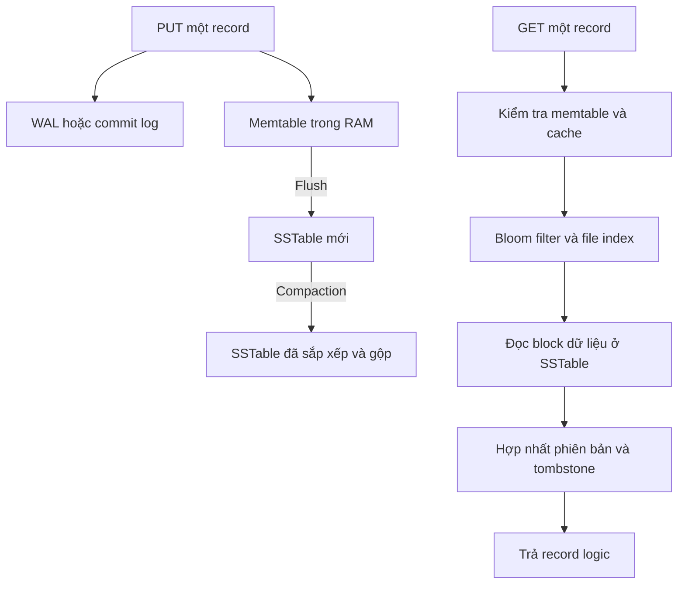
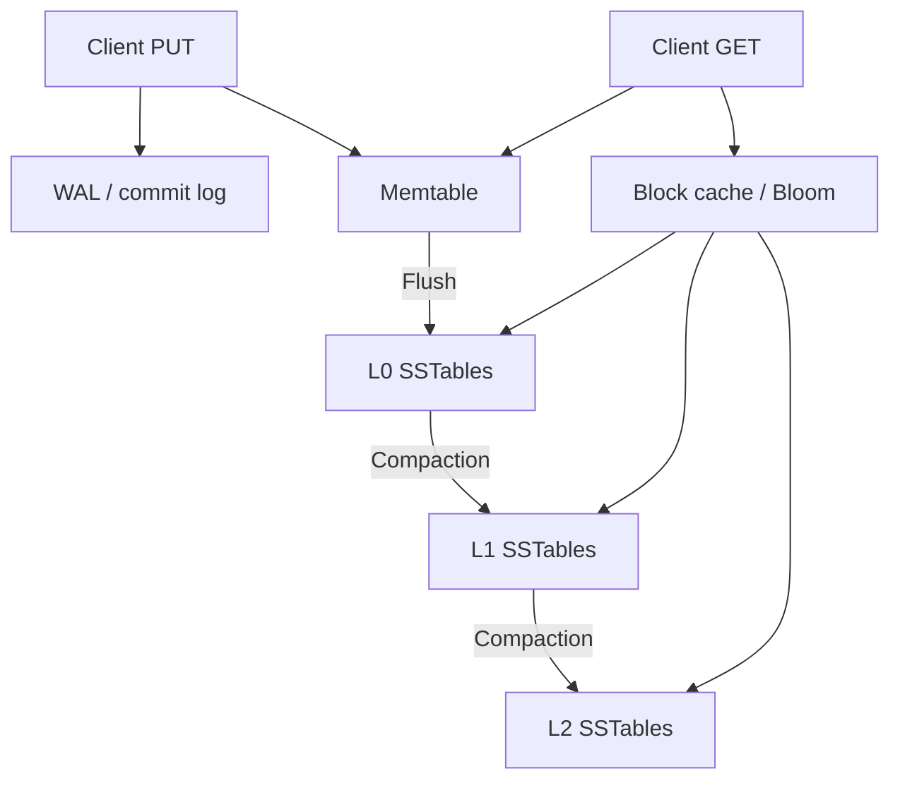
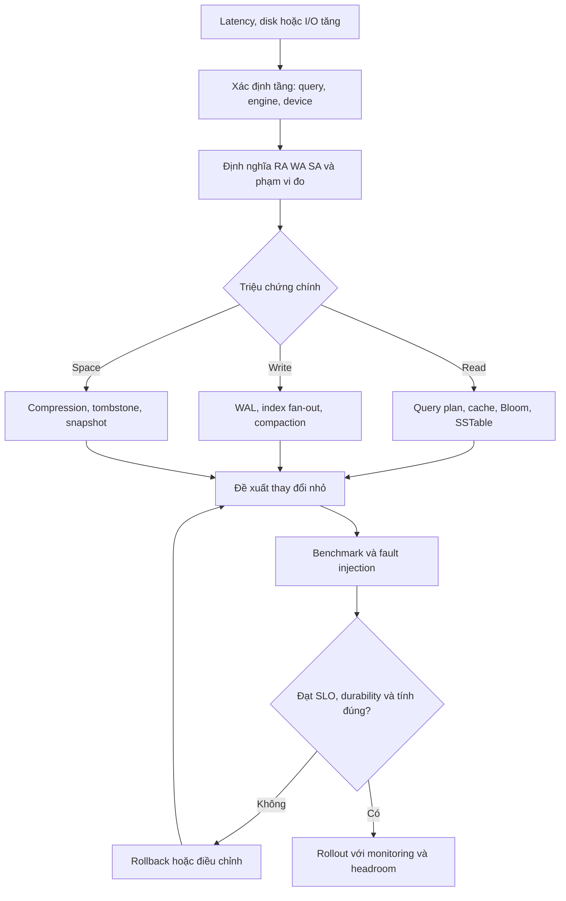

# Read amplification, write amplification và space amplification

Khi ứng dụng ghi một document 1 KiB vào NoSQL, storage engine có thể ghi thêm **WAL/commit log**, flush dữ liệu xuống file, cập nhật chỉ mục và ghi lại bản ghi trong quá trình **compaction**. Khi đọc một item 1 KiB, engine có thể phải kiểm tra nhiều block chỉ mục hoặc SSTable. Dữ liệu nghiệp vụ 100 GiB cũng không nhất thiết chỉ chiếm 100 GiB: hệ còn cần metadata, index, các phiên bản cũ, tombstone, log và bản sao.

Ba hiện tượng này được gọi là:

- **Read amplification (RA):** một thao tác hoặc một lượng dữ liệu đọc logic gây ra bao nhiêu công việc đọc ở tầng thấp hơn.
- **Write amplification (WA):** một lượng dữ liệu ghi logic tạo ra bao nhiêu byte hoặc thao tác ghi ở tầng lưu trữ.
- **Space amplification (SA):** để giữ dữ liệu logic còn hiệu lực, cần bao nhiêu không gian lưu trữ vật lý.

Đây là chủ đề nền tảng của **lưu trữ và độ bền (storage and durability)**, đặc biệt trong NoSQL engine dùng **Log-Structured Merge Tree (LSM-tree)**, nhưng cũng liên quan đến **B-tree/B+tree**, MVCC, copy-on-write, secondary index, database phân tán và hệ lưu trữ trong RAM.

**Lưu ý quan trọng:** ba khái niệm không có cùng một công thức và phạm vi chuẩn hóa cho mọi sản phẩm. Trước khi so sánh, phải định nghĩa tử số, mẫu số, đơn vị, thời gian đo và tầng được tính. Tỷ số ở storage engine, SSD và hóa đơn cloud có thể mang tên gần giống nhưng không thể so trực tiếp.

## 1. Một request logic tạo ra công việc vật lý như thế nào?

Giả sử API có hai thao tác:

```text
PUT /orders/O-1001:
    Payload = 1 KiB

GET /orders/O-1001:
    Response = 1 KiB
```

Một engine kiểu LSM có thể xử lý:



Các bước không nhất thiết xảy ra trong thời gian request: compaction thường là công việc nền; block nằm trong cache có thể không tạo I/O SSD; WAL có chính sách fsync/group commit; và không phải mọi NoSQL đều dùng LSM-tree.

### Ba tầng đo không được trộn lẫn

| Tầng | Ví dụ | Đo điều gì? |
| --- | --- | --- |
| **Application/API** | PUT/GET một payload | Byte và số thao tác logic |
| **Storage engine/filesystem** | WAL, flush, index, compaction | Byte read/write và page/block I/O |
| **Thiết bị/cluster** | NAND flash, replica, network, snapshot | Ghi vật lý, lưu trữ nhân bản, chi phí |

Ví dụ ghi thêm do **compaction** thuộc engine WA; SSD còn có garbage collection và wear leveling, tạo **device WA** khác. Replica network và dung lượng backup lại thuộc cấp cluster hoặc hệ thống.

## 2. Định nghĩa read amplification

Một cách đo ở cấp byte:

\[
RA_{\text{bytes}} =
\frac{\text{Byte đọc tại tầng storage được chọn}}
{\text{Byte dữ liệu logic hữu ích được đọc hoặc trả}}
\]

Nếu truy vấn trả 4 KiB thông tin hữu ích nhưng storage phải đọc tổng cộng 64 KiB:

\[
RA_{\text{bytes}} = \frac{64}{4} = 16
\]

Kết quả là **16 lần**, theo cách định nghĩa và phạm vi đo này.

Có thể đo theo **I/O operations**, ví dụ:

```text
Một point lookup:
    đọc 2 index blocks
    đọc 1 data block

Read I/O operations per lookup = 3
```

Hai cách đo khác đơn vị. **Ba I/O không có nghĩa ba byte đọc cho một byte kết quả**. Một lần đọc 256 KiB khác nhiều lần đọc 4 KiB ở latency, queueing và hiệu quả SSD.

### Read amplification có hai lớp

1. **Query-level:** engine kiểm tra nhiều index entry/document hơn số kết quả trả.
2. **Storage-level:** để trả một record, engine kiểm tra nhiều file/block/version.

Ví dụ query trả 20 đơn:

```text
nReturned:           20
totalKeysExamined:  60.000
totalDocsExamined:   8.000
```

Tỷ số **60.000/20 = 3.000 index entries trên mỗi kết quả** là một metric hữu ích về đường truy cập. Nhưng đó **không phải RA theo byte**, vì index entry và document không cùng kích thước.

## 3. Read amplification trong LSM-tree

LSM-tree lưu thay đổi mới ở memtable rồi flush thành các SSTable. Một key có thể có phiên bản mới trong SSTable mới hơn và phiên bản cũ ở level sâu hơn.

```text
Memtable:      không có K
L0 - File A:   có thể có K
L0 - File B:   có thể có K
L1 - File C:   không có K
L2 - File D:   K = value mới hợp lệ
```

Engine cần xác định phiên bản nào có hiệu lực, có tombstone mới hơn hay không. Với **negative lookup** (key không tồn tại), engine còn phải tìm đủ bằng chứng để kết luận key vắng mặt.

Những yếu tố ảnh hưởng:

- Số **SSTable/file** có thể chứa key.
- Các vùng khóa có **chồng lấn** không.
- **Bloom filter** có loại được những file chắc chắn không chứa key không.
- File index và data block nằm trong **cache** không.
- Có nhiều **update/tombstone** cho cùng key không.
- Đây là point lookup hay range scan.
- Có nhiều replica/shard tham gia đường đọc không.

Cùng một engine có thể có RA thấp cho lookup đã cache và RA cao cho truy vấn quét không có index.

## 4. Bloom filter và negative lookup

**Bloom filter** là cấu trúc xác suất hỗ trợ kiểm tra một key **có thể** nằm trong một tập hay không.

- Kết quả **negative** của Bloom filter chuẩn nghĩa là key không thuộc tập đã được biểu diễn.
- Kết quả **positive** chỉ nói key có thể tồn tại, bởi có thể xảy ra **false positive**.

Giả sử một key vắng mặt trên mười SSTable. Nếu filter loại chín SSTable, engine có thể tránh nhiều block reads. Đổi lại, filter cần RAM hoặc metadata và có chi phí xây dựng.

| Chính sách | Tác động tới RA | Chi phí khác |
| --- | --- | --- |
| Ít hoặc không có Bloom filter | Nhiều file cần kiểm tra hơn | Ít bộ nhớ filter |
| Filter false-positive thấp | Ít I/O thừa khi lookup | Cần nhiều bit/index hơn |
| Cache index tốt | Giảm SSD I/O | Chiếm RAM |
| Compaction giảm số file | Ít ứng viên phải tra | Có thể tăng WA |
| Thay query bằng lookup theo key đúng | Giảm ứng viên ở tầng query | Có thể cần index/read model mới |

Không thể chỉ tăng Bloom filter rồi mặc định mọi query được cải thiện: range scan lớn và filter theo thuộc tính ngoài khóa có hành vi khác point lookup.

## 5. Định nghĩa write amplification

Một cách tính thường dùng:

\[
WA_{\text{engine}} =
\frac{\text{Tổng byte engine ghi xuống storage trong kỳ}}
{\text{Tổng byte ghi logic của ứng dụng trong cùng kỳ}}
\]

Nếu ứng dụng gửi **100 GiB ghi logic** và engine tạo **500 GiB host writes**, kể cả WAL, flush, compaction và những dữ liệu phụ được tính theo phạm vi:

\[
WA_{\text{engine}} = \frac{500}{100} = 5
\]

### Ví dụ ghi một record 1 KiB

| Bước | Byte ghi giả định |
| --- | ---: |
| WAL | 1 KiB |
| Flush xuống SSTable | 1 KiB |
| Compaction viết lại lần đầu | 1 KiB |
| Compaction viết lại lần thứ hai | 1 KiB |
| Compaction viết lại lần thứ ba | 1 KiB |
| **Tổng** | **5 KiB** |

Tỷ số là **5 KiB / 1 KiB = 5**. Đây là mô hình minh họa, **không phải số lần ghi cố định của mọi NoSQL**. Dữ liệu thực còn phụ thuộc compression, memtable, index, bản ghi bị xóa, file format, batching và compaction strategy.

### Vì sao cùng dữ liệu bị ghi lại?

LSM tạo **SSTable bất biến**; khi cần gộp file và giới hạn số phiên bản, compaction đọc nhiều SSTable rồi **ghi output mới**. Những bản ghi còn sống có thể bị copy qua nhiều đợt compaction trước khi hết vòng đời.

Khi tăng tần suất compaction, số file cần tìm có thể giảm, nhưng lượng ghi lại có thể tăng.

## 6. Phân biệt WA theo byte, fan-out và WA của SSD

Một lần cập nhật order có thể sinh:

```text
1. Update order nguồn
2. Cập nhật secondary index
3. Đổi entry ở bảng theo status
4. Phát sự kiện vào outbox
5. Cập nhật bản tổng doanh thu
```

Đây có thể là **năm hiệu ứng ghi logic** trên nhiều cấu trúc, nhưng không tự suy ra **WA engine = 5**. Mỗi hiệu ứng có payload khác nhau; mỗi storage engine còn ghi WAL/compaction riêng.

| Đại lượng | Mẫu số | Tử số |
| --- | --- | --- |
| **Engine byte WA** | Byte ghi logic | Byte engine/filesystem ghi |
| **Write operation fan-out** | Số nghiệp vụ ghi | Số thao tác ghi vào cấu trúc |
| **Device/NAND WA** | Host writes tới SSD | NAND bytes thực ghi |
| **Cluster write multiplier** | Ghi logic nguồn | Ghi từ replica/read model theo phạm vi |

Nếu engine WA = 4 và thiết bị SSD WA = 1,5 trên **đúng cùng luồng, thời gian và đơn vị tương thích**, NAND writes có thể khoảng sáu lần logical bytes. Không được nhân bừa hai tỷ số đo khác phạm vi.

## 7. Định nghĩa space amplification

Một cách đo:

\[
SA_{\text{engine}} =
\frac{\text{Dung lượng engine đang chiếm}}
{\text{Dung lượng dữ liệu logic còn hiệu lực}}
\]

Giả sử:

```text
Live logical data:      100 GiB
File dữ liệu và bản cũ: 125 GiB
Index:                  25 GiB
WAL/metadata:            5 GiB

Tổng engine storage:    155 GiB
```

Khi dữ liệu logic và dung lượng file được đo trên cơ sở biểu diễn thích hợp, tỷ số là **155/100 = 1,55 lần**.

Nhưng nếu **100 GiB logical chưa nén** được lưu thành **35 GiB dữ liệu nén**, tổng engine storage có thể dưới 100 GiB và SA theo tỷ số này dưới 1. Điều đó không có nghĩa engine không có overhead: numerator và denominator dùng cách biểu diễn khác nhau.

### Phải xác định phạm vi

- Live bytes là dữ liệu **trước nén** hay đã nén?
- Numerator có tính **index, WAL, tombstone, MVCC history**?
- Có tính **temporary compaction output**, free space đã cấp phát?
- **Snapshot và backup** ở trong hay ngoài phạm vi?
- Tính một replica hay mọi replica?
- Tính tất cả bảng phụ và search index ứng dụng hay chỉ một engine?
- Dùng **disk used** hay dung lượng nhà cung cấp tính phí?

Không so SA của một database tự vận hành với dung lượng hóa đơn cloud nếu phạm vi bao gồm những bản sao khác nhau.

## 8. Ba loại amplification đánh đổi ra sao?

```text
Compaction tích cực:
    ít file và phiên bản cũ hơn
    -> RA thường giảm;
    -> SA có thể giảm sau khi dọn;
    -> WA có thể tăng vì phải ghi lại dữ liệu.

Compaction ít tích cực:
    ít viết lại trước mắt
    -> WA có thể giảm;
    -> nhiều SSTable/version còn tồn tại
    -> RA và SA có thể tăng.
```

| Quyết định | RA | WA | SA |
| --- | --- | --- | --- |
| Compaction mạnh hơn | Có thể giảm | Có thể tăng | Có thể giảm, nhưng peak space tăng tạm |
| Giữ nhiều file chưa gộp | Có thể tăng | Có thể giảm trước mắt | Có thể tăng |
| Thêm index cho query chính | Query RA có thể giảm | Tăng duy trì index | Tăng |
| Bỏ index thật sự không dùng | Query phụ thuộc có thể chậm hơn | Giảm | Giảm |
| Tăng cache | SSD RA thường giảm | Không nhất thiết đổi | Tăng RAM |
| Compression tốt hơn | Byte disk đọc có thể giảm | Byte disk ghi có thể giảm | Thường giảm disk, tăng CPU |
| Replication factor cao hơn | Phụ thuộc read routing | Cluster writes tăng | Cluster storage tăng |

Các xu hướng này **không phải định luật cứng**. Thay đổi một tầng có thể tạo tác động ở tầng khác.

## 9. LSM-tree: WAL, memtable, SSTable và compaction

Luồng ghi LSM khái quát:



**Ưu điểm tiềm năng:**

- Ghi được gom ở RAM rồi chuyển thành các đợt I/O tuần tự.
- Phù hợp workload ingest cao.
- Có thể nén block, dùng Bloom filter, tối ưu theo key range.

**Đổi lại:**

- WA do compaction ghi lại dữ liệu sống.
- RA khi phải tra nhiều SSTable/version.
- SA do file cũ, tombstone, output tạm.
- Compaction tranh CPU, RAM và IOPS với truy vấn.
- Nếu compaction không theo kịp ingest, có thể gây write stall.

LSM không có nghĩa mọi GET đều chậm. Point lookup có key phù hợp, filter tốt và block trong cache có thể rất nhanh.

## 10. Size-tiered và leveled compaction

Hai chiến lược LSM thường gặp:

**Size-tiered compaction (tiering):** gộp nhiều file có kích thước tương tự theo chính sách. Có thể giảm số lần viết lại ở một số workload ghi lớn, nhưng giữ nhiều file có vùng key chồng lấn.

**Leveled compaction (leveling):** tổ chức dữ liệu theo các level kích thước mục tiêu; ở nhiều level sâu các file được bố trí để giảm vùng khóa chồng lấn. Point lookup có thể cần ít file hơn, space overhead có thể kiểm soát hơn, đổi lại có thể viết lại dữ liệu nhiều lần hơn.

| Mặt đánh đổi | Size-tiered (xu hướng) | Leveled (xu hướng) |
| --- | --- | --- |
| WA | Có thể thấp hơn | Có thể cao hơn |
| Point lookup RA | Có thể phải xét nhiều file | Thường giảm file ứng viên ở level sâu |
| SA | Có thể tăng lúc chờ gộp | Thường được kiểm soát hơn |
| Write-heavy | Đáng cân nhắc | Cần kiểm tra I/O budget |
| Read-heavy | Cần tối ưu filter/cache | Đáng cân nhắc |
| Backlog | Có thể tạo spike gộp lớn | Có thể tạo áp lực rewrite liên tục |

**Không suy từ tên thuật toán ra tỷ số cụ thể.** Fan-out, số level, file sizing, Bloom config, compression và data distribution đều ảnh hưởng. **L0** vẫn có thể có nhiều file chồng lấn ngay cả khi dùng leveling.

## 11. Time-window compaction cho time series

Trong hệ dữ liệu sự kiện theo thời gian, nhiều bản ghi có TTL tương tự nhau:

```text
Ngày 12/11 -> Window A
Ngày 13/11 -> Window B
Ngày 14/11 -> Window C

Retention theo ngày:
    Window hết hạn và đủ điều kiện an toàn
    có thể được dọn theo quy tắc engine.
```

**Time-window compaction** có thể thuận lợi khi dữ liệu đến tương đối đúng thứ tự, ít update bản ghi cũ và TTL đồng đều. Nếu record sống lâu bị trộn với dữ liệu hết hạn, không dễ dọn cả file. Nếu backfill rất muộn, sửa dữ liệu cũ hoặc TTL biến động, lợi thế có thể giảm.

Với Cassandra/ScyllaDB, các chiến lược như TWCS cần đối chiếu phiên bản và hướng dẫn cụ thể. Không tự đặt TTL ngắn hơn để thấy disk giảm nếu retention nghiệp vụ không cho phép.

## 12. B-tree/B+tree cũng có amplification

Engine dựa trên B-tree/B+tree có thể truy cập theo page:

```text
Root page
  |
  +-- Internal page
        |
        +-- Leaf page chứa key K
```

Point lookup có thể cần vài page; root/internal page thường được cache. Update một field có thể tạo WAL, sửa page, tách page hoặc cập nhật nhiều secondary index. MVCC/copy-on-write có thể giữ version cũ và ghi thêm page.

- **RA:** đọc index page, fetch dữ liệu nguồn, scan leaf pages.
- **WA:** WAL, page updates, page split, secondary index maintenance.
- **SA:** page fragmentation, free space, MVCC versions, index và snapshot.

Không thể kết luận **B-tree không có WA** hoặc **LSM luôn kém đọc hơn B-tree**. Phải đo cùng workload và độ bền.

## 13. Tombstone, TTL và dữ liệu cũ

Trong LSM, xóa một key có thể được ghi thành tombstone:

```text
L0: K = TOMBSTONE, phiên bản mới
L1: K = value cũ
L2: K = value cũ hơn
```

Khi đọc, engine chọn trạng thái mới nhất hợp lệ. Compaction chỉ có thể dọn giá trị cũ/tombstone khi đáp ứng điều kiện an toàn.

Tác động:

- **RA:** có thể phải đọc metadata/file để biết giá trị đã bị xóa.
- **WA:** DELETE và compaction tạo thêm ghi.
- **SA:** bản cũ và tombstone tồn tại trước khi được reclaim.
- **Correctness:** tombstone giúp ngăn bản sao cũ tự quay lại.

### Replica cũ và resurrection

Trong Cassandra, replica offline có thể không nhận DELETE. Nếu replica khác dọn tombstone trước khi repair đồng bộ thông tin xóa, giá trị cũ có nguy cơ **tái xuất hiện** khi node quay lại.

**gc_grace_seconds**, anti-entropy repair và compaction phải được vận hành phù hợp. **Không giảm tombstone grace tùy tiện** chỉ vì muốn tối ưu SA; chính sách storage không được phá nghĩa vụ xóa.

## 14. MVCC và snapshot giữ không gian vì tính đúng đắn

**Multi-Version Concurrency Control (MVCC)** cho phép giao dịch/query đọc trạng thái phù hợp với snapshot:

```text
K = v1 tại T1
K = v2 tại T2
K = v3 tại T3

Snapshot S từ T1 còn cần v1
trong khi request hiện hành đọc v3.
```

Để giữ snapshot đúng, engine có thể chưa dọn v1. Dữ liệu cũ làm SA tăng nhưng không thể xem là rác cần xóa vô điều kiện.

Các nguồn space retention khác:

- Transaction đọc dài.
- Snapshot backup đang giữ page/file.
- Replication checkpoint chưa tiến.
- Consumer CDC chưa thể bỏ log.
- Version của document cần cho rollback hay historical read.

Tối ưu SA phải tôn trọng **isolation, snapshot semantics và durability**.

## 15. WAL/commit log và durability

Một chu trình ghi giả định:

```text
Client PUT
    -> append WAL/commit log
    -> cập nhật memtable
    -> ACK theo durability policy
    -> flush SSTable sau đó
    -> giải phóng log cũ khi an toàn
```

WAL tạo thêm ghi và space, nhưng là công cụ phục hồi sau crash trong mô hình engine tương ứng. Tắt fsync hoặc bỏ WAL trong benchmark có thể làm hệ nhanh hơn nhưng **thay đổi cam kết durability**.

| Khái niệm | Câu hỏi |
| --- | --- |
| **Write ACK** | Khi nào server trả thành công? |
| **Durable commit** | Sau crash, ghi đã ACK được đảm bảo còn không? |
| **Replication acknowledgment** | Bao nhiêu bản sao xác nhận? |
| **Checkpoint/flush** | Khi nào WAL segment có thể giải phóng? |
| **RPO/RTO** | Mất dữ liệu tối đa và thời gian phục hồi cam kết là gì? |

Một phép so sánh WA chỉ công bằng nếu hai cấu hình có cùng mục tiêu durability/replication và failure semantics.

## 16. Secondary index và denormalization làm tăng fan-out

Ví dụ một order tồn tại trên ba đường truy cập:

```text
orders_by_id
orders_by_customer
orders_by_store_status
```

Order chuyển trạng thái PENDING → PAID có thể cần:

```text
1. Update order nguồn
2. Update lịch sử khách
3. Delete entry PENDING
4. Insert entry PAID
5. Update bảng tổng doanh thu
```

Đây là năm thao tác logic trên nhiều cấu trúc. Nếu được duy trì trong database, công việc index nằm trong engine; nếu ứng dụng tự duy trì, phải xử lý idempotency, transaction/outbox và recovery.

Đánh đổi:

- Đọc theo customer/status nhanh hơn, giảm query RA.
- Ghi nhiều hơn, tăng fan-out và WA toàn hệ.
- Bảng/index phụ chiếm thêm SA.
- Xóa/sửa phải đồng bộ mọi bản sao.
- Cập nhật một hot key có thể bị contention.

Đừng tối ưu một query bằng nhiều projection mà không tính tổng chi phí ghi và vận hành.

## 17. Query sai đường truy cập có thể áp đảo RA của storage engine

Giả sử collection có 10 triệu order và API cần:

```text
tenantId = T1
storeId = S12
status = PENDING
sort createdAt DESC
limit 20
```

Nếu chỉ index status, engine có thể đọc rất nhiều order ở cửa hàng khác trước khi tìm đủ 20.

Một candidate MongoDB index:

```javascript
db.orders.createIndex({
  tenantId: 1,
  storeId: 1,
  status: 1,
  createdAt: -1,
  orderId: -1
});
```

Nếu access pattern và phân bố dữ liệu phù hợp, index này giúp định vị tenant/store/status rồi duyệt theo thời gian. Việc giảm **totalKeysExamined / totalDocsExamined** có thể quan trọng hơn tinh chỉnh Bloom filter ở storage engine.

Nhưng index mới tạo write/storage overhead. Phải đo cả **tốc độ cập nhật status** và số index trong collection, không chỉ GET p95.

## 18. Compression giảm byte nhưng tăng CPU

Block 64 KiB logic có thể được nén xuống 16 KiB nếu dữ liệu phù hợp. Khi đó:

- Disk reads/writes có thể giảm.
- Dung lượng file giảm.
- Có thể tăng hiệu quả cache tùy cache giữ dạng nén hay giải nén.
- CPU encode/decode tăng.
- Update nhỏ có thể khiến engine xử lý lại block theo thiết kế nội bộ.

Báo cáo nên tách:

```text
logical_uncompressed_bytes
compressed_data_file_bytes
physical_host_bytes_read
physical_host_bytes_written
compression_cpu_time
decompression_cpu_time
cache_hit_ratio
```

Thuật toán nén cho tỷ lệ tốt nhất không mặc định là lựa chọn tốt nhất khi CPU đang nóng hoặc p99 latency quá cao.

## 19. Cache và read amplification

Block cache hoặc OS page cache có thể trả lời nhiều lookup mà không cần đọc SSD. Khi đó **physical SSD RA giảm**, nhưng CPU, memory access và index traversal vẫn có chi phí.

```text
Query A:
    1.000 index/cache operations
    0 SSD reads

Query B:
    1 SSD read 64 KiB
    ít thao tác CPU hơn
```

Nếu chỉ nhìn SSD bytes, A có thể trông tốt; nếu chỉ nhìn CPU, B có thể tốt hơn. Vì vậy cần xem **latency, CPU, cache miss và disk I/O** cùng nhau.

Benchmark nên có:

- **Warm cache:** dữ liệu thường xuyên truy cập đã ở RAM.
- **Cold cache:** sau restart/failover.
- **Cache pressure:** working set vượt RAM.
- **Write churn:** cập nhật làm invalidation/eviction liên tục.
- **Negative lookup:** key vắng mặt.

Không thể dùng kết quả warm-cache ngắn để suy ra I/O dài hạn khi dữ liệu tăng gấp mười.

## 20. Replication thay đổi phạm vi WA và SA

Giả sử dữ liệu logic 100 GiB có ba replica; mỗi replica sử dụng 150 GiB storage bao gồm overhead theo cách đo giả định.

```text
Logical data:              100 GiB
Một replica:               150 GiB
Ba replica:                450 GiB
```

Hai tỷ số:

\[
SA_{\text{replica}} = \frac{150}{100} = 1{,}5
\]

\[
SA_{\text{cluster}} = \frac{450}{100} = 4{,}5
\]

Cả hai có thể đúng **theo phạm vi khác nhau**. Trong cluster sharded thực tế, không phải mọi node giữ toàn bộ dataset, nên cần tính đúng tổng bản sao và partition ownership.

Với WA cũng vậy:

- Engine WA ở **một replica** không bao gồm byte ghi của replica khác.
- Cluster write multiplier có thể bao gồm ghi tới mọi replica và read model.
- Consistency level ảnh hưởng số ACK cần chờ; không tự quyết định tổng bản sao cuối cùng được lưu.
- Backup và cross-region replication có thể tạo chi phí ngoài phạm vi engine.

Đừng lấy tỷ số cấp replica so với cấp cluster mà không ghi chú.

## 21. Redis: memory amplification và persistence

Redis thường giữ dữ liệu trong RAM, nên không có SSTable read amplification như LSM cho thao tác in-memory thông thường. Nhưng vẫn có:

- Metadata trên mỗi key và cấu trúc dữ liệu nội bộ.
- Memory allocator fragmentation.
- Set/sorted set phụ để phục vụ query.
- AOF append/rewrite và RDB snapshot theo cấu hình.
- Replication traffic và snapshot copy-on-write overhead.
- Cache miss khiến đọc lại nguồn.

Một key mang payload 20 byte **không nhất thiết chỉ tốn 20 byte RAM**. Có thể dùng tỷ lệ **memory used / logical payload** nhưng phải gọi đó là **memory amplification**, không nhầm với disk SA của Cassandra.

Nếu Redis chỉ là cache có thể dựng lại, chính sách persistence khác Redis đang lưu state nghiệp vụ cần phục hồi. Khi so chi phí, phải ghi rõ RPO/RTO.

## 22. MongoDB, Cassandra và DynamoDB đo khác nhau

### MongoDB

Một deployment dùng storage engine như WiredTiger có page cache, compression, journal, index và checkpoint theo cấu hình. Cần xem:

- Explain plan: **keysExamined, docsExamined, FETCH, SORT**.
- WiredTiger cache, dirty pages, eviction và I/O.
- Data/index size, compression và fragmentation.
- Nhiều index, update-heavy workload, replication.
- Độ trễ đọc/ghi dưới transaction và write concern thực.

**Không mô tả MongoDB như LSM SSTable engine** chỉ vì cả hai là NoSQL.

### Cassandra / ScyllaDB

Với wide-column LSM, metric quan trọng gồm:

- Số SSTable được xét trên một lần đọc.
- Bloom false positive và block/cache hit.
- SSTable size theo table/level.
- Compaction pending, bytes read/written.
- Tombstone, TTL, partition size và repair health.
- Commit log, memtable flush và disk throughput.
- p95/p99 khi compaction chạy cùng user traffic.

Compaction strategy phải phù hợp workload và vòng đời dữ liệu. Partition cực lớn hoặc query sai partition key có thể gây RA lớn hơn mọi vấn đề Bloom/compaction.

### DynamoDB

DynamoDB là dịch vụ quản lý; chi tiết engine/SSD bên trong không được hiển thị như một RocksDB instance. Nên đánh giá qua metric công khai:

- Consumed read/write capacity hoặc billing units theo chế độ bảng.
- Request latency, throttling và hot partition.
- Item size, PK/SK, GSI, FilterExpression, số item được xét.
- Chi phí index projection và replication.
- Backup/PITR, TTL và Streams theo contract dịch vụ.

**Không coi WCU/RCU là trực tiếp số byte NAND đã ghi/đọc bên trong engine.** Capacity units không phải device WA/RA.

## 23. Compaction backlog và tail latency

Nếu tốc độ ingest vượt năng lực compaction:

```text
Write rate tăng
    -> memtable flush nhanh
    -> L0 SSTable tăng
    -> compaction backlog
    -> lookup kiểm tra nhiều file hơn
    -> disk/CPU tranh chấp
    -> write stall hoặc p99 đọc tăng
```

Điều này giải thích vì sao tối ưu chỉ để giảm WA trước mắt có thể làm **RA, SA và tail latency** tăng theo thời gian.

Theo dõi:

1. Pending compaction jobs/bytes.
2. Tốc độ ingest so với compaction throughput.
3. Số file L0 và level.
4. Disk free, peak compaction space.
5. Read/write p95/p99 trong lúc background I/O.
6. Write stall count/duration.
7. Recovery khi node restart với backlog.

Một hệ ổn định cần compaction **theo kịp workload dài hạn**, không chỉ chịu burst ngắn rồi kẹt hàng giờ.

## 24. Peak space có thể cao trong lúc compaction

Trong quá trình gộp SSTable, input files có thể còn tồn tại tới khi output files đã được ghi và được phép thay thế.

```text
Trước compaction:
    80 GiB input

Trong lúc compaction:
    80 GiB input còn giữ
    60 GiB output đang ghi
    tổng đỉnh theo ví dụ = 140 GiB

Sau khi an toàn xóa input:
    còn khoảng 60 GiB output
```

Đây là mô hình số giả định; điều kiện và thứ tự xóa file tùy engine.

Do đó nên phân biệt:

- **Steady-state SA:** storage ở trạng thái ổn định.
- **Peak SA:** storage cao nhất trong compaction, repair, backup, restore hoặc index build.
- **Disk headroom:** dung lượng trống để các tác vụ nền và recovery có thể chạy.

Nếu disk gần đầy, compaction có thể không còn đủ chỗ để giảm dung lượng. Không hoạch định capacity ở mức 100% utilization rồi hy vọng engine tự dọn.

## 25. Đo WA trên đúng cửa sổ thời gian

Một lỗi đo phổ biến:

```text
10:00–10:05:
    ghi 10 GiB logic, memtable chưa flush đủ
    engine bytes written trông thấp.

10:05–10:10:
    không có ghi mới
    compaction vẫn viết 30 GiB.
```

Nếu tính WA riêng mỗi cửa sổ 5 phút, cửa sổ đầu trông quá tốt; cửa sổ sau mẫu số gần 0. Cần đo trên **giai đoạn đủ dài, sau warm-up và gần steady-state**, hoặc phân bổ chi phí theo cohort dữ liệu.

Định nghĩa phép đo:

```text
logicalWriteBytes:
    tính theo payload, record mới hay field delta?

engineHostWrites:
    tính WAL, flush, compaction, index và metadata nào?

window:
    bao lâu, đã hoàn tất backlog chưa?

compression:
    mẫu số trước hay sau nén?

replication:
    tính một node, toàn cluster hay cả read models?
```

Nếu WA lấy từ metric engine cụ thể, nên dùng đúng định nghĩa nhà cung cấp thay vì tự gán cùng tên cho một tỷ số khác.

## 26. Đo RA và SA song song với query metrics

### Read

```text
RA_bytes = physicalStorageReadBytes / logicalReadBytes
```

Nếu response chỉ là COUNT=1 nhưng engine scan nhiều GiB, mẫu số response bytes làm tỷ số cực lớn. Nên báo cáo bổ sung:

```text
keysExamined / nReturned
docsExamined / nReturned
blocksRead / lookup
SSTablesConsulted / lookup
cacheMissRate
```

Các chỉ số bổ sung giúp tìm nguyên nhân chứ không chỉ kết luận đọc thừa.

### Space

```text
liveLogicalBytes
compressedDataFilesBytes
indexFilesBytes
walBytes
oldVersionsBytes
tombstoneBytes
temporaryCompactionBytes
snapshotBytes
clusterReplicaBytes
```

Có thể công bố nhiều tỷ số:

```text
SA_engine  = engineOccupiedBytes / liveLogicalBytes
SA_cluster = clusterOccupiedBytes / liveLogicalBytes
```

Khi compression lớn, cần giải thích vì sao ratio có thể dưới 1. Đừng so hai sản phẩm nếu phạm vi index/snapshot khác nhau.

## 27. Ví dụ tính RA, WA, SA hoàn chỉnh

Một dịch vụ NoSQL có dữ liệu giả định:

```text
Trong kỳ:
    Logical writes:           100 GiB
    WAL writes:               100 GiB
    Initial flushed files:     80 GiB
    Compaction rewrites:      220 GiB
    Index/metadata writes:     50 GiB
    Tổng engine writes:       450 GiB

    Logical read payload:      20 GiB
    Physical SSD reads:       120 GiB

Tại thời điểm đo:
    Live logical data:        200 GiB (chưa nén)
    Data files:               130 GiB (đã nén, gồm bản cũ)
    Secondary index:           30 GiB
    WAL/metadata:              10 GiB
    Compaction temp files:     20 GiB
    Tổng engine storage:      190 GiB
```

Khi scope đã rõ:

\[
WA_{\text{engine}} = \frac{450}{100} = 4{,}5
\]

\[
RA_{\text{disk}} = \frac{120}{20} = 6
\]

\[
SA_{\text{engine}} = \frac{190}{200} = 0{,}95
\]

**SA = 0,95 không phủ nhận index/tombstone overhead**: mẫu số là logical data trước nén, còn numerator là file đã nén. Đây là lý do phải ghi chú đơn vị và phạm vi cùng kết quả.

Các con số chỉ minh họa, **không phải benchmark thực của một sản phẩm**.

## 28. Workload quyết định kiểu đánh đổi

### Ghi log/time series cường độ cao

```text
90% insert
8% range scan gần đây
2% point lookup
TTL: 30 ngày
```

Quan tâm: WAL/flush throughput, compaction WA, partition/time buckets, TTL và dọn file theo vòng đời. Time-window compaction có thể phù hợp nếu ít late-write và TTL đồng đều.

### Point lookup có p99 rất thấp

```text
95% GET theo ID
5% update
Dataset lớn hơn RAM
```

Quan tâm: Bloom filter, cache, số SSTable/level, negative lookup và cold-cache p99. Compaction có thể được ưu tiên nếu đọc là đường chính.

### Hot counters và update nhiều

```text
Nhiều request cùng một key
Read-modify-write và cập nhật index
```

Quan tâm: atomic update, contention, MVCC history, WAL, index fan-out, replica write latency và khả năng phân tải. Không sharding một counter quan trọng nếu làm mất bất biến.

### Dashboard/analytics nhiều filter

```text
COUNT/SUM theo tenant, ngày, category
Dữ liệu tăng nhiều năm
```

Quan tâm: query RA do scan, compound index, precomputed aggregate và search/analytics store. Read model giảm cost đọc nhưng tăng ghi và space; cần freshness và idempotency.

**Không có chính sách compaction/cache/index tối ưu cho mọi workload.**

## 29. Benchmark phải quan sát đủ một chu kỳ sống dữ liệu

Một test ngắn có thể bỏ qua:

- Memtable chưa flush.
- Compaction chưa chạy.
- Dữ liệu vẫn nằm trong RAM.
- Chưa có tombstone từ update/delete.
- Index chưa lớn đủ.
- WAL chưa checkpoint.
- Replica/read model chưa đồng bộ.
- Dataset chưa tạo nhiều level SSTable.

Kế hoạch:

| Pha | Điều cần quan sát |
| --- | --- |
| Load dataset | Data/index size, bytes ghi |
| Warm-up | Cache hit, compaction khởi động |
| Steady-state mixed load | RA/WA/SA, throughput, p95/p99 |
| Update/delete churn | Version cũ, tombstone, SA |
| Traffic peak | Backpressure, write stall |
| Cold restart | Cache miss và read p99 |
| Failure/repair | Durability và replica convergence |
| Post-load settle | Compaction backlog và space reclaim |

Đo cả **correctness**: dữ liệu đã ACK theo hợp đồng có còn sau crash? Record đã xóa có xuất hiện lại sau repair không? Một cấu hình có WA thấp nhưng vi phạm durability không phải tối ưu hợp lệ.

## 30. Metric vận hành nên có

```text
# Read
read_latency_p50_p95_p99
physical_bytes_read
read_iops
cache_hit_rate
bloom_false_positive_rate
sstables_per_read
index_keys_examined
documents_examined

# Write
logical_write_bytes
engine_host_write_bytes
wal_bytes_written
memtable_flush_bytes
compaction_bytes_read
compaction_bytes_written
compaction_pending_bytes
write_stalls
write_latency_p95_p99

# Space
live_logical_bytes
data_file_bytes
index_file_bytes
wal_bytes
tombstone_count_and_age
snapshot_bytes
temporary_compaction_bytes
disk_free_bytes

# Cluster
replication_network_bytes
per_node_disk_io
hot_partition_latency
replica_lag
repair_backlog
```

Tên metric thực khác nhau theo sản phẩm. Nếu engine không cung cấp byte chính xác, hãy báo cáo đó là **proxy/ước lượng**; không gán cho nó độ chính xác của host I/O counter.

## 31. Những sai lầm diễn giải thường gặp

**“WA thấp lúc mới ingest nghĩa là hệ tối ưu.”** Compaction có thể chạy sau, phải đo dài hạn.

**“Compaction tăng WA nên tắt nó đi.”** RA/SA có thể tăng, L0 file nhiều và write stall xuất hiện.

**“Giảm tombstone grace giúp tiết kiệm disk vô hại.”** Có thể khiến dữ liệu đã xóa tái xuất hiện khi replica cũ quay lại.

**“RA=0 vì SSD reads=0.”** Cache che I/O, nhưng CPU/index work vẫn có.

**“KeysExamined/Returned chính là tỷ số bytes RA.”** Đây là query metric theo số entry, khác read bytes.

**“SA dưới 1 nghĩa không có overhead.”** Có thể do compression và cách chọn mẫu số.

**“Replication factor 3 chắc chắn nhân engine WA ba lần.”** Cần biết engine WA đo ở một replica hay cả cluster.

**“DynamoDB WCU cho biết số byte NAND ghi.”** Đây là đơn vị service/billing, không phải device WA.

**“B-tree không có write amplification.”** WAL, page splits, MVCC và index đều có thể tạo ghi thêm.

**“TTL hết nghĩa là dữ liệu biến mất vật lý ngay.”** Cleanup/compaction theo cơ chế và thời gian riêng.

**“Thêm index luôn làm hệ nhanh hơn.”** Giảm query RA nhưng tăng WA/SA và cache pressure.

**“p50 latency đủ để chọn cấu hình.”** Compaction backlog và cache cold thường thể hiện rõ ở p95/p99.

## 32. Bài thực hành

Một cluster giả định có:

```text
Logical writes/ngày:        80 GiB
Engine host writes/ngày:   360 GiB
Logical reads/ngày:         40 GiB
SSD reads/ngày:            200 GiB

Live logical data:         100 GiB
Data files compressed:      65 GiB
Secondary indexes:          20 GiB
WAL/metadata:                5 GiB
Compaction temp:            15 GiB
```

### Bài 1 — Tính amplification

\[
WA = \frac{360}{80} = 4{,}5
\]

\[
RA = \frac{200}{40} = 5
\]

\[
SA = \frac{65+20+5+15}{100} = 1{,}05
\]

Giải thích vì sao cần ghi rõ live logical bytes chưa nén và data files đã nén.

### Bài 2 — Thêm compound index

Một index làm **keysExamined giảm từ 80.000 xuống 100** trên query quan trọng, nhưng chiếm 15 GiB và làm host writes tăng 30 GiB/ngày.

Hãy phân tích query QPS, read SLO, update frequency, storage budget, write budget và liệu có index khác ít tốn hơn không. Không quyết định chỉ bằng một lần query nhanh hơn.

### Bài 3 — Compaction backlog

Trong đợt traffic lớn, L0 files tăng và p99 GET cao. Hãy nêu cách kiểm tra compaction pending, disk bandwidth, file count, Bloom hit, cache hit, write stall và peak disk space. Đổi strategy có thể tác động RA/WA/SA theo hướng nào?

### Bài 4 — TTL và delete

Một triệu record hết TTL nhưng disk chưa giảm ngay. Giải thích tombstone, điều kiện dọn qua compaction và nguy cơ resurrection nếu replica offline lâu.

### Bài 5 — Benchmark

Thiết kế test có dataset lớn hơn RAM, cold/warm cache, insert/update/delete, negative lookup, compaction đang chạy, tenant nóng và failover. Hãy ghi rõ metric và cách xác minh RPO/RTO.

## 33. Quy trình tối ưu có kiểm soát



Một lộ trình thực tế:

1. Xác định vấn đề chính là **read latency, write stall, disk usage hay cloud cost**.
2. Chọn mẫu số và tầng đo đúng, không nhầm query RA với byte RA.
3. Kiểm tra **partition key/index/query** trước khi đổi storage tuning.
4. Kiểm tra cache, SSTable count, compaction backlog, tombstone và snapshot.
5. Kiểm tra index/read-model fan-out và replication.
6. Giữ nguyên durability, retention, consistency khi so benchmark.
7. Đổi từng yếu tố: index, compaction, compression, cache hoặc data model.
8. Đo trên workload đại diện, đủ lâu để compaction chạy.
9. Thử cold restart, failover, repair và delete correctness.
10. Chỉ rollout khi p95/p99, chi phí và headroom đều đạt yêu cầu.

## Kết luận

**Read amplification**, **write amplification** và **space amplification** giải thích vì sao chi phí vật lý của NoSQL khác với byte và số thao tác API nhìn thấy. RA phản ánh công việc đọc thêm; WA phản ánh dữ liệu bị ghi lại hoặc nhân rộng; SA phản ánh dung lượng cần để duy trì dữ liệu còn hiệu lực.

Trong **LSM-tree**, WAL, memtable, SSTable và compaction tạo các đánh đổi rõ ràng. Trong **B-tree/MVCC**, page updates, WAL, index, fragmentation và versioning tạo những hình thái amplification khác. Bloom filter, cache, compression, secondary indexes, replication, TTL và tombstone đều có thể thay đổi các tỷ số — nhưng **tối ưu storage không được làm mất dữ liệu đã được ACK hoặc phá ngữ nghĩa xóa**.

Cách làm đáng tin cậy là **định nghĩa rõ đơn vị và phạm vi, xác định workload, đo đúng tầng, kiểm tra query plan và compaction, rồi chọn đánh đổi đáp ứng đồng thời tính đúng, độ bền, p95/p99 và chi phí vận hành**.
