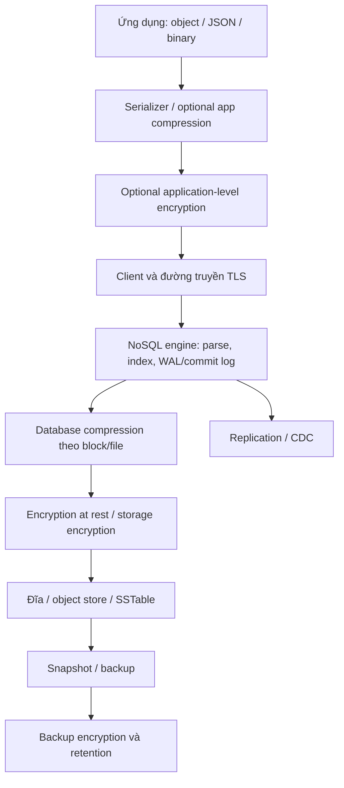
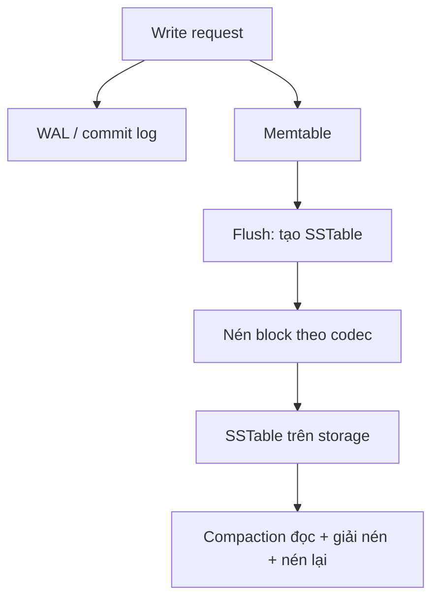
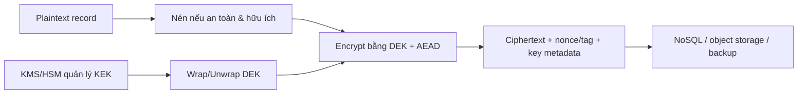
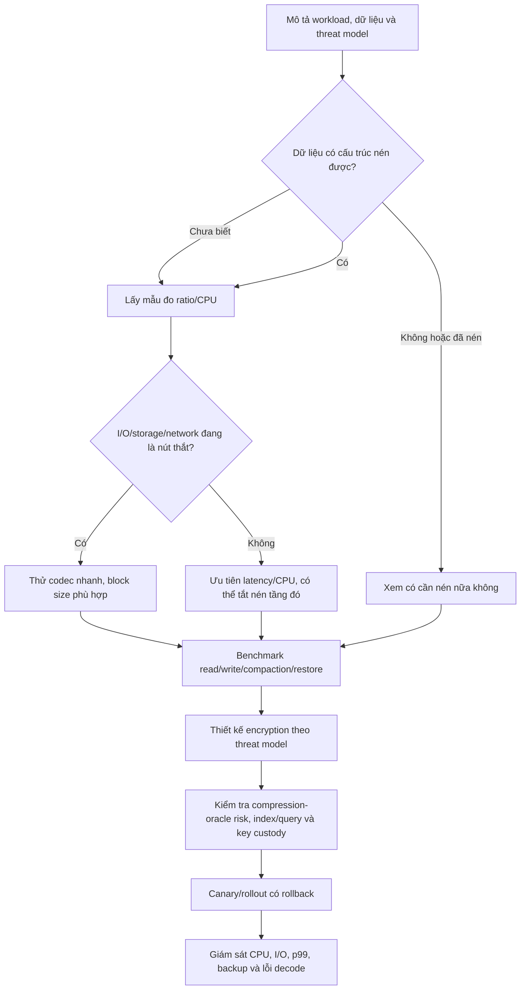

# Nén, mã hóa và đánh đổi CPU với dung lượng/I/O

## 1. Một bản ghi có thể nhỏ hơn trên đĩa nhưng tốn CPU hơn khi đọc

Trong hệ NoSQL, dữ liệu thường được lưu trên nhiều node, nhân bản qua mạng, ghi vào log, nén trong các file dữ liệu rồi phục vụ hàng nghìn hoặc hàng triệu truy vấn. Khi khối lượng lớn, **dung lượng lưu trữ**, **I/O đọc ghi**, **băng thông mạng** và **CPU** đều là tài nguyên hữu hạn.

Hai cơ chế thường được đặt cạnh nhau là:

- **Nén (compression):** biến đổi biểu diễn để giảm số byte phải lưu hoặc truyền, với chi phí tính toán nén và giải nén.
- **Mã hóa (encryption):** bảo vệ bí mật của dữ liệu trước những chủ thể không có quyền/khóa phù hợp; thường thêm chi phí CPU, quản lý khóa và metadata thay vì giảm dung lượng.

Nén và mã hóa có quan hệ quan trọng về **thứ tự xử lý**. Dữ liệu đã mã hóa tốt thường có entropy cao nên khó nén thêm. Nhiều hệ thống do đó nén dữ liệu trước rồi mã hóa khi lưu hoặc truyền. Tuy nhiên, **nén dữ liệu có bí mật cùng dữ liệu do kẻ tấn công kiểm soát có thể làm lộ thông tin qua độ dài**, nên không được áp dụng quy tắc “luôn nén trước khi mã hóa” một cách máy móc.

Ví dụ minh họa: hệ thống NoSQL lưu 100 GiB dữ liệu logic. Nếu sau nén phần dữ liệu tương ứng chỉ còn 40 GiB, hệ có thể giảm lượng dữ liệu đọc/ghi trong một số đường xử lý và giảm dung lượng trên đĩa. Nhưng để đọc một bản ghi, nó có thể phải đọc một block, giải mã, giải nén, lọc rồi trả kết quả. Nếu CPU đang quá tải, nén mạnh hơn có thể làm **độ trễ p99 tăng** dù disk usage giảm.

Ngược lại, nếu storage chậm hoặc băng thông mạng mới là nút thắt, nén có thể **cải thiện tốc độ** vì giảm số byte cần chuyển nhiều hơn chi phí CPU giải nén.

### Mục tiêu học tập

Sau bài này, bạn có thể:

1. Phân biệt nén dữ liệu ở tầng ứng dụng, request, database, storage, backup và replication.
2. Tính tỷ lệ nén, dung lượng sau nén và ước lượng điểm hòa vốn CPU–I/O.
3. Giải thích vì sao dữ liệu JSON nhiều trường lặp thường dễ nén, còn ciphertext và dữ liệu đã nén thường không.
4. Chọn phương pháp nén theo workload đọc/ghi, kích thước block, latency, throughput và khả năng vận hành.
5. Phân biệt mã hóa **in transit**, **at rest**, **phía ứng dụng/field level** và cơ chế quản lý khóa.
6. Hiểu thứ tự nén–mã hóa, AEAD, nonce, AAD, KMS và các rủi ro bảo mật liên quan.
7. Đánh giá ảnh hưởng lên index, query, cache, compaction, replication, backup, TTL và restore.
8. Thiết kế benchmark đo cả CPU, I/O, dung lượng, p95/p99 latency và chi phí thực tế thay vì chỉ nhìn compression ratio.

## 2. Bắt đầu từ đường đi của dữ liệu

Một hệ NoSQL thực tế có thể có các tầng:



Đây là sơ đồ **khái niệm**, không phải thứ tự pipeline bắt buộc của mọi engine. Một dịch vụ có thể mã hóa ở tầng storage trước khi ghi, nén theo column family, nén khi snapshot, hoặc thực hiện replication trên dạng dữ liệu khác với dạng lưu cuối cùng.

Cần trả lời ba câu hỏi trước khi bật một tùy chọn:

- **Tầng nào đang xử lý byte?** Ứng dụng, database engine, disk layer hay network?
- **Tầng nào nhìn thấy plaintext?** Điều này ảnh hưởng khả năng filter, index và threat model.
- **Tài nguyên nào giảm, tài nguyên nào tăng?** Storage, network, CPU, bộ nhớ, latency, số lần copy dữ liệu hay chi phí vận hành?

### 2.1. Nén ở nhiều tầng không cộng tỷ lệ đơn giản

Giả sử serializer giảm JSON từ 1.000 byte xuống 700 byte, rồi thuật toán nén thứ hai biến 700 byte còn 500 byte. Không được lấy tỷ lệ tiết kiệm của từng tầng cộng thành “30% + 28,6% = 58,6%” theo cách không kiểm tra mẫu số.

Tổng tỷ lệ còn lại là:

\[
r_{\text{total}} = \frac{500}{1.000} = 0{,}5
\]

Tổng tiết kiệm là 50% so với dạng 1.000 byte ban đầu. Một lần nén sau cũng có thể hầu như không giảm gì nếu dữ liệu đã được mã hóa hay nén hiệu quả.

### 2.2. Cùng bản ghi có nhiều phép đo kích thước

| Khái niệm | Cách hiểu | Dùng cho |
|---|---|---|
| Payload ứng dụng | Bytes sau serializer (JSON/Protobuf/BSON...) | Network, request size, serialization |
| Logical item size | Kích thước logic theo quy tắc database | Giới hạn item/document, billing theo đơn vị nếu có |
| Compressed payload | Bytes sau thuật toán nén được chọn | Ước lượng CPU và byte chuyển/lưu ở tầng đó |
| Encrypted payload | Ciphertext + nonce/tag/header (nếu có) | Ước lượng overhead bảo mật |
| Physical storage | Bytes thực trên disk/block, gồm index/log/metadata theo phạm vi đo | Capacity planning |
| Replicated footprint | Dung lượng trên các bản sao phục vụ | Chi phí cluster và fault tolerance |
| Backup footprint | Snapshot/full/incremental/log, có thể nén/khử trùng lặp riêng | Dự báo retention và DR |

Một tỷ lệ nén lấy từ file export không thể thay thế trực tiếp tỷ lệ nén SSTable/collection trong production, vì định dạng đầu vào và phạm vi đo khác nhau.

## 3. Định nghĩa tỷ lệ nén và phần trăm tiết kiệm

Cho:

- \(U\): dung lượng trước nén (*uncompressed bytes*);
- \(C\): dung lượng sau nén (*compressed bytes*).

Một cách biểu diễn:

\[
r = \frac{C}{U}
\]

- \(r = 0{,}4\) nghĩa là dữ liệu còn 40% kích thước gốc.
- Phần tiết kiệm là \(1-r = 0{,}6\), tức 60%.

Một cách biểu diễn khác là **compression factor**:

\[
f = \frac{U}{C} = \frac{1}{r}
\]

- \(f = 2{,}5\) nghĩa là dữ liệu trước nén lớn gấp 2,5 lần sau nén.

**Tránh nhầm cách báo cáo:** “compression ratio 2.5:1” và “compressed size ratio 0.4” mô tả cùng hiện tượng nhưng dùng tử/mẫu khác nhau.

### 3.1. Ví dụ 100 GiB và ba bản sao

Giả sử 100 GiB dữ liệu cơ sở có tỷ lệ kích thước sau nén \(r = 0{,}35\).

Dung lượng sau nén:

\[
C = 100 \times 0{,}35 = 35\ \text{GiB}
\]

Dung lượng tiết kiệm cho **một bản dữ liệu**:

\[
100-35 = 65\ \text{GiB}
\]

Nếu giả định có **ba bản sao đầy đủ** của chính phần dữ liệu ấy và cả ba có cùng tỷ lệ:

\[
S_{\text{uncompressed replicas}} = 3 \times 100 = 300\ \text{GiB}
\]

\[
S_{\text{compressed replicas}} = 3 \times 35 = 105\ \text{GiB}
\]

Tiết kiệm lý thuyết: **195 GiB** trước index, log, metadata, compaction, snapshot, backup, dư địa disk và chênh lệch giữa các node.

Không lấy 195 GiB làm một cam kết tiết kiệm thực tế. Trong database, không phải tất cả byte được nén với cùng thuật toán và hiệu quả; index, WAL, tombstone và backup có thể có đường nén khác nhau.

### 3.2. Chi phí tính theo logical capacity có thể không giảm

Một số managed NoSQL services tính phí hoặc giới hạn theo **kích thước item logic**, read/write capacity và request, không phải chỉ theo số byte vật lý trên đĩa do nhà cung cấp nén nội bộ.

Nén phía ứng dụng có thể giảm dung lượng value mà dịch vụ nhìn thấy, nhưng cũng có thể làm mất khả năng filter/index theo trường, thêm CPU, và biến một value nhỏ thành binary blob.

Cần kiểm tra contract định giá và giới hạn của dịch vụ đang dùng trước khi kết luận “nén 50% = giảm 50% hóa đơn”.

## 4. Những loại dữ liệu nào dễ hoặc khó nén?

Khả năng nén phụ thuộc **mẫu lặp, độ đa dạng và entropy** của dữ liệu.

| Dữ liệu | Xu hướng nén | Lý do |
|---|---|---|
| JSON có nhiều key lặp | Thường tốt | Tên field, cú pháp và giá trị lặp |
| Log text có cấu trúc | Thường tốt | Template thông báo và tiền tố lặp |
| Event có nhiều giá trị tương tự | Có thể tốt | Kiểu field và nội dung gần nhau |
| Dữ liệu cột cùng kiểu | Có thể rất tốt | Giá trị liền kề, dictionary, run-length, delta |
| Chuỗi ID hoặc UUID ngẫu nhiên | Thường kém hơn | Ít mẫu lặp cục bộ |
| Ảnh JPEG/PNG, video hiện đại | Thường không giảm nhiều khi nén lần nữa | Đã có codec nén riêng |
| Tệp ZIP/GZIP | Thường gần như không nén tiếp | Đã giảm redundancy |
| Ciphertext từ AEAD hợp lệ | Hầu như không nén được thêm | Có dạng gần nhiễu ngẫu nhiên |
| Sự kiện cực nhỏ | Có thể phình ra | Header/dictionary/block overhead |
| Payload lồng nhau, biến độ dài lớn | Không thể đoán chỉ từ schema | Phân bố field và nội dung thực tế quyết định |

Không phải mọi JSON đều nén tốt. Một JSON chứa chuỗi Base64 của dữ liệu đã nén hoặc bytes giả ngẫu nhiên có thể chỉ giảm ít. Cần đo từ sample đại diện thay vì suy từ file extension.

### 4.1. Entropy và lặp theo nhóm

Một document:

```json
{
  "tenantId": "t17",
  "deviceId": "d42",
  "type": "TEMPERATURE",
  "unit": "CELSIUS",
  "temperature": 28.4
}
```

Nếu lưu một triệu event tương tự, các chuỗi `tenantId`, `deviceId`, `type`, `unit` và tên thuộc tính xuất hiện liên tục. Compressor làm việc trên các block chứa nhiều event có thể khai thác các mẫu ấy.

Nhưng nếu mỗi event được nén **riêng lẻ** với header riêng, kích thước nhỏ và không có từ điển chung, lợi ích có thể thấp hơn nhiều so với nén cả một block gồm nhiều event.

### 4.2. Sự khác nhau giữa row-based và column-oriented encoding

Trong một dữ liệu được bố trí theo cột, nhiều giá trị cùng field có thể nằm gần nhau:

```text
status: PAID, PAID, PAID, PAID, PENDING, PENDING, ...
amount: 100, 101, 100, 100, 102, 105, ...
```

Các kỹ thuật như dictionary encoding, run-length encoding hoặc delta encoding có thể hoạt động tốt. Nhưng “wide-column NoSQL” và “columnar OLAP storage” không đồng nghĩa nhau; cách tổ chức physical blocks của Cassandra, Bigtable, ClickHouse hay Parquet khác nhau.

Bài toán nén luôn phải gắn với **layout thật** và access pattern của storage engine.

## 5. Chọn thuật toán: tốc độ, tỷ lệ nén và tài nguyên

Các họ thuật toán thường gặp trong hệ lưu trữ và data pipeline:

| Thuật toán/họ | Đặc tính chung | Trường hợp cân nhắc |
|---|---|---|
| **Snappy** | Ưu tiên tốc độ nén/giải nén, tỷ lệ thường vừa phải | Dữ liệu cần đọc/ghi nhanh và CPU hạn chế |
| **LZ4** | Rất chú trọng throughput/latency, tỷ lệ thường không tối đa | Data path có độ trễ thấp, SSTable/block compression |
| **Zstandard (Zstd)** | Có nhiều mức nén, cân bằng ratio và CPU tùy level/dictionary | Dữ liệu text/sự kiện, storage hoặc backup |
| **zlib/DEFLATE** | Phổ biến, tương thích rộng, ratio/CPU tùy level | Export, dữ liệu trung bình, hệ tương thích cũ |
| **Gzip** | Container định dạng dựa trên DEFLATE | File/object/log được trao đổi rộng |
| **Brotli** | Tối ưu tốt cho nhiều nội dung text/web, CPU tùy level | HTTP/static content, một số data pipeline |
| **Dictionary/RLE/delta** | Khai thác lặp trong kiểu/nhóm giá trị | Columnar formats và codec chuyên dụng |

Bảng phản ánh **xu hướng**, không phải thứ hạng cố định. Một bản benchmark phải chọn thuật toán, level, kích thước block, tập dữ liệu và phiên bản thư viện cụ thể.

### 5.1. Level nén cao không luôn tối ưu

Một compressor có nhiều level:

- Level thấp thường dùng ít CPU nén hơn, tỷ lệ nén có thể kém hơn.
- Level cao có thể giảm thêm byte nhưng tốn CPU/thời gian nén hơn.
- Tốc độ giải nén có thể không tăng/giảm cùng cách với tốc độ nén.
- Ở một số thuật toán, dictionary và kích thước window ảnh hưởng memory footprint.

Không chọn level cao nhất chỉ vì disk đang đắt. Trong hệ OLTP đọc/ghi nhiều, thêm CPU compression vào write path có thể làm tăng tail latency hoặc giảm throughput.

### 5.2. Compression dictionary

Một số thuật toán hỗ trợ từ điển được huấn luyện trên mẫu dữ liệu cùng loại. Với các record rất nhỏ và có nhiều cấu trúc lặp, dictionary có thể cải thiện ratio.

Đổi lại, cần quản lý:

- Dictionary version/ID được gắn trong payload hoặc metadata.
- Phân phối dictionary đến tất cả reader/worker.
- Backup và restore dictionary cùng dữ liệu đã nén.
- Phạm vi bảo mật của dictionary nếu được huấn luyện từ dữ liệu nhạy cảm.
- Tương thích khi rotate thuật toán/dictionary.
- Khả năng decode record cũ nhiều năm sau.

Một record chỉ lưu “compressed bytes” mà không biết codec, version và dictionary có thể trở thành **dữ liệu không thể đọc** khi library/config thay đổi.

## 6. Nén theo record, block hay file?

### 6.1. Nén từng record

```text
Record A -> Compress(A)
Record B -> Compress(B)
Record C -> Compress(C)
```

Ưu điểm:

- Có thể giải nén một record mà không cần đọc/giải nén các record khác.
- Dễ gắn version của codec vào value.
- Có thể truyền một value đã nén giữa các dịch vụ theo contract.

Nhược điểm:

- Nhiều header nhỏ.
- Mất cơ hội khai thác mẫu lặp xuyên record.
- Tăng CPU khi rất nhiều record nhỏ.
- Nếu app-level compression tạo blob, database không nhìn được field bên trong để index/filter.

### 6.2. Nén theo block

```text
Block 1: [Record A | Record B | Record C | ...] -> Compressed Block 1
Block 2: [Record D | Record E | Record F | ...] -> Compressed Block 2
```

Ưu điểm:

- Khai thác mẫu lặp giữa nhiều record.
- Giảm disk I/O cho scan/range read.
- Có thể quản lý compression trong storage engine mà ứng dụng không cần thay schema.

Nhược điểm:

- Đọc một record có thể cần giải nén cả block.
- Block lớn có thể tăng CPU, memory tạm và write amplification khi cập nhật.
- Random read nhỏ trên dữ liệu ít liên quan có thể tốn giải nén không cần thiết.
- Lỗi dữ liệu ở block có thể ảnh hưởng nhiều record; cần checksum và cơ chế kiểm tra/cứu dữ liệu.

### 6.3. Nén cả file/snapshot

Thích hợp cho export, snapshot hoặc archive có thể đọc tuần tự, nhưng random access cần index/block framing hoặc phải giải nén một phạm vi lớn.

Một file nén tốt trên đĩa **không tự đồng nghĩa** với API read latency thấp. Nhu cầu truy cập ngẫu nhiên khác nhu cầu đọc toàn bộ bản backup.

### 6.4. Kích thước block ảnh hưởng tỷ lệ và latency

Giả sử block 4 KiB, 32 KiB và 256 KiB:

| Block | Có thể thuận lợi | Rủi ro |
|---|---|---|
| Nhỏ | Đọc ngẫu nhiên ít giải nén dư; memory tạm nhỏ | Ratio thấp hơn, nhiều metadata |
| Trung bình | Cân bằng random read và scan | Cần benchmark theo workload |
| Lớn | Nén tốt hơn khi dữ liệu tương đồng | Đọc 1 record vẫn xử lý nhiều byte, tail latency/memory tăng |

Không suy “256 KiB luôn tốt hơn 32 KiB”. Một hệ có block cache và prefetch riêng có thể có tối ưu khác.

## 7. Mô hình CPU–I/O: khi nào nén làm đọc nhanh hơn?

Giả sử một truy vấn phải đọc \(U\) byte dữ liệu chưa nén. Nếu tỷ lệ sau nén là \(r\), số byte phải đọc ở tầng nén là \(rU\).

Đặt:

- \(B\): bandwidth đọc hiệu dụng của tầng lưu trữ, byte/giây;
- \(D\): tốc độ giải nén hiệu dụng, tính theo **byte gốc/giây**;
- \(r\): tỷ lệ kích thước sau nén.

Mô hình **không pipeline, không cache, bỏ qua overhead khác**:

\[
T_{\text{plain}} \approx \frac{U}{B}
\]

\[
T_{\text{compressed}} \approx \frac{rU}{B} + \frac{U}{D}
\]

Nén nhanh hơn trong mô hình này khi:

\[
\frac{rU}{B}+\frac{U}{D}<\frac{U}{B}
\]

Rút gọn:

\[
\frac{1}{D}<\frac{1-r}{B}
\]

Hay:

\[
D > \frac{B}{1-r}
\]

Đây là **điểm hòa vốn tính theo thông lượng lý thuyết**, không phải định luật về latency production.

### 7.1. Ví dụ đọc 4 GiB

Giả định minh họa:

| Biến | Giá trị |
|---|---:|
| Dữ liệu gốc | \(U=4096\) MiB |
| Tỷ lệ sau nén | \(r=0{,}4\) |
| Tốc độ đọc hiệu dụng | \(B=500\) MiB/s |
| Tốc độ giải nén | \(D=1024\) MiB/s |

Không nén:

\[
T_{\text{plain}} = \frac{4096}{500}\approx 8{,}19\ \text{giây}
\]

Sau nén:

\[
T_{\text{compressed}}
= \frac{0{,}4\times4096}{500}+\frac{4096}{1024}
\]

\[
\approx 3{,}28+4{,}00=7{,}28\ \text{giây}
\]

Theo mô hình tuần tự này, đọc nén **nhanh hơn khoảng 0,91 giây** và giảm byte I/O. Nếu giải nén chậm hơn, hoặc CPU bận, kết quả có thể đảo ngược.

Trong thực tế, đọc và giải nén có thể được pipeline, nhiều core xử lý song song, dữ liệu đã nằm trong page cache, hoặc có thêm chi phí network và query execution. Vì vậy phải đo end-to-end.

### 7.2. Nút thắt CPU có thể chuyển từ I/O sang decompression

Giả sử storage nhanh hơn nhiều (ví dụ NVMe có băng thông lớn hơn mức CPU giải nén khả dụng). Khi ấy tiết kiệm I/O ít giá trị hơn, còn CPU giải nén có thể trở thành bottleneck.

Đặc biệt trong một cluster vừa phục vụ query, vừa compaction, vừa replication, CPU nén/giải nén cạnh tranh với:

- Query predicate evaluation.
- Serialization/deserialization.
- TLS encryption.
- Garbage collection.
- Background index maintenance.
- Read repair/replica coordination.
- Compaction, flush, snapshot và backup jobs.

Chỉ nhìn thông số disk I/O không đủ để dự đoán p99 latency khi CPU saturate.

### 7.3. Nếu dữ liệu nằm trong cache?

Một số database giữ **dữ liệu đã giải nén** trong page/block cache; một số giữ **block nén** hoặc dùng nhiều tầng cache. Nếu hit cache, tiết kiệm I/O có thể gần bằng 0 trong đường đọc đó; CPU decompress lại có thể là chi phí nổi bật hoặc có thể đã được loại nhờ cached uncompressed block.

Cần hiểu cache design của engine và xem các phép đo:

- Block cache hit/miss.
- Cache bytes compressed/uncompressed.
- Decompress operations.
- CPU usage và cache eviction.
- Read latency khi cache nóng và khi cache lạnh.

## 8. Mô hình CPU–I/O trên đường ghi

Ghi dữ liệu phải qua serialization, validation, index, WAL/commit log, có thể compression, encryption và replication.

Giả sử tốc độ nén là \(E\) byte gốc/giây và bandwidth ghi là \(B_w\).

Mô hình tuần tự đơn giản:

\[
T_{\text{write, plain}} \approx \frac{U}{B_w}
\]

\[
T_{\text{write, compressed}}
\approx
\frac{U}{E} + \frac{rU}{B_w}
\]

Nếu \(E\) thấp, chi phí nén có thể làm đường ghi chậm hơn dù lượng byte ghi giảm mạnh. Tuy nhiên, database có thể nén khi flush hoặc compaction **ngoài request latency**, và không phải mọi write đều chờ dữ liệu được ghi thành block nén trên đĩa.

### 8.1. Không áp công thức ghi trực tiếp cho mọi LSM engine

Ở nhiều hệ LSM, một write được ghi vào log/memtable rồi dữ liệu được flush/compact thành file về sau. Compression có thể xảy ra trong background:



Vì vậy nén có thể không làm tăng trực tiếp thời gian ACK của từng request trong cùng cách với “nén value đồng bộ trước PUT”, nhưng nó vẫn tiêu thụ CPU/I/O nền và có thể ảnh hưởng throughput, queueing và tail latency.

### 8.2. Compaction làm tăng số lần nén lại

Trong một số workload, cùng một dữ liệu được:

1. Ghi vào memtable/WAL.
2. Flush thành SSTable nén.
3. Đọc trong compaction.
4. Giải nén/merge dữ liệu.
5. Nén lại thành SSTable mới.
6. Có thể được compact nhiều lần trước khi bị xóa.

Do đó cần đo **write amplification** theo tổng byte vật lý và CPU compression qua vòng đời, không chỉ nén lần đầu.

### 8.3. Nén giúp network replication không?

Có thể, nhưng phụ thuộc hệ:

- Một số replication truyền mutation dạng logic chưa nén.
- Một số truyền block/file đã nén.
- Một số dùng nén transport riêng.
- Một số dịch vụ managed không cho cấu hình lớp này.
- Rebalancing/repair/streaming có thể dùng format và codec khác đường ghi bình thường.

Nếu muốn ước lượng tiết kiệm băng thông replication, hãy đo **bytes transmitted per replica stream**, không lấy trực tiếp tỷ lệ nén SSTable nhân với network traffic.

## 9. Nén và độ bền (durability) có liên quan nhưng không đồng nghĩa

Trong chương *Lưu trữ và độ bền*, cần phân biệt ba tính chất:

- **Compression:** giảm biểu diễn byte.
- **Encryption:** bảo vệ bí mật, đôi khi tính toàn vẹn theo phạm vi của cơ chế mật mã.
- **Durability:** thay đổi đã được xác nhận có khả năng tồn tại và phục hồi theo failure model của hệ.

Một hệ có thể nén rất tốt nhưng mất dữ liệu nếu không fsync/log/replicate theo contract. Một hệ mã hóa đầy đủ vẫn có thể làm hỏng dữ liệu vì mất khóa hoặc snapshot không nhất quán.

### 9.1. Những mắt xích của durability

Một write có thể phụ thuộc:

- Write acknowledgment và consistency level.
- WAL/commit log hoặc cơ chế persistence.
- Replica/leader failover.
- Filesystem/storage guarantees.
- Checksums hoặc integrity verification.
- Snapshot/backup và restore.
- Key management để giải mã bản backup.
- Quy trình phát hiện và sửa corruption.

Nén thường làm giảm byte ở một số tầng, qua đó có thể giúp backup hoặc replication hiệu quả hơn. Nhưng **bật nén không thay thế redundancy, fsync, backup hay testing**.

### 9.2. Block corruption và checksum

Nếu một block nén bị hỏng một vài byte, giải nén có thể thất bại hoặc làm ảnh hưởng đến nhiều record trong block. Cần:

- Checksums phát hiện corruption theo cơ chế sản phẩm.
- Mã xác thực/integrity ở tầng mã hóa phù hợp.
- Replica hoặc backup lành mạnh để recovery.
- Metrics và cảnh báo error đọc block.
- Runbook phân biệt lỗi disk, dữ liệu nén và sai khóa giải mã.

**Checksum không thay thế AEAD** đối với tấn công cố ý sửa ciphertext, còn AEAD không tự giúp phục hồi byte đã mất. Cả hai cần được đặt trong threat model rõ ràng.

## 10. Mã hóa trong NoSQL: bảo vệ trước những ai?

Trước khi bật encryption, phải viết **threat model**: đang ngăn ai đọc dữ liệu trái phép?

- Người lấy được ổ đĩa hoặc snapshot storage.
- Người có quyền xem bản backup.
- Kẻ nghe lén mạng nội bộ/Internet.
- Người có quyền đọc database nhưng không có quyền xem một số trường nhạy cảm.
- Nhân viên vận hành tầng hạ tầng.
- Một service bị xâm nhập hoặc client vượt quyền.
- Người sửa dữ liệu/response trong quá trình truyền.

Không có một lớp mã hóa giải quyết tất cả.

### 10.1. Encryption in transit

TLS bảo vệ kênh giữa client và database hoặc giữa các thành phần khi được cấu hình và xác minh đúng:

```text
App -- TLS --> Database endpoint
Node -- TLS --> Node
Worker -- TLS --> Object storage
```

TLS giúp chống nghe lén và tấn công sửa dữ liệu trên đường truyền trong phạm vi xác thực endpoint. Nhưng sau khi endpoint hợp lệ giải mã, dữ liệu vẫn được xử lý trong bộ nhớ của endpoint.

Cần kiểm tra:

- TLS có thực sự được yêu cầu, không phải optional downgrade?
- Có xác thực certificate và hostname đúng?
- Các kết nối giữa node/replica có được bảo vệ?
- Secret/cert rotation và quyền truy cập đã được quản lý?
- Có tránh log payload nhạy cảm hay không?

Đừng bật “compression trong TLS” theo thói quen. Nén kết hợp dữ liệu bí mật và dữ liệu do attacker kiểm soát có thể tạo **length side channels**. Các giao thức TLS hiện đại không dựa vào TLS-level compression; chỉ bật cơ chế nén ở tầng ứng dụng khi có đánh giá an toàn rõ.

### 10.2. Encryption at rest

Encryption at rest bảo vệ dữ liệu trên thiết bị, volume, file hoặc service storage:

```text
Database plaintext in memory
       |
       v
Storage engine / encryption layer
       |
       v
Encrypted blocks on disk
```

Nó có thể bảo vệ dữ liệu khi ổ đĩa/backup/storage media bị truy cập trái phép mà không có khóa.

**Giới hạn:** một người có quyền query hợp lệ qua database vẫn có thể đọc plaintext nếu database engine có quyền giải mã. At-rest encryption không thay thế database authorization, row/field-level access policy hay audit.

### 10.3. Encryption phía ứng dụng hoặc cấp trường

Ứng dụng có thể mã hóa riêng `phoneNumber`, `nationalId` hoặc một secret trước khi gửi đến database.

```text
Application plaintext
     |
     v
App encrypt(value)
     |
     v
Database chỉ nhìn ciphertext
```

Lợi ích: nếu quản lý khóa độc lập và DB không có quyền giải mã, một số kịch bản người truy cập DB không thể xem trực tiếp giá trị bí mật.

Đánh đổi:

- Database có thể không filter/sort/range query trên plaintext.
- Secondary indexes trên ciphertext thường không phục vụ truy vấn ngữ nghĩa gốc.
- Một số cơ chế deterministic encryption cho equality query có rủi ro lộ mẫu bằng nhau.
- Rotation/re-encryption và compatibility của record trở nên phức tạp.
- Application CPU và kích thước value tăng.
- Nếu app/server bị xâm nhập và giữ key, ciphertext có thể bị giải mã.
- Backup phải đi cùng quy trình bảo vệ/khôi phục khóa.

Field-level encryption cần được thiết kế cùng access pattern, không thêm ở phút cuối cho một cột cần range query.

### 10.4. Các phạm vi mã hóa

| Cơ chế | Ai thường nhìn plaintext? | Truy vấn DB theo field | Rủi ro/giới hạn |
|---|---|---|---|
| TLS | Hai endpoint hợp lệ | Không thay đổi do TLS | Không bảo vệ storage/backend sau giải mã |
| Disk/volume encryption | DB engine có quyền giải mã | Thường giữ nguyên | Admin có quyền DB vẫn có thể query |
| Database TDE/storage encryption | DB engine theo contract | Thường giữ nguyên | Không tự phân quyền field |
| App-level random encryption | Ứng dụng có key | Thường không query trực tiếp theo plaintext | Khó index, tăng CPU, quản lý khóa |
| Deterministic encryption | Ứng dụng/hệ mã hóa có key | Có thể hỗ trợ equality theo thiết kế | Rò rỉ equality/frequency; không phù hợp mọi field |
| Specialized queryable encryption | Tùy scheme/product/version | Một tập query được hỗ trợ | Giới hạn, chi phí và mô hình rò rỉ riêng |

Không gắn nhãn “mã hóa mạnh” với một cơ chế mà không nêu **key custody, attack model, leakage và query semantics**.

## 11. Thứ tự nén và mã hóa: tại sao thường nén trước?

### 11.1. Dữ liệu plaintext có cấu trúc, ciphertext không

Với JSON có lặp:

```text
JSON 1.000 B
   |
   | Compression
   v
Compressed bytes 350 B
   |
   | Authenticated encryption
   v
Ciphertext + nonce + tag + header
```

Nếu mã hóa trước:

```text
JSON 1.000 B
   |
   | Encryption
   v
Ciphertext ~ 1.000 B + overhead
   |
   | Compression
   v
Gần như không giảm tiếp
```

Bởi ciphertext sinh từ cipher hiện đại với nonce phù hợp có đặc tính gần nhiễu ngẫu nhiên; compressor không tìm được cấu trúc lặp hữu ích.

### 11.2. Ngoại lệ an ninh: compression oracle/length leakage

Giả sử cùng một vùng dữ liệu chứa:

- Secret do server giữ, ví dụ session token.
- Chuỗi do attacker kiểm soát, ví dụ một phần request.
- Compressor chạy trên cả hai.
- Attacker quan sát độ dài ciphertext hoặc response qua nhiều thử nghiệm.

Attacker có thể đo mức thay đổi độ dài khi đưa chuỗi đoán vào, từ đó suy ra thông tin liên quan đến secret thông qua **compression side channel**. Các tấn công kiểu CRIME/BREACH minh họa nguy cơ trong những cấu hình giao thức/web cụ thể.

Vì vậy:

- Không nén chung secret với dữ liệu attacker có thể điều khiển nếu độ dài có thể quan sát và threat model cho phép tấn công.
- Có thể tách vùng nén, tắt compression cho payload nhạy cảm hoặc dùng padding/chính sách phù hợp sau đánh giá.
- Không mặc định padding vài byte là đủ chống mọi suy đoán.
- Không biến một mẫu “compress then encrypt” thành lời khuyên bảo mật tuyệt đối.

**Nguyên tắc:** nén trước mã hóa thường có lợi về tỷ lệ, **nhưng phải kiểm tra rò rỉ qua độ dài và nguồn dữ liệu trước khi quyết định**.

### 11.3. Trường đã mã hóa ở tầng ứng dụng ảnh hưởng nén tầng DB

Nếu app gửi một field ciphertext ngẫu nhiên vào MongoDB hay Cassandra, storage engine nhìn thấy bytes có entropy cao ở field đó. Việc nén ở tầng DB khó giảm kích thước field ấy, mặc dù các field plaintext khác trong cùng block vẫn có thể nén.

Do đó hệ có nhiều PII field đã encrypt phía app có thể đạt tỷ lệ nén thấp hơn dự đoán từ dữ liệu giả lập plaintext. Benchmark phải dùng payload thực tế sau serializer/encryption ở đúng tầng.

## 12. Encryption overhead: dữ liệu mã hóa thường lớn hơn một chút

Với AES-GCM và một envelope minh họa:

- Nonce 12 byte.
- Authentication tag 16 byte nếu dùng tag 128-bit.
- Một byte format version.
- Ciphertext có độ dài bằng plaintext được mã hóa trước khi tính tag trong ví dụ AES-GCM không padding.

Phần overhead tối thiểu trong ví dụ là:

\[
12 + 16 + 1 = 29\ \text{byte}
\]

Chưa gồm key identifier, checksum ngoài, compression header, alignment, metadata hoặc record envelope của ứng dụng.

### 12.1. Bản ghi nhỏ chịu overhead tương đối lớn

Nếu một value trước mã hóa chỉ có 80 byte:

\[
S_{\text{after}} = 80 + 29 = 109\ \text{byte}
\]

Overhead 29/80 ≈ **36,25%** so với dữ liệu trước mã hóa.

Nếu value 8 KiB, cùng 29 byte là tỷ lệ rất nhỏ. Điều này giải thích vì sao mã hóa riêng **hàng triệu field cực nhỏ** có thể tạo overhead metadata đáng kể, trong khi mã hóa theo block lớn hơn có footprint tốt hơn.

Đây chỉ là ví dụ định dạng envelope; các sản phẩm có scheme, tag, nonce, cấu trúc và metadata khác.

### 12.2. Mã hóa không thay thế compression hay index tuning

Encryption có thể tăng CPU và một ít dung lượng, nhưng vấn đề hiệu năng lớn hơn đôi khi là **mất đường truy vấn**: app biến `email` thành ciphertext nên database không thể index theo email plaintext. Nếu ứng dụng phải scan nhiều item rồi giải mã để lọc, CPU và read capacity có thể tăng mạnh hơn overhead AES.

Tối ưu bảo mật phải được thiết kế cùng **đường truy cập**, không chỉ benchmark thời gian `encrypt()`.

## 13. Quản lý khóa: phần quan trọng hơn việc chọn API encrypt

Mã hóa không an toàn chỉ vì chọn thuật toán phổ biến. **Ai giữ khóa, khi nào khóa được cấp và có thể khôi phục thế nào** mới quyết định threat model.

### 13.1. Không hardcode khóa

Sai lầm:

```text
const secretKey = "my-production-secret-key";
```

Không nên ghi production key trong source code, test fixture, tài liệu, image container hoặc log. Khi key bị lộ, mọi ciphertext được bảo vệ bởi key đó có thể bị ảnh hưởng theo phạm vi sử dụng.

### 13.2. Envelope encryption

Một mô hình phổ biến:

1. Hệ sinh **Data Encryption Key (DEK)** để mã hóa payload.
2. DEK được bọc (wrap) bằng **Key Encryption Key (KEK)** do KMS/HSM hoặc hệ quản lý khóa đáng tin bảo vệ.
3. Record/file lưu ciphertext, metadata codec và wrapped DEK hoặc key reference theo thiết kế.
4. Reader được cấp quyền unwrap DEK theo policy, rồi decrypt payload.
5. Rotating KEK có thể khác việc re-encrypt mọi payload bằng DEK mới.



Không phải ứng dụng nào cũng cần tự xây envelope encryption. Nhiều managed database đã có cơ chế at-rest encryption và KMS integration. Cần biết phạm vi bảo vệ của chúng trước khi thêm một lớp app-level.

### 13.3. Các loại rotation

| Thao tác | Ý nghĩa | Không nên nhầm với |
|---|---|---|
| Đổi KEK/KMS wrapping key | Thay lớp bảo vệ DEK theo contract KMS | Tự động đổi mọi DEK hoặc mọi ciphertext |
| Rewrap DEK | Bọc lại cùng DEK bằng KEK khác | Mã hóa lại payload dưới DEK mới |
| Re-encrypt dữ liệu | Đọc/giải mã rồi mã hóa lại bằng key/nonce mới | Chỉ thay metadata key ID |
| Rotate TLS certificates | Thay chứng chỉ/kênh kết nối | Thay khóa mã hóa data at rest |
| Hủy khóa | Làm mất khả năng giải mã những dữ liệu phụ thuộc nếu không còn bản sao key | Xóa mọi bản plaintext/ciphertext khỏi storage |

Một kế hoạch rotation phải xem **availability và restore**: nếu key cũ bị xóa trong khi backup cũ còn cần nó, backup có thể trở nên không thể sử dụng.

### 13.4. Key ID và versioning của ciphertext

Một envelope dữ liệu có thể lưu:

```json
{
  "recordId": "U42",
  "encodingVersion": 2,
  "compressionCodec": "zstd",
  "encryptionAlgorithm": "AES-256-GCM",
  "keyId": "customer-data-key-v7",
  "nonce": "<base64>",
  "ciphertext": "<base64>",
  "tagLocation": "appended"
}
```

Đây là ví dụ **metadata cấu trúc**, không phải ciphertext hợp lệ hay format chuẩn của mọi sản phẩm. Khi triển khai cần dùng các API và format đã được kiểm chứng, đồng thời đảm bảo một số metadata quan trọng được authenticated, chẳng hạn qua AEAD AAD hoặc envelope integrity.

### 13.5. Mất khóa cũng là mất dữ liệu

Một backup “thành công” nhưng không có key cần để decrypt có thể không restore được. Runbook cần:

- Quyền truy cập key trong DR environment.
- Chính sách key retention tương thích backup retention.
- Cơ chế key rotation không làm hỏng dữ liệu cũ.
- Audit người unwrap/decrypt.
- Phục hồi trong tình huống region/account lỗi.
- Cách xử lý key bị lộ.
- Bằng chứng restore drill có thực sự giải mã được dữ liệu.

## 14. AEAD, nonce và tính toàn vẹn

Nên dùng các scheme được cộng đồng và nhà cung cấp hỗ trợ, chẳng hạn **AES-GCM** hoặc một AEAD phù hợp với môi trường, thay vì tự thiết kế cipher.

### 14.1. Authenticated encryption

AEAD (*Authenticated Encryption with Associated Data*) cho phép vừa mã hóa vừa kiểm tra integrity/authenticity của ciphertext và AAD theo contract.

Ví dụ AAD có thể gắn với:

- Tenant ID.
- Record ID.
- Record type.
- Format version hoặc ngữ cảnh sử dụng.

Khi record bị sao chép sang một identity khác hoặc metadata bị sửa, việc decrypt với AAD không khớp sẽ thất bại. Nhưng AAD chỉ bảo vệ đúng những gì ứng dụng đưa vào và kiểm tra nhất quán; nó **không** thay database authorization.

### 14.2. Nonce duy nhất theo khóa

Với AES-GCM, tái sử dụng cùng nonce với cùng key có thể gây hậu quả bảo mật nghiêm trọng. Trong thiết kế dùng nonce ngẫu nhiên, phải sinh bằng **cryptographically secure RNG**, đủ độ dài và hiểu xác suất va chạm tại quy mô sử dụng.

Nếu mã hóa rất nhiều record bằng cùng DEK, cần policy key/nonce và giới hạn sử dụng phù hợp. Không dùng timestamp vài chữ số, counter không được đồng bộ giữa node, hoặc random generator không an toàn làm nonce.

### 14.3. Không giải nén dữ liệu trước khi xác thực

Với pipeline compress → encrypt, khi đọc nên:

1. Parse envelope có giới hạn kích thước và version rõ.
2. Xác định key/algorithm phù hợp.
3. Xác thực tag và decrypt theo AEAD.
4. Chỉ sau khi ciphertext hợp lệ mới giải nén.
5. Giới hạn kích thước output giải nén.
6. Deserialize/validate theo schema hiện hành.

Việc đưa dữ liệu chưa xác thực vào decompressor làm tăng bề mặt tấn công. Đồng thời, **compressed bomb** có thể khai thác tỷ lệ nén rất lớn để buộc hệ cấp phát lượng RAM/CPU khổng lồ, nên phải đặt giới hạn output và input phù hợp.

### 14.4. Checksum và AEAD khác nhau

- **Checksum:** phát hiện sai lệch byte do lỗi truyền/lưu trữ; không nhất thiết chống sửa cố ý.
- **AEAD tag:** xác nhận ciphertext/AAD dưới secret key phù hợp, phát hiện sửa trái phép theo bảo đảm của scheme.
- **Hash nội dung:** hỗ trợ integrity/deduplication theo điều kiện, nhưng nếu không có khóa/chữ ký, không mặc nhiên xác thực nguồn.

Một database có thể có checksum storage và mã hóa ở một tầng khác. Không bỏ qua checksum của engine chỉ vì app đã dùng AEAD, và không xem checksum làm cơ chế bảo mật thay thế.

## 15. Ví dụ Java: nén rồi mã hóa một value

Ví dụ này minh họa cấu trúc **compress → AES-GCM encrypt → verify/decrypt → bounded decompress**. Mã chạy trên Java 17 với thư viện chuẩn; dùng key sinh tạm **chỉ để demo**, không phải triển khai production. Trong hệ thật, key phải đến từ quy trình quản lý khóa phù hợp và metadata key ID/format phải được lưu để đọc lại.

```java
import javax.crypto.Cipher;
import javax.crypto.KeyGenerator;
import javax.crypto.SecretKey;
import javax.crypto.spec.GCMParameterSpec;
import java.io.ByteArrayInputStream;
import java.io.ByteArrayOutputStream;
import java.nio.ByteBuffer;
import java.nio.charset.StandardCharsets;
import java.security.SecureRandom;
import java.util.zip.DeflaterOutputStream;
import java.util.zip.InflaterInputStream;

public class CompressEncryptDemo {
    private static final byte FORMAT_VERSION = 1;
    private static final int NONCE_BYTES = 12;
    private static final int TAG_BITS = 128;
    private static final int TAG_BYTES = TAG_BITS / 8;
    private static final int MAX_OUTPUT_BYTES = 16 * 1024 * 1024;
    private static final SecureRandom RNG = new SecureRandom();

    static byte[] compress(byte[] input) throws Exception {
        try (ByteArrayOutputStream out = new ByteArrayOutputStream();
             DeflaterOutputStream z = new DeflaterOutputStream(out)) {
            z.write(input);
            z.finish();
            return out.toByteArray();
        }
    }

    static byte[] decompressBounded(byte[] input) throws Exception {
        try (InflaterInputStream in = new InflaterInputStream(
                    new ByteArrayInputStream(input));
             ByteArrayOutputStream out = new ByteArrayOutputStream()) {

            byte[] buffer = new byte[8192];
            int n;

            while ((n = in.read(buffer)) != -1) {
                if (n > MAX_OUTPUT_BYTES - out.size()) {
                    throw new IllegalArgumentException(
                        "Decompressed payload exceeds limit"
                    );
                }
                out.write(buffer, 0, n);
            }
            return out.toByteArray();
        }
    }

    static byte[] seal(
            byte[] plaintext,
            SecretKey key,
            String recordIdentity
    ) throws Exception {

        // Trong hệ thật, kiểm tra input size trước khi nén.
        if (plaintext.length > MAX_OUTPUT_BYTES) {
            throw new IllegalArgumentException("Payload too large");
        }

        byte[] compressed = compress(plaintext);
        byte[] nonce = new byte[NONCE_BYTES];
        RNG.nextBytes(nonce);

        Cipher cipher = Cipher.getInstance("AES/GCM/NoPadding");
        cipher.init(
            Cipher.ENCRYPT_MODE,
            key,
            new GCMParameterSpec(TAG_BITS, nonce)
        );

        // AAD gắn ciphertext với format và identity ngữ cảnh.
        cipher.updateAAD(new byte[] { FORMAT_VERSION });
        cipher.updateAAD(
            recordIdentity.getBytes(StandardCharsets.UTF_8)
        );

        byte[] ciphertextAndTag = cipher.doFinal(compressed);
        return ByteBuffer.allocate(
                1 + NONCE_BYTES + ciphertextAndTag.length
            )
            .put(FORMAT_VERSION)
            .put(nonce)
            .put(ciphertextAndTag)
            .array();
    }

    static byte[] open(
            byte[] envelope,
            SecretKey key,
            String recordIdentity
    ) throws Exception {

        if (envelope.length < 1 + NONCE_BYTES + TAG_BYTES) {
            throw new IllegalArgumentException("Invalid envelope");
        }

        ByteBuffer input = ByteBuffer.wrap(envelope);
        byte format = input.get();
        if (format != FORMAT_VERSION) {
            throw new IllegalArgumentException(
                "Unsupported format: " + format
            );
        }

        byte[] nonce = new byte[NONCE_BYTES];
        input.get(nonce);

        byte[] ciphertextAndTag = new byte[input.remaining()];
        input.get(ciphertextAndTag);

        Cipher cipher = Cipher.getInstance("AES/GCM/NoPadding");
        cipher.init(
            Cipher.DECRYPT_MODE,
            key,
            new GCMParameterSpec(TAG_BITS, nonce)
        );
        cipher.updateAAD(new byte[] { format });
        cipher.updateAAD(
            recordIdentity.getBytes(StandardCharsets.UTF_8)
        );

        // Xác thực tag trước; sai key/AAD/ciphertext sẽ thất bại.
        byte[] compressed = cipher.doFinal(ciphertextAndTag);

        // Chỉ giải nén sau khi xác thực và có giới hạn output.
        return decompressBounded(compressed);
    }

    public static void main(String[] args) throws Exception {
        KeyGenerator generator = KeyGenerator.getInstance("AES");
        generator.init(256);
        SecretKey demoKey = generator.generateKey();

        byte[] original = (
            "{\"tenantId\":\"t17\",\"eventType\":\"TEMPERATURE\","
            + "\"deviceId\":\"d42\",\"value\":28.4}"
        ).getBytes(StandardCharsets.UTF_8);

        byte[] encrypted = seal(original, demoKey, "t17:event:E1");
        byte[] restored = open(encrypted, demoKey, "t17:event:E1");

        System.out.println("Before: " + original.length + " bytes");
        System.out.println("Envelope: " + encrypted.length + " bytes");
        System.out.println(
            "Restored matches: "
            + java.util.Arrays.equals(original, restored)
        );
    }
}
```

### 15.1. Điều gì được minh họa đúng?

- Mã hóa value **sau khi nén**.
- Sinh nonce mới từ nguồn random bảo mật cho mỗi lần encrypt.
- Dùng AEAD tag 128-bit, kiểm tra bằng `Cipher.doFinal`.
- AAD gắn ciphertext với version và record identity; cùng identity phải được dùng khi decrypt.
- Không giải nén trước khi tag được xác minh.
- Giới hạn kích thước output để tránh decompression bomb đơn giản.
- Không log plaintext hoặc key.

### 15.2. Điều gì còn thiếu trước khi triển khai production?

- KMS/HSM và envelope encryption với key ID/wrapped DEK.
- Quản lý rotation, revoked key, multi-region restore và lưu key metadata.
- Quy tắc không tái sử dụng nonce trên một key ở quy mô triển khai.
- Giới hạn input ciphertext và memory allocation **trước** khi tạo buffer.
- Phân loại lỗi xác thực, codec, corruption và rate limit.
- Chính sách bảo mật compression oracle/length leakage của dữ liệu thực.
- Authentication/authorization của caller và record identity.
- Key caching, key retrieval latency và khả năng phục hồi khi KMS lỗi.
- Unit/integration tests cho record lớn, sai tag, sửa AAD, sai version.
- Dữ liệu nhạy cảm trong heap, garbage collection và memory diagnostics.
- Chọn codec theo workload; ví dụ dùng `Deflater` chỉ vì có trong JDK.

**Không sao chép demo vào production như một giao thức mật mã hoàn chỉnh.** Mục tiêu là thấy rõ boundary và các bước bảo vệ, không tự xây một KMS hay crypto framework.

### 15.3. Ví dụ với value cực nhỏ có thể phản tác dụng

Một value JSON ngắn có thể không nén được bao nhiêu, sau đó còn thêm 29 byte AES-GCM envelope. Vì vậy số byte sau `seal` có thể **lớn hơn** payload ban đầu.

Ứng dụng có thể áp dụng policy “chỉ nén các value lớn hơn ngưỡng và có lợi”, nhưng khi ấy metadata phải ghi rõ `compressionCodec = none` hay `deflate` để reader biết cách giải mã. Ngoài ra, quyết định nén theo dữ liệu nhạy cảm phải xét length side channel.

## 16. Các lớp nén và mã hóa của những hệ NoSQL phổ biến

Không nên suy rằng mọi hệ cho phép bật/tắt một codec ở cùng vị trí. Thông số thay đổi theo phiên bản, engine hoặc managed service; hãy đọc tài liệu chính thức của sản phẩm trước khi cấu hình.

### 16.1. MongoDB / WiredTiger

MongoDB dùng WiredTiger trong nhiều deployment, có các cơ chế nén dữ liệu và index theo cách engine quản lý. Những compressor thường được nhắc đến gồm Snappy, zlib và Zstandard, với khả năng/tùy chọn tùy phiên bản và cấu hình.

Với MongoDB cần phân biệt:

- Collection/block compression trong storage engine.
- Mã hóa at rest theo tính năng deployment/managed service.
- TLS bảo vệ kết nối.
- Client-side field level encryption (CSFLE) hoặc Queryable Encryption cho những trường hợp được hỗ trợ.
- Network compression khi client/driver và server có cấu hình phù hợp.

Khi dùng CSFLE, ciphertext do client tạo có thể làm storage compression giảm hiệu quả đối với phần field đó. Một truy vấn lọc theo plaintext cũng không tự hoạt động với ciphertext; khả năng query phụ thuộc scheme/driver/version.

**Phép kiểm tra nên làm:** dùng metrics storage/compression và query performance của deployment, so sánh document có field đã mã hóa với document đại diện chưa mã hóa; không đọc tỷ lệ từ dump JSON rồi gán cho WiredTiger.

### 16.2. Apache Cassandra

Cassandra lưu dữ liệu theo SSTable và hỗ trợ compression cho dữ liệu lưu trữ theo định dạng/cấu hình của phiên bản. LZ4 thường là một lựa chọn phổ biến; các thuật toán, options và default cụ thể phải xem tài liệu đúng bản.

Ví dụ CQL **minh họa một thuộc tính cấu hình**, cần đối chiếu phiên bản:

```sql
CREATE TABLE sensor_events (
    tenant_id text,
    device_id text,
    bucket_day date,
    observed_at timestamp,
    event_id uuid,
    payload blob,
    PRIMARY KEY (
        (tenant_id, device_id, bucket_day),
        observed_at,
        event_id
    )
) WITH CLUSTERING ORDER BY (
    observed_at DESC,
    event_id DESC
)
AND compression = {
    'class': 'LZ4Compressor',
    'chunk_length_in_kb': '64'
};
```

Đây là ví dụ về **compression của SSTable data**; không có nghĩa toàn bộ commit log, hints, network replication và backup đều được nén cùng codec.

Cần kiểm tra:

- Dung lượng SSTable trước/sau, số partition và block cache behavior.
- CPU flush/compaction/decompression.
- Tác động tới read latency và read amplification.
- Thời gian repair/streaming và băng thông.
- Tombstone/TTL, compaction và recovery.
- Cấu hình compression có cần thay đổi/rewrite dữ liệu cũ để đạt hiệu quả mới không?

Khi mã hóa at rest, Cassandra tự quản lý hoặc deployment có thể dùng các giải pháp ở tầng filesystem/storage/service. Phải kiểm tra tính năng cụ thể thay vì giả định “Cassandra tự có TDE đầy đủ giống database X”.

### 16.3. RocksDB / LSM-based KV engines

RocksDB thường cho cấu hình compression per-level/per-file tùy API và tích hợp. Một số codec được hỗ trợ có thể gồm Snappy, LZ4, Zstd và các lựa chọn khác theo build.

Ý tưởng thường thấy:

- Tầng dữ liệu mới hoặc hot level ưu tiên codec nhanh.
- Tầng cũ/cold level có thể dùng codec nén tốt hơn.
- Compaction chuyển dữ liệu giữa levels, có thể giải nén và nén lại.
- Dictionary và compression options ảnh hưởng CPU/memory.
- Block cache quyết định bao nhiêu thao tác đọc phải decompress.

Đừng áp cấu hình per-level của RocksDB cho một dịch vụ dùng RocksDB bên dưới nhưng **không expose** quyền cấu hình; managed products có thể tự quản lý hoàn toàn.

### 16.4. Amazon DynamoDB

DynamoDB là dịch vụ managed NoSQL với encryption at rest theo khả năng dịch vụ và lựa chọn key management được hỗ trợ. Ứng dụng thường không có một tùy chọn chung “đổi SSTable compressor của table” như với engine tự quản.

Nếu app muốn nén một thuộc tính lớn rồi lưu dạng binary:

- Cần version/codec metadata.
- Ghi/đọc thêm CPU để compress/decompress.
- Các thuộc tính nằm trong blob nén không còn được DynamoDB index/filter như những attribute top-level thông thường.
- Phải tính kích thước item, giới hạn API và model billing dựa trên cách DynamoDB tính dung lượng.
- Encryption phía app có thể áp dụng thêm nhưng tạo chi phí và mất queryability.
- GSI projection, replication, TTL, backup/PITR được dịch vụ quản lý theo contract riêng.

Một thiết kế thường tốt hơn là chỉ nén một **payload lớn ít dùng để lọc**, trong khi giữ riêng partition/sort key và các metadata phục vụ Query.

### 16.5. Redis

Redis chủ yếu là in-memory data store; cần phân biệt:

- Dữ liệu trong RAM.
- Persistence qua RDB/AOF theo cấu hình.
- Replication sang replica.
- TLS trong đường truyền.
- Compression do ứng dụng tự thực hiện trên value nếu cần.

Một số định dạng persistence có cơ chế nén riêng theo config/version, nhưng điều đó không đồng nghĩa các value đang nằm trong RAM được nén giống file snapshot. Nếu ứng dụng nén value JSON trước `SET`:

- RAM có thể dùng ít hơn cho value trong một số trường hợp, nhưng key/object overhead vẫn tồn tại.
- Mỗi `GET` có thể thêm CPU giải nén ở ứng dụng.
- Data type commands (hash/list/set/sorted set) không còn áp dụng lên nội dung JSON đã bị nén thành blob.
- TTL, eviction, snapshot/AOF và replication vẫn phải được đo riêng.

Đối với Redis cache nhỏ, việc nén từng value 100 byte thường không đáng hơn chi phí CPU và header. Với value lớn và ít thay đổi, nén có thể là phương án cần benchmark.

### 16.6. Bigtable, HBase và hệ column-family

Những hệ có row key, column family và cell có thể dùng compression theo family/block/storage-layer tùy sản phẩm.

Điểm cần phân biệt:

- Một column family chứa dữ liệu ít đọc/large value có thể có chính sách khác họ field metadata nóng, khi sản phẩm cho phép.
- Compression ảnh hưởng scan và random row access khác nhau.
- Nếu một blob đã được app encrypt, dữ liệu bên trong không còn được engine khai thác redundancy tốt như plaintext.
- Mức quản lý của cloud provider có thể không cho sửa compression codec.
- Backup/export và replication có semantics độc lập với nén data blocks.

Không đánh đồng Bigtable với Cassandra chỉ vì đều thuộc họ NoSQL cột rộng; storage format và quyền cấu hình khác nhau.

## 17. Nén dữ liệu giúp backup và disaster recovery như thế nào?

Backup thường liên quan lượng byte lớn, băng thông ra region khác, object storage và retention dài hạn. Một thuật toán nén mạnh hơn có thể tiết kiệm nhiều chi phí khi backup được thực hiện theo batch và không nằm trong latency path của người dùng.

### 17.1. Backup thiên về throughput hơn p99 request

Ví dụ:

- Production OLTP ưu tiên codec nhanh để giữ latency.
- Export/backup ban đêm có thể dùng codec nén tốt hơn với CPU budget riêng.
- Cold archive có thể chấp nhận giải nén chậm hơn nếu hiếm khi restore.
- Cần biết **RTO**: backup rất nhỏ nhưng restore mất quá nhiều thời gian giải nén có thể không đáp ứng mục tiêu khôi phục.

Đừng chọn cấu hình chỉ theo dung lượng backup. Cần diễn tập restore thật.

### 17.2. Nén trước mã hóa backup

Một workflow khái niệm:

```text
Consistent export/snapshot
 -> Compression (if safe/applicable)
 -> Encryption with authenticated format
 -> Offsite backup storage
 -> Verification and retention
```

Nhưng không phải mọi cloud backup triển khai đúng thứ tự này. Một snapshot volume đã mã hóa ở tầng thấp vẫn có thể được dịch vụ backup xử lý block/deduplication theo cách riêng, hoặc có hạn chế khi di chuyển qua account/region.

Khi backup đã chứa ciphertext ứng dụng, nén tiếp có thể không giảm đáng kể. Để giảm dung lượng, nhiều hệ phải nén **trước tầng mã hóa ứng dụng**, hoặc chọn tính năng backup/deduplication phù hợp mà không làm lộ plaintext ngoài threat model.

### 17.3. Restore có thể bị chặn vì codec/key cũ

Nếu backup được nén với codec/dictionary phiên bản cũ và mã hóa bằng key đã rotate/hủy, việc có đủ file backup vẫn chưa đảm bảo có thể giải mã/giải nén.

Runbook restore cần:

- Mốc recovery point và integrity checks.
- Schema/serializer version.
- Codec và dictionary version.
- Encryption algorithm, key ID và quyền truy cập key.
- Engine/tool version tương thích.
- Thời gian giải nén, I/O, CPU và temp storage cần thiết.
- Thủ tục import/replay và kiểm chứng invariant nghiệp vụ.

Giữ metadata giải mã không kém phần quan trọng so với giữ payload.

## 18. Những đánh đổi khi mã hóa ảnh hưởng truy vấn và index

### 18.1. Mã hóa ngẫu nhiên và equality filter

Giả sử trước đây ứng dụng query:

```text
Find User WHERE email = "an@example.test"
```

Nếu ứng dụng lưu `emailEncrypted` bằng AEAD với nonce mới mỗi lần, cùng plaintext có thể cho ciphertext khác nhau. Query bằng cách encrypt lại chuỗi email rồi so sánh ciphertext **không hoạt động như một equality index thông thường**.

Các hướng cần đánh giá:

- Dùng token tra cứu/HMAC chuyên dụng với key bảo vệ độc lập, nếu threat model và dữ liệu cho phép.
- Dùng sản phẩm có khả năng queryable encryption được kiểm chứng.
- Lưu một lookup index chỉ chứa dữ liệu ít nhạy cảm hơn nếu chính sách cho phép.
- Thiết kế route theo ID thay vì email.
- Chấp nhận giải mã ở app sau khi giảm tập ứng viên bằng những trường không nhạy cảm.

Không nên triển khai deterministic encryption tự chế hoặc hash email không khóa rồi cho rằng đã ẩn email: tập giá trị email dễ đoán và có thể bị tấn công dictionary.

### 18.2. Deterministic encryption và rò rỉ mẫu bằng nhau

Nếu hai bản ghi có cùng plaintext dẫn đến cùng ciphertext, hệ có thể index equality nhưng sẽ lộ **hai giá trị bằng nhau** cho người quan sát ciphertext; phân bố tần suất cũng có thể rò rỉ.

Với dữ liệu ít giá trị khác nhau như `gender`, `status`, `countryCode` hoặc mã vùng, tần suất có thể rất dễ đoán. Không suy “không biết key là an toàn” khi mô hình bảo vệ cần chống phân tích mẫu.

### 18.3. Range/sort query và mã hóa

Mã hóa AEAD thông thường không bảo toàn thứ tự số/ngày. Nếu bạn mã hóa `amountMinor`, database không thể dùng index B-tree/range bình thường để query `amountMinor > 1_000_000` trong plaintext.

Có các scheme/hệ chuyên biệt hỗ trợ một số query trên encrypted data với những chi phí và mô hình leakage riêng. Không nên tự tạo “order-preserving encryption” chỉ để giữ phép sort; cần đánh giá bảo mật và dùng công cụ được thẩm định.

### 18.4. Nén một JSON blob cũng có thể làm mất queryability

Không chỉ encryption. Nếu ta nén toàn bộ JSON rồi lưu:

```json
{
  "id": "U42",
  "codec": "zstd",
  "payload": "<compressed-binary>"
}
```

database không thể filter trực tiếp theo `payload.address.city` như khi field còn là JSON có cấu trúc, trừ khi có đường truy vấn khác.

Một thiết kế hay gặp là **hybrid**:

```json
{
  "id": "U42",
  "tenantId": "t17",
  "createdAt": "2026-11-14T08:00:00Z",
  "status": "ACTIVE",
  "payloadCodec": "zstd",
  "encryptedPayload": "<binary>"
}
```

Metadata phục vụ query được giữ riêng và chỉ những trường phù hợp mới được mã hóa/nén. Nhưng những metadata lộ ra cần được xét theo threat model; không phải mọi thuộc tính đều được phép để plaintext.

## 19. Cache, memory và garbage collection

Nén có thể giảm disk I/O nhưng làm tăng áp lực ở những tài nguyên khác.

### 19.1. Bộ nhớ tạm khi giải nén

Giải nén một blob 2 MiB có thể phải cấp phát:

- Buffer ciphertext đầu vào.
- Buffer plaintext sau decrypt.
- Buffer sau decompress.
- Object model sau deserialize.
- Memory cho copy/serialize response.

Nếu mọi bước tạo một bản sao trong heap, peak memory có thể lớn hơn nhiều kích thước payload cuối.

Trong JVM, điều này có thể tăng allocation rate và GC pressure, làm tăng latency p99. Cần xem stream decoding, pooling có kiểm soát, giới hạn payload và cách xử lý zero-copy/buffer reuse nếu thư viện hỗ trợ.

### 19.2. Cache nén hay không nén?

Một số mô hình:

| Mô hình cache | Ưu điểm | Đánh đổi |
|---|---|---|
| Cache plaintext đã giải nén | Read hit nhanh, không decompress mỗi lần | Tốn RAM, plaintext nhạy cảm trong memory |
| Cache compressed bytes | Ít RAM hơn nếu ratio tốt | CPU giải nén mỗi hit |
| Cache ciphertext | Có thể hạn chế plaintext exposure ở cache tier | Phải decrypt và có key mỗi lần truy cập |
| Cache object đã deserialize | Tránh serializer | GC/memory object overhead, quản lý mutable state |

Không chọn “nén cache” chỉ vì tiết kiệm RAM: một service rất CPU-bound có thể tốt hơn nếu cache giữ uncompressed hot records và dùng compressed storage cho cold records.

### 19.3. CPU tăng có thể kéo theo autoscaling

Trong cloud, giảm 30% disk có thể không đủ bù việc phải tăng gấp đôi số compute instances để giải nén trong giờ cao điểm. Chi phí thực:

\[
C_{\text{total}}
=
C_{\text{storage}}
+
C_{\text{compute}}
+
C_{\text{network}}
+
C_{\text{ops}}
+
C_{\text{risk}}
\]

\(C_{\text{risk}}\) ở đây là khái niệm để nhắc rằng latency, sự cố khôi phục và tính an toàn cũng có chi phí, không phải một con số tự có nếu chưa được định lượng.

## 20. Thiết kế hot/cold data theo workload

Không nhất thiết mọi dữ liệu dùng cùng codec, cùng level hay cùng kỹ thuật mã hóa.

Ví dụ IoT:

| Loại dữ liệu | Access pattern | Gợi ý cân nhắc |
|---|---|---|
| Trạng thái cảm biến mới nhất | Đọc cực thường xuyên, value nhỏ | Có thể không nén từng value; ưu tiên latency |
| Event 7 ngày gần nhất | Ghi liên tục, đọc theo thiết bị/thời gian | Codec nhanh, block size phù hợp |
| Event 1–12 tháng | Ít ghi, scan/analytics theo batch | Compression ratio tốt hơn, cold tier |
| Báo cáo tổng hợp | Dữ liệu cột, batch | Columnar encoding + compression phù hợp |
| File đính kèm hình/video | Phần lớn đã nén | Tránh nén lại không hiệu quả |
| Trường nhạy cảm | Quyền truy cập chặt | Encryption theo threat model, có thể hy sinh queryability |

### 20.1. Tầng dữ liệu nóng

Đặc điểm:

- Read/write liên tục.
- Yêu cầu p99 thấp.
- Thường ưu tiên CPU nhẹ và random access nhanh.
- Cache hiệu quả hơn khi block phù hợp.

Có thể chọn compressor tốc độ cao hoặc chỉ nén nhóm trường lớn, tùy sản phẩm.

### 20.2. Tầng dữ liệu lạnh

Đặc điểm:

- Ít truy cập.
- Dữ liệu ổn định, thường theo batch.
- Storage/transfer có thể chiếm chi phí chính.
- Latency restore thường có SLA riêng.

Có thể nén mạnh hơn, nhưng cần giữ khả năng decode dài hạn và kiểm tra RTO.

### 20.3. Chuyển tầng có chi phí

Một quá trình compaction/tiering cần:

- Đọc dữ liệu từ hot storage.
- Giải nén hoặc decode format cũ.
- Nén/ghi lại theo codec mới.
- Mã hóa và cập nhật metadata.
- Di chuyển qua network/storage.
- Giữ version/rollback và checksum.

Không tính việc “đổi codec từ hôm nay” như thể ngay lập tức tiết kiệm cho toàn bộ lịch sử; dữ liệu cũ có thể chỉ được rewrite khi compaction/migration phù hợp.

## 21. Compression và encryption trong replication và backup

Một hệ phân tán có nhiều bản sao và logs. Cần tách từng dòng chi phí.

### 21.1. Replication factor không phải compression factor

Nếu dữ liệu nén còn 35 GiB và có ba replica, footprint cơ sở có thể xấp xỉ 105 GiB **cho phần dữ liệu giống nhau được lưu đầy đủ**, nhưng:

- Metadata và logs mỗi node có thể khác nhau.
- Topology phân shard/replica không tạo ba bản toàn dataset trên mỗi node.
- Bản sao có thể nén khác nhau theo block/version.
- Snapshot/backup có phương thức copy-on-write hoặc deduplication.
- Network replication có thể truyền mutation chưa nén.

Cần dùng metrics cluster tổng thể, không nhân số mù quáng.

### 21.2. Encryption key của replica/region

Một cluster nhiều vùng có thể có key policy khác nhau. Khi failover, replica hợp lệ phải giải mã được dữ liệu cần phục vụ. Cross-region backup/restore cũng cần key grants hợp lệ ở vùng đích.

Nếu tất cả node phụ thuộc một KMS ở vùng vừa gặp sự cố, một bản replica còn disk tốt chưa chắc phục vụ được nếu không thể unwrap key. **Key service cũng là dependency availability**.

### 21.3. Backup retention và crypto-erasure

Một số thiết kế dùng hủy khóa riêng để khiến dữ liệu mã hóa không còn giải mã được. Nhưng “hủy khóa” chỉ có ý nghĩa trong phạm vi:

- Không còn key copy/wrapped key nào có thể sử dụng.
- Không còn plaintext ở cache, log, export, search hay data lake ngoài phạm vi.
- Không hủy key dùng chung với record phải giữ.
- Quy trình KMS deletion có mốc hiệu lực và bằng chứng rõ.
- Backup/restore policy không cần dùng key ấy cho dữ liệu hợp lệ.

Không được tuyên bố crypto-erasure đồng nghĩa **đã xóa mọi byte vật lý** hoặc hoàn thành mọi nghĩa vụ chính sách mà không có kiểm chứng.

## 22. Một ma trận benchmark có thể tái sử dụng

Bài toán: một collection `sensor_events` có 50 triệu records, trung bình 800 byte logic/record, phần lớn là JSON text. 70% ghi, 20% đọc theo time range và 10% query bản ghi theo ID. Tất cả số là **dữ liệu giả định để thiết kế thí nghiệm**.

So sánh ba cấu hình:

- **A:** không nén ở tầng cần khảo sát.
- **B:** codec nhanh (ví dụ LZ4/Snappy theo engine).
- **C:** codec ưu tiên ratio (ví dụ một level Zstd phù hợp).

Với mỗi cấu hình, nếu còn xét field-level encryption, nên tách thành thí nghiệm riêng để biết chi phí tăng do đâu.

### 22.1. Dữ liệu đầu vào phải đại diện

Chuẩn bị:

- Record nhỏ, trung bình và p99 lớn.
- Tenant/device có tải khác nhau.
- Field JSON lặp và field entropy cao.
- Một tỷ lệ payload đã nén như ảnh hoặc file.
- Bản ghi cũ/TTL/tombstone trong production.
- Tải backfill và event đến muộn.
- Hot cache và cold cache.
- Tỷ lệ read/write và peak QPS sát thực tế.

Không chỉ tạo một triệu bản ghi chứa cùng câu `"hello"` để đo ratio: dữ liệu cực kỳ dễ nén đó có thể làm kết quả đẹp nhưng không đại diện production.

### 22.2. Các metric bắt buộc

| Nhóm | Chỉ số | Vì sao cần |
|---|---|---|
| Dung lượng | Logical bytes, compressed physical bytes, index bytes | Biết tiết kiệm ở phần nào |
| Đọc | Read latency p50/p95/p99, QPS, bytes read | Thấy tail latency và throughput |
| Ghi | Write latency p50/p95/p99, ACK rate, retries | Thấy áp lực write path |
| CPU | CPU user/system, compressor/decompressor CPU | Phát hiện chuyển nút thắt |
| Memory | Heap/RSS, allocation, GC pause, cache hit rate | Thấy overhead giải nén |
| Storage | IOPS, read/write MB/s, queue depth | Xác định I/O bottleneck |
| LSM | Flush/compaction time, bytes rewritten | Phân tích chi phí nền |
| Network | Replica bytes, client transfer, cross-region traffic | Xác minh tiết kiệm băng thông |
| Encryption | Crypto CPU, key retrieval latency, failures | Nhận diện key-management bottleneck |
| Backup | Backup size/time, restore throughput/RTO | Không hy sinh DR |
| Reliability | Checksum/decrypt errors, timeout, OOM | Phát hiện lỗi và giới hạn an toàn |

### 22.3. Đo riêng nén và mã hóa

Thiết kế một ma trận 2×3 để không nhầm nguyên nhân:

| Cấu hình | Không nén | Codec nhanh | Codec ratio tốt hơn |
|---|---|---|---|
| Không app-level encryption | A0 | B0 | C0 |
| Có app-level AEAD cho payload | A1 | B1 | C1 |

At-rest encryption của database có thể luôn bật theo dịch vụ; nếu không được tắt, ghi nhận rõ nó là điều kiện chung. Trong mỗi cấu hình, đo cùng query/write mix, page size và batch.

Không bật/tắt bảo vệ dữ liệu trên production chỉ để benchmark nếu vi phạm chính sách; có thể dùng môi trường thử với dữ liệu tổng hợp và quyền phù hợp.

### 22.4. Phân tách warm-up và steady state

Chạy theo các giai đoạn:

1. Nạp dataset đủ lớn.
2. Chờ hoặc kiểm soát background compaction/index build theo thiết kế đo.
3. Đo cold-cache reads.
4. Warm cache dưới tải tương tự.
5. Đo steady-state throughput/latency.
6. Chạy peak write/read mix.
7. Chạy background compaction/backup song song.
8. Chạy restore drill với bản backup thực tế.
9. Lặp lại đủ số lần để nhận diện biến động.
10. Ghi rõ version codec, database, hardware và config.

Một benchmark chỉ chạy 30 giây trên data vừa insert thường bỏ lỡ tác động CPU nền và compaction sau đó.

### 22.5. Diễn giải kết quả đúng

Ví dụ **giả định**:

| Metric | A: không nén | B: nhanh | C: ratio tốt |
|---|---:|---:|---:|
| Physical bytes của dataset đo | 100 GiB | 52 GiB | 35 GiB |
| CPU trung bình dưới tải | 45% | 57% | 82% |
| Read p95 | 28 ms | 24 ms | 32 ms |
| Read p99 | 65 ms | 60 ms | 115 ms |
| Write p95 | 18 ms | 21 ms | 37 ms |

Kết luận không phải “C tốt nhất vì tiết kiệm 65 GiB”. Trong giả định này:

- B giảm footprint đáng kể và cải thiện read p95/p99.
- C giảm thêm dung lượng nhưng CPU và latency tăng rõ.
- Nếu SLA p99 không cho phép 115 ms, C có thể không phù hợp cho tầng hot.
- Nếu đây là cold backup batch và không ảnh hưởng request, C có thể vẫn có giá trị.

**Không coi bảng là số đo của Cassandra, MongoDB hay một codec cụ thể.** Đây là ví dụ cách ra quyết định từ nhiều metric.

## 23. Những lỗi thiết kế phổ biến

| Sai lầm | Hậu quả | Hướng xử lý |
|---|---|---|
| “Nén càng mạnh càng tốt” | CPU/p99 có thể tăng mạnh | Benchmark ratio cùng latency/throughput |
| “Nén 60% sẽ giảm 60% tổng chi phí” | Quên CPU, index, replica, billing và backup | Tính tổng chi phí theo tài nguyên thật |
| Dùng file JSON export để suy tỷ lệ nén SSTable | Storage layout khác | Đo bytes vật lý đúng tầng |
| Nén từng document 80 byte | Header/CPU có thể lớn hơn phần tiết kiệm | Chọn ngưỡng và block/dictionary phù hợp |
| Nén ciphertext | Gần như không hiệu quả | Xem thứ tự pipeline, giữ an toàn length side channel |
| Luôn nén secret + input không tin cậy trước encrypt | Có thể rò rỉ qua độ dài | Đánh giá compression oracle và tách dữ liệu |
| Chỉ bật TLS và nghĩ disk đã được mã hóa | TLS không bảo vệ storage | At-rest encryption theo threat model |
| Chỉ bật disk encryption và nghĩ DB admin không đọc được | Engine có quyền giải mã | Authorization và field/application encryption nếu cần |
| Tự chế deterministic encryption để query | Rò equality/frequency, có thể sai thiết kế crypto | Dùng giải pháp được thẩm định phù hợp |
| Mã hóa field filter/range nhưng vẫn yêu cầu query cũ | Index không còn dùng như trước | Thiết kế access pattern và scheme sớm |
| Hardcode encryption key | Key có thể lộ qua repo/image | KMS/HSM, least privilege, audit |
| Tái sử dụng nonce AES-GCM | Rủi ro nghiêm trọng tới tính bí mật và toàn vẹn | Nonce policy an toàn, key limits |
| Không xác thực tag trước decompress | Mở rộng bề mặt tấn công | AEAD verify trước, output size cap |
| Không version codec/key | Record cũ không đọc được | Envelope metadata, migration, retention |
| Hủy key cũ trước khi hết backup retention | Backup không restore được | Key lifecycle gắn với backup |
| Đo write ACK rồi kết luận nén không tốn CPU | CPU có thể chạy ở flush/compaction | Theo dõi background work |
| Cho rằng nén disk cũng nén replication network | Hai tầng có codec khác | Đo replica network bytes |
| Bỏ qua compaction | Write amplification vượt dự báo | Benchmark steady-state và peak |
| Đo cache warm rồi áp cho cold scans | Không thấy lợi ích I/O hoặc chi phí decompress thật | Đo cả cache warm/cold |
| Quên PII trong backup/index/log | Dữ liệu nhạy cảm còn tồn tại | Inventory, encryption, retention và purge |
| Nén payload thành blob mà quên query | Mất filter/index theo trường | Giữ query metadata hoặc read model riêng |
| Chọn codec không hỗ trợ ở DR environment | Restore lỗi dù có backup | Giữ decoder/dictionary và restore drill |

## 24. Quy trình quyết định nén và mã hóa



### Bước 1 — Liệt kê dữ liệu và đường truy cập

Đối với từng dataset:

- Payload size p50/p95/p99/max?
- Dữ liệu đã nén/mã hóa từ đầu chưa?
- Field nào cần filter/sort/index?
- Query phần lớn random point lookup hay range scan?
- Read/write tỷ lệ bao nhiêu?
- Data hot giữ bao lâu, cold giữ bao lâu?
- Có replication, cross-region, backup, export?
- Có yêu cầu PII/confidentiality khác nhau theo field?

### Bước 2 — Chọn phạm vi nén

Có thể ở:

- Application payload value.
- Network transport.
- Database collection/table/SSTable/block.
- Object storage/archive.
- Backup file.

Không bật nhiều tầng mà không đo, vì nén lặp có thể tăng CPU mà gần như không giảm bytes.

### Bước 3 — Chọn phạm vi mã hóa

Xác định:

- In-transit TLS cho client/node/service.
- At-rest encryption cho primary, replica, backup, object storage.
- Field-level/app-level encryption cho dữ liệu đòi key custody riêng.
- KMS grants, rotation và audit.
- Khả năng restore với key/dictionary cũ.
- Impact lên index, query, pagination, search và schema.

### Bước 4 — Thử nghiệm theo tải thực

Đo:

- Ratio và footprint vật lý.
- CPU decompress/compress/crypto.
- IOPS/throughput.
- Read/write p95/p99.
- Compaction/flush CPU.
- GC và cache.
- Network replication bytes.
- Backup time, restore RTO.

### Bước 5 — Triển khai và rollback an toàn

- Mã hóa/format mới phải có version.
- Reader được nâng cấp trước khi writer phát sinh format mới không tương thích.
- Có chính sách đọc dữ liệu cũ và xử lý unknown codec/key ID.
- Có thể rollout từng collection/table/tenant khi sản phẩm hỗ trợ.
- Đảm bảo không mất dữ liệu nếu rollback ứng dụng nhưng đã ghi payload mới.
- Giữ key/dictionary và decoder cũ trong retention cần thiết.
- Kiểm tra index và backup mới trước khi dọn bản cũ.

## 25. Bài tập thực hành

### Bài 1 — Tính compression ratio

Một bảng NoSQL chứa 800 GiB dữ liệu logic và sau nén phần dữ liệu tương ứng còn 280 GiB.

**Yêu cầu:**

1. Tính \(r = C/U\).
2. Tính phần trăm dung lượng tiết kiệm.
3. Tính compression factor \(f=U/C\).
4. Nếu có RF=3 và giả định cả ba bản sao giống nhau, ước lượng footprint cơ sở trước overhead.

**Gợi ý:**

\[
r = 280/800 = 0{,}35
\]

Tiết kiệm 65%; factor khoảng \(2{,}86:1\). Ba bản sao nén ≈ 840 GiB cho chính phần dữ liệu đó, chưa tính metadata, log, index, backup, compaction.

### Bài 2 — CPU vs I/O

Dữ liệu gốc cần đọc 2.048 MiB; bandwidth đọc 400 MiB/s. Codec làm dữ liệu còn 50%, giải nén đạt 800 MiB/s.

**Yêu cầu:** tính theo mô hình không pipeline ở mục 7, so sánh với không nén.

**Gợi ý:**

\[
T_{\text{plain}}=2048/400=5{,}12\ \text{giây}
\]

\[
T_{\text{comp}}
=(0{,}5\times2048)/400 + 2048/800
=2{,}56+2{,}56=5{,}12\ \text{giây}
\]

Hai phương án hòa vốn theo mô hình thô, nhưng production còn overhead/parallelism/cache. Không được kết luận chắc chắn p99 bằng nhau.

### Bài 3 — Mã hóa làm thay đổi đường truy vấn

Một collection trước đây query `WHERE email = :email`. Sau khi chuyển sang app-level AES-GCM với nonce ngẫu nhiên, ứng dụng vẫn tạo index trên `emailEncrypted`.

**Câu hỏi:** query equality trên email cũ có hoạt động bằng cách encrypt lại email cần tìm không? Đề xuất hướng thiết kế và đánh đổi bảo mật.

**Gợi ý:** không, vì cùng plaintext có thể cho ciphertext khác nhau. Cân nhắc queryable encryption được hỗ trợ, keyed lookup token với threat model phù hợp, hoặc tra theo ID. Không dùng hash email không khóa như một giải pháp riêng tư mặc định.

### Bài 4 — Compression trước encryption

Một API phản hồi chứa một secret token và một chuỗi do client điều khiển. Server nén chung rồi mã hóa và attacker có thể đo độ dài response.

**Câu hỏi:** vì sao thứ tự compress-before-encrypt có thể gây rủi ro dù ciphertext được mã hóa đúng? Hãy nêu hai phương án giảm rủi ro.

**Gợi ý:** compression ratio thay đổi theo sự trùng lặp giữa input và secret, có thể rò thông tin qua length. Tách vùng nén/secret hoặc tắt compression cho ngữ cảnh nhạy cảm; đánh giá padding và thiết kế endpoint theo threat model.

### Bài 5 — AES-GCM envelope overhead

Một ứng dụng mã hóa mỗi value 100 byte, dùng nonce 12 byte, tag 16 byte, header version 1 byte, không có metadata khác.

**Yêu cầu:** tính kích thước mã hóa tối thiểu trong mô hình và phần trăm overhead so với value ban đầu.

**Gợi ý:** 129 byte; overhead \(29/100=29\%\). Một data format thực tế có thể có thêm key ID, alignment và compression metadata.

### Bài 6 — Database compression và backup

Hệ thống có backup 90 ngày được mã hóa bằng key K1. Team rotate sang K2 rồi dự định hủy K1 ngay, trong khi một số backup cũ còn dùng K1.

**Câu hỏi:** rủi ro là gì, và cần quy trình nào?

**Gợi ý:** backup cũ có thể không giải mã/restore được. Cần key inventory, rewrap/re-encrypt khi phù hợp, đánh giá retention, restore drill và chỉ hủy key khi không còn dependency hoặc đã phê duyệt mất khả năng phục hồi.

### Bài 7 — Chọn codec cho hot vs cold

Một hệ có:

- Hot KV: 95% request đọc value 200 byte, p99 mục tiêu dưới 10 ms.
- Cold event archive: 10 TB text sự kiện, chỉ đọc theo batch mỗi tháng.
- Attachment ảnh JPEG, ít cập nhật.

**Yêu cầu:** chọn hướng nén cho từng lớp, nêu chỉ số cần benchmark.

**Gợi ý:** hot KV có thể không nén từng value hoặc ưu tiên codec rất nhẹ; cold archive có thể cân nhắc codec ratio cao hơn với CPU/RTO budget; JPEG thường không nén thêm hiệu quả. Cần đo p99, footprint, CPU, restore time, không gán một thuật toán “tốt nhất” cho cả ba.

### Bài 8 — Compression + LSM compaction

Một cluster LSM ghi nhanh vào memtable nhưng CPU tăng cao vào giờ compaction sau khi bật codec nén mới.

**Câu hỏi:** vì sao benchmark chỉ đo write request latency trong 5 phút có thể bỏ sót vấn đề? Cần đo gì?

**Gợi ý:** compression có thể chạy ở flush/compaction nhiều lần. Cần test steady-state dài, compaction backlog, bytes rewritten, CPU, cache, p99, write/read throughput khi compaction chạy.

### Bài 9 — Phạm vi mã hóa

Một hệ có TLS và encryption at rest của cloud database. Người quản trị database vẫn có quyền query field `nationalId` dạng plaintext.

**Câu hỏi:** hệ đã có những lớp bảo vệ nào, còn thiếu điều gì nếu threat model yêu cầu DB operator không được đọc trường đó?

**Gợi ý:** TLS bảo vệ đường truyền; at-rest bảo vệ storage media theo contract, không ngăn query hợp lệ của DB engine. Có thể cần app/client-side field encryption và phân tách key custody, đồng thời chấp nhận hạn chế query/index.

### Bài 10 — Quyết định bằng số liệu

Hai cấu hình giả định:

| Metric | Codec nhanh | Codec ratio cao |
|---|---:|---:|
| Dataset size | 520 GiB | 350 GiB |
| CPU peak | 65% | 91% |
| Read p99 | 58 ms | 125 ms |
| Backup size | 450 GiB | 310 GiB |
| Restore time | 25 phút | 68 phút |

SLA hot read p99 = 80 ms; RTO = 45 phút.

**Yêu cầu:** phương án nào đạt hai yêu cầu trên trong ví dụ? Nếu muốn giữ codec ratio cao cho cold backup, cần thiết kế tách đường nào?

**Gợi ý:** codec nhanh đáp ứng cả p99 và RTO theo số liệu giả định; codec ratio cao không đáp ứng. Có thể dùng codec nhanh ở hot storage nhưng codec ratio cao ở archive, với kế hoạch restore/cấp CPU đủ để đáp ứng RTO hoặc không đưa archive chậm vào critical restore path.

## 26. Checklist trước khi thay đổi compression/encryption

### Dữ liệu và đường truy cập

- [ ] Đã biết kích thước p50/p95/p99/max và entropy của payload thực chưa?
- [ ] Có field nào đã nén hoặc mã hóa từ trước không?
- [ ] Có cần index/range/filter theo field sắp chuyển thành blob không?
- [ ] Đã phân biệt hot random reads, range scans và cold backups chưa?
- [ ] Có dữ liệu nhạy cảm được trộn với attacker-controlled input trong cùng vùng nén không?

### Tài nguyên và hiệu năng

- [ ] Đã đo ratio từ đúng tầng storage/format chưa?
- [ ] Đã đo CPU nén, giải nén và mã hóa dưới peak traffic chưa?
- [ ] Đã kiểm tra p95/p99 read/write, compaction, GC và cache chưa?
- [ ] Có biết chi phí storage, network, index, backup và replica không?
- [ ] Có giới hạn decompressed payload và khả năng phòng compression bomb không?

### Bảo mật và khóa

- [ ] TLS thực sự bật và xác thực endpoint đúng chưa?
- [ ] At-rest encryption bảo vệ đúng các resource, replica và backup cần bảo vệ chưa?
- [ ] Field encryption có phù hợp threat model và queryability không?
- [ ] Có KMS/HSM, least-privilege grants, audit và rotation plan chưa?
- [ ] AEAD nonce không bị tái sử dụng theo key trong thiết kế chưa?
- [ ] Có authenticated metadata/AAD khi cần gắn ciphertext với record identity chưa?
- [ ] Compression side channel được đánh giá chưa?

### Độ bền và khả năng khôi phục

- [ ] Có codec/version/dictionary/key ID để đọc dữ liệu cũ chưa?
- [ ] Đã thử backup/restore với key mới và key cũ theo retention chưa?
- [ ] Có giữ đủ decoder cho backup/snapshot cũ không?
- [ ] RPO/RTO có còn đạt sau khi thay codec không?
- [ ] Có kiểm tra corruption, checksum/AEAD errors và alert không?
- [ ] Có kế hoạch rollback khi đã ghi record theo format mới không?

## 27. Nguồn tham khảo

Khi cấu hình sản phẩm thật, cần đối chiếu tài liệu **đúng phiên bản, driver, edition, deployment và cloud service**:

- [MongoDB Documentation](https://www.mongodb.com/docs/manual/) — WiredTiger compression, storage engine, connection TLS và encryption.
- [MongoDB Client-Side Field Level Encryption](https://www.mongodb.com/docs/manual/core/csfle/) — mã hóa phía client, key management và giới hạn query.
- [MongoDB Queryable Encryption](https://www.mongodb.com/docs/manual/core/queryable-encryption/) — kiểu query được hỗ trợ và threat model theo version.
- [Apache Cassandra Documentation](https://cassandra.apache.org/doc/latest/) — SSTable compression, compaction, consistency, repair và lưu trữ.
- [RocksDB Wiki](https://github.com/facebook/rocksdb/wiki) — compression options, block cache, compaction và per-level configuration.
- [Amazon DynamoDB Developer Guide](https://docs.aws.amazon.com/amazondynamodb/latest/developerguide/Introduction.html) — encryption at rest, item size, binary attributes và capacity.
- [Redis Documentation](https://redis.io/docs/latest/) — persistence, compression options, TLS và Redis memory behavior.
- [Google Cloud Bigtable Documentation](https://cloud.google.com/bigtable/docs) — storage, backup/restore, schema design và encryption.
- [Apache Avro Specification](https://avro.apache.org/docs/current/specification/) — encoding và schema resolution khi chuyển format.
- [Zstandard Documentation](https://facebook.github.io/zstd/) — compression levels, performance, dictionaries và decoder.
- [LZ4 Project](https://lz4.org/) — LZ4 frame format và hiệu năng.
- [OWASP Cryptographic Storage Cheat Sheet](https://cheatsheetseries.owasp.org/cheatsheets/Cryptographic_Storage_Cheat_Sheet.html) — key management, thuật toán và bảo vệ dữ liệu.
- [NIST SP 800-38D](https://csrc.nist.gov/pubs/sp/800/38/d/final) — đặc tả GCM và các yêu cầu sử dụng.
- [NIST Key Management Publications](https://csrc.nist.gov/projects/key-management) — vòng đời khóa và các khuyến nghị mật mã.

Tài liệu có thể thay đổi theo thời gian. Những con số trong bài là **giả định để minh họa phép tính**, không phải benchmark hoặc cam kết tính năng của các sản phẩm được nêu.

## 28. Kết luận

**Nén trao đổi CPU lấy ít byte hơn; mã hóa trao đổi CPU, metadata và khả năng quản lý khóa để bảo vệ dữ liệu theo một threat model.** Khi storage/I/O là nút thắt, nén có thể vừa tiết kiệm dung lượng vừa tăng tốc đọc. Khi CPU đã bão hòa, cùng một codec có thể làm tail latency tăng. Khi mã hóa ở tầng ứng dụng, những field trước đây lọc/index được có thể trở thành ciphertext không còn hỗ trợ truy vấn cũ.

Nén và mã hóa cũng ảnh hưởng vòng đời dữ liệu: format/codec/key phải được giữ đủ lâu để restore; compaction có thể nén lại nhiều lần; backup, replica và export có mức compression khác nhau; encryption không tự đem lại durability, và compression không tự bảo vệ confidentiality.

Vì vậy, hãy đi theo chuỗi **xác định workload và threat model → đo dữ liệu thực → chọn đúng tầng nén/mã hóa → benchmark CPU/I/O/latency/footprint → thiết kế key/codec lifecycle và restore → rollout có giám sát**.

Câu hỏi quan trọng nhất không phải **“codec nào nén tốt nhất?”** mà là **“với dữ liệu và đường truy cập này, chúng ta tiết kiệm được bao nhiêu byte và I/O, phải trả bao nhiêu CPU/độ trễ, và còn khôi phục, giải mã, truy vấn dữ liệu một cách an toàn theo đúng hợp đồng hay không?”**

