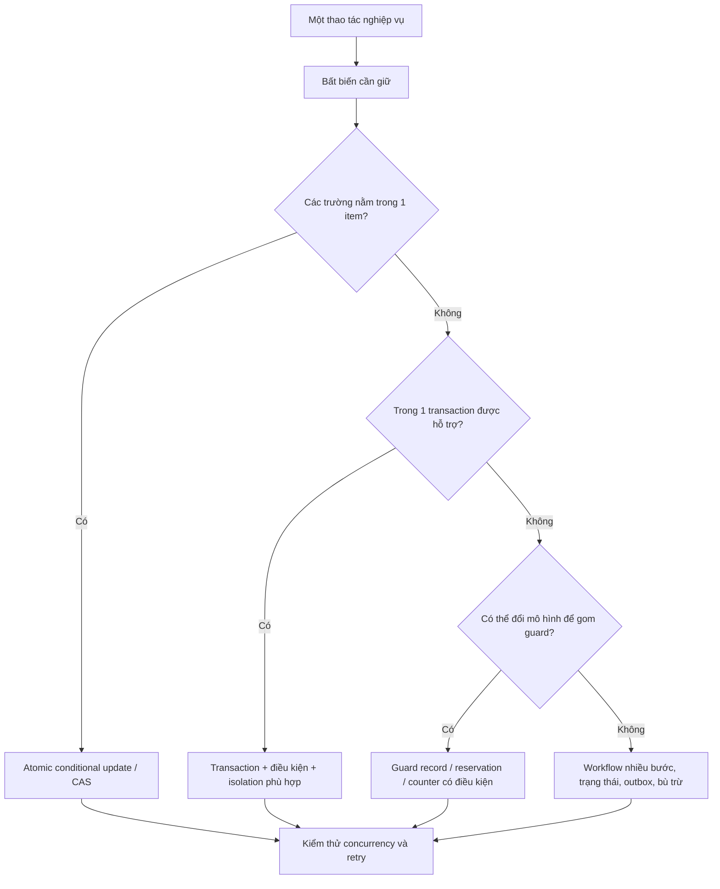
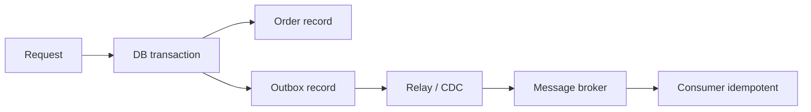
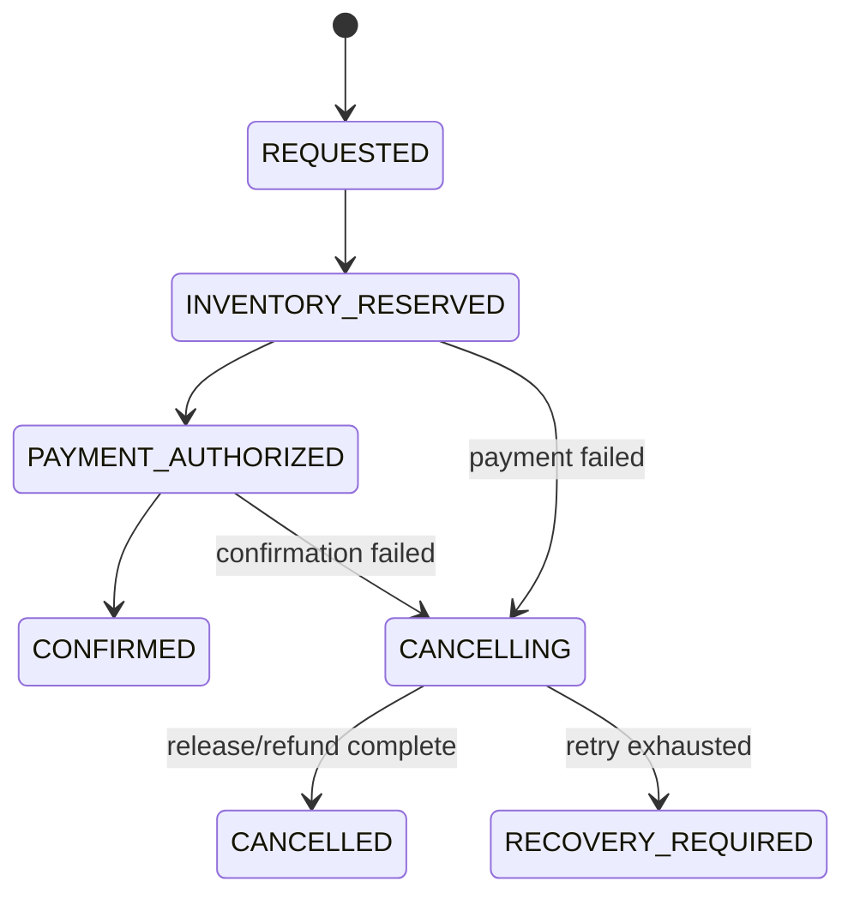
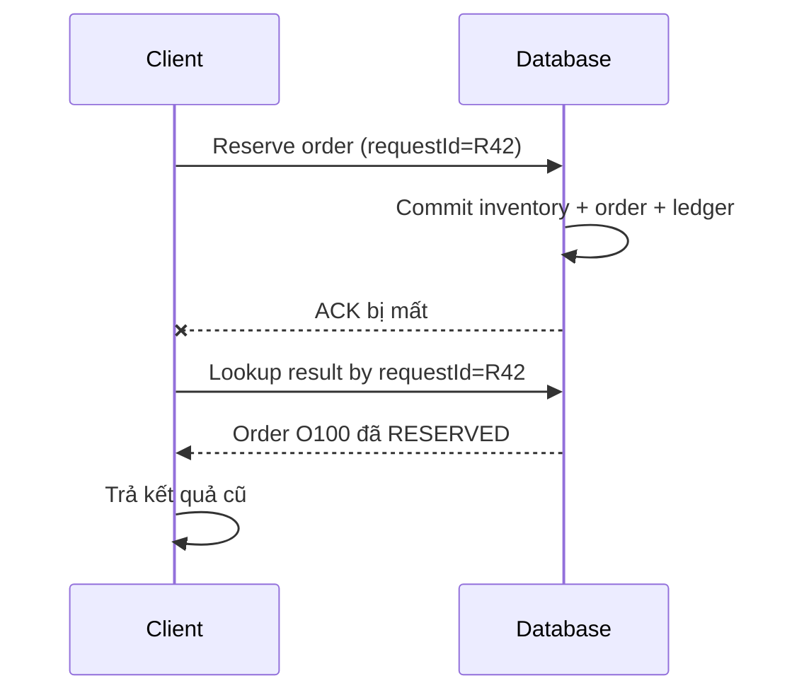

# Ràng buộc xuyên bản ghi và lựa chọn ranh giới giao dịch

## 1. Vấn đề: từng bản ghi đúng nhưng toàn hệ thống vẫn sai

Trong một hệ NoSQL, nhiều thao tác đọc/ghi có thể phân tán qua các document, item, partition, collection hoặc dịch vụ. Mỗi bản ghi riêng lẻ có thể hợp lệ, nhưng **mối quan hệ giữa chúng** lại không còn đáp ứng quy tắc nghiệp vụ.

Giả sử một cửa hàng có một đơn vị tồn kho cho sản phẩm `BK-01`:

```text
Inventory:
  sku: BK-01
  available: 1

Orders:
  chưa có đơn được xác nhận
```

Hai khách hàng cùng bấm **Đặt hàng**. Cả hai request đều đọc `available = 1` và cùng cố gắng:

1. Tạo một đơn hàng với trạng thái `CONFIRMED`.
2. Trừ tồn kho đi một.
3. Trả thông báo đặt hàng thành công.

Nếu các thao tác không được điều phối đúng, có thể xuất hiện:

- Hai đơn hàng được xác nhận nhưng chỉ có một sản phẩm.
- Tồn kho bị trừ còn `0` trong khi có hai đơn.
- Tồn kho giảm nhưng không có đơn hàng do bước tạo đơn lỗi.
- Có đơn hàng nhưng tồn kho không giảm do bước cập nhật lỗi.
- Client timeout sau khi ghi rồi retry, làm tạo đơn hoặc trừ tồn kho thêm lần nữa.

Dù `Inventory` và từng `Order` đều có cấu trúc JSON đúng, hệ thống đã phá vỡ một **ràng buộc xuyên bản ghi** (*cross-record invariant*).

Bài này thuộc chương **Giao dịch và nguyên tử** trong Database No SQL, tập trung vào câu hỏi kiến trúc:

> **Những dữ liệu nào phải được thay đổi như một đơn vị nhất quán, và cần chọn ranh giới giao dịch ở đâu để bảo vệ điều kiện đó mà không làm tăng chi phí quá mức?**

### Mục tiêu học tập

Sau bài học, bạn có thể:

1. Viết bất biến nghiệp vụ thành điều kiện phải đúng sau mỗi thao tác được chấp nhận.
2. Phân loại ràng buộc trong một record, một aggregate, một partition, nhiều record và nhiều dịch vụ.
3. Nhận diện race condition, lost update, write skew, phantom, duplicate request và commit không rõ kết quả.
4. Phân biệt **atomicity**, **isolation**, **consistency** và **durability** trong phạm vi thực tế của NoSQL.
5. Chọn giữa atomic conditional write, CAS, transaction nhiều item, guard record hoặc workflow có bù trừ.
6. Hiểu giới hạn áp dụng của MongoDB, DynamoDB, Cassandra, Redis và graph database.
7. Thiết kế transaction boundary theo bất biến, hot key, partitioning và access pattern.
8. Kết hợp idempotency, outbox, retry, đối soát và kiểm thử concurrent histories.

## 2. Bất biến nghiệp vụ là điều gì phải luôn đúng?

**Bất biến (invariant)** là một điều kiện mô tả trạng thái hợp lệ của hệ thống. Khi một thao tác nghiệp vụ được chấp nhận, trạng thái sau thao tác phải tiếp tục thỏa các bất biến có liên quan.

Ví dụ:

| Bài toán | Bất biến |
|---|---|
| Tồn kho | Không xác nhận tổng số đơn vượt lượng hàng có thể cấp |
| Giữ vé | Số ghế đang giữ/đã bán không vượt sức chứa |
| Ví tiền | Số dư không âm, trừ khi sản phẩm cho phép hạn mức thấu chi |
| Chuyển tiền | Giá trị ghi nợ và ghi có bảo toàn tổng tiền theo phạm vi kế toán |
| Coupon dùng một lần | Mỗi coupon code được claim tối đa một lần theo chính sách |
| Username duy nhất | Không có hai tài khoản hợp lệ cùng normalized username |
| Membership | Một cặp `(workspaceId, userId)` chỉ có tối đa một membership active |
| Nhân viên trực | Mỗi ca trực phải có ít nhất một người trực |
| Đặt lịch | Không có hai booking độc quyền chồng thời gian trên cùng tài nguyên |
| Số người tham gia | `activeMembers <= maxMembers` theo định nghĩa nhất quán |
| Thanh toán | Một logical payment request không bị charge hai lần |
| Workflow đơn hàng | Không xác nhận đơn nếu reservation tương ứng chưa hợp lệ |

### 2.1. Viết bất biến thành biểu thức cụ thể

Với quota:

\[
0 \leq used \leq limit
\]

Với số vé:

\[
confirmedSeats + activeHolds \leq capacity
\]

Với chuyển tiền giữa hai tài khoản A và B, bỏ qua phí:

\[
balance_A + balance_B = constant
\]

Với một mã giảm giá:

\[
\operatorname{count}(\text{claims by couponCode}) \leq 1
\]

Với quy tắc ít nhất một người trực:

\[
\sum_{i \in staff} \mathbf{1}(onCall_i) \geq 1
\]

Với booking độc quyền:

\[
\forall b_i,b_j,\ i\neq j:
\quad
resource_i = resource_j
\Rightarrow
interval_i \cap interval_j = \varnothing
\]

Biểu thức giúp tìm ra **dữ liệu nào phải được quan sát và thay đổi cùng nhau**.

### 2.2. Phân biệt bất biến với dữ liệu chỉ để hiển thị

Giả sử một order đã lưu tổng tiền và hệ thống còn có bảng `orders_by_customer` dùng để vẽ lịch sử mua hàng. Bảng lịch sử cập nhật trễ vài giây có thể vẫn đáp ứng yêu cầu nghiệp vụ nếu order nguồn là chuẩn và UI thể hiện độ trễ.

Nhưng nếu `inventory.available` và số reservation hợp lệ lệch nhau khiến hệ thống bán vượt tồn, đó là vi phạm một bất biến cốt lõi.

Không phải mọi mối quan hệ phải **strongly consistent**. Điều quan trọng là phân biệt:

- **Ràng buộc cứng:** không được phá sau commit; cần cơ chế cưỡng chế phù hợp.
- **Điều kiện có thể hội tụ:** cho phép chênh lệch tạm thời với giới hạn và cơ chế sửa.
- **Projection/read model:** có thể tái tạo từ nguồn sự thật; không dùng tùy tiện để quyết định nghiệp vụ cứng.
- **Báo cáo/analytics:** thường chấp nhận chậm so với hệ giao dịch, theo SLA riêng.

## 3. Phân loại theo phạm vi dữ liệu cần bảo vệ

### 3.1. Một record

Ví dụ document quota:

```json
{
  "_id": "quota:tenant17",
  "used": 7,
  "limit": 10,
  "revision": 4
}
```

Nếu cả `used` và `limit` nằm trong một document và database hỗ trợ atomic conditional update trên document, bất biến `used <= limit` có thể được bảo vệ bằng **một thao tác**.

### 3.2. Một aggregate

**Aggregate** là nhóm dữ liệu cùng thuộc một đơn vị nhất quán nghiệp vụ, có thể bao gồm nhiều trường hoặc object lồng nhau.

Ví dụ một giỏ hàng:

```json
{
  "_id": "cart:U42",
  "items": [
    { "sku": "BK-01", "quantity": 2 },
    { "sku": "PN-02", "quantity": 1 }
  ],
  "maxLines": 20,
  "revision": 9
}
```

Nếu toàn bộ aggregate nằm trong một document, cập nhật nguyên tử một document có thể đủ cho một số bất biến. Nếu tách mỗi line item thành record riêng, cần xác định lại transaction boundary hoặc chấp nhận workflow tương ứng.

**Aggregate không đồng nghĩa partition**: aggregate là ranh giới nghiệp vụ, còn partition là ranh giới phân bố lưu trữ. Có hệ đặt được nhiều aggregate trong một partition; cũng có aggregate trải nhiều partition.

### 3.3. Một partition

Một số NoSQL store có các bảo đảm đặc biệt cho thao tác trên **một partition/row** hoặc nhóm item cùng key partition. Tuy vậy, tên “partition” không tự xác định transaction semantics.

Cần đọc đúng sản phẩm:

- Có hỗ trợ atomic batch trong một partition không?
- Conditional update có áp dụng cho từng item hay cho cả tập?
- Có isolation tương đương serializable không?
- Có giới hạn thời gian và số lượng mutation không?
- Replication hoặc multi-region có thay đổi bảo đảm không?

Không thể suy từ việc hai record có cùng partition key rằng chúng tự động được commit nguyên tử như một transaction.

### 3.4. Nhiều record, collection, partition hoặc bảng

Một đơn hàng có thể yêu cầu cập nhật:

```text
InventoryItem(BK-01)
Reservation(R100)
Order(O100)
IdempotencyLedger(REQUEST-42)
```

Bất biến liên quan nhiều item. Nếu phải cùng commit hoặc cùng thất bại, cần một transaction **thực sự bao trùm các item đó**, hoặc phải đổi mô hình/định nghĩa nghiệp vụ.

### 3.5. Nhiều dịch vụ hoặc nhiều hệ lưu trữ

Một yêu cầu đặt hàng còn liên quan:

```text
Orders DB
Inventory DB
Payment gateway
Message broker
Email provider
```

Transaction cục bộ của Orders DB không tự bao trùm payment provider hay broker. Nếu không có distributed transaction phù hợp được các thành phần hỗ trợ, cần một **stateful workflow** (saga, reservation, outbox, compensation) và định nghĩa chính xác thời điểm “đã xác nhận”.

### 3.6. Sơ đồ ranh giới



Sơ đồ là hướng suy nghĩ, không phải bảo đảm rằng mọi bài toán đều giải được bằng một guard duy nhất hoặc bù trừ hoàn toàn.

## 4. Phân biệt atomicity, isolation, consistency và durability

Trong cơ sở dữ liệu, ACID thường được mô tả:

| Chữ | Nội dung | Câu hỏi thực tế |
|---|---|---|
| **A — Atomicity** | Một nhóm thay đổi được áp dụng như một đơn vị all-or-nothing theo contract | Nếu bước 2 lỗi, bước 1 có rollback không? |
| **C — Consistency** | Giao dịch hợp lệ giữ các ràng buộc được hệ thống/ứng dụng cưỡng chế | Ai thực thi invariant, database hay application logic? |
| **I — Isolation** | Các giao dịch đồng thời được quan sát/xử lý theo một ngữ nghĩa xác định | Hai transaction đọc cùng điều kiện rồi ghi bản ghi khác nhau có thể cùng commit không? |
| **D — Durability** | Thay đổi đã được xác nhận tồn tại theo failure model và acknowledgment contract | Sau mất điện/failover, những ghi nào còn? |

**Có atomicity không đồng nghĩa có serializability.** Một transaction có thể commit hai thao tác cùng lúc nhưng vẫn có lỗi write skew nếu nhiều transaction song song đọc cùng điều kiện tổng thể và ghi vào các record khác nhau dưới isolation không đủ mạnh.

**Consistency trong ACID** cũng không phải cùng khái niệm với “read consistency level” hoặc tính nhất quán giữa replicas. Tên giống nhau nhưng phạm vi khác nhau.

### 4.1. Một thao tác nguyên tử đã đủ khi nào?

Giả sử quota nằm trong một item:

```text
UPDATE quota:tenant17
SET used = used + 1
ONLY IF used < limit
```

Nếu database bảo đảm điều kiện và mutation được áp dụng nguyên tử trên item, invariant của item này được giữ trước cạnh tranh. Không cần transaction nhiều item chỉ để tăng một con số.

Nhưng nếu thao tác còn phải tạo một `Job` mới tương ứng với phần quota vừa chiếm, có rủi ro:

```text
Quota increment thành công
Job insert thất bại
```

Bây giờ quota bị chiếm nhưng không có job. Cần transaction giữa quota và job, hoặc một mô hình lease/reservation có khả năng hoàn trả và đối soát.

### 4.2. Transaction có thể bảo vệ một phần nhưng không bảo vệ phần còn lại

Giả sử transaction gồm:

```text
Update Inventory
Insert Order
Commit
```

Nếu sau commit ứng dụng gọi payment gateway và payment thất bại, transaction DB vẫn đã commit. **Không có rollback tự động qua một API mạng ngoài database**.

Bài toán cần được định nghĩa lại theo giai đoạn:

```text
Order PENDING
 -> Inventory RESERVED
 -> Payment AUTHORIZED
 -> Order CONFIRMED
```

Các bước thuộc một workflow, không phải một transaction DB khổng lồ.

## 5. Race condition: đọc rồi kiểm tra rồi ghi là chưa đủ

Ví dụ hai request đặt một đơn vị tồn kho:

```text
Inventory: available = 1
Request A: read(available=1)
Request B: read(available=1)
Request A: if available>=1 -> insert Order A
Request B: if available>=1 -> insert Order B
Request A: write available=0
Request B: write available=0
```

Kết quả có thể là hai order thành công và tồn kho 0.

Lỗi này có thể xảy ra ngay cả khi document không bao giờ chứa giá trị âm. **Bất biến xuyên bản ghi đã bị phá**, không phải chỉ có một giá trị cuối bị ghi sai.

### 5.1. Lost update

Hai client đọc `revision=5` và cùng thay đổi tài liệu:

```text
A đọc cart v5
B đọc cart v5
A ghi cart v6 chứa item mới
B ghi cart v6 từ snapshot cũ, làm mất item của A
```

Dùng optimistic concurrency control:

```text
UPDATE cart
ONLY IF revision = 5
SET content = newContent, revision = 6
```

Một client thành công, client kia nhận conflict. Nhưng CAS chỉ bảo vệ **record cart này**. Nó chưa bảo vệ ràng buộc với inventory hoặc order.

### 5.2. Write skew

Hai transaction đọc các record khác nhau để kiểm tra một điều kiện tổng thể, rồi ghi vào **những record khác nhau**. Cả hai có thể commit dưới một số isolation model và phá bất biến.

Ví dụ bác sĩ trực ở mục 8.

### 5.3. Phantom/predicate anomaly

Một transaction kiểm tra:

```text
SELECT count(bookings overlapping interval) = 0
```

Trong khi transaction khác tạo một booking mới cùng khoảng thời gian. Nếu database không có cơ chế bảo vệ predicate/range hoặc serialization phù hợp, cả hai có thể quyết định “trống” rồi cùng đặt lịch.

Đây không chỉ là vấn đề có transaction hay không: **điều kiện đọc thuộc một tập kết quả** cũng phải được bảo vệ trước các insert phù hợp.

### 5.4. Duplicate request và unknown commit

Client gửi request, server commit nhưng phản hồi bị mất. Client retry, có thể tạo thêm order thứ hai dù lần đầu hoàn toàn thành công.

Giải pháp yêu cầu **idempotency key**, transaction/conditional create và cách truy vấn kết quả cũ. Sự nguyên tử của một lệnh giảm tồn kho **không tự chặn retry cùng ý định nghiệp vụ**.

## 6. Bất biến xuyên bản ghi nên được mô hình hóa từ nghiệp vụ

Trước khi chọn transaction, hãy viết một **bảng invariant và ownership**.

Ví dụ:

| Bất biến | Dữ liệu liên quan | Nguồn sự thật | Điều kiện commit |
|---|---|---|---|
| Không bán quá tồn | Inventory + reservations/orders | Inventory/reservation ledger | Không cấp reservation khi lượng khả dụng không đủ |
| Một coupon chỉ dùng một lần | Coupon claim + order | Unique claim key | Claim theo code thành công đúng một lần |
| Một user chỉ có một membership | Membership + user index | Membership key | Không tạo trùng natural key |
| Ca trực luôn có người | Shift + staff assignments | Shift aggregate | Không chuyển người cuối sang off-call |
| Booking không chồng | Resource + booking intervals | Booking allocation | Không chấp nhận hai khoảng giao nhau |
| Chuyển tiền bảo toàn | Account A + Account B + ledger | Financial ledger/Accounts | Debit và credit nhất quán |
| Quota tài nguyên | Tenant quota + jobs | Quota/leases | Không cấp nhiều token hơn quota |

Với mỗi bất biến, cần trả lời:

1. **Ai là chủ sở hữu dữ liệu có thẩm quyền?**
2. Điều kiện có thể đặt vào **một record** được không?
3. Những writer nào có thể sửa dữ liệu liên quan?
4. Cần mạnh đến mức nào tại thời điểm trả thành công?
5. Nếu bất biến tạm thời chưa đúng, có được phép trả `PENDING` không?
6. Có giới hạn thời gian để đối soát hoặc bù trừ không?
7. Trong lúc lỗi/timeout, việc retry có tạo tác dụng lặp không?

### 6.1. Ranh giới giao dịch là ranh giới nhất quán, không phải ranh giới màn hình

Một request API “Tạo đơn hàng” có thể gọi nhiều domain service, nhưng không nên vì thế mặc định một transaction phải ôm mọi service.

Ngược lại, một trang UI có thể chỉ hiển thị một trường trong quota, nhưng việc tăng quota phải xét cả tập job đang chạy. Ranh giới giao dịch được quyết định bởi **bất biến phải được giữ đồng thời**, không bởi kích thước màn hình hoặc số microservice tham gia.

## 7. Chiến lược thứ nhất: gom dữ liệu vào cùng một đơn vị ghi nguyên tử

Đôi khi cách giảm độ phức tạp tốt nhất là thay đổi mô hình dữ liệu.

### 7.1. Trạng thái giỏ hàng trong một document

```json
{
  "_id": "cart:U42",
  "items": [
    { "sku": "BK-01", "quantity": 2 },
    { "sku": "PN-02", "quantity": 1 }
  ],
  "maxDistinctItems": 20,
  "revision": 9
}
```

Nếu invariant là không quá 20 dòng hàng khác nhau, document này có thể được sửa bằng atomic update/CAS ở một nơi. Dễ hơn việc giữ 20 item trong nhiều partition rồi đếm và kiểm tra.

### 7.2. Điểm mạnh

- Ít round trip.
- Tránh transaction multi-record nếu invariant nằm gọn trong một document/item.
- Logic đọc/ghi đơn giản hơn.
- Có thể sử dụng conditional update với filter theo state/version.
- Dễ kiểm tra invariant trước và sau một mutation.

### 7.3. Không gom một cách mù quáng

Một document có thể trở thành:

- **Hot item:** nhiều request cập nhật cùng record gây contention.
- **Too large:** vượt kích thước item/document hoặc khiến network/write amplification tăng.
- **Unbounded aggregate:** danh sách member/task tăng vô hạn.
- **Khó phân quyền:** phần tử thuộc nhiều owner khác nhau.
- **Khó phân vùng:** mọi tenant hoặc dự án phụ thuộc một key.
- **Khó truy vấn độc lập:** một số trường cần index theo hướng khác.

Ví dụ “gộp toàn bộ một triệu order của tenant vào một document để được atomicity” không phải phương án thực tế trong nhiều NoSQL stores.

### 7.4. Quy tắc chọn aggregate

Hãy nhóm các dữ liệu **phải thay đổi cùng nhau thường xuyên** và có giới hạn tăng trưởng hợp lý. Đừng cố gom toàn bộ những thứ *có quan hệ* chỉ vì muốn tránh mọi transaction.

Một customer có thể có hàng triệu order. Customer và orders có quan hệ, nhưng không có nghĩa phải nằm trong một aggregate khổng lồ.

## 8. Chiến lược thứ hai: một guard record cho điều kiện tổng thể

Một invariant có thể liên quan nhiều child nhưng **được biểu diễn bằng một record điều phối**.

### 8.1. Quota làm guard

```json
{
  "_id": "quota:tenant17",
  "limit": 10,
  "used": 7,
  "revision": 27
}
```

Một job mới chỉ được cấp khi:

```text
IF used < limit:
    used = used + 1
```

Việc tạo job cũng cần được gắn với reservation tương ứng. Nếu guard increment và job insert phải cùng thành công, có thể đưa chúng vào một transaction nhỏ:

```text
TX:
  UPDATE quota:tenant17 IF used < limit, SET used = used+1
  INSERT job:JOB-900 IF NOT EXISTS
  INSERT requestLedger:R-42 IF NOT EXISTS
COMMIT
```

Nếu không có transaction multi-record, có thể dùng **lease/token reservation** trong guard với một cơ chế tạo job/giải phóng đã được xác định và đối soát.

### 8.2. Tránh write skew bằng guard chung

Giả sử ca trực bắt buộc có ít nhất một bác sĩ. Thay vì hai transaction chỉ cập nhật record bác sĩ độc lập, cả hai có thể phải điều chỉnh hoặc khóa một record `shift:2026-11-14` chứa số nhân viên trực.

```json
{
  "_id": "shift:night-42",
  "activeOnCall": 2,
  "revision": 15
}
```

Khi một người xin nghỉ:

```text
TX:
  UPDATE shift:night-42
    IF activeOnCall > 1
    SET activeOnCall = activeOnCall - 1

  UPDATE staffAssignment:
    IF onCall = true
    SET onCall = false
COMMIT
```

Hai transaction phải tranh quyền cập nhật **cùng record shift**; một request không thể khiến `activeOnCall` giảm xuống 0 nếu điều kiện được thực thi atomically trong phạm vi transaction.

Nhưng guard chỉ chính xác nếu **mọi đường ghi** như thêm/xóa nhân viên, chuyển ca, job sửa dữ liệu, import đều cập nhật nó theo cùng protocol.

### 8.3. Guard có thể thành điểm nóng

Một guard cho toàn hệ thống có thể làm giảm throughput và tăng retry. Cần chọn **phạm vi nhỏ nhất của invariant**:

- Một guard mỗi sản phẩm cho tồn kho.
- Một guard mỗi tenant cho quota tenant.
- Một guard mỗi ca trực.
- Một guard mỗi phòng/tài nguyên cho booking.

Không dùng một global guard nếu không có bất biến toàn cục thực sự.

### 8.4. Đừng nhầm guard với một bộ đếm eventual

Nếu `activeOnCall` được cập nhật qua event bất đồng bộ và có thể trễ, dùng nó để quyết định cho nhân viên cuối cùng nghỉ có thể sai. **Guard dùng để cưỡng chế invariant phải có bảo đảm đủ mạnh**, không chỉ là read model.

## 9. Write skew: bài toán bác sĩ trực

Giả sử hai record:

```text
Doctor A: onCall = true
Doctor B: onCall = true
```

Bất biến:

\[
count(onCall = true) \geq 1
\]

Hai bác sĩ cùng muốn nghỉ:

| Thời điểm | Transaction T1 | Transaction T2 |
|---|---|---|
| T1 | Đọc A, B đều trực | |
| T2 | | Đọc A, B đều trực |
| T3 | Kiểm tra còn 2 người: cho A nghỉ | |
| T4 | | Kiểm tra còn 2 người: cho B nghỉ |
| T5 | Ghi `A.onCall=false` | |
| T6 | | Ghi `B.onCall=false` |
| T7 | Commit | Commit |
| Sau cùng | A=false, B=false | Bất biến bị phá |

Nếu isolation cho phép cả hai transaction nhìn một snapshot cũ và commit những **write set không giao nhau**, atomicity của từng transaction vẫn có thể được giữ nhưng invariant tổng thể thất bại.

### 9.1. Vì sao transaction không tự sửa vấn đề?

Vì hai transaction không ghi lên cùng một record. Một số database sẽ không phát hiện conflict chỉ từ việc hai transaction đã đọc cùng dữ liệu.

Đây là lý do không thể chỉ viết:

```text
BEGIN TRANSACTION
  count = COUNT(onCall doctors)
  if count > 1:
      update own onCall = false
COMMIT
```

rồi kết luận “đã an toàn”.

### 9.2. Những hướng giải quyết

1. **Serializable isolation** thực sự khi sản phẩm cung cấp phù hợp; xử lý transaction bị abort/retry.
2. **Guard record** của ca trực với conditional decrement và cập nhật assignment trong cùng transaction.
3. **Khóa hoặc điều phối** tập nhân viên theo ca qua primitive đã được database/hạ tầng bảo đảm.
4. **Mô hình sở hữu đơn nhất**: một aggregate đại diện assignment của cả ca, nếu kích thước/truy cập phù hợp.

Mỗi hướng có đánh đổi về contention, quy mô, latency và khả năng phục hồi. Không đổi từ hai record sang một counter eventual rồi tuyên bố đã giải quyết concurrency.

## 10. Phantom và uniqueness: kiểm tra “không tồn tại” là một ràng buộc

### 10.1. Username duy nhất

Hai request cùng đăng ký username `alice`:

```text
A: QUERY users WHERE normalizedUsername='alice' -> none
B: QUERY users WHERE normalizedUsername='alice' -> none
A: INSERT user U1 username='alice'
B: INSERT user U2 username='alice'
```

Nếu không có unique constraint hoặc create-if-absent theo một key chung, hai user có thể tồn tại dù mỗi request đã đọc và kiểm tra trong transaction riêng.

### 10.2. Dùng một natural key làm điểm cưỡng chế

Một mô hình:

```text
username-claim:alice -> { userId: U1 }
```

Tạo user và claim trong transaction:

```text
TX:
  PUT username-claim:alice IF NOT EXISTS
  PUT user:U1 IF NOT EXISTS
COMMIT
```

Nếu cả hai request dùng cùng key `username-claim:alice`, chỉ một request claim được trong phạm vi conditional creation được bảo đảm. Nhưng nếu chỉ claim trước rồi tạo user ở bước sau độc lập, có thể có claim mồ côi khi bước tạo user lỗi. Cần transaction hoặc workflow phục hồi.

### 10.3. Normalize trước khi tạo key

Nếu nghiệp vụ coi `Alice`, `ALICE` và `alice` là trùng, phải chuẩn hóa theo một quy tắc cố định:

```text
normalizedUsername = normalizeUsername(input)
key = "username-claim:" + normalizedUsername
```

Quy tắc normalization phải được định nghĩa rõ về Unicode, case folding, whitespace và policy ký tự. Không để hai service dùng hai cách normalize rồi tạo hai key khác nhau.

### 10.4. Unique index và scope

Một số database có unique index trên một collection cho những trường hợp phù hợp. Cần kiểm tra:

- Unique toàn collection hay chỉ trong scope/partition?
- Cần unique theo `tenantId + username` hay toàn hệ thống?
- Null/missing và collation được xử lý thế nào?
- Index có giới hạn trong sharded deployment?
- Việc tạo user và các bản ghi phụ còn cần transaction không?

**Uniqueness của một trường không tự tạo nguyên tử cho toàn bộ workflow đăng ký.**

## 11. Booking khoảng thời gian: ràng buộc predicate khó hơn equality

Giả sử một phòng họp không thể có hai booking chồng nhau:

```text
Room R1:
  Booking A: 09:00–10:00
  Booking B: 10:00–11:00
```

Hai request đồng thời:

```text
T1: muốn 11:00–12:00
T2: muốn 11:30–12:30
```

Cả hai query kiểm tra khoảng đang trống và đều thấy không có booking overlap. Sau đó cả hai tạo booking ở **hai record khác nhau**.

### 11.1. Công thức overlap

Giả sử khoảng nửa mở `[start, end)` với `start < end`. Hai khoảng giao nhau khi:

\[
start_A < end_B
\quad \land \quad
start_B < end_A
\]

Dùng khoảng nửa mở cho phép booking kết thúc đúng 10:00 và booking mới bắt đầu đúng 10:00 **không** bị coi là overlap.

Định nghĩa boundary là quyết định nghiệp vụ, cần nhất quán múi giờ/precision.

### 11.2. Kiểm tra rồi insert chưa đủ

```text
BEGIN
  overlaps = SELECT bookings WHERE
      resourceId = R1 AND start < newEnd AND end > newStart

  if overlaps empty:
      INSERT booking(...)
COMMIT
```

Nếu hệ không bảo vệ predicate hoặc không serialize các transaction đồng thời cho cùng resource, có thể double-book.

### 11.3. Các lựa chọn thiết kế

- Dùng **serializable transaction** hoặc constraint chuyên biệt nếu sản phẩm hỗ trợ.
- Dùng **resource guard** mà mọi thao tác đặt/hủy booking phải ghi/khóa trong transaction phù hợp.
- Chia thời gian thành các **slot IDs** được claim có điều kiện; phải kiểm tra độ phân giải và số slot, tránh booking lệch slot.
- Đưa toàn bộ lịch của một resource hữu hạn vào aggregate nhỏ để cập nhật nguyên tử.
- Dùng service điều phối booking có serialization theo `resourceId`, kèm lease/fencing và recovery.

Không chọn một khóa phân tán có TTL mà bỏ qua trường hợp worker cũ tiếp tục ghi sau khi lease đã hết. Cần fencing token hoặc cơ chế từ chối writer stale theo contract.

## 12. Chuyển tiền giữa hai tài khoản: ranh giới hai record

Giả sử:

```text
Account A: balanceMinor = 100000
Account B: balanceMinor =  50000
Transfer T42: chuyển 30000 từ A sang B
```

Bất biến:

\[
balance_A + balance_B = 150000
\]

và theo policy:

\[
balance_A \geq 0
\]

Nếu hệ giảm A thành 70.000 rồi lỗi trước khi tăng B, tổng tiền còn 120.000. Nếu tăng B trước và giảm A sau, hệ có thể tạm tạo tiền hoặc hoàn toàn sai khi bước hai thất bại.

### 12.1. Khi cùng transaction được hỗ trợ

Một giao dịch có thể gồm:

```text
TX:
  CHECK transferLedger:T42 does not exist
  UPDATE Account A
    IF balanceMinor >= 30000
    SET balanceMinor = balanceMinor - 30000

  UPDATE Account B
    SET balanceMinor = balanceMinor + 30000

  INSERT transferLedger:T42
    {from:A,to:B,amountMinor:30000,status:COMPLETED}
COMMIT
```

Ở đây:

- Có điều kiện tránh chuyển quá số dư.
- Debit/credit/ledger gắn vào một đơn vị atomic commit.
- `transferId` cố định giúp ngăn retry tạo lại chuyển tiền.
- Cần kiểm tra concurrency giữa nhiều chuyển tiền cùng tài khoản.
- Currency, rounding và đơn vị tiền phải xác định rõ.

Đây là ví dụ mô hình hóa, **không phải định nghĩa đầy đủ một sổ cái tài chính đạt yêu cầu kiểm toán**. Hệ tài chính thật cần cân nhắc double-entry ledger, bất biến kế toán, idempotency, reconciliation và yêu cầu pháp lý.

### 12.2. Khi hai tài khoản ở hai store không có transaction chung

Không thể chỉ gọi hai API lần lượt rồi tuyên bố all-or-nothing. Cần một protocol cấp cao hơn, ví dụ một sổ cái/escrow authoritative và trạng thái chuyển tiền:

```text
REQUESTED -> RESERVED -> SETTLED
                 |
                 v
              CANCELLED
```

Các bước có thể bù trừ và đối soát, nhưng **compensation không phải rollback tức thì**. Phải định nghĩa thời điểm người dùng được thông báo “đã chuyển thành công” và xử lý các giao dịch treo.

## 13. Transaction boundary cho checkout: ví dụ xuyên suốt

Giả sử hệ đặt hàng có ba record:

```text
InventoryItem:
  sku=BK-01
  available=1

Order:
  orderId=O-1007
  status=RESERVED

RequestLedger:
  requestId=R-42
  resultOrderId=O-1007
```

Bất biến:

1. Không cấp reservation nếu tồn kho không đủ.
2. Nếu báo reservation thành công, phải tồn tại order tương ứng.
3. Một `requestId` chỉ có tối đa một kết quả reservation.
4. Nếu client gửi lại cùng `requestId`, trả kết quả cũ thay vì trừ tồn kho thêm.

### 13.1. Transaction logic

```text
TX reserveOneUnit(requestId=R-42, orderId=O-1007):
  CREATE RequestLedger:R-42 IF ABSENT

  UPDATE Inventory:BK-01
    ONLY IF available >= 1
    SET available = available - 1

  CREATE Order:O-1007 IF ABSENT
    SET status=RESERVED, requestId=R-42, sku=BK-01

COMMIT
```

Nếu transaction không commit vì hết tồn kho, cả ba thay đổi phải không được công nhận. Nếu commit thành công, order và ledger phải nhất quán với số tồn đã trừ.

### 13.2. Tại sao lưu cả order và request ledger?

`orderId` có thể là UUID do client hoặc server sinh. Nếu mỗi retry tự sinh order ID mới, có thể tạo hai order cho cùng ý định.

`requestId` phải được xác định trước lần thử đầu tiên và **ổn định qua retry**. Ledger là nơi ghi nhận kết quả nghiệp vụ để khi client mất phản hồi vẫn có thể truy vấn theo request ID.

Trường hợp nhiều request khác nhau dùng cùng `orderId` cũng cần được bảo vệ bằng create-if-absent/unique key. Không dựa vào việc xác suất UUID trùng thấp để bỏ kiểm tra ghi đè record đã tồn tại.

### 13.3. Vì sao order không nên chuyển thành PAID ngay trong transaction này?

Nếu thanh toán do một gateway ngoài database xử lý, DB transaction không thể tự đảm bảo gateway đã charge/authorize thành công. Một thiết kế nên tách:

```text
PENDING
 -> RESERVED
 -> PAYMENT_AUTHORIZED
 -> CONFIRMED
```

Mỗi trạng thái có điều kiện hợp lệ, idempotency và cơ chế khôi phục. Hệ có thể chỉ xác nhận đơn sau khi các tiền điều kiện ở những hệ liên quan được đáp ứng.

## 14. MongoDB: atomic document và multi-document transaction

MongoDB cung cấp tính nguyên tử cho thao tác trên **một document**, đồng thời hỗ trợ multi-document transactions trong những deployment/phiên bản phù hợp.

### 14.1. Nếu chỉ cần giảm tồn kho

```javascript
const quantity = 1;

const updated = await db.collection("inventory").findOneAndUpdate(
  {
    _id: "BK-01",
    available: { $gte: quantity }
  },
  {
    $inc: { available: -quantity }
  },
  {
    returnDocument: "after"
  }
);

if (updated === null) {
  // Không đủ tồn kho hoặc item không tồn tại.
}
```

Điều kiện tồn kho và mutation ở **cùng document** giúp tránh hai request cùng sử dụng giá trị đọc cũ để trừ vượt mức. Tuy nhiên, chưa có order hay ledger. Nếu application trả “đơn đã tạo” lúc này thì vẫn sai contract.

### 14.2. Transaction nhiều collection

Ví dụ Node.js minh họa với collection `inventory`, `orders` và `request_ledger`:

```javascript
async function reserveOrder({
  client,
  db,
  requestId,
  orderId,
  sku,
  quantity
}) {
  const session = client.startSession();

  try {
    await session.withTransaction(async () => {
      const ledgerResult = await db
        .collection("request_ledger")
        .insertOne(
          {
            _id: requestId,
            orderId,
            type: "RESERVE_ORDER"
          },
          { session }
        );

      if (!ledgerResult.acknowledged) {
        throw new Error("LEDGER_NOT_ACKNOWLEDGED");
      }

      const inventoryResult = await db
        .collection("inventory")
        .updateOne(
          {
            _id: sku,
            available: { $gte: quantity }
          },
          {
            $inc: { available: -quantity }
          },
          { session }
        );

      if (inventoryResult.modifiedCount !== 1) {
        throw new Error("OUT_OF_STOCK");
      }

      await db.collection("orders").insertOne(
        {
          _id: orderId,
          requestId,
          sku,
          quantity,
          status: "RESERVED"
        },
        { session }
      );
    });

    return { status: "RESERVED", orderId };
  } finally {
    await session.endSession();
  }
}
```

Đây là **code minh họa một transaction boundary**, không phải một endpoint production hoàn chỉnh.

Những điều bắt buộc phải làm trong thực tế:

- Áp dụng unique key/index thích hợp cho ledger và order ID.
- Khi duplicate request ID, **đọc lại kết quả đã ghi nhận**, không kết luận mọi duplicate đều thành công vô điều kiện; kiểm tra payload và request identity.
- Xác nhận transaction success/commit theo contract driver trước khi trả thành công.
- Phân loại transaction retry và lỗi kết quả commit không rõ.
- Không gọi payment/email/broker trực tiếp trong callback transaction có thể được chạy lại.
- Đặt timeouts, write concern/read concern và session options theo tính nhất quán/durability yêu cầu.
- Không giữ transaction mở trong khi đợi API bên ngoài.
- Bảo vệ thêm những invariant không được biểu diễn trong các update cụ thể.
- Không giả định isolation cao nhất chỉ vì giao dịch dùng nhiều collection.

### 14.3. Giao dịch MongoDB có thể cần guard chống write skew

Nếu hai transaction chỉ đọc số bác sĩ trực rồi cập nhật hai doctor khác nhau, tính nguyên tử multi-document **chưa đủ chứng minh** bất biến “ít nhất một bác sĩ trực” được giữ.

Một thiết kế có thể buộc cả hai ghi/điều kiện trên cùng `Shift` document để tạo conflict và kiểm tra count:

```javascript
const guard = await db.collection("shifts").updateOne(
  {
    _id: "night-42",
    activeOnCall: { $gt: 1 }
  },
  {
    $inc: { activeOnCall: -1 }
  },
  { session }
);

if (guard.modifiedCount !== 1) {
  throw new Error("LAST_ON_CALL_DOCTOR");
}

await db.collection("assignments").updateOne(
  { _id: assignmentId, onCall: true },
  { $set: { onCall: false } },
  { session }
);
```

Trong code production, phải đảm bảo assignment thực sự được cập nhật đúng một lần, hoặc abort transaction khi `modifiedCount !== 1`, để tránh counter lệch nếu assignment đã chuyển trạng thái. Mọi writer phải theo cùng quy tắc.

## 15. DynamoDB: transaction nhiều item và conditional writes

DynamoDB có điều kiện ghi trên item và API `TransactWriteItems` cho một tập thao tác giao dịch được hỗ trợ, với giới hạn số hành động/dung lượng/phạm vi và điều kiện cụ thể theo tài liệu dịch vụ.

### 15.1. Atomic conditional update một item

Mẫu `UpdateItem` minh họa:

```json
{
  "TableName": "Inventory",
  "Key": {
    "sku": { "S": "BK-01" }
  },
  "UpdateExpression": "SET available = available - :q",
  "ConditionExpression": "attribute_exists(sku) AND available >= :q",
  "ExpressionAttributeValues": {
    ":q": { "N": "1" }
  }
}
```

Nếu điều kiện không đạt, DynamoDB từ chối ghi theo semantics conditional write. Đây là nền tảng để tránh overselling trên một item nhưng chưa tạo được order nguyên tử.

### 15.2. Transaction cho inventory, order và request ledger

Một request `TransactWriteItems` minh họa ba hành động:

```json
{
  "TransactItems": [
    {
      "Update": {
        "TableName": "Inventory",
        "Key": { "sku": { "S": "BK-01" } },
        "UpdateExpression": "SET available = available - :q",
        "ConditionExpression": "attribute_exists(sku) AND available >= :q",
        "ExpressionAttributeValues": {
          ":q": { "N": "1" }
        }
      }
    },
    {
      "Put": {
        "TableName": "Orders",
        "Item": {
          "orderId": { "S": "O-1007" },
          "requestId": { "S": "R-42" },
          "sku": { "S": "BK-01" },
          "status": { "S": "RESERVED" }
        },
        "ConditionExpression": "attribute_not_exists(orderId)"
      }
    },
    {
      "Put": {
        "TableName": "RequestLedger",
        "Item": {
          "requestId": { "S": "R-42" },
          "orderId": { "S": "O-1007" }
        },
        "ConditionExpression": "attribute_not_exists(requestId)"
      }
    }
  ]
}
```

Đây là **mô tả một mẫu request hợp lệ về ý tưởng** nếu các key/schema, điều kiện và giới hạn dịch vụ phù hợp. Trong ứng dụng thật, SDK có cấu trúc request, exception, cancellation reasons, capacity và retry behavior riêng.

Lưu ý quan trọng:

- Các action phải nằm trong phạm vi transaction mà DynamoDB hỗ trợ.
- Không thể đưa **hai hành động transaction riêng cùng nhắm một item** như một `ConditionCheck` và `Update` độc lập trên chính item đó; hãy gắn condition vào action phù hợp.
- Không cần đặt một `ConditionCheck` chỉ để kiểm tra tồn kho rồi lại `Update` cùng item nếu chính `Update` có `ConditionExpression`.
- `TransactWriteItems` có thể nhận idempotency token theo API, nhưng cơ chế/token window **không thay thế vĩnh viễn business idempotency ledger**.
- GSI có eventual consistency; một query GSI không tự là bằng chứng transaction inventory/order vừa commit đã xuất hiện trên index.
- Với global tables/multi-region, transaction và replication có ngữ nghĩa riêng theo vùng. Không suy rằng một transaction được commit ở vùng A lập tức tạo invariant mạnh khi các writer khác ghi đồng thời vùng B.

### 15.3. Transaction nhiều item không đồng nghĩa toàn bảng

Nếu một thao tác cần cập nhật hàng triệu item, không thể đặt tất cả vào một `TransactWriteItems` duy nhất. Cần chia lại bài toán:

- Aggregate/guard nhỏ dùng transaction.
- Các projection hoặc read model cập nhật bất đồng bộ.
- Workflow nhiều bước với trạng thái và reconciliation.
- Job batch không được tự nhận là all-or-nothing toàn dataset.

## 16. Cassandra: LWT và ranh giới atomicity khác giao dịch RDBMS

Apache Cassandra hỗ trợ conditional mutations thông qua **lightweight transactions (LWT)** dựa trên cơ chế đồng thuận trong phạm vi được sản phẩm hỗ trợ.

### 16.1. Conditional create cho natural key

```sql
INSERT INTO coupon_claim_by_code (
    coupon_code,
    user_id,
    request_id
)
VALUES ('CODE123', 'U42', 'R-42')
IF NOT EXISTS;
```

Kết quả LWT có thể thể hiện `[applied] = true/false` theo API. Với một key claim được chọn đúng, create-if-absent có thể bảo vệ uniqueness ở phạm vi record/key tương ứng.

Nhưng nếu claim coupon và tạo order nằm ở **những partition/bảng khác nhau**, không được coi một LWT insert đã tạo transaction hai bước.

### 16.2. CAS bằng revision

```sql
UPDATE inventory_by_sku
SET available = 8,
    revision = 12
WHERE sku = 'BK-01'
IF revision = 11;
```

Giả sử client đọc `available=10` và `revision=11` rồi muốn trừ 2. Khi revision đã đổi, update phải thất bại và client cần đọc lại, tính lại ý định nghiệp vụ.

Đây là pattern CAS, **không phải phép trừ độc lập có điều kiện cho mọi truy vấn tùy ý**. Cần kiểm tra cách mô hình counter, conditional update và LWT tương tác trong CQL theo version.

### 16.3. CQL BATCH không đồng nghĩa multi-partition ACID transaction

Cassandra `BATCH` có semantics về grouping/atomicity của batch mutation theo đặc tả, nhưng không mang đầy đủ cùng nghĩa với transaction SQL đa partition có isolation/rollback/read set tùy ý.

Không dùng logged batch với hàng trăm partition chỉ để “đảm bảo tất cả dữ liệu đúng” mà chưa hiểu:

- Partition keys và latency.
- Logged/unlogged batch behavior.
- Isolation của các truy vấn đọc và ghi.
- LWT/batch conditional limitations.
- Failure/repair/replication semantics.

Nếu invariant cần hai record ở partition khác nhau, cần thiết kế theo khả năng thực tế của Cassandra: thay đổi model để có điểm cưỡng chế phù hợp, chọn một service authoritative, hoặc workflow có trạng thái/đối soát.

## 17. Redis: nguyên tử thực thi lệnh khác rollback một transaction DB

Redis hỗ trợ các thao tác nguyên tử theo model thực thi của nó, `MULTI/EXEC`, `WATCH` và Lua/function scripting. Nhưng không nên đồng nhất với ACID transaction nhiều collection trên MongoDB.

### 17.1. Giữ quota bằng Lua

Một script nguyên tử trong phạm vi Redis server/cluster key rules có thể:

```lua
-- KEYS[1] = quota key
-- ARGV[1] = số token cần cấp
local used = tonumber(redis.call("HGET", KEYS[1], "used"))
local limit = tonumber(redis.call("HGET", KEYS[1], "limit"))
local quantity = tonumber(ARGV[1])

if not used or not limit or not quantity or quantity <= 0 then
  return {err = "INVALID_STATE"}
end

if used + quantity > limit then
  return 0
end

redis.call("HINCRBY", KEYS[1], "used", quantity)
return 1
```

Script gắn kiểm tra và tăng `used` trong cùng một thao tác thực thi theo Redis semantics. Nhưng **không ghi cùng lúc một record order ở database khác**.

Nếu quota Redis là source of truth và Redis failover/persistence mất một số ghi mới nhất theo mode cấu hình, hệ có thể đánh giá quota sai. Cần chọn durability, replication và reconciliation theo yêu cầu.

### 17.2. WATCH/MULTI/EXEC

`WATCH` cho phép optimistic concurrency với những key đã theo dõi; nếu key thay đổi trước `EXEC` theo semantics, transaction có thể bị hủy và client retry.

Nhưng:

- `EXEC` không có rollback runtime errors của từng command theo nghĩa mọi DB ACID.
- Redis Cluster giới hạn multi-key operations theo hash slot/key rules.
- Retry cần idempotency để tránh trừ quota lặp.
- `WATCH` chỉ bao các key được theo dõi và không tạo transaction xuyên service khác.

Không thể chỉ đặt `MULTI` quanh vài `SET` rồi giả định chúng giữ một invariant có điều kiện nếu logic kiểm tra đã thực hiện không được bảo vệ.

## 18. Graph database: ràng buộc trên node, relationship và cấu trúc đồ thị

Trong graph NoSQL, invariant có thể mô tả một cạnh hoặc một cấu trúc:

- Một user không thể tham gia hai role độc quyền trong một project.
- Mỗi task phải có một owner hợp lệ.
- Không được tạo chu kỳ trong quan hệ phân cấp.
- Một resource chỉ có tối đa một assignment đang active.

Các database đồ thị có khả năng transaction, constraint và isolation khác nhau. Một transaction Neo4j có thể thay đổi nhiều node/relationship theo phạm vi hỗ trợ.

### 18.1. Unique constraint không bảo vệ mọi cấu trúc

Ví dụ constraint uniqueness trên `User.email` có thể ngăn hai node User cùng email theo schema phù hợp. Nhưng bất biến “không có cycle trong cây quản lý” là thuộc tính **trên nhiều node và relationship**; không tự được bảo vệ bởi một unique index.

### 18.2. Kiểm tra đường đi rồi tạo cạnh có thể gặp race

Giả sử hai transaction đồng thời kiểm tra `A` không phải tổ tiên của `B` rồi tạo những cạnh mới. Nếu các bước thay đổi không tranh lock/guard thích hợp, hai thay đổi riêng lẻ có thể tạo chu kỳ dù mỗi transaction nhìn thấy graph không có chu kỳ lúc kiểm tra.

Cần cơ chế theo hệ graph cụ thể, chẳng hạn:

- Lock/guard trên aggregate cấu trúc.
- Cơ chế serialization/constraint được database hỗ trợ.
- Transaction query + write theo pattern đảm bảo race safety.
- Đơn giản hóa mô hình để invariant được cưỡng chế qua một điểm chung.

Không suy từ việc `MATCH ... CREATE` ở trong transaction rằng một predicate traversal trên cả graph đã được khóa tự động.

## 19. Lựa chọn isolation theo loại bất biến

Có thể xem các mức đọc/ghi theo các nhóm khái niệm, nhưng tên level và bảo đảm cụ thể phụ thuộc database:

| Bảo đảm/khái niệm | Ý nghĩa khái quát | Có thể còn rủi ro |
|---|---|---|
| Read committed | Tránh đọc một số giá trị chưa commit, theo DB | Non-repeatable read, predicate changes, write skew tùy model |
| Repeatable read | Các lần đọc một record có tính ổn định hơn | Phantom/write skew tùy implementation |
| Snapshot isolation | Transaction thấy snapshot nhất quán theo phạm vi | Write skew khi ghi các record khác nhau |
| Serializable | Kết quả tương đương một thứ tự tuần tự hợp lệ theo phạm vi | Transaction có thể abort, retry, hạn chế chi phí |
| Linearizable operation | Một thao tác đơn có hiệu ứng tức thời theo mô hình thời gian thực | Không tự làm nhiều thao tác thành transaction |
| Eventual consistency | Các replica/projection có thể hội tụ theo thời gian | Không phù hợp nếu dùng stale read để duyệt invariant cứng |

Không phải mọi NoSQL engine đều expose những level trên dưới cùng tên, và một transaction cũng có thể chỉ bao một partition hoặc một region.

### 19.1. Isolation phải đủ cho tiền điều kiện

Bất biến “số người trực không dưới 1” được đánh giá dựa trên **tập record**. Nếu chọn snapshot isolation và không ép các transaction ghi chung guard, có thể gặp write skew.

Bất biến “một username duy nhất” có thể được cưỡng chế bằng **unique key/conditional insert**, không cần tự xây một predicate scan + serializable transaction khổng lồ.

Bất biến “một tài khoản không âm” có thể được cưỡng chế bằng **conditional decrement** trên một account.

Ranh giới tốt là **ít nhất đủ mạnh** cho điều kiện, không phải mức isolation cao nhất ở mọi nơi.

### 19.2. Đọc có nhất quán mạnh hơn chưa chắc giải quyết được TOCTOU

Hai client đều có thể đọc trạng thái **mới nhất tại thời điểm riêng của mình**, cùng thấy còn 1 vé, rồi cùng tạo đơn. Nếu kiểm tra và ghi không phải một đơn vị được điều phối, việc chọn strongly consistent read đơn lẻ không giải quyết race.

Đây là phân biệt quan trọng:

- **Read consistency** nói một request đọc thấy trạng thái nào.
- **Conditional write / transaction isolation** quyết định hai thao tác cạnh tranh có thể commit cùng nhau không.

## 20. Transaction boundary theo partition và sharding

Trong NoSQL, dữ liệu thường được phân vùng bởi partition key hoặc shard key. Ranh giới này ảnh hưởng hiệu năng và khả năng transaction.

### 20.1. Transaction cùng partition thường rẻ hơn nhưng không mặc nhiên đủ mạnh

Khi các item liên quan được đặt gần nhau, có thể giảm network coordination và latency. Một số database cung cấp transaction scope khác nhau cho single-partition và multi-partition.

Tuy nhiên, không được suy:

> “Cùng partition nghĩa là mọi write trên các record ở đó tự động atomic.”

Phải dùng đúng API và hiểu contract. Một loạt request độc lập đến cùng partition vẫn có thể commit từng phần.

### 20.2. Cross-shard transaction tăng coordination

Nếu một transaction chạm nhiều shard, hệ có thể cần giao thức commit/consensus/locking với overhead lớn hơn và failure handling phức tạp hơn.

Các vấn đề thường tăng:

- Nhiều round trip.
- Tail latency khi một shard chậm.
- Thời gian giữ lock hoặc version snapshot.
- Xác suất conflict với workload lớn.
- Timeout và retry.
- Capacity/hot partition.
- Khả năng transaction bị abort do limit.
- Khó theo dõi khi transaction trải nhiều region.

Không có nghĩa phải tránh mọi cross-shard transaction; nếu nghiệp vụ yêu cầu atomicity thì chi phí có thể xứng đáng. Nhưng nên thiết kế **phạm vi nhỏ nhất bảo vệ đúng invariant**.

### 20.3. Chọn partition key theo invariant và access pattern

Ví dụ booking theo phòng:

```text
PK = ROOM#R1
SK = BOOKING#...
```

Tập booking của cùng phòng có thể được tìm hiệu quả hơn so với phân tán ngẫu nhiên theo booking ID. Nếu cơ chế transaction/guard theo phòng có sẵn, đây là một hướng tốt.

Tuy nhiên, một phòng cực hot có thể trở thành hot partition; phải cân đối transaction contention với phân bố tải.

### 20.4. Multi-region và global tables

Một transaction cục bộ ở region A không tự đảm bảo **invariant global** nếu region B cho phép writer cập nhật độc lập cùng logical entity và replication giải quyết conflict theo một cơ chế khác.

Nếu quota/tồn kho/uniqueness yêu cầu mạnh trên toàn cầu, cần chọn:

- Single authoritative writer per invariant/key.
- Global serialization/consensus được sản phẩm hỗ trợ.
- Partition quyền sở hữu theo vùng.
- Escrow allocation: cấp quota/tồn kho cho từng vùng theo tổng giới hạn, có protocol phân bổ.
- Hoặc thay đổi contract sang eventual với khả năng bù trừ rõ.

Không được coi “replication đa vùng” là “distributed transaction với serializability toàn cầu”.

## 21. Giao dịch không bao trùm broker, email và payment gateway

Một checkout có thể có:

```text
Orders DB -> Inventory DB -> Payment service -> Kafka -> Email
```

Ngay cả khi hai bảng trong một database commit nguyên tử, không thể mặc định email, Kafka và payment được rollback cùng DB.

### 21.1. Dual write

```text
1. Commit Order thành công.
2. Publish OrderCreated thất bại.
```

Consumer không bao giờ được báo có order mới.

Đảo thứ tự:

```text
1. Publish OrderCreated thành công.
2. Commit Order thất bại.
```

Consumer nhận event cho một order chưa tồn tại.

Chỉ retry một trong hai bước cũng có thể phát event trùng.

### 21.2. Transactional outbox

Nếu nguồn order và bảng outbox nằm trong **cùng phạm vi transaction**:

```text
TX:
  INSERT Order O100
  INSERT Outbox Event E100
COMMIT
```

Một worker đọc outbox và publish sau commit. Khi mất ACK, event có thể được gửi lại, vì vậy **consumer phải idempotent**.



Lợi ích: không còn khoảng chênh “order commit nhưng event hoàn toàn không được ghi nhận” nếu source và outbox thực sự commit cùng nhau.

Giới hạn:

- Publish vẫn có thể at-least-once.
- Event có thể trễ.
- Outbox phải có cleanup, retry và monitoring.
- Nếu outbox nằm ở **database khác**, atomicity không tự có.
- Consumer side effects ngoài DB vẫn cần idempotency.

### 21.3. Saga và compensation

Một workflow phân tán:



Mỗi bước có:

- Local transaction/conditional write.
- Idempotency key.
- Deadline/timeout.
- Retry policy.
- State transition được bảo vệ.
- Compensation hoặc manual reconciliation.

**Compensation không tương đương rollback nguyên tử**. Có thể đã gửi email, cấp tài nguyên hoặc giữ tiền tạm thời trước khi bù trừ. Cần xác định nghĩa vụ với người dùng và trạng thái quan sát được.

## 22. Retry, idempotency và kết quả commit không rõ

### 22.1. Ba loại kết quả

| Kết quả | Ý nghĩa | Ứng dụng nên làm gì? |
|---|---|---|
| **COMMITTED** | Hệ đã xác nhận commit theo contract | Trả kết quả, ghi nhận operation ID |
| **ABORTED/CONDITION_FAILED** | Điều kiện không đạt hoặc transaction bị hủy có xác nhận | Phân loại nghiệp vụ, đọc lại, retry có giới hạn nếu phù hợp |
| **UNKNOWN** | Client mất kết nối/timeout, không biết commit đã xảy ra chưa | Dùng operation ID/ledger đối chiếu, không retry mù |

Ví dụ request timeout sau commit:



Cần dùng read path có consistency đủ để xác minh commit. Một read từ replica/index eventual có thể chưa thấy ledger ngay và khiến client kết luận sai.

### 22.2. Idempotency key phải gắn với payload

Nếu request ID `R42` ban đầu có:

```json
{
  "sku": "BK-01",
  "quantity": 1
}
```

mà lần retry gửi:

```json
{
  "sku": "BK-02",
  "quantity": 10
}
```

không nên trả thành công cũ một cách âm thầm. Ledger có thể lưu request hash/identity để phân biệt **retry cùng ý định** với **tái sử dụng request ID cho ý định khác**.

### 22.3. Retry transaction không được lặp side effect ngoài DB

Một số driver transaction helpers có thể gọi lại callback khi lỗi tạm thời. Không làm trong callback:

```text
sendEmail()
chargeCreditCard()
publishEvent()
```

trừ khi từng hành động có protocol idempotency và được thiết kế phù hợp; cách phổ biến hơn là outbox/workflow sau commit.

### 22.4. Backoff và giới hạn

Khi nhiều request tranh cùng một inventory/guard record, retry tức thời liên tục có thể làm contention nặng hơn. Cần:

- Exponential backoff với jitter.
- Tổng thời gian retry hợp lý.
- Giới hạn số lần thử.
- Tách conflict nghiệp vụ như `OUT_OF_STOCK` khỏi lỗi hạ tầng.
- Không retry tạo lại tác dụng không idempotent.
- Monitoring conflict rate và tail latency.

### 22.5. Không kiểm soát retry bằng một cờ trong memory

Một mutex/cờ trong một instance ứng dụng không đủ khi triển khai nhiều instances hoặc worker. Ledger/idempotency key cần nằm trong một hệ lưu trữ có contract phù hợp, và việc check-and-write phải chịu điều kiện atomic/transaction.

## 23. Khi invariant có thể được bảo vệ bằng reservation/escrow

Một số bài toán đa vùng hoặc tải lớn không thuận lợi nếu mọi request đều ghi vào một global counter.

### 23.1. Reservation token

Thay vì mỗi order đọc tổng tồn kho và cập nhật mọi record liên quan, hệ có thể tạo một số **quyền giữ hàng** hữu hạn:

```text
Inventory SKU-1:
  total = 10

Reservation tokens:
  TOKEN-1 ... TOKEN-10
```

Mỗi request claim một token bằng conditional create/update. Nếu token đại diện chính xác một đơn vị tài nguyên và không được claim trùng, tổng số token đã cấp không vượt tổng tồn.

Nhưng phải xử lý:

- Token đã claim nhưng order insert thất bại.
- Token hết hạn/giải phóng có đua với confirm.
- Một request claim lại sau timeout.
- Token được chuyển vùng hoặc tái phân bổ.
- Order bị hủy phải giải phóng đúng một token.
- Các writer ngoài reservation protocol.

### 23.2. Escrow giữa các vùng

Nếu có 100 vé, có thể cấp trước quota hữu hạn:

```text
Region A: 40 tickets
Region B: 35 tickets
Region C: 25 tickets
Total allocated = 100
```

Trong phạm vi quota đã được cấp, từng region có thể xử lý yêu cầu theo một local guard. Khi chuyển quota giữa vùng, cần giao thức điều phối giữ bất biến tổng.

Ưu điểm có thể là giảm giao dịch xuyên vùng thường xuyên. Nhược điểm là **phân bổ không đều**, tồn kho kẹt ở vùng ít nhu cầu, và logic chuyển quyền phức tạp.

Đây là một chiến lược có điều kiện, không phải giải pháp chung để biến consistency eventual thành đúng tuyệt đối nếu các bước điều phối không được bảo vệ.

## 24. Transaction boundary và projection/denormalization

NoSQL thường nhân bản dữ liệu để phục vụ truy vấn:

```text
orders_by_id
orders_by_customer
paid_orders_by_day
orders_search_index
```

Một order đổi trạng thái `PENDING → PAID` có thể cần cập nhật nhiều đường đọc.

### 24.1. Những gì thực sự cần commit cùng nhau?

Nếu `orders_by_id` là nguồn sự thật và các bảng còn lại là **projection có thể rebuild**, không nhất thiết đưa tất cả vào cùng transaction.

Một thiết kế:

1. Commit thay đổi order nguồn cùng outbox event.
2. Consumer cập nhật `orders_by_customer` và `paid_orders_by_day`.
3. Search index đồng bộ bất đồng bộ.
4. Reader biết độ trễ consistency và có thể đối chiếu order nguồn khi cần.
5. Job reconciliation phát hiện projection bị mất event hoặc stale.

### 24.2. Khi projection là một phần của invariant

Nếu một bản sao được dùng để quyết định **số tiền có thể chi**, **quyền truy cập** hoặc **số ghế còn lại**, nó không còn chỉ là projection hiển thị. Nó phải có bảo đảm tương ứng hoặc không được dùng làm nguồn ra quyết định.

Sai lầm thường gặp là đưa dữ liệu nguồn và index vào hai hệ eventual rồi gọi index để kiểm tra điều kiện cứng.

### 24.3. Đừng tạo transaction khổng lồ chỉ để đồng bộ mọi read model

Cần phân biệt:

- Bản ghi authoritative và guard: bảo vệ bằng transaction/conditional write.
- Search/analytics/cache: chấp nhận eventual theo SLA, có outbox/reconciliation.
- Billing/financial ledger: có thể cần transaction hoặc workflow mạnh hơn theo domain.

Ranh giới nhất quán nên phản ánh **hậu quả nghiệp vụ của sự sai lệch**, không phải chỉ sự tiện lợi của API.

## 25. Những điều transaction không tự giải quyết

### 25.1. Thao tác ngoài phạm vi transaction

DB transaction không rollback email, network call, object storage và payment gateway.

### 25.2. Lỗi đọc từ index/replica trễ

Một transaction ghi xong không có nghĩa mọi GSI/search index, read replica hoặc region lập tức nhìn thấy kết quả. Read-after-write requirements cần đường đọc phù hợp.

### 25.3. Schema và ý nghĩa dữ liệu sai

Transaction có thể commit nguyên tử hai record chứa số tiền **khác currency**, vẫn sai nghiệp vụ. Cần validate units, schemaVersion, authorization, state transition và invariant.

### 25.4. Quyền truy cập

Một user không được phép chuyển tiền vẫn có thể gửi request tạo transaction. ACID không thay thế authentication/authorization.

### 25.5. Double submission

Transaction có thể commit hai lần hợp lệ nếu mỗi retry dùng một orderId/requestId khác. Cần business idempotency.

### 25.6. Out-of-band writer

Nếu job import hoặc script admin bypass quy tắc guard, bất biến có thể bị phá dù API chính đúng. Các đường ghi cần đồng nhất policy hoặc được database cưỡng chế đủ mức.

### 25.7. Độ bền ngoài backup

Một transaction commit theo write concern nhất định không tự đảm bảo toàn bộ dữ liệu không thể mất dưới mọi failure scenario. Durability, replication, failover và backup là những yêu cầu khác.

## 26. Chi phí transaction theo ranh giới

### 26.1. Một bảng so sánh

| Phương án | Phạm vi mạnh | Ưu điểm | Đánh đổi |
|---|---|---|---|
| Atomic update một item | Một record được hỗ trợ | Latency thấp, ít coordination | Không cover item phụ |
| CAS bằng version | Một item/aggregate | Tránh lost update, ít lock | Conflict/retry; không tự bảo vệ predicate xuyên record |
| Conditional create trên natural key | Một key uniqueness | Ngăn claim trùng | Cần transaction/workflow với entity khác |
| Guard + multi-item transaction | Một invariant có guard và child | Cưỡng chế count/condition chung | Guard hot, transaction overhead |
| Serializable transaction | Tập read/write/predicate trong phạm vi hỗ trợ | Bảo vệ nhiều anomaly | Abort/retry, limits, latency |
| Single-writer coordinator | Tập key do một service sở hữu | Serializes commands theo key | Phụ thuộc availability/fencing/recovery |
| Saga/reservation | Nhiều service hoặc bước dài | Không phải giữ transaction dài | Trạng thái trung gian, compensation, reconciliation |
| Eventual projection | Bản sao phục vụ đọc | Scale read, tối ưu query | Stale, cần đồng bộ/idempotency |

Không có phương án luôn tốt nhất. Một transaction nhỏ, rõ ràng thường rẻ hơn nhiều so với việc tự viết saga phức tạp; nhưng một transaction trải hàng triệu record/đa dịch vụ thường không khả thi.

### 26.2. Các yếu tố ảnh hưởng latency

- Số item/partition/shard trong transaction.
- Khoảng cách địa lý giữa các participants.
- Số round trip/coordination.
- Conflict hot key.
- Snapshot/locking overhead.
- Write set size và index updates.
- Write acknowledgment/consistency.
- Retry/abort rate.
- Phát sinh transaction log và compaction.
- Thời gian xử lý nghiệp vụ ở giữa các lệnh.

**Transaction nhỏ và ngắn** thường dễ vận hành hơn; tránh giữ transaction mở trong khi thực hiện network API không liên quan.

### 26.3. Khi bị giới hạn transaction

Không được tự ý chia một transaction lớn thành 10 batch rồi tiếp tục nói “tất cả cùng commit”. Mỗi batch commit độc lập có thể để lại trạng thái trung gian.

Nếu invariant yêu cầu all-or-nothing toàn tập, phải:

- Thu hẹp invariant về guard/aggregate.
- Chọn database/cơ chế có scope phù hợp.
- Hoặc đổi contract thành workflow có trạng thái trung gian và recovery.

Đây là quyết định nghiệp vụ/kiến trúc, không chỉ tối ưu code.

## 27. Bảng quyết định theo các ràng buộc thường gặp

| Bất biến | Đường cưỡng chế thường xét | Ranh giới cần lưu ý |
|---|---|---|
| `stock.available >= 0` | Atomic conditional decrement | Một inventory item |
| Có reservation tương ứng với stock đã trừ | Transaction inventory + reservation hoặc reservation ledger | Nhiều item |
| Mỗi request chỉ tạo một order | Unique request ledger/idempotency key | Key + order cùng transaction |
| Username duy nhất trong tenant | Unique key/conditional insert theo normalized username | Scope tenant + normalization |
| Chuyển tiền trong cùng store | Transaction debit + credit + ledger | Hai account + ledger |
| Hai bác sĩ không cùng rời ca cuối | Guard cùng shift hoặc serializable | Predicate/count trên nhiều assignments |
| Booking không overlap | Serializable/predicate lock hoặc resource guard/slot claim | Một resource và khoảng thời gian |
| Quota tenant không vượt limit | Guard quota + job/lease transaction | Tenant-level guard |
| Order và search index nhất quán eventual | Outbox + idempotent projection | DB source khác index |
| Payment gateway + order DB | Saga/workflow, gateway idempotency | Không có transaction DB chung |
| Xóa workspace có hàng triệu child | Deleting state + chặn writer + cleanup idempotent | Không ép một transaction lớn |
| Toàn vùng chỉ dùng một phần quota | Escrow allocation theo vùng | Invariant tổng quota toàn hệ |

## 28. Kiểm thử đúng đắn dưới cạnh tranh

Một bài test chạy tuần tự không thể chứng minh an toàn đồng thời. Nên tạo **lịch interleaving** cố ý.

### 28.1. Test oversell

Điều kiện đầu:

```text
stock(BK-01) = 1
không có confirmed order
```

Chạy đồng thời 100 request với 100 request IDs khác nhau, mỗi request đặt 1 đơn vị.

Điều kiện sau:

```text
Số reservation hợp lệ <= 1
available >= 0
available + số lượng đã reserve tương ứng = tồn ban đầu
Không có order RESERVED mà không có reservation/tồn kho tương ứng
```

Nếu có retry, ledger phải bảo đảm mỗi request ID được xử lý tối đa một lần theo semantics đã chọn.

### 28.2. Test write skew

Tạo hai doctor cùng `onCall=true`:

1. T1 và T2 cùng đọc trạng thái.
2. Cho cả hai đến điểm trước khi ghi bằng test barrier.
3. Cho T1 ghi A=false và T2 ghi B=false.
4. Cố commit đồng thời.
5. Kiểm tra invariant sau cùng.

Nếu implementation không có guard/serializable đủ mạnh, test có thể phát hiện cả hai commit.

### 28.3. Test uniqueness

Tạo 1.000 request claim cùng coupon code `CODE123`. Kết quả mong muốn:

- Tối đa một claim hợp lệ.
- Nếu có một order hợp lệ tương ứng, claim và order nhất quán theo contract.
- Các request còn lại nhận duplicate/condition failure.
- Không có orphan claim sau crash/retry.

### 28.4. Test commit không rõ

Giả lập:

```text
Database commit thành công.
Đường mạng làm mất ACK.
Client retry cùng requestId.
```

Phải đảm bảo không trừ tồn hai lần và không tạo hai order. Đồng thời, retry có payload khác nhưng cùng request ID phải bị phân loại thành conflict hoặc lỗi input.

### 28.5. Test lỗi giữa các bước saga

Dừng worker tại từng điểm:

```text
[1] Tạo order PENDING
[2] Giữ inventory
[3] Gửi payment authorization
[4] Ghi payment result
[5] Confirm order
[6] Publish event
```

Sau mỗi điểm dừng, chạy lại workflow và kiểm tra:

- Không charge hai lần.
- Không giữ inventory vĩnh viễn nếu payment thất bại.
- Không confirm order khi chưa thỏa tiền điều kiện.
- Không phát event thiếu/duplicate ngoài khả năng idempotent của consumer.
- Có thể đối soát các operation `RECOVERY_REQUIRED`.

### 28.6. Test phục hồi và nhiều vùng

Nếu cluster có replicas/multi-region:

- Failover ngay sau write acknowledgement.
- Read từ replica trễ sau commit.
- Retry sau connection reset.
- Chuyển leader giữa transaction.
- Kịch bản concurrent writes từ hai regions nếu topology cho phép.
- Khôi phục backup chứa trạng thái cũ rồi áp dụng deletion/operation ledger sau recovery point.

Cần dựa vào **failure model thực sự** của sản phẩm, không chỉ mô phỏng các trường hợp đơn giản.

## 29. Quan sát và vận hành transaction

Các metric gợi ý:

| Metric | Ý nghĩa |
|---|---|
| `transaction_commit_rate` | Tỷ lệ transaction được xác nhận commit |
| `transaction_abort_rate` | Tỷ lệ abort và nguyên nhân |
| `conditional_write_failures` | Điều kiện nghiệp vụ không đạt hoặc CAS conflict |
| `write_skew_prevention_conflicts` | Conflict trên guard/serialization nếu đo được |
| `transaction_p95/p99_latency` | Tail latency của transaction |
| `transaction_retry_count` | Retry do conflict/transient failure |
| `unknown_commit_outcomes` | Số request chưa xác định kết quả commit |
| `idempotency_duplicate_hits` | Request lặp được ledger nhận ra |
| `orphan_reservations` | Reservation không còn order/timeout |
| `outbox_pending_age` | Event chưa được publish lâu nhất |
| `saga_recovery_required` | Workflow cần đối soát/thao tác thủ công |
| `hot_guard_contention` | Điểm nóng tại quota/inventory/shift |
| `replica_index_lag` | Độ trễ bản sao dùng cho đường đọc |
| `invariant_violations_found` | Vi phạm được phát hiện bởi reconciliation |

Không trộn **condition failed đúng nghiệp vụ** với **database error**. Khi kho hết hàng, nhiều request thất bại điều kiện là điều có thể kỳ vọng; không nên coi mọi thất bại ấy là sự cố hạ tầng.

### 29.1. Job reconciliation

Ngay cả khi transaction đúng, hệ thực tế có thể có dữ liệu lịch sử bị lỗi do bản code cũ, import hoặc sự cố khác.

Ví dụ đối soát:

```text
for each order in boundedBatch:
    if order.status == "RESERVED":
        assert reservation exists for orderId
        assert inventory movement ledger has matching requestId
```

Khi phát hiện sai lệch, không tự sửa dữ liệu tài chính/tồn kho theo một quy tắc mù. Cần phân loại nguyên nhân, quyết định nguồn sự thật và ghi audit.

### 29.2. Log có đủ context nhưng không lộ bí mật

Ghi:

- Transaction/operation ID.
- Invariant name.
- Aggregate/tenant identifier theo chính sách.
- Version/revision đã kiểm tra.
- Conflict/abort reason.
- Thời gian và số retry.

Tránh log token, số thẻ, PII hoặc toàn bộ payload không cần thiết. Sử dụng correlation ID để nối các bước saga/outbox mà không đưa bí mật vào metrics labels.

## 30. Sai lầm thường gặp

| Sai lầm | Vì sao sai? | Hướng sửa |
|---|---|---|
| Mỗi record hợp lệ nghĩa là nghiệp vụ hợp lệ | Invariant có thể xuyên nhiều record | Viết điều kiện tổng thể trước khi thiết kế |
| Đọc rồi ghi không có điều kiện | TOCTOU/overselling | Atomic conditional update/CAS |
| “Đã bọc transaction nên không còn write skew” | Isolation có thể cho phép write skew | Guard chung hoặc serializable phù hợp |
| Dùng strongly consistent read nhưng ghi rời | Hai client vẫn cùng đọc trạng thái hợp lệ | Check-and-write nguyên tử |
| Count query rồi insert booking | Predicate có thể thay đổi | Serializable/guard/slot claim |
| Dùng GSI eventual để kiểm tra quota | Dữ liệu stale | Guard authoritative |
| Đặt tất cả dữ liệu tenant vào một document | Hot item, size limit, scale kém | Aggregate vừa đủ, tách projection |
| Bỏ unique key vì UUID rất khó trùng | Retry vẫn có thể tạo order khác | Business idempotency key |
| Transaction callback gọi payment | Callback có thể retry | Saga/outbox và idempotency ngoài DB |
| Chia transaction lớn thành batch và gọi all-or-nothing | Partial commit | Workflow/trạng thái phục hồi |
| Dùng Redis MULTI cho DB khác | Không có transaction xuyên dịch vụ | Định nghĩa workflow |
| Coi Cassandra BATCH như SQL transaction tổng quát | Scope/isolation khác | Đọc docs và đổi model |
| Dùng distributed lock không có fencing | Worker cũ có thể ghi sau lease | Fencing token/guard kiểm tra version |
| Không xử lý unknown commit | Retry mù, double mutation | Ledger và lookup có consistency phù hợp |
| Retry vô hạn khi hết stock | Condition failure là nghiệp vụ | Trả OUT_OF_STOCK |
| Dùng guard counter eventual | Race và chênh lệch | Guard phải được cập nhật theo protocol mạnh |
| Không cập nhật tất cả writer | Import/job bypass invariant | Quy định write path chung |
| Gộp search projection vào transaction chính không cần thiết | Tốn latency/coordination | Outbox eventual nếu contract cho phép |
| Cho rằng replication đa vùng = serializable global | Conflict/lag có thể phá invariant | Chọn authoritative region hoặc allocation |
| Bỏ qua timeout/compensation saga | Workflow kẹt hoặc giữ tài nguyên mãi | TTL, retries, recovery và reconciliation |
| Chỉ đo throughput, không đo conflict | p99/abort tăng mà không rõ lý do | Metrics contention, retry, p99 |
| Khôi phục backup rồi mở API ngay | Có thể hồi sinh operation đã hủy | Hòa giải ledger sau recovery point |

## 31. Bài tập tình huống

### Bài 1 — Giữ chỗ khi chỉ còn một ghế

Hệ có:

```json
{
  "eventId": "EV-01",
  "capacity": 100,
  "confirmedSeats": 99
}
```

Hai request cùng giữ một ghế.

**Yêu cầu:**

1. Viết bất biến số ghế.
2. Vì sao `GET` rồi `PUT` có thể sai?
3. Nêu conditional update phù hợp nếu tất cả số liệu trong một item.
4. Nếu còn cần tạo `Ticket` riêng, ranh giới transaction phải thay đổi thế nào?

**Gợi ý:** số đã xác nhận + số giữ hợp lệ không vượt capacity. Atomic conditional increment trên cùng event/guard có thể chặn vượt mức, nhưng ticket và guard phải được gắn bằng transaction hoặc reservation protocol đáng tin.

### Bài 2 — Chuyển tiền

Account A có 100.000, B có 50.000; chuyển 30.000.

**Yêu cầu:** viết hậu điều kiện; đề xuất transaction gồm debit, credit, transfer ID; phân loại kết quả khi mất ACK sau commit.

**Gợi ý:** bảo toàn tổng 150.000, A không âm, transfer ID không trùng. Với unknown commit, lookup ledger bằng đường đọc phù hợp thay vì chuyển lại.

### Bài 3 — Write skew ca trực

Hai bác sĩ A/B trực cùng ca. Mỗi request đọc đủ 2 người rồi cập nhật record của mình thành off-call.

**Câu hỏi:** vì sao snapshot transaction có thể sai? Nếu dùng guard, record nào cần tranh ghi và khi nào phải abort?

**Gợi ý:** hai transaction ghi hai records khác nhau. Một `Shift` record có `activeOnCall` và conditional decrement trong cùng transaction với cập nhật assignment giúp tạo điểm contention; cần abort khi assignment không được sửa hợp lệ.

### Bài 4 — Coupon duy nhất

Coupon `WELCOME` chỉ được dùng một lần trên toàn hệ thống, nhưng bảng claims phân vùng theo `userId`.

**Yêu cầu:** chỉ ra vì sao query claims theo user không tạo uniqueness toàn cục. Chọn natural key nào để claim một lần? Làm sao gắn claim với order?

**Gợi ý:** tạo `couponClaim:WELCOME` bằng conditional create/unique key, gắn với order bằng transaction hoặc workflow xử lý orphan; không chỉ truy vấn từng user.

### Bài 5 — Booking overlap

Hai request đồng thời đặt phòng R1:

```text
T1: [09:00, 10:30)
T2: [10:00, 11:00)
```

**Yêu cầu:** kiểm tra điều kiện overlap và đề xuất cơ chế chống phantom. Nếu dùng slot 15 phút, những quy tắc nào cần nhất quán?

**Gợi ý:** hai khoảng giao nhau. Dùng serializable/predicate protection hoặc resource guard/slot claims; normalize timezone, slot boundary và kiểm tra tất cả slots thuộc booking.

### Bài 6 — Event và database

Order được commit nhưng publish `OrderCreated` đến broker thất bại.

**Yêu cầu:** giải thích vì sao retry publish có thể tạo duplicate; vẽ transaction outbox và mô tả consumer idempotency.

**Gợi ý:** Order + Outbox nằm trong cùng transaction; relay có thể gửi lại; consumer dedup theo event ID và thao tác có điều kiện.

### Bài 7 — DynamoDB transaction

Một `TransactWriteItems` có:

```text
ConditionCheck Inventory:BK-01
Update Inventory:BK-01
Put Orders:O100
```

**Câu hỏi:** vấn đề gì với hai action trên cùng item Inventory trong một transaction, và sửa thế nào?

**Gợi ý:** gắn `ConditionExpression` trực tiếp vào `Update` của inventory thay vì hai action riêng cùng item. Kiểm tra giới hạn/phạm vi API theo tài liệu.

### Bài 8 — Cassandra và multi-partition

Một coupon claim ở partition theo couponCode, order nằm ở partition theo orderId.

**Yêu cầu:** giải thích vì sao một LWT cho claim không tự đảm bảo order được tạo; đề xuất ranh giới nghiệp vụ nếu không có transaction phù hợp.

**Gợi ý:** chuyển trách nhiệm vào một aggregate/authoritative service hoặc workflow reservation với operation ID, expiration, compensation, reconciliation.

### Bài 9 — Retry unknown commit

Client gửi request `R42`, database commit thành công nhưng network timeout. Retry cùng requestId nhưng sinh `orderId` mới.

**Câu hỏi:** có thể tạo lỗi gì? Thiết kế ledger/idempotency key thế nào?

**Gợi ý:** phải giữ identity của logical request, lưu kết quả và request payload hash; retry đọc kết quả cũ thay vì tạo mới. Nếu payload khác dưới cùng key thì báo conflict.

### Bài 10 — Chọn ranh giới cho hệ nhiều tenant

Hệ quản lý job có:

- 500 tenant.
- Mỗi tenant quota riêng.
- Một tenant lớn có 100.000 jobs/phút.
- Mỗi job cần reservation và log.
- Dashboard danh sách jobs có thể chậm vài giây.

**Yêu cầu:** đề xuất authoritative quota/lease mechanism, chiến lược tránh hot key, và xác định những projection nào có thể eventual.

**Gợi ý:** quota per tenant hoặc allocation nhỏ hơn với tổng hạn mức được bảo vệ; transaction/conditional guard cho reservation; dashboard/analytics theo outbox event. Không shard counter tùy tiện nếu invariant tổng còn bắt buộc.

## 32. Checklist lựa chọn ranh giới giao dịch

### Bất biến và nguồn sự thật

- [ ] Mỗi bất biến đã được viết dưới dạng điều kiện cụ thể chưa?
- [ ] Có biết bản ghi nào phải đồng thời đúng ở thời điểm commit không?
- [ ] Có phân biệt hard invariant với projection eventual không?
- [ ] Có xác định aggregate, owner, natural key và các writer liên quan không?
- [ ] Có định nghĩa chính xác khi nào API được trả thành công không?

### Transaction và isolation

- [ ] Có thể đưa invariant vào một atomic conditional write không?
- [ ] Nếu nhiều record, transaction có hỗ trợ đúng collection/table/partition/region không?
- [ ] Có điều kiện ghi được kiểm tra nguyên tử, không chỉ kiểm tra trước trong app không?
- [ ] Có xét write skew, phantom và lost update theo isolation thực tế không?
- [ ] Nếu dùng guard record, mọi writer có cùng tranh ghi/đọc guard không?
- [ ] Có biết transaction limit, timeout, throughput và failure handling không?

### Idempotency và lỗi

- [ ] Request ID ổn định qua retry không?
- [ ] Ledger được ghi trong phạm vi transaction phù hợp không?
- [ ] Có phân biệt condition failure, transient error và unknown commit không?
- [ ] Có lookup kết quả bằng read path phù hợp thay vì retry mù không?
- [ ] Có giới hạn retry và backoff không?
- [ ] Có tránh side effect ngoài DB trong callback transaction có thể retry không?

### Vận hành và kiến trúc

- [ ] Có đo conflict/hot key, p99 latency, abort rate và capacity không?
- [ ] Có cần outbox/saga cho broker/payment/email không?
- [ ] Có compensation và reconciliation cho bước ngoài transaction không?
- [ ] Có kiểm tra consistency giữa regions/replicas/index không?
- [ ] Có test concurrency có chủ đích và crash tại các điểm commit không?
- [ ] Có kế hoạch migration nếu thay partition key/aggregate boundary không?
- [ ] Có lưu audit đủ để điều tra và sửa invariant bị phá không?

## 33. Nguồn tham khảo chính thức

Khi thiết kế production, phải kiểm tra tài liệu theo **đúng phiên bản, SDK, edition và deployment topology**. Cùng từ “transaction” nhưng các hệ có giới hạn và bảo đảm rất khác nhau:

- [MongoDB Transactions](https://www.mongodb.com/docs/manual/core/transactions/) — multi-document transactions, giới hạn và semantics.
- [MongoDB Atomicity](https://www.mongodb.com/docs/manual/core/write-operations-atomicity/) — atomic update một document và điều kiện ghi.
- [MongoDB Node.js Driver Transactions](https://www.mongodb.com/docs/drivers/node/current/fundamentals/transactions/) — sessions, transaction helpers và retry.
- [Amazon DynamoDB Transactions](https://docs.aws.amazon.com/amazondynamodb/latest/developerguide/transaction-apis.html) — `TransactWriteItems`, `TransactGetItems`, idempotency và giới hạn.
- [DynamoDB Conditional Operations](https://docs.aws.amazon.com/amazondynamodb/latest/developerguide/Expressions.ConditionExpressions.html) — `ConditionExpression`, create-if-absent và conditional update.
- [Apache Cassandra Documentation](https://cassandra.apache.org/doc/latest/) — LWT, CQL conditional mutations, consistency, batches và partitioning.
- [Redis Transactions](https://redis.io/docs/latest/develop/interact/transactions/) — `MULTI`, `EXEC`, `WATCH` và error handling.
- [Redis Scripting](https://redis.io/docs/latest/develop/programmability/eval-intro/) — Lua atomicity và cluster constraints theo version.
- [Neo4j Cypher Manual](https://neo4j.com/docs/cypher-manual/current/) — transactions, constraints và graph write semantics.
- [Martin Kleppmann — Designing Data-Intensive Applications](https://dataintensive.net/) — nền tảng về distributed data, isolation, replication và transaction patterns.

Các đường dẫn là điểm bắt đầu để kiểm tra contract; không phải cam kết rằng mọi ví dụ áp dụng giống hệt vào mọi bản triển khai.

## 34. Kết luận

**Ràng buộc xuyên bản ghi là nơi một thiết kế dữ liệu NoSQL có thể sai dù từng lệnh và từng record đều hợp lệ.** Khi một thao tác phụ thuộc vào nhiều giá trị, phải xác định điều kiện nào cần đúng lúc commit và cơ chế nào bảo vệ điều kiện trước nhiều writer đồng thời.

Đi theo thứ tự **bất biến → nguồn sự thật → ranh giới aggregate/partition → primitive atomic/transaction → isolation → idempotency/retry → workflow ngoài DB → kiểm thử cạnh tranh** thường giúp chọn giải pháp vừa đủ mạnh.

- Nếu invariant nằm trong một record: ưu tiên atomic conditional update/CAS khi phù hợp.
- Nếu invariant nằm trên vài record có transaction phù hợp: dùng transaction nhỏ và điều kiện rõ.
- Nếu transaction không đủ bảo vệ predicate hoặc write skew: dùng serializable/guard/serialization phù hợp.
- Nếu invariant vượt nhiều dịch vụ: định nghĩa stateful workflow, reservation, outbox, compensation và reconciliation, không giả vờ có một rollback toàn cầu.
- Nếu chi phí contention lớn: xem lại ranh giới và ownership, không đánh đổi tính đúng đắn bằng một bộ đếm eventual không kiểm soát.

Câu hỏi cuối cùng là: **“Với hai hoặc nhiều request cạnh tranh, retry sau timeout, writer đến trễ và failover, điều kiện nghiệp vụ này còn được bảo vệ tại chính ranh giới đã cam kết hay không?”** Nếu trả lời được bằng contract của database, thiết kế dữ liệu và bằng chứng kiểm thử, bạn mới thực sự lựa chọn đúng ranh giới giao dịch.

