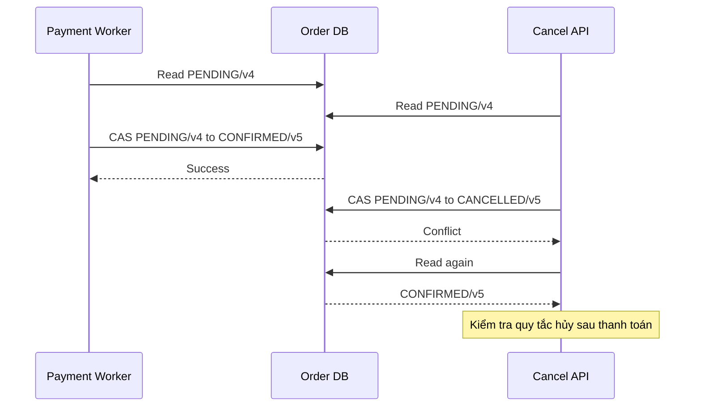

# Mô hình hai tác nhân cùng đọc và thay đổi dữ liệu

## 1. Mở đầu: hai tác nhân cùng đọc một giá trị

Giả sử hệ thống bán hàng lưu tồn kho trong một database NoSQL:

```json
{
  "sku": "P100",
  "available": 10,
  "version": 7
}
```

Cùng một thời điểm:

- **Tác nhân A** xử lý một đơn đặt 3 sản phẩm.
- **Tác nhân B** xử lý một đơn đặt 4 sản phẩm.

Cả hai cùng đọc `available = 10`, tính số lượng sau khi giữ hàng rồi gửi lệnh cập nhật:

```text
Thời điểm    Tác nhân A                 Tác nhân B
---------    -----------------------   -----------------------
T1           READ -> 10
T2                                     READ -> 10
T3           Tính 10 - 3 = 7
T4                                     Tính 10 - 4 = 6
T5           WRITE available = 7
T6                                     WRITE available = 6

Giá trị cuối cùng tại nguồn: 6
```

Nếu cả hai đơn thực sự được chấp nhận thì số lượng đúng phải là:

\[
10 - 3 - 4 = 3
\]

Kết quả `available = 6` không phản ánh tác động của A. Đây là **lost update** (mất cập nhật), một lỗi đồng thời quan trọng trong NoSQL.

Có thể cả hai lệnh WRITE đều nhận `success`, vì database đã thực hiện đúng yêu cầu **gán lại một giá trị cụ thể**. Lỗi nằm ở chỗ ứng dụng tự tính giá trị mới từ dữ liệu có thể đã lỗi thời, nhưng không yêu cầu database kiểm tra giả định đó khi ghi.

Bài học này tập trung vào cách mô hình hóa tình huống **hai tác nhân cùng đọc rồi thay đổi dữ liệu**, phân biệt lịch thực thi hợp lệ và không hợp lệ, chọn cơ chế kiểm soát đồng thời cho NoSQL và thiết kế cách xử lý conflict, timeout, retry.

## 2. “Tác nhân” là gì?

Trong hệ thống phân tán, tác nhân (actor) không nhất thiết là con người. Đó có thể là:

- Hai request HTTP chạy trên hai thread Java.
- Hai instance của cùng microservice sau load balancer.
- Một request người dùng và một background job.
- Hai consumer xử lý event ở hai partition/worker.
- Một tác vụ migration đang backfill và một ứng dụng đang cập nhật.
- Hai region cùng cho phép ghi.
- Một request gốc và một retry do client hoặc broker thực hiện lại.

Điểm chung: các tác nhân có thể **đọc và ghi độc lập**, không có thứ tự phối hợp tự nhiên bảo đảm chúng lần lượt hoàn tất trọn chuỗi đọc–sửa–ghi.

### 2.1. Mô hình hành động

Ký hiệu:

- `R_A(x)`: tác nhân A đọc giá trị x.
- `R_B(x)`: tác nhân B đọc giá trị x.
- `W_A(y)`: A ghi giá trị y.
- `W_B(z)`: B ghi giá trị z.
- `ACK_A`, `ACK_B`: database xác nhận ghi theo hợp đồng của thao tác.

Một **lịch thực thi** (*schedule*) là thứ tự xen kẽ của các hành động:

```text
S1: R_A(10) -> W_A(7) -> R_B(7) -> W_B(3)

S2: R_B(10) -> W_B(6) -> R_A(6) -> W_A(3)

S3: R_A(10) -> R_B(10) -> W_A(7) -> W_B(6)
```

S1 và S2 tương đương hai cách thực thi tuần tự hợp lệ, cùng có kết quả 3. S3 có kết quả 6 và đã mất một thay đổi.

### 2.2. Sơ đồ hai tác nhân

```mermaid
sequenceDiagram
    participant A as Actor A
    participant DB as NoSQL Database
    participant B as Actor B
    A->>DB: Read stock
    DB-->>A: available=10, version=7
    B->>DB: Read stock
    DB-->>B: available=10, version=7
    Note over A: Tính 7
    Note over B: Tính 6
    A->>DB: Set available=7
    DB-->>A: Success
    B->>DB: Set available=6
    DB-->>B: Success
    Note over A,B: Kết quả cuối=6; cập nhật của A bị mất
```

**Atomicity của một lệnh WRITE** không đồng nghĩa **atomicity của chuỗi READ → CALCULATE → WRITE**. Đây là khác biệt cần giữ xuyên suốt bài.

## 3. Trước khi chọn giải pháp: xác định invariant

**Invariant** (bất biến nghiệp vụ) là điều kiện hệ phải giữ sau mỗi tập thay đổi được cam kết hợp lệ.

Ví dụ:

| Nghiệp vụ | Invariant | Hậu quả nếu vi phạm |
| --- | --- | --- |
| Tồn kho | `available >= 0` | Bán vượt lượng hàng |
| Tài khoản | Mỗi username chỉ có một chủ sở hữu trong phạm vi tenant | Trùng định danh |
| Đơn hàng | Trạng thái chỉ chuyển theo state machine được cho phép | Hủy nhầm đơn đã xử lý |
| Lịch trực | Luôn có ít nhất một nhân sự trực | Không có người phụ trách |
| Số dư | Tổng biến động phải nhất quán với giao dịch đã cam kết | Sai số dư |
| Cấu hình | Không mất sửa đổi hợp lệ của người khác | Ghi đè cấu hình |

Không nên đặt mục tiêu mơ hồ là **“hai request đều phải thành công”**. Nếu có 5 sản phẩm mà A/B mỗi người muốn giữ 4, chỉ một yêu cầu được phép thành công. Một request bị từ chối có thể chính là **hành vi đúng**.

### 3.1. Kiểm tra cả kết quả ghi lẫn kết quả nghiệp vụ

Với `available = 5`, hai lệnh reserve(4):

| Phản hồi A | Phản hồi B | Số lượng cuối | Đánh giá |
| --- | --- | --- | --- |
| Thành công | Từ chối hết hàng | 1 | Có thể đúng |
| Từ chối hết hàng | Thành công | 1 | Có thể đúng |
| Thành công | Thành công | 1 | **Sai:** hai reservation nhưng chỉ trừ một lần |
| Thành công | Thành công | -3 | **Sai:** tồn kho âm |
| Từ chối | Từ chối | 5 | Cần xem lý do; có thể lỗi availability/policy |

Một bài test chỉ xem `available == 1` có thể **bỏ sót trường hợp cả hai đơn đều được báo thành công**. Phải xác minh response, operation ID, reservation record và trạng thái nguồn.

## 4. Lost update xảy ra ngay cả khi sửa hai field khác nhau

Xét user profile:

```json
{
  "userId": "U01",
  "displayName": "An",
  "phone": "0900000000",
  "version": 4
}
```

A muốn đổi `displayName`; B muốn đổi `phone`. Hai actor cùng đọc document version 4:

```text
A đọc version4: displayName=An, phone=0900000000
B đọc version4: displayName=An, phone=0900000000

A tạo bản mới: displayName=Anh, phone=0900000000
B tạo bản mới: displayName=An,  phone=0911111111

A replace toàn document
B replace toàn document
```

Kết quả: phone mới nhưng displayName có thể trở lại “An”. A không cố ý sửa phone, B cũng không cố ý sửa displayName; nhưng **replace toàn document** đã mang theo các field lỗi thời.

### 4.1. Patch đúng field

Trong MongoDB, nếu các field thực sự độc lập:

```javascript
db.users.updateOne(
  { userId: "U01" },
  { $set: { displayName: "Anh" } }
);
```

Và:

```javascript
db.users.updateOne(
  { userId: "U01" },
  { $set: { phone: "0911111111" } }
);
```

Các update riêng field giúp tránh dạng lost update do replace toàn object cũ. Tuy nhiên:

- Hai actor cùng sửa **một field** vẫn cần chính sách phân xử.
- Các field liên quan bởi invariant vẫn cần kiểm tra cùng nhau.
- Nếu một form edit toàn object phải từ chối khi người khác vừa sửa, nên dùng **version/CAS** thay vì merge mù.

### 4.2. Không phải mọi khác biệt do concurrency đều là lỗi

Hai phép tăng counter độc lập có thể áp dụng theo thứ tự nào cũng được. Hai yêu cầu “đổi tên thành A” và “đổi tên thành B” lại đòi một quyết định về ý định người dùng.

Những chính sách thường gặp:

- **Reject on conflict:** request đến sau bị từ chối.
- **Last-write-wins:** lấy bản ghi thắng theo quy tắc đã định.
- **Field-level merge:** kết hợp thay đổi trên field độc lập.
- **Domain merge:** quyết định theo quy tắc nghiệp vụ.
- **Collaborative algorithm:** dùng thuật toán như OT/CRDT cho bài toán đồng chỉnh sửa phù hợp.

Không có một chính sách đúng tuyệt đối cho tất cả loại dữ liệu.

## 5. Atomic update thay cho tính toán từ bản đọc cũ

### 5.1. Cộng/trừ trực tiếp ở nguồn

Thay vì:

```text
READ counter=10
CALCULATE counter+1=11
SET counter=11
```

hãy dùng một **atomic increment** nếu database hỗ trợ:

```text
INCREMENT counter BY 1
```

Khi hai actor cùng increment, engine xử lý phép biến đổi trên trạng thái hiện hành. Nếu cả hai operation thực sự được áp dụng **đúng một lần**, kết quả tăng 2.

Về toán học:

\[
(x+a)+b=(x+b)+a
\]

Phép cộng có tính giao hoán, nhưng **không có tính idempotent**. Nếu event tăng 1 bị xử lý hai lần, kết quả tăng 2, không phải 1.

### 5.2. Giới hạn nghiệp vụ phải nằm trong cùng atomic operation

Giảm tồn kho bằng một phép atomic decrement không điều kiện chưa bảo vệ:

\[
available \geq 0
\]

Với `available = 2`, A và B đều muốn lấy 2, hai phép giảm atomic vẫn có thể đưa kết quả thành -2.

Cần logic tương đương:

```text
IF currentAvailable >= requestedQuantity
THEN currentAvailable = currentAvailable - requestedQuantity
ELSE reject
```

**Điều kiện và phép biến đổi phải được thực thi atomic tại nguồn có thẩm quyền**, không phải đọc điều kiện trong Java rồi gửi update không điều kiện.

## 6. Compare-and-set (CAS) và optimistic concurrency control

**CAS** nghĩa là **chỉ ghi nếu trạng thái hiện tại còn khớp kỳ vọng**.

Một Order:

```json
{
  "orderId": "O1001",
  "status": "PENDING",
  "version": 7
}
```

A muốn CONFIRMED, B muốn CANCELLED. Hai actor đều đọc version 7:

```text
A: UPDATE status=CONFIRMED, version=8
   WHERE orderId=O1001 AND version=7
   -> SUCCESS

B: UPDATE status=CANCELLED, version=8
   WHERE orderId=O1001 AND version=7
   -> CONFLICT / no match
```

Sau cập nhật của A, version hiện tại là 8. Điều kiện version=7 của B không còn đúng, nên B không được ghi đè.

### 6.1. Vì sao đọc version trong ứng dụng chưa đủ?

Mã sau **không có CAS thật**:

```java
long currentVersion = repository.readVersion(orderId);
if (currentVersion == expectedVersion) {
    repository.updateWithoutCondition(orderId, nextStatus);
}
```

Một request khác có thể ghi **giữa** hai lệnh Java. CAS đúng cần check và update xảy ra **trong một thao tác conditional/atomic của engine**, hoặc thông qua transaction với mức isolation bảo vệ tương đương.

### 6.2. Các bước của optimistic locking

1. Đọc document/item và version.
2. Tính thay đổi nghiệp vụ dựa trên state đã đọc.
3. Gửi update kèm `expectedVersion`.
4. Nếu thành công, version được tăng hoặc thay token.
5. Nếu thất bại, đọc lại để đánh giá nghiệp vụ và quyết định retry, merge hay trả conflict.

OCC hữu ích khi xung đột ít và không muốn giữ khóa suốt quá trình người dùng suy nghĩ/nhập biểu mẫu.

### 6.3. Version nên đến từ nguồn có thẩm quyền

Version có thể là số nguyên tăng đơn điệu hoặc token opaque. Không nên dùng **timestamp client tự khai** để xác định ai cập nhật trước, vì đồng hồ lệch và network delay có thể đảo thứ tự quan sát.

### 6.4. Vấn đề ABA

```text
Trước: status=READY, version=7
A đọc READY/version7
B: READY/version7 -> PROCESSING/version8 -> READY/version9
A thấy READY lần nữa, tưởng record chưa đổi
```

So sánh **status** không phát hiện chuỗi thay đổi. Version 9 giúp A biết record đã biến đổi dù cuối cùng status quay về READY. Đây là vấn đề **ABA**.

## 7. MongoDB: cập nhật atomic trên một document

MongoDB cung cấp atomicity cho update trên **một document** theo semantics của engine. Điều kiện filter có thể được đánh giá cùng update.

### 7.1. Atomic decrement bằng $inc

```javascript
db.inventory.updateOne(
  { sku: "P100" },
  { $inc: { available: -3 } }
);
```

Nếu A giảm 3 và B giảm 4, các phép `$inc` được áp dụng trên giá trị hiện hành; không có kiểu mất cập nhật do cùng tính giá trị 7/6 rồi SET.

Nhưng để bảo vệ không âm phải thêm điều kiện.

### 7.2. Conditional decrement trong MongoDB

```javascript
const quantity = 3;

const result = db.inventory.updateOne(
  {
    sku: "P100",
    available: { $gte: quantity }
  },
  {
    $inc: {
      available: -quantity,
      version: 1
    }
  }
);

if (result.matchedCount === 0) {
  // Không có SKU hoặc không còn đủ hàng.
}
```

MongoDB thực hiện filter/update trên cùng document. Nếu A đã giảm hàng thì B phải được đánh giá theo điều kiện khi thao tác B chạy.

**Không suy từ `matchedCount === 0` rằng chắc chắn hết hàng**: SKU có thể không tồn tại hoặc còn điều kiện khác không thỏa.

### 7.3. Java MongoDB driver: CAS theo version và status

Ví dụ dùng MongoDB synchronous Java driver, với version lưu kiểu số nguyên dài:

```java
import com.mongodb.client.MongoCollection;
import com.mongodb.client.model.FindOneAndUpdateOptions;
import com.mongodb.client.model.ReturnDocument;
import org.bson.Document;

import static com.mongodb.client.model.Filters.and;
import static com.mongodb.client.model.Filters.eq;
import static com.mongodb.client.model.Updates.combine;
import static com.mongodb.client.model.Updates.inc;
import static com.mongodb.client.model.Updates.set;

public Document confirmOrder(
        MongoCollection<Document> orders,
        String tenantId,
        String orderId,
        long expectedVersion) {

    return orders.findOneAndUpdate(
        and(
            eq("tenantId", tenantId),
            eq("orderId", orderId),
            eq("version", expectedVersion),
            eq("status", "PENDING")
        ),
        combine(
            set("status", "CONFIRMED"),
            inc("version", 1L)
        ),
        new FindOneAndUpdateOptions()
            .returnDocument(ReturnDocument.AFTER)
    );
}
```

Nếu trả `null`, không có document nào thỏa **toàn bộ filter**. Application phải phân biệt not found, sai tenant, invalid transition và version conflict theo hợp đồng API. `tenantId` phải đến từ ngữ cảnh xác thực, không được tin body do client tự khai.

Ví dụ này chỉ minh họa state transition trên **một document**; nó không tự chứng minh payment đã hoàn tất hoặc transaction nhiều document đã cam kết.

### 7.4. Thao tác liên quan nhiều document

Nếu giữ hàng và tạo Order ở hai document khác nhau, atomicity của mỗi update riêng không tự đảm bảo cả hai thay đổi xảy ra cùng nhau. Cần transaction hoặc mô hình reservation/workflow có bảo đảm phù hợp. Phải kiểm tra isolation và khả năng write skew thay vì chỉ nhìn thấy tên tính năng “transaction”.

## 8. DynamoDB: ConditionExpression

DynamoDB hỗ trợ conditional write trên item. Một request có thể yêu cầu:

```text
SET status = CONFIRMED, version = version + 1
IF version = 7 AND status = PENDING
```

Nếu A thành công nâng version lên 8, yêu cầu B còn expected 7 không được áp dụng.

### 8.1. Java AWS SDK v2

```java
import java.util.Map;

import software.amazon.awssdk.services.dynamodb.DynamoDbClient;
import software.amazon.awssdk.services.dynamodb.model.AttributeValue;
import software.amazon.awssdk.services.dynamodb.model.UpdateItemRequest;
import software.amazon.awssdk.services.dynamodb.model.ConditionalCheckFailedException;

public boolean confirmOrder(
        DynamoDbClient client,
        String orderKey,
        long expectedVersion) {

    UpdateItemRequest request = UpdateItemRequest.builder()
        .tableName("Orders")
        .key(Map.of(
            "PK", AttributeValue.builder().s(orderKey).build()
        ))
        .updateExpression(
            "SET #status = :confirmed, #version = #version + :one"
        )
        .conditionExpression(
            "#version = :expected AND #status = :pending"
        )
        .expressionAttributeNames(Map.of(
            "#status", "status",
            "#version", "version"
        ))
        .expressionAttributeValues(Map.of(
            ":confirmed", AttributeValue.builder().s("CONFIRMED").build(),
            ":pending", AttributeValue.builder().s("PENDING").build(),
            ":expected", AttributeValue.builder()
                .n(Long.toString(expectedVersion)).build(),
            ":one", AttributeValue.builder().n("1").build()
        ))
        .build();

    try {
        client.updateItem(request);
        return true;
    } catch (ConditionalCheckFailedException conflict) {
        return false;
    }
}
```

Ví dụ giả định table chỉ có partition key **PK**. Nếu table còn sort key, phải cung cấp đủ primary key. Các lỗi throttle, timeout và network **không được nhầm với** ConditionalCheckFailedException.

### 8.2. Giữ hàng có điều kiện

```text
Item: PK=STOCK#P100
available=5

Update expression:
  SET available = available - :quantity

Condition expression:
  available >= :quantity
```

Điều kiện được kiểm tra ở nguồn ghi item. Hai request cùng giữ 4 trên stock 5 không thể cùng được xác nhận đã giảm hàng thành công theo cùng trạng thái.

### 8.3. GSI không thay thế kiểm tra atomic

Global Secondary Index của DynamoDB cập nhật **eventually consistently**. Hai actor cùng Query GSI để kiểm tra username chưa tồn tại có thể cùng thấy rỗng.

Với uniqueness, cần một key reservation có `PutItem + attribute_not_exists` hoặc transaction thích hợp. Không dùng **GSI không thấy record** làm bằng chứng rằng có quyền cấp phát khóa duy nhất.

### 8.4. Transaction nhiều item

DynamoDB hỗ trợ transaction trong phạm vi giới hạn API, có thể thất bại vì condition/conflict. Phải thiết kế retry/idempotency và xem riêng semantics multi-region/global tables; một conditional write tại một region không tự trở thành một khóa serializable toàn cầu.

## 9. Cassandra: bình thường là blind write, CAS cần LWT

Trong Cassandra, một UPDATE thông thường không tự bảo vệ phép đọc–tính–ghi ở ứng dụng:

```text
A SELECT available=10
B SELECT available=10
A UPDATE available=7
B UPDATE available=6
```

Giá trị cuối theo cơ chế giải quyết ghi có thể không phản ánh đủ hai ý định.

### 9.1. Lightweight transaction (LWT)

Ví dụ CQL:

```sql
UPDATE stock_by_sku
SET available = 7,
    version = 8
WHERE sku = 'P100'
IF version = 7;
```

Kết quả LWT chứa thông tin **[applied]** cho biết điều kiện có thành công không.

- Actor thắng có thể tăng version.
- Actor thua phải đọc lại và tính lại, hoặc trả conflict.
- LWT có chi phí đồng thuận/phối hợp khác write thông thường.
- Cần đối chiếu phạm vi partition, serial consistency và semantics phiên bản Cassandra.
- Một LWT một partition không tự là transaction toàn cục xuyên các partition/service.

### 9.2. Counter không bảo vệ mọi invariant

Cassandra có cơ chế counter cho một số workload, nhưng “giảm counter” không tự bảo đảm cùng lúc: còn hàng, tạo reservation, chống request trùng, ghi Order và hoàn tác khi payment thất bại. Cần thiết kế toàn bộ luồng theo invariant, không chỉ thay field `long` bằng counter.

## 10. Redis: từng lệnh atomic không cứu chuỗi GET–SET

Redis hỗ trợ lệnh như:

```redis
DECRBY stock:P100 3
```

Nhưng code:

```text
GET stock:P100
Tính available mới trong Java
SET stock:P100 newValue
```

vẫn có lost update nếu A/B cùng GET trước khi SET.

### 10.1. MULTI/EXEC không tự bảo vệ GET bên ngoài

Nếu cả hai client đọc 10 trước rồi queue một lệnh SET trong MULTI/EXEC, hai lệnh vẫn có thể ghi đè nhau. MULTI/EXEC không tự biết rằng giá trị SET đã được tính từ bản GET lỗi thời.

### 10.2. WATCH + MULTI/EXEC

```text
WATCH stock:P100
current = GET stock:P100

if current >= qty:
    MULTI
    SET stock:P100 (current - qty)
    EXEC
else:
    UNWATCH
    reject
```

Nếu khóa được WATCH đã thay đổi trước EXEC, Redis có thể không thực thi giao dịch. Client phải tính lại trên state mới hoặc trả conflict.

Cần dùng **cùng connection** đúng lifecycle, xử lý timeout/disconnect và nhớ giới hạn multi-key của Redis Cluster.

### 10.3. Lua script thực hiện điều kiện và cập nhật phía server

```lua
local qty = tonumber(ARGV[1])
if qty == nil or qty <= 0 then
    return redis.error_reply("invalid quantity")
end

local current = tonumber(redis.call("GET", KEYS[1]) or "0")
if current < qty then
    return 0
end

redis.call("DECRBY", KEYS[1], qty)
return 1
```

Với `KEYS[1] = stock:P100`, script giúp kiểm tra và cập nhật như một thao tác atomic của server Redis.

Tuy nhiên:

- Script nên ngắn, tránh block event loop Redis lâu.
- Multi-key có ràng buộc hash slot trong Redis Cluster.
- Atomicity không đồng nghĩa dữ liệu bền qua mất điện; durability phụ thuộc persistence/replication.
- Nếu retry cùng request sau timeout, script vẫn có thể bị thực hiện lần hai nếu không có idempotency.
- Nếu Redis chỉ là cache, nó không mặc nhiên bảo vệ tồn kho authoritative ở database khác.

## 11. Write skew: hai tác nhân ghi hai record khác nhau

Một lỗi khó hơn lost update:

```text
Invariant: luôn có ít nhất một bác sĩ trực.

Doctor A: onCall=true
Doctor B: onCall=true
```

Hai người cùng xin nghỉ:

```text
Transaction A                        Transaction B
-----------------------------        -----------------------------
Đọc A,B: thấy 2 người trực          Đọc A,B: thấy 2 người trực
Quyết định A có thể nghỉ             Quyết định B có thể nghỉ
Ghi A.onCall=false
                                     Ghi B.onCall=false
Commit                               Commit

Cuối cùng: 0 người trực
```

Mỗi transaction chỉ ghi **một document khác nhau**, nên cơ chế chỉ phát hiện write–write conflict trên cùng document có thể không chặn được. Đây là **write skew** trên invariant nhiều record.

### 11.1. Snapshot isolation không mặc nhiên là serializable

Một transaction dùng snapshot isolation có thể tránh nhiều dạng trạng thái không nhất quán, nhưng không tự loại mọi write skew. Cần xem mức **isolation/serializability thực tế** của database, không suy rằng có transaction là chắc chắn an toàn.

### 11.2. Cách bảo vệ invariant liên record

Có thể:

- Đưa số lượng người đang trực vào một aggregate chung, update có điều kiện.
- Dùng transaction với mức isolation và cơ chế conflict phù hợp.
- Tạo một record phối hợp mà hai transaction buộc phải cập nhật, để tạo conflict có thể phát hiện.
- Tuần tự hóa command của cùng lịch trực qua một owner/queue tin cậy.

Một aggregate chung có thể thành hot key; cần cân bằng correctness với throughput, nhưng không đánh đổi invariant để lấy tốc độ.

## 12. Check-then-act: hai actor cùng thấy chưa tồn tại

Ví dụ username:

```text
A QUERY username=an -> không thấy
B QUERY username=an -> không thấy
A INSERT user(username=an)
B INSERT user(username=an)
```

Một lần read có tính nhất quán mạnh vẫn không tự bảo đảm quyền ghi độc nhất vì trạng thái có thể thay đổi **sau read và trước insert**.

### 12.1. Dùng atomic uniqueness tại nguồn

- **MongoDB:** unique index trong phạm vi tenant/collation đúng.
- **DynamoDB:** conditional PutItem trên reservation item hoặc transaction.
- **Cassandra:** `INSERT ... IF NOT EXISTS` với LWT.
- **Redis:** `SET ... NX` khi Redis là nguồn phân xử thích hợp, kèm chính sách TTL/durability cần thiết.

Đừng chỉ kiểm tra tên chưa tồn tại bằng GSI hoặc read model eventual rồi xem đó là một khóa phân tán.

### 12.2. Uniqueness phải có ngữ nghĩa

Username có unique toàn cầu hay theo tenant? Email có phân biệt chữ hoa không? Giá trị missing/null có bị ràng buộc không? Các quy tắc này cần đồng nhất giữa input normalization, storage key, unique constraint và mọi writer.

## 13. Atomicity, isolation, consistency và durability không giống nhau

| Thuộc tính | Câu hỏi |
| --- | --- |
| **Atomicity** | Một tập thay đổi có commit toàn phần hoặc không trong ranh giới bảo đảm? |
| **Isolation** | Hai giao dịch đồng thời có thể quan sát/xen kẽ với nhau ra sao? |
| **Business consistency** | Trạng thái sau commit có giữ invariant nghiệp vụ không? |
| **Durability** | Ghi đã commit sống sót qua các failure mode nào? |

Một ghi có thể **durable nhưng sai nghiệp vụ** nếu nó ghi đè state từ snapshot cũ. Replication write concern không tự tạo CAS. Atomicity của một document không đương nhiên tạo transaction nhiều document.

### 13.1. Linearizability và serializability

**Linearizability:** các thao tác có thể được xem như xảy ra tại một điểm logic giữa lúc gọi và lúc hoàn thành, đồng thời tôn trọng thứ tự thời gian thực của các thao tác không chồng lấn.

**Serializability:** kết quả của các transaction đồng thời tương đương một thứ tự tuần tự hợp lệ. Nó không tự bao hàm đầy đủ thứ tự thời gian thực như strict serializability.

Một database có một atomic update trên một key không có nghĩa mọi transaction đa key là serializable.

### 13.2. Stale read vẫn có thể được phát hiện tại đường ghi

A đọc version 10 từ replica chậm trong khi nguồn đã có version 11:

- A **blind SET**: có nguy cơ ghi đè.
- A **CAS expectedVersion=10** tại nguồn: điều kiện thất bại.

Vì vậy, đọc stale không nhất thiết gây mất cập nhật nếu update có bảo vệ đúng. Nhưng quyền truy cập, UX và deadline có thể yêu cầu đọc với mức nhất quán mạnh hơn trong từng use case.

## 14. Pessimistic lock và fencing token

**Pessimistic locking** lấy quyền độc quyền trước khi sửa:

```text
A acquire lock for P100
A read -> validate -> update -> commit
A release lock
B acquire lock -> tiếp tục
```

Lock giúp giảm cùng tính từ snapshot cũ nhưng có chi phí: chờ, deadlock/starvation, timeout, giảm throughput và xử lý crash. `synchronized` trong một JVM không bảo vệ các JVM khác.

### 14.1. Lock có TTL có thể hết hạn khi actor còn chạy

```text
A lấy lock token 41, rồi bị tạm dừng lâu
Lock hết hạn
B lấy lock token 42 và cập nhật
A tỉnh lại, vẫn cố ghi
```

Nếu nguồn không kiểm tra gì thêm, A có thể ghi stale. **Fencing token** tăng đơn điệu giúp nguồn từ chối actor giữ token cũ, **nếu chính nguồn được bảo vệ thực thi điều kiện này**.

Chỉ đưa token vào log hoặc so sánh trong một client không giúp gì trước race. Lock không thay thế điều kiện ghi hoặc transaction tại nguồn.

## 15. Conflict là một kết quả nghiệp vụ có chủ đích

Khi CAS thất bại, có nhiều lựa chọn:

1. **Trả 409/412** và cho client tải lại.
2. **Đọc lại, tính lại, retry** nếu phép biến đổi an toàn và business rule vẫn đúng.
3. **Merge field độc lập** theo quy tắc được định nghĩa.
4. **Đưa command vào queue** với một owner cho aggregate.
5. **Yêu cầu con người phân xử** khi cùng sửa dữ liệu quan trọng.

Không nên retry mù một giá trị đã tính từ snapshot cũ:

```text
Sai:
  Read available=10
  Calculate next=7
  CAS failed
  Retry SET available=7 without checking current state
```

### 15.1. Retry phải có giới hạn

Khi một hot key chịu hàng trăm request, OCC có thể tạo vòng:

```text
read -> conflict -> read -> conflict -> ...
```

Cần số lần retry tối đa, deadline, backoff/jitter khi thích hợp, phân biệt conflict nghiệp vụ với lỗi mạng/throttle, và đo conflict rate. Tăng retry vô hạn không sửa được mô hình có contention quá cao.

## 16. Idempotency: cùng một ý định được gửi lại

Một request giữ 3 sản phẩm đã commit, nhưng client timeout trước khi nhận ACK. Client retry.

```text
Request R100 -> reserve 3 -> commit
ACK bị mất
Request R100 được gửi lại
```

Nếu không nhận biết request đã xử lý, hệ có thể giảm tồn kho **6** cho một đơn.

### 16.1. Idempotency key

```http
POST /reservations
Idempotency-Key: RES-T01-R100
Content-Type: application/json

{"sku":"P100","quantity":3}
```

Một idempotency key cần được ràng buộc với **tenant, loại operation và nội dung yêu cầu** phù hợp. Khi nhận retry, server truy lại kết quả hoặc trạng thái xử lý thay vì thực thi tác dụng lần hai.

### 16.2. Không thể ghi cờ PROCESSED tách rời bất cẩn

Hai thứ tự sai:

```text
Ghi idempotency=PROCESSED
Crash trước khi giảm stock
```

Hoặc:

```text
Giảm stock
Crash trước khi lưu idempotency=PROCESSED
```

Trường hợp thứ nhất có thể bỏ sót nghiệp vụ, trường hợp thứ hai có thể thực hiện lặp. Cần transaction/conditional aggregate hoặc workflow có trạng thái và đối soát để liên kết **danh tính operation** với **thay đổi nghiệp vụ**.

**Idempotency không thay CAS:** nó ngăn một request bị lặp; CAS xử lý hai request khác nhau tranh cùng state.

## 17. Timeout không chứng minh thất bại

```text
T1: client gửi conditional update
T2: database commit
T3: phản hồi bị mất trên mạng
T4: client thấy timeout
```

Một timeout chỉ nói client **không xác nhận được kết quả**. Ghi có thể đã commit.

Cách xử lý:

- Dùng request ID có thể tra cứu.
- Dùng idempotent transaction/conditional operation nếu phù hợp.
- Đọc state authoritative để đối soát.
- Tách lỗi **conflict đã biết** khỏi tình huống **commit outcome unknown**.
- Có thể trả trạng thái đang xác minh nếu chưa thể kết luận ngay.

Không retry một phép trừ tiền/hàng thiếu idempotency chỉ vì client thấy timeout.

## 18. Transaction nhiều record và saga đa service

Một đơn hàng gồm:

1. Giảm tồn kho.
2. Tạo Order.
3. Tạo Reservation.
4. Phát event OrderReserved.

Atomic update của Stock không bao trùm tất cả. Nếu các record cùng nằm trong một database hỗ trợ transaction phù hợp:

```text
BEGIN transaction
  check stock >= requested
  decrement stock
  create order/reservation
  append outbox event
COMMIT
```

Phải kiểm tra isolation, giới hạn kích thước/thời gian, transaction abort, shard scope, write concern và cách recovery sau timeout.

### 18.1. Gom invariant trong một aggregate

Nếu business rule chỉ cần các field cùng một đối tượng, có thể lưu:

```json
{
  "sku": "P100",
  "available": 10,
  "reserved": 0,
  "version": 7
}
```

Một conditional update có thể đồng thời giảm available và tăng reserved. Điều này giảm độ phức tạp so với transaction nhiều document, nhưng một SKU rất nóng có thể trở thành điểm tranh chấp.

### 18.2. Saga không phải global ACID

Nếu Checkout, Inventory, Payment và Shipping là các service độc lập:

```text
Reserve inventory (idempotent)
    -> Authorize payment
    -> Create shipment request
```

Nếu payment thất bại, hệ có thể chạy **ReleaseReservation**. Nhưng saga cần quản lý pending, timeout, retry, event đến trễ và compensation; không bảo đảm các service luôn cùng trạng thái từng millisecond.

Mỗi bước cục bộ vẫn cần atomicity/CAS phù hợp để hai actor không cùng giữ một đơn vị hàng.

## 19. State machine: hai tác nhân muốn chuyển trạng thái khác nhau

Order được phép:

```text
PENDING -> CONFIRMED
PENDING -> CANCELLED
CONFIRMED -> FULFILLED
```

A là payment worker, B là API hủy. Cả hai cùng đọc PENDING/version4:



B không được cứ retry CANCELLED sau khi biết đơn đã CONFIRMED nếu domain không cho phép chuyển trạng thái ấy. **Conflict bắt buộc phải đi qua bước đánh giá nghiệp vụ mới.**

### 19.1. Dùng cả version và điều kiện trạng thái

Một lệnh nên kiểm tra:

```text
WHERE orderId = O1001
  AND version = 4
  AND status = PENDING
```

Version phát hiện cập nhật khác; điều kiện status bảo vệ transition đang yêu cầu. Các điều kiện nghiệp vụ ở service ngoài vẫn cần bằng chứng và workflow phù hợp.

### 19.2. Event đến muộn và bản chiếu

Nếu consumer nhận OrderCancelled version6 trước OrderConfirmed version5, nó không nên ghi đè state bằng version5 chỉ vì thông điệp đó đến sau. Có thể dùng revision/tombstone với phép ghi điều kiện.

Nhưng nếu event là **delta cần áp dụng tất cả bước**, không thể tự động bỏ mọi event version thấp hơn; cần semantics phát hiện gap, replay hoặc tái dựng snapshot nguồn.

## 20. Hai writer ở nhiều region

Khi A/B ghi ở hai region không phối hợp tức thì, chúng có thể cùng chấp nhận thay đổi trong lúc network partition.

### 20.1. Last-write-wins (LWW)

Một số hệ chọn phiên bản thắng bằng timestamp hoặc metadata. Chính sách này có thể phù hợp với tùy chọn UI ít quan trọng, nhưng dễ **mất ý định hợp lệ**. Không nên dùng LWW làm chiến lược mặc định cho tiền, tồn kho, quyền truy cập hoặc trạng thái đặt chỗ.

### 20.2. Vector clock và conflict siblings

Một số mô hình dùng version vector để phát hiện các thay đổi đồng thời về mặt nhân quả. Khi có sibling versions, cần ứng dụng hoặc engine định nghĩa cách merge, thay vì giả vờ tất cả sự kiện có thứ tự tuyến tính chỉ nhờ timestamp client.

### 20.3. CRDT và invariant

CRDT có thể hội tụ cho counter, set hoặc cấu trúc dữ liệu được thiết kế phù hợp. Nhưng **hội tụ cuối cùng không tự bảo đảm available >= 0 hoặc username duy nhất**. Có thể cần reservation quota hoặc một nguồn phân xử mạnh hơn.

## 21. HTTP API: ETag và If-Match

Một GET có thể trả:

```http
HTTP/1.1 200 OK
ETag: "order-v7"
Content-Type: application/json

{"orderId":"O1001","status":"PENDING"}
```

Client gửi PATCH:

```http
PATCH /orders/O1001
If-Match: "order-v7"
Content-Type: application/json

{"status":"CONFIRMED"}
```

Nếu nguồn đã lên version8, server có thể trả **412 Precondition Failed** theo HTTP conditional request. **409 Conflict** thường dùng cho các xung đột nghiệp vụ khác theo contract.

Quan trọng: controller phải chuyển điều kiện If-Match thành **conditional write thực sự tại database**. So sánh ETag trong RAM rồi UPDATE không điều kiện vẫn có race.

Một response conflict có thể là:

```json
{
  "code": "VERSION_CONFLICT",
  "message": "Order changed since it was read",
  "expectedVersion": 7,
  "currentVersion": 8
}
```

Không tự trả dữ liệu nhạy cảm trong response; bảo vệ quyền và chỉ trả thông tin phù hợp với caller. Với biểu mẫu dài, có thể giữ draft cục bộ để người dùng so sánh và merge khi conflict.

## 22. Thử nghiệm race condition có chủ đích bằng Java

Một test gọi hai thread nhưng không đồng bộ điểm bắt đầu có thể tình cờ chạy tuần tự và không tái hiện lỗi. Dùng **CountDownLatch** để cả hai đọc snapshot trước khi ghi:

```java
import java.util.concurrent.CountDownLatch;
import java.util.concurrent.ExecutorService;
import java.util.concurrent.Executors;
import java.util.concurrent.Future;

public class LostUpdateDemo {
    static final class NaiveCounter {
        volatile int value = 0;

        void increment(CountDownLatch bothRead)
                throws InterruptedException {
            int snapshot = value;
            bothRead.countDown();
            bothRead.await();
            value = snapshot + 1;
        }
    }

    public static void main(String[] args) throws Exception {
        NaiveCounter counter = new NaiveCounter();
        CountDownLatch bothRead = new CountDownLatch(2);
        ExecutorService pool = Executors.newFixedThreadPool(2);

        try {
            Future<?> a = pool.submit(() -> {
                counter.increment(bothRead);
                return null;
            });
            Future<?> b = pool.submit(() -> {
                counter.increment(bothRead);
                return null;
            });

            a.get();
            b.get();

            System.out.println("Expected: 2");
            System.out.println("Actual: " + counter.value);
        } finally {
            pool.shutdownNow();
        }
    }
}
```

Hai thread đều đọc 0. Mỗi thread ghi `snapshot + 1`, nên cuối cùng counter là **1** thay vì 2. Đây là test minh họa **trong bộ nhớ Java**, chưa phải test database thật.

### 22.1. Vì sao volatile chưa đủ?

`volatile` cung cấp một số bảo đảm visibility/order của Java Memory Model, nhưng phép `value = value + 1` vẫn gồm đọc, tính, ghi. `AtomicInteger.incrementAndGet()` bảo vệ phép tăng trong **một JVM**, không tự biến nhiều instance Java cùng sửa NoSQL thành một transaction.

### 22.2. Integration test với database thật

Một kịch bản có barrier:

```text
1. Insert record counter=0, version=1.
2. Khởi chạy A và B.
3. Cả hai cùng đọc counter=0, version=1.
4. Barrier mở, cho cả hai gửi conditional update.
5. Ghi lại kết quả từng actor.
6. Đọc trạng thái authoritative sau khi cả hai kết thúc.
7. Kiểm tra không có hai CAS cùng thành công trên version1.
8. Actor thua đọc lại/tính lại nếu nghiệp vụ cho retry.
```

Với stock=5, hai yêu cầu giữ 4, kiểm tra **không có hai reservation thành công**, chứ không chỉ số stock cuối.

### 22.3. Kịch bản lỗi nên bổ sung

- Timeout ngay sau commit.
- Duplicate retry cùng request ID.
- Hai worker cùng sửa hot key.
- Consumer nhận event sai thứ tự.
- Một worker crash trước checkpoint hoặc outbox ACK.
- Replica lag/failover.
- Migration backfill ghi đè user update.
- Write skew trên hai document khác nhau.

Bài test một counter không thay cho bài test state machine, multi-document invariant và idempotency.

## 23. So sánh các cơ chế giải quyết đồng thời

| Cơ chế | Ưu điểm | Giới hạn |
| --- | --- | --- |
| Atomic field update | Ít round trip, chống lost update trên phép đơn giản | Không tự giữ bound hay chống retry trùng |
| CAS theo version | Phát hiện stale write rõ ràng | Conflict/retry, contention hot key |
| Conditional insert / unique index | Bảo vệ tính duy nhất tại nguồn | Cần chọn đúng phạm vi khóa và phân tán |
| Pessimistic lock | Hạn chế actor khác trong critical section | Timeout, deadlock, fencing, throughput |
| Transaction | Gom nhiều thay đổi trong phạm vi hỗ trợ | Isolation, giới hạn và abort |
| Single-writer queue | Tuần tự hóa command theo aggregate | Backlog, failover, idempotency |
| Domain merge | Có thể giữ các thay đổi độc lập | Không an toàn với mọi field/invariant |
| Last-write-wins | Đơn giản với dữ liệu ít quan trọng | Mất ý định của actor thua |
| CRDT | Hội tụ theo phép merge phù hợp | Không tự bảo vệ giới hạn nghiệp vụ |
| Saga | Phối hợp workflow qua nhiều service | Không atomic toàn hệ, cần local CAS |

Không có giải pháp tối ưu tuyệt đối. Phải ưu tiên **tính đúng đắn của invariant**, sau đó tối ưu throughput, độ trễ và chi phí vận hành.

## 24. Hot key, contention và giới hạn throughput

Nếu hàng nghìn actor cùng sửa:

```text
inventory:SKU-P100
```

CAS có thể liên tục thất bại, lock tạo hàng chờ và transaction phát sinh abort.

Những phương án cần đánh giá:

- Batch/aggregate các thao tác được phép.
- Phân stock theo kho hoặc vùng nếu nghiệp vụ có thể phân bổ thật.
- Reservation quota cho từng worker/region với quy tắc cấp phát an toàn.
- Một command queue có owner xử lý tuần tự theo SKU.
- CRDT cho metric không có bound quan trọng.
- Giới hạn số request concurrent và backpressure.

Sharding counter thành 100 phần giúp chia tải, nhưng **không tự ngăn tổng số reservation vượt lượng hàng thật**. Cần giữ invariant ở ranh giới cấp phát.

### 24.1. Các metric cần quan sát

```text
conditional_write_conflict_rate
CAS_retry_count
transaction_abort_count
hot_key_write_rate
lock_wait_duration
queue_depth_per_aggregate
write_latency_p95_p99
idempotency_duplicate_count
invariant_violation_count
```

Conflict rate cao không nhất thiết chứng minh dữ liệu sai; có thể hệ đang từ chối đúng, nhưng trải nghiệm người dùng hoặc chi phí retry vượt mức cho phép.

## 25. Quy trình xử lý bài toán hai tác nhân

### Bước 1 — Xác định actor và dữ liệu

Liệt kê record/key, field đọc/ghi, tác nhân, instance, region, đường cache/index và hệ authoritative.

### Bước 2 — Viết invariant

Ví dụ stock không âm, username unique, order transition hợp lệ. Không chọn cơ chế chỉ vì một database quảng bá “strong consistency”.

### Bước 3 — Vẽ lịch xen kẽ

```text
A đọc -> A ghi -> B đọc -> B ghi
A đọc -> B đọc -> A ghi -> B ghi
B đọc -> A đọc -> B ghi -> A ghi
```

Thử thêm timeout, retry, duplicate và out-of-order event.

### Bước 4 — Xác định atomic boundary

Động tác ghi bảo đảm trên một field, một document/item, một partition, một transaction nhiều record hay nhiều service? Read/write consistency và isolation nào đang cấu hình?

### Bước 5 — Chọn chiến lược bảo vệ

- Phép biến đổi số: atomic operator + condition.
- Edit form: CAS/ETag.
- Unique allocation: conditional insert/constraint.
- Invariant nhiều record: transaction isolation đủ mạnh hoặc aggregate phối hợp.
- Đa service: local atomicity, saga, idempotency và reconciliation.

### Bước 6 — Định nghĩa conflict/retry

Actor thua được báo gì, có tự tính lại được không, nếu timeout sau commit thì tra cứu kết quả ra sao, và khi nào dừng retry?

### Bước 7 — Kiểm thử lịch thực thi thật

Dùng barrier cho hai actor đọc cùng version, cùng ghi. Xác minh response, state cuối và side effects. Thử cả failure modes.

### Bước 8 — Giám sát production

Theo dõi conflict, retries, transaction abort, hot key, p99 latency và invariant violations; có runbook cho outcome unknown và reconciliation.

## 26. Những hiểu nhầm thường gặp

| Hiểu nhầm | Cách hiểu đúng |
| --- | --- |
| Mỗi SET atomic nên READ–CALCULATE–SET atomic | Chuỗi lệnh không tự atomic |
| Hai WRITE đều success chứng minh không lost update | Blind writes có thể ghi đè nhau |
| synchronized trong một JVM bảo vệ mọi instance | Không bảo vệ JVM/process khác |
| $inc luôn bảo đảm stock không âm | Cần điều kiện trước phép giảm |
| CAS conflict cứ retry giá trị đã tính cũ | Phải đọc/tính lại hoặc trả conflict |
| Majority write concern là CAS | Replication ACK khác điều kiện version |
| Có transaction thì chắc không write skew | Cần kiểm tra isolation |
| GSI không thấy tên nghĩa là chưa có | Secondary index eventual không thay unique constraint |
| Redis MULTI bảo vệ GET trước đó | Cần WATCH hoặc atomic server-side operation |
| Cassandra normal UPDATE thực hiện cộng dồn an toàn | Blind writes có thể mất tác động |
| volatile biến ++ thành atomic | Read–modify–write vẫn nhiều bước |
| Timeout nghĩa là chưa commit | ACK có thể mất sau khi commit |
| Distributed lock đủ để ngăn writer cũ | Cần fencing/enforcement |
| CRDT tự bảo vệ stock không âm | Hội tụ không tự giữ invariant |
| Chỉ kiểm tra state cuối là đủ | Phải xét response và side effects |

## 27. Bài tập thực hành

### Bài 1 — Lost update

Counter bắt đầu 100. A đọc 100 và muốn tăng 10, B đọc 100 và muốn giảm 20. A ghi 110, B ghi 80.

**Hỏi:** Nếu cả hai thay đổi được cam kết thì giá trị đúng là bao nhiêu?

**Gợi ý:** **90**. Kết quả 80 cho thấy tác động của A bị mất.

### Bài 2 — Atomic increment

A và B cùng increment(1) counter ban đầu 0.

**Hỏi:** Sau hai operation thành công đúng một lần, kết quả là gì? Nếu request của A được retry thì sao?

**Gợi ý:** **2**; nếu retry bị thực thi thêm lần nữa mà không idempotent, có thể thành **3**.

### Bài 3 — Stock có điều kiện

Kho còn 5 sản phẩm. A và B mỗi người muốn giữ 4.

**Hỏi:** Vì sao chỉ atomic decrement chưa đủ? Cần điều kiện gì?

**Gợi ý:** `available >= requestedQuantity` phải được kiểm tra cùng phép giảm; chỉ một reservation 4 được thành công.

### Bài 4 — CAS version

Order PENDING/version8. A muốn CONFIRMED, B muốn CANCELLED, cả hai cùng expectedVersion=8.

**Hỏi:** Hai conditional writes có thể cùng thành công trên version8 không?

**Gợi ý:** Không nếu điều kiện được enforce atomic. Actor thua phải đọc lại và xét transition.

### Bài 5 — Hai field độc lập

A đổi displayName, B đổi phone, nhưng cả hai dùng replace toàn document đã đọc.

**Hỏi:** Vì sao mất cập nhật? Khi nào patch từng field phù hợp?

**Gợi ý:** Replace mang field cũ; patch có thể giữ cả hai nếu field thực sự độc lập.

### Bài 6 — Write skew

Hai bác sĩ cùng đang trực, mỗi người thấy hai người trực rồi ghi record của mình thành off.

**Hỏi:** Vì sao atomicity từng record không bảo vệ invariant?

**Gợi ý:** Invariant liên hai record; cần transaction/isolation/điểm phối hợp phù hợp.

### Bài 7 — Redis WATCH

A WATCH K và GET K=10, sau đó B sửa K trước khi A EXEC.

**Hỏi:** A nên làm gì nếu EXEC không áp dụng?

**Gợi ý:** Đọc lại/tính lại hoặc trả conflict, không SET từ dữ liệu cũ.

### Bài 8 — DynamoDB

Hai request UpdateItem cùng condition version=3, một request đã nâng lên 4.

**Hỏi:** Request kia có thể nhận gì? Có nên xem GSI để xác nhận CAS?

**Gợi ý:** Có thể nhận ConditionalCheckFailedException; GSI eventual không phải nguồn CAS.

### Bài 9 — Cassandra LWT

Hai actor chạy UPDATE ... IF version=10.

**Hỏi:** Kiểm tra thành phần nào của response?

**Gợi ý:** **[applied]**. Nếu false, đọc lại state và quyết định.

### Bài 10 — Timeout sau commit

Server đã giữ 2 sản phẩm nhưng client không nhận ACK và retry.

**Hỏi:** Làm sao không trừ hàng hai lần?

**Gợi ý:** Idempotency key gắn với thao tác và trạng thái nguồn, có giao thức atomic/transaction hoặc reconciliation phù hợp.

### Bài 11 — ABA

A đọc READY/v7. B chuyển READY/v7 → PROCESSING/v8 → READY/v9. A chỉ so trạng thái READY.

**Hỏi:** A có biết record đã thay đổi không?

**Gợi ý:** Không; version/epoch giúp phát hiện.

### Bài 12 — Lock hết hạn

A giữ token 31 rồi bị treo; TTL hết, B nhận token 32 và ghi; A tỉnh lại.

**Hỏi:** Phải bảo vệ ở đâu?

**Gợi ý:** Nguồn được bảo vệ phải từ chối stale fencing token, hoặc dùng cơ chế tương đương.

### Bài 13 — Username duy nhất

A và B cùng query username “an” không thấy rồi insert.

**Hỏi:** Strong read trước insert đã đủ chưa?

**Gợi ý:** Chưa. Cần unique constraint/conditional insert tại nguồn.

### Bài 14 — HTTP If-Match

Client GET order-v5; server sau đó lên version6; client PATCH với If-Match order-v5.

**Hỏi:** Server nên trả gì?

**Gợi ý:** Không ghi đè. Với HTTP precondition, **412 Precondition Failed** là phù hợp; một số conflict nghiệp vụ dùng 409 theo contract.

### Bài 15 — Saga đa service

Checkout gồm Inventory, Payment và Shipping. Payment timeout trong khi người dùng yêu cầu hủy.

**Hỏi:** Vì sao atomic stock update chưa đủ?

**Gợi ý:** Cần workflow/saga có trạng thái, idempotency, local CAS, xử lý event đến trễ và compensation/reconciliation.

## 28. Kết luận

**Mô hình hai tác nhân cùng đọc và thay đổi dữ liệu** là cách trực quan để phân tích race condition trong NoSQL. Hai luồng chạy đúng khi đơn lẻ vẫn có thể tạo kết quả sai khi các bước READ–CALCULATE–WRITE xen kẽ. Lost update, check-then-act và write skew là những ví dụ cần đánh giá riêng.

Với một document/item, **atomic update có điều kiện** và **compare-and-set theo version/state** thường là cơ chế trực tiếp. Khi invariant liên nhiều record, cần xét transaction isolation, aggregate design hoặc điểm phối hợp phù hợp. Khi nhiều service hoặc region tham gia, còn phải xử lý idempotency, timeout, conflict resolution và quá trình hội tụ.

Điều quan trọng không phải làm mọi request **luôn thành công**, mà là **chỉ xác nhận những thay đổi đúng nghiệp vụ, không âm thầm xóa mất ý định của actor khác và luôn có cách xử lý khi conflict hoặc outcome không rõ**. Hãy viết invariant, vẽ lịch A/B, đối chiếu đúng bảo đảm của database và kiểm thử cạnh tranh có chủ đích trước khi kết luận một luồng cập nhật là an toàn.
