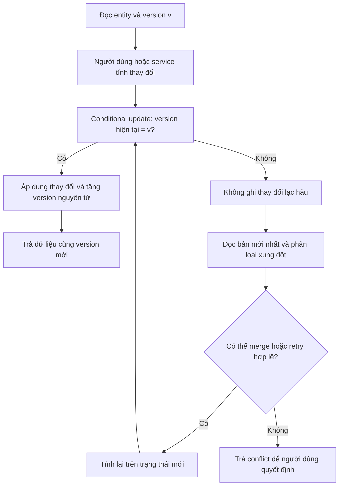

# Khóa lạc quan bằng trường phiên bản

Khi nhiều người dùng hoặc nhiều service cùng cập nhật một bản ghi trong NoSQL, một thao tác ghi hợp lệ về kiểu dữ liệu vẫn có thể **xóa mất thay đổi của người khác**. Ví dụ hai nhân viên cùng mở hồ sơ khách hàng: người thứ nhất đổi số điện thoại, người thứ hai đổi địa chỉ. Nếu mỗi người gửi lại toàn bộ document mình đã đọc, lần ghi sau có thể ghi đè trường được người kia cập nhật trước.

**Khóa lạc quan bằng trường phiên bản (optimistic locking with a version field)** là một kỹ thuật kiểm soát cạnh tranh (*optimistic concurrency control – OCC*). Mỗi thực thể có một giá trị **version**. Ứng dụng đọc version cùng dữ liệu, xử lý yêu cầu, rồi chỉ cho ghi khi version tại thời điểm commit **vẫn bằng version đã đọc**. Khi ghi thành công, version được tăng theo một quy tắc duy nhất.

Điểm cốt lõi không phải chỉ thêm trường `version` vào JSON. Điều bảo vệ dữ liệu là một thao tác **so sánh phiên bản và cập nhật nguyên tử tại database** (*compare-and-set / conditional write*), để không có hai yêu cầu cùng dựa trên phiên bản cũ đều ghi thành công.

Bài học này thuộc chủ đề **Cập nhật đồng thời** trong **Database No SQL**. Ta sẽ phân tích lost update, điều kiện nguyên tử, ví dụ trên MongoDB, DynamoDB, Cassandra/ScyllaDB và Redis, cách triển khai trong Java/API, quy trình xử lý xung đột, retry/idempotency, giới hạn của version đơn đối với hệ phân tán nhiều bản ghi và các phép thử cạnh tranh.

## 1. Lỗi mất cập nhật (*lost update*)

Giả sử document ban đầu:

```json
{
  "customerId": "C-101",
  "name": "Mai",
  "phone": "0900000001",
  "address": "Quận 1",
  "version": 7
}
```

Hai request gần như đồng thời:

```text
Thời điểm      Request A                    Request B
---------      ---------------------------  ---------------------------
T1             READ document version 7
T2                                          READ document version 7
T3             Đổi phone = 0900000002
T4                                          Đổi address = Quận 3
T5             REPLACE document -> thành công
T6                                          REPLACE document -> thành công

Kết quả:
    address của B có thể được lưu;
    phone của A có thể quay về 0900000001.
```

Mỗi request đều làm đúng việc của mình theo dữ liệu cũ nó đọc, nhưng **lần ghi B chứa một bản sao lạc hậu của phone**. Nếu hệ sử dụng kiểu **last-write-wins** mà không kiểm tra xung đột, việc mất cập nhật có thể diễn ra âm thầm.

### Minh họa bằng version

```text
Ban đầu:                    version 7

A đọc:                      version 7
B đọc:                      version 7

A UPDATE ... WHERE version=7
    -> thành công;
    -> document chuyển version 8.

B UPDATE ... WHERE version=7
    -> không tìm thấy bản ghi thỏa điều kiện;
    -> báo conflict;
    -> B cần đọc lại version 8.
```

Kỹ thuật này biến một lỗi dữ liệu âm thầm thành **xung đột có thể phát hiện và xử lý có chủ đích**.

### Không phải mọi cập nhật đồng thời đều là lỗi

Nếu A tăng một counter bằng primitive nguyên tử và B cũng tăng counter bằng primitive nguyên tử, hai cập nhật có thể được phép cùng thành công. OCC bằng version đặc biệt hữu ích khi một thay đổi được tính dựa trên **trạng thái đã đọc trước đó**, hoặc khi người dùng chỉnh sửa một object có nhiều field phụ thuộc lẫn nhau.

## 2. “Khóa lạc quan” có thực sự khóa bản ghi không?

Tên gọi *optimistic locking* dễ gây nhầm lẫn. Kỹ thuật này thường **không giữ khóa độc quyền trên bản ghi trong suốt thời gian người dùng chỉnh sửa**.

Quy trình:

1. **Read:** đọc dữ liệu và version.
2. **Compute/Edit:** xử lý dựa trên snapshot đã đọc, có thể mất vài mili-giây hoặc vài phút.
3. **Validate-and-write:** yêu cầu database chỉ ghi khi version chưa thay đổi.
4. **Success/Conflict:** thành công thì tăng version; thất bại thì không tự ghi đè.

Nó là **kiểm tra xung đột tại thời điểm ghi**. So với khóa bi quan, OCC giả định khả năng tranh chấp đủ thấp để không phải khóa từ đầu. Nếu xung đột xảy ra, ứng dụng cần xử lý.

| Tiêu chí | Khóa lạc quan bằng version | Khóa bi quan |
| --- | --- | --- |
| Khi đọc | Không giữ lock dài hạn theo cơ chế OCC | Có thể cần lock/lease để ngăn writer khác |
| Khi ghi | So sánh version + ghi nguyên tử | Ghi khi giữ lock phù hợp |
| Khi tranh chấp | Một số writer bị conflict và cần xử lý | Writer có thể chờ, timeout hoặc deadlock |
| Phù hợp | Tranh chấp không quá cao, form chỉnh sửa, cấu hình | Vùng critical section có tranh chấp cao và cơ chế lock phù hợp |
| Rủi ro | Retry storm, người dùng gặp conflict, version cũ | Lock contention, lease expiry, giữ lock quá lâu |
| Điều kiện an toàn | Database phải hỗ trợ conditional write nguyên tử | Lock protocol phải đúng, gồm fencing khi cần |

Cả hai không tự giải quyết mọi bất biến nhiều bản ghi. Chọn kỹ thuật phải xét ngữ nghĩa nghiệp vụ và khả năng transaction của hệ.

## 3. Mô hình thực thể có trường version

Ví dụ stored document:

```json
{
  "tenantId": "T1",
  "orderId": "O-500",
  "status": "PENDING",
  "shippingAddress": "12 Nguyễn Huệ",
  "totalMinor": 250000,
  "version": 12,
  "updatedAt": "2026-11-14T08:00:00Z"
}
```

Những quy tắc nên công bố:

| Thuộc tính | Quy tắc |
| --- | --- |
| **Identity** | Khóa thực thể ổn định, ví dụ `(tenantId, orderId)`. |
| **version** | Số nguyên không âm hoặc dương theo convention; ứng dụng phải chọn nhất quán. |
| **Initial version** | Ví dụ 1 khi tạo, nhưng 0 cũng được nếu mọi writer thống nhất. |
| **Transition** | Sau một lần cập nhật trạng thái được chấp nhận: `version := version + 1`. |
| **Ownership** | Do server/database quản lý; client không tự gán version mới. |
| **Update predicate** | Bắt buộc có identity, tenant scope và `version = expectedVersion`. |
| **No-op policy** | Xác định rõ cập nhật không đổi field có làm tăng version không. |
| **Delete/recreate** | Duy trì dấu xóa hoặc generation để không chấp nhận cập nhật lạc hậu. |

**Version là một token của trạng thái quan sát**, không phải “số lượng request đã gửi”. Nếu ghi thất bại vì xung đột, version không được tăng theo request thất bại. Nếu retry một request đã commit nhưng client mất response, phải xét idempotency riêng.

### Tại sao dùng số nguyên thay vì thời gian updatedAt?

`updatedAt` hữu ích cho hiển thị và audit, nhưng thường không phải thay thế tốt cho version:

- Hai update có thể cùng timestamp ở độ phân giải hiện tại.
- Đồng hồ giữa các node có thể lệch.
- Timestamp có thể do client cung cấp sai.
- So sánh thời gian không bảo đảm tính đơn điệu theo thứ tự commit.
- Một số hệ serialize timestamp với precision khác nhau.

**Một counter version tăng bởi nguồn có thẩm quyền ngay trong conditional update** dễ diễn giải hơn. Timestamp vẫn nên lưu phục vụ audit nhưng không mặc định là concurrency token.

## 4. Thuật toán optimistic locking chuẩn

Một hợp đồng tổng quát:

```text
Input:
    entityId
    expectedVersion
    requestedChange

Atomic operation at authoritative storage:
    IF entityId tồn tại
       AND stored.version == expectedVersion
       AND những business preconditions cần thiết còn đúng
    THEN
       apply requestedChange
       stored.version = stored.version + 1
       commit
       return success with newVersion
    ELSE
       do not overwrite data
       return conflict / not-found / validation error
```

Sơ đồ:



Hai thành phần **so sánh** và **ghi** phải nằm trong một ranh giới nguyên tử mà database hỗ trợ. Nếu chỉ so sánh ở ứng dụng, tồn tại cửa sổ cạnh tranh.

## 5. Cách làm sai: đọc version rồi UPDATE không điều kiện

Ví dụ giả mã nguy hiểm:

```java
Order order = repository.findById(id);

if (order.version() == expectedVersion) {
    // Một request khác có thể ghi ngay sau câu if này.
    repository.save(order.withStatus("PAID"));
}
```

Ngay cả khi `repository.save` thành công, nó không bảo đảm được trạng thái không thay đổi giữa READ và WRITE. Đây là **time-of-check to time-of-use race (TOCTOU)**.

Một biến thể sai khác:

```text
1. GET current version = 12.
2. Nếu == 12, tính version mới = 13.
3. PUT bản ghi với version = 13 nhưng không có condition.
```

Hai writer có thể cùng đọc 12 rồi cùng PUT version 13. Kết quả là một update bị mất **mà cả hai response vẫn báo thành công**.

Chỉ có ích khi database thực thi logic tương đương:

```sql
UPDATE ...
SET payload = ..., version = version + 1
WHERE id = ... AND version = :expected
```

Đây là cú pháp SQL khái niệm; trong NoSQL, dùng **Update filter, ConditionExpression, LWT hoặc transaction/script** tương ứng của sản phẩm.

## 6. MongoDB: updateOne theo version và $inc

MongoDB hỗ trợ thao tác cập nhật trên **một document** với tính nguyên tử của update document. Có thể kết hợp điều kiện version và tăng version:

```javascript
const expectedVersion = NumberLong("12");

const result = db.orders.updateOne(
  {
    tenantId: "T1",
    orderId: "O-500",
    version: expectedVersion
  },
  {
    $set: {
      status: "PAID",
      updatedAt: new Date()
    },
    $inc: {
      version: NumberLong("1")
    }
  }
);

if (result.matchedCount === 1) {
  print("Update accepted");
} else {
  print("Missing entity, wrong tenant or stale version");
}
```

Nếu document có version 12, update đặt status PAID và tăng version lên 13 như **một thao tác document-level atomic**. Nếu request khác đã chuyển version lên 13, filter `version: 12` không còn khớp.

### Vì sao dùng matchedCount?

- **matchedCount = 1:** đã có document thỏa điều kiện lúc update thực thi. Vì `$inc` luôn tăng version khi update hợp lệ, thông thường document sẽ thực sự bị sửa.
- **matchedCount = 0:** không có document thỏa **toàn bộ filter**; chưa thể suy ra ngay nguyên nhân là conflict, not-found hay tenant scope.
- **modifiedCount** còn chịu ngữ nghĩa update có thật sự tạo thay đổi hay không; với `$inc` hợp lệ, nó thường là 1 khi match, nhưng điều kiện chấp nhận phải được định nghĩa rõ.

Không gộp `matchedCount = 0` thành lỗi “bản ghi không tồn tại” nếu thực thể vẫn có nhưng version đã thay đổi.

### Cần tránh những lỗi sau

**Sai:** query filter có version nhưng `$set` để client tự gửi cả `version`.

```javascript
// Không nhận document nguyên vẹn từ client để $set vô kiểm soát.
// Client có thể gửi version hoặc field nhạy cảm.
db.orders.updateOne(
  { orderId: "O-500", version: 12 },
  { $set: untrustedClientPayload }
);
```

**Đúng hơn:** server tạo allowlist những field được phép cập nhật, và version được tăng ở operation do server kiểm soát.

Nếu nhiều field thuộc cùng document, MongoDB có thể áp chúng nguyên tử trong một lần update. Nếu business operation thay đổi **nhiều document/collection**, cần đánh giá transaction hoặc mô hình invariants riêng: OCC cho một document không tự tạo atomicity xuyên tất cả document.

## 7. MongoDB: findOneAndUpdate trả version mới

Khi cần trả ngay document sau khi cập nhật:

```javascript
const updated = db.orders.findOneAndUpdate(
  {
    tenantId: "T1",
    orderId: "O-500",
    version: NumberLong("12")
  },
  {
    $set: {
      shippingAddress: "28 Nguyễn Huệ",
      updatedAt: new Date()
    },
    $inc: {
      version: NumberLong("1")
    }
  },
  {
    returnDocument: "after"
  }
);

if (updated === null) {
  // Không thỏa toàn bộ filter.
  // Có thể đọc lại theo identity và tenant scope để phân loại.
} else {
  // updated.version là version mới sau commit.
}
```

**Ưu điểm:** client nhận được trạng thái vừa ghi thay vì tự tính version rồi giả định. Phải đảm bảo mọi update theo cùng entity (kể cả background job và admin tool) tuân thủ version contract; nếu một script cập nhật document nhưng **không tăng version**, OCC có thể không phát hiện thay đổi đó.

### Có nên dùng replaceOne?

Có thể dùng `replaceOne` với filter identity + expectedVersion và replacement version mới. Nhưng replace toàn document có nguy cơ ghi lại field lạc hậu, làm mất field không thuộc phạm vi request hoặc chép nhầm metadata. Với PATCH, update đúng những field cần đổi thường an toàn và rẻ hơn. Dù chọn update/replace, **filter theo version phải nằm trong lệnh ghi nguyên tử**.

## 8. Java với MongoDB driver: một hàm cập nhật có điều kiện

Ví dụ dùng MongoDB Java Sync Driver, minh họa một service nhận `expectedVersion` từ request đã validate:

```java
import com.mongodb.client.MongoCollection;
import com.mongodb.client.model.FindOneAndUpdateOptions;
import com.mongodb.client.model.ReturnDocument;
import org.bson.Document;
import org.bson.conversions.Bson;

import java.util.Date;
import java.util.Optional;

import static com.mongodb.client.model.Filters.and;
import static com.mongodb.client.model.Filters.eq;
import static com.mongodb.client.model.Updates.combine;
import static com.mongodb.client.model.Updates.inc;
import static com.mongodb.client.model.Updates.set;

public final class OrderUpdater {
    public static Optional<Document> changeAddress(
            MongoCollection<Document> orders,
            String tenantId,
            String orderId,
            long expectedVersion,
            String newAddress) {

        if (expectedVersion < 0) {
            throw new IllegalArgumentException(
                "expectedVersion must be non-negative"
            );
        }

        Bson filter = and(
            eq("tenantId", tenantId),
            eq("orderId", orderId),
            eq("version", expectedVersion)
        );

        Bson update = combine(
            set("shippingAddress", newAddress),
            set("updatedAt", new Date()),
            inc("version", 1L)
        );

        Document result = orders.findOneAndUpdate(
            filter,
            update,
            new FindOneAndUpdateOptions()
                .returnDocument(ReturnDocument.AFTER)
        );

        return Optional.ofNullable(result);
    }
}
```

Ý nghĩa kết quả:

```text
Optional có document:
    conditional write thành công;
    document đã có version mới.

Optional.empty():
    filter không khớp;
    cần phân loại entity không tồn tại hay conflict.

Exception do network/timeouts:
    KHÔNG được tự coi chắc chắn ghi thất bại;
    commit có thể đã xảy ra trước khi response mất.
```

Đoạn mã chỉ trình bày giao thức OCC. Trong production cần authorization, validation, exception mapping, timeout, idempotency và kiểm tra các cập nhật ngoài service này. Version được minh họa là kiểu **long**, và dữ liệu lưu phải có kiểu tương thích một cách nhất quán.

### Spring Data và @Version

Một số framework như Spring Data MongoDB có hỗ trợ annotation `@Version` để triển khai optimistic locking trong những thao tác repository/template được hỗ trợ. Điều đó có thể giảm boilerplate, nhưng cần xác minh:

- Version được khởi tạo và tăng ra sao theo framework/version.
- Những thao tác bulk, custom update, script hoặc driver trực tiếp có đi qua cơ chế version không.
- Write concern và điều kiện ghi thực tế.
- Thao tác nào ném exception khi xung đột.
- Nhiều đường writer có cùng contract hay không.

**Không giả định gắn `@Version` lên class tự động bảo vệ mọi câu lệnh ghi vào collection.**

## 9. DynamoDB: ConditionExpression + UpdateExpression

DynamoDB hỗ trợ **conditional writes** trên item. Version có thể là thuộc tính Number:

```json
{
  "PK": { "S": "TENANT#T1" },
  "SK": { "S": "ORDER#O-500" },
  "status": { "S": "PENDING" },
  "version": { "N": "12" }
}
```

Mẫu UpdateItem ở mức API:

```text
Key:
    PK = TENANT#T1
    SK = ORDER#O-500

UpdateExpression:
    SET #status = :newStatus,
        #version = #version + :one

ConditionExpression:
    attribute_exists(PK) AND #version = :expected

ExpressionAttributeNames:
    #status  -> status
    #version -> version

ExpressionAttributeValues:
    :newStatus -> S("PAID")
    :one       -> N("1")
    :expected  -> N("12")

ReturnValues:
    ALL_NEW
```

Nếu version hiện tại là 12, update và tăng lên 13 trong phạm vi item. Nếu đã thành 13, **ConditionExpression** không thỏa và DynamoDB báo lỗi điều kiện, thường là **ConditionalCheckFailedException** trong SDK tương ứng.

### Những lưu ý thực tế

- **ConditionExpression và UpdateExpression** được đánh giá nguyên tử trong write operation của item.
- Nếu business cần kiểm tra cả `status = PENDING`, thêm điều kiện này **cùng ConditionExpression**, không chỉ kiểm tra trước ở client.
- **FilterExpression** của Query không thay thế được điều kiện ghi.
- Không dùng `PutItem` vô điều kiện để overwrite item đã có version.
- Nếu dữ liệu cập nhật nằm trên nhiều item, cần xét **TransactWriteItems** và giới hạn transaction tương ứng.
- GSI được cập nhật bất đồng bộ; **đọc version cũ từ GSI** có thể tạo nhiều conflict dù source write đã đúng. Với workflow cần phiên bản mới nhất, cân nhắc đọc từ đường khóa nguồn phù hợp.
- Dùng SDK typed Number nhất quán; không làm tròn version lớn qua floating-point không an toàn.

### Điều kiện trạng thái và version

Một update thanh toán có thể yêu cầu đồng thời:

```text
#version = :expected
AND #status = :pending
AND attribute_exists(PK)
```

Version bảo vệ khỏi **cập nhật lạc hậu**, còn status bảo vệ **state transition**. Hai điều kiện bổ sung nhau.

## 10. Cassandra/ScyllaDB: lightweight transaction (LWT)

Trong mô hình CQL, so sánh phiên bản và cập nhật có điều kiện có thể dùng **lightweight transaction** với mệnh đề `IF`. Ví dụ bảng:

```sql
CREATE TABLE profiles_by_id (
    tenant_id text,
    profile_id text,
    display_name text,
    version bigint,
    PRIMARY KEY ((tenant_id, profile_id))
);
```

Giả sử version đang là 7:

```sql
UPDATE profiles_by_id
SET display_name = ?,
    version = ?
WHERE tenant_id = ?
  AND profile_id = ?
IF version = ?;
```

Bindings minh họa:

```text
display_name = "Mai"
new_version  = 8
tenant_id    = "T1"
profile_id   = "C-101"
old_version  = 7
```

Khi LWT áp dụng thành công, trả kết quả có **[applied] = true** theo giao diện CQL/driver tương ứng. Nếu version đã khác, `[applied] = false` và dữ liệu không được ghi bởi điều kiện đó.

### Khác gì với MongoDB update?

- Trong ví dụ CQL, ứng dụng tính `newVersion = expectedVersion + 1`, và LWT bảo đảm chỉ một update thỏa điều kiện expectedVersion được áp dụng.
- LWT sử dụng giao thức đồng thuận trong phạm vi hỗ trợ, có **latency/throughput cost** cao hơn ghi thường; không dùng bừa cho mọi telemetry write.
- Không suy rằng một LWT trên row tạo ra transaction serializable xuyên các partition hoặc bảng tùy ý.
- Cần kiểm tra consistency settings, driver retry policy và tính năng cụ thể của phiên bản Cassandra/ScyllaDB.
- Dữ liệu cũ thiếu version cần migration hoặc điều kiện khởi tạo phù hợp; không mặc định mọi row đã có version 0.

### Đừng dùng batch như một thay thế tùy tiện

Một batch CQL không tự biến mọi thay đổi ở nhiều partition thành transaction SQL thông thường. Khi bất biến liên quan nhiều thực thể, cần xác định cơ chế được engine hỗ trợ và mô hình dữ liệu thay vì dùng version trên một row rồi giả định cả workflow nguyên tử.

## 11. Redis: WATCH/MULTI/EXEC hoặc Lua script

Redis hash có thể giữ version:

```redis
HSET profile:T1:C-101 name Mai version 7
HGETALL profile:T1:C-101
```

### WATCH/MULTI/EXEC

Một quy trình:

```text
WATCH profile:T1:C-101
HGET profile:T1:C-101 version
So sánh với expectedVersion từ request.
Nếu bằng:
    MULTI
    HSET profile:T1:C-101 name Mai
    HINCRBY profile:T1:C-101 version 1
    EXEC

Nếu key thay đổi trước EXEC:
    EXEC có thể abort giao dịch theo WATCH.
```

Điểm quan trọng: so sánh ở client **được bảo vệ bởi WATCH** đến khi EXEC; nếu chỉ HGET rồi MULTI mà không WATCH, vẫn có TOCTOU.

### Lua script: so sánh và ghi trong một lần thực thi

Một script minh họa trên **một Redis hash key**:

```lua
-- KEYS[1]: key của profile.
-- ARGV[1]: expected version, chuỗi số nguyên.
-- ARGV[2]: display name mới.

local current = redis.call("HGET", KEYS[1], "version")
if not current then
    return {0, "MISSING_OR_UNVERSIONED"}
end

if current ~= ARGV[1] then
    return {0, "VERSION_CONFLICT"}
end

redis.call("HSET", KEYS[1], "name", ARGV[2])
local newVersion = redis.call("HINCRBY", KEYS[1], "version", 1)
return {1, tostring(newVersion)}
```

Script được thực thi nguyên tử theo mô hình xử lý lệnh của Redis đối với các key hợp lệ, tránh khoảng trống giữa HGET và HSET. Ví dụ so sánh **chuỗi chuẩn hóa của version** (không làm tròn qua Lua number). Trong thực tế phải:

- Validate expectedVersion là dạng số nguyên chuẩn, không có nhiều biểu diễn tương đương như `07` và `7`.
- Kiểm tra version nằm trong miền số được Redis HINCRBY hỗ trợ; xử lý overflow.
- Trong Redis Cluster, các key script dùng phải tuân thủ quy tắc cùng hash slot nếu có nhiều key.
- Xác định TTL và expiry: key hết hạn giữa lúc người dùng đọc và ghi phải dẫn tới kết quả an toàn.
- Không nhầm tính nguyên tử thực thi script với cam kết **durability sau crash**; Redis persistence/replication có hợp đồng riêng.
- Kiểm tra quyền caller và path của key, không tin key/tenant từ client.

### Redis WATCH khác trường version như thế nào?

WATCH phát hiện thay đổi trên key trong một transaction window, còn **trường version** lưu token trạng thái có thể truyền qua API, cache, client và nhiều request theo thời gian. Có thể dùng chúng cùng nhau. Nếu không cần lưu version lâu dài, WATCH có thể đủ cho một thao tác ngắn, nhưng API sửa document trong vài phút thường cần token phiên bản ổn định.

## 12. Một flow nhất quán cho API HTTP

Giả sử client đọc:

```http
GET /api/orders/O-500
```

Response:

```json
{
  "orderId": "O-500",
  "status": "PENDING",
  "shippingAddress": "12 Nguyễn Huệ",
  "version": 12
}
```

Khi cập nhật:

```http
PATCH /api/orders/O-500
Content-Type: application/json

{
  "expectedVersion": 12,
  "shippingAddress": "28 Nguyễn Huệ"
}
```

Server:

1. Xác thực và xác định tenant thực tế.
2. Validate field được phép cập nhật và expectedVersion.
3. Tạo **conditional update** theo `(tenantId, orderId, version)`.
4. Tăng version **trong cùng thao tác thành công**.
5. Trả representation có `version = 13`, hoặc conflict có cấu trúc.

Ví dụ thành công:

```json
{
  "orderId": "O-500",
  "shippingAddress": "28 Nguyễn Huệ",
  "version": 13
}
```

### Phân biệt nguồn version

- **expectedVersion:** version mà client đã quan sát; dùng làm điều kiện.
- **storedVersion:** version thực của source tại thời điểm database xử lý.
- **newVersion:** version mới, chỉ xuất hiện sau khi cập nhật được commit thành công.

Không để client quyết định `newVersion`. Client không được gửi `version: 999` trong payload để “giành ưu tiên”.

## 13. HTTP ETag và If-Match

Thay vì đặt expectedVersion trong JSON, HTTP có cơ chế **conditional requests** dùng **ETag**.

Ví dụ API có representation:

```http
HTTP/1.1 200 OK
ETag: "order-O-500-v12"
Content-Type: application/json

{
  "orderId": "O-500",
  "shippingAddress": "12 Nguyễn Huệ"
}
```

Client gửi cập nhật với validator đã nhận:

```http
PATCH /api/orders/O-500
If-Match: "order-O-500-v12"
Content-Type: application/json

{
  "shippingAddress": "28 Nguyễn Huệ"
}
```

Server phải ánh xạ ETag sang **trạng thái mà nó đại diện**, rồi dùng cơ chế conditional write nguyên tử với nguồn. Nếu ETag không còn khớp, chuẩn HTTP thường sử dụng **412 Precondition Failed** cho điều kiện If-Match thất bại.

### 409, 412 hay 428?

| HTTP status | Khi nào cân nhắc |
| --- | --- |
| **409 Conflict** | Xung đột nghiệp vụ/version theo hợp đồng API không dựa vào HTTP precondition. |
| **412 Precondition Failed** | Header If-Match/điều kiện HTTP không còn đúng. |
| **428 Precondition Required** | API yêu cầu client phải gửi điều kiện trước khi cập nhật. |
| **404 Not Found** | Resource không tồn tại hoặc phải được ẩn theo quyền truy cập. |
| **403 Forbidden** | Caller không có quyền thực hiện thao tác. |
| **400/422** | Payload sai cấu trúc hoặc không đạt validation theo convention API. |

**ETag không tự kích hoạt optimistic locking trong database.** Server phải thực sự ràng buộc cập nhật với token trạng thái. ETag mạnh/yếu, phương pháp so sánh và representation thay đổi cần tuân theo ngữ nghĩa HTTP đã chọn. Với một resource được phục vụ qua nhiều biến thể encoding/representation, token phải được thiết kế để không tuyên bố hai trạng thái tương đương sai.

Nếu một thao tác phải chống cập nhật lạc hậu, server có thể từ chối PATCH không có `If-Match` theo policy thay vì tự áp last-write-wins.

## 14. Xử lý xung đột ở API: không phải lúc nào cũng tự retry

Giả sử:

```text
A đọc v12, đổi address.
B đọc v12, đổi phone.

A commit -> v13.
B ghi expectedVersion=12 -> conflict.
```

Tùy nghiệp vụ, B có một số lựa chọn:

1. **Trả conflict cho người dùng:** hiển thị giá trị mới và phần họ vừa sửa, để quyết định có áp tiếp không.
2. **Merge theo field:** nếu có đủ thông tin để chứng minh hai thay đổi độc lập, tính lại patch trên v13 rồi ghi với expectedVersion=13.
3. **Retry có điều kiện:** service tải bản mới, tính toán lại từ đầu và thử trong giới hạn.
4. **Từ chối vĩnh viễn:** nếu state transition đã không còn hợp lệ, ví dụ CANCELLED không thể thành PAID.

**Không** làm điều này:

```text
CONFLICT
    -> đọc version mới nhất
    -> ghi lại nguyên payload cũ, chỉ thay expectedVersion mới
```

Vì payload cũ có thể chứa các field lạc hậu. Đổi version để ép ghi thành công không tương đương merge đúng.

### Phân loại conflict trước khi retry

| Tình huống | Hướng xử lý |
| --- | --- |
| Hai thay đổi trên field độc lập | Có thể merge nếu domain cho phép và dựa trên state mới. |
| Hai người sửa cùng địa chỉ | Yêu cầu người dùng chọn hoặc quy tắc domain rõ. |
| Chuyển trạng thái đơn đã CANCELLED | Từ chối hoặc yêu cầu workflow khác. |
| Tăng counter cộng dồn | Có thể dùng primitive atomic thay vì OCC toàn document. |
| Ghi tiền hoặc thanh toán | Không tự retry làm side effect; cần operationId và bất biến tài chính. |
| Inventory giảm bởi hai đơn | Dùng điều kiện stock/version trong cùng write hoặc transaction tương ứng. |
| Resource đã bị xóa | Không tự tạo lại chỉ vì request cũ. |

## 15. Retry dưới tranh chấp và giới hạn retry

OCC hoạt động tốt khi số xung đột thấp. Với một document nóng, nhiều request có thể liên tục đọc cùng version rồi tranh nhau.

```text
10 request đọc version 100.
Một request thắng -> version 101.
Chín request conflict.
Nếu chín request lập tức retry đồng thời,
họ lại có thể cùng đọc version 101,
và chỉ một request tiếp theo thắng.
```

Tình trạng này tạo **retry storm**.

Chiến lược thường dùng:

- Giới hạn số lần thử, ví dụ **3 lần** cho nghiệp vụ thích hợp.
- Sau conflict, **đọc lại trạng thái thật**; không chỉ cộng expectedVersion trong bộ nhớ.
- Tính lại thay đổi dựa trên dữ liệu mới, kiểm tra business rule lần nữa.
- Sử dụng **backoff có jitter** khi tự động retry để giảm đồng bộ hóa các request.
- Không retry vô hạn trong luồng HTTP có timeout.
- Đưa kết quả conflict có ý nghĩa cho người dùng nếu không thể merge.
- Theo dõi tỷ lệ conflict theo entity/tenant và nhóm tác vụ.

Ví dụ giả mã:

```java
for (int attempt = 0; attempt < maxAttempts; attempt++) {
    Order current = repository.readCurrent(orderId, tenantId);

    Change change = domain.recalculate(current, command);

    if (!change.isStillValid()) {
        return BusinessRejected.INSTANCE;
    }

    WriteResult result =
        repository.compareAndUpdate(
            orderId,
            tenantId,
            current.version(),
            change
        );

    if (result.isApplied()) {
        return result;
    }

    backoffWithJitter(attempt);
}

return RetryBudgetExhausted.INSTANCE;
```

Đây là **giả mã**, không có hàm `backoffWithJitter` hoặc repository thực tế. Quan trọng là mỗi vòng phải **đọc lại, tính lại, kiểm tra lại**, không lặp blind write từ snapshot cũ.

Không nên retry thao tác người dùng sửa cùng một field bằng cách tự quyết định bản nào thắng nếu product chưa có policy rõ ràng.

## 16. OCC không đồng nghĩa idempotency

**Optimistic locking** giải quyết việc hai writer dùng cùng snapshot cũ cùng muốn ghi. **Idempotency** giải quyết việc **cùng một yêu cầu bị gửi lại** mà không thực hiện nghiệp vụ hai lần.

Kịch bản:

```text
Client gửi PayOrder(requestId=R1, expectedVersion=12).
Database commit: status=PAID, version=13.
Response bị mất vì network timeout.

Client retry PayOrder(R1, expectedVersion=12).
Database trả version conflict.
```

Nếu chỉ nhìn conflict, client có thể tưởng thanh toán chưa thành công, dù thao tác trước đã commit. Nguy hiểm hơn, nếu client phát lại side effect charge payment trước khi kiểm tra idempotency, có thể thanh toán trùng.

### Idempotency key

Một workflow có thể lưu:

```json
{
  "operationId": "R1",
  "entityId": "O-500",
  "requestFingerprint": "canonical-hash",
  "status": "APPLIED",
  "resultVersion": 13
}
```

Khi cùng `operationId` đến lại, hệ trả **kết quả đã commit** thay vì thực hiện lần nữa. Cần bảo đảm trạng thái operation và thay đổi nghiệp vụ có ràng buộc nguyên tử hoặc giao thức recovery phù hợp, không chỉ lưu operationId sau update mà không giải quyết crash giữa hai bước.

### Ba điều phải phân biệt

- **Conflict có xác nhận:** database trả điều kiện version thất bại.
- **Write thành công có xác nhận:** client nhận kết quả commit.
- **Kết quả không xác định:** timeout/mất kết nối sau khi gửi; không biết commit đã xảy ra hay chưa.

Trường hợp thứ ba phải được xử lý bằng **read-back/operation status/idempotency**, không tự coi là chắc chắn thất bại.

## 17. Cập nhật counter: khi nào không cần CAS toàn document?

Giả sử hai request cùng muốn **tăng số lượt xem thêm 1**:

```text
A đọc views=10.
B đọc views=10.
A tính views=11.
B tính views=11.
```

Nếu dùng PUT giá trị 11 không điều kiện, mất một lượt. OCC với version có thể phát hiện conflict, nhưng còn giải pháp đơn giản hơn nếu nghiệp vụ chỉ là phép tăng độc lập:

MongoDB:

```javascript
db.articles.updateOne(
  { articleId: "A-1" },
  { $inc: { views: 1 } }
);
```

Redis:

```redis
INCR article:A-1:views
```

DynamoDB có thể dùng UpdateExpression với phép cộng trên số, cùng điều kiện cần thiết nếu có.

**Atomic increment** tránh read-modify-write ở client cho phép cộng. Nhưng nếu có bất biến:

```text
stock >= quantity
AND stock phải giảm đúng một lần cho order R1
```

thì phải có **conditional update** phù hợp và idempotency; phép `$inc` âm không điều kiện không đủ để chống oversell hoặc double decrement.

### Version có cần tăng khi dùng atomic increment?

Tùy hợp đồng:

- Nếu version đại diện **mọi thay đổi thực thể**, counter update phải tăng version.
- Nếu views là metric độc lập và không ảnh hưởng trạng thái được chỉnh sửa, có thể tách counter sang entity/key riêng.
- Nếu writer cập nhật views nhưng không tăng version trong khi document khác dựa vào version bảo vệ toàn bộ state, contract OCC bị phá.

Không được tùy tiện thay đổi ngữ nghĩa version chỉ để giảm conflict mà không phân tách invariant rõ ràng.

## 18. Version cả document hay version từng phần?

Version toàn document đơn giản:

```json
{
  "customerId": "C-101",
  "phone": "0900000002",
  "address": "Quận 3",
  "preferences": {
    "language": "vi",
    "theme": "dark"
  },
  "version": 18
}
```

Ưu điểm: một token bảo vệ mọi trạng thái trong document. Nhược điểm: đổi theme và đổi phone cũng xung đột dù có thể độc lập.

Một số thiết kế chia thực thể thành:

```text
customer_profile:
    name, phone, address, profileVersion

customer_preferences:
    language, theme, preferenceVersion

customer_view_counter:
    views
```

Đổi theme không còn cạnh tranh với cập nhật địa chỉ. Tuy nhiên, nếu một bất biến phụ thuộc **profile + preferences**, phải có giao thức kiểm soát phù hợp; tách version không tự tạo transaction toàn cục.

### Nguyên tắc phân ranh giới

Chọn phạm vi version theo **aggregate có bất biến cần bảo vệ cùng nhau**, mức độ độc lập của field và tần suất ghi.

Đừng thêm version riêng cho từng field chỉ vì muốn giảm conflict nếu hệ sẽ mất khả năng đảm bảo một thay đổi chéo field.

## 19. OCC và PATCH: missing, null, replace

Request PATCH:

```json
{
  "expectedVersion": 12,
  "shippingAddress": "28 Nguyễn Huệ"
}
```

Nếu API có semantics **partial update**, những field khác phải được giữ nguyên. Tránh chuyển payload này thành replace toàn document.

Phân biệt:

| Trạng thái field | Có thể mang ý nghĩa |
| --- | --- |
| Không có field | Không thay đổi field trong PATCH. |
| Explicit null | Đặt thành null hoặc xóa, tùy hợp đồng PATCH. |
| Empty string | Giá trị cụ thể; có thể không hợp lệ. |
| False/0 | Giá trị hợp lệ cần giữ, không phải missing. |

Nếu endpoint dùng **JSON Merge Patch**, null có ngữ nghĩa loại member theo RFC 7396, khác một PATCH tùy biến lưu null. API phải tài liệu hóa rõ.

### Validate trạng thái cuối

Giả sử stored:

```text
startAt = 10:00
endAt   = 12:00
version = 4
```

Request cập nhật `startAt = 13:00` có kiểu thời gian hợp lệ, nhưng phá bất biến `startAt < endAt`. Nếu service đọc dữ liệu để validate, nó phải đảm bảo write chỉ được áp trên version đã validate. Nếu version đổi, cần đọc/validate lại, không ghi bản cũ.

## 20. Tạo bản ghi mới và chống trùng identity

Một create operation chưa có bản ghi để so sánh version. Cần bảo vệ uniqueness bằng primary key hoặc conditional create.

### MongoDB

```javascript
db.orders.createIndex(
  { tenantId: 1, orderId: 1 },
  { unique: true }
);

db.orders.insertOne({
  tenantId: "T1",
  orderId: "O-500",
  status: "PENDING",
  version: NumberLong("1")
});
```

Nếu hai request cùng insert `(T1,O-500)`, unique index ngăn hai document cùng identity theo phạm vi constraint. Một request nhận duplicate-key conflict cần xử lý; không tự overwrite document đã tồn tại.

### DynamoDB

Với PK/SK xác định entity:

```text
PutItem:
    version = 1
    ConditionExpression = attribute_not_exists(PK)
```

Điều kiện bảo đảm insert không ghi đè item hiện hữu ở key được định danh. Cần đảm bảo key design đúng phạm vi uniqueness.

### Cassandra/ScyllaDB

Một conditional insert có thể dùng LWT theo mẫu:

```sql
INSERT INTO profiles_by_id (
    tenant_id, profile_id, display_name, version
)
VALUES (?, ?, ?, 1)
IF NOT EXISTS;
```

LWT có chi phí riêng. Nếu không yêu cầu chống tạo trùng, có thể chọn mô hình khác; nhưng không sử dụng blind upsert cho entity mà uniqueness và version là bất biến.

## 21. Xóa bản ghi và vấn đề ABA

Giả sử:

```text
T1: Client A đọc customer C-101 version=7.
T2: Client B xóa C-101.
T3: Hệ tạo lại C-101 với version=7.
T4: Client A UPDATE WHERE id=C-101 AND version=7.
```

Nếu hệ cho tái sử dụng ID và reset version, update cũ của A có thể **khớp nhầm thực thể mới**. Đây là biến thể của **ABA problem**: trạng thái/token quay về giá trị giống ban đầu dù vòng đời đã thay đổi.

### Cách ngăn

- Không tái sử dụng ID nếu domain không cần.
- Dùng **generation/incarnation ID** bên cạnh entityId.
- Giữ tombstone hoặc deletion marker đủ lâu để chặn cập nhật từ incarnation cũ.
- Không reset version tùy tiện khi tạo lại cùng identity.
- Với restore, yêu cầu authorization và generation/version mới.

Ví dụ:

```json
{
  "customerId": "C-101",
  "generation": 4,
  "version": 1,
  "status": "ACTIVE"
}
```

Writer phải so cả `(customerId, generation, version)` nếu ID có thể được tái sử dụng.

### Conditional delete

MongoDB minh họa:

```javascript
db.customers.deleteOne({
  tenantId: "T1",
  customerId: "C-101",
  version: NumberLong("7")
});
```

Xóa theo version ngăn một client cũ xóa document đã được sửa, nhưng **hard delete loại bỏ version hiện hành**. Nếu có replay/update cũ hoặc ID reuse, cần chính sách tombstone/generation. Với soft delete, có thể cập nhật `status = DELETED` và tăng version, đồng thời bảo vệ việc không cho stale writer đổi trở lại ACTIVE.

## 22. Version overflow, kiểu dữ liệu và độ bền token

Nếu version là số nguyên tăng đơn điệu, phải chọn miền giá trị đủ lớn:

- Java `long` là signed 64-bit.
- MongoDB có BSON int64 (`NumberLong`) và các kiểu số khác.
- DynamoDB Number có quy tắc precision/range riêng của dịch vụ.
- JavaScript `Number` không giữ chính xác mọi integer vượt `Number.MAX_SAFE_INTEGER`.
- Redis `HINCRBY` vận hành trên số nguyên trong miền được hỗ trợ.
- Cassandra CQL `bigint` thường dùng cho version lớn hơn `int`.

Không dùng floating-point làm version nếu có nguy cơ mất precision. Với JSON/API truyền version lớn, có thể biểu diễn dưới dạng chuỗi số nguyên chuẩn nếu hệ client có JavaScript và version vượt safe range.

Nếu version có nguy cơ overflow hoặc cần thay đổi biểu diễn, phải lên kế hoạch migration có điều kiện, không cho counter quay vòng và vô tình khớp token cũ.

### Version opaque

Một số hệ sử dụng token opaque như **CAS token hoặc ETag** thay cho số đếm trực tiếp. Điều quan trọng là client không cần hiểu cách token được tạo; nó chỉ gửi lại để kiểm tra trạng thái đã quan sát. Trường `version` số nguyên là một cách triển khai, không phải cách duy nhất của OCC.

## 23. Multi-document write skew: giới hạn của một version

Một lỗi quan trọng không được che lấp: OCC trên từng document **không tự bảo vệ bất biến trải qua nhiều document**.

Ví dụ lịch trực:

```text
Bất biến:
    Luôn có ít nhất một bác sĩ trực.

Doctor A: onCall=true, version=5
Doctor B: onCall=true, version=8

Transaction T1 đọc A/B, quyết định cho A nghỉ.
Transaction T2 đọc A/B, quyết định cho B nghỉ.
```

Nếu T1 chỉ conditional update **A.version=5** và T2 chỉ conditional update **B.version=8**, cả hai có thể thành công. Kết quả cả A lẫn B đều nghỉ, vi phạm bất biến, dù **không có lost update trên cùng document**.

Đây là biến thể **write skew**.

### Cách xử lý

Tùy database và model:

- Đặt bất biến trong **một aggregate/item** để có conditional update nguyên tử.
- Dùng transaction với isolation phù hợp trên các document/item liên quan.
- Dùng một **guard/version record** chung mà mọi thao tác thay đổi bất biến phải cập nhật có điều kiện.
- Thiết kế khóa/uniqueness hoặc transaction phù hợp domain.
- Nếu chọn eventual consistency, công bố rõ trạng thái tạm thời và quy trình reconciliation/compensation.

**Không** suy rằng “mọi document đều có version nên mọi nghiệp vụ đồng thời đều an toàn”.

## 24. Active-active replication và version toàn cục

Trong một hệ một primary ghi có thẩm quyền, `version: 12 → 13` có thứ tự dễ hiểu. Trong hệ **multi-primary/active-active** có nhiều Region đồng thời ghi:

```text
Region A đọc v12 -> ghi v13_A.
Region B đọc v12 -> ghi v13_B.
Replication hợp nhất sau đó.
```

Nếu cả hai Region cho ghi dựa trên local version 12, chỉ một số nguyên `13` không đủ để diễn đạt thứ tự và xung đột toàn cục.

Cần kiểm tra:

- Việc conditional write được phân xử **trên một authority** hay độc lập tại từng Region?
- Database giải quyết conflict bằng last-writer-wins, timestamp, vector clocks, CRDT hay chính sách khác?
- Các write đồng thời cùng logical entity có thể được chấp nhận ở hai Region không?
- Version được cấp theo cluster/global protocol hay local counter?
- Khi failover, client đang đọc từ replica lag như thế nào?
- Có cần external consistency/serializability cho thao tác này không?

Trong một số thiết kế, **single-writer per entity/partition** giúp giữ OCC scalar đơn giản. Nếu cần multi-writer thực sự, phải chọn kỹ thuật conflict resolution đúng với hệ, không gắn version mà mặc định an toàn xuyên Region.

## 25. Cache và replica lag gây conflict giả tạo

Giả sử source version = 13 nhưng cache/read replica vẫn trả version = 12. Client đọc v12 rồi cập nhật có điều kiện ở source:

```text
Client reads cache: v12
Source current:     v13

PATCH expectedVersion=12:
    -> conflict
```

Đây không nhất thiết là lỗi; OCC đã ngăn ghi đè dữ liệu mới. Nhưng nếu cache rất trễ, người dùng sẽ gặp nhiều conflict và trải nghiệm kém.

Giải pháp có thể là:

- Đọc version từ source hoặc đường đọc có consistency phù hợp khi bắt đầu chỉnh sửa.
- Invalidating/versioning cache đúng khi write.
- Trả lại representation mới nhất sau update thành công.
- Đo replica lag và cache age.
- Không ép client tăng expectedVersion mà không tải lại data.
- Nếu dùng read-your-writes, điều phối session/token phù hợp.

**OCC bảo vệ correctness nhưng không tự bảo đảm user experience tốt** nếu đường đọc thường xuyên phục vụ phiên bản cũ.

## 26. Bảo mật: version không thay authorization

Một client biết `version=13` không có nghĩa được phép sửa entity đó. Filter cập nhật phải gồm **identity và tenant scope tin cậy**, còn authorization phải kiểm tra quyền hành động.

Ví dụ filter sai:

```javascript
db.orders.updateOne(
  { orderId: "O-500", version: 13 },
  { $set: { status: "PAID" }, $inc: { version: 1 } }
);
```

Nếu `orderId` chỉ duy nhất theo tenant và request không có tenant filter, có nguy cơ cập nhật nhầm đối tượng. Ngoài ra, không nên để caller ngoài hệ thống tự chọn `tenantId`, `status`, `role` hoặc `version` trong payload.

Một API cần:

1. Xác thực caller.
2. Xác định tenant/ownership từ nguồn tin cậy.
3. Kiểm tra quyền sửa field/transition.
4. Validate expectedVersion.
5. Dùng conditional write theo đúng identity và version.
6. Không tiết lộ dữ liệu tenant khác khi phân loại conflict/not-found.
7. Log requestId, version và mã lỗi có kiểm soát; tránh log PII không cần thiết.

Version không phải token bảo mật bí mật. Nó là concurrency precondition.

## 27. Thiết kế phản hồi conflict hữu ích

Một response mẫu khi API sử dụng lỗi nghiệp vụ 409:

```json
{
  "error": "VERSION_CONFLICT",
  "message": "Resource has changed since it was read",
  "resourceId": "O-500",
  "expectedVersion": 12,
  "currentVersion": 13,
  "requestId": "req-456",
  "resolution": "REFETCH_AND_REVIEW"
}
```

Chỉ trả `currentVersion` hoặc dữ liệu mới nếu caller có quyền xem resource. Có thể trả **current representation** để hỗ trợ UI merge, hoặc chỉ cung cấp endpoint tải lại.

### UI có thể xử lý ba trường hợp

**Sửa một field độc lập:** hiển thị giá trị mới nhất, cho người dùng áp lại thay đổi họ chủ động chọn.

**Sửa cùng một field:** hiển thị xung đột từng giá trị và yêu cầu quyết định; không âm thầm dùng last-write-wins.

**Thực hiện state transition:** từ chối nếu trạng thái hiện tại không còn thỏa luật, ví dụ yêu cầu thanh toán đơn đã CANCELLED.

Không khuyến khích UI tự động retry vô hạn hoặc ẩn toàn bộ conflict vì như vậy mất lợi ích chính của OCC: **phát hiện sự thay đổi cần được xem xét**.

## 28. Migration khi dữ liệu cũ chưa có version

Một collection legacy có thể chứa:

```json
{
  "orderId": "O-100",
  "status": "PENDING"
}
```

Trong khi code mới yêu cầu `version`. Nếu bắt đầu filter `version=1` ngay, record cũ không có field này sẽ không khớp và không sửa được.

Một kế hoạch tương thích:

1. **Audit** số bản ghi thiếu version, null, string hay kiểu số không phù hợp.
2. Chốt **initial version** cho dữ liệu legacy, ví dụ 1, và tác động của nó với các writer đang chạy.
3. Nâng cấp mọi đường ghi mới để dùng version contract.
4. Backfill field trên dữ liệu cũ bằng update có điều kiện theo missing/old schema.
5. Giải quyết race giữa backfill và writer mới bằng expected state/version.
6. Quan sát conflict, record bị bỏ qua và lỗi serializer.
7. Siết validation khi dữ liệu và writer đã tương thích.
8. Không bỏ version khỏi write path của script/admin/batch job.

Ví dụ MongoDB chỉ minh họa bước backfill cơ bản:

```javascript
db.orders.updateMany(
  {
    version: { $exists: false }
  },
  {
    $set: { version: NumberLong("1") }
  }
);
```

Đây **không phải runbook an toàn tuyệt đối** khi production đang có writer cũ/mới cùng lúc. Cần orchestrate rollout và kiểm tra write conflicts, tránh overwrite version đã có và bảo đảm mọi cập nhật trong thời gian migration được bảo vệ.

### Không dùng default một cách mù quáng

Nếu `version: null` có ý nghĩa lỗi dữ liệu, nó không tự tương đương missing. Nếu một script cũ ghi version dưới dạng chuỗi `"1"`, cần chuẩn hóa kiểu theo chính sách thay vì giả định so sánh với số luôn đúng.

## 29. Quan sát contention và retry trong production

Các metric có thể dùng:

```text
optimistic_update_attempts_total
optimistic_update_applied_total
optimistic_update_conflicts_total
optimistic_update_retries_total
optimistic_update_retry_exhausted_total

conditional_write_latency_p50_p95_p99
read_to_write_gap_ms
time_since_version_read_ms

idempotency_duplicate_requests_total
unknown_write_outcomes_total
operation_status_reconciliation_total

hot_entity_conflicts_by_bucket
per_tenant_conflict_ratio
conditional_transaction_cost
```

Một số metric theo entity ID chi tiết có thể gây **cardinality cao hoặc lộ thông tin nhạy cảm**. Dùng nhóm bucket, phân loại tenant hoặc sampling đúng policy thay vì đưa mọi ID vào nhãn time-series.

### Phân tích tỷ lệ conflict

\[
\text{Conflict rate} =
\frac{\text{Số conditional writes bị từ chối vì version}}
{\text{Tổng conditional write attempts}}
\]

Phải loại hoặc phân nhóm những lỗi không phải version conflict, như quyền truy cập, missing resource hoặc business predicate thất bại. Nếu một ConditionExpression chứa cả version/status và API chỉ biết điều kiện tổng thất bại, cần có cơ chế phân loại đủ an toàn để metric không đánh tráo ý nghĩa.

Tỷ lệ conflict cao có thể báo hiệu:

- Một entity quá nóng.
- Người dùng giữ form quá lâu.
- Cache/replica phục vụ version cũ.
- Retry đồng bộ gây bão.
- Aggregate có phạm vi quá rộng.
- Writer không cập nhật version nhất quán.
- Một workflow nên dùng atomic primitive thay vì read-modify-write.

## 30. Khi nào nên chọn kỹ thuật khác?

| Workload | OCC bằng version có phù hợp? | Cân nhắc thêm |
| --- | --- | --- |
| Người dùng chỉnh sửa hồ sơ | Rất phù hợp để phát hiện thay đổi từ người khác | UI conflict/merge |
| Chỉnh sửa cấu hình theo phiên bản | Phù hợp | Audit, ETag/If-Match |
| Đổi trạng thái đơn | Phù hợp nhưng cần state predicate | Idempotency, transaction |
| Counter tăng liên tục | Có thể gây conflict quá nhiều | Atomic increment |
| Tồn kho với điều kiện không âm | Có thể kết hợp version | Conditional decrement & idempotency |
| Dữ liệu nhiều writer trên một hot key | Có thể có retry storm | Partition/aggregate split, queue serialization |
| Cập nhật độc lập trên field khác nhau | Version toàn document có thể quá thô | Field-level merge, split aggregate |
| Bất biến qua nhiều document | Version mỗi document không đủ | Transaction/guard item/protocol |
| Multi-primary active-active | Scalar version local có thể không đủ | Single authority, vector clocks/CRDT/conflict resolution |
| Workload chỉ append event | Có thể dùng sequence riêng | Expected stream revision, idempotent append |

Sự lựa chọn không chỉ dựa vào số request mà dựa trên **ngữ nghĩa thao tác có thể hoán đổi hay không**. Hai phép cộng độc lập là trường hợp khác hai người sửa cùng địa chỉ giao hàng.

## 31. Ma trận kiểm thử cạnh tranh

Một bộ test OCC không nên dừng ở một request thành công. Cần chủ động tạo race.

| Kịch bản | Thiết lập | Kết quả mong đợi |
| --- | --- | --- |
| Update bình thường | Read v7, update v7 | Thành công, thành v8 |
| Version cũ | Current v8, expected v7 | Từ chối, dữ liệu giữ nguyên |
| Hai writer cùng version | A/B cùng read v7 | Chỉ một conditional update v7 thành công |
| Hai field khác nhau | A/B sửa hai field từ v7 | Một conflict; chỉ merge khi domain cho phép |
| Same-field conflict | Hai địa chỉ khác nhau | Không mất update âm thầm |
| Missing document | Update version cho ID không tồn tại | Không upsert lạc hậu |
| Wrong tenant | ID/version giống nhưng khác tenant | Không chạm dữ liệu tenant khác |
| Explicit null | PATCH có null | Theo đúng contract, không áp default mù quáng |
| No-op update | Giá trị bằng giá trị hiện có | Theo policy version được định nghĩa |
| Delete then stale update | Xóa v7, sau đó PATCH v7 | Không tái tạo document cũ |
| Delete/recreate cùng ID | Generation thay đổi | Stale writer cũ bị chặn |
| Retry sau timeout | Request đã commit nhưng response mất | Không thực hiện side effect hai lần |
| Bão retry | Nhiều writer tranh hot key | Có giới hạn retry và metrics |
| Multi-document invariant | Hai writer sửa hai record | Không tuyên bố an toàn chỉ nhờ version riêng |
| Replica lag | Client đọc version cũ | Conflict an toàn, không overwrite |
| Version overflow/type mismatch | Token ngoài miền hoặc sai kiểu | Từ chối hoặc migration được kiểm soát |

### Kịch bản concurrency có thể tái lập

```text
Given:
    profile version = 10

Barrier:
    Worker A đọc version 10.
    Worker B đọc version 10.
    Cả hai dừng trước conditional write.

Release:
    A update phone WHERE version=10.
    B update address WHERE version=10.

Assert:
    exactly 1 request applied.
    final version = 11.
    dữ liệu của request thua không được ghi đè.
    request thua nhận conflict có cấu trúc.
```

Test phải chạy **trên database thật hoặc môi trường integration có semantics tương đương**, không chỉ mock repository luôn trả success. Để kiểm chứng storage behavior, cần test failure injection (mất response, restart/failover) trong phạm vi an toàn.

## 32. Ví dụ nghiệp vụ: tránh mất thay đổi khi duyệt đơn

Ban đầu:

```json
{
  "tenantId": "T1",
  "orderId": "O-501",
  "status": "PENDING",
  "shippingAddress": "Địa chỉ cũ",
  "version": 4
}
```

Hai luồng:

```text
Nhân viên CSKH:
    Đọc v4.
    Muốn sửa shippingAddress.

Dịch vụ thanh toán:
    Đọc v4.
    Muốn đổi status PENDING -> PAID.
```

Nếu cả hai dùng replace toàn document không condition, có thể bị mất địa chỉ hoặc trạng thái thanh toán.

### Cách triển khai

**Luồng CSKH:**

```text
Conditional update:
    identity = (T1, O-501)
    expectedVersion = 4
    SET shippingAddress = ...
    INC version
```

**Luồng thanh toán:**

```text
Conditional update:
    identity = (T1, O-501)
    expectedVersion = 4
    AND status = PENDING
    SET status = PAID
    INC version
```

Giả sử thanh toán thắng trước, version thành 5. CSKH nhận conflict. Ứng dụng có thể đọc lại v5, xác minh việc sửa địa chỉ còn được phép sau PAID rồi tạo request có expectedVersion=5. **Không** tự ép sửa nếu quy tắc kinh doanh cấm đổi địa chỉ sau khi thanh toán.

### Cần idempotency cho thanh toán

Trong workflow thanh toán, database version là một lớp bảo vệ trạng thái đơn. Tác động **charge payment bên ngoài** cần operationId và cơ chế idempotency của gateway/workflow riêng. Nếu response timeout, không được tự charge lại chỉ vì version conflict.

## 33. Tiêu chí nghiệm thu một thiết kế OCC

Ví dụ tiêu chí có thể kiểm chứng:

| Mã | Tiêu chí | Cách xác nhận |
| --- | --- | --- |
| AC-01 | Không hai write cùng expectedVersion trên một entity generation đều được chấp nhận | Barrier/concurrency test |
| AC-02 | Version tăng đúng một bước cho mỗi commit theo policy | Readback sau update |
| AC-03 | Update thua không thay đổi payload | So snapshot trước/sau conflict |
| AC-04 | Client không tự ghi version mới | Request tampering test |
| AC-05 | Wrong tenant không thể cập nhật | Authorization integration test |
| AC-06 | Không upsert khi expected entity vắng mặt | Delete/stale update test |
| AC-07 | Response thành công chứa version mới | API contract test |
| AC-08 | Conflict có mã lỗi ổn định và không lộ dữ liệu trái quyền | API/security test |
| AC-09 | Retry sau outcome không xác định không tạo duplicate side effect | Timeout/idempotency test |
| AC-10 | Background job và batch write cũng tăng version | Mixed writer test |
| AC-11 | Không reset token khi ID được tái sử dụng | Generation/ABA test |
| AC-12 | Conflict rate và retry exhausted có quan sát được | Monitoring test |
| AC-13 | Cross-document invariants có cơ chế riêng | Write-skew test |
| AC-14 | Failover/replication không phá expectedVersion semantics đã công bố | Failure/consistency test |

Các ngưỡng như conflict rate tối đa, số retry hay latency p99 phải được đặt theo workload thực, không suy từ một con số mặc định chung.

## 34. Checklist triển khai

```text
[ ] Entity có identity ổn định và tenant scope rõ.
[ ] Version có kiểu, giá trị khởi tạo và quy tắc tăng nhất quán.
[ ] Mọi writer đi qua conditional update hoặc protocol tương đương.
[ ] So sánh version và update được thực thi nguyên tử tại database.
[ ] Version được cập nhật cùng các field của commit.
[ ] Client không được thay version/field nhạy cảm tùy ý.
[ ] Trả version mới sau success; có conflict contract rõ.
[ ] Phân biệt conflict, not-found, forbidden và business rejection.
[ ] PATCH/replace và null/missing semantics được công bố.
[ ] Retry bị giới hạn, đọc lại và tính lại từ state mới.
[ ] Outcome không xác định được xử lý bằng idempotency/readback.
[ ] Delete/recreate được bảo vệ bằng tombstone hoặc generation.
[ ] Migrations cho record thiếu/sai kiểu version được hoạch định.
[ ] Không tuyên bố version một document bảo vệ mọi cross-document invariant.
[ ] Replica lag, active-active và consistency đã được đánh giá.
[ ] Có test concurrency, failover, timeout và monitoring.
```

## Kết luận

**Khóa lạc quan bằng trường phiên bản** là cách thực tế để phát hiện và ngăn **lost update** trong NoSQL: client đọc dữ liệu cùng version, server thực hiện **conditional write theo expectedVersion**, và chỉ khi ghi thành công mới tăng version. Thao tác so sánh và cập nhật phải được **database thực thi nguyên tử**; thêm field version mà vẫn ghi đè không điều kiện không tạo ra sự bảo vệ nào.

MongoDB có thể kết hợp filter version với `$inc`, DynamoDB có **ConditionExpression**, Cassandra/ScyllaDB dùng **LWT** khi phù hợp, còn Redis có **WATCH/MULTI/EXEC** hoặc script để tránh khoảng trống kiểm tra–ghi. Tầng API có thể sử dụng expectedVersion hoặc **HTTP ETag/If-Match** để báo xung đột minh bạch.

OCC không thay thế **authorization, idempotency, transaction nhiều bản ghi, kiểm soát trạng thái hay giao thức đồng bộ multi-primary**. Thiết kế tốt phải xử lý đúng conflict, không retry mù quáng, giữ version nhất quán trên mọi đường ghi và có phép thử hai writer cạnh tranh thực sự. Mục tiêu cuối không phải chỉ để request thành công, mà là **không làm mất những thay đổi đã được commit và luôn có cách giải thích an toàn khi trạng thái đã thay đổi kể từ lúc đọc**.
