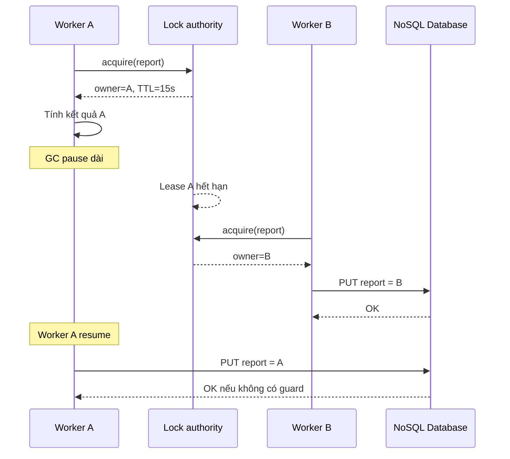
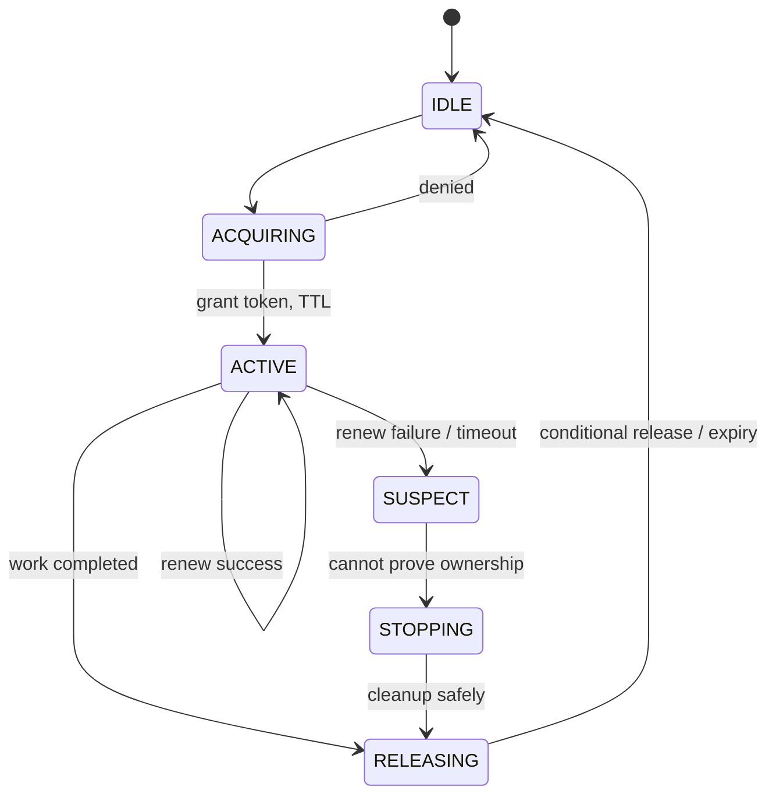

# Khóa phân tán, lease và mã thứ tự ngăn tác nhân hết quyền tiếp tục ghi

## 1. Một worker đã mất khóa vẫn có thể tiếp tục ghi

Trong các hệ thống NoSQL phân tán, nhiều tiến trình có thể cùng xử lý một tài nguyên: cập nhật báo cáo, chạy migration, xử lý một job, ghi checkpoint, làm mới cache hay chuyển một đơn hàng sang trạng thái tiếp theo. Khi cần tránh hai tiến trình cập nhật cùng một tài nguyên, người ta thường nghĩ đến **distributed lock (khóa phân tán)**.

Với một khóa có thời hạn (lease), việc thực thi có thể diễn ra:

```text
00s  Worker A lấy khóa cho report:daily, lease 15 giây.
03s  A đọc dữ liệu và bắt đầu tính báo cáo.
05s  A bị GC pause hoặc mất kết nối trong 25 giây.
15s  Lease của A hết hạn ở lock service.
16s  Worker B lấy khóa mới và bắt đầu tính.
23s  B ghi kết quả mới vào NoSQL database.
30s  A tiếp tục sau GC pause.
31s  A ghi kết quả cũ đè lên dữ liệu B đã ghi.
```

Lock service có thể hoàn toàn đúng khi cấp khóa cho B sau khi lease A hết hạn. Vấn đề là **TTL không tắt CPU của A, không hủy một HTTP request đã gửi và không buộc database đích từ chối lệnh đến muộn**.

Đó là lỗi **stale owner / stale writer**: một tác nhân đã mất quyền nhưng vẫn tạo side effect. Cơ chế trung tâm để xử lý là **fencing token (mã thứ tự rào chắn)**: quyền sở hữu được đánh số theo thế hệ tăng dần, và nơi nhận ghi phải từ chối các thế hệ đã cũ.

Bài học nằm trong chương **Cập nhật đồng thời** của **Database No SQL**. Mục tiêu không chỉ là lấy được khóa, mà là **bảo vệ tính đúng đắn của những write xảy ra dưới concurrency, pause, failover, network partition và retry**.

### Mục tiêu học tập

Sau bài, bạn có thể:

1. Phân biệt local mutex, distributed lock, lease, owner ID, fencing token, CAS revision và idempotency key.
2. Giải thích vì sao lock có TTL và heartbeat không ngăn được stale writer.
3. Thiết kế nguồn cấp token tăng đơn điệu, không tái dùng sau failover.
4. Cưỡng chế fencing tại tài nguyên đích bằng conditional mutation nguyên tử.
5. Nêu đúng giới hạn giữa **mốc token cao nhất từng thấy** và **generation hiện hành được ủy quyền**.
6. Kết hợp fencing với revision, operation ID, transaction hoặc workflow.
7. Phân tích các cách dùng Redis, etcd, ZooKeeper, MongoDB, DynamoDB và các hệ khác.
8. Tạo bài kiểm thử cố ý gây lỗi GC pause, timeout, partition, retry và ghi đảo thứ tự.
9. Quyết định khi nào không cần distributed lock mà chỉ cần một conditional write.

## 2. Bản đồ các khái niệm

| Thuật ngữ | Ý nghĩa | Không có nghĩa là |
|---|---|---|
| **Local mutex** | Đồng bộ thread trong một process/phạm vi OS | Khóa xuyên nhiều server |
| **Distributed lock** | Authority công nhận quyền thao tác một resource | Tất cả side effect được transaction hóa |
| **Lease** | Quyền sở hữu có hạn, cần renew hoặc để hết hạn | Worker cũ bị cưỡng bức dừng |
| **Owner ID** | Định danh lần acquire hoặc tiến trình | Giá trị có thứ tự thế hệ |
| **TTL** | Giới hạn thời gian lease theo authority | Global timestamp đáng tin để fence |
| **Fencing token** | Generation tăng khi quyền được cấp lại | Secret key hoặc authentication token |
| **CAS** | Kiểm tra và cập nhật một state nguyên tử | Hai lệnh GET rồi PUT rời nhau |
| **Revision** | Version của record sau mutation | Generation của lần giữ khóa |
| **Idempotency key** | Định danh cùng ý định nghiệp vụ qua retry | Bằng chứng quyền lease hiện hành |
| **Heartbeat** | Cố gia hạn lease trước khi hết hạn | Chứng minh mọi request in-flight còn an toàn |
| **Resource-side guard** | Logic từ chối write sai generation tại đích | Chỉ ghi token vào log |

Ví dụ metadata một document:

```json
{
  "_id": "report:daily",
  "currentFence": 42,
  "revision": 107,
  "operationId": "BUILD-20261114",
  "resultRef": "reports/daily/epoch-42.json"
}
```

- `currentFence = 42`: generation được phép thao tác resource.
- `revision = 107`: phiên bản của document dùng tránh lost update.
- `operationId`: logical operation giúp chống retry lặp.
- `resultRef`: vị trí kết quả, có thể bất biến theo generation.

Một holder có thể ghi nhiều lần trong **cùng fence 42** nhưng mỗi lần thay đổi `revision`. Không nên trộn ba loại version thành một trường duy nhất nếu chúng có quy tắc tăng khác nhau.

## 3. Timeline của lỗi stale writer

### 3.1. Lock service đúng nhưng dữ liệu sai



Storage chỉ thấy hai request ghi bình thường và có thể áp dụng theo thứ tự nhận được. A không biết quyền đã chuyển; thậm chí nếu biết, một write gửi trước khi hết hạn có thể đã nằm trong queue rồi đến trễ.

### 3.2. Các lý do khiến A không tự dừng

- JVM stop-the-world GC hoặc runtime pause.
- Thread bị scheduler tạm dừng.
- Network partition chỉ xảy ra giữa A và lock service.
- Giải quyết DNS, TLS handshake hoặc RPC bị treo.
- Retry/timeout ở driver.
- Máy bị freeze rồi resume.
- Worker không kiểm tra trạng thái lease giữa các bước.
- Lệnh ghi đã được gửi trước khi mất lease nhưng mạng giao sau.
- Session của coordination service hết hạn mà event báo lỗi chưa đến client.

**Kết luận:** lease hết hạn là một sự kiện ở authority, không phải hành động hủy các computation hoặc message tại mọi node.

## 4. Lock, lease và fencing giải quyết những mục tiêu khác nhau

### 4.1. Distributed lock: điều phối việc bắt đầu

Một authority có thể cung cấp:

```text
acquire(resource, ownerId)
release(resource, ownerId)
```

Trong điều kiện bình thường, một owner được cấp quyền và các owner khác đợi. Lock giúp giảm công việc trùng và contention, nhưng quyền kiểm soát chỉ tồn tại trong phạm vi protocol.

### 4.2. Lease: khả năng phục hồi khi owner chết

Lease bổ sung:

```text
acquire(resource, ownerId, ttl)
renew(resource, ownerId, ttl)
release(resource, ownerId)
```

Nếu A crash, lease hết hạn giúp B tiếp quản. Đây là **liveness**. Nhưng chính việc tự hết hạn mở ra nguy cơ hai tác nhân **cùng đang chạy code** trong khoảng A chưa nhận ra quyền đã mất.

### 4.3. Fencing: bảo vệ write tại đích

Authority cấp:

```text
A -> token=41
B -> token=42 (sau khi A mất quyền)
```

Database giữ mốc token đã công nhận:

```text
highestAcceptedFence=41

B gửi update(token=42)
-> store nâng highestAcceptedFence=42, nhận write B

A gửi update(token=41)
-> 41 < 42, REJECT STALE_FENCE
```

Cơ chế bảo vệ chỉ đúng khi **kiểm tra token và mutation diễn ra nguyên tử tại nơi có side effect**, hoặc qua một protocol tương đương đáng tin.

### 4.4. Ba tính chất phải được mô tả riêng

- **Mutual exclusion của authority:** authority công nhận owner nào.
- **Lease lifecycle:** quyền hết hạn/được renew/chuyển cho ai.
- **Write safety tại resource:** những mutation nào được nhận, từ generation nào, tại thời điểm nào.

Một hệ có thể đạt thuộc tính đầu tiên nhưng không đạt thuộc tính thứ ba nếu DB đích bỏ qua fencing token.

## 5. Fencing token cần có những bảo đảm gì?

Một token dùng để so sánh generation nên:

1. **Có thứ tự:** token mới lớn hơn token cũ trong cùng resource/lock scope.
2. **Tăng nghiêm ngặt cho một lần cấp quyền mới:** không tái sử dụng generation.
3. **Được cấp bởi authority đủ nhất quán:** hai process không tự tăng từ bản sao cũ.
4. **Không quay lùi sau failover hoặc restore:** state cấp token phải được bảo vệ.
5. **Có phạm vi rõ:** token của lock A không nhất thiết so sánh với lock B.
6. **Được chuyển đến đúng resource:** write phải mang thế hệ được cấp cho chính quyền sở hữu ấy.
7. **Được thực thi ở target:** token cao hơn được công nhận theo protocol; token cũ bị chặn.
8. **Có kiểm soát ai được đăng ký:** client trái quyền không được tự chọn số rất lớn để chiếm guard.
9. **Có quy tắc overflow/serialization:** không chuyển nhầm 64-bit integer sang number mất precision.
10. **Có recovery procedure:** phục hồi authority từ backup không được khiến generation mới trùng generation đã phát.

### 5.1. UUID là owner ID tốt nhưng không phải fencing order

Hai lần acquire:

```text
A: owner=550e8400-e29b-41d4-a716-446655440000
B: owner=6d0f1e44-6715-4bd2-a20b-9e4df4d86213
```

UUID giúp xác định người giữ khóa khi release. Nhưng so sánh chuỗi UUID không nói ai được cấp quyền sau. Cần một **monotonic sequence/revision/epoch** đi cùng.

### 5.2. Timestamp cũng không tự đáng tin

Đừng dùng giá trị `Date.now()` của worker như nguồn thứ tự duy nhất:

- Đồng hồ giữa node có thể lệch.
- Precision có thể khiến hai grant cùng timestamp.
- Wall clock có thể nhảy khi đồng bộ NTP.
- TTL đã được gia hạn không đồng nghĩa một generation khác.
- Clock của client không nói trạng thái đồng thuận của authority.

Một revision được cấp dưới protocol có linearizable/serializable semantics thích hợp đáng tin hơn.

### 5.3. Token per lease hay per operation?

**Per-lease:** A token 41 có thể ghi nhiều lần. B tiếp quản được 42.

**Per-operation:** mỗi mutation có sequence mới và target chỉ nhận sequence lớn hơn. Cách này cần thỏa cả ordering của operation và quyền sở hữu.

Nếu per-lease token không đổi, một điều kiện `token > lastSeenToken` cho **mọi** write sẽ khiến write thứ hai cùng lease bị từ chối. Khi đó dùng `token >= lastSeenToken` hoặc so sánh **bằng generation đã đăng ký**, rồi thêm CAS revision/per-operation ordering.

## 6. Nguồn cấp token tăng đơn điệu

Một authority có thể mô hình hóa:

```text
grantLease(resource, owner):
    verify no active owner
    currentGeneration = currentGeneration + 1
    set owner and lease deadline
    return currentGeneration
```

Toàn bộ logic chuyển quyền và tăng generation phải dùng primitive đủ mạnh theo failure model. Nếu hai client cùng acquire, không được tự chạy trong hai process với local counter.

### 6.1. Ví dụ grant và renew

```text
A acquire -> generation 104
A renew   -> vẫn generation 104
A release -> thế hệ 104 không còn hiệu lực
B acquire -> generation 105
B crash
C acquire -> generation 106
```

Renew cùng lease thường **không tăng generation**. Re-acquire sau khi hết lease phải nhận generation mới dù owner process vẫn có tên giống trước.

### 6.2. Lỗi failover làm token quay lùi

```text
Primary cấp token=200 cho A.
Primary crash trước khi replica nhận counter=200.
Replica được promote với counter=199.
Replica cấp lại token=200 cho B.
```

Hai quyền sở hữu khác nhau có cùng token. Đây là lỗi thiết kế fencing. Một lệnh `INCR` atomic trên một instance **không tự bảo đảm** counter không lùi qua asynchronous failover.

### 6.3. Epoch và sequence

Có thể biểu diễn generation dưới dạng tuple:

```text
(epoch=7, sequence=120)
(epoch=7, sequence=121)
(epoch=8, sequence=1)
```

So sánh lexicographic theo `epoch` trước rồi `sequence`. Tuy nhiên epoch mới phải được authority có độ tin cậy phù hợp cấp; không thể tự tăng trong mỗi worker rồi gọi là global order.

### 6.4. Số nguyên lớn và JSON

Một token 64-bit có thể vượt miền số nguyên biểu diễn chính xác của JavaScript Number. Khi cần, API có thể serialize token thành **decimal string** và parse bằng kiểu integer an toàn. Không làm tròn generation hoặc dùng floating point cho CAS.

## 7. Conditional write tại resource: lớp bảo vệ thực sự

Giả sử resource:

```json
{
  "_id": "report:daily",
  "highestAcceptedFence": 41,
  "revision": 10,
  "status": "READY"
}
```

Một protocol khái niệm:

```text
write(resource, token, expectedRevision, payload):
    ATOMICALLY:
        if token < highestAcceptedFence:
            return STALE_FENCE
        if expectedRevision != revision:
            return REVISION_CONFLICT
        highestAcceptedFence = max(highestAcceptedFence, token)
        payload = payload
        revision = revision + 1
        return SUCCESS
```

**ATOMICALLY** là yêu cầu quan trọng. Nếu thực thi:

```text
GET highestAcceptedFence
IF token >= value:
    PUT payload
```

bằng hai request độc lập thì sau GET, một owner mới có thể nâng fence và ghi dữ liệu. PUT cũ đến sau vẫn ghi đè: chính lỗi TOCTOU (*time of check to time of use*).

### 7.1. CAS revision cần đi kèm nếu có nhiều write cùng token

Một worker B với token 42 có thể gửi update revision 10 và 11, nhưng mạng đảo thứ tự. Nếu chỉ so fence 42, lần cập nhật cũ vẫn được nhận.

Cần thêm:

- `expectedRevision` bằng revision hiện hành.
- Monotonic offset/checkpoint predicate.
- Sequence theo operation nếu có ordering domain.
- Idempotency key cho retry cùng tác vụ.

Fencing giải quyết **owner generation**; revision giải quyết **thứ tự thay đổi record**.

### 7.2. Token lớn hơn không tự chứng minh caller có quyền

Nếu client không tin cậy có thể gửi token 1.000.000.000 và target chỉ kiểm `token > highestFence`, nó có thể chiếm generation. Target cần authentication/authorization, hoặc protocol để chỉ grant đã được authority xác thực mới được đăng ký.

### 7.3. Scope cho nhiều item

Một item guard có fence 42 nhưng payload thực ở item khác: update guard và update payload rời nhau không được mặc nhiên atomic. Nếu business invariant phụ thuộc cả hai, dùng multi-item transaction trong phạm vi DB hỗ trợ, hoặc thiết kế một điểm commit có điều kiện như pointer authoritative.

## 8. Giới hạn rất quan trọng của highest-seen fencing

Giả sử:

```text
T0: A token=41 được resource công nhận.
T1: Lease A hết hạn.
T2: Lock authority cấp B token=42.
T3: Resource vẫn đang có highestSeenFence=41.
T4: A gửi write(token=41).
T5: B mới gửi write(token=42).
```

Nếu storage chỉ dùng điều kiện `token >= highestSeenFence`:

- Ở T4, A vẫn **có thể được nhận**, vì resource chưa nhìn thấy 42.
- Ở T5, B nâng mốc lên 42.
- Sau T5, A token 41 bị từ chối.

Vậy highest-seen fencing đảm bảo **write của thế hệ cũ không ghi đè sau khi đích đã công nhận thế hệ mới**. Nó **không tự thu hồi ngay quyền ghi của A vào đúng thời điểm B được cấp lease**, nếu đích chưa biết generation 42.

### 8.1. Ba hướng thiết kế mạnh hơn

**Hướng A — Authority và dữ liệu nằm trong cùng consistency domain.** Có thể lưu `currentFence` trên chính record hoặc một guard được kiểm tra trong transaction. Chuyển owner và mutation liên quan có thể dùng một protocol atomic/linearizable theo phạm vi DB.

**Hướng B — Đăng ký generation tại target trước khi worker mới thao tác.** B thực hiện `registerFence(42)`, nhận ACK, rồi mới commit kết quả. Sau đăng ký, token 41 bị chặn. Nhưng có **khoảng trống giữa lúc authority cấp 42 và lúc target đăng ký 42**, không được tuyên bố A bị cấm tức thì ngay từ grant.

**Hướng C — Target xác minh owner/generation hiện hành một cách nguyên tử với side effect.** Một RPC hỏi authority rồi PUT rời vẫn có race. Cần transaction/proxy/protocol có thể cưỡng chế ở điểm commit, không chỉ một phép kiểm tra trước.

### 8.2. Cần chọn bảo đảm theo nghiệp vụ

| Yêu cầu | Cơ chế gợi ý |
|---|---|
| Không để A ghi đè kết quả đã commit của B | Highest-seen fencing được target enforce |
| Chỉ B được bắt đầu write sau khi target công nhận 42 | Register fence rồi write conditional |
| Không cho A write kể từ khoảnh khắc authority chuyển lease | Cần liên kết quyền với điểm ghi mạnh hơn; highest-seen riêng lẻ chưa đủ |
| Một logical operation không làm hai lần | Idempotency ledger |
| Ghi nhiều record all-or-nothing | Transaction đúng scope hoặc workflow khác |
| Ghi tiến độ không giảm | Monotonic checkpoint condition bên cạnh fence |

Những mức bảo đảm này phải được viết rõ trong tài liệu hệ thống.

## 9. Lease lifecycle và state machine



### 9.1. ACTIVE

Worker giữ owner ID, token, lease metadata và operation ID. Với mỗi write:

- Kiểm tra trạng thái local và deadline để tránh công việc vô ích.
- Gửi token tới target.
- Dùng target-side guard.
- Thêm CAS revision/idempotency nếu cần.
- Không giữ DB transaction mở trong suốt một job dài nếu có thể tránh.

### 9.2. SUSPECT

Khi renew timeout hoặc kết quả không rõ:

- Ngừng tạo side effect mới.
- Hủy computation có thể hủy.
- Xác minh lại authority theo contract nếu khả thi.
- Không coi “chưa nhận thông báo mất quyền” là bằng chứng còn quyền.
- Những write in-flight vẫn phải được resource bảo vệ.

### 9.3. Release

Release chỉ được thực hiện nếu lock key/record vẫn thuộc **đúng lần giữ khóa hiện tại**. Một release đến muộn từ A không được xóa lease vừa cấp cho B.

### 9.4. Re-acquire

Nếu A mất token 41 rồi lấy lại quyền, A phải nhận token mới (ví dụ 43). Không tái sử dụng token 41 vì hostname/PID không đổi.

## 10. Redis: SET NX PX, renew và release an toàn theo owner

Redis có thể dùng làm lock store trong một số workload nhờ thao tác đơn giản và nhanh. Cần phân biệt **khóa best-effort** với guarantee mạnh cho business invariant.

### 10.1. Acquire

```redis
SET lock:report:daily owner-a8c9 NX PX 15000
```

- `NX` chỉ set nếu key chưa tồn tại.
- `PX 15000` đặt TTL 15.000 ms.
- Giá trị owner nên đủ khó trùng cho một lần acquire.

Giá trị `owner-a8c9` chỉ là minh họa. Nó dùng để release/renew đúng khóa, **không phải fencing sequence**.

### 10.2. Release bằng Lua compare-and-delete

```lua
-- KEYS[1]: lock key
-- ARGV[1]: owner value của lần acquire hiện tại
if redis.call("GET", KEYS[1]) == ARGV[1] then
    return redis.call("DEL", KEYS[1])
end
return 0
```

Vì script thực thi nguyên tử theo Redis scripting semantics, A không xóa khóa B nếu B đã thay owner value.

Không dùng `GET` rồi `DEL` ở hai request rời nhau: giữa hai lệnh khóa có thể đã hết hạn và được chuyển quyền.

### 10.3. Renew bằng Lua so owner

```lua
-- KEYS[1]: lock key
-- ARGV[1]: owner value
-- ARGV[2]: TTL mới tính bằng milliseconds
if redis.call("GET", KEYS[1]) == ARGV[1] then
    return redis.call("PEXPIRE", KEYS[1], tonumber(ARGV[2]))
end
return 0
```

Khi trả 0, worker không còn được công nhận theo thao tác này. Khi timeout, kết quả renew có thể chưa rõ; client nên dừng phát sinh write nguy hiểm cho đến khi xác minh.

### 10.4. Vì sao `INCR` không mặc nhiên tạo fencing mạnh?

```redis
INCR lock:fence:report:daily
```

Atomic trên một Redis instance chưa đồng nghĩa:

- Bộ đếm không quay lùi sau failover với asynchronous replication.
- Token được liên kết nguyên tử với một lần acquire thành công.
- Token được target DB kiểm tra.
- Lease cũ không thể tạo side effect ngoài Redis.

Nếu counter=100 đã được primary xác nhận nhưng replica chưa nhận khi failover, một replica mới có thể phát lại 100. Với yêu cầu hard correctness, cần một authority cấp generation có **durability và consistency** phù hợp, không dựa mù vào lệnh `INCR`.

### 10.5. Lock failover và Redis replication

Trong một số mode replication bất đồng bộ:

```text
A acquire ở primary.
Primary crash trước khi replica nhận lock key.
Replica được promote, không có key.
B acquire.
```

B có thể được cấp khóa dù A vẫn tin mình giữ. Đây là một phần failure model cần xem xét trước khi dùng Redis lock cho trạng thái quan trọng. Một số cơ chế chờ replica acknowledgment có thể giảm rủi ro nhất định nhưng không tự biến mọi deployment thành consensus lock authority.

### 10.6. Redlock

Redlock là một thuật toán dựa trên nhiều Redis instances, có mô hình giả định và những phân tích kỹ thuật trái chiều về thời gian, partition và safety. Không coi tên thuật toán là bằng chứng mặc nhiên của:

- Fencing token tăng đơn điệu.
- Target-side atomic write validation.
- Giao dịch xuyên DB/object storage.
- Mutual exclusion tuyến tính trong mọi lỗi.

Nếu chọn cơ chế này, cần đọc tài liệu và threat model của thuật toán, kiểm chứng những assumption thực tế, và vẫn xét stale writes tại đích.

## 11. etcd: lease, mutex và revision

etcd cung cấp KV store có đồng thuận, transaction, lease, watcher và concurrency primitives. Một protocol khóa có thể tạo contender key gắn lease, quan sát thứ tự theo revision và chọn owner theo contract của thư viện.

Ví dụ ý tưởng:

```text
grant lease
create /locks/report-daily/<unique-owner> with lease
observe contender keys using ordered revisions
wait until eligible to own lock
use a monotonic revision/generation as fence
```

Đây là **mô hình**, không phải đủ lệnh để tự triển khai mutex. Nên dùng đúng concurrency API và hiểu trạng thái session, thứ tự cấp quyền, cancellation, timeout.

### 11.1. Lease ID khác fencing token

Lease ID là định danh quản lý lifetime của key. Không mặc định lease ID tăng theo generation.

Một `createRevision` hoặc sequence do etcd cấp có thể dùng trong fencing **nếu protocol lock thực sự gắn revision đó với thứ tự grant** và target kiểm tra đúng. Không lấy revision tùy ý rồi tuyên bố nó là ownership epoch.

### 11.2. Session hết hạn

Client A có thể mất kết nối, lease expire, key bị xóa rồi B có quyền. Nhưng A vẫn có thể gửi write đến MongoDB, S3 hoặc service khác. etcd không thể ngăn write ngoài namespace KV của nó nếu target không cưỡng chế fencing.

### 11.3. Check lock rồi ghi là race

```text
if etcd says A still holds lock:
    db.update(...)
```

Giữa lần hỏi etcd và lệnh DB, quyền có thể chuyển. Cần target-side guard, hoặc protocol gắn ownership với mutation có tính atomic tương ứng.

## 12. ZooKeeper: ephemeral sequential znode và generation

ZooKeeper thường dùng **ephemeral sequential znodes** trong một số distributed lock recipe.

```text
/locks/report-daily/lock-0000000101
/locks/report-daily/lock-0000000102
/locks/report-daily/lock-0000000103
```

Client tạo ephemeral sequential node, xác định vị trí trong hàng đợi, thường watch predecessor để không tạo herd effect. Session hết hạn có thể khiến ephemeral znode biến mất, cho contender tiếp theo vào.

### 12.1. Dùng sequence làm fence

Số thứ tự của znode có thể là cơ sở generation nếu:

- Được cấp theo cùng lock domain và đúng acquisition protocol.
- Không bị tái sử dụng khi namespace/cluster được khôi phục.
- Được target kiểm tra ở mọi mutation.
- Quy định rõ writer nào mới là holder hợp lệ.

Không tự tạo lại path rồi cấp sequence thấp trong khi target còn giữ token cao từ lịch sử trước đó.

### 12.2. Watcher không đồng nghĩa client còn quyền

Nếu A chưa nhận được watcher event, không suy nó còn lease. Session có thể hết hạn trong lúc A bị pause; event chỉ được xử lý khi client resume. Target fencing bảo vệ những mutation đến muộn.

## 13. MongoDB: fence và revision trên cùng document

Khi dữ liệu có thể được bảo vệ ở chính document, MongoDB cung cấp atomic conditional update phù hợp.

### 13.1. Resource

```javascript
db.resources.insertOne({
  _id: "report:daily",
  currentFence: NumberLong("41"),
  revision: NumberLong("10"),
  state: "READY",
  resultRef: "object://report/v10"
});
```

### 13.2. Đăng ký generation mới

Giả định token 42 được **authority đáng tin** cấp, và chỉ service được ủy quyền mới có thể gọi đăng ký:

```javascript
const newFence = NumberLong("42");

const registration = db.resources.updateOne(
  {
    _id: "report:daily",
    currentFence: { $lt: newFence }
  },
  {
    $set: { currentFence: newFence }
  }
);

if (registration.matchedCount !== 1) {
  // Bản ghi không tồn tại hoặc đã có generation >= 42.
  // Đọc lại với consistency phù hợp để phân loại.
}
```

Không dùng kết quả `matchedCount=0` để tự động “reset fence về 0”.

### 13.3. Write chỉ khi đúng fence và revision

```javascript
const token = NumberLong("42");
const expectedRevision = NumberLong("10");

const result = db.resources.updateOne(
  {
    _id: "report:daily",
    currentFence: token,
    revision: expectedRevision
  },
  {
    $set: {
      state: "COMPLETE",
      resultRef: "object://report/v11"
    },
    $inc: {
      revision: NumberLong("1")
    }
  }
);

if (result.matchedCount !== 1) {
  // Có thể là STALE_FENCE, REVISION_CONFLICT hoặc missing record.
  // Không retry bằng một PUT không điều kiện.
}
```

Filter và mutation cùng một document bảo vệ điều kiện **tại thời điểm ghi**. Nếu holder A token 41 gửi lệnh sau khi resource đã có `currentFence=42`, update sẽ không match.

### 13.4. Guard ở một document, payload ở document khác

Nếu service làm:

```text
1. Update guard.currentFence
2. Update report.resultRef (không có condition)
```

hai thao tác **không tự atomic**. Bước 2 vẫn có thể bị stale worker gửi đến, hoặc service crash giữa hai bước. Nếu cần invariant xuyên document, phải dùng multi-document transaction đúng scope, hoặc thay model về **guard/pointer commit** nhất quán.

### 13.5. Highest seen so với current authorized

Một phương án khác:

```javascript
db.resources.updateOne(
  {
    _id: "report:daily",
    highestSeenFence: { $lte: token }
  },
  {
    $set: {
      highestSeenFence: token,
      resultRef: nextResult
    }
  }
);
```

Nó có thể chặn token thấp sau khi token cao được **resource nhìn thấy**, nhưng vẫn có cửa sổ giữa grant của B và write đầu tiên B gửi. Với yêu cầu không chấp nhận A ngay sau grant, phải có protocol khác mạnh hơn.

## 14. DynamoDB: conditional mutation và guard item

DynamoDB hỗ trợ điều kiện ghi trên item và các API transaction theo phạm vi/giới hạn dịch vụ.

### 14.1. Item gắn generation

```json
{
  "PK": "RESOURCE#R1",
  "SK": "STATE",
  "currentFence": 42,
  "revision": 100,
  "status": "READY"
}
```

Worker token=42 muốn cập nhật:

```json
{
  "TableName": "Resources",
  "Key": {
    "PK": { "S": "RESOURCE#R1" },
    "SK": { "S": "STATE" }
  },
  "UpdateExpression": "SET #s = :next, revision = revision + :one",
  "ConditionExpression": "currentFence = :fence AND revision = :rev",
  "ExpressionAttributeNames": {
    "#s": "status"
  },
  "ExpressionAttributeValues": {
    ":next": { "S": "COMPLETE" },
    ":fence": { "N": "42" },
    ":rev": { "N": "100" },
    ":one": { "N": "1" }
  }
}
```

Một holder cũ token 41 sẽ thất bại điều kiện nếu target đã đăng ký 42. Cùng token 42 nhưng stale revision 99 cũng thất bại.

### 14.2. Đăng ký fence

```json
{
  "TableName": "Resources",
  "Key": {
    "PK": { "S": "RESOURCE#R1" },
    "SK": { "S": "STATE" }
  },
  "UpdateExpression": "SET currentFence = :new",
  "ConditionExpression": "currentFence < :new",
  "ExpressionAttributeValues": {
    ":new": { "N": "43" }
  }
}
```

Ví dụ giả định item đã có `currentFence`. Bootstrap cần logic riêng và phải tránh reset generation từ missing/null data.

### 14.3. Khi transaction chạm nhiều item

Nếu guard và dữ liệu có quan hệ nghiệp vụ với nhiều item, có thể cần `TransactWriteItems` và condition trên các action phù hợp. Không đặt hai action riêng nhắm vào **cùng item** khi API transaction không hỗ trợ; gắn `ConditionExpression` vào action update tương ứng.

Không suy từ một conditional write trên guard rằng mọi table khác được thay đổi nguyên tử theo nó.

### 14.4. Multi-region

Nếu hai region đồng thời cho phép update cùng logical resource và replication xử lý conflict theo cơ chế riêng, một condition được kiểm tra ở region A **không tự tạo total ordering toàn cầu**. Với hard invariant, xem ownership một region, consensus authority, partition quyền sở hữu hoặc thiết kế quota/escrow có điều kiện.

## 15. Java demo: mô phỏng resource-side fencing

Đoạn code Java sau minh họa **logic ở target** bằng `synchronized` trong **một JVM**. Nó không triển khai distributed lock và không bảo vệ nhiều process; production cần thay nó bằng atomic/transactional mutation tại DB hoặc service có authority.

```java
import java.util.Objects;

public final class FencedResource {
    private long fence = 0L;
    private long revision = 0L;
    private String value = "";

    public synchronized void registerFence(long nextFence) {
        if (nextFence <= fence) {
            throw new IllegalStateException("FENCE_NOT_ADVANCING");
        }
        fence = nextFence;
    }

    public synchronized long write(
            long workerFence,
            long expectedRevision,
            String nextValue) {
        Objects.requireNonNull(nextValue);

        if (workerFence != fence) {
            throw new IllegalStateException("STALE_FENCE");
        }
        if (expectedRevision != revision) {
            throw new IllegalStateException("REVISION_CONFLICT");
        }

        value = nextValue;
        return ++revision;
    }

    public synchronized Snapshot read() {
        return new Snapshot(fence, revision, value);
    }

    public record Snapshot(long fence, long revision, String value) {}

    public static void main(String[] args) {
        var resource = new FencedResource();

        resource.registerFence(41);       // A được cấp quyền.
        var staleSnapshot = resource.read();

        resource.registerFence(42);       // B tiếp quản.
        resource.write(42, 0, "Result from B");

        try {
            resource.write(
                41,
                staleSnapshot.revision(),
                "Late result from A"
            );
            throw new AssertionError("Stale write accepted");
        } catch (IllegalStateException expected) {
            System.out.println(expected.getMessage());
        }

        System.out.println(resource.read().value());
        // Kết quả vẫn là "Result from B".
    }
}
```

Điều demo làm rõ:

- Target cần biết `currentFence`.
- Khi target đã nhận 42, write 41 bị từ chối.
- Revision được kiểm cùng mutation.
- Mọi write từ các node khác nhau phải đi qua **một consistency domain thật**; `synchronized` chỉ chứng minh nguyên lý bên trong process.

Trong ứng dụng thật, phải thêm key issuance, authentication/authorization, audit, idempotency, error handling và đảm bảo durability.

## 16. Fencing không thay thế thứ tự operation trong cùng generation

Giả sử B giữ token 42, cần ghi checkpoint:

```text
B phát checkpoint=100
B phát checkpoint=120
Mạng làm 120 tới trước 100.
```

Nếu target chỉ check `token >= highestFence`, cả hai đều hợp lệ, và checkpoint có thể **tụt từ 120 về 100**.

Cần thêm:

```text
IF token == currentFence AND nextCheckpoint > currentCheckpoint:
    checkpoint = nextCheckpoint
```

Với dữ liệu không có thứ tự số tự nhiên, dùng CAS `expectedRevision` hoặc operation sequence. Với event log có nhiều partition, offset chỉ so sánh được theo partition, không tự tạo thứ tự toàn cục.

### 16.1. Compare-and-set khác fencing thế nào?

CAS dựa trên **phiên bản dữ liệu**; fencing dựa trên **thế hệ chủ sở hữu**. Có thể dùng cả hai:

```text
IF workerFence == currentFence
   AND expectedRevision == currentRevision
THEN update payload, revision++
```

Bản ghi có thể liên tục được cập nhật bởi worker trong cùng generation mà fence không đổi.

### 16.2. Counter có thể được nhân bản eventual không?

Nếu guard/high-water của resource được replica A và B update độc lập rồi hội tụ sau, hai stale writes có thể được nhận ở hai nơi trước khi replica hòa giải. Khi invariant cần strong correctness, **target-side guard phải có consistency phù hợp**, không chỉ là một số trong một projection eventual.

## 17. Object storage và file: nên dùng immutable artifact + pointer

Không phải mọi object store/REST API cho phép so sánh `fenceToken` với state đang lưu trong cùng một atomic update.

### 17.1. PUT không điều kiện không có tác dụng fencing

```text
PUT /reports/daily/latest.json (token=42, value=B)
PUT /reports/daily/latest.json (token=41, value=A)
```

Nếu API chỉ ghi đè bytes, token dù có trong metadata vẫn **không ngăn A thắng**. Cần conditional PUT/ETag/If-Match phù hợp, một service proxy tin cậy hoặc thay đổi mô hình dữ liệu.

### 17.2. Bất biến hóa kết quả

Thay vì ghi một key chung:

```text
reports/daily/generation-41.json
reports/daily/generation-42.json
```

Mỗi worker chỉ ghi artifact riêng. Một item authoritative giữ:

```json
{
  "reportId": "daily",
  "currentFence": 42,
  "currentObjectKey": "reports/daily/generation-42.json",
  "revision": 12
}
```

Worker commit bằng CAS lên pointer. Khi A đến muộn, nó có thể đã tạo object thế hệ cũ, nhưng không chuyển pointer hiện hành trở lại 41.

Cần xử lý:

- Orphan artifacts chưa được chọn.
- TTL và retention của dữ liệu cũ.
- Authentication/authorization khi đổi pointer.
- Sự nhất quán giữa object tồn tại và pointer chỉ đến nó.
- Recovery khi object ghi xong nhưng pointer commit fail.
- Không dùng tên object “mới nhất theo timestamp” thay cho pointer có CAS.

### 17.3. Target không có conditional write

Nếu target không thể check generation, cân nhắc:

- Proxy service chịu trách nhiệm serialize write và kiểm guard.
- Đường ghi immutable + pointer CAS.
- Thay dữ liệu nguồn bằng state machine authoritative.
- Chấp nhận duplication với kết quả có thể tái tạo nếu nghiệp vụ cho phép.
- Dùng workflow có bù trừ nếu side effect không thể thu hồi atomic.

Không thể thêm fencing vào một API ghi mù chỉ bằng cách ghi số token trong payload.

## 18. Lock không biến multi-record workflow thành transaction

Một worker giữ lock rồi làm:

```text
1. Trừ inventory.
2. Tạo order.
3. Publish event.
4. Charge payment.
```

Nếu bước 2 thất bại, lock không rollback bước 1. Nếu charge thành công nhưng mất ACK, lock không trả lại tiền. Nếu publish event rồi worker chết, consumer có thể đã thực hiện side effect.

Các cơ chế cần xem thêm:

- **Transaction đa item/document** theo phạm vi NoSQL DB.
- **Conditional write** cho invariant một record.
- **Reservation/escrow** để giữ tài nguyên theo workflow.
- **Transactional outbox** để ghi record và sự kiện cần phát trong cùng transaction.
- **Saga/compensation** cho nhiều service.
- **Idempotency key** cho mỗi logical operation.
- **Reconciliation** khi workflow dở dang.

### 18.1. Không cần lock nếu atomic claim đã đủ

Một job record:

```json
{
  "_id": "job:J42",
  "status": "PENDING",
  "revision": 7
}
```

Nếu DB cho phép:

```text
UPDATE job:J42
IF status = PENDING AND revision = 7
SET status = RUNNING, revision = 8
```

thì chỉ một worker có thể claim theo contract, không nhất thiết phải thêm Redis lock. Nếu job kéo dài và worker có thể chết, đưa lease/generation vào **chính job state** với conditional update là một lựa chọn.

### 18.2. Khi distributed lock có ích

- Tránh chạy cùng một migration/index rebuild tốn CPU.
- Leader election cho scheduler.
- Điều phối quyền sử dụng tài nguyên ngoài DB.
- Công việc dài có checkpoint.
- Giảm contention trước các write quan trọng, trong khi target vẫn giữ guard.

Đây là vai trò điều phối, **không phải bằng chứng mọi side effect đã an toàn**.

## 19. Idempotency bảo vệ retry, fencing bảo vệ thế hệ

Giả sử worker B token 42 ghi thành công nhưng không nhận được ACK. B retry:

```text
B token=42, operationId=REBUILD-20261114
B gửi write.
Storage commit.
ACK mất.
B gửi lại cùng write.
```

Fencing có thể cho phép cả hai write cùng token 42, gây side effect hai lần. Cần **operation ID**:

```text
IF operationId already completed:
    return recorded result
ELSE IF token is authorized AND revision matches:
    apply change
    persist operation result
COMMIT
```

Nếu operation ledger và payload nằm trong các store không có transaction chung, phải xử lý bằng một workflow có khả năng đối soát, không giả vờ check-then-write độc lập là idempotent.

### 19.1. Token không bảo vệ business payload

Request ID R42 được dùng cho:

```json
{
  "sku": "BK-01",
  "quantity": 1
}
```

Retry cùng R42 nhưng body đổi thành `quantity=10` phải bị phân loại là conflict hoặc invalid retry, không trả kết quả cũ như thể hai ý định giống nhau. Ledger có thể gắn request hash/owner.

### 19.2. Unknown commit

Ba kết quả:

| Kết quả | Cách xử lý |
|---|---|
| Commit xác nhận | Trả kết quả và giữ operation ID |
| Condition failed / stale fence | Không cố ép ghi; phân loại và dừng/đọc lại |
| Timeout, không rõ có commit hay không | Lookup operation ledger với đường đọc đủ consistency; tránh retry mù |

Một read từ replica eventual chưa thấy ledger **không chứng minh operation chưa commit**.

## 20. Timeout và lease renewal

### 20.1. Không tin hoàn toàn đồng hồ local

TTL nên được hiểu theo authority. Local client có thể dùng monotonic clock để chủ động dừng sớm, nhưng clock skew, scheduling pause và network delay khiến việc tự tính `expiresAt` không trở thành bằng chứng toàn cục.

### 20.2. Heartbeat không tạo safety guarantee

Ví dụ:

```text
Lease TTL = 30 giây
Worker renew mỗi 10 giây
Worker bị GC pause 80 giây
```

Renew schedule hợp lý vẫn không ngăn lease hết hạn. Khi worker resume, memory có thể còn `isLeader=true`. Phải coi local state có thể stale và dựa vào target validation.

### 20.3. Renew thất bại hoặc không rõ

Policy bảo thủ:

1. Đánh dấu worker `SUSPECT`.
2. Ngừng phát sinh write mới.
3. Hủy việc còn hủy được.
4. Xác minh lại quyền theo contract.
5. Dựa vào fencing/conditional write để bảo vệ in-flight requests.

### 20.4. Lease được gia hạn nhưng work vẫn stale

Một worker có thể còn lease hợp lệ nhưng đọc một replica chậm, tính toán trên dữ liệu cũ rồi ghi kết quả. Fencing không tự chữa **stale read**. Cần CAS revision, read concern hoặc transaction phù hợp.

## 21. Network partition và split brain

```text
A ---X--- Lock authority
A ------- Database
B ------- Lock authority
B ------- Database
```

A bị cắt khỏi authority nhưng vẫn có đường đến database. Authority cho lease A hết hạn và cấp B token cao hơn. Nếu database đích không kiểm generation, A vẫn ghi được.

### 21.1. Nếu target đã công nhận token mới

B token 52 đã đăng ký tại target. A token 51 gửi lệnh; target từ chối. Đây là công dụng chính của fencing.

### 21.2. Nếu target cũng bị phân vùng

Nếu hai replica nhận mutation độc lập và mỗi replica giữ high-water khác nhau, chúng có thể cùng chấp nhận những write không thể hòa giải theo invariant.

**Nguồn guard cũng phải có consistency domain phù hợp.** Không chỉ bảo đảm token được cấp đúng; nơi thực thi mutation phải từ chối stale generation theo một protocol đáng tin khi partition.

### 21.3. Multi-region và leader election

Một leader election epoch cấp ở region A không tự ràng buộc mọi write đồng thời đến region B nếu cả hai region dùng eventual resolution. Cần chọn authoritative writer, consensus/quorum có contract phù hợp, phân quyền quota theo vùng hoặc state machine có thể chấp nhận eventual consistency.

## 22. Leader election và event đến muộn

Một scheduler leader A được cấp epoch 8, B tiếp quản với epoch 9. A có thể đã publish event trước khi mất lease, nhưng message broker giao event của A **sau** event của B.

```text
A(epoch 8) -> DispatchJob(J42) [bị giữ trong queue]
B(epoch 9) -> DispatchJob(J42) [đã xử lý]
Sau đó A(epoch 8) đến consumer.
```

Consumer hoặc authoritative job service cần kiểm epoch và operation ID để không xử lý lại/stale, khi contract yêu cầu.

- Epoch giúp từ chối owner cũ.
- Event source version giúp không áp trạng thái cũ.
- Operation ID giúp chống duplicate.
- Log offset chỉ xác định thứ tự trong scope của log/partition, không mặc nhiên là thứ tự commit toàn hệ.

Chỉ khóa ở publisher không tự làm message cũ biến mất trong broker.

## 23. Kiểm soát quyền và chống lock poisoning

Fencing token không phải password. Một client độc hại có thể thử gửi:

```text
registerFence(resource, 9999999999)
```

Nếu target chỉ so số lớn hơn, nó có thể vô hiệu hóa các worker hợp lệ.

Cần:

- Authentication/authorization ở acquire/renew/release.
- Role riêng cho force revoke/administration.
- Không để client tùy ý đăng ký token mà không có grant hợp lệ.
- TLS, ACL và bảo vệ namespace của lock store.
- Gắn lock key với tenant/resource scope.
- Audit việc chuyển owner/generation.
- Rate limit và quota cho số lần acquire/renew.
- Không log secret, capability token hoặc dữ liệu nhạy cảm không cần thiết.
- Kiểm quyền lại ở **resource**; token lớn không chứng minh caller được phép sửa dữ liệu.

Nếu dùng chữ ký/capability token để chứng minh grant, phải quản lý key, expiry và revocation theo threat model. Không trộn nó với giá trị monotonic chỉ dùng so thứ tự.

## 24. Quan sát và vận hành

| Metric | Ý nghĩa |
|---|---|
| `lock_acquire_attempts` | Số lần xin khóa |
| `lock_acquire_latency_p99` | Độ trễ authority |
| `lock_contention_rate` | Tần suất nhiều contender |
| `lease_renew_failures` | Renew không thành công |
| `lease_expiry_during_work` | Quyền hết hạn khi job còn chạy |
| `fence_registration_failures` | Target chưa công nhận thế hệ mới |
| `stale_fence_rejections` | Worker cũ gửi mutation và bị chặn |
| `revision_conflicts` | Write trong cùng generation hoặc từ snapshot cũ |
| `generation_regressions` | Token lùi/trùng sau failover — nghiêm trọng |
| `unknown_commit_outcomes` | Timeout không rõ kết quả |
| `idempotency_duplicate_hits` | Operation được retry |
| `job_takeover_count` | Số lần chuyển owner |
| `long_gc_pause_seconds` | Pause có nguy cơ vượt TTL |
| `orphan_artifact_count` | Kết quả generation cũ không được commit |
| `release_owner_mismatch` | Release đến muộn từ owner cũ |
| `outbox_pending_age` | Event chậm được publish |

**Stale rejection không nhất thiết là lỗi của guard.** Nó có thể chứng minh lớp phòng vệ đang hoạt động. Nhưng nếu tần suất tăng, điều tra TTL, pause, network, renew và contention.

Báo động nghiêm trọng khi token được tái sử dụng, target nhận write thấp hơn generation đã đăng ký, hoặc release của owner cũ xóa lock của owner mới.

## 25. Kiểm thử đồng thời có kiểm soát

### 25.1. A pause rồi B tiếp quản

1. A acquire token 41, đọc dữ liệu.
2. Pause A lâu hơn TTL.
3. B acquire token 42, đăng ký tại target.
4. B commit kết quả.
5. Resume A, cho A gửi write 41.

**Kỳ vọng:** A nhận `STALE_FENCE`, kết quả B không bị ghi đè.

### 25.2. B chưa đăng ký fence

1. Target giữ highestSeen=41.
2. Authority cấp B 42.
3. Trước khi B đăng ký, A 41 gửi write.

**Kỳ vọng:** nếu protocol chỉ highest-seen thì A **có thể được nhận**. Test này chỉ ra giới hạn để thiết kế contract phù hợp; không được che bằng lời khẳng định “token luôn chặn ngay khi grant”.

### 25.3. Release trễ

A hết lease, B nhận khóa mới. A release. **Kỳ vọng:** không xóa khóa B vì release có owner compare atomic.

### 25.4. Token cùng generation nhưng write đảo thứ tự

B token 42 gửi checkpoint 120 trước checkpoint 100 đến đích. **Kỳ vọng:** checkpoint không lùi vì CAS/monotonic predicate.

### 25.5. Failover authority

Authority phát token 100 rồi crash. **Kỳ vọng:** generation tiếp theo không lùi/trùng theo scope; nếu contract không đảm bảo, workload phải được phân loại đúng chứ không khẳng định hard safety.

### 25.6. Acquire hoặc renew mất ACK

Client không biết quyền còn hợp lệ. **Kỳ vọng:** không tự cho mình quyền, không tự cấp token; dừng side effect mới và đối soát.

### 25.7. Commit thành công nhưng mất ACK

Client retry cùng operation ID. **Kỳ vọng:** một tác dụng nghiệp vụ, ledger trả kết quả cũ.

### 25.8. Token giả mạo

Caller không có quyền gửi generation cực lớn. **Kỳ vọng:** resource từ chối và không tăng fence.

### 25.9. Restore snapshot cũ

Authority counter được restore về 900 nhưng target còn fence 1000. **Kỳ vọng:** phát hiện lỗi, chặn mutation hoặc nâng epoch hợp lệ bằng recovery protocol. Không reset target về 0 để “sửa”.

### 25.10. Đường ghi bỏ sót guard

Một batch script ghi thẳng resource không gửi token. **Kỳ vọng:** bị chặn, hoặc hệ nhận diện đây là bypass cần loại bỏ. Mọi writer ảnh hưởng invariant phải tuân cùng protocol.

## 26. Bài tập thực hành

### Bài 1 — Lease có đủ không?

A giữ lease 10 giây nhưng GC pause 35 giây. B lấy lease mới, ghi kết quả; A resume và ghi đè.

**Yêu cầu:** giải thích vì sao lock service không nhất thiết sai, nhưng dữ liệu bị hỏng. Đề xuất nơi phải đặt guard.

**Gợi ý:** target-side fencing trong atomic mutation tại resource, không chỉ kiểm lock state ở A.

### Bài 2 — Owner ID và generation

A/B nhận hai UUID khác nhau và token lần lượt 17, 18.

**Câu hỏi:** UUID để làm gì? Token để làm gì? Vì sao không so sánh UUID từ điển?

**Gợi ý:** UUID bảo vệ release/renew đúng owner; token để target phân biệt generation mới/cũ.

### Bài 3 — Redis

Viết acquire `SET NX PX` và Lua compare-and-delete. Giải thích vì sao `INCR` không đủ fencing trong mọi kịch bản Redis failover.

**Gợi ý:** primary có thể cấp counter chưa replication rồi crash; sequence bị tái dùng.

### Bài 4 — MongoDB

Resource:

```json
{
  "_id": "job:J42",
  "currentFence": 52,
  "revision": 8,
  "checkpoint": 300
}
```

A token 51, B token 52 và revision 8. Viết filter update B. Điều gì xảy ra nếu B retry dùng revision 8 sau khi record đã lên 9?

**Gợi ý:** filter đồng thời theo `_id`, `currentFence`, `revision`; stale fence và stale revision bị từ chối.

### Bài 5 — Highest-seen gap

B được cấp token 62 nhưng target còn highestSeen 61. A 61 gửi write trước B.

**Câu hỏi:** target chỉ so `token >= highestSeen` có thể nhận A không? Nếu yêu cầu không nhận A ngay từ lúc grant thì cần thêm gì?

**Gợi ý:** có; cần protocol authority-target mạnh hơn chứ không chỉ thay phép so sánh.

### Bài 6 — Object storage

Hai worker dựng file báo cáo lớn. Hãy thiết kế object key bất biến theo generation và một pointer CAS.

**Gợi ý:** worker cũ không cập nhật pointer hiện hành sau khi fence mới được đăng ký, dù nó có thể tạo artifact chưa được chọn.

### Bài 7 — Mất lease lúc đang thanh toán

A bị pause khi chờ payment gateway; B tiếp quản và xử lý lại order.

**Yêu cầu:** vì sao fencing ở Orders DB chưa bảo đảm không charge hai lần? Đề xuất protocol thích hợp.

**Gợi ý:** payment intent, gateway idempotency key, authoritative state machine, reconciliation và compensation.

### Bài 8 — Checkpoint

A token 20 ghi checkpoint=800. B token 21 ghi checkpoint=1200. Một message A đến sau.

**Yêu cầu:** mô tả hai lớp điều kiện để không lùi state. Nếu B gửi checkpoint=1100 sau khi ghi 1200 thì sao?

**Gợi ý:** fence chặn A, monotonic offset hoặc revision chặn update cũ từ B.

### Bài 9 — Lựa chọn lock scope

Hệ có 500 tenant và mỗi tenant 50.000 jobs. Mỗi job chạy 30 phút.

**Yêu cầu:** chọn scope per-job, per-tenant hay global và phân tích hot key, contention, heartbeat, checkpoint và cleanup.

**Gợi ý:** chọn scope nhỏ nhất theo invariant, không dùng một lock toàn hệ nếu jobs độc lập.

### Bài 10 — Thiết kế một test harness

Cho phép pause worker tại ba vị trí: trước tính toán, trước commit, sau commit nhưng trước ACK. Hãy viết các interleaving và hậu điều kiện cho stale write, unknown commit và retry.

**Gợi ý:** test phải xác minh dữ liệu cuối, owner generation, revision và operation ledger chứ không chỉ nhận HTTP 200.

## 27. Checklist trước khi triển khai

### Invariant và authority

- [ ] Đã xác định tác dụng ghi nào cần ngăn stale owner?
- [ ] Cần hard safety hay chỉ best-effort tránh công việc trùng?
- [ ] Lock service có failure model và consistency phù hợp?
- [ ] Generation có monotonic sau failover, restore và restart?
- [ ] Có owner ID riêng cho mỗi acquire và release/renew an toàn?
- [ ] Lease TTL/heartbeat được chọn có đo p99 pause và network latency?
- [ ] Có policy khi acquire/renew timeout không rõ kết quả?

### Target-side correctness

- [ ] Mọi write được bảo vệ đều mang token?
- [ ] Nơi nhận ghi kiểm token **nguyên tử với mutation**?
- [ ] Có phân biệt highest-seen và current-authorized generation?
- [ ] Nếu yêu cầu cấm ngay từ grant, có protocol đáp ứng mức đó?
- [ ] Có revision/CAS hoặc operation sequence cho cùng generation?
- [ ] Target guard có consistency đủ mạnh khi replication/multi-region?
- [ ] Client không được tự tăng/đăng ký fence trái quyền?
- [ ] Dữ liệu ngoài DB có conditional write/proxy/immutable pointer?

### Retry, bảo mật và vận hành

- [ ] Có idempotency key/operation ledger?
- [ ] Có xử lý mất ACK sau commit?
- [ ] Có transaction hoặc saga/outbox cho side effect đa hệ?
- [ ] Có audit owner, resource, generation và kết quả ghi?
- [ ] Có stale rejection, renewal và regression metrics?
- [ ] Có kiểm thử pause, network partition, failover, release muộn?
- [ ] Có recovery protocol khi restore backup cũ?
- [ ] Có giới hạn key cardinality/hot lock và cleanup artifact mồ côi?

## 28. Tài liệu tham khảo

Khi triển khai thực tế, cần xem tài liệu **đúng phiên bản, topology và mức nhất quán** của từng hệ:

- [Redis Distributed Locks](https://redis.io/docs/latest/develop/use/patterns/distributed-locks/) — lock acquisition/release và các giả định phân tán.
- [Redis SET](https://redis.io/docs/latest/commands/set/) — `NX`, `PX`, expiration semantics.
- [Redis Transactions](https://redis.io/docs/latest/develop/interact/transactions/) — `WATCH`, `MULTI`, `EXEC` và lỗi.
- [etcd Concurrency API](https://etcd.io/docs/v3.5/dev-guide/api_concurrency_reference_v3/) — mutex/session/lease theo phiên bản.
- [etcd API Guarantees](https://etcd.io/docs/v3.5/learning/api_guarantees/) — consistency và revision.
- [Apache ZooKeeper Recipes](https://zookeeper.apache.org/doc/current/recipes.html) — ephemeral sequential locks.
- [ZooKeeper Programmer's Guide](https://zookeeper.apache.org/doc/current/zookeeperProgrammers.html) — session expiration/watchers.
- [MongoDB Write Atomicity](https://www.mongodb.com/docs/manual/core/write-operations-atomicity/) — conditional atomic mutation trên document.
- [MongoDB Transactions](https://www.mongodb.com/docs/manual/core/transactions/) — multi-document transaction semantics.
- [DynamoDB Conditional Expressions](https://docs.aws.amazon.com/amazondynamodb/latest/developerguide/Expressions.ConditionExpressions.html) — conditional writes và optimistic concurrency.
- [DynamoDB Transactions](https://docs.aws.amazon.com/amazondynamodb/latest/developerguide/transaction-apis.html) — `TransactWriteItems` và phạm vi hỗ trợ.
- [HashiCorp Consul Sessions](https://developer.hashicorp.com/consul/docs/automate/session) — session/lock primitives.

Tài liệu của một lock service mô tả phạm vi khả năng của chính nó. **Đường ghi đến một hệ khác phải được đánh giá riêng**; chỉ có API acquire trả về thành công không chứng minh side effects sau này không thể bị stale worker thực hiện.

## 29. Kết luận

**Distributed lock quyết định ai được authority cấp quyền làm việc; lease quyết định bao lâu quyền tồn tại; fencing token giúp nơi nhận ghi phân biệt thế hệ mới và cũ.** Ba khái niệm này liên quan nhưng không thay thế nhau.

Một stale worker có thể tiếp tục chạy sau GC pause, timeout hoặc network partition. Vì vậy không thể chỉ dựa vào TTL hoặc heartbeat để bảo vệ dữ liệu. Token phải tăng đơn điệu từ một authority đủ nhất quán, và nơi thực hiện side effect phải kiểm token bằng một thao tác nguyên tử. Với nhiều write trong cùng generation, cần thêm revision/CAS hoặc operation sequence; với retry cần idempotency; với nhiều hệ cần transaction đúng scope hoặc workflow có phục hồi.

Đặc biệt, cần hiểu giới hạn của **highest-seen fencing**: nó ngăn token cũ sau khi target đã công nhận thế hệ mới, nhưng không tự cấm mọi write của owner cũ từ đúng khoảnh khắc authority chuyển lease nếu target chưa được cập nhật. Mức an toàn mạnh hơn đòi hỏi giao thức chuyển quyền và ghi dữ liệu có ranh giới nhất quán phù hợp.

Câu hỏi cuối cùng không phải **“worker đã lấy khóa thành công chưa?”** mà là **“nếu worker mất quyền, bị treo rồi quay lại sau khi một thế hệ mới đã tiếp quản, mọi nơi có side effect có thể từ chối hành động đến muộn của nó theo đúng bất biến đã cam kết hay không?”**

