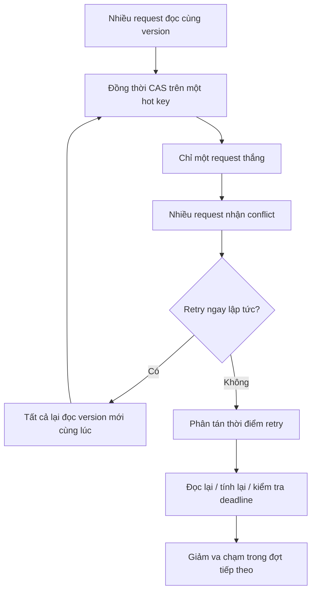
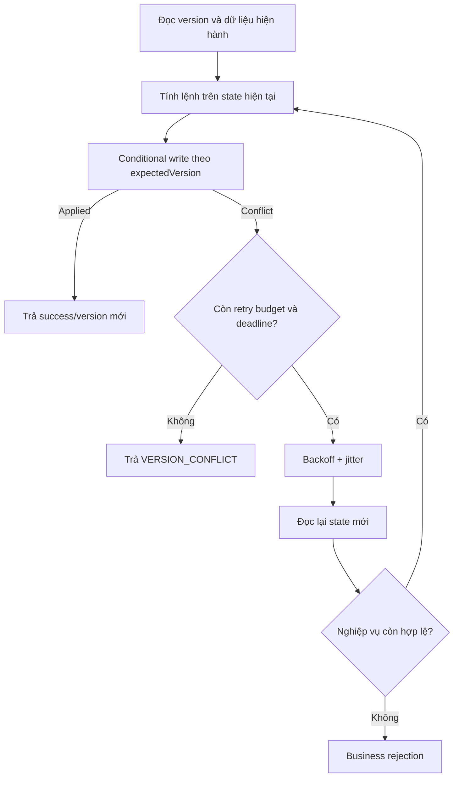
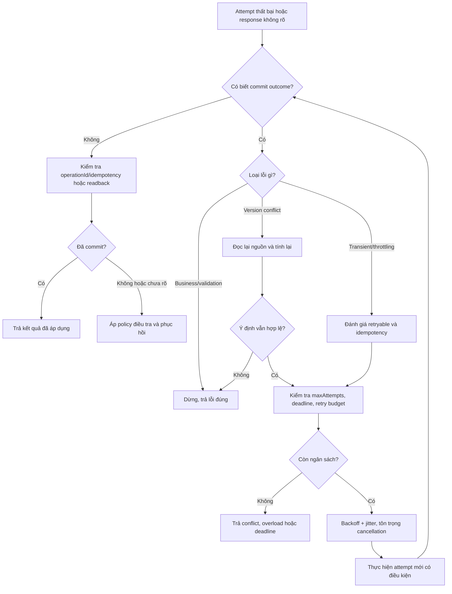

# Giới hạn thử lại, backoff và tránh tạo thêm tranh chấp

Trong hệ NoSQL có nhiều request ghi đồng thời, **thử lại (retry)** là một cơ chế cần thiết nhưng cũng có thể là nguyên nhân khiến sự cố nghiêm trọng hơn. Một thao tác cập nhật thất bại vì phiên bản đã thay đổi, một transaction gặp xung đột, một partition bị throttling hoặc một request mất kết nối đều có thể dẫn tới hành động “thử lại”. Nếu mọi client cùng retry liên tục, chúng có thể cùng đọc một phiên bản, cùng tranh một bản ghi, lại thất bại, rồi lặp lại với tải cao hơn ban đầu.

Ví dụ, 100 worker cùng đọc một document ở `version = 20`. Chỉ một worker có thể thắng thao tác **compare-and-set (CAS)**; 99 worker còn lại nhận conflict. Nếu 99 worker lập tức thử lại, chúng lại có thể cùng đọc `version = 21`, chỉ một worker thắng và 98 worker tiếp tục retry. Một cơ chế vốn dùng để bảo vệ dữ liệu lại trở thành **retry storm**, làm tăng CPU, I/O, độ trễ và nguy cơ quá tải.

Bài học này thuộc **Database No SQL → Cập nhật đồng thời** và tập trung vào ba quyết định:

1. **Có nên retry không?** Phân biệt xung đột cần tính toán lại, lỗi tạm thời, lỗi nghiệp vụ vĩnh viễn và kết quả ghi chưa xác định.
2. **Retry bao nhiêu lần, trong bao lâu?** Đặt giới hạn số lần thử, deadline, retry budget và giới hạn chi phí.
3. **Retry lúc nào, theo cách nào để không làm tăng tranh chấp?** Áp dụng exponential backoff, jitter, backpressure, phân tán thời điểm retry và thiết kế lại những hot key.

Mọi ví dụ số trong bài đều là **giả định để minh họa**, không phải cấu hình bắt buộc hoặc cam kết hiệu năng của MongoDB, DynamoDB, Cassandra, ScyllaDB, Redis hay một dịch vụ cloud cụ thể.

## 1. Vì sao retry lại liên quan đến cập nhật đồng thời?

Xét một đơn hàng:

```json
{
  "tenantId": "T1",
  "orderId": "O-100",
  "status": "PENDING",
  "availableUnits": 12,
  "version": 7
}
```

Hai luồng muốn giữ số lượng hàng:

```text
Luồng A                              Luồng B
---------------------------------   ---------------------------------
READ order version 7                READ order version 7
Tính số lượng còn lại = 11          Tính số lượng còn lại = 10
CAS WHERE version = 7              CAS WHERE version = 7
Ghi thành công -> version 8         Ghi thất bại vì version đã là 8
```

Nếu B **ghi đè không điều kiện**, dữ liệu có thể mất thay đổi của A. Nếu B **chỉ cập nhật expectedVersion từ 7 lên 8 nhưng giữ nguyên payload tính từ phiên bản 7**, B vẫn có thể ghi một kết quả sai. Cách xử lý đúng nếu nghiệp vụ cho phép retry là:

```text
B nhận VERSION_CONFLICT.
B đọc lại order version 8.
B tính lại phép giữ hàng trên số lượng mới.
B kiểm tra số lượng vẫn đủ.
B thử CAS expectedVersion = 8.
```

Khi request không còn hợp lệ (ví dụ hàng không đủ, đơn đã hủy), B phải **dừng với lỗi nghiệp vụ**, không tiếp tục retry để ép thành công.

**Retry không được dùng để vượt qua điều kiện bảo vệ dữ liệu.** Retry là cơ hội đánh giá lại một hành động trên trạng thái mới hoặc xử lý một lỗi tạm thời có cơ sở; nó không phải quyền ghi đè.

## 2. Phân loại bốn nhóm kết quả trước khi retry

Không phải mọi lỗi có mã không thành công đều đáng retry.

| Nhóm kết quả | Ví dụ | Quyết định thường phù hợp |
| --- | --- | --- |
| **Conflict do trạng thái thay đổi** | OCC version mismatch, Redis WATCH abort, CAS không áp dụng | Đọc lại, tính lại và thử có giới hạn **nếu** thao tác còn hợp lệ |
| **Lỗi hạ tầng tạm thời** | Throttling, resource temporarily unavailable, leader election, một số timeout trước commit | Có thể retry idempotently với backoff/jitter và deadline |
| **Lỗi nghiệp vụ/vĩnh viễn** | Không đủ tồn kho, không có quyền, schema sai, entity đã bị xóa, trạng thái không cho phép | Không retry tự động; trả lỗi/điều chỉnh đầu vào |
| **Kết quả ghi không xác định** | Server đã commit nhưng response mất; timeout sau gửi request | Không giả định thất bại; kiểm tra operationId/readback trước khi quyết định |

Một condition expression có thể chứa nhiều điều kiện:

```text
version = 7
AND status = PENDING
AND stock >= 2
```

Nếu database trả **condition failed**, nguyên nhân có thể là `version` cũ, `status` đã đổi hoặc `stock` không đủ. Không được gán mọi condition failure thành **transient conflict** rồi lặp lại vô hạn.

### Nguyên tắc phân loại

- Trước hết xác định **thao tác đã được commit hay chưa**.
- Xác định **điều kiện đã thất bại** nếu database có thể cung cấp thông tin an toàn.
- Phân biệt **có thể giải quyết bằng trạng thái mới** với **không thể thành công nếu không thay đổi nghiệp vụ**.
- Chỉ retry khi có **tính an toàn lặp lại**, ngân sách, thời hạn và cách tính lại được định nghĩa.

## 3. Thử lại một thao tác đọc khác thử lại một thao tác ghi

Đọc một item bằng `GET` thường không làm thay đổi dữ liệu nguồn nên retry có thể đơn giản hơn, dù vẫn gây tải. Nhưng một thao tác ghi có thể tạo tác động không đảo ngược.

Ví dụ:

```text
GET document:
    timeout -> retry có thể chấp nhận nếu deadline còn.

SET shippingAddress = "A":
    có thể retry nếu có idempotency và condition phù hợp.

INCREMENT counter by 1:
    timeout -> retry mù có thể tăng hai lần.

Charge payment:
    timeout -> tuyệt đối không gọi lại vô điều kiện;
               phải tra cứu transaction/idempotency.
```

**Tính idempotent** nghĩa cùng một thao tác được thực hiện lặp lại không tạo tác động nghiệp vụ vượt quá một lần theo hợp đồng. Một phép gán giá trị cố định có thể có tính idempotent về giá trị cuối, nhưng nếu mỗi lần còn phát email, tăng version hoặc ghi outbox, toàn workflow chưa chắc idempotent.

Đặc biệt, **“retryable write” theo tài liệu driver** không đồng nghĩa mọi workflow ứng dụng đều an toàn để chạy lại từ đầu. Driver có thể cung cấp bảo đảm riêng cho một nhóm lệnh; tác động nghiệp vụ bên ngoài vẫn do ứng dụng kiểm soát.

## 4. Retry phải luôn có giới hạn

Một chính sách retry nên nêu ít nhất:

```yaml
retryPolicy:
  maxAttempts: 4
  deadlineMs: 1500
  baseDelayMs: 40
  maxDelayMs: 400
  jitter: full
  retryableReasons:
    - TRANSIENT_CONTENTION
    - THROTTLED
  businessConflict:
    requireReRead: true
    requireRevalidation: true
  unknownOutcome:
    action: CHECK_IDEMPOTENCY_STATUS
```

Đây là **mẫu chính sách minh họa**, không phải cấu hình dùng chung nguyên dạng.

### Phân biệt “attempts” và “retries”

Với `maxAttempts = 4`:

```text
Attempt 1: lần đầu
Attempt 2: retry thứ nhất
Attempt 3: retry thứ hai
Attempt 4: retry thứ ba

Tổng: 4 attempts = 1 initial attempt + 3 retries.
```

Một số SDK diễn đạt “max retries” thay vì “max attempts”; cần kiểm tra rõ để không vô tình tăng tải. `maxAttempts = 0` hoặc số âm nên bị từ chối trong validation cấu hình.

### Giới hạn theo thời gian

Bốn attempts không phải lúc nào cũng chấp nhận được. Nếu API có deadline 500 ms và lần đầu đã mất 480 ms, ba lần nữa rất có thể chỉ khiến hệ thêm tải và trả kết quả trễ hơn.

Quy tắc:

```text
Không bắt đầu attempt mới nếu không còn đủ thời gian
cho attempt đó hoặc cho quy trình kiểm tra kết quả.
```

Mỗi attempt có thể cần timeout riêng ngắn hơn **deadline tổng**. Khi đã hết deadline, client nên dừng và lan truyền cancellation nếu giao thức hỗ trợ.

## 5. Vì sao retry ngay lập tức thường tạo thêm tranh chấp?

Một chu kỳ xung đột có thể diễn ra như sau:



**Retry ngay** có thể phù hợp với một vài xung đột hiếm, nhưng dưới tải cao, các client bắt đầu đồng bộ hóa nhịp. Không có thời gian để request đang thắng hoàn tất, cache/replica cập nhật, hoặc những worker khác rời vùng tranh chấp.

Hệ quả:

- Tăng số **conditional writes** thất bại.
- Tăng **read amplification** vì mỗi retry đọc lại cùng entity.
- Tăng WAL/transaction coordinator work ở những retry đã chạm storage.
- Tăng queue length và p95/p99 latency.
- Tăng throttling, timeout và số request tới hạn deadline.
- Một hot key làm ảnh hưởng các tenant không liên quan nếu dùng chung tài nguyên.

Một retry thất bại không chỉ tốn chi phí của riêng nó; nó còn chiếm tài nguyên khiến request khác chậm, từ đó làm phát sinh **nhiều retry hơn**.

## 6. Backoff là gì?

**Backoff** là khoảng chờ trước khi thử lại. Không có backoff, các client có thể retry ngay lập tức, dẫn tới vòng lặp xung đột dày đặc.

Một số chính sách:

| Chính sách | Công thức khái niệm | Đặc điểm |
| --- | --- | --- |
| **Immediate** | 0 ms | Nhanh ở xung đột cực hiếm, nguy hiểm khi đồng loạt |
| **Fixed delay** | `d` | Đơn giản nhưng nhiều client dễ cùng nhịp |
| **Linear backoff** | `d × attemptIndex` | Tăng chậm, có thể vẫn xung đột ở tải lớn |
| **Exponential backoff** | `min(cap, base × 2^n)` | Giảm tần suất nhanh theo lần thất bại |
| **Exponential + jitter** | Giá trị ngẫu nhiên trong miền quanh/đến delay | Giảm đồng bộ retry giữa client |
| **Server-directed** | Dựa theo `Retry-After` hoặc hướng dẫn tương đương | Tôn trọng tín hiệu tải nếu được cung cấp |

`n` thường là **chỉ số lần retry bắt đầu từ 0**, không phải tổng attempts. Nếu `base = 100 ms`, `cap = 1600 ms`:

```text
Retry 1, n=0: 100 ms chưa jitter
Retry 2, n=1: 200 ms
Retry 3, n=2: 400 ms
Retry 4, n=3: 800 ms
Retry 5, n=4: 1600 ms
Retry 6, n=5: 1600 ms vì đã đạt cap
```

Số trên là **trần/cơ sở tính delay**, không nhất thiết là thời gian chờ thật khi áp jitter.

## 7. Exponential backoff có giới hạn

Một công thức:

\[
B_n = \min(B_{\max}, B_0 \cdot 2^n)
\]

Trong đó:

- \(B_0\): thời gian cơ sở.
- \(n\): thứ tự retry, bắt đầu từ 0.
- \(B_{\max}\): trần delay.
- \(B_n\): delay chưa jitter của lần retry đó.

Ví dụ:

\[
B_0 = 50\text{ ms},\quad B_{\max} = 800\text{ ms}
\]

thì dãy trần ban đầu là:

```text
50, 100, 200, 400, 800, 800, ...
```

**Vẫn phải có maxAttempts và deadline.** Chỉ dùng cap delay nhưng không giới hạn số attempts tạo ra một client retry mãi, tiêu tốn tài nguyên không xác định.

### Tránh overflow khi tính

Không tính `base * 2^n` bằng phép nhân/bit shift vô hạn trong `int`/`long` khi n lớn. Có thể:

- Giới hạn `n` theo maxAttempts hợp lý.
- Kiểm tra bão hòa tới `cap` trước phép nhân.
- Dùng phép toán saturating.
- Không để delay âm do overflow.

Một delay cấu hình sai thành vài tỷ giây có thể làm worker mắc kẹt; cấu hình phải có **validation và upper bound**.

## 8. Jitter: phá nhịp retry đồng loạt

**Jitter** bổ sung yếu tố ngẫu nhiên vào khoảng chờ. Nếu 1.000 client cùng gặp lỗi tại T0 và tất cả chờ chính xác 100 ms, chúng có thể lại đánh vào server tại T0+100 ms. Jitter khiến những lần thử rải đều hơn.

### Full jitter

Với trần backoff \(B_n\):

\[
D_n \sim U(0,B_n)
\]

Tức mỗi retry chọn ngẫu nhiên một delay từ 0 tới \(B_n\) (theo phân phối đều trong mô hình).

Ví dụ trần 400 ms:

```text
Client A:  34 ms
Client B: 287 ms
Client C: 141 ms
Client D: 361 ms
Client E:  92 ms
```

Những giá trị chỉ minh họa, không phải kết quả random cố định.

### Equal jitter

Một biến thể:

\[
D_n = \frac{B_n}{2} + U(0,\frac{B_n}{2})
\]

Với trần 400 ms, delay nằm khoảng 200–400 ms. Cách này tránh delay gần 0, nhưng có thể có đặc điểm tải khác full jitter.

### Decorrelated jitter

Một biến thể có thể tính delay kế tiếp từ delay trước:

\[
D_{n+1} =
\min(B_{\max}, U(B_0, 3D_n))
\]

Công thức này cần xử lý trường hợp `D_n` nhỏ và overflow, cùng việc đặt giá trị ban đầu. Nó không nhất thiết tốt nhất cho mọi workload; nên đo tính công bằng, latency và độ ổn định.

**Không cần áp dụng thuật toán phức tạp nhất từ đầu.** Full jitter với exponential cap, số lần retry nhỏ và deadline rõ thường là một baseline dễ triển khai, dễ kiểm tra.

## 9. Ví dụ phân bố tải: cùng số attempt nhưng khác thời điểm

Giả sử 200 client cùng gặp throttling:

```text
Không backoff:
    200 attempts ở T0.
    200 retries gần như ngay sau đó.
    200 retries tiếp theo cũng cùng lúc.

Fixed delay 100 ms:
    200 attempts ở T0.
    200 retries ở T0 + 100 ms.
    200 retries ở T0 + 200 ms.

Backoff + full jitter:
    200 attempts ở T0.
    Các retries rải trong [0,100] ms.
    Đợt sau rải theo các khoảng rộng hơn.
```

Tổng số attempts **không tự giảm** chỉ nhờ jitter nếu tất cả đều không thành công. Lợi ích quan trọng là **giảm đỉnh đồng thời**, tạo cơ hội cho hệ xử lý các request thắng và phục hồi tài nguyên. Retry budget/maxAttempts mới là cơ chế giới hạn tổng số công việc.

### Phân biệt throughput và tốc độ đến

Một hàng đợi chỉ xử lý được 100 writes/s nhưng client gửi 1.000 retries/s không thể tự trở nên nhanh hơn. Nếu tất cả retries vẫn đến sau vài giây, backlog có thể tiếp tục tăng. Khi capacity không đủ, ngoài backoff còn cần **admission control, rate limit, queue và load shedding**.

## 10. Retry budget: giới hạn tải phát sinh do retry

MaxAttempts ngăn một request retry vô hạn, nhưng chưa đủ ở quy mô hệ thống. Giả sử 10.000 request mới/s, mỗi request được retry tối đa ba lần:

```text
Original requests:      10.000 / s
Potential retries:      30.000 / s
Potential total:        40.000 attempts / s
```

Nếu hạ tầng chỉ phục vụ 12.000 attempts/s, chính sách đó có thể gây quá tải gấp nhiều lần.

**Retry budget** đặt giới hạn ở cấp client, service hoặc cluster, ví dụ chỉ cho retry chiếm một tỷ lệ tối đa so với lượng request mới đã được phục vụ, hoặc cấp **token** cho retry theo thời gian.

Một mô hình khái niệm:

```text
New request:
    luôn đi qua admission control bình thường.

Retry:
    phải còn deadline;
    phải thuộc loại retryable;
    phải còn attempt budget;
    phải còn retry token toàn client/service;
    rồi mới chờ jitter và gửi lại.
```

Cần tránh thiết kế budget khiến request mới bị đói tài nguyên vì các request cũ đang retry. **Retry có mức ưu tiên thấp hơn công việc mới** là một phương án thường đáng cân nhắc khi hệ đang chịu tải.

### Token bucket cho retry

```text
retryTokens:
    capacity = 100 token
    refill = 10 token mỗi giây

Mỗi retry:
    lấy 1 token;
    nếu hết token: dừng retry hoặc trả overload rõ ràng.
```

Số chỉ minh họa. Cần đo phù hợp QPS, tenant và capacity; một bucket toàn hệ có thể khiến tenant lớn dùng hết budget của tenant nhỏ, nên đôi khi cần **per-tenant budget/fairness**.

## 11. Retry nhiều tầng làm số attempt tăng theo cấp số nhân

Một sai lầm hệ thống rất phổ biến:

```text
HTTP client tự retry tối đa 3 attempts.
    |
Service A tự retry tối đa 3 attempts.
    |
Repository layer tự retry tối đa 3 attempts.
    |
Database driver cũng có retry policy riêng.
```

Nếu mỗi tầng có ba attempts và các vòng được lồng nhau, **một request đầu vào** có thể gây tới:

\[
3 \times 3 \times 3 = 27
\]

lần gọi ở tầng sâu nhất **chỉ với ba tầng**, chưa tính driver. Thực tế số lần phụ thuộc đường lỗi và cơ chế SDK, nhưng nguy cơ **retry amplification** là có thật.

### Thiết kế trách nhiệm

- **Một tầng nên sở hữu chính sách retry chính** cho một operation.
- Driver/SDK retry tự động phải được xem là một phần của **attempt budget tổng**.
- Deadline phải được truyền xuống tầng dưới.
- Repository có thể trả lỗi đã phân loại thay vì retry bí mật.
- HTTP gateway không nên retry POST ghi không an toàn chỉ vì 502 nếu không có idempotency.
- Đảm bảo tracing ghi số lần thử ở từng tầng để tìm vòng lặp nhân tải.

Công bố hợp đồng:

```text
API request budget: 1500 ms.
Business service: tối đa 3 conditional attempts.
Database SDK: một số lỗi retry nội bộ theo cấu hình đã biết.
HTTP gateway: không retry write endpoint này.
```

Không nhất thiết tắt toàn bộ retry của SDK; quan trọng là **biết tổng hiệu ứng và không lặp trùng**.

## 12. Deadline tổng và timeout cho từng attempt

**Timeout** của một attempt và **deadline** của cả operation là hai thứ khác nhau.

Ví dụ:

```text
Client request deadline:        1200 ms
Attempt 1 timeout:               250 ms
Backoff 1:                        80 ms
Attempt 2 timeout:               250 ms
Backoff 2:                       160 ms
Attempt 3 timeout:               250 ms
Tổng tối đa theo kế hoạch:       990 ms
```

Còn thời gian cho serialization, network và trả response. Một hệ cần tính deadline theo **thời gian đã trôi** thay vì cộng máy móc các budget và để lần sau vượt giới hạn.

### Monotonic clock

Ở trong một tiến trình, dùng **monotonic clock** như `System.nanoTime()` (Java) để đo thời lượng. Đồng hồ lịch như `currentTimeMillis()` có thể thay đổi bởi đồng bộ hệ thống, không phù hợp làm thước đo elapsed time chính.

Ví dụ logic:

```text
deadlineNanos = monotonicNow() + operationBudget

Trước mỗi attempt:
    remaining = deadlineNanos - monotonicNow()
    nếu remaining không đủ: stop.

Trước sleep:
    delay = min(backoffWithJitter, remainingBudget)
    nếu cancellation: stop.

Sau attempt:
    kiểm tra kết quả và thời gian còn lại.
```

Deadline nên truyền xuyên service call. Không để service dưới tự khởi tạo deadline mới đầy đủ khi request đầu đã gần hết hạn.

## 13. Respect cancellation và thread interruption

Một client đóng kết nối, người dùng hủy thao tác hoặc hệ shutdown có thể khiến request không còn cần thiết. Nếu worker vẫn retry, nó tiêu tốn capacity vô ích.

Trong Java synchronous code:

```java
if (Thread.currentThread().isInterrupted()) {
    throw new InterruptedException("Operation cancelled");
}
```

Khi dùng `Thread.sleep`, `InterruptedException` phải được truyền hoặc xử lý bằng cách **khôi phục interrupt flag** theo contract, không nuốt rồi tiếp tục retry.

Trong reactive/async pipeline, không chặn event loop bằng `Thread.sleep`; dùng scheduler/timer không blocking và hủy scheduled retry khi subscriber/request bị hủy.

**Cancellation phía client không chứng minh server chưa commit.** Nếu thao tác đã được gửi tới database, cần phân loại outcome và idempotency khi client quay lại.

## 14. Retry do optimistic locking phải đọc lại và tính lại

Một version conflict thường không giống timeout tạm thời. Đây là thông tin rằng **trạng thái tại nguồn đã thay đổi**.

Quy trình:



**Tuyệt đối không** chỉ thay `expectedVersion = latestVersion` mà giữ nguyên một object đầy đủ đã tính từ state cũ. Điều đó có thể vượt qua hàng rào OCC và tạo lost update.

### Ví dụ kiểm tra tồn kho

```text
Input nghiệp vụ:
    reserve(orderId=R1, quantity=3)

Lần đầu:
    available=5, version=10
    muốn available=2
    conflict do writer khác cập nhật.

Đọc lại:
    available=2, version=11

Business validation:
    2 < 3 -> không đủ hàng.
    Dừng, trả OUT_OF_STOCK.
```

Nếu “retry” cứ ghi `available=2` từ tính toán cũ, hệ sẽ bỏ qua thay đổi của writer khác. Trạng thái mới bắt buộc phải được kiểm tra lại.

## 15. Mã Java: bounded OCC retry với full jitter

Đoạn dưới là **mẫu điều phối ở tầng service**. Các interface domain như `OrderRepository`, `OrderSnapshot`, `Change`, `Result`, `WriteOutcome` cần được triển khai theo nghiệp vụ và database thực tế. Ý chính là **mỗi attempt đọc lại state**, **có giới hạn**, **tính lại change**, **không retry kết quả chưa xác định**.

```java
import java.util.concurrent.ThreadLocalRandom;
import java.util.concurrent.TimeUnit;

public final class BoundedOrderRetry {
    private static final int MAX_ATTEMPTS = 4;
    private static final long BUDGET_NANOS =
            TimeUnit.MILLISECONDS.toNanos(1500);
    private static final long BASE_DELAY_MS = 40;
    private static final long MAX_DELAY_MS = 400;

    public Result apply(
            OrderRepository repo,
            String tenantId,
            String orderId,
            Command command) throws InterruptedException {

        long start = System.nanoTime();

        for (int attempt = 0; attempt < MAX_ATTEMPTS; attempt++) {
            if (Thread.currentThread().isInterrupted()) {
                throw new InterruptedException("Cancelled");
            }

            long remaining =
                    BUDGET_NANOS - (System.nanoTime() - start);

            if (remaining <= 0) {
                return Result.deadlineExceeded();
            }

            OrderSnapshot latest = repo.read(tenantId, orderId);

            if (latest == null) {
                return Result.notFound();
            }

            if (!command.isStillValid(latest)) {
                return Result.businessRejected();
            }

            Change change = command.recalculate(latest);

            WriteOutcome outcome = repo.compareAndUpdate(
                    tenantId,
                    orderId,
                    latest.version(),
                    change,
                    remaining);

            if (outcome.isApplied()) {
                return Result.applied(outcome.newVersion());
            }

            if (outcome.isUnknownCommitOutcome()) {
                return Result.needsIdempotencyCheck();
            }

            if (!outcome.isVersionConflict()) {
                return Result.otherFailure();
            }

            if (attempt == MAX_ATTEMPTS - 1) {
                break;
            }

            long ceilingMs = Math.min(
                    MAX_DELAY_MS,
                    BASE_DELAY_MS << attempt);

            long jitterMs =
                    ThreadLocalRandom.current()
                            .nextLong(ceilingMs + 1);

            long leftAfterWrite = BUDGET_NANOS
                    - (System.nanoTime() - start);

            long leftMs = TimeUnit.NANOSECONDS.toMillis(
                    Math.max(0, leftAfterWrite));

            if (leftMs == 0) {
                return Result.deadlineExceeded();
            }

            Thread.sleep(Math.min(jitterMs, leftMs));
        }

        return Result.versionConflict();
    }
}
```

**Giới hạn của ví dụ:**

- Dãy shift an toàn ở đây vì `MAX_ATTEMPTS` cố định rất nhỏ; phiên bản cấu hình động phải chống overflow.
- `read` và `compareAndUpdate` phải có **timeout/deadline được thực thi**, không chỉ nhận tham số mà bỏ qua.
- `Thread.sleep` phù hợp minh họa synchronous code, không phù hợp event loop.
- Kết quả điều kiện ghi phải được repository phân loại chính xác; một timeout sau gửi write không tự biến thành version conflict.
- `Command` phải là ý định nghiệp vụ có thể **tính lại trên state mới**, không phải snapshot cũ cần ghi đè.
- Nếu mọi lần retry đều conflict và workload rất nóng, không có bảo đảm sẽ thành công trong bốn attempts.
- Chưa có retry budget chung, tenant admission control, tracing, metrics và operationId; các phần đó là trách nhiệm của hệ production.

## 16. Sự khác nhau giữa version conflict và storage transaction conflict

Có ít nhất hai loại “conflict” đáng phân biệt.

**Optimistic version conflict ở application level:** writer gửi expectedVersion=7 nhưng nguồn đã là 8. Đây thường là **tín hiệu nghiệp vụ**, không phải lỗi mạng. Retry chỉ khi đọc lại, tính lại và vẫn hợp lệ.

**Transaction/write conflict ở storage engine:** nhiều transaction cùng sửa tài nguyên hoặc transaction bị aborted vì conflict. Một số lỗi engine được coi là **transient** và transaction có thể chạy lại theo protocol của driver, nhưng vẫn phải chú ý idempotency và side effects.

Ví dụ một transaction:

```text
Begin transaction
Read A, B
Apply update A
Apply update B
Commit
```

Nếu transaction abort, retry đúng có thể yêu cầu **thực thi lại toàn bộ transaction body** trên snapshot mới theo cơ chế sản phẩm; không chỉ gửi lại COMMIT hoặc một lệnh update tùy tiện.

**Không phát email/charge payment bên trong transaction callback** mà driver có thể gọi lại nhiều lần. Dùng outbox/idempotency để tách side effects khỏi những lần thử nội bộ.

## 17. MongoDB: OCC conflict và transaction retry

Ví dụ conditional update cho một document:

```javascript
const result = db.orders.updateOne(
  {
    tenantId: "T1",
    orderId: "O-100",
    version: NumberLong("7")
  },
  {
    $set: { status: "PAID" },
    $inc: { version: NumberLong("1") }
  }
);

if (result.matchedCount === 0) {
  // Có thể là version conflict, missing document hoặc tenant mismatch.
  // Không tự lặp lại đúng payload trên version mới.
}
```

Nếu `matchedCount=0`, server cần phân loại theo identity/authorization và state mới. Chỉ khi thao tác có thể tính lại thì mới áp retry loop.

### Transaction retry có giao thức riêng

Trong MongoDB, transaction APIs/drivers có thể báo một số nhãn lỗi như:

- **TransientTransactionError:** tình huống có thể cần chạy lại transaction theo hướng dẫn driver.
- **UnknownTransactionCommitResult:** kết quả commit chưa được xác định rõ; cần xử lý theo commit protocol, **không suy ra chưa commit rồi chạy lại mọi side effect**.

Chi tiết labels, retryable writes và phương thức driver khác theo phiên bản. **Không tự viết blanket retry trên mọi exception**. Với APIs có callback transaction tự retry, phải nhận thức callback có thể được thực thi lại; những side effect ngoài database cần idempotency.

### Một lỗi query kế hoạch khác retry conflict

Nếu update bị chậm vì collection scan hoặc secondary index không phù hợp, thêm retry không giải quyết nguyên nhân. Cần tối ưu đường truy cập và resource budget. Retry liên tục trên một operation đã luôn timeout chỉ khiến storage chịu tải nặng hơn.

## 18. DynamoDB: conditional failure, throttling và SDK retry

Một UpdateItem có thể dùng:

```text
Key:
    PK = TENANT#T1
    SK = ORDER#O-100

ConditionExpression:
    version = :expected
    AND status = :pending

UpdateExpression:
    SET status = :paid,
        version = version + :one
```

Hai nhánh phải tách:

- **ConditionalCheckFailedException** hoặc condition failure tương đương: trạng thái không còn khớp; thường **không nên retry nguyên lệnh**. Đọc lại và xác minh business rule.
- **Throttling / một số lỗi dịch vụ tạm thời:** có thể retry qua SDK policy/backoff/jitter trong deadline.

Không mặc định mọi `TransactionCanceledException` hay HTTP 4xx đều thuộc cùng nhóm. Một transaction có thể thất bại vì condition, conflict, capacity hoặc nguyên nhân khác; phải dựa trên reason có sẵn và hợp đồng phiên bản SDK.

### Tránh retry hai tầng

Nếu AWS SDK đã có retry strategy thích hợp, service không nên vô tình bọc thêm nhiều vòng exponential retry không giới hạn. Khi thêm OCC retry ở tầng nghiệp vụ, cần biết **mỗi attempt của nghiệp vụ có bao nhiêu lần gọi ở SDK**.

### Hot partition không được chữa chỉ bằng backoff

Nếu nhiều update đều đổ vào cùng một partition key, backoff giúp giảm đỉnh tức thời, nhưng giới hạn vật lý và contention vẫn tồn tại. Cần xem key design, phân tán workload, hoặc giới hạn concurrency theo key. Không chuyển conditional error thành scan/reread toàn bảng làm tăng tải.

## 19. Cassandra/ScyllaDB: LWT và retry có điều kiện

Một update CQL dùng lightweight transaction:

```sql
UPDATE profiles_by_id
SET display_name = ?, version = ?
WHERE tenant_id = ?
  AND profile_id = ?
IF version = ?;
```

Khi nhận `[applied] = false`, hệ đã biết điều kiện không được đáp ứng tại thời điểm LWT được xét. Đây thường là **xung đột hoặc điều kiện nghiệp vụ không thỏa**, không phải tín hiệu “chắc chắn hãy gửi lại câu lệnh y hệt”.

Đường hợp lý:

```text
LWT not applied
    -> đọc state mới nhất với consistency phù hợp
    -> tính lại thay đổi
    -> kiểm tra business predicate
    -> backoff có jitter nếu còn ngân sách
    -> LWT với expectedVersion mới
```

**LWT có chi phí đồng thuận** và latency cao hơn ghi thông thường trong nhiều workload. Mười request cạnh tranh một row có thể không phù hợp với việc tất cả liên tục chạy LWT. Nếu contention thường trực, cân nhắc:

- Một writer/service xử lý tuần tự theo key.
- Tách aggregate nếu business cho phép.
- Partition/queue theo entity để có thứ tự.
- Dùng primitive hoặc data model khác thay cho CAS toàn row nếu chỉ cần phép toán độc lập.

LWT kết quả timeout có thể tạo **outcome không xác định**; cần kiểm tra trạng thái và idempotency trước retry ghi nghiệp vụ. Không suy rằng timeout chứng minh LWT chưa applied.

## 20. Redis: WATCH abort và retry có backoff

Redis có thể dùng `WATCH` để phát hiện key thay đổi trước `EXEC`:

```text
WATCH profile:T1:C-101
HGETALL profile:T1:C-101
    -> version=7, name=Mai

MULTI
HSET profile:T1:C-101 name Linh
HINCRBY profile:T1:C-101 version 1
EXEC
```

Nếu một writer khác thay đổi watched key trước `EXEC`, transaction theo WATCH có thể bị abort. Lúc đó client cần:

1. Thoát trạng thái transaction/watch đúng theo API.
2. Chờ backoff/jitter nếu còn budget.
3. Đọc lại state.
4. Tính lại operation.
5. WATCH và thử một vòng mới.

Đừng dùng:

```text
while true:
    WATCH key
    READ key
    MULTI ...
    EXEC
```

không timeout và không giới hạn, nhất là khi key là hot counter.

### Lua script và contention

Script có thể thực hiện so sánh version và update trong một lần xử lý nguyên tử:

```lua
local v = redis.call("HGET", KEYS[1], "version")
if v ~= ARGV[1] then
    return {0, "VERSION_CONFLICT"}
end
redis.call("HSET", KEYS[1], "name", ARGV[2])
local n = redis.call("HINCRBY", KEYS[1], "version", 1)
return {1, tostring(n)}
```

Script tránh TOCTOU trên key được xử lý theo phạm vi Redis hỗ trợ, nhưng **không giải quyết tải ghi vào hot key**: mọi client vẫn có thể gửi script, nhận conflict và retry. Cần rate limit, key-level concurrency control và retry policy phù hợp. Ngoài ra, tính nguyên tử xử lý script khác bảo đảm persistence/replication sau crash.

## 21. HTTP 429, 503 và Retry-After

Ở tầng HTTP/API, server có thể thông báo quá tải:

- **429 Too Many Requests:** giới hạn tốc độ hoặc quota.
- **503 Service Unavailable:** dịch vụ tạm không sẵn sàng.
- **Retry-After:** gợi ý thời gian client nên chờ trước khi thử lại theo semantics HTTP phù hợp.

Ví dụ:

```http
HTTP/1.1 429 Too Many Requests
Retry-After: 2
Content-Type: application/json

{
  "error": "RATE_LIMITED"
}
```

`Retry-After: 2` biểu thị **hai giây** trong dạng delta-seconds; header cũng có thể dùng HTTP-date. Client nên parse và kiểm tra an toàn, rồi quyết định theo **deadline tổng**. Nếu deadline còn 300 ms, không nên ngủ hai giây rồi giữ một HTTP request cũ còn sống.

**Không áp Retry-After cho mọi lỗi version conflict.** HTTP 409/412 thể hiện precondition không còn đúng; tự chờ hai giây mà vẫn gửi cùng expectedVersion cũ sẽ thường tiếp tục thất bại.

Nếu hệ dùng header riêng cho retry hint, phải tài liệu hóa và không đưa thông tin tenant/hệ thống nhạy cảm vào response.

## 22. Backpressure, admission control và load shedding

Backoff ở client giảm tần suất gửi lại, nhưng khi hệ đã đầy, cần cơ chế bảo vệ từ phía server.

### Backpressure

**Backpressure** làm upstream chậm hoặc dừng nạp khi downstream không kịp xử lý.

```text
Incoming requests
    |
    v
Admission controller
    |
    +-- còn capacity -> xử lý
    |
    +-- vượt capacity -> trì hoãn có giới hạn / reject
```

### Bounded queue

Một queue có giới hạn số item và thời gian chờ giúp ngăn toàn hệ cạn RAM khi producer tạo công việc nhanh hơn consumer. Nhưng queue quá dài khiến request gần hết deadline vẫn chờ, tăng số timeout và retries không cần thiết.

Cần theo dõi:

- Queue depth.
- Queue age.
- Số request bị từ chối do đầy.
- Deadline của item đang chờ.
- Tỷ lệ request xử lý đúng hạn.
- Sự công bằng giữa tenant.

### Load shedding

Khi đã vượt capacity, từ chối sớm một phần request thường tốt hơn nhận hết rồi timeout hàng loạt. Response cần có mã lỗi và retry guidance phù hợp, nhưng **không phải mọi tác vụ ghi bị từ chối đều có thể được client tự retry** nếu thiếu idempotency.

## 23. Circuit breaker không phải retry

**Circuit breaker** giúp tạm ngừng gọi một dependency đang lỗi nặng để tránh tạo thêm tải và giảm latency thất bại.

Một mô hình:

```text
CLOSED:
    request bình thường.

OPEN:
    từ chối hoặc fallback nhanh;
    không gửi thêm request tới dependency trong khoảng bảo vệ.

HALF_OPEN:
    cho một lượng probe có giới hạn;
    nếu phục hồi thì đóng, nếu chưa thì mở lại.
```

Circuit breaker không làm tăng xác suất một operation vốn **không còn hợp lệ về nghiệp vụ** được thành công. Nó phù hợp hơn với lỗi hạ tầng/dependency, không phải cách xử lý cho mọi conflict OCC.

Khi nhiều service dùng breaker độc lập, phải tránh tất cả cùng mở half-open và tạo **recovery thundering herd**. Có thể dùng jitter trong probe timing và giới hạn probe concurrency.

## 24. Rate limiting, retry budget và concurrency limit khác nhau

Ba cơ chế bảo vệ tài nguyên:

| Cơ chế | Giới hạn gì? | Ví dụ |
| --- | --- | --- |
| **Rate limit** | Số request trong đơn vị thời gian | 100 writes/s cho tenant T1 |
| **Concurrency limit** | Số operation đang được xử lý đồng thời | Tối đa 4 writes đang chạy trên một hot key |
| **Retry budget** | Phần tải bổ sung do những lần thử lại | Retry không quá 10% request mới trong một cửa sổ |

Một hệ có 100 req/s nhưng mỗi request mất 5 giây có thể chứa hàng trăm request đồng thời. Rate limit đơn thuần không kiểm soát hết contention. Ngược lại, concurrency limit quá nhỏ có thể làm throughput thấp khi request rất ngắn.

Với key nóng, giới hạn **per-key in-flight writes** hoặc serialize update có thể giảm CAS conflict đáng kể. Với nhiều tenant, cần tránh tenant lớn chiếm toàn bộ concurrency slots.

## 25. Per-key serialization: thay retry storm bằng thứ tự

Một tình huống đáng xem xét:

```text
10.000 request/s cùng update counter của product P1.
Mỗi request:
    READ version
    CAS UPDATE
    Conflict -> retry
```

Nếu luôn có hàng nghìn request tranh cùng key, backoff chỉ giảm đỉnh, không thay đổi bản chất **single hotspot**.

Các phương án:

1. **Atomic increment:** nếu phép cộng giao hoán và không cần logic trên snapshot cũ.
2. **Queue theo entity/key:** partition message theo key, một consumer/owner cập nhật tuần tự.
3. **Actor/single-writer model:** một tiến trình hoặc ownership protocol quản lý state của key.
4. **Sharded counters:** phân tán phép cộng khi có thể chấp nhận cách đọc tổng và reconciliation phù hợp.
5. **Tách aggregate:** phân chia những phần state độc lập để giảm phạm vi version.
6. **Batch/coalesce:** gom nhiều update có thể kết hợp thành ít lần ghi hơn.

Không áp dụng mọi kỹ thuật cho payment, tồn kho hoặc các bất biến mạnh mà không phân tích. Ví dụ sharded counter có thể giúp thống kê lượt xem, nhưng không tự thích hợp để bảo vệ **tồn kho chính xác không âm** khi nhiều partition cộng/trừ độc lập.

## 26. Thundering herd khi TTL hoặc sự cố vừa kết thúc

Thundering herd không chỉ đến từ version conflict.

Một số nguồn:

- Hàng nghìn cache entries cùng hết TTL tại một thời điểm.
- Database failover hoàn tất và mọi client reconnect/retry cùng lúc.
- Circuit breakers đồng loạt chuyển half-open.
- Scheduler chạy đúng đầu phút cho mọi tenant.
- Một queue bị pause rồi resume và consumer đồng loạt đẩy backlog.
- Deployment mới khiến cold cache làm GET và write pressure tăng.

Biện pháp:

- **Jitter TTL** khi business cho phép.
- Stagger lịch job theo tenant/partition.
- Rate limit và bounded concurrency lúc resume.
- Exponential backoff cho reconnect, không dồn ngay tất cả.
- Request coalescing/singleflight cho những read cùng key.
- Warm-up có kiểm soát trước khi chuyển toàn bộ traffic.
- Ưu tiên phục hồi ổn định hơn việc “retry càng nhanh càng tốt”.

**Jitter không phải lựa chọn hợp lệ cho mọi TTL nghiệp vụ**. Nếu dữ liệu bắt buộc hết hạn chính xác theo chính sách, có thể chỉ jitter thời gian refresh/cleanup của cache, không kéo dài hiệu lực phục vụ dữ liệu trái quy tắc.

## 27. Công bằng và starvation giữa các writer

Backoff ngẫu nhiên làm giảm va chạm nhưng **không tự bảo đảm fairness**. Một request thiếu may mắn có thể thua nhiều lần và hết deadline; request mới có thể liên tục vượt trước.

Với workload quan trọng:

- Theo dõi **retry attempts** và latency theo phân vị.
- Giới hạn số in-flight theo entity.
- Sử dụng queue FIFO theo key khi cần thứ tự và có thể chấp nhận độ trễ hàng đợi.
- Xác định ưu tiên nghiệp vụ, tránh để tác vụ nền cướp capacity của giao dịch người dùng.
- Dùng **max age** cho công việc trong queue; không xử lý lệnh đã hết hiệu lực.
- Nếu dùng ưu tiên, phải xác định chống starvation cho nhóm ưu tiên thấp.

Một hệ có throughput cao nhưng 1% request liên tục thất bại có thể không đáp ứng SLO. **p99, fairness và tính đúng quan trọng bên cạnh số attempts trung bình.**

## 28. Retry, transaction và side effect bên ngoài

Giả sử workflow:

```text
1. Đọc order.
2. Đổi status thành PAID.
3. Charge payment.
4. Gửi email.
```

Nếu retry toàn hàm do bước 2 conflict, side effects có thể chạy lại khi lập trình sai thứ tự hoặc khi timeout xảy ra ở bước 3.

Một cách tổ chức an toàn hơn:

```text
Command có operationId duy nhất.
    |
    v
Transaction/conditional write:
    xác thực state, version và idempotency;
    cập nhật order;
    ghi outbox event (nếu cơ chế hỗ trợ atomic).
    |
    v
Worker đọc outbox:
    xử lý side effect bằng idempotency key;
    cập nhật trạng thái delivery.
```

**Outbox** không tạo exactly-once side effect tự động; consumer và dịch vụ bên ngoài vẫn cần cơ chế deduplication hoặc idempotency phù hợp. Nhưng nó giúp tách **retry cập nhật dữ liệu** khỏi **retry tác động bên ngoài** và cung cấp bằng chứng về operation đã commit.

### Timeout sau commit

Nếu database đã commit nhưng response mất, client retry cùng `operationId` phải có thể nhận lại kết quả hoặc tra cứu trạng thái, không khởi tạo một order/payment mới. Chỉ version conflict là chưa đủ để quyết định request trước đó thành công hay chưa.

## 29. Hạn chế retry với thao tác không hoán đổi được

Hai cập nhật có thể mang ngữ nghĩa rất khác:

```text
A: SET shippingAddress = "A"
B: SET shippingAddress = "B"
```

Hai lệnh không thể tự kết hợp mà giữ nguyên ý định cả hai người. Retry tự động sau conflict có thể biến thành “ai kiên trì hơn thì thắng”, không phải trải nghiệm đúng.

Ngược lại:

```text
A: INCREMENT viewCount by 1
B: INCREMENT viewCount by 1
```

Phép tăng có thể kết hợp nếu bảo đảm mỗi operation được áp dụng đúng một lần.

Bảng phân loại:

| Thao tác | Có nên tự retry sau OCC conflict? | Điều kiện |
| --- | --- | --- |
| Cập nhật địa chỉ người dùng | Thường cần người dùng xem lại | Không ghi đè ý định người khác |
| Tăng counter thống kê | Có thể dùng atomic primitive | Chống tăng trùng do timeout |
| Giữ tồn kho | Có thể retry có tính toán lại | Kiểm tra available stock và idempotency |
| Chuyển trạng thái PENDING→PAID | Cần xác minh state mới | Không thanh toán hai lần |
| Đổi vai trò bảo mật | Thường không tự merge tùy tiện | Authorization và audit |
| Thêm item vào set | Có thể nếu set semantics/idempotency rõ | Không thêm trùng/tái tạo đã xóa |
| Xóa dữ liệu theo yêu cầu | Cần bảo vệ deletion intent | Không resurrect từ replay |
| Cập nhật bảng tổng hợp | Có thể qua event idempotent | Checkpoint và duplicate handling |

Nghĩa vụ business luôn quyết định **retryable hay không**, không chỉ exception type.

## 30. Active-active và retry giữa nhiều Region

Một hệ multi-primary có thể cho phép hai Region nhận write đồng thời:

```text
Region A:
    đọc version=10
    ghi version=11A

Region B:
    đọc version=10
    ghi version=11B
```

Nếu mỗi Region kiểm tra CAS trên replica cục bộ, hai write có thể cùng “thành công” trước khi replication hòa giải. **Retry/backoff không tự tạo một thứ tự commit toàn cục**.

Cần đánh giá:

- Có **single-writer authority** cho mỗi entity không?
- Version token có hiệu lực **toàn cluster** hay chỉ tại một Region?
- Hệ giải quyết conflict bằng last-writer-wins, vector clock, CRDT hay protocol khác?
- Client chuyển Region có thể thấy version lùi không?
- Khi retry sau failover, idempotency record có khả dụng ở Region mới không?
- Có cần nhất quán mạnh hay chỉ eventual consistency với reconciliation?

Nếu nghiệp vụ yêu cầu bất biến mạnh, phải chọn mô hình dữ liệu và authority phù hợp. Không tăng số attempts để che thiếu bảo đảm nhất quán.

## 31. Xử lý stale read và cache lag

Một client đọc version=20 từ cache nhưng source đã ở 21:

```text
Read cache:     version 20
Source current: version 21
CAS expected=20 -> conflict
```

OCC đang làm đúng nhiệm vụ: ngăn ghi đè dữ liệu mới. Nhưng nếu mọi attempt đều đọc lại từ **cache cũ**, chúng sẽ tiếp tục conflict.

Do đó đường retry cần:

- Đọc lại từ **source of truth** hoặc đường đọc có freshness/consistency phù hợp.
- Không chỉ gọi GET cùng một cache stale.
- Invalidate/version cache đúng sau commit.
- Đảm bảo client nhận version mới sau ghi thành công.
- Theo dõi replica lag, cache hit và age.
- Với read-your-writes, duy trì session/token phù hợp.

**Backoff không sửa được cache luôn trả dữ liệu sai**. Nó chỉ thay thời điểm bạn đọc lại sai dữ liệu.

## 32. Bảng quyết định retry ở các hệ NoSQL

| Hệ | Kết quả/lỗi | Có retry nguyên request? | Hướng chính |
| --- | --- | --- | --- |
| **MongoDB** | `updateOne` matchedCount=0 theo filter version | Không | Đọc lại, phân loại, tính lại nếu hợp lệ |
| **MongoDB** | Transaction transient error theo driver | Có thể theo protocol | Chạy lại transaction body an toàn, tránh side effect |
| **MongoDB** | Unknown commit result | Không giả định chưa commit | Tra commit/operation status |
| **DynamoDB** | ConditionalCheckFailed | Không mặc định | Kiểm tra version và business predicates |
| **DynamoDB** | Throttling/capacity tạm thời | Có thể | SDK backoff/jitter và budget |
| **Cassandra/ScyllaDB** | LWT `[applied] = false` | Không lặp vô điều kiện | Đọc lại, tính lại và giới hạn retry |
| **Cassandra/ScyllaDB** | Timeout LWT | Không kết luận thất bại | Xác minh trạng thái/operationId |
| **Redis** | WATCH/EXEC abort | Có thể | Đọc lại, tính lại, backoff |
| **Redis** | Script trả VERSION_CONFLICT | Không retry blind | Kiểm tra state mới |
| **HTTP API** | 409 hoặc 412 | Không mặc định | Người dùng/service giải quyết conflict |
| **HTTP API** | 429 kèm Retry-After | Có thể nếu safe | Tôn trọng hint, deadline, budget |
| **HTTP API** | 503/timeout | Cần xét an toàn | Idempotency/unknown outcome trước retry |

Chi tiết mã lỗi, retry labels và SDK behavior phụ thuộc phiên bản. **Tài liệu chính thức của driver đang dùng là nguồn quyết định** để xác định retryable exception, nhưng hợp đồng nghiệp vụ vẫn phải xét riêng.

## 33. Quan sát và metrics để phát hiện retry storm

Các metric hữu ích:

```text
# Tổng request và attempt
requests_started_total
attempts_total
retry_attempts_total
attempts_per_request_histogram
retry_budget_exhausted_total
retry_suppressed_total

# Conflict và trạng thái
version_conflicts_total
business_rejections_total
conditional_write_failures_total
unknown_commit_outcomes_total
idempotency_duplicates_total

# Thời gian
first_attempt_latency_ms
total_operation_latency_ms_p50_p95_p99
backoff_delay_ms_histogram
time_remaining_at_retry_ms
queue_wait_ms

# Sức khỏe dependency
database_throttling_total
database_timeout_total
inflight_writes
per_key_hotspot_conflicts
queue_depth
rejected_due_to_overload_total

# Kết quả
operations_applied_total
operations_conflict_final_total
operations_deadline_total
side_effect_duplicates_detected_total
```

Một số metric cần được phân nhóm theo **operation, tenant bucket, key-hash bucket và reason**, không đưa entity ID hay PII trực tiếp vào time-series labels gây cardinality cao hoặc lộ dữ liệu.

### Chỉ số quan trọng

\[
\text{Retry ratio} =
\frac{\text{Số retry attempts}}
{\text{Số requests ban đầu}}
\]

\[
\text{Conflict rate} =
\frac{\text{Số attempts bị từ chối do xung đột}}
{\text{Số conditional-write attempts}}
\]

\[
\text{Amplification factor} =
\frac{\text{Tổng attempts tới database}}
{\text{Số requests ban đầu}}
\]

Mẫu số/tử số phải đồng nhất về operation và thời gian. Khi một request chưa hoàn tất trong cửa sổ đo, các tỷ số thời gian ngắn có thể lệch; nên đối chiếu cả tracing và histogram.

## 34. Ví dụ tính retry amplification

Một hệ nhận 1.000 request nghiệp vụ mỗi giây.

**Trường hợp A – retry không kiểm soát:**

```text
1.000 initial attempts.
60% = 600 attempts conflict.
Cả 600 retry ngay.
50% của retry = 300 attempts lại conflict.
300 retry lần nữa.

Tổng attempts = 1.000 + 600 + 300 = 1.900.
```

Trong ví dụ:

\[
\text{Amplification} = 1900/1000 = 1{,}9
\]

Tức database phải xử lý **1,9 attempts cho mỗi request ban đầu** trong giai đoạn minh họa, chưa tính các tầng SDK retry và các thao tác đọc lại.

**Trường hợp B – bounded retry có jitter:**

```text
1.000 initial attempts.
600 conflict.
Chính sách cho retry tối đa 200 token trong cửa sổ.
200 retries được phân tán theo jitter.
400 requests còn lại trả conflict/thử sau hoặc đưa vào queue theo policy.
```

Điều này giảm áp lực tại database nhưng cũng đồng nghĩa **một số request chưa thành công ngay**. Đó là sự đánh đổi có chủ đích nhằm giữ hệ ổn định, thay vì cho tất cả retry đến khi mọi request timeout.

Không nên tăng retry budget chỉ để báo tỷ lệ success cao hơn nếu p99 và resource exhaustion tệ đi.

## 35. Ví dụ nghiệp vụ: giữ tồn kho trên một sản phẩm nóng

Bảng/item:

```json
{
  "tenantId": "T1",
  "sku": "SKU-42",
  "available": 5,
  "version": 100
}
```

Năm đơn hàng đồng thời đều muốn giữ hai sản phẩm:

```text
Order A -> reserve 2
Order B -> reserve 2
Order C -> reserve 2
Order D -> reserve 2
Order E -> reserve 2
```

Tồn kho chỉ đủ cho **hai đơn** (tổng bốn sản phẩm); đơn thứ ba trở đi phải bị từ chối theo business rule nếu không có nhập hàng thêm.

### Cách không an toàn

```text
Mỗi request đọc available=5, version=100.
Mỗi request tính available=3.
Mỗi request tự retry bằng cách PUT available=3.
```

Cách này có thể chấp nhận quá nhiều đơn dù số available cuối cùng là 3.

### Cách đúng với OCC

```text
Attempt:
    READ available, version.
    Nếu available < requested: OUT_OF_STOCK.
    Else conditional update:
        WHERE version = expectedVersion
        AND available >= requested
        SET available = available - requested,
            version = version + 1.
```

Nếu database có atomic conditional decrement, có thể không cần đọc–ghi vòng ngoài cho bất biến đơn giản. Nhưng vẫn cần **operationId** ngăn cùng một đơn trừ tồn kho hai lần khi timeout.

### Sau một số conflict

```text
A thắng: available = 3, version = 101.
B đọc lại 3, giữ 2 -> available = 1, version = 102.
C, D, E đọc lại 1 -> OUT_OF_STOCK.
```

Các đơn hết hàng không nên tiếp tục retry CAS chỉ vì version thay đổi: **điều kiện nghiệp vụ không còn đáp ứng**.

Nếu sản phẩm thực sự hot và quá nhiều request tranh cùng key, giới hạn in-flight writes per SKU, đưa reservation qua queue hoặc thiết kế một authority có thể hiệu quả hơn việc mọi request tự OCC retry.

## 36. Test policy: không chỉ test khi database thành công

Một bộ integration/fault-injection test nên có:

| Test | Thiết lập | Kết quả mong đợi |
| --- | --- | --- |
| **T1 – No conflict** | Một request duy nhất | Một attempt, không sleep |
| **T2 – One OCC conflict** | Writer khác commit trước | Đọc lại state, tính lại, không mất update |
| **T3 – Business rule invalid** | State mới không đủ hàng | Dừng, không gửi thêm write |
| **T4 – Retry cap** | Mọi CAS đều thất bại | Đúng maxAttempts, trả conflict |
| **T5 – Deadline** | Lần đầu đã gần hết budget | Không khởi động attempt vượt deadline |
| **T6 – Jitter** | Nhiều worker cùng thất bại | Retry times phân tán, không cùng một mốc cố định |
| **T7 – Timeout after commit** | Server commit, response mất | Không double-apply, tra idempotency |
| **T8 – SDK nested retry** | Driver có policy nội bộ | Tổng attempts nằm trong dự kiến |
| **T9 – Cancellation** | Request bị hủy trong sleep | Dừng nhanh, không tiếp tục retry |
| **T10 – Throttling 429** | Server trả Retry-After | Tôn trọng hint trong deadline |
| **T11 – Hot key** | Hàng nghìn writer cùng key | Concurrency limit và overload behavior đúng |
| **T12 – Cache stale** | Retry đọc replica cũ | Chuyển sang nguồn tươi hoặc dừng an toàn |
| **T13 – Multi-region failover** | Ghi qua Region khác | Không giả định scalar version local là global |
| **T14 – Duplicate operationId** | Client gửi lệnh hai lần | Side effect chỉ xảy ra một lần |
| **T15 – Fairness** | Một tenant lớn chiếm tải | Tenant nhỏ không bị starve ngoài policy |
| **T16 – No-op** | Thay đổi không có hiệu lực | Chính sách tăng version/no-op rõ ràng |

### Test barrier hai writer

```text
Given:
    record K ở version=7.

Worker A đọc K v7.
Worker B đọc K v7.
Dùng barrier cho hai worker chuẩn bị xong.

Release:
    A/B cùng conditional update expectedVersion=7.

Expected:
    đúng một writer thành công;
    writer còn lại nhận conflict;
    dữ liệu không bị lost update;
    writer thua chỉ retry nếu domain còn hợp lệ.
```

Không chỉ mock repository luôn trả success. Test này cần database hoặc môi trường mô phỏng đúng **atomic CAS semantics**.

## 37. Benchmark để chọn backoff không tạo thêm tranh chấp

Một benchmark đại diện cần nhiều mức contention:

| Workload | Đặc điểm | Điều cần đo |
| --- | --- | --- |
| **Low contention** | Mỗi request một key khác nhau | Overhead retry policy khi không conflict |
| **Medium contention** | Nhiều writer nhưng key phân tán | Success/attempt và latency |
| **Hot key** | Nhiều writer cùng một entity | Conflict rate, queue, retry storm |
| **Skewed tenants** | Một tenant chiếm 80% traffic | Isolation và fairness |
| **Burst** | Đột ngột tăng RPS | Backpressure, drop/retry budget |
| **Dependency slowdown** | Database latency tăng | Deadline, retry amplification |
| **Partial outage** | Timeout, reconnect, failover | Jitter và thundering herd |
| **Unknown outcome** | Mất response sau commit | Idempotency, duplicate side effects |

So sánh tối thiểu:

```text
A: No retry
B: Immediate retry (đối chứng rủi ro trong môi trường test)
C: Fixed delay
D: Exponential backoff
E: Exponential full jitter + maxAttempts + deadline
F: E + per-key concurrency limit/retry budget
```

**Không kết luận bằng số lượng success duy nhất.** Cần đo:

- Business correctness (không double-charge, không oversell, không lost update).
- P50/p95/p99 end-to-end latency.
- DB attempts per request.
- Conflict/throttle/timeout rate.
- Retry-induced traffic.
- CPU, I/O, queue age, connections.
- Tỷ lệ request còn đáp ứng deadline.
- Fairness và error budget.
- Hoạt động khi cache lạnh/failover.

Một chính sách có tỷ lệ success cao hơn nhưng làm dependency sập khi gặp burst chưa phải phương án tốt.

## 38. Mẫu acceptance criteria cho ứng dụng

Ví dụ giả định một API cập nhật hồ sơ:

```yaml
operation: update_customer_profile
concurrency:
  mechanism: version_compare_and_set
  maxAttempts: 3
  totalDeadlineMs: 1000
  jitterPolicy: exponential_full_jitter
  baseDelayMs: 30
  maxDelayMs: 250
  requireFreshReadAfterConflict: true
  requireBusinessRevalidation: true
  idempotency:
    requiredForSideEffects: true
overload:
  perTenantRateLimit: configured
  retriesHaveSeparateBudget: true
observability:
  recordAttempts: true
  recordConflictReasons: true
  recordUnknownOutcomes: true
acceptance:
  lostUpdates: 0
  duplicateBusinessSideEffects: 0
  requestsBeyondDeadline: 0
```

Các số là **ví dụ về cách thể hiện yêu cầu**. Với nghiệp vụ có form chỉnh sửa cùng field, retry policy có thể là **không tự retry**, thay vào đó trả conflict để người dùng xem lại.

### Tiêu chí phải kiểm chứng được

- Không có hai conditional writes từ cùng `expectedVersion` và entity generation đều được chấp nhận.
- Không retry khi business predicate thất bại vĩnh viễn.
- Không đọc lại bản cache stale mãi rồi ghi.
- Không side effect bị thực hiện lần hai sau timeout.
- Không vượt maxAttempts/deadline tính cả SDK retry.
- Retry rate không vượt ngân sách đã cấu hình khi dependency quá tải.
- Dưới hot-key load, hệ không phát sinh retry storm không giới hạn.
- Sự cố kết thúc không khiến toàn client retry cùng một thời điểm.
- Caller có thể phân biệt conflict, overload và unknown outcome qua API contract.

## 39. Các sai lầm thường gặp

**“Lỗi gì cũng retry ba lần.”** Condition failed, không đủ hàng, permission denied và validation error thường không được chữa bằng retry. Phải phân loại.

**“Version mismatch thì cập nhật expectedVersion và gửi lại payload cũ.”** Có thể làm mất update khác; phải tải lại và tính toán lại ý định.

**“Có exponential backoff thì không cần maxAttempts.”** Khi cap delay đạt trần, client có thể retry mãi nếu không giới hạn.

**“Đã có maxAttempts thì không cần deadline.”** Một attempt có thể quá chậm, khiến tổng latency vượt SLO.

**“Backoff cố định là đủ để phá thundering herd.”** Nhiều client cùng mốc retry có thể vẫn đánh vào server đồng loạt. Jitter giúp rải thời điểm.

**“Retry ở mọi tầng tăng độ tin cậy.”** Các lớp lồng nhau nhân số attempt, thậm chí gây quá tải ngay khi dependency yếu.

**“Timeout nghĩa là write chưa xảy ra.”** Server có thể đã commit rồi response mới mất. Cần idempotency/operation status.

**“Nếu bị throttling, cứ retry nhanh hơn để sớm thành công.”** Thường tạo thêm tải lên chính hệ đang quá tải.

**“Chỉ theo dõi số request thành công.”** Phải theo dõi attempts, conflict, queue, p99, deadline và side effects.

**“Retry có jitter bảo đảm mọi client công bằng.”** Jitter không tự bảo vệ khỏi starvation; hot key và tenant fairness cần cơ chế riêng.

**“Tăng CPU hoặc số connection sẽ giải quyết tranh một record.”** Với một invariants writer hot key, giới hạn là contention logic, không chỉ phần cứng.

**“Cần đủ số success, có thể bỏ qua business precondition khi retry.”** Hệ có thể oversell, double charge hoặc phục hồi dữ liệu không được phép.

**“Đổi Region rồi retry sẽ tránh version conflict.”** Multi-primary có thể tạo hai write thành công cục bộ và conflict khi replication; cần authority phù hợp.

**“Circuit breaker và backoff là một.”** Breaker bảo vệ dependency bằng cách ngừng gọi; backoff phân tán lần gọi lại; cả hai có mục đích khác nhau.

## 40. Quy trình ra quyết định thực tế



Một trình tự áp dụng:

1. Xác định thao tác có side effect không, có operationId và idempotency không.
2. Phân loại lỗi: version conflict, business rejection, transient, throttling hay unknown outcome.
3. Với OCC, đọc lại state **từ nguồn đủ tươi**, kiểm tra business rule và tính lại update.
4. Tập trung retry ở một tầng, kiểm soát SDK/driver policy bên dưới.
5. Đặt maxAttempts, per-attempt timeout và **deadline tổng**.
6. Thêm capped exponential backoff với jitter, không chờ cố định đồng loạt.
7. Bổ sung retry budget, rate limit và concurrency limit khi ở quy mô lớn.
8. Nếu một key nóng liên tục, thay access pattern: atomic primitive, queue hoặc single writer.
9. Giữ cancellation, backpressure và load shedding để bảo vệ dependency.
10. Test concurrency, timeout-after-commit, failover và đo p99/attempts để kiểm chứng.

## Kết luận

Trong NoSQL, **retry không chỉ là một vòng lặp gửi lại request**. Nếu dùng thiếu kiểm soát, retry có thể làm tăng số conditional writes thất bại, khiến hot key nóng hơn, đẩy queue dài ra và biến sự cố tạm thời thành **retry storm**.

Thiết kế đúng bắt đầu từ **phân loại lỗi**: một OCC version conflict cần **đọc lại, tính lại và xác minh ý định nghiệp vụ**; throttling có thể cần backoff; lỗi vĩnh viễn phải dừng; còn timeout sau gửi write có thể là **kết quả commit chưa xác định** và cần idempotency/readback. Tiếp theo, mọi retry phải nằm trong **maxAttempts, deadline, retry budget** và nên được rải bằng **capped exponential backoff kết hợp jitter**. Khi contention đã là đặc tính thường trực của một hot key, cần **admission control, giới hạn đồng thời, queue hoặc thiết kế lại dữ liệu**, không chỉ tăng số lần retry.

Mục tiêu cuối cùng là **giữ đúng dữ liệu dưới cập nhật đồng thời, phục vụ được nhiều yêu cầu hợp lệ nhất trong giới hạn tài nguyên, và không để nỗ lực phục hồi của client trở thành tải phá hỏng hệ thống**.
