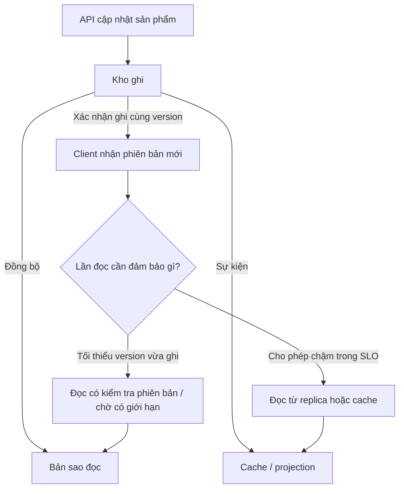

# Yêu cầu về dữ liệu mới nhất, đọc sau ghi và cập nhật đồng thời

Khi thiết kế một cơ sở dữ liệu NoSQL, câu hỏi “dữ liệu có nhất quán không?” vẫn chưa đủ cụ thể để lựa chọn cách lưu trữ và truy vấn. Ứng dụng cần biết **đọc được phiên bản mới đến mức nào**, **người vừa ghi có được thấy dữ liệu của chính mình ngay không**, và **nhiều yêu cầu cùng sửa một dữ liệu sẽ được xử lý ra sao**. Ba yêu cầu này liên quan với nhau nhưng không đồng nhất.

Trong chương **Yêu cầu và tải dữ liệu**, chúng ta chuyển các kỳ vọng của người dùng và nghiệp vụ thành hợp đồng có thể đo đạc, thiết kế và kiểm thử. Điều này đặc biệt quan trọng với NoSQL vì dữ liệu thường được phân vùng, nhân bản, đưa qua bộ nhớ đệm hoặc đồng bộ bất đồng bộ giữa các thành phần.

## 1. Phân biệt ba yêu cầu ngay từ đầu

Giả sử một ứng dụng bán hàng lưu thông tin sản phẩm, giỏ hàng và tồn kho:

1. Quản trị viên đổi giá sản phẩm từ 100.000 đồng thành 90.000 đồng. Khách hàng cần nhìn thấy giá mới sau bao lâu? Đây là **yêu cầu về độ mới của dữ liệu** (*freshness*).
2. Khách hàng vừa thêm một mặt hàng vào giỏ, lập tức mở lại giỏ hàng. Họ có được thấy món vừa thêm? Đây là **đọc sau ghi** (*read-your-writes*).
3. Hai khách hàng cùng mua sản phẩm chỉ còn một đơn vị tồn kho. Hệ thống có ngăn cả hai đơn đồng thời trừ tồn kho thành âm? Đây là **yêu cầu về cập nhật đồng thời** (*concurrent updates*).

| Khía cạnh | Câu hỏi chính | Rủi ro nếu không xác định rõ |
|---|---|---|
| **Dữ liệu mới nhất** | Bản đọc cần phản ánh cập nhật mới đến đâu, và được phép chậm bao lâu? | Giá, trạng thái hoặc số liệu hiển thị đã lỗi thời |
| **Đọc sau ghi** | Một người dùng vừa ghi thành công có nhìn thấy chính thay đổi đó trong lần đọc kế tiếp? | Giao diện báo lưu thành công nhưng tải lại lại hiện giá trị cũ |
| **Cập nhật đồng thời** | Nhiều thao tác đọc–sửa–ghi đụng cùng bản ghi có giữ các ràng buộc nghiệp vụ? | Mất cập nhật, ghi đè, tồn kho âm, xử lý yêu cầu hai lần |

**Độ mới** mô tả mức chậm của thông tin được nhìn thấy. **Đọc sau ghi** là một bảo đảm liên quan đến thứ tự quan sát của một người dùng hoặc một phiên làm việc. **An toàn cập nhật đồng thời** là việc duy trì các bất biến khi nhiều thao tác có thể diễn ra xen kẽ. Một hệ thống có thể đáp ứng một yêu cầu nhưng vẫn vi phạm yêu cầu khác.

Ví dụ, luôn đọc từ một bản sao cập nhật nhanh có thể cho dữ liệu khá mới, nhưng lần đọc ngay sau ghi đôi khi vẫn thấy phiên bản trước. Ngược lại, giao diện có thể hiển thị thay đổi người dùng vừa thực hiện bằng dữ liệu cục bộ, trong khi các máy khác vẫn đọc phiên bản cũ và hai yêu cầu cập nhật vẫn có khả năng xung đột.

## 2. “Dữ liệu mới nhất” cần được định nghĩa thế nào?

### 2.1. Phiên bản mới nhất không phải lúc nào cũng có thể nhìn thấy ngay

Một dữ liệu có thể đi qua nhiều tầng:

```text
Ứng dụng ghi dữ liệu
       |
       v
   Nút nhận ghi  -------->  Bản sao ở vùng khác
       |                         |
       |                         v
       +----------------->  Chỉ mục tìm kiếm
       |
       +----------------->  Cache / CDN
                                 |
                                 v
                         Ứng dụng thực hiện đọc
```

Nếu bản sao, chỉ mục tìm kiếm hoặc cache được cập nhật **bất đồng bộ**, các tầng có thể đang giữ những phiên bản khác nhau. Một yêu cầu đọc có thể nhận dữ liệu cũ ngay cả khi ghi ban đầu đã thành công.

Hãy xem một dòng thời gian minh họa; các mốc chỉ để diễn giải cơ chế, không phải đặc tính cố định của sản phẩm:

| Thời điểm | Sự kiện | Phiên bản có thể nhìn thấy |
|---|---|---|
| 10:00:00.000 | Giá sản phẩm đang là 100.000 đồng | Nút chính và bản sao đều ở phiên bản 7 |
| 10:00:00.100 | Nút nhận ghi xác nhận giá mới 90.000 đồng | Nút nhận ghi có phiên bản 8 |
| 10:00:00.120 | Người dùng truy vấn bản sao chưa bắt kịp | Vẫn thấy phiên bản 7 |
| 10:00:00.450 | Bản sao nhận đủ thay đổi | Có thể thấy phiên bản 8 |
| 10:00:01.000 | Cache chưa hết hạn hoặc chưa được vô hiệu hóa | Đọc qua cache vẫn có thể thấy phiên bản 7 |

Ví dụ làm rõ hai điều:

- **Ghi thành công không tự động đồng nghĩa mọi nơi đều thấy dữ liệu mới.** Điều gì được bảo đảm phụ thuộc điều kiện xác nhận ghi, cách nhân bản và nguồn mà lần đọc sử dụng.
- **Độ trễ ứng dụng và độ mới dữ liệu khác nhau.** Một truy vấn trả về sau 5 ms vẫn có thể là dữ liệu đã cũ 30 giây; một truy vấn mất 200 ms có thể cung cấp phiên bản mới hơn.

### 2.2. Những mức yêu cầu độ mới thường gặp

| Mức yêu cầu | Đặc điểm | Ví dụ có thể phù hợp |
|---|---|---|
| **Nhất quán mạnh cho thao tác đọc** | Thao tác đọc phải đáp ứng mô hình nhất quán mạnh đã cam kết, chẳng hạn thấy ghi hoàn tất gần nhất theo thứ tự có thể tuyến tính hóa (*linearizable*) | Quyết định cấp phát tài nguyên độc quyền, một số trạng thái tài chính |
| **Độ mới có giới hạn (*bounded staleness*)** | Chấp nhận độ trễ nhưng xác định được giới hạn bằng thời gian hoặc số phiên bản, nếu hệ thống thực sự cung cấp bảo đảm đó | Một số dữ liệu trạng thái cần đồng bộ trong khoảng đã định |
| **Độ mới có mục tiêu vận hành** | Ví dụ 99,9% thay đổi xuất hiện trên màn hình trong tối đa 2 giây; đây là SLO đo lường, không phải cam kết tuyệt đối cho mọi thao tác | Giá niêm yết, thông tin mô tả, kết quả tổng hợp |
| **Nhất quán cuối cùng (*eventual consistency*)** | Khi không còn cập nhật và kết nối được phục hồi, các bản sao cuối cùng hội tụ; mô hình này tự nó không quy định một giới hạn thời gian cụ thể | Lượt xem, nội dung đề xuất hoặc dữ liệu có thể chậm mà không gây sai nghiệp vụ |

Cần phân biệt **bảo đảm của cơ chế** với **mục tiêu đo được trong thực tế**. Một hệ thống bình thường cập nhật bản sao trong 100 ms không có nghĩa luôn bảo đảm bản sao cập nhật trong 100 ms khi mạng gián đoạn hoặc tải cao.

Độ mới cũng thường được xác định theo một **thực thể** (một sản phẩm, một tài khoản), thay vì một khái niệm “phiên bản mới nhất của cả hệ thống”. Nếu nhiều bản ghi được ghi độc lập, chúng không nhất thiết có một thứ tự toàn cục chung.

### 2.3. Cách đo độ mới dữ liệu

Hai cách đo hữu ích:

**Theo thời gian**: đo khoảng trễ giữa thời điểm một cập nhật được cam kết và thời điểm nó có thể được quan sát ở đường đọc cần đo.

\[
\text{Độ trễ hiển thị} = t_{\text{đọc thấy phiên bản mới}} - t_{\text{ghi được cam kết}}
\]

**Theo phiên bản hoặc vị trí log**: mỗi lần cập nhật làm thay đổi số phiên bản, sequence number, offset hoặc token tương đương. Người đọc có thể so sánh phiên bản đang thấy với phiên bản cần có, miễn là các giá trị này **có thể so sánh đúng trong cùng phạm vi**.

Ví dụ, sản phẩm có `version = 18` và chỉ mục tìm kiếm vẫn trả `version = 16` nghĩa là chỉ mục còn chậm hai phiên bản đối với sản phẩm đó. Không thể lấy hai số phiên bản thuộc hai thực thể độc lập để suy ra thứ tự toàn hệ thống.

Đối với phép đo thời gian, đồng hồ ở các máy khác nhau có thể lệch. Nên dùng mốc từ cùng nguồn tin cậy hoặc đo bằng công cụ quan sát phù hợp; không kết luận độ trễ nhân bản chính xác chỉ bằng cách trừ hai đồng hồ chưa đồng bộ.

Các câu hỏi cần đặt ra: **độ mới áp dụng cho truy vấn nào, đo ở tầng nào, theo phân vị nào, vào lúc tải cao ra sao, và ứng dụng sẽ xử lý thế nào nếu không đạt?**

## 3. Đọc sau ghi: người vừa lưu phải thấy điều mình vừa lưu

### 3.1. Read-your-writes là bảo đảm của một phiên quan sát

Một người dùng sửa tên hiển thị từ “An” thành “An Nguyễn”. Máy chủ trả `200 OK` với thông báo lưu thành công. Nếu ngay sau đó người dùng tải lại trang nhưng nhận tên “An” từ bản sao chậm đồng bộ, trải nghiệm sẽ gây nhầm lẫn.

**Read-your-writes consistency** bảo đảm rằng sau khi một phiên ghi được cập nhật, các lần đọc tiếp theo thuộc phạm vi được bảo đảm của phiên ấy không quay về trạng thái cũ hơn chính những cập nhật đã ghi thành công. Đây là một **bảo đảm phiên (session guarantee)**, thường yếu hơn yêu cầu mọi người dùng ở mọi nơi phải luôn thấy ghi mới nhất.

```text
Phiên của người dùng A:

Ghi hồ sơ v12 -> nhận xác nhận -> Đọc hồ sơ -> phải thấy v12 hoặc mới hơn
                                               (trong phạm vi bảo đảm của phiên)

Người dùng B ở phiên khác:

Đọc từ replica chậm -> có thể vẫn thấy v11 nếu hệ thống cho phép
```

Trong tài liệu sản phẩm, thuật ngữ *read-after-write consistency* đôi khi được dùng với nghĩa đọc sau một ghi đã xác nhận sẽ thấy ghi đó; nơi khác có thể dùng gần với nhất quán mạnh hơn. Vì vậy trong đặc tả dự án nên ghi rõ **ai được bảo đảm, bản ghi nào, sau điều kiện xác nhận nào, trong bao lâu và trên những thiết bị nào**.

Một số hệ cơ sở dữ liệu hỗ trợ **causal consistency** để duy trì quan hệ nhân quả trong cùng phiên; một số khác có cách cấu hình đọc/ghi và định tuyến riêng. Không nên suy ra rằng chỉ bật replication hoặc gửi ghi tới nhiều bản sao là đã có read-your-writes.

### 3.2. Bốn cách phổ biến để đáp ứng read-your-writes

| Cách làm | Nguyên lý | Điều cần cân nhắc |
|---|---|---|
| **Đọc từ đường có bảo đảm phù hợp** | Sau khi ghi, đọc từ leader hoặc dùng chế độ đọc nhất quán mạnh theo hợp đồng của hệ quản trị | Đọc leader đơn thuần chưa đủ để mặc định có mọi bảo đảm linearizable; cần đúng chế độ xác nhận/đọc |
| **Duy trì session hoặc causal token** | Client mang thông tin ghi trước đó để lần đọc sau chờ hoặc chọn nguồn đã theo kịp | Token phải sống qua các request và được chuyển tới đúng lớp lưu trữ; bảo đảm cụ thể tùy hệ quản trị |
| **Version fence / minimum version** | Ghi trả phiên bản `v`; các lần đọc sau yêu cầu ít nhất `v` | Replica chậm có thể phải đợi, đổi nút đọc hoặc báo chưa đáp ứng; không nên đợi vô hạn |
| **Hiển thị trạng thái vừa lưu ở ứng dụng** | Giao diện giữ giá trị vừa cập nhật hoặc tạm thời đọc từ một vùng dữ liệu nhất quán hơn | Giúp trải nghiệm mượt nhưng chỉ là giải pháp giao diện nếu không có bảo đảm đọc tương ứng ở backend |

Ví dụ giao thức **tối thiểu theo phiên bản**, viết dưới dạng mã giả để không phụ thuộc một nhà cung cấp:

```javascript
// API ghi trả phiên bản đã được chấp nhận.
const saved = await profileStore.updateProfile({
  userId: "u-42",
  displayName: "An Nguyễn"
});
// saved = { userId: "u-42", version: 12 }

// Lần đọc kế tiếp yêu cầu thấy ít nhất phiên bản vừa ghi.
const profile = await profileStore.getProfile("u-42", {
  minVersion: saved.version
});
```

`minVersion` là **hợp đồng ứng dụng minh họa**, không phải tham số chuẩn sẵn có của mọi cơ sở dữ liệu. Backend phải hiện thực việc kiểm tra phiên bản, chờ có giới hạn, định tuyến sang nguồn khác hoặc trả lỗi có ý nghĩa nếu không đạt yêu cầu. Nếu không có logic phía sau, truyền tham số này không bảo đảm được điều gì.

### 3.3. Xác định biên phiên và biên thiết bị

Cùng một người dùng có thể:

- Ghi bằng điện thoại rồi ngay lập tức đọc bằng laptop.
- Đăng xuất, đăng nhập lại sau khi ghi.
- Mở hai tab cùng chỉnh sửa một tài liệu.
- Đọc dữ liệu bằng API trực tiếp trong khi giao diện dùng cache.

Nếu chỉ giữ session token trong bộ nhớ một tab, bảo đảm “đọc sau ghi” có thể mất khi qua thiết bị khác. Hệ thống phải xác định liệu yêu cầu là **trong một tab**, **trong một phiên xác thực**, **trong toàn bộ tài khoản**, hay **cho tất cả người đọc**. Phạm vi càng rộng, việc truyền token hoặc yêu cầu nhất quán tại kho dữ liệu càng đáng chú ý.

Ngoài read-your-writes còn có **monotonic reads**: một phiên đã nhìn thấy phiên bản 12 thì các lần đọc sau không bị quay lại phiên bản 11. Hai thuộc tính này thường hỗ trợ nhau nhưng không đồng nhất: phiên có thể đã thấy phiên bản 12 do người khác ghi, dù bản thân phiên chưa ghi gì.

### 3.4. Ghi “thành công” phải được định nghĩa rõ

Một API trả thành công có thể mang nghĩa rất khác nhau:

1. Request đã được tiếp nhận vào hàng đợi.
2. Một nút đã nhận và lưu cập nhật.
3. Ghi đã đạt một mức bền vững hoặc số bản sao xác nhận cụ thể.
4. Dữ liệu đã xuất hiện trên một projection hoặc cache phục vụ đọc.

Không được dùng chung nhãn “đã lưu” cho bốn ý nghĩa nếu người dùng trông đợi dữ liệu mới ngay. Ví dụ, nếu API chỉ xác nhận đã nhận sự kiện vào hàng đợi, nên phân biệt trạng thái **đang xử lý** với **đã hoàn tất**; thao tác đọc từ kho đích ngay lúc đó có thể chưa chứa cập nhật.

## 4. Cập nhật đồng thời: xử lý nhiều yêu cầu thay đổi cùng dữ liệu

### 4.1. Vấn đề mất cập nhật (*lost update*)

Giả sử hai nhân viên cùng sửa hồ sơ sản phẩm đang có `version = 7`:

```text
Thời điểm       Nhân viên A                  Nhân viên B
---------       -----------                  -----------
t1              Đọc v7
t2                                           Đọc v7
t3              Đổi tên, ghi v8
t4                                           Đổi giá, ghi toàn bộ bản v7
t5              Tên mới của A có thể bị B ghi đè bằng tên cũ
```

Nếu mỗi người đọc rồi gửi lại **toàn bộ tài liệu**, thao tác ghi sau có thể xóa mất thay đổi của người kia. Đây không phải lỗi do “NoSQL kém nhất quán”, mà là một lỗi xử lý đồng thời cũng gặp trong SQL khi ứng dụng không có kiểm soát thích hợp.

Các kiểu bất thường cần phân biệt:

- **Lost update:** một thay đổi hợp lệ bị thao tác khác ghi đè.
- **Write conflict:** hai yêu cầu muốn sửa cùng trạng thái; hệ thống phát hiện xung đột và buộc một yêu cầu xử lý lại.
- **Duplicate execution:** cùng yêu cầu bị gửi lại sau timeout và tạo hai tác dụng phụ.
- **Write skew / vi phạm bất biến nhiều bản ghi:** mỗi thao tác đọc tập dữ liệu chung rồi sửa một bản ghi khác nhau; từng bản ghi có vẻ đúng nhưng ràng buộc tổng thể bị phá vỡ nếu mức cô lập không đủ.
- **Out-of-order event:** sự kiện phiên bản 11 đến sau phiên bản 12 và bị áp vào trạng thái mới hơn nếu không kiểm tra thứ tự.

Không thể giải quyết tất cả bằng một khóa `version` duy nhất. Cần xác định **phạm vi bất biến**: một trường, một document, nhiều document, một partition hay nhiều dịch vụ.

### 4.2. Cập nhật nguyên tử trong một document

Nhiều document database hỗ trợ thao tác cập nhật nguyên tử **trong phạm vi một document**. Với MongoDB, ví dụ trừ tồn kho nếu vẫn còn ít nhất 2 sản phẩm:

```javascript
const result = db.inventory.updateOne(
  {
    _id: "sku-42",
    availableQty: { $gte: 2 }
  },
  {
    $inc: { availableQty: -2 }
  }
);

if (result.matchedCount === 0) {
  // Không tìm thấy sản phẩm hoặc điều kiện đủ hàng không còn đúng.
  // Không tiếp tục giả định việc đặt hàng đã thành công.
}
```

Điều kiện `availableQty >= 2` và phép trừ được thực hiện trong cùng lệnh cập nhật nguyên tử của document. Nếu hai yêu cầu cùng muốn mua hai chiếc và số tồn chỉ còn hai, chúng không thể đều thành công bằng cách đơn giản cùng đọc số 2 rồi cùng trừ độc lập trong cùng document.

Tuy nhiên, **tính nguyên tử của lệnh trừ tồn kho không tự làm cả quy trình đặt hàng trở nên nguyên tử**. Tạo đơn hàng ở document khác, ghi thanh toán, phát thông báo và cập nhật thống kê đều là các thao tác khác. Ngoài ra, nếu cùng một request được gửi lại, hai lần trừ tồn kho vẫn có thể xảy ra khi cả hai lần đều còn đủ hàng; cần xử lý idempotency.

### 4.3. Optimistic concurrency: kiểm tra phiên bản trước khi ghi

Một chiến lược hữu ích khi xung đột không xảy ra quá thường xuyên là **optimistic concurrency control (OCC)**. Mỗi document có một `version`; yêu cầu ghi phải nêu phiên bản mà mình đã đọc.

Ví dụ tài liệu:

```json
{
  "_id": "product-100",
  "name": "Bàn phím cơ",
  "price": 950000,
  "version": 7
}
```

Lệnh cập nhật có điều kiện trong MongoDB:

```javascript
const expectedVersion = 7;

const result = db.products.updateOne(
  { _id: "product-100", version: expectedVersion },
  {
    $set: { price: 900000 },
    $inc: { version: 1 }
  }
);

if (result.matchedCount === 1) {
  // Ghi thành công; phiên bản của document đã tăng lên 8.
} else {
  // Không tồn tại document hoặc phiên bản đã thay đổi.
  // Đọc lại và xử lý xung đột; không ghi đè mù quáng.
}
```

Nếu hai client cùng sửa từ phiên bản 7, chỉ một lệnh có thể khớp điều kiện `version = 7`. Lệnh còn lại nhận thông tin không khớp và có thể đọc lại để hỏi người dùng, hợp nhất trường không xung đột hoặc thử lại theo quy tắc nghiệp vụ.

**Các điểm triển khai cần nhớ:**

1. Gửi `expectedVersion` từ dữ liệu mà người dùng đã đọc, không lấy phiên bản mới nhất rồi luôn ghi đè.
2. Tăng `version` **trong cùng thao tác nguyên tử** với cập nhật.
3. Phân biệt document không còn tồn tại với trường hợp có document nhưng sai phiên bản nếu thông báo nghiệp vụ cần khác nhau.
4. Không retry vô hạn; các bản cập nhật có tính quyết định của người dùng cần chiến lược hòa giải xung đột.
5. Ghi có thể thành công nhưng phản hồi bị mất; nếu request được gửi lại cần cơ chế nhận diện để tránh tác dụng phụ lặp.

Trong REST API, mẫu tương tự thường dùng `ETag` và `If-Match` để client gửi điều kiện phiên bản khi `PUT`/`PATCH`. Tuy vậy, chỉ thêm HTTP header chưa đủ; lớp lưu trữ vẫn phải thực thi phép so khớp nguyên tử.

### 4.4. Cập nhật theo phép toán thay vì đọc–sửa–ghi

Với bộ đếm, lệnh **tăng trực tiếp** như `$inc` thường an toàn hơn kiểu ứng dụng đọc `count = 10`, tính `count + 1`, rồi ghi lại `11`. Trong kiểu đọc–sửa–ghi, hai yêu cầu có thể cùng đọc 10 và đều ghi 11, làm mất một lượt tăng.

Với tập phần tử, thao tác nguyên tử như thêm phần tử nếu chưa có, kiểm tra khóa duy nhất hoặc dùng cấu trúc tập hợp có thể phù hợp hơn thay thế toàn bộ mảng. Tuy nhiên, việc một phép toán có tính nguyên tử, tính giao hoán hay giải quyết xung đột ra sao phụ thuộc **loại dữ liệu và hệ quản trị cụ thể**.

### 4.5. Giao dịch nhiều document và nhiều dịch vụ

Nếu bất biến trải qua nhiều bản ghi, chẳng hạn **tạo đơn hàng và giữ chỗ tồn kho phải thành công cùng nhau**, nguyên tử trong một document là chưa đủ.

Các lựa chọn tùy trường hợp:

| Phạm vi | Cách có thể cân nhắc | Giới hạn hoặc lưu ý |
|---|---|---|
| Một document | Atomic update, conditional update, version/CAS | Đủ mạnh cho một số bất biến cục bộ |
| Nhiều document trong cùng cơ sở dữ liệu | Transaction nếu hệ quản trị hỗ trợ và mức cô lập đáp ứng yêu cầu | Cần kiểm tra bảo đảm thực tế, chi phí, timeout, xung đột và giới hạn phân vùng |
| Nhiều cơ sở dữ liệu hoặc dịch vụ | Quy trình trạng thái, event/outbox, saga và thao tác bù trừ | Không có nguyên tử toàn cục mặc định; phải xử lý lỗi giữa chừng và lặp sự kiện |
| Một tài nguyên độc quyền được nhiều tiến trình tranh chấp | Conditional write, lease hoặc lock có cơ chế bảo vệ | Lock hết hạn không đủ để ngăn tiến trình cũ ghi tiếp; có thể cần fencing token |

Ví dụ, chuyển trạng thái đơn hàng `PENDING -> PAID` bằng điều kiện “trạng thái hiện tại vẫn là `PENDING`” giúp ngăn hai yêu cầu cùng chuyển từ trạng thái cũ. Nhưng nếu hệ thống còn phải ghi bút toán thanh toán ở kho khác, vẫn cần thiết kế để các bước không mất hoặc nhân đôi.

## 5. Idempotency: yêu cầu bắt buộc khi có retry và timeout

Mạng có thể lỗi ở thời điểm khó phân biệt:

```text
Client gửi yêu cầu đặt hàng
       |
       v
Server đã tạo đơn hàng
       |
       X  Phản hồi bị mất do lỗi mạng
       |
Client retry cùng yêu cầu
```

Client không thể chỉ nhìn timeout để biết lần gửi đầu đã được thực hiện chưa. Nếu lần thứ hai tạo thêm một đơn hàng hoặc trừ tồn kho lần nữa, ta có lỗi xử lý lặp dù các thao tác ghi riêng lẻ đều nguyên tử.

**Idempotency** là thiết kế sao cho thực hiện lặp lại cùng một ý định nghiệp vụ không tạo thêm tác dụng phụ. Với thao tác đặt hàng, client có thể gửi `idempotencyKey` ổn định cho một yêu cầu logic:

```json
{
  "idempotencyKey": "checkout-req-8f12",
  "customerId": "u-42",
  "items": [{ "sku": "sku-42", "quantity": 2 }]
}
```

Server dùng một ràng buộc duy nhất hoặc cơ chế lưu kết quả xử lý theo khóa để bảo đảm các lần retry cùng ý định không tạo đơn hàng khác nhau. Cần quy định rõ phạm vi khóa (người dùng, tenant, API), thời hạn lưu và cách xử lý khi **cùng khóa nhưng nội dung request khác**.

Một mẫu xử lý có thể gồm:

1. Kiểm tra/lưu khóa idempotency theo cách có bảo vệ cạnh tranh; hai request đồng thời cùng khóa không được cùng bắt đầu quy trình tạo tác dụng phụ.
2. Ghi trạng thái xử lý và kết quả; khi retry, trả lại kết quả đã xác định hoặc trạng thái đang thực hiện.
3. Thực hiện thay đổi nghiệp vụ bằng giao dịch thích hợp, hoặc dùng trạng thái và cơ chế khôi phục để xử lý trường hợp quy trình dở dang.
4. Khi phát sự kiện, mang mã sự kiện duy nhất và khiến consumer xử lý lặp an toàn, vì hệ thống hàng đợi có thể giao lại thông điệp.

**Idempotency không đồng nghĩa mọi thao tác đều “exactly once”.** Trong hệ phân tán, thường cần chấp nhận khả năng gửi/nhận lại và kiểm soát tác dụng phụ ở phía xử lý.

## 6. Mối liên hệ giữa độ mới, đọc sau ghi và ghi đồng thời

Ba yêu cầu thường kéo theo những lựa chọn khác nhau:

| Nhu cầu | Bảo đảm cần hướng đến | Cơ chế có thể sử dụng |
|---|---|---|
| Người sửa hồ sơ phải thấy tên mới ngay sau khi lưu | Read-your-writes trong phạm vi phiên đã định | Session token, đọc có mức nhất quán phù hợp, version fence |
| Người dùng chỉ cần danh sách đề xuất gần đây | Độ mới theo SLO hoặc eventual consistency | Replica đọc, cache, projection bất đồng bộ và theo dõi độ trễ |
| Không được bán quá số lượng hàng hiện có | Bất biến ghi đồng thời | Cập nhật nguyên tử có điều kiện, giao dịch nếu bất biến vượt một document |
| Hai nhân viên không được âm thầm ghi đè sửa đổi của nhau | Phát hiện và xử lý xung đột | Version/CAS, ETag/If-Match, quy tắc merge |
| Retry thanh toán không được tạo hai khoản thu | Idempotency và kiểm soát quy trình giao dịch | Khóa yêu cầu duy nhất, kiểm soát trạng thái, cơ chế khôi phục |
| Các máy đọc không được quay về phiên bản thấp hơn đã thấy | Monotonic reads | Session consistency, token hoặc định tuyến đọc thích hợp |

Một minh họa cho catalog sử dụng bản sao và cache:



Đường đọc có yêu cầu `minVersion` cần khả năng đổi nguồn hoặc chờ bản sao bắt kịp. Đường đọc chấp nhận dữ liệu cũ có thể tối ưu chi phí và độ trễ. Đây là một phân tách có chủ đích theo **đặc tính của thao tác**, không phải một lời khẳng định cache hoặc replica luôn đáp ứng độ mới.

### Khi mạng bị phân vùng thì sao?

Nếu cụm cơ sở dữ liệu bị chia cắt và không thể trao đổi giữa các nút, hệ thống phải xác định hành vi với từng thao tác. Cho phép các phía cùng ghi có thể tăng khả năng tiếp nhận yêu cầu nhưng tạo xung đột cần hòa giải. Hạn chế hoặc chặn một số ghi giúp bảo vệ tính nhất quán nhưng giảm khả năng phục vụ các yêu cầu ấy trong thời gian lỗi mạng.

Định lý CAP diễn đạt đánh đổi giữa các bảo đảm nhất quán mạnh và tính sẵn sàng khi có phân vùng mạng; nó **không** quyết định sẵn yêu cầu của ứng dụng. Trên cùng sản phẩm, thao tác đọc catalog và thao tác giữ tồn kho có thể được thiết kế với các bảo đảm khác nhau, nếu cơ chế và dữ liệu cho phép.

## 7. Viết yêu cầu nghiệp vụ thành hợp đồng có thể kiểm chứng

Các từ “mới nhất”, “ngay lập tức”, “không bị ghi đè” đều cần chuyển thành điều kiện cụ thể. Ví dụ một bảng yêu cầu **minh họa** cho hệ thống bán hàng:

| Luồng nghiệp vụ | Yêu cầu cần chứng minh | Khi không đáp ứng |
|---|---|---|
| Quản trị viên cập nhật giá | Sau khi API trả “đã lưu”, chính quản trị viên đọc lại phải thấy phiên bản vừa ghi hoặc mới hơn | Đọc từ nguồn phù hợp hoặc báo tạm chưa đồng bộ; không hiển thị dữ liệu cũ như thể đã lưu thất bại |
| Khách xem trang danh mục | 99,9% giá hiển thị bắt kịp thay đổi trong 2 giây ở tải dự kiến | Theo dõi độ trễ projection; chủ động loại cache quá hạn hoặc giảm cấp cách hiển thị |
| Hai người cùng sửa sản phẩm | Nếu cùng dựa trên version cũ, chỉ một bản ghi được chấp nhận; người kia nhận thông báo xung đột | Yêu cầu đọc lại/merge, không tự ghi đè |
| Hai đơn cùng giữ hàng cuối | Điều kiện tồn kho không âm phải luôn đúng ở thao tác đã cam kết | Một yêu cầu nhận kết quả hết hàng hoặc phải chờ/thử lại theo chính sách |
| Client retry checkout | Cùng `idempotencyKey` và cùng nội dung không tạo thêm đơn hoặc trừ tồn kho hai lần | Trả kết quả trước đó hoặc trạng thái đang xử lý |
| Hệ thống vừa chuyển vùng lỗi | Đường đọc/ghi trọng yếu đáp ứng mức nhất quán và thời gian phục hồi đã được phê duyệt | Từ chối thao tác không thể bảo đảm thay vì âm thầm tạo dữ liệu sai |

**Lưu ý:** Các con số 99,9% và 2 giây là tiêu chí giả định để minh họa cách đặc tả, không phải quy chuẩn hay cam kết mặc định của NoSQL.

Mỗi yêu cầu cần nói rõ:

- **Đối tượng:** một document, một tập dữ liệu hay toàn bộ giao dịch?
- **Người quan sát:** chính người vừa ghi, mọi người dùng, một tenant hay tất cả vùng?
- **Điểm bắt đầu:** request được nhận, ghi đã xác nhận hay giao dịch đã cam kết?
- **Đường đọc:** primary, replica, cache, API tổng hợp hay chỉ mục tìm kiếm?
- **Mức chấp nhận:** tuyệt đối với một bất biến, hoặc theo giới hạn thời gian/SLO với độ mới?
- **Hành vi khi lỗi:** chờ, đọc ở nguồn khác, trả lỗi xung đột, thử lại có kiểm soát hay hiển thị trạng thái đang đồng bộ?

Nếu không thống nhất các điểm này, nhóm phát triển và vận hành có thể cùng nói “đã nhất quán” nhưng đang đo hai hiện tượng khác nhau.

## 8. Kiểm thử dưới tải và tình huống lỗi

Các yêu cầu về đọc và ghi cần được thử **khi có đồng thời**, thay vì chỉ chạy một request rồi quan sát kết quả.

### 8.1. Thử read-your-writes

Kịch bản:

1. Tạo một thực thể và ghi nhận `version = n`.
2. Cập nhật qua đúng API chính thức, lưu `version = n + 1` trả về sau khi ghi được xác nhận theo hợp đồng.
3. Đọc ngay qua mọi đường đọc mà ứng dụng thực sự dùng (API, replica, cache hoặc truy vấn tổng hợp).
4. Xác nhận đường đọc có bảo đảm read-your-writes không trả phiên bản thấp hơn `n + 1`.
5. Lặp lại khi tải cao, khi mất kết nối tới một replica và khi client chuyển máy/vùng nếu hợp đồng yêu cầu.

Chỉ thử một lần có thể không phát hiện trễ đồng bộ ngẫu nhiên. Cũng không nên giả định rằng việc giao diện đã cập nhật là bằng chứng backend đọc sau ghi thành công; cần kiểm tra kết quả ở đúng đường đọc.

### 8.2. Thử mất cập nhật và tranh chấp

Cho hai hoặc nhiều client đọc cùng phiên bản rồi gần như đồng thời gửi thao tác cập nhật. Kết quả kỳ vọng phụ thuộc nghiệp vụ:

- Với **OCC**, một yêu cầu thành công và các yêu cầu còn lại nhận xung đột rõ ràng, hoặc xử lý lại dựa trên phiên bản mới.
- Với **phép cộng nguyên tử**, tổng sau cùng phải bằng giá trị ban đầu cộng tổng các lần cập nhật được chấp nhận.
- Với **giữ tồn kho**, sau nhiều lệnh đặt hàng cạnh tranh, tồn kho không âm và số lượng giữ thành công không vượt lượng sẵn có.
- Với **idempotency**, nhiều lần gửi cùng yêu cầu không được tạo thêm tác dụng phụ.

Phải thử cả trường hợp client timeout sau khi server đã cam kết; đây là nguyên nhân phổ biến gây retry và ghi lặp.

### 8.3. Thử độ mới và phục hồi

Đặt bộ đo trên đường ghi và đường đọc. Quan sát:

| Chỉ số | Ý nghĩa |
|---|---|
| Replication lag | Độ trễ bản sao theo cơ chế mà hệ quản trị công bố |
| Projection/index lag | Chậm trễ khi dữ liệu được đưa sang chỉ mục tìm kiếm hoặc view đọc |
| Cache hit và tuổi dữ liệu | Dữ liệu trả từ cache hiện tại có mới như yêu cầu không? |
| Visibility latency p95/p99 | Phân phối thời gian để cập nhật xuất hiện trên đường đọc cụ thể |
| Tỷ lệ đọc thiếu `minVersion` | Bao nhiêu lần đọc theo session không đáp ứng phiên bản tối thiểu |
| Conflict/retry rate | Mức tranh chấp khi cập nhật đồng thời |
| Duplicate suppression rate | Bao nhiêu request lặp được nhận diện và xử lý an toàn |

Trong môi trường thử nghiệm kiểm soát, lần lượt tạo lỗi mạng, dừng nút đang nhận ghi, trì hoãn replica, làm cache không cập nhật và khởi động lại consumer. Mỗi thử nghiệm phải gắn với **kết quả quan sát được** và giới hạn dịch vụ đã đặt ra. Việc hệ thống tự phục hồi không đủ chứng minh đúng dữ liệu nếu sau đó vẫn có cập nhật bị mất hoặc áp sai thứ tự.

## 9. Sai lầm dễ gặp khi chọn cơ chế

| Kết luận vội vàng | Điều thực sự cần kiểm tra |
|---|---|
| “Dùng NoSQL thì dữ liệu luôn cập nhật cuối cùng, nên không thể đọc sau ghi.” | Eventual consistency không loại trừ session guarantees; nhiều hệ có lựa chọn nhất quán riêng. |
| “Đọc từ primary là luôn lấy dữ liệu mới nhất tuyệt đối.” | Phụ thuộc hợp đồng đọc/ghi, thời điểm cam kết, failover và mức nhất quán. |
| “Ghi đã được nhiều replica xác nhận thì mọi replica đều đọc thấy ngay.” | Bản sao được chọn để đọc vẫn có thể chưa theo kịp, tùy cấu hình và cơ chế. |
| “Cache chỉ làm nhanh hơn, không ảnh hưởng tính đúng đắn.” | Cache cũ có thể vi phạm SLO độ mới hoặc read-your-writes; cần chính sách invalidation/phiên bản. |
| “Cập nhật một document là nguyên tử nên toàn bộ nghiệp vụ an toàn.” | Bất biến có thể trải qua nhiều document, hàng đợi và dịch vụ. |
| “Đã có version thì không cần xử lý xung đột.” | Version chỉ giúp phát hiện/giới hạn một số xung đột; vẫn cần xử lý khi điều kiện ghi không khớp. |
| “Retry là an toàn vì gọi lại cùng endpoint.” | Endpoint có thể tạo thêm đơn hoặc trừ tồn kho lần nữa nếu không có idempotency. |
| “Last-write-wins luôn giải quyết được xung đột.” | Nó chọn một trạng thái cuối nhưng có thể làm mất ý định cập nhật; thứ tự theo đồng hồ còn có nguy cơ lệch. |
| “Chạy kiểm thử khi ít tải là đủ.” | Lag, conflict và failover thường thể hiện rõ khi tải cao hoặc phân vùng mạng. |

## 10. Cách quyết định theo yêu cầu thực tế

Khi nhận một chức năng mới, nên đi theo chuỗi câu hỏi:

```text
Chức năng có ràng buộc nghiệp vụ không được vi phạm?
       |
       +-- Có --> Bất biến nằm trong một document hay nhiều thực thể?
       |              |
       |              +-- Một document: cập nhật nguyên tử / điều kiện / CAS
       |              +-- Nhiều thực thể: transaction hoặc quy trình có bù trừ
       |
       +-- Người vừa ghi có phải đọc thấy kết quả ngay?
       |              |
       |              +-- Có: xác định biên session và cơ chế đọc có bảo đảm
       |
       +-- Người đọc khác được phép thấy dữ liệu cũ không?
                      |
                      +-- Không: yêu cầu mô hình nhất quán đọc phù hợp
                      +-- Có: đặt giới hạn độ mới/SLO và đo đúng đường đọc
```

Sau khi xác định yêu cầu, mới chọn loại NoSQL, cơ chế partition/replication, mức xác nhận ghi, mức đọc, cache, schema, transaction và cách xử lý lỗi. Một sản phẩm có thể hỗ trợ nhiều lựa chọn, nhưng bảo đảm chỉ có hiệu lực nếu **cấu hình và cách ứng dụng sử dụng** đúng với điều đã thiết kế.

### Kết luận

Ba câu hỏi phải luôn được trả lời riêng biệt:

1. **Dữ liệu mới đến mức nào?** Xác định độ mới theo thao tác đọc, đường đọc, phạm vi và chỉ tiêu đo lường.
2. **Ai phải nhìn thấy ngay cập nhật của mình?** Xác định read-your-writes theo phiên hoặc tài khoản, cách định tuyến/token và phản ứng khi bản sao còn chậm.
3. **Điều gì không được sai khi nhiều người cùng ghi?** Chốt bất biến nghiệp vụ, dùng thao tác nguyên tử, điều kiện phiên bản, transaction và idempotency đúng phạm vi.

NoSQL có nhiều công cụ để cân bằng độ trễ, khả năng mở rộng, tính sẵn sàng và nhất quán. Chất lượng thiết kế phụ thuộc vào việc biến những công cụ ấy thành **hợp đồng đọc/ghi cụ thể, có thể kiểm thử khi chịu tải và khi gặp sự cố**.
